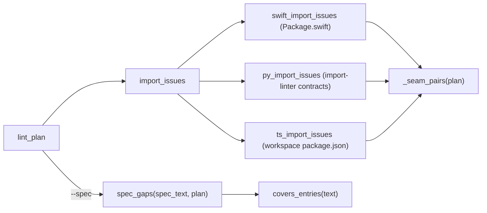
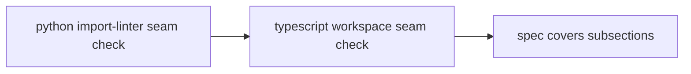

# Superlite: plan lint checks seam imports for Python and TypeScript, and Covers reaches unnumbered subsections (B78)

**Goal:** fix #404 (the importability check at a seam reads SwiftPM manifests only; Max's decision: implement import-linter and TypeScript checks) and #425 (an unnumbered spec subsection under a numbered section is not covered by that number, and a title holding a comma cannot be named in Covers).
**Architecture:** `plan_tools.import_issues` becomes a dispatcher over three stack checks, each in its own `try`: the existing SwiftPM check (renamed `swift_import_issues`, unchanged output), a new Python check that reads import-linter contracts (`setup.cfg`, `.importlinter`, `pyproject.toml`) and a new TypeScript check that reads workspace `package.json` dependencies. All three share `_seam_pairs` (consumer, consumed signature, producer id, producer signature). SPEC coverage moves into `spec_gaps`, which keeps a heading stack so a Covers entry naming a heading also covers every heading below it, and `covers_entries`, which splits Covers outside double quotes.
**Tech stack:** Python 3.10+ stdlib (tomllib when present), pytest through `sl run_tests`.
**Spec:** this file, section Design; issues #404 and #425 Expected lines.
**Detail:** contracts
**Target-min:** 11
**Wave0:** none

Global constraints:
- Every new or changed code line in `skills/subagent-driven-development/scripts/` carries the repo's trailing `# O(...)` complexity comment (short notes after `|`); tests do not. Stdlib only.
- Existing tests stay green, `tests/scripts/test_plan_lint_imports_388.py` above all (its exact Swift warning text). If an existing test turns red, report it in DONE_WITH_CONCERNS with the test id and the reason instead of editing it.
- The import checks only ever add `WARNING: IMPORT:` lines to lint's warnings, never an issue; a config or manifest that does not parse yields no warning for that stack and never hides another stack's warnings.
- Run `sl` as an executable (`<abs>/sl ...`). Verify with the task's own `--fast` command, `--task Tn --background`, then run the printed `wait:` line in the foreground and end the turn only after it reports.
- No version edits; no docs edits outside Owns. Touch only the files in Owns.

Ruling: all three tasks own `skills/subagent-driven-development/scripts/plan_tools.py` (the brief's file list), so they run as a chain T1 -> T2 -> T3; no new module (cost if wrong: about 5 minutes of wall time).
Ruling: the Python check reads contract types forbidden, layers, independence and protected, honours `ignore_imports`, `as_packages`, `containers`, `|`/`:` layer siblings and `*`/`**` wildcards, checks direct imports only and ignores other contract types (cost if wrong: an acyclic_siblings or custom contract breach is not warned).
Ruling: the TypeScript check is workspace `package.json` dependencies (dependencies, devDependencies, peerDependencies, optionalDependencies) between packages found to depth 3, active only with 2 or more named packages; tsconfig references, path aliases, eslint and dependency-cruiser rules are not read (cost if wrong: those repos get no TS warning).
Ruling: the Python and TypeScript checks also check the produced name's own home (the producer task's owned modules or packages), not only the types in its signature, because a call needs that import; the Swift check keeps its types-only rule and output (cost if wrong: Swift misses a function-home gap, as today).
Ruling: a candidate set with any importable member never warns (conservative), and one consumer, importer and module set warns once (cost if wrong: a gap hidden behind an allowed second candidate).
Ruling: a Covers entry (number or title) covers every heading below its heading until the next heading of the same or a higher level, numbered or not; a plain mention of an ancestor in the plan text does not; quotes only protect separators (cost if wrong: a Covers on a broad parent hides a subsection nobody builds).
Ruling: no probe adapter (lint helpers tested through in-process calls and `lint` subprocesses) (cost if wrong: no generated probes).
Ruling: already in the lead worktree on branch superlite/b78-plan-lint-seam-and-covers (cost if wrong: none).
LAYERS: unit headless evals

## Design

1. `_seam_pairs(plan)`: for each task's Consumes item with a parseable signature, the producer candidates of the same `sig_key` (restricted to the `(Tn)` refs when given); the first candidate pairs. The Swift check uses it unchanged in output.
2. `importlinter_config(root)`: the first of `setup.cfg`, `.importlinter`, `pyproject.toml` at root that holds an import-linter section gives roots, contracts and the file name.
3. `py_module(path, roots)`, `module_within(expr, module, as_packages)`, `contract_blocks(contract, importer, imported)`: the contract semantics in Ruling 2.
4. `py_import_issues(plan, root)`: per seam pair and consumer module, warn when every module holding the produced name, or a type in its signature, is blocked.
5. `ts_packages(root)`, `ts_import_issues(plan, root)`: per seam pair and consumer package, warn when every package holding the name or type is neither the consumer's own nor in its dependencies.
6. `covers_entries(text)`: Covers split on `,` `·` `;` outside double quotes.
7. `spec_gaps(spec_text, plan)`: the SPEC headings with no task, with the heading stack of Ruling 6.
8. `skills/writing-plans/SKILL.md`: the Covers row and the Consumes/Produces row say the new rules.

## Coverage

| Category | State | Basis |
|---|---|---|
| Scope and success criteria | settled | #404, #425 Expected lines; Max's decision |
| Domain and data model | ruled | contract dict, package dict, heading stack |
| Persistence and migration | n/a | reads config files only |
| Interfaces and contracts | ruled | warning text, function signatures below |
| UI states | n/a | CLI text only |
| Concurrency and state ownership | n/a | read-only |
| Error handling and recovery | ruled | per-stack try, unparsable config: no warning |
| Security and privacy | n/a | reads repo files |
| Performance and limits | ruled | walks to depth 3, scans only with seam pairs |
| Observability | ruled | `WARNING: IMPORT:` lines |
| Testing strategy | settled | three new test files |
| Compatibility | ruled | Swift output unchanged; old Covers forms unchanged |
| Rollout | ruled | one PR |
| Research unknowns | n/a | import-linter docs read (context7) |

## File structure
- `skills/subagent-driven-development/scripts/plan_tools.py`: `_seam_pairs`, Python check (T1); TypeScript check (T2); `covers_entries`, `spec_gaps` (T3).
- `tests/scripts/test_plan_lint_imports_python_404.py` (T1), `tests/scripts/test_plan_lint_imports_ts_404.py` (T2), `tests/scripts/test_plan_lint_spec_subsections_425.py` (T3).
- `skills/writing-plans/SKILL.md`: field table rows (T3).

## Task graph

```mermaid
%% schedule
gantt
  title Predicted schedule (mm:ss)
  dateFormat X
  axisFormat %M:%S
  section lane 1
  T1 python import-linter seam check :t1, 0, 126s
  T2 typescript workspace seam check :t2, 126, 93s
  T3 spec covers subsections :t3, 219, 89s
```

critical path: T1 → T2 → T3 (5.1 min) · peak width 1 · predicted build 5.1 min · predicted total ≈ 8.6 min (target ✓)

## Package: seam import checks (library)
App type: library. Categories: deep (contract shapes, wildcards, nesting), encoding (config syntax), state (plan versus disk), file (config and manifest files).
**Probe entry:** none (Ruling: no probe adapter).

### T1 python import-linter seam check · Complexity 6 · Est. context 55k
**Owns:** skills/subagent-driven-development/scripts/plan_tools.py, tests/scripts/test_plan_lint_imports_python_404.py
**Components:** 2
**LOC owned:** 380
**Tests:** fast
**Model:** sonnet
**Covers:** 1, 2, 3, 4
**Produces:** plan_tools._seam_pairs(plan: Plan) -> list[tuple[Task, dict, str, dict]] · plan_tools.importlinter_config(root: Path) -> dict | None · plan_tools.py_module(path: str, roots: list[str]) -> str | None · plan_tools.module_within(expr: str, module: str, as_packages: bool = True) -> str | None · plan_tools.contract_blocks(contract: dict, importer: str, imported: str) -> bool · plan_tools.py_import_issues(plan: Plan, root: Path) -> list[str] · plan_tools.swift_import_issues(plan: Plan, root: Path) -> list[str] · plan_tools.import_issues(plan: Plan, root: Path) -> list[str]
e.g. importlinter_config(root) with pyproject `[tool.importlinter]` root_package "shop" and one contract -> {"file": "pyproject.toml", "roots": ["shop"], "contracts": [{"name": "Layers", "type": "layers", "layers": ["shop.web", "shop.core"], "containers": [], "ignore_imports": [], "as_packages": True}]}
e.g. py_module("src/shop/core/models.py", ["shop"]) -> "shop.core.models"; py_module("shop/__init__.py", ["shop"]) -> "shop"; py_module("tools/x.py", ["shop"]) -> None
e.g. module_within("shop.*.models", "shop.a.models.user") -> "shop.a.models"; module_within("shop.core", "shop.core.x", as_packages=False) -> None
**Review Focus:** deep: `test_layers_lower_may_not_import_higher` (layers `shop.web`, `shop.core`: `contract_blocks(c, "shop.core.models", "shop.web.views")` True, reverse False, same layer False), `test_layers_siblings_and_containers` (containers `["shop"]`, layers `["web", "api | cli", "core"]`: `shop.api.x -> shop.cli.y` True; `api : cli` False; `(web)` parentheses stripped; a module outside the container False), `test_independence_forbidden_protected` (independence `shop.a`, `shop.b`: `shop.a.x -> shop.b.y` True, `shop.a.x -> shop.a.z` False; forbidden source `shop.core` forbidden `shop.web`: True for `shop.core.m -> shop.web.v`; protected `shop.db` allowed `shop.repo`: `shop.web.v -> shop.db.s` True, `shop.repo.r -> shop.db.s` False, `shop.db.a -> shop.db.b` False; unknown type `acyclic_siblings` False), `test_wildcards_and_ignore` (`*` one segment, `**` one or more; `ignore_imports = ["shop.core.models -> shop.web.views"]` makes that pair False, `shop.core.other -> shop.web.views` stays True); encoding: `test_config_ini_and_toml` (setup.cfg `[importlinter]` `root_packages` two lines plus `[importlinter:contract:one]` multi-line lists with a `#` comment line; `.importlinter`; pyproject `[[tool.importlinter.contracts]]`; setup.cfg without an importlinter section falls through to pyproject; a broken pyproject -> None), `test_py_module_values` (the three e.g. values, `src/shop/a/__init__.py` -> `shop.a`); state: `test_python_seam_warns` (see Notes), `test_allowed_direction_silent` (consumer in `shop/web/views.py`, producer in `shop/core/models.py`: no IMPORT line), `test_no_config_silent` (no import-linter config: no IMPORT line), `test_swift_388_unchanged` (`import_issues` on the 388 fixture returns that test's exact line; a broken pyproject next to Package.swift keeps it).
**Steps:** 1 failing tests, 2 run: FAIL, 3 implement, 4 run: PASS
**Notes:** Lists in INI are the value's lines, stripped, blanks and `#` lines dropped; `as_packages` reads `False`/`false`/`0`/`no` as False; TOML needs `tomllib` (absent: that file is skipped). A config file is chosen only when it holds `[importlinter]` (INI) or `[tool.importlinter]` (TOML). Wildcard regex: `*` -> `[^.]+`, `**` -> `[^.]+(?:\.[^.]+)*`, other segments escaped; `module_within` returns the shortest module prefix that matches whole (as_packages False: the module itself or None). Layers: an entry splits on `|` (independent siblings) else `:`; a module sits in layer i through `container.item` (no container: item); blocked when both sit under the same concrete container and the imported layer index is lower, or equal with another item of a `|` entry. Independence: blocked when the two matched prefixes differ and neither contains the other. `ignore_imports` lines `a -> b` match whole modules with wildcards. Python files: owns ending `.py`, not `conftest.py`, `test_*.py`, `*_test.py` or under a `tests`/`test` folder. Candidates: the producer's owned modules for its `psig["name"]`; for each `signature_types(psig)` type, the modules with a top-level `class <Type>` in `.py` files under `root/<pkg>` and `root/src/<pkg>`, plus owned modules of tasks whose Produces names that type (sig `cls` or a bare capitalised item). Warn when the candidate set is non-empty and every member is blocked for the consumer module: `WARNING: IMPORT: T2 consumes load(order: Order) -> Receipt from T1, but load is declared in shop.web.views, which shop.core.models may not import (import-linter contract "Layers" in pyproject.toml)`; several modules join sorted with `, `; the contract is the first one that blocks the first module; dedup on (consumer id, importer, module tuple). `import_issues` returns swift + python lines, each call in its own `try` catching `(OSError, ValueError, TypeError, AttributeError, KeyError, configparser.Error)`. Fixture for `test_python_seam_warns`: pyproject above, T1 owns `shop/web/views.py` and produces `load(order: Order) -> Receipt`, T2 owns `shop/core/models.py` and consumes it `(T1)`: exactly the line above.

### T2 typescript workspace seam check · Complexity 4 · Est. context 45k
**Owns:** skills/subagent-driven-development/scripts/plan_tools.py, tests/scripts/test_plan_lint_imports_ts_404.py
**Components:** 1
**LOC owned:** 230
**Tests:** fast
**Model:** sonnet
**Covers:** 5
**Consumes:** none
**Produces:** plan_tools.ts_packages(root: Path) -> dict[str, dict] · plan_tools.ts_import_issues(plan: Plan, root: Path) -> list[str]
e.g. ts_packages(root) with `packages/core/package.json` {"name": "@shop/core"} and `packages/web/package.json` {"name": "@shop/web", "dependencies": {"react": "18"}} -> {"@shop/core": {"dir": root/"packages/core", "deps": set(), "manifest": "packages/core/package.json"}, "@shop/web": {"dir": root/"packages/web", "deps": {"react"}, "manifest": "packages/web/package.json"}}
**Review Focus:** state: `test_ts_seam_warns` (see Notes), `test_ts_declared_dependency_silent` (web lists `"@shop/core": "workspace:*"` in devDependencies: no IMPORT line), `test_ts_same_package_silent` (both tasks in packages/core: none), `test_single_package_silent` (one package.json: `ts_packages` -> {} and none); file: `test_ts_skips_node_modules_and_bad_json` (a package.json under `node_modules/x/` and one with invalid JSON are not packages; a package.json without `name` is not either), `test_ts_type_declared_in_scan` (an `export interface Order` in `packages/core/src/order.ts` makes `Order` a core type: a consumer in web without the dependency gets a line naming `Order is declared in @shop/core`); deep: `test_ts_deepest_package_wins` (root package.json `shop` plus `packages/web/package.json`: a file in packages/web/src belongs to `@shop/web`); protocol: `test_import_issues_has_all_stacks` (`import_issues` returns the TS line beside a Python fixture's line, TS last).
**Steps:** 1 failing tests, 2 run: FAIL, 3 implement, 4 run: PASS
**Notes:** T1's committed `_seam_pairs(plan)` (consumer Task, consumed sig, producer id, producer sig) and `import_issues` dispatcher are in plan_tools.py when T2 starts: reuse them. Walk root to depth 3 like `swift_targets`, skipping `node_modules`, `.git`, `.superlite`, `dist`, `build`, `out`, `coverage`, `.next`, `.turbo`; a package needs a JSON object with a string `name`; deps keep manifest order (a `_Deps` with `.order`) over dependencies, devDependencies, peerDependencies, optionalDependencies; under 2 packages return {}. A file's package is the deepest package dir holding it (reuse `_target_of`). TS files: owns ending `.ts`, `.tsx`, `.mts`, `.cts`, not `.test.`/`.spec.` names or `__tests__`/`tests`/`test` folders. Candidates: the producer's owned packages for `psig["name"]`; per signature type, packages whose `.ts`/`.tsx`/`.mts`/`.cts` files (same skips) hold `^\s*export\s+(default\s+)?(declare\s+)?(abstract\s+)?(class|interface|type|enum|const\s+enum|function)\s+<Type>\b`, plus owned packages of tasks producing that type; scan files only when a seam pair has a TS consumer file. Importable: same package or its name in the consumer's deps; warn when every candidate is not. Fixture for `test_ts_seam_warns` (the e.g. packages): T1 owns `packages/core/src/order.ts` and produces `loadOrder(id: string) -> Order`, T2 owns `packages/web/src/page.tsx` and consumes it `(T1)`: exactly `WARNING: IMPORT: T2 consumes loadOrder(id: string) -> Order from T1, but loadOrder is declared in @shop/core, which package @shop/web may not import (packages/web/package.json) dependencies: react` (no deps: `dependencies: none`). Dedup as T1. `import_issues` appends `ts_import_issues` in its own `try`.

## Package: SPEC coverage (library)
App type: library. Categories: deep (heading nesting), encoding (quotes, separators), state (spec versus plan text).
**Probe entry:** none (Ruling: no probe adapter).

### T3 spec covers subsections · Complexity 4 · Est. context 45k
**Owns:** skills/subagent-driven-development/scripts/plan_tools.py, tests/scripts/test_plan_lint_spec_subsections_425.py, skills/writing-plans/SKILL.md
**Components:** 1
**LOC owned:** 200
**Tests:** fast
**Model:** sonnet
**Covers:** 6, 7, 8
**Produces:** plan_tools.covers_entries(text: str) -> list[str] · plan_tools.spec_gaps(spec_text: str, plan: Plan) -> list[str]
e.g. covers_entries('8, "Auth, sessions and tokens" · `§ 2.1`; Parser') -> ["8", "auth, sessions and tokens", "2.1", "parser"]
e.g. spec_gaps("## 8. Endpoints\n### B2. Optional header on three endpoints (R18)\n## 9. Limits\n", plan with `**Covers:** 8`) -> ["9. Limits"]
**Review Focus:** deep: `test_number_covers_unnumbered_child` (the e.g. spec: B2 covered; with Covers `9` instead -> `["8. Endpoints", "B2. Optional header on three endpoints (R18)"]`), `test_cover_stops_at_same_level` (`## 8. A` / `### X one` / `## Zed part` / `### Y two`, Covers 8 -> `["Zed part", "Y two"]`), `test_title_covers_children` (`## Auth, sessions and tokens` / `### Refresh flow`, Covers `"Auth, sessions and tokens"` -> []; unquoted -> both headings listed), `test_number_only_heading` (`## 8` / `### Retry rules`, Covers 8 -> []; no Covers -> `["8", "Retry rules"]`), `test_h4_and_fences` (a `#### deep` heading is never listed; headings inside a fenced block neither stack nor list); encoding: `test_covers_entries_values` (the e.g. value; `'"unterminated, x'` -> `["unterminated", "x"]`; `""` -> []); state: `test_old_forms_unchanged` (numbered subsection `### 2.1 Parse` under `## 2. Core` covered by Covers 2 or 2.1; a title named in prose covers itself only; `§ 3` in prose covers `## 3. X`; Intent/Decisions/Out of scope exempt), `test_lint_uses_spec_gaps` (`lint --plan P --spec S` prints `SPEC section '9. Limits' has no task` and not B2's).
**Steps:** 1 failing tests, 2 run: FAIL, 3 implement, 4 run: PASS
**Notes:** `spec_gaps` reads unfenced `^(#{1,6})\s+(.*?)\s*#*$` lines (fence flags from `scan_fences`); a heading pops stack entries of the same or a deeper level, then is checked (levels 2-3 only) and pushed. Number form `^(?:§\s*)?(\d+(?:\.\d+)*)\.?(?:\s+(.*))?$` (title `""` for a number alone; an empty title never matches by text). Exempt titles as today (SPEC_SKIP and the intent/decisions/... prefix regex) are skipped but pushed. A heading is covered by: its title in the plan text, a Covers entry equal to its title, its number equal to or under an entry, the `§`/`section`/`sec.` mention of its number, or any stack ancestor named by a Covers entry (title equal, or number equal to or under the entry). `covers_entries` strips spaces, backticks and `§` and lowercases; an unmatched quote runs to the end of the text. lint_plan's SPEC block calls `spec_gaps` with the same message. SKILL.md, Covers row, replace `(a number covers its subsections)` with `(a number or a title covers every heading below it, numbered or not, until the next heading of its level; quote a title holding a comma: `**Covers:** "Auth, sessions and tokens"`)`; Consumes/Produces row, append: ` Lint warns (`WARNING: IMPORT:`) when a consumer's file may not import the producer's module: SwiftPM target dependencies, import-linter contracts (forbidden, layers, independence, protected) and workspace package.json dependencies; other stacks are not checked.`

## Review Focus
Per package above. Cross-package: T2 reuses T1's `_seam_pairs` and dispatcher; T3 never touches the import checks.

## Self-review
Coverage: Design 1-4 T1, 5 T2, 6-8 T3. No placeholders. Consumes match Produces. The chain is forced by one shared file (Ruling 1). Fields filled.
