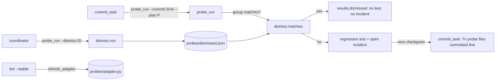
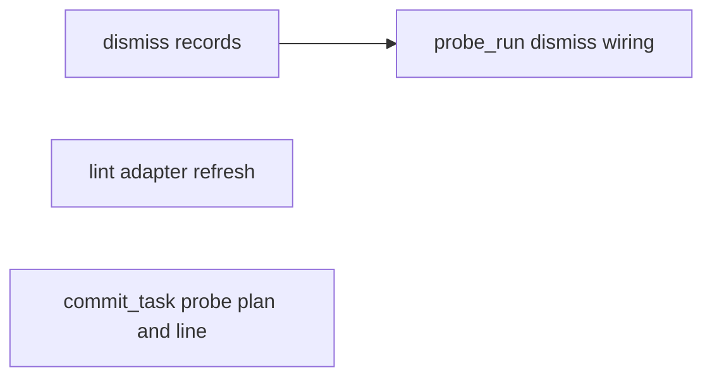

# Superlite: a dismissed probe result stays dismissed, and lint rebuilds a stale probe adapter (B76)

**Goal:** fix #417 (commit_task's background `probe_run --commit` regenerates a false-positive regression test the coordinator deleted and ruled no defect) and #423 (a plan edit that changes a Probe entry leaves the generated adapter stale; lint passes, probe_run refuses).
**Architecture:** a new stdlib module `probes/dismiss.py` resolves a dismissal id to a record and keeps the records in `<run folder>/probes/dismissed.json`; `probe_run --dismiss ID` stores one, removes the generated test and closes its incident; every later run moves matching failure groups to `results["dismissed"]` (no regression test, no incident, no exit 1). `plan_tools.refresh_adapter` compares the run's generated adapter with the plan's Probe entries: `lint --stable` rebuilds it, plain `lint` prints a `RUN:` line. `commit_task` passes `--plan` to its background probe_run and names on stdout the generated probe files a checkpoint takes.
**Tech stack:** Python 3.10+ stdlib (probe_run.py 3.12), pytest through `sl run_tests`.
**Spec:** this file, section Design; issues #417 and #423 Expected lines.
**Detail:** contracts
**Target-min:** 11
**Wave0:** none

Global constraints:
- Every new or changed code line in `skills/subagent-driven-development/scripts/` and `skills/subagent-driven-development/probes/` carries the repo's trailing `# O(...)` complexity comment (short notes after `|`); tests do not. Stdlib only.
- Existing tests stay green. If an existing test turns red, report it in DONE_WITH_CONCERNS with the test id and the reason instead of editing it.
- Run `sl` as an executable (`<abs>/sl ...`). Verify with the task's own `--fast` command, `--task Tn --background`, then run the printed `wait:` line in the foreground and end the turn only after it reports.
- No version edits; no docs edits (docs/tools.md, SKILL.md files stay unchanged). Touch only the files in Owns.

Ruling: B76 also edits `skills/subagent-driven-development/probes/probe_run.py` and adds `probes/dismiss.py`, outside its file list: Max's decision names `probe_run --dismiss`, and no open batch owns either file (B79 owns guard files) - cost if wrong: a rebase conflict in probe_run.py.
Ruling: a dismissal matches a later failure group by category plus the group key without its line number (`crash|BadInput|src/a.py:12` -> `crash|BadInput|src/a.py`), so a line shift keeps it dismissed while another exception or file still fails; a bare probe id (`numeric/huge`, no group known) matches any group listing that probe - cost if wrong: a real defect with the same exception in the same file stays hidden until the record is deleted.
Ruling: dismissed groups keep their files out of the pass cache and `verified` entries (re-probed each run, dismissed each run) - cost if wrong: probe time only.
Ruling: `--dismiss` closes the group's incident with resolution `wontfix` and deletes only files that start with the generator header (`"""Generated by probe_run.py:`), plus `_probe_adapter.py` when no `test_probe_*.py` is left beside it - cost if wrong: none (generated files).
Ruling: commit_task cannot see what its background probe_run writes, so "says on stdout when it wrote probe files" is the checkpoint that takes them: one line per task naming the generated probe files committed - cost if wrong: the line comes one commit later than the write.
Ruling: lint --stable rebuilds the adapter (the SDD flow re-lints after every plan edit); commit_task and probe_run do not rebuild; plain lint only prints `RUN:` (it writes nothing) - cost if wrong: a hand run of probe_run after an unlinted plan edit still refuses with its rebuild message.
Ruling: no probe adapter for this change (CLI tools tested through subprocess and in-process calls) - cost if wrong: no generated probes.
Ruling: already in the lead worktree on branch superlite/b76-probe-dismiss-and-adapter-rebuild - cost if wrong: none.
LAYERS: unit headless

## Design

1. `dismiss.sig(key)`: drop a trailing `:<digits>` from a group key.
2. `dismiss.resolve(ident, results, root)`: a test (basename starts `test_probe_`, `.py` optional, path allowed) -> the `results["failures"]` group whose `regression_test` has that basename, else the header of `root/tests/regression/<name>.py` (line 1 `"""Generated by probe_run.py: <category> <kind> (<key>).`, line 2 `... probe <probe id>. ...`); `g<N>` -> that group; an id with `/` -> the group listing it, else a bare probe record. Record keys: id, category, kind, sig, probes, test, incident (`{"file", "line"}` or None). No match: None.
3. `dismiss.add/load`: `<folder>/probes/dismissed.json` = `{"dismissed": [record + "reason" + "time"]}`; a record with the same category, sig and (sig None) probes is replaced, not duplicated.
4. `dismiss.run`: the `--dismiss` command (stdout line in T1); `probe_run --dismiss ID [--reason TEXT]` calls it before any adapter check.
5. probe_run run: matching groups leave `results["failures"]` for `results["dismissed"]` (`"dismissed": <record id>`), skip shrink, regression test and incident, count in neither exit code nor category `fail`; the summary line gains `, N dismissed` only when N > 0.
6. `plan_tools.refresh_adapter(plan, write)`; lint --stable prints its line after the warnings, plain lint after its warnings.
7. commit_task: `launch_probes` appends `--plan P` when the plan file exists; a checkpoint holding `tests/regression/test_probe_*.py` or `tests/regression/_probe_adapter.py` prints the probe-files line after the task's SHA line.

## Coverage

| Category | State | Basis |
|---|---|---|
| Scope and success criteria | settled | #417, #423 Expected lines; Max's decision |
| Domain and data model | ruled | dismissal record, match rule |
| Persistence and migration | ruled | probes/dismissed.json, new file |
| Interfaces and contracts | ruled | --dismiss, refresh_adapter, output lines |
| UI states | n/a | CLI text only |
| Concurrency and state ownership | settled | one writer per call; background probe_run reads |
| Error handling and recovery | ruled | unknown id exit 2; rebuild failure -> RUN line |
| Security and privacy | ruled | delete only generator-headed files |
| Performance and limits | ruled | dismissed files re-probed |
| Observability | ruled | stdout lines, results.dismissed |
| Testing strategy | settled | four new test files |
| Compatibility | ruled | summary line unchanged without dismissals |
| Rollout | ruled | one PR; docs follow-up in notes |
| Research unknowns | n/a | none |

## File structure
- `skills/subagent-driven-development/probes/dismiss.py`: dismissal records (T1).
- `skills/subagent-driven-development/probes/probe_run.py`: `--dismiss`, `--reason`, dismissed groups in a run (T2).
- `skills/subagent-driven-development/scripts/plan_tools.py`: `refresh_adapter`, lint lines (T3).
- `skills/subagent-driven-development/scripts/commit_task.py`: `--plan` passthrough, probe-files line (T4).
- `tests/scripts/test_probe_dismiss_417.py` (T1), `tests/scripts/test_probe_run_dismiss_417.py` (T2), `tests/scripts/test_lint_adapter_refresh_423.py` (T3), `tests/scripts/test_commit_probe_files_417.py` (T4).

## Task graph

```mermaid
%% schedule
gantt
  title Predicted schedule (mm:ss)
  dateFormat X
  axisFormat %M:%S
  section lane 1
  T1 dismiss records :t1, 0, 94s
  T2 probe_run dismiss wiring :t2, 94, 86s
  section lane 2
  T3 lint adapter refresh :t3, 0, 86s
  section lane 3
  T4 commit_task probe plan and line :t4, 0, 80s
```

critical path: T1 → T2 (3.0 min) · peak width 3 · predicted build 3.0 min · predicted total ≈ 6.5 min (target ✓)

## Package: probe dismissal (CLI)
App type: CLI. Categories: protocol (ids, flags, output lines), state (store, incident log), file (generated files).
**Probe entry:** none (Ruling: no probe adapter).

### T1 dismiss records · Complexity 4 · Est. context 45k
**Owns:** skills/subagent-driven-development/probes/dismiss.py, tests/scripts/test_probe_dismiss_417.py
**Components:** 1
**LOC owned:** 230
**Tests:** fast
**Model:** sonnet
**Covers:** 1, 2, 3, 4
**Produces:** dismiss.sig(key: str) -> str · dismiss.resolve(ident: str, results: dict, root: Path) -> dict | None · dismiss.load(folder: Path) -> list[dict] · dismiss.add(folder: Path, record: dict, reason: str) -> bool · dismiss.matches(records: list[dict], group: dict) -> dict | None · dismiss.remove_generated(root: Path, test: str | None) -> list[str] · dismiss.run(ident: str, reason: str, folder: Path, root: Path, results_path: Path, log_path: Path, log_fn) -> int
e.g. sig("crash|BadInput|src/a.py:12") -> "crash|BadInput|src/a.py"; sig("hang|deep/call") -> "hang|deep/call"
e.g. resolve("g1", R, root) -> {"id": "g1", "category": "deep", "kind": "crash", "sig": "crash|BadInput|src/a.py", "probes": ["deep/nested_list", "deep/long_string"], "test": "tests/regression/test_probe_deep_1.py", "incident": {"file": "src/a.py", "line": 12}} where R = {"failures": [{"group_id": "g1", "key": "crash|BadInput|src/a.py:12", "category": "deep", "kind": "crash", "probes": ["deep/nested_list", "deep/long_string"], "regression_test": "tests/regression/test_probe_deep_1.py", "incident": {"file": "src/a.py", "line": 12}}]}
e.g. matches([rec_g1], {"key": "crash|BadInput|src/a.py:15", "category": "deep", "probes": ["deep/other"]}) -> rec_g1; with key "crash|KeyError|src/a.py:15" -> None
**Review Focus:** protocol: `test_resolve_test_name_forms` (`test_probe_deep_1`, `test_probe_deep_1.py`, `tests/regression/test_probe_deep_1.py` give R's record with that id), `test_resolve_group_and_probe_id` (`g1`; `deep/long_string` gives g1's record; `numeric/huge` with `{}` gives `{"id": "numeric/huge", "category": "numeric", "kind": None, "sig": None, "probes": ["numeric/huge"], "test": None, "incident": None}`), `test_resolve_unknown_is_none` (`g9`, `nonsense` -> None); state: `test_resolve_from_test_header` (results `{}`, file `tests/regression/test_probe_deep_3.py` with the two header lines for key `crash|BadInput|src/a.py:12`, probe `deep/nested_list` -> category deep, kind crash, that sig, probes `["deep/nested_list"]`, incident src/a.py:12), `test_matches_rules` (same sig other line -> record; other exc -> None; other category -> None; bare `numeric/huge` record matches probes `["numeric/huge", "numeric/neg"]`, not `["numeric/neg"]`), `test_add_dedups_and_load` (two adds -> True, False; one stored record with `"reason": "domain error"` and an int `"time"`; missing or corrupt file -> `[]`); file: `test_remove_generated` (test + adapter removed, returned in that order; a second `test_probe_deep_2.py` keeps the adapter; a file without the header is kept, `[]`), `test_run_line_and_incident` (see Notes).
**Steps:** 1 failing tests, 2 run: FAIL, 3 implement, 4 run: PASS
**Notes:** `run` reads `results_path` (missing or bad JSON: `{}`), resolves, `add`s, `remove_generated(root, record["test"])`, closes the incident through `log_fn(log_path, [(file, line, f"wontfix: probe result dismissed ({reason})", kind, "wontfix")])` with kind `{"crash": "exception", "leak": "exception", "hang": "perf", "setup-error": "spec-ambiguity"}.get(record kind, "test-failure")` (no incident: no call), prints one stdout line and returns 0: `dismissed test_probe_deep_1: deep crash|BadInput|src/a.py; removed tests/regression/test_probe_deep_1.py, tests/regression/_probe_adapter.py; incident src/a.py:12 wontfix; later runs skip it (.superlite/probes/dismissed.json)` (the `removed` and `incident` parts only when present; a bare record shows its probes comma-joined instead of the sig; the store path relative to root, else absolute). Unknown id: stderr `probe_run: --dismiss nope: no failure group, regression test or probe id matches`, return 2. The header regexes read the first two lines only; a header key's incident comes from a trailing `<file>:<line>` in its last `|` part, else None.

## Package: probe_run wiring (CLI)
App type: CLI. Categories: protocol (flags, summary line, exit code), state (results file, incident log), file (regression tests).
**Probe entry:** none (Ruling: no probe adapter).

### T2 probe_run dismiss wiring · Complexity 5 · Est. context 62k
**Owns:** skills/subagent-driven-development/probes/probe_run.py, tests/scripts/test_probe_run_dismiss_417.py
**Components:** 1
**LOC owned:** 170
**Tests:** fast
**Model:** sonnet
**Covers:** 4, 5
**Consumes:** dismiss.run(ident: str, reason: str, folder: Path, root: Path, results_path: Path, log_path: Path, log_fn) -> int (T1) · dismiss.matches(records: list[dict], group: dict) -> dict | None (T1)
**Produces:** probe_run.main(argv: list[str] | None = None) -> int
**Review Focus:** protocol: `test_dismiss_cli_stores_and_removes` (project as in test_probe_run_raises_418 without `raises=`, `--plan plan --categories deep` exits 1 and writes `tests/regression/test_probe_deep_1.py`; `--plan plan --dismiss test_probe_deep_1 --reason "domain error"` exits 0, stdout starts `dismissed test_probe_deep_1: deep crash|BadInput|`, the test and `_probe_adapter.py` are gone, `.superlite/probes/dismissed.json` holds one record, the newest incidents.jsonl entry has resolution `wontfix`), `test_dismiss_unknown_exit_2` (`--dismiss g7` with no results file: exit 2, stderr names `g7`); state: `test_dismissed_group_not_regenerated` (the same run again: exit 0, no `test_probe_*.py`, `results["failures"] == []`, every `results["dismissed"]` group has `"dismissed": "test_probe_deep_1"`, stdout has ` dismissed`, no new `open` incident); file: `test_other_exception_still_fails` (after the dismissal, src/a.py raises `KeyError` for non-digit text: exit 1, a failure group, a regression test written).
**Steps:** 1 failing tests, 2 run: FAIL, 3 implement, 4 run: PASS
**Notes:** load `dismiss.py` from HERE (it sits beside probe_run.py; HERE is already on sys.path). `--dismiss ID` and `--reason TEXT` (default `ruled no defect`); `run_main` handles `--dismiss` right after out/log are set, before the adapter checks: `dismiss.run(a.dismiss, a.reason, base, root, <out under root>, <log under root>, _log_incidents)`. Records load from `base` once per run with T1's `dismiss.load(base)` (the stored records, `[]` without a store). In `_run_main`, after grouping and before `finish_group`, a group that `dismiss.matches` drops `_rep`, gets `"dismissed"` and moves to `results["dismissed"]` (always present, `[]` by default); `failed_files`/`unattributed` count failures and dismissed groups; a category's `bad` and `nfail` leave out probes whose group is dismissed; `stats.dismissed_groups`. Docstring: the `--dismiss` usage line and one sentence on dismissed groups.

## Package: lint adapter refresh (CLI)
App type: CLI. Categories: protocol (output lines), state (adapter file), file (rebuild, removal).
**Probe entry:** none (Ruling: no probe adapter).

### T3 lint adapter refresh · Complexity 4 · Est. context 55k
**Owns:** skills/subagent-driven-development/scripts/plan_tools.py, tests/scripts/test_lint_adapter_refresh_423.py
**Components:** 1
**LOC owned:** 170
**Tests:** fast
**Model:** sonnet
**Covers:** 6
**Consumes:** existing `pt_review.plan_entries(plan) -> list[dict]` · existing `pt_review.build_adapter(plan, out: Path, root: Path) -> str` · existing `pt_review.parse_plan(path) -> Plan` · existing `state.plan_dir(plan_or_dir) -> Path`
**Produces:** plan_tools.refresh_adapter(plan_path: str, write: bool = True) -> str
**Review Focus:** state: `test_current_adapter_quiet` (adapter just built by `pt_review adapter --plan P --root R` -> `""`), `test_rebuilds_after_entry_change` (Probe entry `call=a.parse` -> `call=a.parse2`: returns `ADAPTER: rebuilt .superlite/probes/adapter.py (the plan's Probe entries changed)`, the file's ENTRIES equal `pt_review.plan_entries` of the new plan, its ROOT line unchanged), `test_no_write_says_run` (write=False: `RUN: <abs scripts/sl> plan_tools adapter --plan <plan> (the probe adapter is stale: the plan's Probe entries changed)`, file unchanged); file: `test_removed_without_entries` (no Probe entry line left: `ADAPTER: removed .superlite/probes/adapter.py (the plan has no Probe entry lines)`, file gone), `test_hand_written_and_other_plan_left` (an adapter without the generator mark, or built from another plan file: `""`, unchanged); protocol: `test_lint_stable_prints_rebuilt` (`pt("lint", "--stable", "--plan", p, cwd=tmp_path)` from test_plan_tools after an entry change prints the rebuilt line), `test_plain_lint_prints_run` (plain `lint` prints the RUN line, exit code as without it).
**Steps:** 1 failing tests, 2 run: FAIL, 3 implement, 4 run: PASS
**Notes:** adapter = `state.plan_dir(plan)/probes/adapter.py`; paths in lines are relative to `plan_dir.parent`. Generated means `pt_review._ADAPTER_MARK` in its first 200 characters and top-level ENTRIES and PLAN literals (ast); another plan = `Path(PLAN).resolve() != Path(plan_path).resolve()`. Rebuild root = the adapter's own `ROOT = (Path(__file__).resolve().parent / <literal>).resolve()` line, else `plan_dir.parent`; `compile` the source before writing (LF). Any exception while rebuilding returns the RUN line. lint --stable prints a non-empty line after its warnings loop; plain lint after its warnings, before `ISSUE:` lines; neither changes an exit code.

## Package: commit_task probe plan and line (CLI)
App type: CLI. Categories: protocol (stdout lines, argv), file (generated probe files).
**Probe entry:** none (Ruling: no probe adapter).

### T4 commit_task probe plan and line · Complexity 3 · Est. context 50k
**Owns:** skills/subagent-driven-development/scripts/commit_task.py, tests/scripts/test_commit_probe_files_417.py
**Components:** 1
**LOC owned:** 130
**Tests:** fast
**Model:** sonnet
**Covers:** 7
**Consumes:** existing `commit_task.spawn_background(cmd: list) -> None` · existing `commit_task.launch_probes(sha: str, plan: str | None = None) -> bool`
**Produces:** commit_task.launch_probes(sha: str, plan: str | None = None) -> bool
**Review Focus:** protocol: `test_launch_passes_plan` (SUPERLITE_PROBE_RUN set to an existing file, `spawn_background` patched: argv ends `["--plan", <plan>]` after `--commit SHA` and any `--categories`; plan None or a missing file: no `--plan`), `test_probe_files_line` (test_autocommit helpers; Owns `src/a.py`; changed src/a.py plus `tests/regression/test_probe_deep_1.py` and `tests/regression/_probe_adapter.py`: stdout is the SHA, then `T1: probe files committed: tests/regression/_probe_adapter.py tests/regression/test_probe_deep_1.py (a background probe_run wrote them; a false positive: sl probe_run --dismiss test_probe_deep_1 --plan <plan as passed>)`), `test_no_line_without_probe_files` (src/a.py only: stdout is the SHA alone), `test_adapter_only_line` (only `_probe_adapter.py` with src/a.py: the line ends `(a background probe_run wrote them)`); file: `test_unchanged_recheckpoint_no_line` (rerun with no change: the `no change since` line, no probe-files line).
**Steps:** 1 failing tests, 2 run: FAIL, 3 implement, 4 run: PASS
**Notes:** a probe file is a path matching `(^|/)tests/regression/(test_probe_[^/]+\.py|_probe_adapter\.py)$` in the task's final `mine` that exists on disk, sorted; recorded per task in `commit_one` only when a new checkpoint or commit was made, printed in `main` right after that task's SHA line (several tasks: after its `Tn <sha>` line). The dismiss hint names the first test's stem; the plan is the `--plan` value as passed, else `nt.DEFAULT_PLAN`. Docstring: one sentence each for the line and `--plan`.

## Review Focus
Per package above. Cross-package: T2's dismissed groups feed T4's line (no files to name); T3 never touches probe_run's stale check.

## Self-review
Coverage: Design 1-4 T1, 4-5 T2, 6 T3, 7 T4. No placeholders. Consumes match Produces. One edge (T2 runs T1's code); no two parallel tasks share a file. Fields filled.
