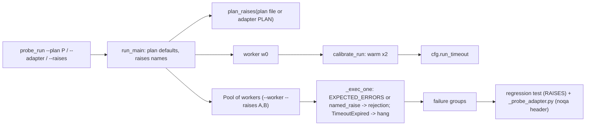

# Superlite: probe_run takes raises= from the Probe entry, measures run= start-up, accepts --plan (B75)

**Goal:** fix #418 (a domain exception named in the Probe entry is a rejection, not a crash; generated regression files lint clean), #368 (a `run=` entry started through uv gets a timeout measured from its own start-up) and #420 (`probe_run --plan P` works like the other tools).
**Architecture:** all changes live in `skills/subagent-driven-development/probes/probe_run.py` plus `probes/adapter_template.py`. The parent reads `raises=` names from the plan (the `--plan` file, else the generated adapter's `PLAN` constant) and hands them to each worker on its command line; the worker treats a matching exception like `EXPECTED_ERRORS`. Before the first `run` probe the parent warms the adapter's `run` twice in one worker and sets the run timeout from the second call. `--plan` resolves the run folder and fills the root, adapter, out and log defaults.
**Tech stack:** Python 3.10+ stdlib, pytest (through `sl run_tests`).
**Spec:** this file, section Design; the Expected lines of issues #418, #368, #420.
**Detail:** tests
**Target-min:** 11
**Wave0:** none
**Max chars:** 34000

Global constraints:
- Every new or changed code line in `probes/probe_run.py` and `probes/adapter_template.py` carries the repo's trailing `# O(...)` complexity comment (the regression template string and tests excepted). Stdlib only.
- Existing tests stay green and existing test files stay unchanged; if one turns red, report it in DONE_WITH_CONCERNS with the test id and the reason instead of editing it.
- Run `sl` as an executable (`<abs>/sl ...`). Verify with the task's `run_tests --fast ... --task Tn --background`, then run the printed `wait:` line in the foreground and end the turn only after it reports. Never raw `pytest`, never the e2e or eval layers (coordinator's step).
- No version edits (the ship step bumps the version). Touch only the files in Owns; `scripts/pt_review.py`, `scripts/state.py`, docs and SKILL.md files stay unchanged (outside B75's files).

Ruling: `raises=` lives only in the plan's Probe entry text; `pt_review.plan_entries`/`ENTRIES` stay unchanged, so adding `raises=` never makes an adapter stale; probe_run reads the plan itself (Max's decision: raises=Class in the Probe entry) - cost if wrong: none, the names reach the worker by its command line.
Ruling: the run's names are the union of every Probe entry's `raises=` plus `--raises`, used for every entry kind (call, run, request) - cost if wrong: a name listed for one package also excuses it in another.
Ruling: a name matches a class in the exception's MRO by `__name__`, `__qualname__` or `module.qualname`; only `Exception` subclasses - cost if wrong: `raises=Exception` excuses everything (the plan author's choice).
Ruling: the generated test drops its unused `import json` and honours `RAISES`; the copied `_probe_adapter.py` (generated code, unused imports by design) starts with `# ruff: noqa` and `# flake8: noqa` - cost if wrong: a project linter other than ruff/flake8 still sees the adapter copy.
Ruling: `--plan P` uses `state.plan_dir(P)` (explicit plan wins over SUPERLITE_STATE_DIR and bindings); the project root is the run folder's parent; the cache stays `<root>/.superlite/probes/cache.json` - cost if wrong: a plan outside its project needs `--root`.
Ruling: run timeout = max(5, 3 × second warm call + 1 s), at most 60 s, after two warm calls (the first may sync uv's cache); `--timeout` loses its default 10 and only caps when given (call 2, request 10 unchanged) - cost if wrong: two extra CLI starts per probe run with run= probes.
Ruling: `subprocess.TimeoutExpired` from the adapter is a hang, never a crash - cost if wrong: none, it is the adapter's own timeout.
Ruling: detail tests; two tasks, T1 (#418, #420) then T2 (#368), sequential because both own probe_run.py; no Wave 0; no probe adapter for this repo - cost if wrong: about 3 min of serial build time.
Ruling: already in the lead worktree on branch superlite/b75-probe-run-timeout-raises-plan-flag - cost if wrong: none.
LAYERS: unit, headless



## Design

T1 (#418, #420):
1. `adapter_consts(adapter: Path) -> dict`: the adapter's top-level `ENTRIES` and `PLAN` literal assignments, read with `ast` as `stale_adapter` does today; `{}` on any error. `stale_adapter` uses it; its behaviour is unchanged.
2. `plan_raises(plan: Path) -> list[str]`: loads `scripts/pt_review.py` by path as `stale_adapter` does (share one loader that restores `sys.path` and drops the private module name), takes `parse_plan(plan).probe_entries`; in each entry, every `·`-separated part whose key (text before `=`, stripped, lower-cased) is `raises`: its value with backticks replaced by spaces, split on commas and whitespace. Names keep first-seen order without duplicates. `[]` when the plan is missing or cannot be parsed.
3. `named_raise(e: BaseException, names) -> bool`: True when a class in `type(e).__mro__` has `__name__`, `__qualname__` or `f"{__module__}.{__qualname__}"` in `names`.
4. New `--raises A,B` option. The run's names: `--raises` first, then `plan_raises` of the `--plan` path when it is a file, else of the adapter's `PLAN` constant (via `adapter_consts`); first-seen order, no duplicates. `Cfg` gets `raises = []`; the run stores them on `cfg.raises` and in the results as top-level `"raises"` (always present).
5. `Worker` adds `--raises <comma list>` to the `--worker` command when `getattr(cfg, "raises", [])` is not empty; `worker_main` stores them as `_WorkerState.raises` (tuple, default `()`).
6. `_exec_one`, call, run and request branches: an `Exception` that `except expected` does not catch but `named_raise(e, st.raises)` matches gives the same result as an expected error (`("err", type(e).__name__)`), never a crash; any other exception propagates as today.
7. `REGRESSION_TEMPLATE`: drop `import json`; add `RAISES = {raises!r}` after `TIMEOUT` (a tuple of the run's names, `()` when none); add `_named(e)` with rule 3; in `_problem`, after `except expected: return None`, add `except Exception as e:` that returns None when `_named(e)` and re-raises otherwise. `_write_regression` fills it from `tuple(getattr(cfg, "raises", []))`.
8. `_copy_adapter` writes `# ruff: noqa\n# flake8: noqa\n` as the first two lines of `_probe_adapter.py`.
9. New `--plan P` (a plan file or a folder): a path that does not exist prints `probe_run: --plan not found: <P>` to stderr, exit 2. Run folder = `state.plan_dir(P)` (`scripts/state.py` loaded by path under a private name; if that fails: `P` when named `.superlite`, `P/.superlite` for another folder, else `P.parent/.superlite`). Project root = the run folder's parent. Each default applies only when its own option is absent: `--root` = project root, `--adapter` = `<run folder>/probes/adapter.py`, `--out` = `<run folder>/probes/probe-results.json`, `--log` = `<run folder>/incidents.jsonl`. `--out` and `--log` argparse defaults become None, filled after parsing (without `--plan`: `.superlite/probes/probe-results.json` and `.superlite/incidents.jsonl` under the root, as today).
10. The module docstring's usage lines name `--plan P` and `--raises A,B`; `--background` passes them on (it re-runs argv).

T2 (#368):
11. `RUN_TIMEOUT_MAX = 60.0`, `WARM_LIMIT = 60.0`; `run_timeout_from(start: float) -> float` = `min(RUN_TIMEOUT_MAX, max(ENTRY_TIMEOUT["run"], round(3 * start + 1, 1)))`.
12. `--timeout` default None (help: cap on per-probe timeouts, default none). `Cfg` gets `run_timeout = None`. `timeout_for(meta, cfg)`: base = `cfg.run_timeout` for a `run` entry when `getattr(cfg, "run_timeout", None)` is set, else `ENTRY_TIMEOUT[entry]`; `min(base, cfg.timeout)` when `getattr(cfg, "timeout", None)` is set, else base.
13. Worker op `{"op": "warm", "timeout": T}`: `_warm(st, T)` calls the adapter's `run(st.ctx.good_args, st.ctx.good_stdin)` (with `timeout=T` when 14 allows) and replies `{"ok": True, "elapsed": s}`, or `{"ok": False, "elapsed": s, "error": "<Type>: <msg>"}` (error cut to 200 chars) when it raises. `Worker.warm(timeout) -> dict` sends it and waits `timeout + 5` s for the reply (extra keys such as `server` are ignored); no reply in time: `_kill()` and `{"ok": False, "elapsed": timeout, "error": "no answer within <T:g>s"}`; worker gone: `{"ok": False, "elapsed": 0.0, "error": "worker process exited"}`.
14. `_WorkerState.run_kw`: True when `inspect.signature(adapter.run)` has a parameter named `timeout` (False when there is no run or on any error). `_exec_one` and `_warm` then call `ad.run(*item, timeout=T)`. Each `_step` sets `os.environ["SUPERLITE_PROBE_TIMEOUT"] = str(timeout)` before making and running the probe.
15. `calibrate_run(w, cfg) -> dict`: `w.warm(WARM_LIMIT)` twice; both ok: `cfg.run_timeout = run_timeout_from(second elapsed)`, returns `{"first": s1, "second": s2, "timeout": timeout_for({"entry": "run"}, cfg)}`; a failed call (stop there): `cfg.run_timeout` stays None, returns `{"error": <its error>, "timeout": timeout_for({"entry": "run"}, cfg)}`.
16. `_run_main`: after `tasks` is built, when any task's entry is `run`: `w = pool.acquire()`, `results["run_warmup"] = calibrate_run(w, cfg)`; then a dead `w` is closed (`close(kill=True)`); a `w` whose `cfg.run_timeout` is set and differs from `ENTRY_TIMEOUT["run"]` is retired (`w.close()`, then `w.dead = True`, so the pool spawns workers with the new env); otherwise `pool.release(w)`. No run task: no warm-up and no `run_warmup` key. `results["stats"]["run_timeout"] = timeout_for({"entry": "run"}, cfg)` always.
17. Worker spawn env: `SUPERLITE_PROBE_TIMEOUT = str(timeout_for({"entry": "run"}, cfg))` (must work with a cfg that has no `run_timeout` attribute).
18. In `_exec_one`'s outer handler, `subprocess.TimeoutExpired` (any entry) gives `{"status": "hang", "detail": f"adapter timed out after {e.timeout:g}s", "timeout": timeout, "frames": <its traceback frames, innermost first>}`, never a crash.
19. `adapter_template.py`: `_timeout()` returns `float(os.environ.get("SUPERLITE_PROBE_TIMEOUT", "5"))` at call time; `run` and `request` use it; the `TIMEOUT` constant goes. Docstring: generated adapters take expected errors from the Probe entry's `raises=`, a hand-written one lists them in `EXPECTED_ERRORS`; the runner measures a run= entry's start-up and sets the variable per probe.
20. The docstring's "How it works" timeout bullet: call 2 s, run 5 s or 3 × the measured start-up + 1 s (at most 60 s), request 10 s; `--timeout` caps them.

## Coverage

| Category | State | Basis |
|---|---|---|
| Scope and success criteria | settled | issue Expected lines; Max's decision on #418 |
| Domain and data model | ruled | names from `raises=` parts; MRO match |
| Persistence and migration | n/a | no stored format changes; results gain keys |
| Interfaces and contracts | ruled | `--plan`, `--raises`, `--timeout` default none; results `raises`, `run_warmup`, `stats.run_timeout` |
| UI states | n/a | CLI only |
| Concurrency and state ownership | settled | warm-up runs in one worker before the pool fans out |
| Error handling and recovery | ruled | failed warm-up keeps 5 s and records why; missing --plan exit 2 |
| Security and privacy | n/a | local tool |
| Performance and limits | ruled | two warm calls only when run probes run; 60 s ceiling |
| Observability | settled | results keys above |
| Testing strategy | settled | two new test files, subprocess end to end plus units |
| Compatibility | ruled | hand-written adapters keep EXPECTED_ERRORS; old template copies get the env at spawn |
| Rollout | ruled | one PR; version bump at ship |
| Research unknowns | n/a | read from the code |

## File structure
- `skills/subagent-driven-development/probes/probe_run.py`: Design 1-10 (T1), 11-18 and 20 (T2).
- `skills/subagent-driven-development/probes/adapter_template.py`: Design 19 (T2).
- `tests/scripts/test_probe_run_raises_418.py`: T1's cases.
- `tests/scripts/test_probe_run_timeout_368.py`: T2's cases.

## Task graph

```mermaid
%% schedule
gantt
  title Predicted schedule (mm:ss)
  dateFormat X
  axisFormat %M:%S
  section lane 1
  T1 raises= names and --plan :t1, 0, 115s
  T2 run= start-up timeout :t2, 115, 107s
```




critical path: T1 → T2 (3.7 min) · peak width 1 · predicted build 3.7 min · predicted total ≈ 7.2 min (target ✓)

## Package: probe runner (CLI + worker protocol)
App type: CLI. Categories: protocol (options, results keys), state (worker pool, warm-up, retired worker), file (plan and run folder paths, generated files).
**Probe entry:** none (the runner probes other projects; its cases are named tests).

### T1 raises= names and --plan · Complexity 5 · Est. context 52k
**Owns:** skills/subagent-driven-development/probes/probe_run.py, tests/scripts/test_probe_run_raises_418.py
**Components:** 2
**LOC owned:** 290
**Tests:** fast
**Model:** sonnet
**Est. time:** 4.0 min (2 components, about 290 LOC, fast tests)
**Covers:** 1, 2, 3, 4, 5, 6, 7, 8, 9, 10
**Consumes:** existing `pt_review.parse_plan(path) -> Plan` (its `probe_entries: list[str]`) · existing `state.plan_dir(plan_or_dir) -> Path`
**Produces:** probe_run.plan_raises(plan: Path) -> list[str] · probe_run.named_raise(e: BaseException, names) -> bool · probe_run.adapter_consts(adapter: Path) -> dict
e.g. plan_raises(<plan with `**Probe entry:** call=a.parse · raises=`BadInput`, a.Other`>) -> ["BadInput", "a.Other"]
e.g. named_raise(a.BadInput("x"), ["a.DomainError"]) -> True (BadInput subclasses DomainError in module a)
**Review Focus:** protocol: `test_plan_that_does_not_exist_is_a_usage_error`, `test_explicit_options_win_over_plan_defaults`; state: `test_raises_turns_a_domain_error_into_a_rejection`, `test_without_raises_the_domain_error_stays_a_crash`; file: `test_real_crash_still_gets_a_lint_clean_regression_test`, `test_plan_folder_sets_root_adapter_and_outputs`.
**Test code (verbatim):**
```python
"""probe_run: `raises=` in a Probe entry names expected errors, generated files lint clean (#418), and --plan (#420)."""
from __future__ import annotations

import ast
import importlib.util
import json
import shutil
import subprocess
import sys
from pathlib import Path

import pytest

ROOT = Path(__file__).resolve().parents[2]
SDD = ROOT / "skills" / "subagent-driven-development"
PROBE_RUN = SDD / "probes" / "probe_run.py"


def _load(name: str, path: Path):
    spec = importlib.util.spec_from_file_location(name, path)
    mod = importlib.util.module_from_spec(spec)
    sys.modules[name] = mod
    spec.loader.exec_module(mod)
    return mod


pt = _load("pt_review_raises_418", SDD / "scripts" / "pt_review.py")
pr = _load("probe_run_raises_418", PROBE_RUN)

SOURCE = '''

class DomainError(Exception):
    pass


class BadInput(DomainError):
    pass


def parse(text):
    if text.isdigit():
        return int(text)
    if KEY_PREFIX and text.startswith(KEY_PREFIX):
        return {}["missing"]
    raise BadInput(text[:20])
'''


def project(tmp_path: Path, key_prefix: str | None = None) -> Path:
    root = tmp_path / "proj"
    (root / "src").mkdir(parents=True)
    (root / "src" / "a.py").write_text(f"KEY_PREFIX = {key_prefix!r}\n" + SOURCE, encoding="utf-8")
    return root


def plan_with(root: Path, entry: str) -> Path:
    p = root / "plan.md"
    p.write_text(f"# p\n\n**Probe entry:** {entry}\n", encoding="utf-8")
    return p


def build_adapter(root: Path, plan: Path) -> Path:
    assert pt.main(["adapter", "--plan", str(plan), "--root", str(root)]) == 0
    return root / ".superlite" / "probes" / "adapter.py"


def hand_adapter(path: Path) -> Path:
    path.parent.mkdir(parents=True, exist_ok=True)
    path.write_text("from a import parse\n\n\ndef call(text):\n    return parse(text)\n", encoding="utf-8")
    return path


def probe_run(*args, cwd: Path | None = None) -> subprocess.CompletedProcess:
    return subprocess.run([sys.executable, str(PROBE_RUN), *map(str, args)], capture_output=True, text=True,
                          timeout=300, cwd=cwd)


def results(root: Path) -> dict:
    return json.loads((root / ".superlite" / "probes" / "probe-results.json").read_text(encoding="utf-8"))


def unused_imports(text: str) -> list[str]:
    """Top-level imports never used by name (what ruff F401 reports); stdlib only."""
    tree = ast.parse(text)
    bound = {}
    for node in tree.body:
        if isinstance(node, ast.Import):
            for a in node.names:
                bound[(a.asname or a.name).split(".")[0]] = a.name
        elif isinstance(node, ast.ImportFrom) and node.module != "__future__":
            for a in node.names:
                bound[a.asname or a.name] = a.name
    used = {n.id for n in ast.walk(tree) if isinstance(n, ast.Name)}
    return sorted(k for k in bound if k not in used)


def pytest_file(root: Path, test: str) -> subprocess.CompletedProcess:
    return subprocess.run([sys.executable, "-m", "pytest", "-q", "-p", "no:cacheprovider", test], cwd=root,
                          capture_output=True, text=True)


def test_plan_raises_reads_every_probe_entry(tmp_path):
    plan = plan_with(tmp_path, "call=a.parse · raises=`BadInput`, a.Other · run=python -m a")
    assert pr.plan_raises(plan) == ["BadInput", "a.Other"]
    plan.write_text("# p\n\n**Probe entry:** call=a.parse · raises=X\n\n**Probe entry:** call=b.f · Raises=Y X\n",
                    encoding="utf-8")
    assert pr.plan_raises(plan) == ["X", "Y"]
    assert pr.plan_raises(plan_with(tmp_path, "call=a.parse")) == []
    assert pr.plan_raises(tmp_path / "missing.md") == []


def test_named_raise_matches_bases_and_dotted_names():
    ns = {"__name__": "a"}
    exec("class DomainError(Exception):\n    pass\n\n\nclass BadInput(DomainError):\n    pass\n", ns)
    e = ns["BadInput"]("x")
    for names in (["BadInput"], ["DomainError"], ["a.BadInput"], ["a.DomainError"], ["Other", "BadInput"]):
        assert pr.named_raise(e, names), names
    for names in ([], ["Other"], ["b.BadInput"], ["Bad"]):
        assert not pr.named_raise(e, names), names
    assert not pr.named_raise(KeyError("k"), ["BadInput"])


def test_adapter_consts_reads_the_generated_constants(tmp_path):
    root = project(tmp_path)
    plan = plan_with(root, "call=a.parse · raises=BadInput")
    consts = pr.adapter_consts(build_adapter(root, plan))
    assert consts["PLAN"] == str(plan.resolve()) and consts["ENTRIES"] == [{"package": "a", "call": "a.parse"}]
    assert pr.adapter_consts(hand_adapter(root / "hand.py")) == {}
    assert pr.adapter_consts(root / "missing.py") == {}


def test_raises_turns_a_domain_error_into_a_rejection(tmp_path):
    root = project(tmp_path)
    adapter = build_adapter(root, plan_with(root, "call=a.parse · raises=BadInput"))
    p = probe_run("--adapter", adapter, "--root", root, "--categories", "deep")
    res = results(root)
    assert p.returncode == 0, p.stdout + p.stderr
    assert res["raises"] == ["BadInput"] and res["failures"] == []
    assert {x["status"] for x in res["probes"]} == {"pass"}
    assert not (root / "tests" / "regression").exists()


def test_without_raises_the_domain_error_stays_a_crash(tmp_path):
    root = project(tmp_path)
    adapter = build_adapter(root, plan_with(root, "call=a.parse"))
    p = probe_run("--adapter", adapter, "--root", root, "--categories", "deep")
    res = results(root)
    assert p.returncode == 1 and res["raises"] == []
    assert {g["exc"] for g in res["failures"]} == {"BadInput"}


@pytest.mark.parametrize("name", ["DomainError", "a.BadInput"])
def test_raises_matches_a_base_class_or_a_dotted_name(tmp_path, name):
    root = project(tmp_path)
    adapter = build_adapter(root, plan_with(root, f"call=a.parse · raises={name}"))
    p = probe_run("--adapter", adapter, "--root", root, "--categories", "deep")
    assert p.returncode == 0 and results(root)["failures"] == [], p.stdout + p.stderr


def test_raises_flag_serves_a_hand_written_adapter(tmp_path):
    root = project(tmp_path)
    adapter = hand_adapter(root / "adapter.py")
    p = probe_run("--adapter", adapter, "--root", root, "--categories", "deep", "--raises", "BadInput")
    assert p.returncode == 0, p.stdout + p.stderr
    assert results(root)["raises"] == ["BadInput"] and results(root)["failures"] == []


def test_real_crash_still_gets_a_lint_clean_regression_test(tmp_path):
    root = project(tmp_path, key_prefix="(")
    adapter = build_adapter(root, plan_with(root, "call=a.parse · raises=BadInput"))
    probe_run("--adapter", adapter, "--root", root, "--categories", "deep")
    failures = results(root)["failures"]
    assert [g["exc"] for g in failures] == ["KeyError"], failures
    test = root / failures[0]["regression_test"]
    text = test.read_text(encoding="utf-8")
    assert "RAISES = ('BadInput',)" in text and unused_imports(text) == []
    copy = test.parent / "_probe_adapter.py"
    assert copy.read_text(encoding="utf-8").startswith("# ruff: noqa\n# flake8: noqa\n")
    ruff = shutil.which("ruff")
    if ruff:
        lint = subprocess.run([ruff, "check", "--isolated", "--no-cache", str(test), str(copy)],
                              capture_output=True, text=True)
        assert lint.returncode == 0, lint.stdout
    run = pytest_file(root, str(test))
    assert run.returncode == 1 and "KeyError" in run.stdout, run.stdout[-800:]


def test_generated_test_treats_named_errors_as_expected(tmp_path):
    root = project(tmp_path)
    adapter = build_adapter(root, plan_with(root, "call=a.parse · raises=BadInput"))
    cfg = pr.Cfg(root.resolve(), adapter.resolve(), None, 10.0)
    cfg.raises = ["BadInput"]
    group = {"category": "deep", "kind": "crash", "key": "k", "probe": "deep/call_x", "size": 1}
    rep = {"status": "crash", "input": "'x'",
           "probe_meta": {"entry": "call", "name": "n", "module": "/nonexistent.py"}}
    rel = pr._write_regression(cfg, group, rep)
    assert "RAISES = ('BadInput',)" in (root / rel).read_text(encoding="utf-8")
    run = pytest_file(root, rel)
    assert run.returncode == 0, run.stdout[-800:]


def test_plan_folder_sets_root_adapter_and_outputs(tmp_path):
    root = project(tmp_path)
    build_adapter(root, plan_with(root, "call=a.parse · raises=BadInput"))
    elsewhere = tmp_path / "elsewhere"
    elsewhere.mkdir()
    p = probe_run("--plan", root / ".superlite", "--categories", "deep", cwd=elsewhere)
    assert p.returncode == 0, p.stdout + p.stderr
    res = results(root)
    assert Path(res["root"]) == root.resolve() and res["raises"] == ["BadInput"]
    assert (root / ".superlite" / "incidents.jsonl").is_file()
    assert not (elsewhere / ".superlite").exists()


@pytest.mark.skipif(shutil.which("git") is None, reason="git not installed")
def test_plan_file_supplies_raises_for_a_hand_written_adapter(tmp_path):
    root = project(tmp_path)
    subprocess.run(["git", "init", "-q", str(root)], check=True, capture_output=True)
    plan = plan_with(root, "call=a.parse · raises=BadInput")
    hand_adapter(root / ".superlite" / "probes" / "adapter.py")
    p = probe_run("--plan", plan, "--categories", "deep", cwd=tmp_path)
    assert p.returncode == 0, p.stdout + p.stderr
    assert results(root)["raises"] == ["BadInput"] and results(root)["failures"] == []


def test_explicit_options_win_over_plan_defaults(tmp_path):
    root = project(tmp_path)
    build_adapter(root, plan_with(root, "call=a.parse · raises=BadInput"))
    out = tmp_path / "out.json"
    p = probe_run("--plan", root / ".superlite", "--out", out, "--categories", "deep", cwd=tmp_path)
    assert p.returncode == 0, p.stdout + p.stderr
    assert json.loads(out.read_text(encoding="utf-8"))["raises"] == ["BadInput"]
    assert not (root / ".superlite" / "probes" / "probe-results.json").exists()


def test_plan_that_does_not_exist_is_a_usage_error(tmp_path):
    p = probe_run("--plan", tmp_path / "nope.md", "--categories", "deep", cwd=tmp_path)
    assert p.returncode == 2 and "probe_run: --plan not found:" in p.stderr
```
**Steps:** 1 write the test file, 2 run: FAIL (record `Red run:`), 3 implement Design 1-10, 4 run: PASS (also `tests/scripts/test_probe_run.py`, `tests/scripts/test_probe_regression_portable.py`, `tests/scripts/test_adapter_and_packet.py` stay green).
**Notes:** verify paths: `tests/scripts/test_probe_run_raises_418.py tests/scripts/test_probe_run.py tests/scripts/test_probe_regression_portable.py tests/scripts/test_adapter_and_packet.py tests/scripts/test_project_python_callers.py`. `test_project_python_callers.py` builds `Worker` with a `SimpleNamespace` cfg that has no `raises`: read it with `getattr`. Keep `stale_adapter`'s refusal text exactly (`test_adapter_and_packet.py` pins it).

### T2 run= start-up timeout · Complexity 5 · Est. context 46k
**Owns:** skills/subagent-driven-development/probes/probe_run.py, skills/subagent-driven-development/probes/adapter_template.py, tests/scripts/test_probe_run_timeout_368.py
**Components:** 2
**LOC owned:** 230
**Tests:** fast
**Model:** sonnet
**Est. time:** 3.5 min (2 components, about 230 LOC, fast tests)
**Covers:** 11, 12, 13, 14, 15, 16, 17, 18, 19, 20
**Consumes:** none
**Produces:** probe_run.run_timeout_from(start: float) -> float · probe_run.timeout_for(meta: dict, cfg) -> float · probe_run.calibrate_run(w, cfg) -> dict
e.g. run_timeout_from(0.3) -> 5.0
e.g. run_timeout_from(2.0) -> 7.0
e.g. run_timeout_from(30.0) -> 60.0
**Review Focus:** state: `test_slow_start_raises_the_run_timeout` (w0 retired, 2 workers), `test_fast_start_keeps_the_default` (1 worker); protocol: `test_failed_warm_up_keeps_the_default_and_says_why`, `test_cap_applies_to_the_measured_timeout`; deep: `test_adapter_timeout_is_a_hang_not_a_crash`.
**Test code (verbatim):**
```python
"""probe_run: a run= entry's timeout is measured from its own start-up, so a uv-started CLI is no hang (#368)."""
from __future__ import annotations

import ast
import importlib.util
import json
import os
import subprocess
import sys
import types
from pathlib import Path

ROOT = Path(__file__).resolve().parents[2]
SDD = ROOT / "skills" / "subagent-driven-development"
PROBE_RUN = SDD / "probes" / "probe_run.py"
_spec = importlib.util.spec_from_file_location("probe_run_timeout_368", PROBE_RUN)
pr = importlib.util.module_from_spec(_spec)
sys.modules["probe_run_timeout_368"] = pr
_spec.loader.exec_module(pr)

ADAPTER = '''import os
import subprocess
import time

START = float(os.environ.get("FAKE_START", "0"))
LOG = os.environ["FAKE_LOG"]
GOOD_ARGS = []
GOOD_STDIN = ""


def run(args, stdin, timeout=10):
    with open(LOG, "a", encoding="utf-8") as f:
        f.write("%s %s %s\\n" % (",".join(args) or "-", timeout, os.environ.get("SUPERLITE_PROBE_TIMEOUT")))
    if not args and os.environ.get("FAKE_WARM_FAIL"):
        raise RuntimeError("cannot start")
    if args and args[0] == "boom":
        raise subprocess.TimeoutExpired("cli", 1.5)
    time.sleep(START + (float(args[0]) if args else 0.0))
    return 0, "ok", ""
'''

PROBES = '''from pack._common import P

CATEGORY = "slowstart"
PROBES = [P("arg_wait", "run", lambda n, ctx: ([ARG], ""))]
'''


def project(tmp_path: Path, arg: str) -> Path:
    root = tmp_path / "proj"
    (root / "probes").mkdir(parents=True)
    (root / "adapter.py").write_text(ADAPTER, encoding="utf-8")
    (root / "probes" / "slowstart.py").write_text(PROBES.replace("ARG", repr(arg)), encoding="utf-8")
    (root / "cli.py").write_text("print('cli')\n", encoding="utf-8")
    return root


def probe(root: Path, *extra: str, **env: str):
    log = root / "calls.log"
    p = subprocess.run([sys.executable, str(PROBE_RUN), "--adapter", str(root / "adapter.py"), "--root", str(root),
                        "--probes", str(root / "probes"), "--categories", "slowstart", "--files", "cli.py",
                        "--workers", "1", *extra],
                       capture_output=True, text=True, timeout=300, env={**os.environ, "FAKE_LOG": str(log), **env})
    res = json.loads((root / ".superlite" / "probes" / "probe-results.json").read_text(encoding="utf-8"))
    return p, res, (log.read_text(encoding="utf-8").splitlines() if log.exists() else [])


def test_run_timeout_from_start_up():
    assert pr.run_timeout_from(0.3) == 5.0
    assert pr.run_timeout_from(2.0) == 7.0
    assert pr.run_timeout_from(2.04) == 7.1
    assert pr.run_timeout_from(30.0) == 60.0


def test_timeout_for_uses_the_measured_run_timeout_and_the_cap():
    cfg = types.SimpleNamespace(timeout=None, run_timeout=7.0)
    assert pr.timeout_for({"entry": "run"}, cfg) == 7.0
    assert pr.timeout_for({"entry": "call"}, cfg) == 2.0
    assert pr.timeout_for({"entry": "request"}, cfg) == 10.0
    cfg.timeout = 3.0
    assert pr.timeout_for({"entry": "run"}, cfg) == 3.0 and pr.timeout_for({"entry": "call"}, cfg) == 2.0
    assert pr.timeout_for({"entry": "run"}, types.SimpleNamespace(timeout=None)) == 5.0


def test_slow_start_raises_the_run_timeout(tmp_path):
    root = project(tmp_path, "3.6")
    p, res, calls = probe(root, FAKE_START="2.0")
    assert p.returncode == 0, p.stdout + p.stderr
    warm = res["run_warmup"]
    assert warm["second"] >= 2.0 and 7.0 <= warm["timeout"] <= 9.0, warm
    assert res["stats"]["run_timeout"] == warm["timeout"]
    assert [x["status"] for x in res["probes"]] == ["pass"], res["probes"]
    assert res["stats"]["workers_started"] == 2
    assert calls[-1] == f"3.6 {warm['timeout']} {warm['timeout']}", calls


def test_fast_start_keeps_the_default(tmp_path):
    root = project(tmp_path, "0")
    p, res, calls = probe(root)
    assert p.returncode == 0, p.stdout + p.stderr
    assert res["run_warmup"]["timeout"] == 5.0 and res["stats"]["run_timeout"] == 5.0
    assert res["run_warmup"]["first"] < 2.0 and res["run_warmup"]["second"] < 2.0
    assert res["stats"]["workers_started"] == 1
    assert [c.split()[0] for c in calls] == ["-", "-", "0"], calls


def test_failed_warm_up_keeps_the_default_and_says_why(tmp_path):
    root = project(tmp_path, "0")
    p, res, _calls = probe(root, FAKE_WARM_FAIL="1")
    assert p.returncode == 0, p.stdout + p.stderr
    assert "RuntimeError: cannot start" in res["run_warmup"]["error"]
    assert res["run_warmup"]["timeout"] == 5.0 and res["stats"]["run_timeout"] == 5.0
    assert [x["status"] for x in res["probes"]] == ["pass"]


def test_adapter_timeout_is_a_hang_not_a_crash(tmp_path):
    root = project(tmp_path, "boom")
    p, res, _calls = probe(root)
    assert p.returncode == 1
    one = res["probes"][0]
    assert one["status"] == "hang" and "adapter timed out after 1.5s" in one["message"], one
    assert [g["kind"] for g in res["failures"]] == ["hang"]


def test_cap_applies_to_the_measured_timeout(tmp_path):
    root = project(tmp_path, "0")
    p, res, _calls = probe(root, "--timeout", "3", FAKE_START="1.5")
    assert p.returncode == 0, p.stdout + p.stderr
    assert res["run_warmup"]["timeout"] == 3.0 and res["stats"]["run_timeout"] == 3.0


def test_no_run_probe_means_no_warm_up(tmp_path):
    root = project(tmp_path, "0")
    (root / "adapter.py").write_text("def call(text):\n    return text\n", encoding="utf-8")
    p, res, calls = probe(root)
    assert p.returncode == 0, p.stdout + p.stderr
    assert "run_warmup" not in res and res["stats"]["run_timeout"] == 5.0 and calls == []


def test_template_reads_the_timeout_at_call_time():
    tree = ast.parse((SDD / "probes" / "adapter_template.py").read_text(encoding="utf-8"))
    funcs = {n.name: ast.unparse(n) for n in tree.body if isinstance(n, ast.FunctionDef)}
    assert "SUPERLITE_PROBE_TIMEOUT" in funcs["_timeout"]
    assert "_timeout()" in funcs["run"] and "_timeout()" in funcs["request"]
    names = {t.id for n in tree.body if isinstance(n, ast.Assign) for t in n.targets if isinstance(t, ast.Name)}
    assert "TIMEOUT" not in names
```
**Steps:** 1 write the test file, 2 run: FAIL (record `Red run:`), 3 implement Design 11-20, 4 run: PASS (also T1's file and the existing probe tests stay green).
**Notes:** verify paths: `tests/scripts/test_probe_run_timeout_368.py tests/scripts/test_probe_run_raises_418.py tests/scripts/test_probe_run.py tests/scripts/test_probe_regression_portable.py tests/scripts/test_adapter_and_packet.py tests/scripts/test_project_python_callers.py`. Build on T1's committed probe_run.py; keep its `--plan`/`--raises` code. The warm-up must run after `tasks` is known and before the `ThreadPoolExecutor` fans out; a worker spawned for the warm-up counts in `stats.workers_started`.

## Review Focus
- protocol: `--plan` defaults vs explicit options, missing `--plan` path (exit 2), `--timeout` cap, results keys `raises`, `run_warmup`, `stats.run_timeout`.
- state: names reach every worker (also respawned ones); the warm-up worker is retired only when the timeout changed; a dead warm-up worker is closed.
- file: generated `test_probe_*.py` has no unused import; `_probe_adapter.py` starts with the noqa header; outputs land in the run folder with `--plan`.
- deep: `TimeoutExpired` from the adapter is a hang; a named error's subclass matches; an unnamed one still crashes.

## Self-review
Coverage: Design 1-10 in T1, 11-20 in T2. Placeholders: none. Types: `plan_raises -> list[str]`, `named_raise -> bool`, `run_timeout_from -> float`, `calibrate_run -> dict`. Graph: one hard edge (shared file), no cycle. Fields: all set. Limits: two tasks inside the band; schedule and lint run below.
