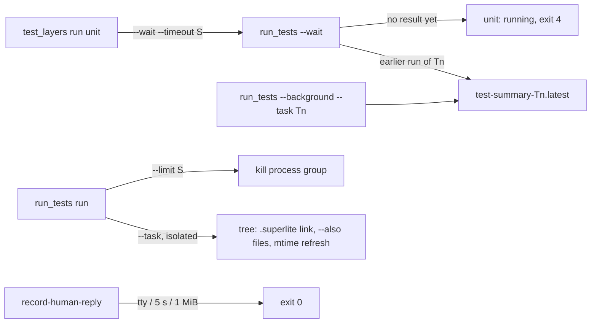
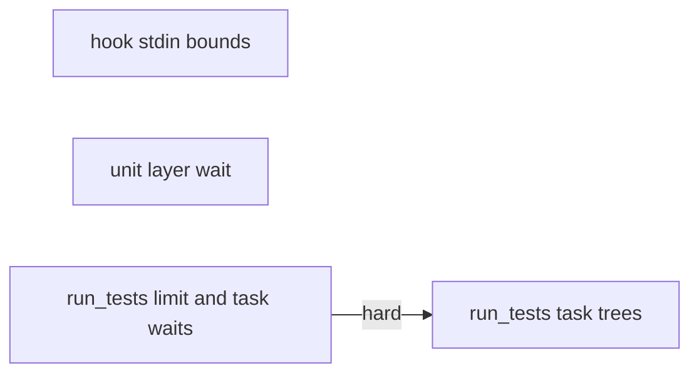

# Superlite: run_tests limits, waits and task trees (B88)

**Goal:** fix #489 (a test hook spun for days under an unlimited `run_tests --full`), #494 (the unit layer reads red when its wait gives up), #507 (a run right after an edit reports the earlier red result), #511 (task trees have no `.superlite/`) and #517 (a task tree lacks files edited outside Owns; Max: declare `--also` before the run).
**Architecture:** three files. `hooks/record-human-reply` stops waiting on stdin; `scripts/test_layers.py` passes a wait limit and reports a still-running unit run as running; `run_tests.py` gets a wall-clock limit, signal cleanup, task-aware waits and three task-tree changes. The two `run_tests.py` tasks run in sequence (one file).
**Tech stack:** Python 3.10+ stdlib, bash (3.2 compatible, builtins only in the hook), pytest through `sl run_tests`.
**Spec:** this file, section Design; the issues' Expected lines.
**Detail:** contracts
**Target-min:** 11
**Wave0:** none

Global constraints:
- Every code line in `skills/subagent-driven-development/scripts/*.py` and `scripts/*.py` carries the repo's trailing `# O(...)` complexity comment where the surrounding function's lines do; tests do not. Stdlib only.
- Existing tests stay green. An existing test file changes only when the task Owns it. If another existing test turns red, report it in DONE_WITH_CONCERNS with the test id and the reason instead of editing it.
- Run `sl` as an executable (`<abs>/sl ...`). Verify with `<abs>/sl run_tests --fast <own test files> --task Tn --background`, then run the printed `wait:` line in the foreground and end the turn only after it reports.
- Tests drop every `SUPERLITE_*` variable from a subprocess env (and `monkeypatch.delenv` SUPERLITE_FLEET_ROLE, SUPERLITE_FLEET_WORKER, SUPERLITE_FLEET_PARENT_DIR, SUPERLITE_STATE_DIR in-process). Timing tests assert generous bounds (a 5 s timeout: under 15 s).
- No version edits (the ship step bumps the version). Never run `scripts/evals.sh`, `claude plugin eval` or `scripts/test_layers.py run` outside a test's temp repo.

Ruling: #489's spin was not reproduced: bash 5.3 and /bin/bash 3.2 exit on an open silent pipe, a non-blocking pipe, a hung-up pty and 1 MB prompts; the hook still gets a tty guard, a 5 s read limit and a 1 MiB input cap, and run_tests' new limit kills whatever a test leaves running - cost if wrong: a cause outside the read stays, bounded by the limit.
Ruling: `run_tests --limit S`, default 3600 s, `0` = none, applies to each runner subprocess (pytest, test-cmd.json command, its setup); a hit kills the process group (pyrun.run_tree), writes a red summary, logs a no-result incident and exits 2; SIGTERM and SIGHUP kill the test process group before run_tests exits 2 - cost if wrong: a suite over 1 h needs `--limit`.
Ruling: #494: `test_layers.py run --wait S` (else `SUPERLITE_UNIT_WAIT`, else 540 s, which fits a 600 s Bash call) is the unit wait; a wait that reports `tests: no result yet` prints `unit: running ...` (never red), keeps the layer's running mark on the background pid and exits 4 (red still wins with 1) - cost if wrong: fleet_layer reads exit 4 as RED with the running line as `last`.
Ruling: #507's pytest case has no tree; the likeliest cause is a wait on an earlier run's path. `--wait PATH` on an earlier finished run of a task waits on that task's newest background run instead; a tree file whose bytes changed since that tree's last run gets mtime now, so mtime-based builds see it - cost if wrong: the stale result has another cause; the summary's new `task` key helps find it.
Ruling: #511: the task tree gets `.superlite` as a relative symlink to the run root's `.superlite` (`_link_dir`); a real folder there stays; info/exclude is not changed; `root_superlite` stays for systems without symlinks - cost if wrong: a tool that follows symlinks into dot folders sees the root's state folder.
Ruling: #517 (Max: declare --also before the run): `run_tests --task Tn --also F [F ...] [--ruling TEXT]` appends commit_task's claim line `- Ruling: Tn also commits F - TEXT` (once), so this and later tree runs and `commit_task Tn` take F; a red tree run names changed files left out of the tree - cost if wrong: one more flag to learn.
Ruling: detail contracts; no probe adapter (CLI and hook; Review Focus cases are named pytest cases); already in the lead worktree; layers: unit and headless (`hooks/record-human-reply` is under `hooks/**`); docs/tools.md and docs/testing.md are outside B88's files (follow-up) - cost if wrong: one NEEDS_CONTEXT round.
LAYERS: unit, headless

## Design

### 1. Hook stdin (T1, #489)
`hooks/record-human-reply`: `[ -t 0 ] && exit 0` before the read (a terminal is never hook input); the read becomes `IFS= read -r -d '' -t 5 input` (status still ignored); after it, `[ ${#input} -le 1048576 ] || input="${input:0:1048576}"`. One header comment line names the three bounds. Builtins only.

### 2. Unit layer wait (T2, #494)
`scripts/test_layers.py`: `DEFAULT_UNIT_WAIT = 540.0`; `unit_command(wait: float) -> str` returns `f"{SL} run_tests --full --background && {SL} run_tests --wait --timeout {wait:g}"`; `COMMANDS["unit"] = unit_command(DEFAULT_UNIT_WAIT)`. `run` takes `--wait S` (float); without it `SUPERLITE_UNIT_WAIT` when it parses as a float above 0, else 540. Used for unit only, never with a `--command-override`. `NO_RESULT = re.compile(r"^tests: no result yet after (\S+) s(?: \(pid (\d+) still running\))?; run again: (.+)$", re.M)`; `still_running(output: str) -> tuple[int | None, str, str] | None` gives (pid, seconds text, rerun command). In `cmd_run` a non-zero layer whose output matches prints `f"{layer}: running (no result after {secs} s; the background run stamps the layer when green; see it: {cmd})"`; with a pid it calls `layer_store.start_run(state, layer, <hash taken before the run>, pid)` after the existing `end_run`, so `status` shows `running` while that pid lives. Exit: 1 when any layer is red or unknown, else 4 when any is running, else 0.

### 3. run_tests limit, signals, task waits (T3, #489, #507)
- `DEFAULT_LIMIT = 3600.0`; `--limit S` (float, default DEFAULT_LIMIT; `<= 0` = none). `run_captured(cmd, limit=None, **kw)` passes `timeout` to `pyrun.run_tree` (which kills the process group and re-raises `subprocess.TimeoutExpired`); it reads the temp files and raises `LimitHit(seconds: float, text: str)` instead. The pytest run, the test-cmd.json command and its setup each pass `a.limit`. On `LimitHit`: `reason = f"wall-clock limit: test run killed after {limit:g} s (run_tests --limit S; 0 = none)"`, stderr `run_tests: <reason>`, `write_summary(..., error=reason)`, `publish_summary`, `record_no_result(a, reason, <command>, -9, text.splitlines(), tree)`, stdout `0 0 0 <seconds>`, exit 2. A `--background` child gets `--limit` through the passed argv.
- On the run path (not `--wait`, `--record`, `--background` parent) main installs, on POSIX, SIGTERM and SIGHUP handlers raising `Stopped(name)` (an `Exception` subclass); run_tree's existing `except BaseException` kills the group. main's crash handler writes the summary error `run_tests stopped by SIGTERM; its test processes were killed` (signal name as received) for a `Stopped`, prints no traceback and exits 2.
- `CURRENT_TASK` (module global, set in main from `a.task`, None without one): `write_summary` adds `"task": CURRENT_TASK` when set (closes the B81/B85 follow-up).
- `task_pointer_path(summary, task) -> Path`: `<stem>-<task>.latest` beside `summary` (`.superlite/test-summary-T1.latest`). `start_background` with `--task` also writes it atomically: `{"id", "summary", "started", "mode", "task"}`.
- `run_stem(mine) -> str | None`: the stem before `-<YYYYmmddTHHMMSS>-<pid>-<6 hex>.json` in a run summary's name. `wait_background`: once `data` is read for `mine` and `data.get("task")` is set, read `mine.parent / f"{run_stem(mine)}-{task}.latest"`; when it names another summary and its `started` is later than `data.get("started", 0)`, stderr `run_tests: <mine> is an earlier run of <task>; waiting on its newest run <path>` and keep waiting on that path, same deadline, at most once. A summary without `task`, a missing pointer or one naming `mine` change nothing.
- Module docstring: one sentence each for `--limit`, the signals, the `task` key and the redirect.

### 4. Task trees (T4, #511, #507, #517)
- After `trees.prepare` in `run()`: `_link_dir(Path.cwd() / ".superlite", Path(tree) / ".superlite")`.
- `refresh_mtimes(tree, task, paths) -> int`: digests (sha256 hex) of each overlaid path that is a file in the tree; a path absent from `.superlite/trees/<task>.digests.json` or with another digest gets `os.utime(tree / p, None)`; the map is rewritten; returns the count touched. Called after `prepare` with the overlay list (`trees.overlay_file(".", task)` JSON).
- `--also F [F ...]` (extend) and `--ruling TEXT` (default `declared before the test run (run_tests --also)`). Without `--task`: `usage_error(a, label, "--also needs --task Tn")`. `to_root` rewrites relative `--also` values against the caller's cwd as it does `--fast` (a trailing `/` kept). In `run()`, before any runner or tree: per F (repo-relative posix), unless `ct.also_owned(a.ledger).get(F) == a.task`, `ct.append_ledger(a.ledger, f"- Ruling: {a.task} also commits {F} - {ruling}")`; stderr `run_tests: {a.task} also commits {F} (ledger ruling; commit_task {a.task} commits it)`. The existing `ct.add_also_owns` then puts F in this run's tree.
- `outside_tree(root, overlay) -> list[str]`: sorted changed paths (`trees.own_changes(root, trees.base_commit(root), ["**/*"])`, copy plus delete) not in `overlay`. A red (exit 1) isolated tree run prints `run_tests: N changed file(s) not in Tn's tree: F1, F2 (+k more); if Tn needs one, rerun with --also F` (at most 5 names) on stderr; nothing when the list is empty or the run is green.
- Module docstring: one sentence each for the link, the refresh and `--also`.

## Coverage

| Category | State | Basis |
|---|---|---|
| Scope and success criteria | settled | the five issues' Expected lines; Max: --also before the run |
| Domain and data model | ruled | summary `task` key, per-task pointer, tree digest map |
| Persistence and migration | ruled | new files beside existing ones; old summaries lack `task` and change nothing |
| Interfaces and contracts | ruled | new flags `--limit`, `--also`, `--ruling`, `run --wait`; exit 4 for running |
| UI states | n/a | CLI text only |
| Concurrency and state ownership | ruled | per-task pointer written atomically; one writer per tree (trees.lock) |
| Error handling and recovery | ruled | limit and signals kill the process group; summary always written |
| Security and privacy | n/a | no new input surface beyond local paths |
| Performance and limits | ruled | 3600 s default; digests only of overlaid files |
| Observability | settled | stderr lines for limit, redirect, --also, outside-tree hint |
| Testing strategy | settled | subprocess runs on temp projects; named cases per task |
| Compatibility | ruled | defaults keep today's output; bash 3.2 builtins |
| Rollout | ruled | one PR; version bump at ship |
| Research unknowns | ruled | #489 and #507 causes not reproduced (rulings above) |

## File structure
- `hooks/record-human-reply`: stdin bounds (T1); `tests/scripts/test_record_human_reply_stdin_489.py` (T1).
- `scripts/test_layers.py`: unit wait and running state (T2); `tests/scripts/test_test_layers_wait_494.py` (T2).
- `skills/subagent-driven-development/scripts/run_tests.py`: limit, signals, task waits (T3), then trees (T4); `tests/scripts/test_run_tests_limit_489.py`, `tests/scripts/test_run_tests_wait_newest_507.py` (T3); `tests/scripts/test_run_tests_tree_state_511.py`, `tests/scripts/test_run_tests_also_517.py` (T4).

## Task graph

```mermaid
%% schedule
gantt
  title Predicted schedule (mm:ss)
  dateFormat X
  axisFormat %M:%S
  section lane 1
  T3 run_tests limit and task waits :t3, 0, 114s
  T4 run_tests task trees :t4, 114, 113s
  section lane 2
  T2 unit layer wait :t2, 0, 86s
  section lane 3
  T1 hook stdin bounds :t1, 0, 82s
```

critical path: T3 → T4 (3.8 min) · peak width 3 · predicted build 3.8 min · predicted total ≈ 7.3 min (target ✓)

## Package: test tooling
App type: CLI. Categories: protocol (flags, exit codes, stderr lines), state (pointers, ledger, tree), file (summaries, links). Specific risks: an orphaned test process outliving the limit; a wait returning another task's run; a claim line commit_task cannot parse; a symlink loop in the tree.
**Probe entry:** none (Ruling: no probe adapter).

### T1 hook stdin bounds · Complexity 2 · Est. context 26k
**Owns:** hooks/record-human-reply, tests/scripts/test_record_human_reply_stdin_489.py
**Components:** 1
**LOC owned:** 90
**Tests:** fast
**Model:** sonnet
**Est. time:** 1.8 min (1 component, about 90 LOC, fast tests)
**Covers:** 1
**Consumes:** none
**Produces:** none
**Review Focus:**
Fixture: `proj` with `.superlite/orchestrator.json` `{"mode": "human", "approved": false}`; env = os.environ without `SUPERLITE_*`, plus `CLAUDE_PROJECT_DIR=proj`, `SUPERLITE_HOME=tmp/home`; BASH as in tests/scripts/test_human_gate.py; `jsonl = proj/.superlite/human-replies.jsonl`.
state: `test_open_silent_stdin_exits` (Popen stdin=PIPE, nothing written, never closed -> `wait(timeout=15) == 0`; no jsonl).
state: `test_endless_stdin_exits` (a thread writes `b"y" * 65536` until BrokenPipeError or a stop event -> `wait(timeout=20) == 0`).
protocol: `test_tty_stdin_exits_at_once` (POSIX only: stdin = the slave of `pty.openpty()` -> `wait(timeout=3) == 0`; no jsonl).
protocol: `test_prompt_still_recorded` (input `{"session_id": "s1", "prompt": "approve"}`, closed -> exit 0 in under 3 s; the jsonl's last line has `"approves":true` and `"text":"approve"`).
encoding: `test_oversize_input_cut` (a 2 MB prompt of `a`, closed -> exit 0 within 20 s).
**Steps:** 1 failing tests, 2 run: FAIL, 3 implement Design 1, 4 run: PASS (own file plus `tests/scripts/test_human_gate.py tests/scripts/test_worker_plumbing_hooks.py`).

### T2 unit layer wait · Complexity 3 · Est. context 30k
**Owns:** scripts/test_layers.py, tests/scripts/test_test_layers_wait_494.py
**Components:** 1
**LOC owned:** 130
**Tests:** fast
**Model:** sonnet
**Est. time:** 2.4 min (1 component, about 130 LOC, fast tests)
**Covers:** 2
**Consumes:** none
**Produces:** test_layers.unit_command(wait: float) -> str
**Review Focus:**
Fixture: `repo`, `cli`, `stale_names` imported from tests/scripts/test_test_layers.py.
protocol: `test_unit_command_wait` (`tl.unit_command(1200) == f"{tl.SL} run_tests --full --background && {tl.SL} run_tests --wait --timeout 1200"`; `tl.COMMANDS["unit"]` ends with `--wait --timeout 540`).
protocol: `test_wait_flag_and_env` (monkeypatch `tl.subprocess.run` to record the command and return rc 0: `main(["run", "unit", "--wait", "900", "--root", repo])` -> command holds `--timeout 900`; env `SUPERLITE_UNIT_WAIT=700`, no flag -> `--timeout 700`; both -> 900; `SUPERLITE_UNIT_WAIT=x` -> 540).
state: `test_no_result_is_running_not_red` (a live `sleep 30` pid P; override `unit=printf 'tests: no result yet after 540 s (pid P still running); run again: sl run_tests --wait /x/s.json\n' >&2; exit 2` -> returncode 4, stdout has `unit: running` and `sl run_tests --wait /x/s.json`, not `unit: red`; `cli(repo, "status")` has the line `unit running run in progress`; `"unit" not in stale_names(repo)`; after killing P, `"unit" in stale_names(repo)`).
state: `test_no_pid_running_clears_mark` (the same line without the pid part -> returncode 4; status does not say running).
protocol: `test_red_stays_red` (override `unit=echo boom >&2; exit 1` -> returncode 1, `unit: red`).
protocol: `test_running_and_red_exit_1` (the running override plus `headless=false` -> returncode 1).
**Steps:** 1 failing tests, 2 run: FAIL, 3 implement Design 2, 4 run: PASS (own file plus `tests/scripts/test_test_layers.py`).

### T3 run_tests limit and task waits · Complexity 5 · Est. context 45k
**Owns:** skills/subagent-driven-development/scripts/run_tests.py, tests/scripts/test_run_tests_limit_489.py, tests/scripts/test_run_tests_wait_newest_507.py
**Components:** 2
**LOC owned:** 250
**Tests:** fast
**Model:** sonnet
**Est. time:** 4.5 min (2 components, about 250 LOC, fast tests)
**Covers:** 3
**Consumes:** none
**Produces:** run_tests.task_pointer_path(summary: str | Path, task: str) -> Path
**Review Focus:**
Fixture: a temp project with `.superlite/` and `.superlite/test-cmd.json` `{"language": "go", "isolate": false, "test": CMD, "test_file": CMD}`; run run_tests.py with `run` from tests/scripts/test_plan_tools.py; `pid_dead(p)` polls `os.kill(p, 0)` up to 5 s for ProcessLookupError.
state: `test_limit_kills_command_tree` (CMD `sh -c 'sleep 60 & echo $! > child.pid; sleep 60'`, `--full --limit 2` -> returncode 2 within 30 s; summary `error` starts with `wall-clock limit: test run killed after 2 s`; the child.pid process is dead; `.superlite/incidents.jsonl` has a `no-result` line).
state: `test_limit_pytest_path` (no test-cmd.json; `tests/test_slow.py` with `time.sleep(60)`, `--fast tests/test_slow.py --limit 3` -> returncode 2; summary error starts with `wall-clock limit`).
protocol: `test_limit_zero_is_none` (CMD `sh -c 'sleep 1; echo "1 passed"'`, `--limit 0` -> returncode 0, passed 1).
protocol: `test_default_limit` (`run_tests.DEFAULT_LIMIT == 3600.0`; `--help` names `--limit`).
state: `test_sigterm_kills_test_processes` (POSIX; CMD as in the first case; Popen run_tests `--full`, wait for child.pid, SIGTERM run_tests -> exits within 15 s with 2; the child is dead; summary error `run_tests stopped by SIGTERM; its test processes were killed`).
state: `test_background_task_pointer_and_summary_task` (CMD `echo "1 passed"`; `--full --task T1 --background`, then the printed `wait:` command -> 0; its summary has `"task": "T1"`; `.superlite/test-summary-T1.latest` names that summary; `run_tests.task_pointer_path(".superlite/test-summary.json", "T1") == Path(".superlite/test-summary-T1.latest")`).
state: `test_wait_earlier_run_takes_newest` (CMD `sh -c 'n=$(cat n 2>/dev/null || echo 0); n=$((n+1)); echo $n > n; echo "$n passed"'`; two `--background --task T1` runs, each waited; `--wait <first path>` -> stdout JSON `passed == 2`; stderr has `is an earlier run of T1; waiting on its newest run`).
state: `test_wait_other_task_unchanged` (run A of T1, then run B of T2; `--wait <A>` -> A's summary, no `earlier run` line).
state: `test_wait_without_task_unchanged` (two runs without --task; `--wait <first>` -> the first summary).
**Steps:** 1 failing tests, 2 run: FAIL, 3 implement Design 3, 4 run: PASS (own files plus `tests/scripts/test_run_tests_wait.py tests/scripts/test_run_tests_wait_line.py tests/scripts/test_run_tests_exit_paths.py tests/scripts/test_run_tests_summary.py tests/scripts/test_run_tests_no_result_trace.py`).

### T4 run_tests task trees · Complexity 5 · Est. context 45k
**Owns:** skills/subagent-driven-development/scripts/run_tests.py, tests/scripts/test_run_tests_tree_state_511.py, tests/scripts/test_run_tests_also_517.py
**Components:** 2
**LOC owned:** 240
**Tests:** fast
**Model:** sonnet
**Est. time:** 4.4 min (2 components, about 240 LOC, fast tests)
**Covers:** 4
**Consumes:** none
**Produces:** run_tests.refresh_mtimes(tree: Path, task: str, paths: list[str]) -> int
**Review Focus:**
Fixture: `setup`, `git`, `summary`, `OUT` from tests/scripts/test_run_tests_plan_fallback.py (isolated swift project, plan T1 owning src/a.txt); a second plan task T2 owning src/b.txt where a case needs it.
file: `test_tree_has_superlite_link` (test command `sh -c 'test -d ./.superlite && echo x > ./.superlite/seen; echo "OUT"'` -> returncode 0; `root/.superlite/seen` exists; `tree/.superlite` is a symlink resolving to `root/.superlite`).
file: `test_tree_real_superlite_folder_kept` (mkdir `tree/.superlite` with a file before the second run -> it stays a folder, the file stays).
state: `test_refresh_touches_changed_only` (`refresh_mtimes` on a tree dir: first call with `["a.txt"]` -> 1; set a.txt's mtime to 1000 and call again, same bytes -> 0 and mtime 1000; change its bytes -> 1 and mtime within 5 s of now).
state: `test_also_records_claim_and_tree_holds_file` (edit src/b.txt, unowned by T1; `--full --task T1 --plan P --also src/b.txt` -> the ledger `.superlite/progress.md` has exactly one `- Ruling: T1 also commits src/b.txt - declared before the test run (run_tests --also)` line; the tree's src/b.txt has the edited bytes; stderr has `T1 also commits src/b.txt`; a second run adds no second line).
protocol: `test_also_relative_to_cwd` (from `root/src`, `--also b.txt` records `src/b.txt`).
protocol: `test_also_needs_task` (`--full --also src/b.txt` -> returncode 2; stderr `--also needs --task Tn`).
protocol: `test_also_claim_read_by_commit_task` (`commit_task.also_owned(ledger) == {"src/b.txt": "T1"}` after the run).
protocol: `test_red_tree_run_names_outside_files` (test command exits 1 with a failing count; src/b.txt edited, not claimed; `--full --task T1` -> stderr `1 changed file(s) not in T1's tree: src/b.txt` and `rerun with --also`; a green run prints no such line).
**Steps:** 1 failing tests, 2 run: FAIL, 3 implement Design 4, 4 run: PASS (own files plus `tests/scripts/test_run_tests_tree_paths.py tests/scripts/test_run_tests_fast_tree.py tests/scripts/test_run_tests_paths_claims.py tests/scripts/test_run_tests_tree_node_modules.py tests/scripts/test_trees.py`).

## Review Focus
- test tooling: protocol, state, file, encoding; cases in T1-T4.

## Self-review
- Coverage: #489 -> Design 1 and 3; #494 -> 2; #507 -> 3 (wait) and 4 (refresh); #511 -> 4 (link); #517 -> 4 (--also, Max's decision). No placeholders. T3 -> T4 is hard: one file, T4 edits the run() T3 changed.
