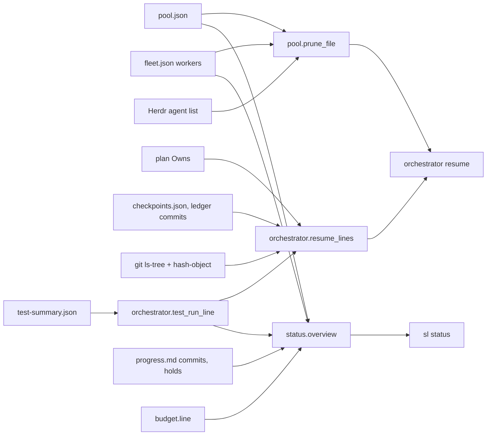
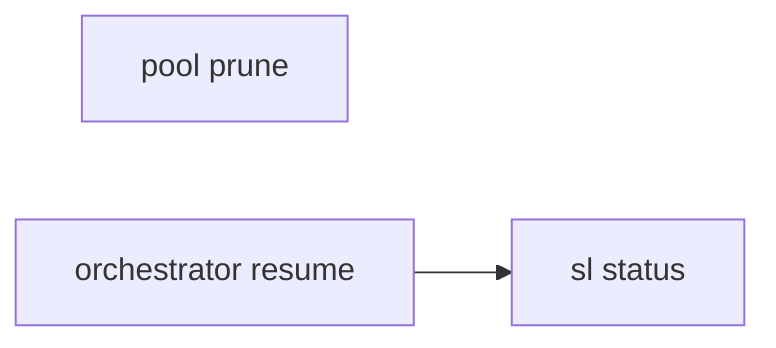

# Superlite: `sl status` overview, `sl orchestrator resume` recovery report, pool prune of dead agents (B81)

**Goal:** fix #384 (after a coordinator died mid-wave there is no tool that says, per task, what it left behind, and pool.json keeps dead agents) and #386 (`sl status` is an unknown tool). Max's decision for #384: resume clears dead pool entries and prints what it removed.
**Architecture:** three scripts. `pool.py`: `prune(data, workers, sid, live)` drops entries of agents that no longer exist (fleet workers: fleet.json state and Herdr's agent list; in-process agents: the session that registered them), `prune_file(path)` loads, prunes under the fleet lock, saves and returns the output lines, CLI `pool prune`; CLI `pool add` records `session`. `orchestrator.py`: `plan_file`, `changed_since`, `test_run_line`, `resume_lines` and CLI `orchestrator resume [--plan P]` (pool prune lines first, then the per-task report). New `status.py`: `overview(sd, plan)` and CLI, so `sl status [--plan P]` prints the run state in one screen.
**Tech stack:** Python 3.10+ stdlib, git, pytest (through `sl run_tests`).
**Spec:** this file, section Design; issues #384 and #386 (Expected lines).
**Detail:** tests
**Target-min:** 11
**Wave0:** none
**Max chars:** 34000

Global constraints:
- Every new or changed code line in the three scripts carries the repo's trailing `# O(...)` complexity comment; tests do not. Stdlib only. Imports of other superlite modules inside `orchestrator.py` and `status.py` stay lazy (inside the functions that need them): `orchestrator` is imported by every gated tool.
- Existing tests stay green. If an existing test turns red, report it in DONE_WITH_CONCERNS with the test id and the reason instead of editing it (T3's change to `test_sl_tools.py::test_status_hint` is the one planned exception).
- Run `sl` as an executable (`<abs>/sl ...`). Verify with `<abs>/sl run_tests --fast <your test file> <the existing tests named in your Notes> --task Tn --background`, then run the printed `wait:` line in the foreground and end the turn only after it reports. Never raw `pytest`, never the e2e or eval layers (coordinator's step).
- No version edits (the ship step bumps the version). Touch only the files in Owns; docs (`docs/tools.md`, `commands/*.md`, SKILL.md files) and the `sl` launcher stay unchanged (outside B81's files).

Ruling: `sl status` needs a file outside the brief's list: a new `skills/subagent-driven-development/scripts/status.py` (no lead can own a file that does not exist yet) plus the pinned hint test in `tests/scripts/test_sl_tools.py`; the `status` hint branch in `sl` becomes unreachable and stays (the launcher is outside B81's files) - cost if wrong: one dead line in `sl` until a later batch drops it.
Ruling: the recovery report is `sl orchestrator resume [--plan P]`; `commands/resume.md` is outside B81's files, so `sl status` names the resume command whenever a pool agent or fleet worker is busy, and the command doc is a follow-up - cost if wrong: `/superlite:resume` does not run it until its doc names it.
Ruling: an in-process agent exists only for the session that registered it: CLI `pool add` records `session` (state.session_id()); prune removes an in-process entry whose `session` differs from this session's id, keeps an entry without `session` (written before this version) with a `sl pool remove ID` hint, and keeps every in-process entry when no session id is known - cost if wrong: a dead entry from an older version needs one manual `pool remove`.
Ruling: a fleet worker exists while its fleet.json state is not `stopped` and Herdr lists its agent name; Herdr is asked only when such a worker is in the pool, and an unreachable Herdr keeps those workers - cost if wrong: a dead worker stays until Herdr answers.
Ruling: resume prunes only when no other live session owns the run folder (`state.live_owner`), else it prints one line naming `sl orchestrator takeover`, as `orchestrator end` already refuses - cost if wrong: a crashed run needs `takeover` first.
Ruling: "the last test run" is the run's `test-summary.json`, not one per task: run_tests records no task in its summary or ledger line (run_tests.py is outside B81's files); resume names the tasks whose changed files are newer than that run - cost if wrong: per-task test evidence stays a judgement call.
Ruling: task files are compared with the newest checkpoint (the chain head commit_task compares with), else HEAD; the comparison reads blobs (`git ls-tree` + `git hash-object`) and touches no index - cost if wrong: none known.
Ruling: detail tests; three tasks; T2 -> T3 is a hard edge (status.py calls orchestrator.plan_file and test_run_line); no probe adapter (CLI scripts tested in process and through the CLI) - cost if wrong: no generated probes.
Ruling: already in the lead worktree on branch superlite/b81-sl-status-and-resume-recovery - cost if wrong: none.
LAYERS: unit



## Design

1. `pool.prune(data, workers, sid, live) -> (removed, kept)`, both lists of `(id, reason)` in pool order; removed entries leave `data["agents"]`. A pool id in `workers` (fleet.json, each record with `name` and `state`) is a fleet worker: state `stopped` -> removed `fleet worker stopped`; `live` None -> kept `Herdr unreachable`; name not in `live` -> removed `fleet worker gone from Herdr`. Any other id is an in-process agent: `sid` None -> kept `no session id to check it against`; no `session` key -> kept `no session recorded; sl pool remove ID if it is gone`; `session` != sid -> removed `in-process agent of session S, not this session`. A removed agent with `busy` true and tasks (`pool.currents`) gets `; was busy with T3,T4`.
2. `pool.prune_file(path) -> list[str]`: no file -> `pool: no pool.json in <folder>`; else workers from fleet.json with names (`fleet_state.name_of`), Herdr asked (`pool.herdr_names()`) only when a pool id is a worker not `stopped`; reload, prune and save (only when something was removed) under `fleet_state.locked(folder)` when fleet_state imports; lines `removed ID (reason)`, `kept ID (reason)`, then `pool: removed N of M agent(s)` or `pool: nothing to prune (M agent(s))` (`agent` when M is 1). CLI `pool prune` prints them, exit 0. CLI `pool add` sets `session` when a session id is known.
3. `orchestrator.plan_file(sd, given=None)`: `given` when it is an existing file; else `stable.json` `plan`, `pool.json` `plan` (relative: against sd's parent), `sd/plan.md`, each only when that file exists; else None.
4. `orchestrator.changed_since(root, ref, files)`: sorted files whose working-tree blob (`git hash-object` of existing files) differs from `ref`'s (`git ls-tree -r`); a file on one side only counts, a path missing on both or naming a folder does not.
5. `orchestrator.resume_lines(sd, plan)`: header, one line per task with changed files (plan order), then `checkpointed, nothing edited after: ...`, `no changes: ...` (each only when non-empty), then `test_run_line(sd)` plus `; edited after it: Tn ...` (tasks with a changed file newer than the summary). CLI `orchestrator resume`: prune lines (or the not-pruned line), then the report; exit 2 with one line when no plan is found, the plan is unreadable or the folder is in no git checkout.
6. `status.overview(sd, plan)`: run and owner, orchestrator summary, plan and task count, tasks (checkpointed, running with agents, held with reasons, open), fleet workers, budget, last test run, and `after a crash: sl orchestrator resume --plan <sd>` when a pool agent or fleet worker is busy. CLI `sl status [--plan P]`, exit 0.

## Coverage

| Category | State | Basis |
|---|---|---|
| Scope and success criteria | settled | #384 and #386 Expected lines |
| Domain and data model | ruled | pool `session` key; checkpoint chain head as comparison ref |
| Persistence and migration | ruled | old pool entries without `session` are kept with a hint |
| Interfaces and contracts | ruled | `sl status`, `sl orchestrator resume`, `sl pool prune` |
| UI states | n/a | CLI text only |
| Concurrency and state ownership | ruled | prune under the fleet lock; skipped while another live session owns the run |
| Error handling and recovery | ruled | Herdr unreachable keeps workers; no plan or git: exit 2, one line |
| Security and privacy | n/a | local state files only |
| Performance and limits | settled | one Herdr call at most; two git calls per task |
| Observability | settled | every removal printed with its reason |
| Testing strategy | settled | one new test file per task |
| Compatibility | ruled | `orchestrator status` and the other pool commands unchanged |
| Rollout | ruled | one PR; version bump at ship |
| Research unknowns | n/a | read from the code |

## File structure
- `skills/subagent-driven-development/scripts/pool.py`: prune, herdr_names, prune_file, CLI prune, session on CLI add (T1).
- `skills/subagent-driven-development/scripts/orchestrator.py`: plan_file, changed_since, test_run_line, resume_lines, CLI resume (T2).
- `skills/subagent-driven-development/scripts/status.py` (new): overview and the `sl status` CLI (T3).
- `tests/scripts/test_pool_prune_384.py` (T1), `tests/scripts/test_orchestrator_resume_384.py` (T2), `tests/scripts/test_sl_status_386.py` and `tests/scripts/test_sl_tools.py` (T3).

## Task graph

```mermaid
%% schedule
gantt
  title Predicted schedule (mm:ss)
  dateFormat X
  axisFormat %M:%S
  section lane 1
  T2 orchestrator resume :t2, 0, 114s
  T3 sl status :t3, 114, 106s
  section lane 2
  T1 pool prune :t1, 0, 100s
```




critical path: T2 → T3 (3.7 min) · peak width 2 · predicted build 3.7 min · predicted total ≈ 7.2 min (target ✓)

## Package: pool (CLI and library)
App type: CLI. Categories: state (which entries survive, saved file), protocol (output lines and plural), file (missing pool, fleet.json).
**Probe entry:** none (Ruling: no probe adapter).

### T1 pool prune · Complexity 4 · Est. context 40k
**Owns:** skills/subagent-driven-development/scripts/pool.py, tests/scripts/test_pool_prune_384.py
**Components:** 2
**LOC owned:** 190
**Tests:** fast
**Model:** sonnet
**Est. time:** 3.2 min (2 components, about 190 LOC, fast tests)
**Covers:** 1, 2
**Consumes:** existing `pool.currents(ag: dict) -> list[str]` · existing `fleet_state.load(sd) -> dict` · existing `fleet_state.name_of(sd, wid: str, w: dict) -> str` · existing `fleet_state.locked(sd)` · existing `herdr_client.agent_states() -> dict` · existing `state.session_id() -> str | None`
**Produces:** pool.prune(data: dict, workers: dict, sid: str | None, live: set | None) -> tuple[list, list] · pool.herdr_names() -> set | None · pool.prune_file(path: str) -> list[str]
e.g. pool.prune({"agents": [{"id": "a1", "session": "old", "busy": True, "current": "T3"}]}, {}, "new", None) -> ([("a1", "in-process agent of session old, not this session; was busy with T3")], [])
e.g. pool.prune_file("/r/.superlite/pool.json") -> ["removed a1 (in-process agent of session old, not this session; was busy with T3)", "pool: removed 1 of 2 agents"]
e.g. pool.prune_file("/r/.superlite/pool.json") with no such file -> ["pool: no pool.json in /r/.superlite"]
**Review Focus:** state: `test_prune_file_saves_and_prints` (the saved file keeps `plan` and the kept agents); protocol: `test_cli_add_records_the_session_and_prune_follows_it` (plural, exit 0); file: `test_prune_file_without_a_pool` (nothing created).
**Test code (verbatim):**
```python
"""pool prune (#384): drop pool entries of agents that no longer exist and say what was removed; `pool add`
records the session that registered an in-process agent."""
import json
import os
import subprocess
import sys
from pathlib import Path

SCRIPTS = Path(__file__).resolve().parents[2] / "skills" / "subagent-driven-development" / "scripts"
sys.path.insert(0, str(SCRIPTS))
import pool  # noqa: E402


def agent(aid, **kw):
    return {"id": aid, "tier": "sonnet", "tasks": [], "files": [], "context_k": 20, "idle_min": 0, "busy": False, **kw}


def write_pool(tmp_path, agents):
    sd = tmp_path / ".superlite"
    sd.mkdir(exist_ok=True)
    (sd / "pool.json").write_text(json.dumps({"plan": "p.md", "agents": agents}), encoding="utf-8")
    return sd


def ids(path):
    return [a["id"] for a in json.loads(Path(path).read_text(encoding="utf-8"))["agents"]]


def cli(tmp_path, *args, sid="new"):
    env = {k: v for k, v in os.environ.items() if not k.startswith("SUPERLITE_") and k != "CLAUDE_CODE_SESSION_ID"}
    env.update(SUPERLITE_SESSION_ID=sid, SUPERLITE_HOME=str(tmp_path / "home"))
    return subprocess.run([sys.executable, str(SCRIPTS / "pool.py"), *args, "--pool", str(tmp_path / ".superlite" / "pool.json")],
                          capture_output=True, text=True, cwd=tmp_path, env=env)


def test_in_process_agent_of_another_session_is_removed():
    data = {"agents": [agent("a1", session="old", busy=True, current="T3,T4"), agent("a2", session="new")]}
    removed, kept = pool.prune(data, {}, "new", None)
    assert removed == [("a1", "in-process agent of session old, not this session; was busy with T3,T4")]
    assert kept == []
    assert [a["id"] for a in data["agents"]] == ["a2"]


def test_idle_agent_reason_has_no_busy_part():
    data = {"agents": [agent("a1", session="old", current="T3")]}
    removed, _ = pool.prune(data, {}, "new", None)
    assert removed == [("a1", "in-process agent of session old, not this session")]


def test_agent_without_session_is_kept_with_a_hint():
    data = {"agents": [agent("a1", busy=True, current=["T5"])]}
    removed, kept = pool.prune(data, {}, "new", None)
    assert removed == []
    assert kept == [("a1", "no session recorded; sl pool remove a1 if it is gone")]
    assert [a["id"] for a in data["agents"]] == ["a1"]


def test_no_session_id_keeps_in_process_agents():
    data = {"agents": [agent("a1", session="old")]}
    removed, kept = pool.prune(data, {}, None, None)
    assert removed == []
    assert kept == [("a1", "no session id to check it against")]


def test_fleet_workers_are_checked_against_herdr():
    workers = {"W1": {"name": "sl-x-w1", "state": "busy"}, "W2": {"name": "sl-x-w2", "state": "ready"},
               "W3": {"name": "sl-x-w3", "state": "stopped"}}
    data = {"agents": [agent("W1", busy=True, current="T2"), agent("W2"), agent("W3")]}
    removed, kept = pool.prune(data, workers, "new", {"sl-x-w2", "other"})
    assert removed == [("W1", "fleet worker gone from Herdr; was busy with T2"), ("W3", "fleet worker stopped")]
    assert kept == []
    assert [a["id"] for a in data["agents"]] == ["W2"]


def test_herdr_unreachable_keeps_live_fleet_workers():
    workers = {"W1": {"name": "sl-x-w1", "state": "ready"}, "W3": {"name": "sl-x-w3", "state": "stopped"}}
    data = {"agents": [agent("W1"), agent("W3")]}
    removed, kept = pool.prune(data, workers, "new", None)
    assert removed == [("W3", "fleet worker stopped")]
    assert kept == [("W1", "Herdr unreachable")]


def test_prune_file_saves_and_prints(tmp_path, monkeypatch):
    sd = write_pool(tmp_path, [agent("a1", session="old", busy=True, current="T3"), agent("a2", session="new")])
    monkeypatch.setenv("SUPERLITE_SESSION_ID", "new")
    lines = pool.prune_file(str(sd / "pool.json"))
    assert lines == ["removed a1 (in-process agent of session old, not this session; was busy with T3)",
                     "pool: removed 1 of 2 agents"]
    assert ids(sd / "pool.json") == ["a2"]
    assert json.loads((sd / "pool.json").read_text(encoding="utf-8"))["plan"] == "p.md"


def test_prune_file_reads_worker_names_from_fleet_json(tmp_path, monkeypatch):
    sd = write_pool(tmp_path, [agent("W1"), agent("W2"), agent("a3")])
    (sd / "fleet.json").write_text(json.dumps({"on": True, "workers": {
        "W1": {"name": "sl-a-w1", "state": "ready"}, "W2": {"name": "sl-a-w2", "state": "busy", "task": "T2"}}}), encoding="utf-8")
    monkeypatch.setenv("SUPERLITE_SESSION_ID", "new")
    monkeypatch.setattr(pool, "herdr_names", lambda: {"sl-a-w2"})
    lines = pool.prune_file(str(sd / "pool.json"))
    assert lines == ["removed W1 (fleet worker gone from Herdr)",
                     "kept a3 (no session recorded; sl pool remove a3 if it is gone)",
                     "pool: removed 1 of 3 agents"]
    assert ids(sd / "pool.json") == ["W2", "a3"]


def test_prune_file_asks_herdr_only_for_live_fleet_workers(tmp_path, monkeypatch):
    sd = write_pool(tmp_path, [agent("a2", session="new")])
    monkeypatch.setenv("SUPERLITE_SESSION_ID", "new")
    calls = []
    monkeypatch.setattr(pool, "herdr_names", lambda: calls.append(1) or set())
    before = (sd / "pool.json").read_text(encoding="utf-8")
    assert pool.prune_file(str(sd / "pool.json")) == ["pool: nothing to prune (1 agent)"]
    assert (sd / "pool.json").read_text(encoding="utf-8") == before
    assert calls == []


def test_prune_file_without_a_pool(tmp_path):
    sd = tmp_path / ".superlite"
    assert pool.prune_file(str(sd / "pool.json")) == [f"pool: no pool.json in {sd}"]
    assert not (sd / "pool.json").exists()


def test_cli_add_records_the_session_and_prune_follows_it(tmp_path):
    r = cli(tmp_path, "add", "a9", "--tier", "sonnet", "--current", "T1")
    assert r.returncode == 0, r.stderr
    saved = json.loads((tmp_path / ".superlite" / "pool.json").read_text(encoding="utf-8"))
    assert saved["agents"][0]["session"] == "new"
    r = cli(tmp_path, "prune")
    assert (r.returncode, r.stdout.splitlines()) == (0, ["pool: nothing to prune (1 agent)"]), r.stderr
    r = cli(tmp_path, "prune", sid="later")
    assert r.returncode == 0, r.stderr
    assert r.stdout.splitlines() == ["removed a9 (in-process agent of session new, not this session; was busy with T1)",
                                     "pool: removed 1 of 1 agent"]
    assert ids(tmp_path / ".superlite" / "pool.json") == []
```
**Steps:** 1 write the test file, 2 run: FAIL, 3 implement, 4 run: PASS together with tests/scripts/test_pool.py and tests/scripts/test_pool_binding.py.
**Notes:** `herdr_names()` returns `set(herdr_client.agent_states())`, None on any exception (Herdr missing, not running, an error reply); import herdr_client inside it. `prune_file` imports fleet_state inside a try (it needs fcntl): on ImportError no worker records and no lock (`contextlib.nullcontext()`). Build `workers` as `{wid: {"name": fleet_state.name_of(sd, wid, w), "state": w.get("state")}}`. Read the pool once to decide whether to ask Herdr (outside the lock), then reload, prune and save inside `fleet_state.locked(sd)`; save only when something was removed. CLI `prune` uses the common `--pool`; CLI `add` sets `ag["session"]` when `state.session_id()` is truthy (the library `add` that fleet.py calls stays unchanged). Update the module docstring's usage lines and describe prune and the `session` key.

## Package: orchestrator resume (CLI and library)
App type: CLI. Categories: state (checkpoint chain head vs HEAD, stale checkpoints of another plan), file (missing summary, unreadable summary, deleted owned file), protocol (exact line texts, exit codes).
**Probe entry:** none (Ruling: no probe adapter).

### T2 orchestrator resume · Complexity 5 · Est. context 52k
**Owns:** skills/subagent-driven-development/scripts/orchestrator.py, tests/scripts/test_orchestrator_resume_384.py
**Components:** 2
**LOC owned:** 290
**Tests:** fast
**Model:** sonnet
**Est. time:** 4.5 min (2 components, about 290 LOC, fast tests)
**Covers:** 3, 4, 5
**Consumes:** pool.prune_file(path: str) -> list[str] (T1) · existing `plan_tools.Plan.load(path: str) -> Plan` (`.tasks`, each with `.id`, `.owns`) · existing `autocommit.plan_key(plan: str) -> str` · existing `state.git_root(path) -> Path | None` · existing `state.live_owner(sd) -> str | None`
**Produces:** orchestrator.plan_file(sd: Path, given: str | None = None) -> Path | None · orchestrator.changed_since(root: Path, ref: str, files: list[str]) -> list[str] · orchestrator.test_run_line(sd: Path) -> str · orchestrator.resume_lines(sd: Path, plan: Path) -> list[str]
e.g. orchestrator.plan_file(Path("/r/.superlite")) with /r/.superlite/stable.json {"plan": "/r/docs/plans/p.md"} -> Path("/r/docs/plans/p.md")
e.g. orchestrator.plan_file(Path("/r/.superlite")) with no stable.json, pool.json or plan.md -> None
e.g. orchestrator.test_run_line(Path("/r/.superlite")) -> "last test run: fast, 5 passed, 0 failed, ended 14:02:11"
e.g. orchestrator.test_run_line(Path("/r/.superlite")) with no test-summary.json -> "last test run: none in /r/.superlite"
**Review Focus:** state: `test_checkpoints_of_another_plan_are_ignored`, `test_without_checkpoints_compares_with_head`; file: `test_changed_since_compares_blobs` (a deleted owned file counts, a folder does not), `test_test_run_line` (unreadable summary); protocol: `test_cli_resume_leaves_another_live_sessions_pool`, `test_cli_resume_without_a_plan` (exit 2).
**Test code (verbatim):**
```python
"""orchestrator resume (#384): per task, what a dead coordinator left behind (checkpoint, edits after it,
uncommitted Owns files), the last test run, and a pool cleared of agents that no longer exist."""
import json
import os
import subprocess
import sys
import time
from datetime import datetime
from pathlib import Path

SCRIPTS = Path(__file__).resolve().parents[2] / "skills" / "subagent-driven-development" / "scripts"
sys.path.insert(0, str(SCRIPTS))
import autocommit  # noqa: E402
import orchestrator  # noqa: E402
import pool  # noqa: E402

PLAN = """# Plan

**Goal:** g

### T1 one
**Owns:** src/a.py, tests/test_a.py
**Tests:** fast

### T2 two
**Owns:** src/b.py
**Tests:** fast

### T3 three
**Owns:** src/c.py
**Tests:** fast
"""


def git(root, *args):
    r = subprocess.run(["git", "-C", str(root), *args], capture_output=True, text=True)
    assert r.returncode == 0, r.stderr
    return r.stdout.strip()


def put(root, rel, text):
    p = root / rel
    p.parent.mkdir(parents=True, exist_ok=True)
    p.write_text(text, encoding="utf-8")


def repo(tmp_path, edit_after=True):
    """A checkout with a T1 checkpoint (src/a.py, tests/test_a.py), src/a.py edited after it when edit_after,
    and src/b.py (T2) changed without a checkpoint; the test summary is older than those edits."""
    root = tmp_path / "r"
    root.mkdir()
    git(root, "init", "-q")
    git(root, "config", "user.email", "t@example.com")
    git(root, "config", "user.name", "t")
    put(root, "docs/plans/p.md", PLAN)
    put(root, "src/a.py", "a0\n")
    put(root, "src/b.py", "b0\n")
    git(root, "add", "-A")
    git(root, "commit", "-qm", "base")
    base = git(root, "rev-parse", "HEAD")
    put(root, "src/a.py", "a1\n")
    put(root, "tests/test_a.py", "t1\n")
    git(root, "add", "src/a.py", "tests/test_a.py")
    git(root, "commit", "-qm", "T1: one")
    c1 = git(root, "rev-parse", "HEAD")
    git(root, "reset", "-q", base)
    plan = root / "docs" / "plans" / "p.md"
    sd = root / ".superlite"
    put(root, ".superlite/checkpoints.json", json.dumps({"plan": autocommit.plan_key(str(plan)), "base": base, "head": base,
        "entries": [{"task": "T1", "sha": c1, "title": "T1: one", "files": ["src/a.py", "tests/test_a.py"]}]}))
    put(root, ".superlite/progress.md", f"- start {base}\n- commit T1 {c1[:10]} one\n")
    put(root, ".superlite/test-summary.json", json.dumps({"passed": 5, "failed": 0, "skipped": 0, "seconds": 1.0, "mode": "fast"}))
    old = time.time() - 100
    os.utime(sd / "test-summary.json", (old, old))
    if edit_after:
        put(root, "src/a.py", "a2\n")
    put(root, "src/b.py", "b1\n")
    return root, plan, sd, c1


def ended(sd):
    return datetime.fromtimestamp((sd / "test-summary.json").stat().st_mtime).strftime("%H:%M:%S")


def clean_env(monkeypatch, tmp_path):
    for k in [k for k in os.environ if k.startswith("SUPERLITE_")]:
        monkeypatch.delenv(k)
    monkeypatch.setenv("SUPERLITE_HOME", str(tmp_path / "home"))
    monkeypatch.setenv("SUPERLITE_SESSION_ID", "new")


def test_resume_lines_name_each_task_state(tmp_path):
    root, plan, sd, c1 = repo(tmp_path)
    assert orchestrator.resume_lines(sd, plan) == [
        f"resume: plan {plan}; checkpoint chain head {c1[:7]} (T1); files compared with it",
        f"T1 checkpointed {c1[:7]}: edited after the checkpoint: src/a.py; keep: sl commit_task T1 --plan {plan}; "
        f"drop: git restore --source {c1[:7]} -- src/a.py",
        f"T2 not checkpointed: uncommitted Owns files: src/b.py; run its tests, then sl commit_task T2 --plan {plan}",
        "no changes: T3",
        f"last test run: fast, 5 passed, 0 failed, ended {ended(sd)}; edited after it: T1 T2",
    ]


def test_clean_checkpoint_is_listed_once(tmp_path):
    root, plan, sd, c1 = repo(tmp_path, edit_after=False)
    lines = orchestrator.resume_lines(sd, plan)
    assert lines[2:4] == ["checkpointed, nothing edited after: T1", "no changes: T3"]
    assert not any(ln.startswith("T1 ") for ln in lines)
    assert lines[-1] == f"last test run: fast, 5 passed, 0 failed, ended {ended(sd)}; edited after it: T2"


def test_without_checkpoints_compares_with_head(tmp_path):
    root, plan, sd, c1 = repo(tmp_path)
    (sd / "checkpoints.json").unlink()
    (sd / "progress.md").write_text("", encoding="utf-8")
    head = git(root, "rev-parse", "HEAD")
    lines = orchestrator.resume_lines(sd, plan)
    assert lines[0] == f"resume: plan {plan}; no checkpoints; files compared with HEAD {head[:7]}"
    assert lines[1] == (f"T1 not checkpointed: uncommitted Owns files: src/a.py, tests/test_a.py; run its tests, "
                        f"then sl commit_task T1 --plan {plan}")


def test_checkpoints_of_another_plan_are_ignored(tmp_path):
    root, plan, sd, c1 = repo(tmp_path)
    st = json.loads((sd / "checkpoints.json").read_text(encoding="utf-8"))
    st["plan"] = str(root / "docs" / "plans" / "old.md")
    (sd / "checkpoints.json").write_text(json.dumps(st), encoding="utf-8")
    head = git(root, "rev-parse", "HEAD")
    assert orchestrator.resume_lines(sd, plan)[0] == f"resume: plan {plan}; no checkpoints; files compared with HEAD {head[:7]}"


def test_changed_since_compares_blobs(tmp_path):
    root, plan, sd, c1 = repo(tmp_path)
    files = ["src/a.py", "tests/test_a.py", "src/b.py", "src/c.py", "src"]
    assert orchestrator.changed_since(root, c1, files) == ["src/a.py", "src/b.py"]
    assert orchestrator.changed_since(root, "HEAD", files) == ["src/a.py", "src/b.py", "tests/test_a.py"]
    assert orchestrator.changed_since(root, c1, []) == []
    (root / "src" / "b.py").unlink()
    assert orchestrator.changed_since(root, "HEAD", ["src/b.py"]) == ["src/b.py"]


def test_plan_file_lookup_order(tmp_path):
    sd = tmp_path / ".superlite"
    sd.mkdir()
    put(tmp_path, "docs/p.md", PLAN)
    plan = tmp_path / "docs" / "p.md"
    other = tmp_path / "other.md"
    other.write_text(PLAN, encoding="utf-8")
    assert orchestrator.plan_file(sd) is None
    (sd / "plan.md").write_text(PLAN, encoding="utf-8")
    assert orchestrator.plan_file(sd) == sd / "plan.md"
    (sd / "pool.json").write_text(json.dumps({"plan": str(other), "agents": []}), encoding="utf-8")
    assert orchestrator.plan_file(sd) == other
    (sd / "stable.json").write_text(json.dumps({"plan": str(plan)}), encoding="utf-8")
    assert orchestrator.plan_file(sd) == plan
    assert orchestrator.plan_file(sd, str(other)) == other
    assert orchestrator.plan_file(sd, str(sd)) == plan
    (sd / "stable.json").write_text(json.dumps({"plan": str(tmp_path / "gone.md")}), encoding="utf-8")
    assert orchestrator.plan_file(sd) == other


def test_test_run_line(tmp_path):
    sd = tmp_path / ".superlite"
    assert orchestrator.test_run_line(sd) == f"last test run: none in {sd}"
    sd.mkdir()
    (sd / "test-summary.json").write_text(json.dumps({"passed": 0, "failed": 1, "skipped": 0, "mode": "full",
                                                      "error": "pytest could not start"}), encoding="utf-8")
    assert orchestrator.test_run_line(sd) == (f"last test run: full, 0 passed, 1 failed, ended {ended(sd)}, "
                                              "error: pytest could not start")
    (sd / "test-summary.json").write_text("{", encoding="utf-8")
    assert orchestrator.test_run_line(sd) == f"last test run: unreadable {sd / 'test-summary.json'}"


def test_cli_resume_prunes_first(tmp_path, monkeypatch, capsys):
    root, plan, sd, c1 = repo(tmp_path)
    clean_env(monkeypatch, tmp_path)
    seen = []
    monkeypatch.setattr(pool, "prune_file", lambda p: seen.append(p) or ["removed a1 (gone)", "pool: removed 1 of 1 agent"],
                        raising=False)
    assert orchestrator.main(["resume", "--plan", str(plan)]) == 0
    out = capsys.readouterr().out.splitlines()
    assert seen == [str(sd / "pool.json")]
    assert out[:2] == ["removed a1 (gone)", "pool: removed 1 of 1 agent"]
    assert out[2:] == orchestrator.resume_lines(sd, plan)


def test_cli_resume_leaves_another_live_sessions_pool(tmp_path, monkeypatch, capsys):
    root, plan, sd, c1 = repo(tmp_path)
    clean_env(monkeypatch, tmp_path)
    home = tmp_path / "home"
    (sd / "session").write_text("other\n", encoding="utf-8")
    (home / "sessions").mkdir(parents=True)
    (home / "sessions" / "other").write_text(f"{sd}\n", encoding="utf-8")

    def boom(p):
        raise AssertionError("pruned another session's pool")

    monkeypatch.setattr(pool, "prune_file", boom, raising=False)
    assert orchestrator.main(["resume", "--plan", str(plan)]) == 0
    out = capsys.readouterr().out.splitlines()
    assert out[0] == (f"pool: not pruned: {sd} belongs to session other; "
                      f"take the run over first: sl orchestrator takeover --plan {sd}")
    assert out[1] == f"resume: plan {plan}; checkpoint chain head {c1[:7]} (T1); files compared with it"


def test_cli_resume_without_a_plan(tmp_path, monkeypatch, capsys):
    clean_env(monkeypatch, tmp_path)
    sd = tmp_path / ".superlite"
    sd.mkdir()
    monkeypatch.setattr(pool, "prune_file", lambda p: ["pool: no pool.json in x"], raising=False)
    assert orchestrator.main(["resume", "--plan", str(sd)]) == 2
    assert capsys.readouterr().out.splitlines() == ["pool: no pool.json in x",
                                                    f"resume: no plan found for {sd}; pass --plan <plan.md>"]


def test_cli_resume_outside_git(tmp_path, monkeypatch, capsys):
    clean_env(monkeypatch, tmp_path)
    sd = tmp_path / ".superlite"
    sd.mkdir()
    (sd / "plan.md").write_text(PLAN, encoding="utf-8")
    monkeypatch.setattr(pool, "prune_file", lambda p: ["pool: no pool.json in x"], raising=False)
    assert orchestrator.main(["resume", "--plan", str(sd)]) == 2
    assert capsys.readouterr().out.splitlines()[-1] == f"resume: {sd} is in no git checkout"
```
**Steps:** 1 write the test file, 2 run: FAIL, 3 implement, 4 run: PASS together with tests/scripts/test_orchestrator.py, tests/scripts/test_orchestrator_takeover.py and tests/scripts/test_orchestrator_worktree_guard.py.
**Notes:** T1 builds `pool.prune_file` in parallel: these tests fake it (`raising=False`), so call it as `pool.prune_file(...)` on the module imported inside the function (`import pool`), never `from pool import prune_file`. `resume` is a new subparser with `--plan`; it takes the `sd = sl_dir(a.plan)` branch and returns before `read_state`. Order in the CLI: `state.live_owner(sd)` set -> the not-pruned line, else print every `pool.prune_file(str(sd / "pool.json"))` line; then `plan_file(sd, a.plan)` (None -> `resume: no plan found for {sd}; pass --plan <plan.md>`, exit 2); then `state.git_root(sd)` (None -> `resume: {sd} is in no git checkout`, exit 2); a plan that fails to load (any exception from `plan_tools.Plan.load`) -> `resume: plan {plan} unreadable: {err}`, exit 2; else print `resume_lines`, exit 0. In `resume_lines`: root = `state.git_root(sd)`; checkpoints = `root/.superlite/checkpoints.json`, used only when it parses and its `plan` equals `autocommit.plan_key(str(plan))` and it has entries; ref = newest entry `sha` (header names its `task`), else `git -C root rev-parse HEAD`. Checkpointed tasks = the tasks of those entries plus ledger lines in `sd/progress.md` matching `^\s*[-*+]?\s*commit\s+([A-Z]{1,3}\d+[A-Za-z]?)\s+([0-9a-f]{7,40})`; the shown sha is the task's newest entry sha, else its ledger sha, cut to 7. A task's files = its plan Owns plus the `files` of its entries, deduped in order; changed files are listed sorted, joined with ", ". The id lists in `checkpointed, nothing edited after:` and `no changes:` and after `edited after it:` are space-separated in plan order. `test_run_line` reads `sd/test-summary.json` (`mode`, `passed`, `failed`, optional `error` appended as `, error: E`), `ended` = the file's mtime as local `%H:%M:%S`; `edited after it` names tasks with a changed, existing file whose mtime is newer than the summary's (omitted when none or when there is no readable summary). `changed_since`: `git -C root ls-tree -r -z ref -- files` for the ref side, `git -C root hash-object -- <files that are regular files>` for the working side; no files -> [] without calling git. Add `resume` to the module docstring's usage block.

## Package: sl status (CLI)
App type: CLI. Categories: protocol (exact lines, exit 0, `sl status` resolves), state (task precedence: checkpointed, running, held, open), file (no run folder, no fleet.json, no metrics).
**Probe entry:** none (Ruling: no probe adapter).

### T3 sl status · Complexity 4 · Est. context 45k
**Owns:** skills/subagent-driven-development/scripts/status.py, tests/scripts/test_sl_status_386.py, tests/scripts/test_sl_tools.py
**Components:** 2
**LOC owned:** 230
**Tests:** fast
**Model:** sonnet
**Est. time:** 3.6 min (2 components, about 230 LOC, fast tests)
**Covers:** 6
**Consumes:** orchestrator.plan_file(sd: Path, given: str | None = None) -> Path | None (T2) · orchestrator.test_run_line(sd: Path) -> str (T2) · existing `orchestrator.summary_line(plan_or_dir=None, review=None) -> str` · existing `orchestrator.sl_dir(plan_or_dir=None) -> Path` · existing `commit_task.committed_tasks(ledger) -> set` · existing `next_tasks.held_tasks(ledger) -> dict` · existing `pool.currents(ag: dict) -> list[str]` · existing `fleet_state.load(sd) -> dict` · existing `budget.compute(plan_path, sl_dir) -> dict` · existing `budget.line(b: dict) -> str` · existing `state.owner(sd)`, `state.session_id()`
**Produces:** status.overview(sd: Path, plan: Path | None) -> list[str] · status.main(argv: list | None = None) -> int
**Review Focus:** protocol: `test_sl_status_prints_the_overview` (the launcher finds the tool), `test_overview_lines`; state: `test_idle_run_has_no_crash_hint` (held beats open; no hint without busy agents); file: `test_overview_without_a_run`.
**Test code (verbatim):** `tests/scripts/test_sl_status_386.py`:
```python
"""`sl status` (#386): the run state in one screen: run folder and owner, orchestrator, plan and its tasks,
fleet workers, budget, last test run, and the resume hint while an agent is busy."""
import json
import os
import subprocess
import sys
from datetime import datetime
from pathlib import Path

ROOT = Path(__file__).resolve().parents[2]
SCRIPTS = ROOT / "skills" / "subagent-driven-development" / "scripts"
SL = SCRIPTS / "sl"
sys.path.insert(0, str(SCRIPTS))
import budget  # noqa: E402
import status  # noqa: E402

PLAN = "# Plan\n\n**Goal:** g\n\n" + "".join(
    f"### T{i} task {i}\n**Owns:** src/f{i}.py\n**Tests:** fast\n\n" for i in range(1, 6))


def run_folder(tmp_path):
    sd = tmp_path / ".superlite"
    sd.mkdir()
    plan = tmp_path / "p.md"
    plan.write_text(PLAN, encoding="utf-8")
    (sd / "stable.json").write_text(json.dumps({"plan": str(plan)}), encoding="utf-8")
    (sd / "orchestrator.json").write_text(json.dumps({"mode": "ai", "approved": True, "by": "user",
                                                      "time": "2026-11-10T09:00:00"}), encoding="utf-8")
    (sd / "progress.md").write_text("- commit T1 abc1234def one\n- Hold T4: waiting on Max\n", encoding="utf-8")
    (sd / "pool.json").write_text(json.dumps({"agents": [{"id": "a1", "tier": "sonnet", "busy": True, "current": "T2"},
                                                         {"id": "a2", "tier": "sonnet", "busy": False}]}), encoding="utf-8")
    (sd / "fleet.json").write_text(json.dumps({"on": True, "workers": {
        "W1": {"agent": "superlite:implementer", "tier": "sonnet", "state": "busy", "task": "T3"},
        "W2": {"agent": "superlite:researcher", "tier": "sonnet", "state": "ready", "task": None},
        "W3": {"agent": "superlite:implementer", "tier": "sonnet", "state": "stopped", "task": None}}}), encoding="utf-8")
    (sd / "test-summary.json").write_text(json.dumps({"passed": 7, "failed": 1, "skipped": 0, "mode": "fast"}), encoding="utf-8")
    return sd, plan


def ended(sd):
    return datetime.fromtimestamp((sd / "test-summary.json").stat().st_mtime).strftime("%H:%M:%S")


def clean_env(monkeypatch, tmp_path):
    for k in [k for k in os.environ if k.startswith("SUPERLITE_")]:
        monkeypatch.delenv(k)
    monkeypatch.setenv("SUPERLITE_HOME", str(tmp_path / "home"))
    monkeypatch.setenv("SUPERLITE_SESSION_ID", "me")


def sl(tmp_path, *args):
    env = {k: v for k, v in os.environ.items() if not k.startswith("SUPERLITE_") and k != "CLAUDE_CODE_SESSION_ID"}
    env.update(SUPERLITE_HOME=str(tmp_path / "home"), SUPERLITE_CACHE_DIR=str(tmp_path / "cache"), SUPERLITE_SESSION_ID="me")
    return subprocess.run(["bash", str(SL), *args], capture_output=True, text=True, cwd=tmp_path, env=env)


def test_overview_lines(tmp_path, monkeypatch):
    clean_env(monkeypatch, tmp_path)
    sd, plan = run_folder(tmp_path)
    assert status.overview(sd, plan) == [
        f"run: {sd}; owner: none",
        "orchestrator: AI (set 2026-11-10T09:00:00 by user)",
        f"plan: {plan}: 5 tasks",
        "tasks: checkpointed 1: T1; running 2: T2 (a1), T3 (W1); held 1: T4 (waiting on Max); open 1: T5",
        "fleet: on; W1 implementer busy T3, W2 researcher ready; stopped: W3",
        "budget: no metrics yet",
        f"last test run: fast, 7 passed, 1 failed, ended {ended(sd)}",
        f"after a crash: sl orchestrator resume --plan {sd}",
    ]


def test_overview_without_a_run(tmp_path, monkeypatch):
    clean_env(monkeypatch, tmp_path)
    sd = tmp_path / ".superlite"
    assert status.overview(sd, None) == [
        f"run: {sd}; owner: none",
        "orchestrator: not set (ungated)",
        "plan: none found (pass --plan <plan.md>)",
        "fleet: off",
        "budget: no plan",
        f"last test run: none in {sd}",
    ]


def test_owner_names_the_session(tmp_path, monkeypatch):
    clean_env(monkeypatch, tmp_path)
    sd, plan = run_folder(tmp_path)
    (sd / "session").write_text("me\n", encoding="utf-8")
    assert status.overview(sd, plan)[0] == f"run: {sd}; owner: this session"
    (sd / "session").write_text("old-lead\n", encoding="utf-8")
    assert status.overview(sd, plan)[0] == f"run: {sd}; owner: session old-lead"


def test_idle_run_has_no_crash_hint(tmp_path, monkeypatch):
    clean_env(monkeypatch, tmp_path)
    sd, plan = run_folder(tmp_path)
    (sd / "pool.json").write_text(json.dumps({"agents": [{"id": "a2", "busy": False}]}), encoding="utf-8")
    (sd / "fleet.json").write_text(json.dumps({"on": False, "workers": {}}), encoding="utf-8")
    lines = status.overview(sd, plan)
    assert lines[3] == "tasks: checkpointed 1: T1; held 1: T4 (waiting on Max); open 3: T2, T3, T5"
    assert lines[4] == "fleet: off"
    assert not any(ln.startswith("after a crash") for ln in lines)


def test_budget_line_comes_from_budget(tmp_path, monkeypatch):
    clean_env(monkeypatch, tmp_path)
    sd, plan = run_folder(tmp_path)
    (sd / "metrics.jsonl").write_text("", encoding="utf-8")
    monkeypatch.setattr(budget, "compute", lambda p, d: {"plan": p, "dir": d})
    monkeypatch.setattr(budget, "line", lambda b: f"budget: from {b['plan']} in {b['dir']}")
    assert f"budget: from {plan} in {sd}" in status.overview(sd, plan)
    monkeypatch.setattr(budget, "compute", lambda p, d: 1 / 0)
    assert "budget: unavailable (ZeroDivisionError: division by zero)" in status.overview(sd, plan)


def test_sl_status_prints_the_overview(tmp_path):
    sd, plan = run_folder(tmp_path)
    r = sl(tmp_path, "status", "--plan", str(sd))
    assert r.returncode == 0, r.stderr
    out = r.stdout.splitlines()
    assert out[0] == f"run: {sd}; owner: none"
    assert out[2] == f"plan: {plan}: 5 tasks"
    assert "unknown tool" not in r.stderr


def test_sl_status_with_a_plan_file(tmp_path):
    sd, plan = run_folder(tmp_path)
    (sd / "stable.json").unlink()
    r = sl(tmp_path, "status", "--plan", str(plan))
    assert r.returncode == 0, r.stderr
    assert r.stdout.splitlines()[2] == f"plan: {plan}: 5 tasks"
```
In `tests/scripts/test_sl_tools.py`, replace `test_status_hint` with:
```python
def test_status_is_a_tool(tmp_path):
    r = _sl(tmp_path, "status", "--plan", str(tmp_path / ".superlite"))
    assert r.returncode == 0, r.stderr
    assert r.stdout.splitlines()[0].startswith("run: ")
    assert "unknown tool" not in r.stderr
```
**Steps:** 1 write the tests, 2 run: FAIL, 3 implement, 4 run: PASS together with tests/scripts/test_sl_tools.py.
**Notes:** `status.py` starts with `#!/usr/bin/env python3`, a docstring (usage `status.py [--plan P]`, what each line shows, exit 0, stdlib only), the `# Complexity notation:` header and `sys.path.insert(0, str(Path(__file__).resolve().parent))` like its siblings; superlite imports go inside the functions (tests monkeypatch `budget.compute` and `budget.line` on the module, so call them as `budget.compute(str(plan), str(sd))` and `budget.line(...)`). `main`: `--plan`; `sd = orchestrator.sl_dir(a.plan)`, `plan = orchestrator.plan_file(sd, a.plan)`, print each overview line, return 0. Lines in order: `run: {sd}; owner: ` + (`none` when `state.owner(sd)` is None, `this session` when it equals `state.session_id()`, else `session X`); `orchestrator.summary_line(sd)`; `plan: {plan}: N tasks` (`plan_tools.Plan.load(str(plan)).tasks`), `plan: {plan} unreadable: {err}` when loading raises, `plan: none found (pass --plan <plan.md>)` when plan is None; the `tasks:` line only with a loaded plan: parts `checkpointed N: ids` (ledger `sd/progress.md`, `commit_task.committed_tasks`), `running N: Tn (agents)` (busy pool agents' `pool.currents`, then fleet.json workers with state `busy` and a `task`, split on commas; agent ids deduped, joined with ", "), `held N: Tn (reason)` (`next_tasks.held_tasks`), `open N: ids`; a task counts in the first of those four that holds it, ids in plan order joined with ", ", parts joined with "; ", empty parts left out, `tasks: none` when all are empty; `fleet: off` unless `fleet_state.load(sd)["on"]`, else `fleet: on; ` + live workers as `Wn <agent without "superlite:"> <state>[ <task>]` joined with ", " (or `no workers`) + `; stopped: W3[, W4]` when any; `budget: no plan` / `budget: no metrics yet` (no `sd/metrics.jsonl`) / `budget.line(...)` / `budget: unavailable ({type(e).__name__}: {e})`; `orchestrator.test_run_line(sd)`; `after a crash: sl orchestrator resume --plan {sd}` only when a pool agent has `busy` true or a fleet worker has state `busy`.

## Review Focus
- pool (CLI): state (surviving entries and saved keys), protocol (line texts, plural), file (no pool.json, no fleet.json). Specific risk: pruning a live agent of another live session; the resume CLI guards it with `live_owner`.
- orchestrator resume (CLI): state (chain head vs HEAD, stale checkpoints), file (deleted owned file, unreadable summary), protocol (exit 2 cases). Specific risk: a git call that writes an index; only `ls-tree`, `hash-object` and `rev-parse` are allowed.
- sl status (CLI): protocol, state, file. Specific risk: `sl status` without `--plan` in a worktree whose binding is foreign exits 2 through `state.resolve` (unchanged behaviour of every reader).

## Self-review
1. Coverage: Design 1-2 -> T1, 3-5 -> T2, 6 -> T3; #384's four per-task items (checkpointed, files edited after the checkpoint, uncommitted Owns files, last test run) and the pool clearing map to T2 and T1; #386's five items (plan, checkpointed and open tasks, held tasks, fleet workers, budget) to T3.
2. Placeholders: none.
3. Types: T2 consumes `pool.prune_file(path: str) -> list[str]` as T1 produces it; T3 consumes `plan_file` and `test_run_line` as T2 produces them.
4. Graph: T2 -> T3 is an execution edge (T3's tests run T2's functions); no two tasks share a file.
5. Fields: every task has Components, LOC owned, Tests, Model.
6. Review Focus: each package has app type, categories and a Probe entry line; tasks carry their cases.
7. Limits: under 34k characters; schedule and lint run next.
