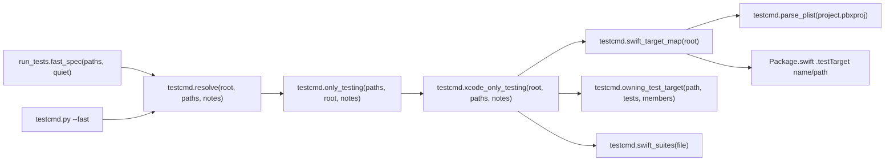
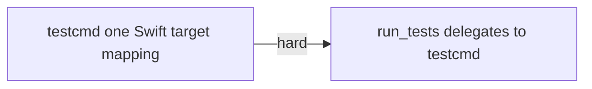

# Superlite: one Swift `-only-testing` mapping, by target membership (B71)

**Goal:** fix #431: `testcmd.only_testing` (used by `testcmd.resolve`, so by `testcmd.py --fast`) still builds target-less `-only-testing:<Suite>` ids and leaves Swift Testing `name()` ids unquoted, while `run_tests` (B64) has its own Target/Suite mapping; a test target whose folder name differs from its target name runs unfiltered; a generated project (XcodeGen, Tuist; not in git) is mapped by folder names only. Expected: one mapping for every caller, and a filtered run for both cases.
**Architecture:** the mapping moves into `testcmd.py` and gains target membership: an OpenStep plist parser reads each `project.pbxproj`; every native target's `PBXSourcesBuildPhase` files (paths resolved through the group tree) and `fileSystemSynchronizedGroups` folders give file and folder membership; `Package.swift` test targets add their `path:` folder. `owning_test_target` asks membership first, then B64's folder-name rule. `testcmd.only_testing` returns shell-quoted Target/Suite ids or None (a path outside every test target), and `testcmd.resolve` then runs the unfiltered `test` command. `run_tests.fast_spec` becomes `testcmd.resolve` plus its own `run_tests:` note prefix; run_tests keeps the helper names as aliases of testcmd's.
**Tech stack:** Python 3.10+ stdlib, pytest (through `sl run_tests`).
**Spec:** this file, section Design; issue #431's Expected line.
**Detail:** tests
**Target-min:** 11
**Wave0:** none
**Max chars:** 32000

Global constraints:
- Every new or changed code line in `skills/subagent-driven-development/scripts/` carries the repo's trailing `# O(...)` complexity comment (short notes after `|`); tests do not. Stdlib only.
- Existing tests stay green. The only existing test files that change are the five named in T1's Notes, each only as stated there. If any other existing test turns red, report it in DONE_WITH_CONCERNS with the test id and the reason instead of editing it.
- Run `sl` as an executable (`<abs>/sl ...`). Verify with the task's own `--fast` command (see the task), `--task Tn --background`, then run the printed `wait:` line in the foreground and end the turn only after it reports.
- No version edits (the ship step bumps the version). Touch only the files in Owns; docs (`docs/tools.md`, `docs/language.md`) stay unchanged (outside B71's files).

Ruling: the one mapping lives in `testcmd.py` (the lower module: run_tests imports testcmd, never the reverse); `run_tests.swift_test_targets`, `owning_test_target` and `xcode_only_testing` stay as aliases of testcmd's functions so B64's tests and callers keep working - cost if wrong: three alias lines.
Ruling: membership comes from parsing `project.pbxproj` as an OpenStep plist (new `testcmd.parse_plist`), not from regexes: group paths, `SOURCE_ROOT` files and synchronized folders need the object graph - cost if wrong: about 50 lines of parser.
Ruling: a pbxproj that does not parse (merge conflict markers, truncation) adds no targets; the folder conventions take over, as with no project - cost if wrong: such a project runs by folder names until it is fixed.
Ruling: lookup order: (1) a file listed in a target's Sources phase maps to its first test target by name, or None when only non-test targets list it; (2) else the deepest folder in the map (a synchronized folder, a SwiftPM test target path, or a folder holding listed files) maps to its first test target by name when every target there is a test target, else None; (3) else B64's folder-name rule - cost if wrong: a new file in a folder mixing app and test files runs unfiltered.
Ruling: synchronized-group membership exceptions (`PBXFileSystemSynchronizedBuildFileExceptionSet`) are ignored: a Swift file excluded from its folder's test target is rare - cost if wrong: that file maps to the folder's target.
Ruling: projects and packages are searched at the root and up to two folders down, skipping hidden folders, `SKIP_DIRS`, `Pods`, `Carthage` and `DerivedData` (Tuist `Projects/App/App.xcodeproj`, monorepo `apps/ios/`); B64 searched one level - cost if wrong: a deeper project maps by folder names.
Ruling: a generated project (XcodeGen, Tuist) is read from disk like any other (git status plays no part); its manifests (`project.yml`, `Project.swift`) are not parsed, since xcodebuild needs the generated project anyway - cost if wrong: a project not generated yet maps by folder names.
Ruling: a Swift file in a test target that declares no suite (or cannot be read) maps to `-only-testing:<Target>` with the note `<p> declares no test suite; using -only-testing:<Target>` (B64's target-wide run; testcmd's old stem fallback ran zero tests) - cost if wrong: the target's whole suite runs.
Ruling: notes (`not in a test target`, `declares no test suite`) go to a `notes` list when the caller passes one, else to stderr with the `testcmd: ` prefix; `run_tests.fast_spec` prints them with `run_tests: ` unless `quiet` - cost if wrong: none.
Ruling: detail tests; two tasks in one chain (T2's tests run T1's code; `testcmd.py` is one file); no probe adapter (library tested in-process and through both CLIs) - cost if wrong: no generated probes.
Ruling: already in the lead worktree on branch superlite/b71-swift-only-testing-single-mapping - cost if wrong: none.
LAYERS: unit



## Design

1. `testcmd.parse_plist(text: str) -> dict | list | str`: parses an OpenStep (old-style ASCII) plist: dict `{ key = value; ... }`, array `( v, v, )` (trailing comma allowed), quoted string `"..."` with escapes `\"`, `\\`, `\n`, `\t`, `\UXXXX` (other escaped characters stand for themselves), unquoted string of `[\w$+/:.\-@~]` characters, data `<hex>` kept as its text; `/* */` and `//` comments skipped. Exactly one value, then only whitespace and comments; anything else raises ValueError (unterminated string or comment, missing `=` or `;`, stray characters such as `<<<<<<<`). Iterative or recursive; pbxproj nesting is shallow.
2. `testcmd.pbx_members(pbxproj: Path, root: Path) -> tuple[set[str], dict[str, set[str]], dict[str, set[str]]]`: (test target names, file -> targets, folder -> targets) of one project. Paths are posix, normalized, relative to `root` (the project folder is the `.xcodeproj` folder's parent, joined with PBXProject `projectDirPath`). Objects: the root's `objects` dict (missing: nothing). Targets: every `PBXNativeTarget` with a non-empty `name`; test targets have productType `com.apple.product-type.bundle.unit-test` or `bundle.ui-testing`. Files: each target's `buildPhases` entry of isa `PBXSourcesBuildPhase`, its `files` -> `PBXBuildFile.fileRef` -> the reference's path. Folders: each target's `fileSystemSynchronizedGroups` entries' paths, plus the parent folder of every listed file. Path of an object: `sourceTree` `<group>` (also when missing) = its parent group's path joined with its `path` (none: the parent's own path); the main group, or an object with no parent group, sits in the project folder; `SOURCE_ROOT` = the project folder joined with `path`; `<absolute>` = `path` relative to `root` when inside it; any other tree, a path leaving `root`, a dangling id or a parent cycle gives no path (that entry is skipped). Parent groups come from the `children` lists of all objects. A file that does not parse: ValueError, the caller skips the project.
3. `testcmd.swift_target_map(root: Path) -> dict`: `{"tests": set[str], "files": dict[str, set[str]], "dirs": dict[str, set[str]]}`, the union over every `*.xcodeproj/project.pbxproj` (via `pbx_members`, unreadable or unparsable ones skipped) and every `Package.swift` at the root or up to two folders down (search skips hidden folders, `SKIP_DIRS`, `Pods`, `Carthage`, `DerivedData`; it never enters an `.xcodeproj`). A `Package.swift` adds each `.testTarget(...)` found in `strip_swift(text)` (so a commented-out one is skipped): its name is the call's first `name: "..."` at the call's own bracket depth, its folder the `path: "..."` there, else `Tests/<name>`, relative to the package folder; the name goes into `tests` and the folder into `dirs`.
4. `testcmd.swift_test_targets(root: Path) -> set[str]`: `swift_target_map(root)["tests"]`.
5. `testcmd.owning_test_target(path: str, targets: set[str], members: dict | None = None) -> str | None`: with `members` (a `swift_target_map` result): a `path` in `members["files"]` gives the sorted-first test target of its set, or None when none is a test target; else the deepest ancestor folder of `path` in `members["dirs"]` gives its sorted-first target when every target in its set is in `members["tests"]`, else None; else, and without `members`, B64's folder-name rule unchanged (targets given: the nearest folder named like one; none: `Tests/<Target>/`, else the nearest folder ending in `Tests`).
6. `testcmd.xcode_only_testing(root: Path, paths: list[str], notes: list | None = None) -> tuple[str | None, str | None]`: B64's function moved from run_tests (absolute paths made relative to `root`, `shlex.quote` per id, de-duplicated, suites from `swift_suites`), using `swift_target_map(root)` once and `owning_test_target(rel, map["tests"], map)`. A mapped path with no suite (not Swift, unreadable, or none declared) uses `<Target>` and, when `notes` is a list and the path ends in `.swift`, appends `<rel> declares no test suite; using -only-testing:<Target>`. Returns `(ids, None)`, or `(None, rel)` at the first unmapped path.
7. `testcmd.only_testing(paths, root=".", notes: list | None = None) -> str | None`: `""` for no paths; else `xcode_only_testing(Path(root), list(paths), said)`; an unmapped path adds `<rel> is not in a test target; running the unfiltered test command` and returns None. With `notes` None each note is printed to stderr as `testcmd: <note>`; with a list they are appended to it.
8. `testcmd.resolve(root=".", paths=(), notes: list | None = None)`: as today, except a command holding `{only_testing}` with paths calls `only_testing(paths, root, notes)`; None switches to the unfiltered `cfg["test"]` command (its `{names}` and `{only_testing}` become empty, as in a full run). The returned dict keeps its keys.
9. `run_tests.fast_spec(paths: list[str], quiet: bool = False)`: `testcmd.resolve(".", paths, notes=notes)`, then prints each note as `run_tests: <note>` on stderr unless `quiet`. run_tests drops its own `PBX_*` and `SPM_TEST_TARGET` patterns and the bodies of `swift_test_targets`, `owning_test_target` and `xcode_only_testing`, keeping the three names as aliases of testcmd's. The run_tests module docstring line on the Swift mapping names the membership lookup.

## Coverage

| Category | State | Basis |
|---|---|---|
| Scope and success criteria | settled | #431 Expected line |
| Domain and data model | ruled | membership map tests/files/dirs |
| Persistence and migration | n/a | nothing stored |
| Interfaces and contracts | ruled | `only_testing` returns None for unmapped; `notes` keyword; run_tests aliases |
| UI states | n/a | CLI text only |
| Concurrency and state ownership | n/a | read-only file parsing |
| Error handling and recovery | ruled | unparsable pbxproj skipped; cycles and dangling ids skipped |
| Security and privacy | n/a | local files the user's own command reads |
| Performance and limits | ruled | two folders deep; one parse per run |
| Observability | ruled | `testcmd:` / `run_tests:` notes |
| Testing strategy | settled | two new test files; five pinned asserts updated |
| Compatibility | ruled | B64 tests unchanged; stem fallback replaced by target-wide ids |
| Rollout | ruled | one PR; version bump at ship |
| Research unknowns | n/a | pbxproj format known (Xcode 15/16 objects) |

## File structure
- `skills/subagent-driven-development/scripts/testcmd.py`: `parse_plist`, `pbx_members`, `swift_target_map`, `swift_test_targets`, `owning_test_target`, `xcode_only_testing`, `only_testing`, `resolve` (T1).
- `tests/scripts/test_testcmd_swift_targets_431.py`: T1's cases below (T1).
- `tests/scripts/test_testcmd_xcode_suites.py`, `tests/scripts/test_testcmd_xcode.py`, `tests/scripts/test_testcmd_placeholder_gate.py`, `tests/scripts/test_session_cost_testcmd.py`: the pinned stem-fallback asserts only (T1 Notes).
- `skills/subagent-driven-development/scripts/run_tests.py`: `fast_spec` delegates; aliases (T2).
- `tests/scripts/test_run_tests_swift_membership_431.py`: T2's cases (T2).

## Task graph

```mermaid
%% schedule
gantt
  title Predicted schedule (mm:ss)
  dateFormat X
  axisFormat %M:%S
  section lane 1
  T1 testcmd one Swift target mapping :t1, 0, 121s
  T2 run_tests delegates to testcmd :t2, 121, 71s
```




critical path: T1 → T2 (3.2 min) · peak width 1 · predicted build 3.2 min · predicted total ≈ 6.7 min (target ✓)

## Package: Swift test target mapping (library + two CLIs)
App type: library / CLI. Categories: deep (group trees, cycles), encoding (quoted plist strings, spaces, `()` ids), file (unparsable or missing projects, search depth, skipped folders), protocol (id quoting, note texts, unfiltered fallback).
**Probe entry:** none (Ruling: no probe adapter).

### T1 testcmd one Swift target mapping · Complexity 6 · Est. context 62k
**Owns:** skills/subagent-driven-development/scripts/testcmd.py, tests/scripts/test_testcmd_swift_targets_431.py, tests/scripts/test_testcmd_xcode_suites.py, tests/scripts/test_testcmd_xcode.py, tests/scripts/test_testcmd_placeholder_gate.py, tests/scripts/test_session_cost_testcmd.py
**Components:** 3
**LOC owned:** 260
**Tests:** fast
**Model:** sonnet
**Est. time:** 4.5 min (3 components, about 260 LOC, fast tests)
**Covers:** 1, 2, 3, 4, 5, 6, 7, 8
**Consumes:** existing `testcmd.strip_swift(text: str) -> str` · existing `testcmd.swift_suites(text: str) -> list[str]` · existing `testcmd.read_config(root: Path)`
**Produces:** testcmd.parse_plist(text: str) -> dict · testcmd.swift_target_map(root: Path) -> dict · testcmd.swift_test_targets(root: Path) -> set[str] · testcmd.owning_test_target(path: str, targets: set[str], members: dict | None = None) -> str | None · testcmd.xcode_only_testing(root: Path, paths: list[str], notes: list | None = None) -> tuple · testcmd.only_testing(paths: list[str], root: str = ".", notes: list | None = None) -> str | None · testcmd.resolve(root: str = ".", paths: tuple = (), notes: list | None = None) -> dict
e.g. only_testing(["Tests/Unit/FooTests.swift"], root) -> "-only-testing:AppTests/FooTests" (target AppTests lists that file)
e.g. only_testing(["App/ContentView.swift"], root, notes) -> None, notes == ["App/ContentView.swift is not in a test target; running the unfiltered test command"]
e.g. only_testing(["Support/Shared.swift"], root, notes) -> "-only-testing:AppTests", notes == ["Support/Shared.swift declares no test suite; using -only-testing:AppTests"]
**Review Focus:** deep: `test_group_cycle_ends`, `test_nested_project_paths_are_root_relative`; encoding: `test_parse_plist_values`, `test_only_testing_quotes_free_function`; file: `test_parse_plist_malformed_raises`, `test_unparsable_pbxproj_falls_back_to_folders`, `test_project_search_depth_and_skips`; protocol: `test_resolve_unmapped_runs_unfiltered`, `test_cli_fast_uses_target_ids`.
**Test code (verbatim):**
```python
"""testcmd owns the one Swift -only-testing mapping: target membership from the Xcode project and Package.swift paths (#431)."""
import json
import subprocess
import sys
from pathlib import Path

import pytest

SCRIPTS = Path(__file__).resolve().parents[2] / "skills" / "subagent-driven-development" / "scripts"
sys.path.insert(0, str(SCRIPTS))
import testcmd  # noqa: E402

PBX = """// !$*UTF8*$!
{
    archiveVersion = 1;
    classes = {
    };
    objectVersion = 77;
    objects = {

/* Begin PBXBuildFile section */
        C1 /* FooTests.swift in Sources */ = {isa = PBXBuildFile; fileRef = F1 /* FooTests.swift */; };
        C2 /* ContentView.swift in Sources */ = {isa = PBXBuildFile; fileRef = F2 /* ContentView.swift */; };
        C3 /* Shared.swift in Sources */ = {isa = PBXBuildFile; fileRef = F3 /* Shared.swift */; };
/* End PBXBuildFile section */

/* Begin PBXFileReference section */
        F1 /* FooTests.swift */ = {isa = PBXFileReference; lastKnownFileType = sourcecode.swift; path = FooTests.swift; sourceTree = "<group>"; };
        F2 /* ContentView.swift */ = {isa = PBXFileReference; lastKnownFileType = sourcecode.swift; path = ContentView.swift; sourceTree = "<group>"; };
        F3 /* Shared.swift */ = {isa = PBXFileReference; lastKnownFileType = sourcecode.swift; path = Support/Shared.swift; sourceTree = SOURCE_ROOT; };
        F4 /* App.app */ = {isa = PBXFileReference; explicitFileType = wrapper.application; path = App.app; sourceTree = BUILT_PRODUCTS_DIR; };
/* End PBXFileReference section */

/* Begin PBXFileSystemSynchronizedRootGroup section */
        S1 /* Snapshots */ = {isa = PBXFileSystemSynchronizedRootGroup; path = Snapshots; sourceTree = "<group>"; };
/* End PBXFileSystemSynchronizedRootGroup section */

/* Begin PBXGroup section */
        G0 = {
            isa = PBXGroup;
            children = (
                G1 /* App */,
                G2 /* Tests */,
            );
            sourceTree = "<group>";
        };
        G1 /* App */ = {
            isa = PBXGroup;
            children = (
                F2 /* ContentView.swift */,
            );
            path = App;
            sourceTree = "<group>";
        };
        G2 /* Tests */ = {
            isa = PBXGroup;
            children = (
                G3 /* Unit Tests */,
                S1 /* Snapshots */,
            );
            path = Tests;
            sourceTree = "<group>";
        };
        G3 /* Unit Tests */ = {
            isa = PBXGroup;
            children = (
                F1 /* FooTests.swift */,
            );
            name = "Unit Tests";
            path = Unit;
            sourceTree = "<group>";
        };
/* End PBXGroup section */

/* Begin PBXNativeTarget section */
        A1 /* App */ = {
            isa = PBXNativeTarget;
            buildPhases = (
                B1 /* Sources */,
            );
            name = App;
            productReference = F4 /* App.app */;
            productType = "com.apple.product-type.application";
        };
        A2 /* AppTests */ = {
            isa = PBXNativeTarget;
            buildPhases = (
                B2 /* Sources */,
            );
            name = AppTests;
            productType = "com.apple.product-type.bundle.unit-test";
        };
        A3 /* App SnapshotTests */ = {
            isa = PBXNativeTarget;
            buildPhases = (
                B3 /* Sources */,
            );
            fileSystemSynchronizedGroups = (
                S1 /* Snapshots */,
            );
            name = "App SnapshotTests";
            productType = "com.apple.product-type.bundle.unit-test";
        };
/* End PBXNativeTarget section */

/* Begin PBXProject section */
        P0 /* Project object */ = {
            isa = PBXProject;
            mainGroup = G0;
            projectDirPath = "";
            projectRoot = "";
            targets = (
                A1 /* App */,
                A2 /* AppTests */,
                A3 /* App SnapshotTests */,
            );
        };
/* End PBXProject section */

/* Begin PBXSourcesBuildPhase section */
        B1 /* Sources */ = {isa = PBXSourcesBuildPhase; files = (C2 /* ContentView.swift in Sources */, ); };
        B2 /* Sources */ = {isa = PBXSourcesBuildPhase; files = (C1 /* FooTests.swift in Sources */, C3 /* Shared.swift in Sources */, ); };
        B3 /* Sources */ = {isa = PBXSourcesBuildPhase; files = ( ); };
/* End PBXSourcesBuildPhase section */
    };
    rootObject = P0 /* Project object */;
}
"""
SUITE = "import XCTest\nfinal class {0}: XCTestCase {{\n    func testA() {{}}\n}}\n"
FILES = {
    "Tests/Unit/FooTests.swift": SUITE.format("FooTests"),
    "Tests/Unit/NewTests.swift": SUITE.format("NewTests"),
    "Tests/Snapshots/Views/CardTests.swift": SUITE.format("CardTests"),
    "App/ContentView.swift": "struct ContentView {}\n",
    "App/Model.swift": "struct Model {}\n",
    "Support/Shared.swift": "func shared() -> Int { 1 }\n",
}
CYCLE = ('{ objects = { G9 = { isa = PBXGroup; children = ( ); sourceTree = "<group>"; }; '
         'G0 = { isa = PBXGroup; children = ( G1 ); path = a; sourceTree = "<group>"; }; '
         'G1 = { isa = PBXGroup; children = ( G0, F1 ); path = b; sourceTree = "<group>"; }; '
         'F1 = { isa = PBXFileReference; path = X.swift; sourceTree = "<group>"; }; '
         'C1 = { isa = PBXBuildFile; fileRef = F1; }; B1 = { isa = PBXSourcesBuildPhase; files = ( C1 ); }; '
         'A1 = { isa = PBXNativeTarget; name = T; buildPhases = ( B1 ); productType = "com.apple.product-type.bundle.unit-test"; }; '
         'P0 = { isa = PBXProject; mainGroup = G9; }; }; rootObject = P0; }')


def project(root, sub=""):
    base = root / sub if sub else root
    (base / "App.xcodeproj").mkdir(parents=True)
    (base / "App.xcodeproj" / "project.pbxproj").write_text(PBX, encoding="utf-8")
    for rel, text in FILES.items():
        (base / rel).parent.mkdir(parents=True, exist_ok=True)
        (base / rel).write_text(text, encoding="utf-8")
    return root


def config(root, cfg):
    (root / ".superlite").mkdir(exist_ok=True)
    (root / ".superlite" / "test-cmd.json").write_text(json.dumps(cfg), encoding="utf-8")


def test_parse_plist_values():
    got = testcmd.parse_plist('// !$*UTF8*$!\n{ a = 1; b = "x \\"y\\""; /* c */ c = ( p, "q r", ); '
                              'd = { e = <0fbd>; }; f = Sources/App.swift; }')
    assert got == {"a": "1", "b": 'x "y"', "c": ["p", "q r"], "d": {"e": "<0fbd>"}, "f": "Sources/App.swift"}


@pytest.mark.parametrize("text", ["{ a = 1; ", "{ a = ( 1, 2 ; }", "<<<<<<< HEAD\n{ a = 1; }", "{ a 1; }",
                                  '{ a = "open; }', "{ a = 1; } x", "{ a = 1; /* never closed }"])
def test_parse_plist_malformed_raises(text):
    with pytest.raises(ValueError):
        testcmd.parse_plist(text)


def test_membership_from_pbxproj(tmp_path):
    m = testcmd.swift_target_map(project(tmp_path))
    assert m["tests"] == {"AppTests", "App SnapshotTests"}
    assert m["files"]["Tests/Unit/FooTests.swift"] == {"AppTests"}
    assert m["files"]["Support/Shared.swift"] == {"AppTests"}
    assert m["files"]["App/ContentView.swift"] == {"App"}
    assert m["dirs"]["Tests/Snapshots"] == {"App SnapshotTests"}
    assert m["dirs"]["Tests/Unit"] == {"AppTests"}
    assert m["dirs"]["App"] == {"App"}
    assert "App.app" not in m["files"]


@pytest.mark.parametrize("rel,want", [
    ("Tests/Unit/FooTests.swift", "AppTests"),
    ("Tests/Unit/NewTests.swift", "AppTests"),
    ("Tests/Unit/Helpers/Fake.swift", "AppTests"),
    ("Tests/Snapshots/Views/CardTests.swift", "App SnapshotTests"),
    ("Support/Shared.swift", "AppTests"),
    ("App/ContentView.swift", None),
    ("App/Model.swift", None),
    ("Docs/Readme.swift", None),
])
def test_owning_test_target_by_membership(tmp_path, rel, want):
    m = testcmd.swift_target_map(project(tmp_path))
    assert testcmd.owning_test_target(rel, m["tests"], m) == want


def test_owning_without_members_keeps_folder_rule():
    assert testcmd.owning_test_target("AppTests/FooTests.swift", {"AppTests"}) == "AppTests"
    assert testcmd.owning_test_target("Tests/Unit/FooTests.swift", {"AppTests"}) is None
    assert testcmd.owning_test_target("Tests/CoreTests/BarTests.swift", set()) == "CoreTests"


def test_only_testing_maps_member_files(tmp_path):
    root = project(tmp_path)
    assert testcmd.only_testing(["Tests/Unit/FooTests.swift", "Tests/Snapshots/Views/CardTests.swift"], root) == (
        "-only-testing:AppTests/FooTests '-only-testing:App SnapshotTests/CardTests'")


def test_only_testing_source_path_is_none_with_note(tmp_path):
    root = project(tmp_path)
    notes = []
    assert testcmd.only_testing(["Tests/Unit/FooTests.swift", "App/ContentView.swift"], root, notes) is None
    assert notes == ["App/ContentView.swift is not in a test target; running the unfiltered test command"]


def test_only_testing_helper_runs_its_target(tmp_path):
    root = project(tmp_path)
    notes = []
    assert testcmd.only_testing(["Support/Shared.swift"], root, notes) == "-only-testing:AppTests"
    assert notes == ["Support/Shared.swift declares no test suite; using -only-testing:AppTests"]


def test_only_testing_prints_notes_without_a_list(tmp_path, capsys):
    root = project(tmp_path)
    assert testcmd.only_testing(["App/Model.swift"], root) is None
    assert capsys.readouterr().err == "testcmd: App/Model.swift is not in a test target; running the unfiltered test command\n"


def test_only_testing_empty_paths():
    assert testcmd.only_testing([]) == ""


def test_only_testing_quotes_free_function(tmp_path):
    f = tmp_path / "Tests" / "KitTests" / "FreeTests.swift"
    f.parent.mkdir(parents=True)
    f.write_text("import Testing\n@Test func adds() {}\n", encoding="utf-8")
    assert testcmd.only_testing(["Tests/KitTests/FreeTests.swift"], tmp_path) == "'-only-testing:KitTests/adds()'"


def test_only_testing_target_less_path_is_none(tmp_path):
    (tmp_path / "FooTests.swift").write_text(SUITE.format("FooTests"), encoding="utf-8")
    assert testcmd.only_testing(["FooTests.swift"], tmp_path, []) is None


def test_nested_project_paths_are_root_relative(tmp_path):
    project(tmp_path, "ios")
    m = testcmd.swift_target_map(tmp_path)
    assert testcmd.owning_test_target("ios/Tests/Unit/FooTests.swift", m["tests"], m) == "AppTests"
    assert testcmd.owning_test_target("ios/App/ContentView.swift", m["tests"], m) is None
    assert testcmd.only_testing(["ios/Tests/Unit/FooTests.swift"], tmp_path) == "-only-testing:AppTests/FooTests"


def test_project_search_depth_and_skips(tmp_path):
    project(tmp_path, "apps/ios")
    for skip in (".build/dep", "node_modules/pkg", "Pods/Dep", "DerivedData/Dep", "a/b/c"):
        (tmp_path / skip).mkdir(parents=True)
        (tmp_path / skip / "Package.swift").write_text('.testTarget(name: "DepTests")\n', encoding="utf-8")
    assert testcmd.swift_test_targets(tmp_path) == {"AppTests", "App SnapshotTests"}


def test_package_test_target_path(tmp_path):
    (tmp_path / "Kit").mkdir()
    (tmp_path / "Kit" / "Package.swift").write_text(
        'let package = Package(name: "Kit", targets: [\n'
        '    .target(name: "Kit", path: "Sources/KitCore"),\n'
        '    // .testTarget(name: "OldTests"),\n'
        '    .testTarget(\n        name: "KitTests",\n'
        '        dependencies: ["Kit", .product(name: "Nimble", package: "Nimble")],\n'
        '        path: "Tests/Unit"\n    ),\n'
        '    .testTarget(name: "KitUITests", dependencies: ["Kit"]),\n])\n', encoding="utf-8")
    m = testcmd.swift_target_map(tmp_path)
    assert m["tests"] == {"KitTests", "KitUITests"}
    assert m["dirs"]["Kit/Tests/Unit"] == {"KitTests"}
    assert m["dirs"]["Kit/Tests/KitUITests"] == {"KitUITests"}
    assert testcmd.owning_test_target("Kit/Tests/Unit/ParserTests.swift", m["tests"], m) == "KitTests"


def test_generated_project_ignored_by_git_is_read(tmp_path):
    subprocess.run(["git", "init", "-q"], cwd=tmp_path, check=True)
    (tmp_path / ".gitignore").write_text("*.xcodeproj/\n", encoding="utf-8")
    (tmp_path / "project.yml").write_text("name: App\n", encoding="utf-8")
    root = project(tmp_path)
    assert testcmd.only_testing(["Tests/Unit/NewTests.swift"], root) == "-only-testing:AppTests/NewTests"


def test_unparsable_pbxproj_falls_back_to_folders(tmp_path):
    (tmp_path / "App.xcodeproj").mkdir()
    (tmp_path / "App.xcodeproj" / "project.pbxproj").write_text("<<<<<<< HEAD\n{\n", encoding="utf-8")
    f = tmp_path / "Tests" / "KitTests" / "FooTests.swift"
    f.parent.mkdir(parents=True)
    f.write_text(SUITE.format("FooTests"), encoding="utf-8")
    assert testcmd.swift_test_targets(tmp_path) == set()
    assert testcmd.only_testing(["Tests/KitTests/FooTests.swift"], tmp_path) == "-only-testing:KitTests/FooTests"


def test_group_cycle_ends(tmp_path):
    (tmp_path / "A.xcodeproj").mkdir()
    (tmp_path / "A.xcodeproj" / "project.pbxproj").write_text(CYCLE, encoding="utf-8")
    m = testcmd.swift_target_map(tmp_path)
    assert m["tests"] == {"T"} and m["files"] == {} and m["dirs"] == {}


def test_resolve_unmapped_runs_unfiltered(tmp_path, capsys):
    root = project(tmp_path)
    config(root, {"language": "swift", "test": "xcodebuild test -scheme App {only_testing}",
                  "test_file": "xcodebuild test -scheme App {only_testing}"})
    assert testcmd.resolve(root, ["App/ContentView.swift"])["command"] == "xcodebuild test -scheme App "
    assert ("testcmd: App/ContentView.swift is not in a test target; running the unfiltered test command"
            in capsys.readouterr().err)
    notes = []
    spec = testcmd.resolve(root, ["Tests/Unit/FooTests.swift"], notes=notes)
    assert spec["command"] == "xcodebuild test -scheme App -only-testing:AppTests/FooTests" and notes == []
    assert capsys.readouterr().err == ""


def test_cli_fast_uses_target_ids(tmp_path):
    root = project(tmp_path)
    config(root, {"language": "swift", "test": "xcodebuild test -scheme App",
                  "test_file": "xcodebuild test -scheme App {only_testing}"})
    r = subprocess.run([sys.executable, str(SCRIPTS / "testcmd.py"), "--root", str(root), "--fast",
                        "Tests/Snapshots/Views/CardTests.swift"], capture_output=True, text=True, timeout=60)
    assert r.returncode == 0, r.stderr
    assert json.loads(r.stdout)["command"] == "xcodebuild test -scheme App '-only-testing:App SnapshotTests/CardTests'"
```
**Steps:** 1 write the test file, 2 run: FAIL, 3 implement Design 1-8 in testcmd.py and update the five pinned asserts (Notes), 4 run: PASS
**Verify:** `<abs sl> run_tests --fast tests/scripts/test_testcmd_swift_targets_431.py tests/scripts/test_testcmd_xcode_suites.py tests/scripts/test_testcmd_xcode.py tests/scripts/test_testcmd_placeholder_gate.py tests/scripts/test_session_cost_testcmd.py tests/scripts/test_testcmd_swift_strip.py tests/scripts/test_run_tests_swift_only_testing.py tests/scripts/test_run_tests_placeholder_gate.py --task T1 --background`
**Notes:** These five existing asserts pinned the old stem fallback (now the target-wide id) and change exactly so: `tests/scripts/test_testcmd_xcode_suites.py::test_no_suite_falls_back_with_warning` expects `"-only-testing:KitTests"` and `"Tests/KitTests/Helpers.swift declares no test suite; using -only-testing:KitTests" in err`; `::test_missing_file_falls_back` expects `out == "-only-testing:KitTests"` (its `"declares no test suite"` check stays); `tests/scripts/test_testcmd_xcode.py::test_only_testing_placeholder` calls `testcmd.only_testing([p], tmp_path)` and expects `"-only-testing:CoreTests"` there and `"xcodebuild test -scheme X -only-testing:CoreTests"` for the command; `tests/scripts/test_testcmd_placeholder_gate.py::test_only_testing_template_still_warns` expects command `"xcodebuild test -scheme X -only-testing:AppTests"` and stderr holding `"testcmd: Tests/AppTests/Empty.swift declares no test suite; using -only-testing:AppTests"`; `tests/scripts/test_session_cost_testcmd.py::test_swift_fast_keeps_only_testing` writes `"final class LibraryTests: XCTestCase {\n    func testA() {}\n}\n"` instead of `"x\n"` (its assert stays). Keep run_tests.py unchanged in T1 (T2 removes its copies). `xcode_only_testing` and `owning_test_target` move from run_tests.py lines 905-939 with B64's behaviour; remove testcmd's old `Tests/`-index logic. Update testcmd's module docstring lines 11-12 (the `{only_testing}` line and the Library list).

### T2 run_tests delegates to testcmd · Complexity 3 · Est. context 40k
**Owns:** skills/subagent-driven-development/scripts/run_tests.py, tests/scripts/test_run_tests_swift_membership_431.py
**Components:** 1
**LOC owned:** 70
**Tests:** fast
**Model:** sonnet
**Est. time:** 1.8 min (1 component, about 70 LOC, fast tests)
**Covers:** 9
**Consumes:** testcmd.resolve(root: str = ".", paths: tuple = (), notes: list | None = None) -> dict (T1) · testcmd.swift_test_targets(root: Path) -> set[str] (T1) · testcmd.owning_test_target(path: str, targets: set[str], members: dict | None = None) -> str | None (T1) · testcmd.xcode_only_testing(root: Path, paths: list[str], notes: list | None = None) -> tuple (T1)
**Produces:** run_tests.fast_spec(paths: list[str], quiet: bool = False) -> dict | None
**Review Focus:** protocol: `test_fast_helper_note_has_run_tests_prefix`, `test_background_parent_prints_no_note`; file: `test_fast_folder_differs_from_target_runs_filtered`.
**Test code (verbatim):**
```python
"""run_tests --fast uses testcmd's one Swift mapping: a test target whose folder differs from its name runs filtered (#431)."""
import json
import subprocess
import sys
from pathlib import Path

SCRIPTS = Path(__file__).resolve().parents[2] / "skills" / "subagent-driven-development" / "scripts"
RUN_TESTS = SCRIPTS / "run_tests.py"
sys.path.insert(0, str(SCRIPTS))
import run_tests  # noqa: E402
import testcmd  # noqa: E402

PBX = ('// !$*UTF8*$!\n{ objects = {\n'
       'S1 = { isa = PBXFileSystemSynchronizedRootGroup; path = "Unit Tests"; sourceTree = "<group>"; };\n'
       'G0 = { isa = PBXGroup; children = ( S1 ); sourceTree = "<group>"; };\n'
       'A1 = { isa = PBXNativeTarget; name = AppTests; fileSystemSynchronizedGroups = ( S1 ); '
       'productType = "com.apple.product-type.bundle.unit-test"; };\n'
       'P0 = { isa = PBXProject; mainGroup = G0; };\n}; rootObject = P0; }\n')
OK = "echo 'Executed 1 test, with 0 failures (0 unexpected) in 0.1 (0.1) seconds'"
CFG = {"language": "swift", "test": f"echo FULL > .superlite/got.txt; {OK}",
       "test_file": f"printf '%s\\n' {{only_testing}} > .superlite/got.txt; {OK}"}


def repo(tmp_path):
    subprocess.run(["git", "init", "-q"], cwd=tmp_path, check=True)
    (tmp_path / "App.xcodeproj").mkdir()
    (tmp_path / "App.xcodeproj" / "project.pbxproj").write_text(PBX, encoding="utf-8")
    (tmp_path / "Unit Tests").mkdir()
    (tmp_path / "Unit Tests" / "FooTests.swift").write_text(
        "import XCTest\nfinal class FooTests: XCTestCase {\n    func testA() {}\n}\n", encoding="utf-8")
    (tmp_path / "Unit Tests" / "Helpers.swift").write_text("func helper() -> Int { 1 }\n", encoding="utf-8")
    (tmp_path / ".superlite").mkdir()
    (tmp_path / ".superlite" / "test-cmd.json").write_text(json.dumps(CFG), encoding="utf-8")
    return tmp_path


def rt(cwd, *args):
    return subprocess.run([sys.executable, str(RUN_TESTS), *args], cwd=cwd, capture_output=True, text=True, timeout=120)


def got(root):
    return (root / ".superlite" / "got.txt").read_text(encoding="utf-8").splitlines()


def test_helpers_are_testcmds():
    assert run_tests.swift_test_targets is testcmd.swift_test_targets
    assert run_tests.owning_test_target is testcmd.owning_test_target
    assert run_tests.xcode_only_testing is testcmd.xcode_only_testing


def test_fast_folder_differs_from_target_runs_filtered(tmp_path):
    root = repo(tmp_path)
    r = rt(root, "--fast", "Unit Tests/FooTests.swift")
    assert r.returncode == 0, r.stderr
    assert got(root) == ["-only-testing:AppTests/FooTests"]
    assert "not in a test target" not in r.stderr


def test_fast_helper_note_has_run_tests_prefix(tmp_path):
    root = repo(tmp_path)
    r = rt(root, "--fast", "Unit Tests/Helpers.swift")
    assert r.returncode == 0, r.stderr
    assert got(root) == ["-only-testing:AppTests"]
    assert "run_tests: Unit Tests/Helpers.swift declares no test suite; using -only-testing:AppTests" in r.stderr
    assert "testcmd:" not in r.stderr


def test_fast_spec_quiet_prints_nothing(tmp_path, monkeypatch, capsys):
    root = repo(tmp_path)
    monkeypatch.chdir(root)
    spec = run_tests.fast_spec(["Unit Tests/Helpers.swift"], quiet=True)
    assert "-only-testing:AppTests" in spec["command"]
    assert capsys.readouterr().err == ""


def test_background_parent_prints_no_note(tmp_path):
    root = repo(tmp_path)
    r = rt(root, "--fast", "Unit Tests/Helpers.swift", "--background")
    assert r.returncode == 0, r.stderr
    assert "declares no test suite" not in r.stderr
    w = rt(root, "--timeout", "60", "--wait")
    assert w.returncode == 0, w.stdout + w.stderr
    assert got(root) == ["-only-testing:AppTests"]
```
**Steps:** 1 write the test file, 2 run: FAIL, 3 implement Design 9, 4 run: PASS
**Verify:** `<abs sl> run_tests --fast tests/scripts/test_run_tests_swift_membership_431.py tests/scripts/test_run_tests_swift_only_testing.py tests/scripts/test_run_tests_placeholder_gate.py tests/scripts/test_session_cost_testcmd.py tests/scripts/test_testcmd_swift_targets_431.py --task T2 --background`
**Notes:** `fast_spec` keeps its signature and callers (`run` and the `--background` parent with `quiet=True`). Its old early-return conditions (no paths, no `{only_testing}`, no `test` string, python) are all handled inside `testcmd.resolve` now. The B64 message `run_tests: <p> is not in a test target; running the unfiltered test command` comes out unchanged as a `run_tests: ` note. Drop `PBX_TARGET`, `PBX_TEST_TYPE`, `PBX_NAME`, `SPM_TEST_TARGET` and the three function bodies (run_tests.py lines 876-939); put `swift_test_targets = testcmd.swift_test_targets`, `owning_test_target = testcmd.owning_test_target`, `xcode_only_testing = testcmd.xcode_only_testing` there with a comment naming #431. Keep `shlex` and `re` imports only if still used elsewhere in run_tests.py. Update the docstring line 40 to say the target comes from the project's target membership (Sources phase files, synchronized folders, Package.swift paths), then the folder names.

## Self-review
Coverage: Design 1-8 in T1, 9 in T2. No placeholders. T2's Consumes match T1's Produces. One hard edge (T2's tests run T1's code; Swift-free but same-module import chain). No shared files.
