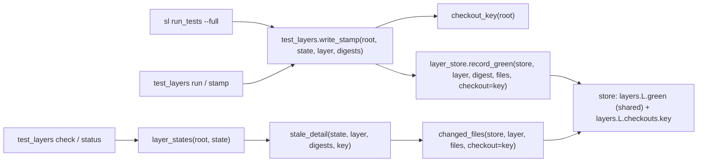

# Superlite: test_layers keeps the last green file manifest per checkout (B70)

**Goal:** fix #430: `test_layers check` and `status` name stale files against the last green manifest of any worktree, because `scripts/layer_store.py` keeps one shared `files` list per layer. Expected: the manifest is keyed by checkout root, so one worktree's stamp never reads stale from another's files.
**Architecture:** `layer_store.record_green`, `changed_files` and `has_manifest` take an optional `checkout` keyword. With it, the manifest lives under `layers.<layer>.checkouts.<checkout>`; without it, the legacy shared `files` slot is used as today. The green digest list stays shared by every checkout. `test_layers.py` passes `checkout_key(root)` (the resolved checkout root) from `write_stamp` and `layer_states`, so `run_tests`' unit stamp (it calls `write_stamp(root, ...)`) is keyed too, with no change to `run_tests.py`.
**Tech stack:** Python 3.10+ stdlib, pytest (through `sl run_tests`).
**Spec:** this file, section Design; issue #430's Expected line.
**Detail:** tests
**Target-min:** 11
**Wave0:** none
**Max chars:** 20000

Global constraints:
- Every new or changed code line in `scripts/layer_store.py` and `scripts/test_layers.py` carries the repo's trailing `# O(...)` complexity comment; tests do not. Stdlib only.
- Existing tests stay green. The only existing test file that changes is `tests/scripts/test_test_layers.py`, and only its `FakeStore` class (see T1 Notes). If another existing test turns red, report it in DONE_WITH_CONCERNS with the test id and the reason instead of editing it.
- Run `sl` as an executable (`<abs>/sl ...`). Verify with `<abs>/sl run_tests --fast tests/scripts/test_layer_manifest_checkout_430.py tests/scripts/test_layer_store.py tests/scripts/test_test_layers.py tests/scripts/test_run_tests_unit_stamp.py tests/scripts/test_layer_stamp_untracked_396.py --task T1 --background`, then run the printed `wait:` line in the foreground and end the turn only after it reports. Never raw `pytest`, never the e2e or eval layers (coordinator's step).
- No version edits (the ship step bumps the version). Touch only the files in Owns; `skills/subagent-driven-development/scripts/run_tests.py` and `docs/testing.md` stay unchanged (outside B70's files).

Ruling: the manifest is keyed by `str(Path(root).resolve())` under `layers.<layer>.checkouts`; the green digest list stays shared, because a digest green in one checkout is the same content in any other (`test_green_in_worktree_counts_in_main` pins it) - cost if wrong: none, the issue asks only for the manifest key.
Ruling: `checkout` is an optional keyword (None = the legacy shared `files` slot), so existing direct callers and `tests/scripts/test_layer_store.py` stay unchanged; every `test_layers.py` call passes it - cost if wrong: an old caller without the keyword still reads the shared slot.
Ruling: no fallback: a checkout without its own manifest reads `no green stamp`, never the shared slot or another checkout's - cost if wrong: one detail line says `no green stamp` until the checkout's first stamp after the upgrade.
Ruling: a checkout record drops the entry's legacy `files` and every checkout key whose directory no longer exists; no count cap (3 live worktrees today, each needs its own manifest) - cost if wrong: a machine with many live worktrees keeps one manifest (about 60 KB) each.
Ruling: `tests/scripts/test_test_layers.py`'s `FakeStore` gains the `checkout=None` keyword on its three manifest methods, because its in-process tests call `stale_layers` through it and would raise TypeError; no open batch lists that file and it tests B70's own script - cost if wrong: a merge conflict in that class only.
Ruling: `docs/testing.md` line 21 ("the file list of the last green run") is a follow-up, outside B70's files - cost if wrong: the doc lags one release.
Ruling: detail tests; one task (one chain, about 170 LOC); no probe adapter (library tested in-process and through the CLI) - cost if wrong: no generated probes.
Ruling: already in the lead worktree on branch superlite/b70-test-layers-per-checkout-manifest - cost if wrong: none.
LAYERS: unit



## Design

1. `layer_store._checkout_files(entry: dict, checkout: str | None) -> dict | None`: `checkout` None: `entry["files"]`; else `entry["checkouts"][checkout]` when `checkouts` is a dict. Anything that is not a dict gives None.
2. `layer_store.manifest_of(entry, checkout=None) -> dict`: `_checkout_files(...)`, or `{}` when None.
3. `layer_store.has_manifest(store, layer, checkout=None) -> bool`: `_checkout_files(layer_entry(store, layer), checkout) is not None`.
4. `layer_store.changed_files(store, layer, files, checkout=None) -> list[str]`: as today, against `manifest_of(entry, checkout)`.
5. `layer_store.record_green(store, layer, digest, files, checkout=None)`: under the lock, the new entry is `{"green": <shared list as today>}`; old `checkouts` are kept when their value is a dict and `os.path.isdir(key)`; with `checkout` None the entry gets `"files": dict(files)` (legacy), else `checkouts[checkout] = dict(files)` and no `"files"` key. `"checkouts"` is written only when it is not empty. Other old keys are dropped (as today).
6. `test_layers.checkout_key(root) -> str`: `str(Path(root).resolve())`.
7. `test_layers.stale_detail(state, layer, digests, checkout=None) -> str`: passes `checkout=checkout` to `has_manifest` and `changed_files`; the output text is unchanged (`no green stamp`, or up to 5 names plus ` (+N more)`).
8. `test_layers.layer_states(root, state)` computes `checkout_key(root)` once and passes it to `stale_detail`.
9. `test_layers.write_stamp(root, state, layer, digests=None)` passes `checkout=checkout_key(root)` to `record_green`.

## Coverage

| Category | State | Basis |
|---|---|---|
| Scope and success criteria | settled | #430 Expected line |
| Domain and data model | ruled | `layers.L.checkouts.<resolved root>` = file manifest |
| Persistence and migration | ruled | legacy `files` read only without a checkout; dropped by a checkout record |
| Interfaces and contracts | ruled | optional `checkout` keyword; CLI output unchanged |
| UI states | n/a | CLI text only |
| Concurrency and state ownership | settled | `record_green` keeps its sidecar lock |
| Error handling and recovery | ruled | malformed `checkouts` read as no manifest; a record overwrites it |
| Security and privacy | n/a | local store under the git common dir |
| Performance and limits | ruled | removed checkouts pruned on record; no count cap |
| Observability | settled | `check`/`status` detail lines |
| Testing strategy | settled | one new test file; `FakeStore` keyword |
| Compatibility | ruled | `run_tests.py` unchanged; old callers keep the shared slot |
| Rollout | ruled | one PR; version bump at ship |
| Research unknowns | n/a | read from the code |

## File structure
- `scripts/layer_store.py`: `_checkout_files`, `manifest_of`, `has_manifest`, `changed_files`, `record_green` with `checkout` (T1).
- `scripts/test_layers.py`: `checkout_key`, `stale_detail`, `layer_states`, `write_stamp` (T1).
- `tests/scripts/test_test_layers.py`: `FakeStore` keyword only (T1).
- `tests/scripts/test_layer_manifest_checkout_430.py`: the cases below (T1).

## Task graph

```mermaid
%% schedule
gantt
  title Predicted schedule (mm:ss)
  dateFormat X
  axisFormat %M:%S
  section lane 1
  T1 per-checkout layer manifest :t1, 0, 97s
```




critical path: T1 (1.6 min) · peak width 1 · predicted build 1.6 min · predicted total ≈ 5.1 min (target ✓)

## Package: test layer store (library + CLI)
App type: library / CLI. Categories: state (one store, several checkouts), file (store JSON shape, removed worktrees), protocol (detail line text).
**Probe entry:** none (Ruling: no probe adapter).

### T1 per-checkout layer manifest · Complexity 4 · Est. context 36k
**Owns:** scripts/layer_store.py, scripts/test_layers.py, tests/scripts/test_test_layers.py, tests/scripts/test_layer_manifest_checkout_430.py
**Components:** 2
**LOC owned:** 170
**Tests:** fast
**Model:** sonnet
**Est. time:** 3.0 min (2 components, about 170 LOC, fast tests)
**Covers:** 1, 2, 3, 4, 5, 6, 7, 8, 9
**Consumes:** existing `layer_store.layer_entry(store: Path, layer: str) -> dict` · existing `layer_store._lock(store: Path)`
**Produces:** layer_store.record_green(store: Path, layer: str, digest: str, files: dict[str, str], checkout: str | None = None) -> None · layer_store.changed_files(store: Path, layer: str, files: dict[str, str], checkout: str | None = None) -> list[str] · layer_store.has_manifest(store: Path, layer: str, checkout: str | None = None) -> bool · test_layers.checkout_key(root: Path) -> str
e.g. after record_green(s, "unit", "h1", {"x.py": "1"}, checkout="/a"): changed_files(s, "unit", {"x.py": "1"}, checkout="/b") -> ["x.py"]
e.g. after record_green(s, "unit", "h1", {"x.py": "1"}): has_manifest(s, "unit", checkout="/a") -> False
**Review Focus:** state: `test_worktree_detail_names_only_its_own_changes`, `test_manifest_kept_per_checkout`; file: `test_record_drops_removed_checkouts_and_the_shared_manifest`, `test_malformed_checkouts_read_as_no_manifest`; protocol: `test_write_stamp_keys_the_manifest_by_resolved_root`.
**Test code (verbatim):**
```python
"""test_layers keeps the last green file manifest per checkout, so one worktree's stamp never reads stale from another's files (#430)."""
from __future__ import annotations

import importlib.util
import json
import os
import shutil
import subprocess
import sys
from pathlib import Path

import pytest

SCRIPTS = Path(__file__).resolve().parents[2] / "scripts"
spec = importlib.util.spec_from_file_location("test_layers_430", SCRIPTS / "test_layers.py")
tl = importlib.util.module_from_spec(spec)
spec.loader.exec_module(tl)  # puts scripts/ on sys.path and imports layer_store
ls = tl.layer_store

FILES = ["hooks/x", "hooks/session-start", "skills/a/SKILL.md", "agents/a.md", "commands/a.md", "evals/c/prompt.md"]


def git(root, *args):
    subprocess.run(["git", *args], cwd=root, check=True, capture_output=True)


def cli(root, *args):
    """test_layers.py on ROOT with the default store (the git common dir's, shared by every worktree)."""
    env = {**os.environ, "SUPERLITE_TEST_LAYERS": ""}
    return subprocess.run([sys.executable, str(SCRIPTS / "test_layers.py"), *args, "--root", str(root)],
                          capture_output=True, text=True, env=env)


def unit_line(root):
    return next((l for l in cli(root, "check").stdout.splitlines() if l.startswith("unit ")), "")


@pytest.fixture
def s(tmp_path):
    return tmp_path / "store" / "test-layers.json"


@pytest.fixture
def dirs(tmp_path):
    out = []
    for name in ("a", "b"):
        (tmp_path / name).mkdir()
        out.append(str((tmp_path / name).resolve()))
    return out


@pytest.fixture
def repo(tmp_path):
    root = tmp_path / "repo"
    root.mkdir()
    git(root, "init", "-q")
    git(root, "config", "user.email", "a@b.c")
    git(root, "config", "user.name", "t")
    for f in FILES:
        p = root / f
        p.parent.mkdir(parents=True, exist_ok=True)
        p.write_text("x\n")
    git(root, "add", "-A")
    git(root, "commit", "-qm", "init")
    return root


def test_manifest_kept_per_checkout(s, dirs):
    a, b = dirs
    ls.record_green(s, "unit", "h1", {"x.py": "1"}, checkout=a)
    ls.record_green(s, "unit", "h2", {"x.py": "2", "y.py": "1"}, checkout=b)
    assert ls.is_green(s, "unit", "h1") and ls.is_green(s, "unit", "h2")
    assert ls.changed_files(s, "unit", {"x.py": "1"}, checkout=a) == []
    assert ls.changed_files(s, "unit", {"x.py": "1"}, checkout=b) == ["x.py", "y.py"]
    assert ls.has_manifest(s, "unit", checkout=a) and ls.has_manifest(s, "unit", checkout=b)
    assert ls.has_manifest(s, "unit") is False
    assert ls.has_manifest(s, "unit", checkout=a + "-other") is False


def test_checkout_never_reads_the_shared_manifest(s, dirs):
    a, _ = dirs
    ls.record_green(s, "unit", "h1", {"x.py": "1"})
    assert ls.has_manifest(s, "unit") is True
    assert ls.has_manifest(s, "unit", checkout=a) is False
    assert ls.changed_files(s, "unit", {"x.py": "1"}, checkout=a) == ["x.py"]
    assert ls.changed_files(s, "unit", {"x.py": "1"}) == []


def test_record_drops_removed_checkouts_and_the_shared_manifest(s, dirs):
    a, b = dirs
    ls.record_green(s, "unit", "h0", {"x.py": "0"})
    ls.record_green(s, "unit", "h1", {"x.py": "1"}, checkout=a)
    shutil.rmtree(a)
    ls.record_green(s, "unit", "h2", {"x.py": "2"}, checkout=b)
    entry = json.loads(s.read_text())["layers"]["unit"]
    assert entry == {"green": ["h0", "h1", "h2"], "checkouts": {b: {"x.py": "2"}}}
    ls.record_green(s, "unit", "h3", {"x.py": "3"})
    entry = json.loads(s.read_text())["layers"]["unit"]
    assert entry["files"] == {"x.py": "3"} and entry["checkouts"] == {b: {"x.py": "2"}}


def test_malformed_checkouts_read_as_no_manifest(s, dirs):
    a, _ = dirs
    s.parent.mkdir(parents=True)
    for bad in ([a], {a: ["x.py"]}, {a: 3}):
        s.write_text(json.dumps({"version": 1, "layers": {"unit": {"green": ["h0"], "checkouts": bad}}}))
        assert ls.has_manifest(s, "unit", checkout=a) is False
        assert ls.changed_files(s, "unit", {"x.py": "1"}, checkout=a) == ["x.py"]
    ls.record_green(s, "unit", "h1", {"x.py": "1"}, checkout=a)
    assert ls.changed_files(s, "unit", {"x.py": "1"}, checkout=a) == []
    assert ls.is_green(s, "unit", "h0") and ls.is_green(s, "unit", "h1")


def test_write_stamp_keys_the_manifest_by_resolved_root(s, tmp_path):
    root = tmp_path / "r"
    (root / "sub").mkdir(parents=True)
    key = str(root.resolve())
    assert tl.checkout_key(root / "sub" / "..") == key
    tl.write_stamp(root / "sub" / "..", s, "unit", {"a.py": "1"})
    assert ls.changed_files(s, "unit", {"a.py": "1"}, checkout=key) == []
    assert tl.stale_detail(s, "unit", {"a.py": "2", "b.py": "1"}, key) == "a.py, b.py"
    assert tl.stale_detail(s, "unit", {"a.py": "2"}, str(tmp_path / "other")) == "no green stamp"


def test_worktree_detail_names_only_its_own_changes(repo, tmp_path):
    wt = tmp_path / "wt"
    git(repo, "worktree", "add", "-q", str(wt), "-b", "side")
    (wt / "hooks" / "lead1").write_text("1\n")
    assert cli(wt, "run", "unit", "--command-override", "unit=true").returncode == 0
    (repo / "hooks" / "main1").write_text("1\n")
    assert cli(repo, "run", "unit", "--command-override", "unit=true").returncode == 0
    (wt / "hooks" / "lead2").write_text("1\n")
    assert unit_line(wt) == "unit stale: hooks/lead2"
    assert unit_line(repo) == ""
    (repo / "hooks" / "x").write_text("2\n")
    assert unit_line(repo) == "unit stale: hooks/x"
    fresh = tmp_path / "fresh"
    git(repo, "worktree", "add", "-q", str(fresh), "-b", "fresh")
    assert unit_line(fresh) == "unit stale: no green stamp"
    store = json.loads((repo / ".git" / "superlite" / "test-layers.json").read_text())
    assert sorted(store["layers"]["unit"]["checkouts"]) == sorted([str(repo.resolve()), str(wt.resolve())])
```
**Steps:** 1 write the test file, 2 run: FAIL (record `Red run:`), 3 implement Design 1-9 and the `FakeStore` change, 4 run: PASS.
**Notes:** `FakeStore` in `tests/scripts/test_test_layers.py` (change nothing else there): `record_green(self, store, layer, digest, files, checkout=None)` keeps the green append and stores `self.files[(layer, checkout)] = dict(files)`; `changed_files(self, store, layer, files, checkout=None)` reads `self.files.get((layer, checkout), {})`; `has_manifest(self, store, layer, checkout=None)` returns `(layer, checkout) in self.files`. `layer_states` calls `checkout_key(root)` from `test_layers.py`, never from `layer_store` (the fake has no such function). `record_green` builds a fresh entry dict, so the legacy `{"green", "files"}` shape stays exact when no checkout was ever recorded.

## Review Focus
- state: two worktrees sharing one store each read their own manifest; green digests stay shared.
- file: removed worktree keys and the legacy `files` slot are dropped by a checkout record; malformed `checkouts` never raise.
- protocol: `check`/`status` detail text unchanged; `run_tests`' `write_stamp(root, state, "unit", digests)` call keys by the resolved root.

## Self-review
Coverage: Design 1-9 all in T1. Placeholders: none. Types: `checkout: str | None` on the three store functions and `stale_detail`; `checkout_key` returns `str`. Graph: one task, no edges. Fields: all set. Limits: one task inside the band; schedule and lint run below.
