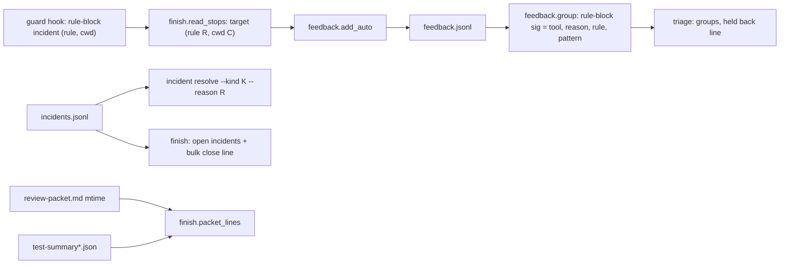
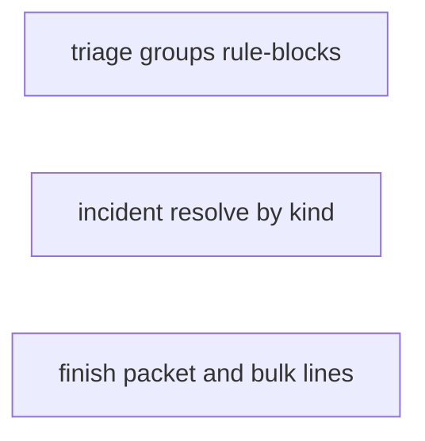

# Superlite: triage groups rule-blocks by rule and target, finish flags a stale packet, bulk incident resolve (B80)

**Goal:** fix #371 (feedback triage hides one-off auto entries without a word, and every auto rule-block lands in one group) and #416 (finish does not say the review packet predates the full run that changed its test results, and open incidents can only be closed one by one). Max's decision for #416: `sl incident resolve --kind K --reason R`.
**Architecture:** three independent edits, one per script. `feedback.py`: a rule-block auto entry's signature becomes (tool, reason, rule, target pattern); a rule-block whose blocked path a hand-written entry names joins that entry's group; triage prints a held-back line for the one-off auto entries it does not list. `incident.py`: `resolve --kind K` closes every open location whose newest open entry has that kind or was logged by that tool; `--reason` is an alias of `--ruling`. `finish.py`: `packet_lines(sl_dir)` compares the review packet's mtime with the run's test summaries; the open-incidents block gains a bulk-close line.
**Tech stack:** Python 3.10+ stdlib, pytest (through `sl run_tests`).
**Spec:** this file, section Design; issues #371 and #416 (Expected lines).
**Detail:** tests
**Target-min:** 11
**Wave0:** none
**Max chars:** 32000

Global constraints:
- Every new or changed code line in the three scripts carries the repo's trailing `# O(...)` complexity comment; tests do not. Stdlib only.
- Existing tests stay green. If an existing test turns red, report it in DONE_WITH_CONCERNS with the test id and the reason instead of editing it.
- Run `sl` as an executable (`<abs>/sl ...`). Verify with `<abs>/sl run_tests --fast <your test file> <the existing tests named in your Notes> --task Tn --background`, then run the printed `wait:` line in the foreground and end the turn only after it reports. Never raw `pytest`, never the e2e or eval layers (coordinator's step).
- No version edits (the ship step bumps the version). Touch only the files in Owns; docs (`docs/tools.md`, SKILL.md files) stay unchanged (outside B80's files).

Ruling: an auto entry of reason `rule-block` groups by (tool, reason, rule, target pattern); every other auto reason keeps (tool, reason), because #140 wants one stop on many files to be one group (commit_task exceptions, run_tests no-results) - cost if wrong: other reasons stay coarse.
Ruling: the target pattern is the blocked path's folder plus `/*` (the path is the target itself, or the first token holding `/` of a command text), else the command's first word; the ` (rule R, cwd C)` suffix finish appends is parsed for the rule and the cwd is dropped, so one block seen in two projects is one group - cost if wrong: two files of one folder blocked for different causes share a group.
Ruling: a rule-block joins a hand-written group only when its blocked path (with a `/`) appears verbatim, at a path boundary, in one of that group's texts; no fuzzy match - cost if wrong: a paraphrased path stays apart.
Ruling: held-back entries are named by id only, under `## held back: K one-off auto entries (an auto group is listed from 2 entries on)`, and the header gains `, K held back`; texts stay hidden as before (test_auto_groups_need_two pins it) - cost if wrong: one more `sl feedback mark` lookup.
Ruling: `--kind K` matches a location's newest open entry by its `kind`, `agent` or `tool`, plus the aliases `probe` (probe_run) and `contract` (pt_review); any other K is taken as written, and no match is exit 2 naming the open kinds and agents - cost if wrong: `--kind exception` also closes real exceptions, which the printed lines show.
Ruling: finish cannot rebuild the packet (pt_review and SKILL.md are outside B80's files); it prints the stale line only when a full run finished after the packet and its failures differ from the newest summary that finished before it, with the tests that turned green or red - cost if wrong: the reviewer's stale finding is still sent to a fixer unless the coordinator reads the line.
Ruling: detail tests; three tasks, no edges, no probe adapter (CLI scripts tested in process and through the CLI) - cost if wrong: no generated probes.
Ruling: already in the lead worktree on branch superlite/b80-triage-groups-and-incident-bulk-reso - cost if wrong: none.
LAYERS: unit



## Design

1. `feedback.split_target(target)`: strips one trailing ` (rule R, cwd C)`, ` (rule R)` or ` (cwd C)` group, then a trailing ` (fleet on)`; returns (bare target, R or "").
2. `feedback.blocked_path(bare)`: a bare target without whitespace that holds `/` is itself; else the first whitespace token holding `/`, with leading `'"<>` and trailing `'";&|)` stripped; else "".
3. `feedback.target_pattern(bare)`: a blocked path p gives `p.rsplit("/", 1)[0] + "/*"`; else the first word of bare; "" for "".
4. `feedback.auto_sig(e)`: rule-block entries give (tool, reason, rule, pattern); other auto entries (tool, reason) as today.
5. `feedback.group(entries)`: hand-written entries group as today; then each auto entry, by date, joins the first hand-written group (creation order) one of whose texts names its blocked path at a path boundary (rule-block only, path holds `/`), else its signature group; auto-only groups under AUTO_MIN are left out. A group's `seen` range and its sort date use the min and max date of its entries.
6. `feedback.cmd_triage`: the ids neither filed nor in a listed group are held back: header suffix `, K held back`, and after the groups `## held back: K one-off auto entries (an auto group is listed from 2 entries on)` plus `- ids: ...` in inbox order.
7. `incident resolve`: exactly one of `--file F --line N` or `--kind K`; `--ruling` or its alias `--reason` is required; `--kind` closes each open location (newest non-verified entry not resolved, holding an entry with resolution none, `open` or `unresolved`) whose newest open entry matches, in log order, in one append; output one `<resolution> F:N` line each, then `closed N of kind K (<resolution>)`.
8. `finish.packet_lines(sl_dir)` and `finish.bulk_close_line(incidents)` (Notes of T3) print in `summary`: the packet lines after the `tests` line, the bulk line after `- close one: ...`.

## Coverage

| Category | State | Basis |
|---|---|---|
| Scope and success criteria | settled | #371 and #416 Expected lines |
| Domain and data model | ruled | rule-block signature with rule and pattern |
| Persistence and migration | settled | append-only logs; old entries parse as before |
| Interfaces and contracts | ruled | Max: `--kind K --reason R`; `--reason` aliases `--ruling` |
| UI states | n/a | CLI text only |
| Concurrency and state ownership | settled | `incident.append` keeps its lock; one append per bulk |
| Error handling and recovery | ruled | exit 2 with one error line, nothing written |
| Security and privacy | settled | feedback text stays scrubbed |
| Performance and limits | settled | linear in the log and inbox |
| Observability | ruled | held-back line, stale packet line, bulk hint |
| Testing strategy | settled | one new test file per task |
| Compatibility | ruled | single resolve form and other auto reasons unchanged |
| Rollout | ruled | one PR; version bump at ship |
| Research unknowns | n/a | read from the code |

## File structure
- `skills/subagent-driven-development/scripts/feedback.py`: split_target, blocked_path, target_pattern, auto_sig, group, cmd_triage (T1).
- `skills/subagent-driven-development/scripts/incident.py`: cmd_resolve and its parser (T2).
- `skills/subagent-driven-development/scripts/finish.py`: packet_lines, bulk_close_line, summary (T3).
- `tests/scripts/test_feedback_triage_groups_371.py` (T1), `tests/scripts/test_incident_bulk_resolve_416.py` (T2), `tests/scripts/test_finish_packet_bulk_416.py` (T3).

## Task graph

```mermaid
%% schedule
gantt
  title Predicted schedule (mm:ss)
  dateFormat X
  axisFormat %M:%S
  section lane 1
  T1 triage groups rule-blocks :t1, 0, 101s
  section lane 2
  T3 finish packet and bulk lines :t3, 0, 97s
  section lane 3
  T2 incident resolve by kind :t2, 0, 86s
```




critical path: T1 (1.7 min) · peak width 3 · predicted build 1.7 min · predicted total ≈ 5.2 min (target ✓)

## Package: feedback triage (CLI)
App type: CLI. Categories: protocol (header and section text), encoding (quotes and redirects in command targets), state (inbox order, joins across groups).
**Probe entry:** none (Ruling: no probe adapter).

### T1 triage groups rule-blocks · Complexity 4 · Est. context 40k
**Owns:** skills/subagent-driven-development/scripts/feedback.py, tests/scripts/test_feedback_triage_groups_371.py
**Components:** 2
**LOC owned:** 190
**Tests:** fast
**Model:** sonnet
**Est. time:** 3.2 min (2 components, about 190 LOC, fast tests)
**Covers:** 1, 2, 3, 4, 5, 6
**Consumes:** existing `feedback.tokens(text: str) -> set` · existing `feedback.scrub(text: str) -> str`
**Produces:** feedback.split_target(target: str) -> tuple[str, str] · feedback.blocked_path(bare: str) -> str · feedback.target_pattern(bare: str) -> str · feedback.auto_sig(e: dict) -> tuple | None
**Review Focus:** encoding: `test_blocked_path_and_pattern` (quotes, `>>`, trailing `;`); state: `test_rule_block_joins_the_handwritten_entry_naming_its_target`; protocol: `test_held_back_line_names_every_hidden_entry`.
**Test code (verbatim):**
```python
"""Feedback triage (#371): every counted entry shows under a group or on the held-back line, auto rule-blocks
group by rule and blocked target pattern, and a rule-block joins the hand-written group that names its target."""
import json
import os
import subprocess
import sys
from pathlib import Path

SCRIPTS = Path(__file__).resolve().parents[2] / "skills" / "subagent-driven-development" / "scripts"
SCRIPT = SCRIPTS / "feedback.py"
sys.path.insert(0, str(SCRIPTS))
import feedback  # noqa: E402

HELD = "## held back: 2 one-off auto entries (an auto group is listed from 2 entries on)"


def triage(tmp_path):
    f = tmp_path / "issues.json"
    f.write_text("[]", encoding="utf-8")
    r = subprocess.run([sys.executable, str(SCRIPT), "triage", "--issues", str(f)], capture_output=True, text=True,
                       cwd=tmp_path, env=dict(os.environ))
    assert r.returncode == 0, r.stderr
    return r.stdout


def put(eid, text, kind="bug", date="2026-11-01T10:00:00Z", **extra):
    f = Path(os.environ["SUPERLITE_HOME"]) / "feedback.jsonl"
    f.parent.mkdir(parents=True, exist_ok=True)
    row = {"v": 1, "id": eid, "date": date, "host": "h", "kind": kind, "text": text, "version": "1.5.85",
           "harness": "claude-code", "project": "p", "session": "", "plan": "", **extra}
    with open(f, "a", encoding="utf-8") as fh:
        fh.write(json.dumps(row) + "\n")


def block(eid, target, date="2026-11-01T11:00:00Z", tool="Bash"):
    put(eid, f"{tool} rule-block: {target}", kind="auto", date=date, tool=tool, reason="rule-block", target=target)


def auto(target, reason="rule-block", tool="Bash"):
    return {"kind": "auto", "tool": tool, "reason": reason, "target": target}


def ids_lines(out):
    return [line[len("- ids: "):].split() for line in out.splitlines() if line.startswith("- ids: ")]


def test_split_target_strips_the_rule_and_cwd_suffix():
    assert feedback.split_target("tests/scripts/? (rule code, cwd ~/github/p)") == ("tests/scripts/?", "code")
    assert feedback.split_target(".superlite/prime.md (rule protected)") == (".superlite/prime.md", "protected")
    assert feedback.split_target("src/a.py (cwd ~/x)") == ("src/a.py", "")
    assert feedback.split_target("superlite:researcher (fleet on) (rule fleet, cwd ~/w)") == ("superlite:researcher", "fleet")
    assert feedback.split_target("python3 -c 'print(1)'") == ("python3 -c 'print(1)'", "")
    assert feedback.split_target("src/a.py") == ("src/a.py", "")
    assert feedback.split_target("") == ("", "")


def test_blocked_path_and_pattern():
    assert feedback.blocked_path("tests/scripts/?") == "tests/scripts/?"
    assert feedback.blocked_path("cat >> .superlite/progress.md <<'EOF' Ruling: x") == ".superlite/progress.md"
    assert feedback.blocked_path("python3 - <<'EOF'") == ""
    assert feedback.blocked_path("rm '~/p/src/a.py';") == "~/p/src/a.py"
    assert feedback.blocked_path("superlite:researcher") == ""
    assert feedback.target_pattern(".superlite/last-wait.txt") == ".superlite/*"
    assert feedback.target_pattern("cat >> .superlite/progress.md <<'EOF'") == ".superlite/*"
    assert feedback.target_pattern("tests/scripts/?") == "tests/scripts/*"
    assert feedback.target_pattern("python3 - <<'EOF'") == "python3"
    assert feedback.target_pattern("superlite:researcher") == "superlite:researcher"
    assert feedback.target_pattern("") == ""


def test_rule_block_signature_has_rule_and_pattern():
    a = feedback.auto_sig(auto(".superlite/last-wait.txt (rule protected, cwd ~/p)"))
    b = feedback.auto_sig(auto(".superlite/prime.md (rule protected, cwd ~/q)"))
    c = feedback.auto_sig(auto("tests/scripts/? (rule code, cwd ~/p)"))
    d = feedback.auto_sig(auto("python3 - <<'EOF' (rule code, cwd ~/p)"))
    e = feedback.auto_sig(auto(".superlite/prime.md (rule code)"))
    assert a == b == ("Bash", "rule-block", "protected", ".superlite/*")
    assert len({a, c, d, e}) == 4
    assert feedback.auto_sig(auto("src/a.py", reason="exception", tool="commit_task")) == ("commit_task", "exception")
    assert feedback.auto_sig(auto("src/b.py", reason="exception", tool="commit_task")) == ("commit_task", "exception")


def test_unrelated_rule_blocks_get_their_own_groups(tmp_path):
    block("a00000000001", "python3 - <<'EOF' (rule code, cwd ~/p)")
    block("a00000000002", "python3 -c 'print(1)' (rule code, cwd ~/q)", date="2026-11-02T11:00:00Z")
    block("a00000000003", ".superlite/last-wait.txt (rule protected, cwd ~/p)")
    block("a00000000004", ".superlite/progress.md (rule protected, cwd ~/q)", date="2026-11-02T11:00:00Z")
    block("a00000000005", "tests/scripts/? (rule code, cwd ~/p)")
    block("a00000000006", "tests/scripts/? (rule code, cwd ~/q)", date="2026-11-02T11:00:00Z")
    out = triage(tmp_path)
    assert "6 untriaged entries, 3 groups" in out and "held back" not in out
    assert sorted(sorted(i) for i in ids_lines(out)) == [["a00000000001", "a00000000002"],
                                                         ["a00000000003", "a00000000004"],
                                                         ["a00000000005", "a00000000006"]]


def test_rule_block_joins_the_handwritten_entry_naming_its_target(tmp_path):
    put("b00000000001", "guard blocks zsh array files=(tests/scripts/test_*.py ...) as a write to tests/scripts/?",
        date="2026-11-03T10:00:00Z")
    block("b00000000002", "tests/scripts/? (rule code, cwd ~/p)", date="2026-11-01T11:00:00Z")
    block("b00000000003", ".superlite/prime.md (rule protected, cwd ~/p)")
    out = triage(tmp_path)
    assert "3 untriaged entries, 1 groups, 1 held back" in out
    assert ids_lines(out)[0] == ["b00000000001", "b00000000002"]
    assert "## 1. ×2 auto, bug: guard blocks zsh array" in out
    assert "- seen: 2026-11-01..2026-11-03" in out


def test_a_path_inside_a_longer_path_does_not_join(tmp_path):
    put("e00000000001", "lint is slow on xsrc/a.py.bak files", date="2026-11-03T10:00:00Z")
    block("e00000000002", "src/a.py (rule code, cwd ~/p)")
    out = triage(tmp_path)
    assert "2 untriaged entries, 1 groups, 1 held back" in out
    assert ids_lines(out) == [["e00000000001"], ["e00000000002"]]


def test_held_back_line_names_every_hidden_entry(tmp_path):
    put("c00000000001", "probe run hangs on windows")
    block("c00000000002", "src/a.py (rule code, cwd ~/p)")
    put("c00000000003", "run_tests no-result", kind="auto", tool="run_tests", reason="no-result", target="")
    out = triage(tmp_path)
    lines = out.splitlines()
    assert "3 untriaged entries, 1 groups, 2 held back" in out
    assert lines[lines.index(HELD) + 1] == "- ids: c00000000002 c00000000003"
    assert {i for ids in ids_lines(out) for i in ids} == {"c00000000001", "c00000000002", "c00000000003"}
    assert "run_tests" not in out


def test_no_held_back_text_when_nothing_is_held(tmp_path):
    put("d00000000001", "probe run hangs on windows")
    out = triage(tmp_path)
    assert "1 untriaged entries, 1 groups" in out and "held back" not in out
```
**Steps:** 1 failing test, 2 run: FAIL, 3 implement, 4 run: PASS
**Notes:** suffix regex anchors at the end, e.g. `\s*\((?:rule [^,()]*(?:, cwd [^()]*)?|cwd [^()]*)\)\s*$`, then `\s*\(fleet on\)\s*$`; `print(1)'` must not match. Path boundary for the join: `(?<![\w./~-])` + escaped path + `(?![\w/-])`. Joined auto entries go after the group's hand-written ones, so the heading text stays the hand-written one; `_vals` sorts kinds (`auto, bug`). Also run `tests/scripts/test_feedback.py tests/scripts/test_feedback_auto.py tests/scripts/test_feedback_file.py tests/scripts/test_feedback_mark.py`.

## Package: incidents (CLI)
App type: CLI. Categories: protocol (argument combinations, exit codes, output lines), state (newest entry per location, one append), file (log left unchanged on refusal).
**Probe entry:** none (Ruling: no probe adapter).

### T2 incident resolve by kind · Complexity 4 · Est. context 36k
**Owns:** skills/subagent-driven-development/scripts/incident.py, tests/scripts/test_incident_bulk_resolve_416.py
**Components:** 1
**LOC owned:** 170
**Tests:** fast
**Model:** sonnet
**Est. time:** 2.6 min (1 component, about 170 LOC, fast tests)
**Covers:** 7
**Consumes:** existing `incident.make_entry(file, line, context, agent=None, kind=None, resolution=None, confidence=None) -> dict` · existing `incident.append(log, entries) -> None` · existing `pt_review.RESOLVED`
**Produces:** incident.cmd_resolve(a: argparse.Namespace) -> int
**Review Focus:** protocol: `test_kind_with_file_or_line_is_refused`, `test_neither_location_nor_kind_is_refused`, `test_a_ruling_is_required_and_reason_is_its_alias`; state: `test_a_location_with_several_entries_is_closed_once`, `test_a_resolved_location_is_not_closed_again`.
**Test code (verbatim):**
```python
"""`sl incident resolve --kind K --reason R` closes every open incident of one kind or tool in one call (#416)."""
import json
from pathlib import Path

from test_plan_tools import SCRIPTS, run

INCIDENT = SCRIPTS / "incident.py"
FINISH = SCRIPTS / "finish.py"


def add(log, file, line, kind="exception", context="boom", agent=None):
    args = ["add", "--file", file, "--line", line, "--kind", kind, "--context", context, "--log", log]
    if agent:
        args += ["--agent", agent]
    cp = run(INCIDENT, *args)
    assert cp.returncode == 0, cp.both


def entries(log):
    return [json.loads(x) for x in Path(log).read_text(encoding="utf-8").splitlines()]


def resolve(log, *args):
    return run(INCIDENT, "resolve", *args, "--log", log)


def open_count(tmp_path, log):
    cp = run(FINISH, "--ledger", tmp_path / "progress.md", "--log", log, cwd=tmp_path)
    assert cp.returncode == 0, cp.both
    return next(line for line in cp.out.splitlines() if line.startswith("open incidents: "))


def test_kind_closes_every_open_incident_of_that_kind(tmp_path):
    log = tmp_path / "i.jsonl"
    add(log, "src/a.py", 1, kind="unsure")
    add(log, "src/b.py", 2, kind="unsure")
    add(log, "src/c.py", 3, kind="exception")
    cp = resolve(log, "--kind", "unsure", "--reason", "tool artifact")
    assert cp.returncode == 0, cp.both
    assert cp.out.splitlines() == ["resolved src/a.py:1", "resolved src/b.py:2", "closed 2 of kind unsure (resolved)"]
    new = entries(log)[3:]
    assert [(e["file"], e["line"], e["kind"], e["resolution"], e["context"]) for e in new] == [
        ("src/a.py", 1, "unsure", "resolved", "resolved: tool artifact"),
        ("src/b.py", 2, "unsure", "resolved", "resolved: tool artifact")]
    assert open_count(tmp_path, log) == "open incidents: 1 (1 distinct)"


def test_probe_and_contract_name_the_tool_that_logged_them(tmp_path):
    log = tmp_path / "i.jsonl"
    add(log, "src/x.py", 5, kind="exception", agent="probe_run")
    add(log, "src/y.py", 6, kind="perf", agent="probe_run")
    add(log, "src/z.py", 7, kind="exception", agent="pt_review")
    add(log, "src/w.py", 8, kind="exception", agent="implementer")
    cp = resolve(log, "--kind", "probe", "--reason", "probe false positive")
    assert cp.returncode == 0, cp.both
    assert cp.out.splitlines() == ["resolved src/x.py:5", "resolved src/y.py:6", "closed 2 of kind probe (resolved)"]
    cp = resolve(log, "--kind", "contract", "--reason", "contract-check artifact", "--resolution", "wontfix")
    assert cp.returncode == 0, cp.both
    assert cp.out.splitlines() == ["wontfix src/z.py:7", "closed 1 of kind contract (wontfix)"]
    assert open_count(tmp_path, log) == "open incidents: 1 (1 distinct)"


def test_an_agent_name_works_as_the_kind(tmp_path):
    log = tmp_path / "i.jsonl"
    add(log, "src/x.py", 5, kind="exception", agent="probe_run")
    add(log, "src/w.py", 8, kind="exception", agent="implementer")
    cp = resolve(log, "--kind", "probe_run", "--ruling", "artifact")
    assert cp.returncode == 0, cp.both
    assert cp.out.splitlines() == ["resolved src/x.py:5", "closed 1 of kind probe_run (resolved)"]


def test_a_location_with_several_entries_is_closed_once(tmp_path):
    log = tmp_path / "i.jsonl"
    add(log, "src/a.py", 1, kind="unsure", context="first")
    add(log, "src/a.py", 1, kind="unsure", context="again")
    cp = resolve(log, "--kind", "unsure", "--reason", "r")
    assert cp.returncode == 0, cp.both
    assert cp.out.splitlines() == ["resolved src/a.py:1", "closed 1 of kind unsure (resolved)"]
    assert len(entries(log)) == 3


def test_a_resolved_location_is_not_closed_again(tmp_path):
    log = tmp_path / "i.jsonl"
    add(log, "src/a.py", 1, kind="unsure")
    assert resolve(log, "--file", "src/a.py", "--line", "1", "--ruling", "done").returncode == 0
    cp = resolve(log, "--kind", "unsure", "--reason", "r")
    assert cp.returncode == 2
    assert "no open incident of kind unsure; none is open" in cp.err
    assert len(entries(log)) == 2


def test_no_match_names_the_open_kinds_and_agents(tmp_path):
    log = tmp_path / "i.jsonl"
    add(log, "src/x.py", 5, kind="exception", agent="probe_run")
    add(log, "src/y.py", 6, kind="perf", agent="probe_run")
    add(log, "src/z.py", 7, kind="exception")
    cp = resolve(log, "--kind", "flaky", "--reason", "r")
    assert cp.returncode == 2
    assert "no open incident of kind flaky; open by kind: exception=2, perf=1; by agent: probe_run=2" in cp.err
    assert len(entries(log)) == 3


def test_kind_with_file_or_line_is_refused(tmp_path):
    log = tmp_path / "i.jsonl"
    add(log, "src/a.py", 1, kind="unsure")
    for extra in (["--file", "src/a.py"], ["--line", "1"], ["--file", "src/a.py", "--line", "1"]):
        cp = resolve(log, "--kind", "unsure", "--reason", "r", *extra)
        assert cp.returncode == 2 and "give --file F --line N, or --kind K, not both" in cp.err
    assert len(entries(log)) == 1


def test_neither_location_nor_kind_is_refused(tmp_path):
    log = tmp_path / "i.jsonl"
    add(log, "src/a.py", 1, kind="unsure")
    for extra in ([], ["--file", "src/a.py"], ["--line", "1"]):
        cp = resolve(log, "--reason", "r", *extra)
        assert cp.returncode == 2 and "give --file F --line N, or --kind K" in cp.err
    assert len(entries(log)) == 1


def test_a_ruling_is_required_and_reason_is_its_alias(tmp_path):
    log = tmp_path / "i.jsonl"
    add(log, "src/a.py", 1, kind="unsure")
    cp = resolve(log, "--file", "src/a.py", "--line", "1")
    assert cp.returncode == 2 and "give the ruling: --ruling TEXT (or --reason TEXT)" in cp.err
    cp = resolve(log, "--file", "src/a.py", "--line", "1", "--reason", "obsolete")
    assert cp.returncode == 0, cp.both
    assert cp.out.strip() == "resolved src/a.py:1"
    assert entries(log)[-1]["context"] == "resolved: obsolete"


def test_help_names_the_kind_form():
    cp = run(INCIDENT, "resolve", "--help")
    assert "--kind" in cp.out and "--reason" in cp.out and "probe" in cp.out and "contract" in cp.out
```
**Steps:** 1 failing test, 2 run: FAIL, 3 implement, 4 run: PASS
**Notes:** `--file`, `--line`, `--ruling` stop being argparse-required; check in this order: resolution, ruling (`give the ruling: --ruling TEXT (or --reason TEXT)`), `--kind` with `--file` or `--line` (`give --file F --line N, or --kind K, not both`), a missing half of the location without `--kind` (`give --file F --line N, or --kind K`); each through `_die` (exit 2, nothing written). `--reason` shares `dest="ruling"`. Aliases: `{"probe": "probe_run", "contract": "pt_review"}`. The no-match counts take one location once, by its newest open entry's `kind` and `agent` (else `tool`), names sorted; `; by agent: ...` is left out when no entry has one; `none is open` when no location is open. The appended entry's kind is the location's newest entry's kind when it is in KINDS (as the single form). Also run `tests/scripts/test_incident_resolve.py tests/scripts/test_incident.py tests/scripts/test_incident_plan.py tests/scripts/test_packet_resolve_331.py`.

## Package: finish report (CLI)
App type: CLI. Categories: protocol (report lines), file (packet and summary mtimes, missing files), numeric (times compared as epochs).
**Probe entry:** none (Ruling: no probe adapter).

### T3 finish packet and bulk lines · Complexity 4 · Est. context 38k
**Owns:** skills/subagent-driven-development/scripts/finish.py, tests/scripts/test_finish_packet_bulk_416.py
**Components:** 2
**LOC owned:** 160
**Tests:** fast
**Model:** sonnet
**Est. time:** 2.8 min (2 components, about 160 LOC, fast tests)
**Covers:** 8
**Consumes:** existing `finish.load_run_summaries(sl_dir) -> list` · existing `finish.open_incidents(path, summary=None) -> list`
**Produces:** finish.packet_lines(sl_dir) -> list[str] · finish.bulk_close_line(incidents: list) -> str | None
**Review Focus:** numeric: `test_packet_older_than_a_full_run_that_changed_the_results`, `test_a_recorded_or_timeless_full_run_is_ignored`; file: `test_no_line_without_a_packet_or_a_full_run`; protocol: `test_finish_offers_the_bulk_close_with_the_open_kinds_and_agents`.
**Test code (verbatim):**
```python
"""finish names a review packet older than the full run that changed its test results, and offers the bulk
close `sl incident resolve --kind K --reason R` with the open kinds and agents (#416)."""
import json
import os
import sys
import time

from test_plan_tools import SCRIPTS, run

sys.path.insert(0, str(SCRIPTS))
import finish  # noqa: E402

FAST = {"passed": 3, "failed": 1, "skipped": 0, "seconds": 10.0, "mode": "fast", "started": 1000.0,
        "failures": ["tests/test_a.py::test_gone: assert 1 == 2"], "files": {"tests/test_a.py": [2, 1]}}
FULL = {"passed": 10, "failed": 1, "skipped": 0, "seconds": 50.0, "mode": "full", "started": 2100.0,
        "failures": ["tests/test_b.py::test_new: boom"], "files": {"tests/test_a.py": [3, 0], "tests/test_b.py": [6, 1]}}


def clock(t):
    return time.strftime("%H:%M:%S", time.localtime(t))


def run_dir(root, packet_at=2000.0, full=FULL, fast=FAST):
    sl = root / ".superlite"
    sl.mkdir(parents=True)
    (sl / "progress.md").write_text("# Progress ledger\n", encoding="utf-8")
    (sl / "test-summary.json").write_text(json.dumps(fast), encoding="utf-8")
    os.utime(sl / "test-summary.json", (1010.0, 1010.0))
    if full is not None:
        p = sl / "test-summary-20261110T100000-1-aaaaaa.json"
        p.write_text(json.dumps(full), encoding="utf-8")
        os.utime(p, (2150.0, 2150.0))
    if packet_at is not None:
        (sl / "review-packet.md").write_text("# packet\n", encoding="utf-8")
        os.utime(sl / "review-packet.md", (packet_at, packet_at))
    return sl


def finish_out(root, sl):
    cp = run(SCRIPTS / "finish.py", "--ledger", sl / "progress.md", "--log", sl / "incidents.jsonl", cwd=root)
    assert cp.returncode == 0, cp.both
    return cp.out


def test_packet_older_than_a_full_run_that_changed_the_results(tmp_path):
    sl = run_dir(tmp_path)
    lines = finish.packet_lines(sl)
    assert lines == [f"review packet: older than the last full run (packet {clock(2000.0)}, full run done {clock(2150.0)}: "
                     "10 passed, 1 failed); rebuild it with `sl plan_tools packet` before trusting its test findings",
                     "- green since the packet: tests/test_a.py::test_gone",
                     "- red since the packet: tests/test_b.py::test_new"]
    out = finish_out(tmp_path, sl)
    assert "\n".join(lines) in out


def test_no_line_when_the_packet_is_newer_than_every_full_run(tmp_path):
    assert finish.packet_lines(run_dir(tmp_path, packet_at=3000.0)) == []


def test_no_line_when_the_full_run_kept_the_packet_results(tmp_path):
    same = dict(FULL, failures=list(FAST["failures"]))
    sl = run_dir(tmp_path, full=same)
    assert finish.packet_lines(sl) == []
    assert "review packet:" not in finish_out(tmp_path, sl)


def test_no_line_without_a_packet_or_a_full_run(tmp_path):
    assert finish.packet_lines(run_dir(tmp_path / "a", packet_at=None)) == []
    assert finish.packet_lines(run_dir(tmp_path / "b", full=None)) == []
    assert finish.packet_lines(tmp_path / "missing") == []


def test_a_recorded_or_timeless_full_run_is_ignored(tmp_path):
    assert finish.packet_lines(run_dir(tmp_path / "a", full=dict(FULL, recorded=True))) == []
    timeless = {k: v for k, v in FULL.items() if k != "started"}
    assert finish.packet_lines(run_dir(tmp_path / "b", full=timeless)) == []


def test_more_than_five_changes_are_cut(tmp_path):
    fast = dict(FAST, failures=[f"tests/test_a.py::test_{i}: x" for i in range(7)])
    lines = finish.packet_lines(run_dir(tmp_path, fast=fast, full=dict(FULL, failures=[], failed=0)))
    assert len(lines) == 7 and lines[-1] == "- (+2 more)"
    assert lines[1] == "- green since the packet: tests/test_a.py::test_0"


def test_finish_offers_the_bulk_close_with_the_open_kinds_and_agents(tmp_path):
    sl = tmp_path / ".superlite"
    sl.mkdir()
    (sl / "progress.md").write_text("# Progress ledger\n", encoding="utf-8")
    rows = [{"file": "src/x.py", "line": 5, "kind": "exception", "agent": "probe_run", "context": "probe crash", "resolution": "open"},
            {"file": "src/y.py", "line": 6, "kind": "perf", "agent": "probe_run", "context": "probe hang", "resolution": "open"},
            {"file": "src/y.py", "line": 6, "kind": "perf", "agent": "probe_run", "context": "probe hang", "resolution": "open"},
            {"file": "src/z.py", "line": 7, "kind": "exception", "context": "boom"}]
    (sl / "incidents.jsonl").write_text("".join(json.dumps(r) + "\n" for r in rows), encoding="utf-8")
    out = finish_out(tmp_path, sl)
    close_one = "- close one: sl incident resolve --file F --line N --ruling \"TEXT\" (file and line as listed)"
    bulk = ("- close all of one kind or tool: sl incident resolve --kind K --reason \"TEXT\" "
            "(open by kind: exception=2, perf=1; by agent: probe_run=2)")
    assert f"{close_one}\n{bulk}" in out
    assert finish.bulk_close_line([]) is None
    assert finish.bulk_close_line([rows[3]]) == ("- close all of one kind or tool: sl incident resolve --kind K "
                                                 "--reason \"TEXT\" (open by kind: exception=1)")


def test_no_bulk_line_without_open_incidents(tmp_path):
    sl = tmp_path / ".superlite"
    sl.mkdir()
    (sl / "progress.md").write_text("# Progress ledger\n", encoding="utf-8")
    assert "--kind K" not in finish_out(tmp_path, sl)
```
**Steps:** 1 failing test, 2 run: FAIL, 3 implement, 4 run: PASS
**Notes:** `packet_lines(sl_dir)`: `[]` when `<sl_dir>/review-packet.md` is missing; a summary's end time is `started + seconds` (both numbers, not bool), a summary without one is skipped; R = the full run (`mode` full, not `recorded`) with the latest end after the packet's mtime, none: `[]`; S = the summary with the latest end at or before the mtime (none: no failures); a failure id is the text before the first `": "`; green = ids(S) - ids(R), red = ids(R) - ids(S), each sorted, both empty: `[]`; the head line then green lines then red lines, at most 5 change lines, then `- (+N more)`; clocks `time.strftime("%H:%M:%S", time.localtime(t))`; any OSError or bad value gives `[]`. `summary()` adds the lines right after the `tests (...)` / `tests: none recorded` line. `bulk_close_line(incidents)`: one entry per (file, line), the last in the list; Counter of `kind` (else `unknown`) and of `agent` (else `tool`, skipped when both absent), names sorted; None for no incidents; printed after the `- close one:` line. Also run `tests/scripts/test_finish_open_incidents.py tests/scripts/test_finish_grouping.py tests/scripts/test_finish_closeout.py tests/scripts/test_finish_held.py tests/scripts/test_finish_stop_rule.py tests/scripts/test_finish_unblocked_375.py tests/scripts/test_incident_resolve.py tests/scripts/test_docs_b67_review_finish.py`.

## Review Focus
- feedback triage (CLI): protocol, encoding, state; specific risk: a rule-block of a command text whose parentheses look like the rule suffix.
- incidents (CLI): protocol, state, file; specific risk: `--kind` closing a location already resolved, or writing on a refused call.
- finish report (CLI): protocol, file, numeric; specific risk: the packet line on every run (it must stay silent when the full run kept the packet's results).

## Self-review
Coverage: Design 1-6 T1, 7 T2, 8 T3. No placeholders. Tasks share no file and run against existing code only, so no edges. Each task has Components, LOC owned, Tests and Model; each package has a Probe entry line and named Review Focus tests.
