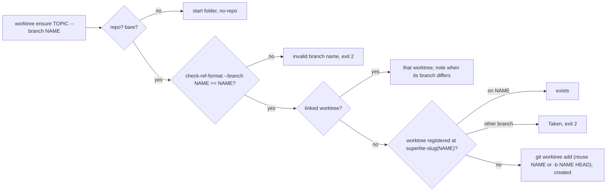

# Superlite: sl worktree ensure --branch NAME (B82)

**Goal:** fix #427: `sl worktree ensure TOPIC --branch NAME` creates (or finds again) the run's worktree on the branch NAME, in a folder derived from NAME, so a project with a tracker branch convention (`feat/KEY-1-slug`) no longer has to run `git worktree add` by hand.
**Architecture:** `worktree.ensure(topic, start, branch=None)` takes the branch; with a branch the folder is `superlite-<slug(branch)>` (Max's decision) and the branch is NAME as given; without one everything stays as today. `main` gets `--branch NAME`. One task: worktree.py, its test file and the docs/tools.md worktree row.
**Tech stack:** Python 3.10+ stdlib, pytest (through `sl run_tests`).
**Spec:** this file, section Design; issue #427 Expected line.
**Detail:** contracts
**Target-min:** 11
**Wave0:** none

Global constraints:
- Every code line in `skills/subagent-driven-development/scripts/*.py` carries the repo's trailing `# O(...)` complexity comment where the surrounding function's lines do; tests do not. Stdlib only.
- Existing tests stay green. An existing test file changes only when the task Owns it. If another existing test turns red, report it in DONE_WITH_CONCERNS with the test id and the reason instead of editing it.
- Run `sl` as an executable (`<abs>/sl ...`). Verify with `<abs>/sl run_tests --fast <own test files> --task Tn --background`, then run the printed `wait:` line in the foreground and end the turn only after it reports.
- Tests clear SUPERLITE_FLEET_ROLE, SUPERLITE_FLEET_PARENT_DIR and SUPERLITE_STATE_DIR with `monkeypatch.delenv(..., raising=False)` (and drop SUPERLITE_* from a subprocess env).
- No version edits (the ship step bumps the version). Never run `scripts/evals.sh`, `claude plugin eval` or `scripts/test_layers.py run`.

Ruling: folder `<main root>/.claude/worktrees/superlite-<slug(NAME)>` (Max's decision: superlite-<slugified branch>), the existing `slug` unchanged (lowercase, non-alphanumerics to `-`, at most 40 characters); the branch keeps NAME exactly as given - cost if wrong: one rename rule in `ensure`.
Ruling: TOPIC stays required; with `--branch` it names nothing (folder and branch come from NAME), so `sl worktree ensure <topic> --branch <name>` reads as the issue asks - cost if wrong: a later issue makes TOPIC optional with `--branch`.
Ruling: NAME is checked with `git check-ref-format --branch NAME` in the repository; a non-zero exit or an output other than NAME (an `@{-1}` expansion) is `worktree: invalid branch name: NAME`, exit 2, before any git change - cost if wrong: none, git would refuse the same names later with a less clear error.
Ruling: a registered worktree at the derived folder on another branch (slug collision `feat/KEY-1` vs `feat-KEY-1`, or detached) is exit 2 (`Taken`), never returned as `exists`, so work never lands on the wrong branch; topic mode keeps today's path-only match - cost if wrong: one more manual `git worktree remove`.
Ruling: from a linked worktree `--branch` changes nothing (state `linked`, as today); when that worktree's branch differs from NAME, stderr gets one line `worktree: linked worktree is on <current>, not <NAME>; --branch ignored` - cost if wrong: one stderr line.
Ruling: NAME already checked out in another worktree (e.g. `main` in the main checkout) stays git's refusal: exit 1 `worktree: git worktree add failed: <git error>`; no lookup of worktrees by branch (YAGNI) - cost if wrong: the user runs it from that worktree instead.
Ruling: detail contracts; no probe adapter (CLI over git; Review Focus cases are named pytest cases); already in the lead worktree, so no `sl worktree ensure`; layers: unit only (scripts/** and tests/scripts/** are outside headless, tui and evals; docs/tools.md has no layer) - cost if wrong: one NEEDS_CONTEXT round.
LAYERS: unit

## Design

### 1. worktree.ensure takes a branch (T1)
- `ensure(topic, start, branch=None)`. `branch is None`: today's behavior byte for byte (folder `superlite-<slug(topic)>`, branch `superlite/<slug(topic)>`, path-only match for `exists`). `backlog_run.cmd_start` calls `worktree.ensure(topic, root)` and must keep working.
- With a branch, after the no-repo and bare checks and before the linked check: `rc, out, _ = git(top, "check-ref-format", "--branch", branch)`; `rc` non-zero or `out != branch` raises `BadBranch(f"invalid branch name: {branch}")` (new exception class next to `Taken`).
- Linked: return `(top, "linked")` as today (the note is printed by `main`, see 2).
- Not linked: `name = slug(branch)`, `target = top / PARENT / f"superlite-{name}"`, `br = branch`. The registered-worktree check reads the porcelain blocks (`worktree <path>`, then `branch refs/heads/<b>` or `detached`): a block at `target` whose folder exists returns `(target, "exists")` only when its branch line is `branch refs/heads/<branch>`; otherwise raise `Taken(f"{target} is a worktree on {other}, not {branch}")` with `other` the short branch name or `a detached HEAD`. A registered block whose folder is gone is pruned as today. Then the plain-folder `Taken`, `add_exclude(top, PARENT, f"{PARENT}/superlite-{name}/x")`, and the existing reuse-or-create of `br` (`worktree add target br` when `refs/heads/ ` exists, else `worktree add -b br target HEAD`).

### 2. CLI and docs (T1)
- `ensure` subparser: `--branch NAME` (`metavar="NAME"`, default None). `main` passes `a.branch`. `BadBranch` prints `worktree: <message>` on stderr, exit 2 (like `Taken`). State `linked` with a branch: `cur = git(path, "rev-parse", "--abbrev-ref", "HEAD")[1]`; when `cur != a.branch`, stderr `worktree: linked worktree is on <cur>, not <NAME>; --branch ignored`.
- The valueless-`--plan` usage line becomes `usage: worktree ensure TOPIC [--repo DIR] [--branch NAME] | inplace --reason TEXT [--plan P]`; the module docstring's ensure line gets `[--branch NAME]` and one sentence on the folder and branch.
- docs/tools.md, `worktree` row: after the `superlite/<slug>` sentence add: ``ensure TOPIC --branch NAME`` uses the branch NAME as given (reused when it exists, else created from `HEAD`) in `<main root>/.claude/worktrees/superlite-<slug of NAME>` (`feat/KEY-1-slug`: `superlite-feat-key-1-slug`); an invalid NAME (`git check-ref-format --branch`) or a worktree at that folder on another branch is exit 2; from a linked worktree on another branch stderr says `--branch ignored`. The usage at the row's start gets `[--branch NAME]`.

## Coverage

| Category | State | Basis |
|---|---|---|
| Scope and success criteria | settled | #427 Expected line; Max: folder superlite-<slugified branch> |
| Domain and data model | n/a | no data change |
| Persistence and migration | n/a | nothing stored |
| Interfaces and contracts | ruled | one optional flag; `ensure(..., branch=None)` keeps the old call |
| UI states | n/a | CLI text only |
| Concurrency and state ownership | n/a | no new state |
| Error handling and recovery | ruled | invalid name and wrong-branch folder exit 2; git refusal exit 1 |
| Security and privacy | ruled | NAME validated by git before use; argv list, no shell |
| Performance and limits | n/a | one extra git call |
| Observability | settled | stderr lines for invalid name, collision, linked note |
| Testing strategy | settled | main(argv) cases on a temp repo plus one `sl` subprocess case |
| Compatibility | settled | calls without `--branch` behave as before |
| Rollout | ruled | one PR; version bump at ship |
| Research unknowns | n/a | none |

## File structure
- `skills/subagent-driven-development/scripts/worktree.py`: `--branch` (T1).
- `tests/scripts/test_worktree_plan.py`: new cases, USAGE constant (T1).
- `docs/tools.md`: worktree row (T1).

## Task graph

```mermaid
%% schedule
gantt
  title Predicted schedule (mm:ss)
  dateFormat X
  axisFormat %M:%S
  section lane 1
  T1 worktree ensure --branch NAME :t1, 0, 80s
```

critical path: T1 (1.3 min) · peak width 1 · predicted build 1.3 min · predicted total ≈ 4.8 min (target ✓)

## Package: worktree CLI
App type: CLI. Categories: protocol (argv, branch names), state (which branch and folder), file (no folder on a refusal). Specific risks: a folder slug collision returning a worktree on the wrong branch; an option-like or `@{-1}` name reaching `git worktree add`; topic mode changed by accident.
**Probe entry:** none (Ruling: no probe adapter).

### T1 worktree ensure --branch NAME · Complexity 3 · Est. context 30k
**Owns:** skills/subagent-driven-development/scripts/worktree.py, tests/scripts/test_worktree_plan.py, docs/tools.md
**Components:** 1
**LOC owned:** 140
**Tests:** fast
**Model:** sonnet
**Est. time:** 2.6 min (1 component, about 140 LOC, fast tests)
**Covers:** 1, 2
**Consumes:** none
**Produces:** worktree.ensure(topic: str, start: str | Path, branch: str | None = None) -> tuple[Path, str]
**Review Focus:**
Test fixture: the file's existing `git`, `init`, `repo`, `wt` and `clean_env`; `B = "feat/KEY-1-slug"`; `bwt = repo / ".claude" / "worktrees" / "superlite-feat-key-1-slug"`. Update `USAGE` to `usage: worktree ensure TOPIC [--repo DIR] [--branch NAME] | inplace --reason TEXT [--plan P]\n`.
state: `test_branch_names_branch_and_folder` (`main(["ensure", "topic", "--repo", repo, "--branch", B]) == 0` -> stdout last line `bwt.as_posix()`; `git -C bwt rev-parse --abbrev-ref HEAD` is `B`; `refs/heads/superlite/topic` does not exist; the main checkout is still on `main`; `.claude/worktrees/` is in `.git/info/exclude`).
state: `test_branch_found_again` (the same call twice -> both 0, same last line; `git worktree list --porcelain` of repo has 2 `worktree ` lines).
state: `test_branch_reuses_existing_branch` (`git branch feat/KEY-2-x`, then a new commit on main; `main(["ensure", "t", "--repo", repo, "--branch", "feat/KEY-2-x"]) == 0` -> the worktree's HEAD sha equals `git rev-parse feat/KEY-2-x`, not main's new HEAD; folder `superlite-feat-key-2-x`).
protocol: `test_invalid_branch_is_exit_2` (parametrized argv tails `["--branch", "a..b"]`, `["--branch=-x"]`, `["--branch", "HEAD"]`, `["--branch", ""]`, `["--branch", "@{-1}"]` after `["ensure", "topic", "--repo", repo]` -> returns 2; stderr is exactly `worktree: invalid branch name: <name>\n`; stdout empty; `repo / ".claude"` does not exist; one `worktree ` line).
state: `test_branch_slug_collision_refused` (ensure `--branch feat/KEY-1` -> 0; then `main(["ensure", "t", "--repo", repo, "--branch", "feat-KEY-1"]) == 2`; stderr starts with `worktree: ` and contains `is a worktree on feat/KEY-1, not feat-KEY-1`; `refs/heads/feat-KEY-1` does not exist).
protocol: `test_branch_inside_linked_worktree` (after `main(["ensure", "topic", "--repo", repo])`: `main(["ensure", "x", "--repo", wt, "--branch", "feat/other"]) == 0`, stdout `wt.as_posix() + "\n"`, stderr is exactly `worktree: linked worktree is on superlite/topic, not feat/other; --branch ignored\n`; the same with `--branch superlite/topic` -> stderr empty).
protocol: `test_branch_checked_out_elsewhere_is_exit_1` (`main(["ensure", "t", "--repo", repo, "--branch", "main"]) == 1`; stderr starts with `worktree: git worktree add failed:`).
state: `test_long_branch_folder_is_cut` (`--branch "feat/" + "a" * 60` -> 0; folder name is `"superlite-feat-" + "a" * 35`; branch name is the full 65 characters).
protocol: `test_ensure_default_branch_none` (`worktree.ensure("topic", repo) == (wt, "created")`, branch `superlite/topic`).
protocol: `test_help_names_branch` (`main(["ensure", "--help"])` raises SystemExit 0; stdout contains `--branch NAME`).
protocol: `test_sl_worktree_ensure_with_branch` (subprocess `["bash", SL, "worktree", "ensure", "topic", "--branch", B, "--plan", ".superlite"]`, cwd repo, SUPERLITE_* dropped -> returncode 0, stdout last line `bwt.as_posix()`).
**Steps:** 1 failing tests, 2 run: FAIL, 3 implement Design 1 and 2 (docs row last), 4 run: PASS (own file plus `tests/scripts/test_worktree.py tests/scripts/test_worktree_bootstrap.py`).

## Review Focus
- worktree CLI: protocol, state, file; cases in T1.

## Self-review
- Coverage: #427 `--branch` flag -> Design 2; folder from the branch -> Design 1 (Max's decision). No placeholders. One task, no edges; docs folded into T1 (they describe its code).
