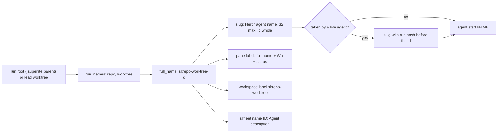
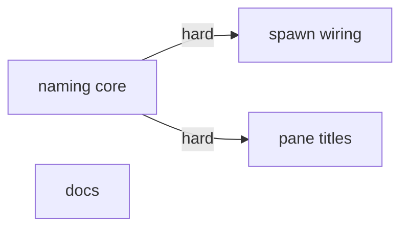

# Superlite: spawned agents are named sl:{repo}-{worktree}-{id} (B102)

**Goal:** fix #467: every agent a superlite coordinator spawns carries the full name `sl:{repo}-{worktree}-{id}` (fleet workers, batch leads, the triage worker in their Herdr pane label; in-process agents in their Agent `description`), and its Herdr agent name is the slug of that name (Max's decision: slug as name, full as label).
**Architecture:** `fleet_state.py` gains the naming core: `run_names(root)` reads `.git` to find repo and worktree, `full_name` builds `sl:{repo}-{worktree}-{id}`, `slug` derives the Herdr name (lowercase, `:` to `-`, cut to 32 with the id kept whole), `agent_name` uses them and adds the run hash only when the readable name is taken. `fleet.py` labels the workspace with the run name, checks taken names at spawn and gets `fleet name [ID]`; `fleet_lead.py` names a lead by its worktree; `fleet_io.py` writes the full name into every pane label. SDD SKILL.md names in-process agents.
**Tech stack:** Python 3.10+ stdlib, pytest (through `sl run_tests`), Markdown docs.
**Spec:** this file, section Design; issue #467 Expected lines.
**Detail:** tests
**Target-min:** 11
**Wave0:** none

Global constraints:
- Every Python code line keeps the file's trailing `# O(...)` complexity comment.
- Existing tests stay green. An existing test file changes only when the task Owns it. If another existing test turns red, report it in DONE_WITH_CONCERNS with the test id and the reason instead of editing it.
- Run `sl` as an executable (`<abs>/sl ...`). Verify with `<abs>/sl run_tests --fast <own test files> --task Tn --background`, then run the printed `wait:` line in the foreground and end the turn only after it reports.
- Records already in a fleet.json keep their stored `name` (`fleet_state.name_of`); only new workers get the new names.
- No version edits (the ship step bumps the version). Never run `scripts/evals.sh`, `claude plugin eval` or `scripts/test_layers.py run`.

Ruling: repo and worktree come from the run root's `.git` (walking up): a `.git` folder is the main checkout (`{worktree}` = `main`); a `.git` file whose `gitdir:` points into `<common>/worktrees/<n>` is a worktree (`{repo}` = the folder holding `<common>`, or `<common>`'s name without `.git` for a bare repo; `{worktree}` = the worktree's folder name without a leading `{repo}-`); anything else (no `.git`, a submodule, an unreadable file) is `{repo}` = the root folder's name, `{worktree}` = `main` (because the issue's examples read `superlite-b81-fleet-wait` and `superlite-main`; cost if wrong: a name reads odd, nothing breaks).
Ruling: the Herdr name keeps the identifier whole and cuts the `{repo}-{worktree}` part; when the readable name is taken by a live Herdr agent (`hc.agents()` at spawn), 4 hex digits of the run root's sha1 go before the id (because Herdr refuses a taken name, and Max rejected a hash on every cut; cost if wrong: a hashed name in a rare collision).
Ruling: a fleet worker's id is its worker id (`W3`), the Herdr name stays stable while the worker is reused; its pane label is `{full_name(sd, label)} {wid}` with the task or brief label, plus ` reported, waiting for coordinator` or ` BLOCKED-UI` as today; a lead's id is `lead` and its names use its worktree (because a lead's label must show the batch's worktree, not main's; cost if wrong: one rename).
Ruling: `sl fleet name [ID] [--plan P]` prints the full name for in-process agents too (works with fleet off), and SDD SKILL.md tells the coordinator to put it in every Agent `description` (because the coordinator cannot derive repo and worktree reliably by hand; cost if wrong: a subcommand under `fleet` that also serves in-process runs).
Ruling: no pane label at spawn (the Herdr name already reads `sl-{repo}-{worktree}-wN`); no probe adapter (naming helpers on paths; Review Focus cases are named tests); detail tests; already in the lead worktree, no `sl worktree ensure`; T4's doc texts are fixed in this plan, so T4 runs without an edge to the code tasks; layers unit, headless and evals (cost if wrong: one NEEDS_CONTEXT round).
LAYERS: unit, headless, evals



## Design

### 1. Naming core (T1)
`fleet_state.py`: `NAME_MAX = 32`; `run_names`, `full_name`, `slug` and the new `agent_name` as in T1's Produces. `slug(text, keep)`: lowercase; every run of characters outside `[a-z0-9_-]` (`:` included) becomes one `-`; runs of `-` collapse to one; leading and trailing `-`/`_` are dropped; a result that does not start with a letter gets `sl-` in front (empty: `sl`). Over 32: when the result ends with `-` + `slug(keep)` (keep non-empty), the part before that suffix is cut to `32 - len(tail)` with `tail = "-" + slug(keep)[:28]`, stripped of trailing `-`/`_`, then `tail` is appended; otherwise the first 32 characters, trailing `-`/`_` stripped. The old `sl-<run folder>-<hash>-<wid>` formula goes; `hashlib` stays for the taken case.

### 2. Spawn wiring (T2)
`fleet.py`: `fleet on` stores `fs.full_name(sd)` as the workspace label; `_live_names()` returns the names `hc.agents()` lists (a HerdrError gives an empty set); `_spawn` names the worker `fs.agent_name(sd, wid, taken=_live_names())`; new subcommand `name [ident] [--plan P]` prints `fs.full_name(sd, ident)` (no ident: `fs.full_name(sd)`). `fleet_lead.py`: `name = fs.agent_name(main_sd, wid, root=worktree, ident="lead", taken=fleet._live_names())`.

### 3. Pane labels (T3)
`fleet_io.py`: `pane_title(sd, wid, label, status="")` returns `f"{fs.full_name(sd, label, root)} {wid}"` plus `" " + status` when given; `root` is the worker record's `worktree` (leads), else None. Every `pane_label(sd, wid, f"{wid} {x}...")` call passes `pane_title(...)` instead: send, send_brief, send_text, the ASKED re-ask, the report (`reported, waiting for coordinator`), `stopped` (the stop hook) and `_blocked` (`BLOCKED-UI`).

### 4. Docs (T4)
SDD SKILL.md: a Setup bullet `- Names: each Agent call's \`description\` is what \`"$SL" fleet name <Tn or role> --plan $PLAN\` prints (\`sl:<repo>-<worktree>-<id>\`).` with an equal cut elsewhere (the file must stay at or under 11700 characters; keep every phrase a test pins). SDD fleet.md, docs/fleet.md and docs/tools.md name the new format (exact texts in T4).

## Coverage

| Category | State | Basis |
|---|---|---|
| Scope and success criteria | settled | #467 Expected; Max: slug as name, full as label |
| Domain and data model | ruled | repo and worktree from `.git` (Ruling 1) |
| Persistence and migration | ruled | stored worker names stay; new workers get new names |
| Interfaces and contracts | ruled | `agent_name(sd, wid)` keeps its call shape; new optional keywords |
| UI states | settled | pane and workspace labels carry the full name |
| Concurrency and state ownership | ruled | taken check right before the start; a race ends in Herdr's refusal as today |
| Error handling and recovery | ruled | no agent list or unreadable `.git`: readable names, fallback names |
| Security and privacy | n/a | local names only |
| Performance and limits | settled | 32-character Herdr limit; one extra agent list per spawn |
| Observability | settled | `sl fleet status` and Herdr show the names |
| Testing strategy | settled | fake git layouts in tmp_path; FakeHerdr call logs |
| Compatibility | settled | `live_by_account` keeps the `sl-` prefix |
| Rollout | ruled | one PR; version bump at ship |
| Research unknowns | n/a | Herdr pane rename already used by fleet_io |

## File structure
- `skills/subagent-driven-development/scripts/fleet_state.py`: naming core (T1).
- `tests/scripts/test_fleet_names_467.py`, `tests/scripts/test_fleet_state.py`: naming tests (T1).
- `skills/subagent-driven-development/scripts/fleet.py`, `fleet_lead.py`: workspace label, taken check, `fleet name`, lead name (T2).
- `tests/scripts/test_fleet_names_wiring_467.py`, `tests/scripts/test_fleet_lead.py`, `tests/scripts/test_fleet_lead_b87.py`: wiring tests (T2).
- `skills/subagent-driven-development/scripts/fleet_io.py`: pane titles (T3).
- `tests/scripts/test_fleet_titles_467.py`, `tests/scripts/test_fleet_io.py`, `tests/scripts/test_fleet_io_notify.py`: title tests (T3).
- SDD `SKILL.md`, SDD `fleet.md`, `docs/fleet.md`, `docs/tools.md` and their pinning tests (T4).

## Task graph

```mermaid
%% schedule
gantt
  title Predicted schedule (mm:ss)
  dateFormat X
  axisFormat %M:%S
  section lane 1
  T1 naming core :t1, 0, 96s
  T2 spawn wiring :t2, 96, 137s
  section lane 2
  T4 docs :t4, 0, 96s
  T3 pane titles :t3, 96, 96s
```




critical path: T1 → T2 (3.9 min) · peak width 2 · predicted build 3.9 min · predicted total ≈ 7.4 min (target ✓)

## Package: agent names
App type: library (naming helpers) plus CLI wiring. Categories: encoding (odd folder names), state (taken names, stored names), file (`.git` layouts), protocol (`fleet name` args).
Specific risks: two workers of one run cut to the same name; a lead colliding with its own worker W-number; a submodule or bare repo read as a worktree; an id cut away.
**Probe entry:** none (naming helpers on paths; Review Focus cases are named tests).

### T1 naming core · Complexity 4 · Est. context 34k
**Owns:** skills/subagent-driven-development/scripts/fleet_state.py, tests/scripts/test_fleet_names_467.py, tests/scripts/test_fleet_state.py
**Components:** 1
**LOC owned:** 150
**Tests:** fast
**Model:** sonnet
**Est. time:** 2.6 min (1 component, about 150 LOC, fast tests)
**Covers:** 1
**Consumes:** none
**Produces:** fleet_state.run_names(root: Path) -> tuple[str, str] · fleet_state.full_name(sd: Path, ident: str = "", root: Path | None = None) -> str · fleet_state.slug(text: str, keep: str = "") -> str · fleet_state.agent_name(sd: Path, wid: str, root: Path | None = None, ident: str | None = None, taken: set = frozenset()) -> str
e.g. full_name(Path("<repo superlite>/.superlite"), "final-reviewer") -> "sl:superlite-main-final-reviewer"
e.g. full_name(Path("<worktree superlite-b81-fleet-wait>/.superlite"), "T3") -> "sl:superlite-b81-fleet-wait-T3"
e.g. agent_name(Path("<tmp>/proj/.superlite"), "W1") -> "sl-proj-main-w1" (no `.git`); with taken={"sl-proj-main-w1"} -> f"sl-proj-main-{sha1(str(proj.resolve()))[:4]}-w1"
**Review Focus:** encoding: `test_slug_lowercases_and_turns_odd_characters_into_one_dash`, `test_slug_never_starts_with_a_non_letter`; state: `test_a_taken_name_gets_the_run_hash`, `test_worktrees_with_a_long_shared_prefix_stay_apart_when_taken`; file: `test_submodule_counts_as_its_own_main_checkout`, `test_bare_repo_worktree`, `test_unreadable_git_file_falls_back`.
**Test code (verbatim):** new file tests/scripts/test_fleet_names_467.py:
```python
# tests/scripts/test_fleet_names_467.py
import hashlib, re, sys
from pathlib import Path
import pytest
from test_plan_tools import SCRIPTS
sys.path.insert(0, str(SCRIPTS))
import fleet_state as fs  # noqa: E402

PAT = r"[a-z][a-z0-9_-]{0,31}"


def _repo(tmp_path, name="superlite"):
    r = tmp_path / name; (r / ".git").mkdir(parents=True); (r / ".superlite").mkdir()
    return r


def _worktree(repo, folder, admin=None):
    wt = repo / ".claude" / "worktrees" / folder; (wt / ".superlite").mkdir(parents=True)
    gd = repo / ".git" / "worktrees" / (admin or folder); gd.mkdir(parents=True)
    (wt / ".git").write_text(f"gitdir: {gd}\n", encoding="utf-8")
    return wt


def _h(p):
    return hashlib.sha1(str(Path(p).resolve()).encode()).hexdigest()[:4]


def test_main_checkout_is_repo_and_main(tmp_path):
    r = _repo(tmp_path)
    assert fs.run_names(r) == ("superlite", "main")
    assert fs.full_name(r / ".superlite", "final-reviewer") == "sl:superlite-main-final-reviewer"
    assert fs.full_name(r / ".superlite") == "sl:superlite-main"


def test_worktree_drops_the_repo_prefix(tmp_path):
    wt = _worktree(_repo(tmp_path), "superlite-b81-fleet-wait")
    assert fs.run_names(wt) == ("superlite", "b81-fleet-wait")
    assert fs.full_name(wt / ".superlite", "T3") == "sl:superlite-b81-fleet-wait-T3"


def test_worktree_without_the_prefix_keeps_its_folder_name(tmp_path):
    assert fs.run_names(_worktree(_repo(tmp_path), "hotfix", admin="hotfix1")) == ("superlite", "hotfix")


def test_relative_gitdir_and_a_subfolder_root(tmp_path):
    r = _repo(tmp_path); (r / ".git" / "worktrees" / "wt-x").mkdir(parents=True)
    wt = tmp_path / "wt-x"; (wt / "pkg").mkdir(parents=True)
    (wt / ".git").write_text("gitdir: ../superlite/.git/worktrees/wt-x\n", encoding="utf-8")
    assert fs.run_names(wt / "pkg") == ("superlite", "wt-x")


def test_bare_repo_worktree(tmp_path):
    bare = tmp_path / "tool.git"; gd = bare / "worktrees" / "tool-feat"; gd.mkdir(parents=True)
    wt = tmp_path / "tool-feat"; wt.mkdir(); (wt / ".git").write_text(f"gitdir: {gd}\n", encoding="utf-8")
    assert fs.run_names(wt) == ("tool", "feat")


def test_no_git_falls_back_to_the_folder_and_main(tmp_path):
    p = tmp_path / "proj"; p.mkdir()
    assert fs.run_names(p) == ("proj", "main")


def test_unreadable_git_file_falls_back(tmp_path):
    p = tmp_path / "proj"; p.mkdir(); (p / ".git").write_text("garbage\n", encoding="utf-8")
    assert fs.run_names(p) == ("proj", "main")


def test_submodule_counts_as_its_own_main_checkout(tmp_path):
    sup = _repo(tmp_path, "super"); m = sup / ".git" / "modules" / "lib"; m.mkdir(parents=True)
    sub = sup / "lib"; sub.mkdir(); (sub / ".git").write_text(f"gitdir: {m}\n", encoding="utf-8")
    assert fs.run_names(sub) == ("lib", "main")


def test_slug_lowercases_and_turns_odd_characters_into_one_dash():
    assert fs.slug("sl:Super Lite-main-W1", "W1") == "sl-super-lite-main-w1"
    assert fs.slug("sl:a..b--c-W2", "W2") == "sl-a-b-c-w2"
    assert fs.slug("sl:superlite-main-W1", "W1") == "sl-superlite-main-w1"


def test_slug_never_starts_with_a_non_letter():
    assert fs.slug("9lives") == "sl-9lives"
    assert fs.slug("") == "sl"
    assert re.fullmatch(PAT, fs.slug(":::-_x"))


def test_slug_cut_keeps_the_identifier_whole():
    assert fs.slug("sl:superlite-b102-agent-naming-W3", "W3") == "sl-superlite-b102-agent-namin-w3"
    assert fs.slug("sl:superlite-b102-agent-naming-lead", "lead") == "sl-superlite-b102-agent-nam-lead"
    assert fs.slug("sl:abcdefghijklmnopqrstuvwxy-z-W1", "W1") == "sl-abcdefghijklmnopqrstuvwxy-w1"


def test_slug_cuts_an_overlong_identifier_and_a_missing_one():
    n = fs.slug("sl:repo-main-" + "x" * 40, "x" * 40)
    assert len(n) <= 32 and re.fullmatch(PAT, n) and n.startswith("sl-") and n.endswith("x" * 28)
    assert fs.slug("sl:" + "a" * 40, "zz") == ("sl-" + "a" * 40)[:32]


def test_agent_name_is_the_slug_of_the_full_name(tmp_path):
    r = _repo(tmp_path)
    assert fs.agent_name(r / ".superlite", "W1") == "sl-superlite-main-w1"
    wt = _worktree(r, "superlite-b102-agent-naming")
    assert fs.agent_name(wt / ".superlite", "W3") == "sl-superlite-b102-agent-namin-w3"


def test_lead_is_named_by_its_worktree(tmp_path):
    r = _repo(tmp_path); wt = _worktree(r, "superlite-b102-agent-naming")
    assert fs.agent_name(r / ".superlite", "W5", root=wt, ident="lead") == "sl-superlite-b102-agent-nam-lead"
    taken = {"sl-superlite-b102-agent-nam-lead"}
    assert fs.agent_name(r / ".superlite", "W5", root=wt, ident="lead", taken=taken) == f"sl-superlite-b102-agen-{_h(wt)}-lead"


def test_a_taken_name_gets_the_run_hash(tmp_path):
    r = _repo(tmp_path); sd = r / ".superlite"
    plain = fs.agent_name(sd, "W1")
    assert fs.agent_name(sd, "W1", taken={plain}) == f"sl-superlite-main-{_h(r)}-w1"
    assert fs.agent_name(sd, "W1", taken={"sl-other-main-w1"}) == plain


def test_worktrees_with_a_long_shared_prefix_stay_apart_when_taken(tmp_path):
    """Spike S1: worktrees ...-phase-2 and -phase-3 cut to one readable name; the second start sees it taken."""
    r = _repo(tmp_path)
    a, b = _worktree(r, "superlite-fleet-leads-phase-2"), _worktree(r, "superlite-fleet-leads-phase-3")
    na = fs.agent_name(a / ".superlite", "W1")
    assert na == fs.agent_name(b / ".superlite", "W1") == "sl-superlite-fleet-leads-phas-w1"
    nb = fs.agent_name(b / ".superlite", "W1", taken={na})
    assert nb != na and re.fullmatch(PAT, nb) and nb.endswith("-w1")
    assert fs.agent_name(Path("/u/a/superlite/.superlite"), "W1", taken={"sl-superlite-main-w1"}) != \
        fs.agent_name(Path("/u/b/superlite/.superlite"), "W1", taken={"sl-superlite-main-w1"})
```
In tests/scripts/test_fleet_state.py delete `test_agent_name_is_run_folder_hash_and_worker_id` and `test_long_shared_prefixes_and_equal_folder_names_stay_apart` (the new file replaces them); keep `test_agent_name_always_matches_the_herdr_pattern` unchanged.
**Steps:** 1 failing tests, 2 run: FAIL, 3 implement, 4 run: PASS (both test files)
**Notes:** `run_names` walks up from `Path(root).resolve()` to the first folder holding `.git`; only that `.git` decides; its fallback `{repo}` is the folder holding that `.git` (a submodule, an unreadable file), or `root`'s own name when no `.git` exists above it. A `gitdir:` path may be relative to the folder holding the `.git` file. `full_name` uses `root or Path(sd).resolve().parent`. In `agent_name` the id is `ident or wid` and `keep` is that id; the taken variant is `slug(full_name(sd, f"{h}-{id}", root), f"{h}-{id}")` with `h` the sha1 of `str(Path(root or sd.parent).resolve())`, first 4 hex digits.

### T2 spawn wiring · Complexity 3 · Est. context 40k
**Owns:** skills/subagent-driven-development/scripts/fleet.py, skills/subagent-driven-development/scripts/fleet_lead.py, tests/scripts/test_fleet_names_wiring_467.py, tests/scripts/test_fleet_lead.py, tests/scripts/test_fleet_lead_b87.py
**Components:** 2
**LOC owned:** 110
**Tests:** fast
**Model:** sonnet
**Est. time:** 2.7 min (2 components, about 110 LOC, fast tests)
**Covers:** 2
**Consumes:** fleet_state.full_name(sd: Path, ident: str = "", root: Path | None = None) -> str (T1) · fleet_state.agent_name(sd: Path, wid: str, root: Path | None = None, ident: str | None = None, taken: set = frozenset()) -> str (T1)
**Produces:** fleet._live_names() -> set
**Review Focus:** protocol: `test_fleet_name_prints_the_full_name`; state: `test_spawn_adds_the_run_hash_when_the_name_is_taken`, `test_no_agent_list_keeps_the_readable_name`, `test_lead_is_named_by_its_worktree`.
**Test code (verbatim):** new file tests/scripts/test_fleet_names_wiring_467.py:
```python
# tests/scripts/test_fleet_names_wiring_467.py
import hashlib, json
import pytest
from test_fleet import REAL, fleet, world  # noqa: F401  (world is a fixture)
import fleet_lead as fl  # noqa: E402

pytestmark = pytest.mark.skipif(REAL, reason="names are read from the in-process fake")


def _starts(world):
    return [c[1] for c in world.fh.calls if c[0] == "start_agent"]


@pytest.fixture
def reg(tmp_path, monkeypatch):
    monkeypatch.setattr(fleet.fs, "_registry", lambda: tmp_path / "reg")


def test_fleet_on_labels_the_workspace_with_the_run_name(world, reg):
    fleet.main(["on", "--accounts", "claude1,claude3"])
    assert json.loads((world.sd / "fleet.json").read_text())["label"] == "sl:proj-main"
    fleet.spawn(world.sd, world.plan, "sonnet", world.proj)
    assert next(c for c in world.fh.calls if c[0] == "create_workspace")[1] == "sl:proj-main"


def test_spawn_names_the_worker_by_repo_worktree_and_id(world, reg):
    fleet.main(["on", "--accounts", "claude1,claude3"])
    fleet.spawn(world.sd, world.plan, "sonnet", world.proj)
    assert _starts(world) == ["sl-proj-main-w1"]
    assert json.loads((world.sd / "fleet.json").read_text())["workers"]["W1"]["name"] == "sl-proj-main-w1"


def test_spawn_adds_the_run_hash_when_the_name_is_taken(world, reg):
    fleet.main(["on", "--accounts", "claude1,claude3"])
    world.fh.agent_rows = [{"name": "sl-proj-main-w1", "agent_status": "idle", "pane_id": "w1:p1"}]
    fleet.spawn(world.sd, world.plan, "sonnet", world.proj)
    h = hashlib.sha1(str(world.proj.resolve()).encode()).hexdigest()[:4]
    assert _starts(world) == [f"sl-proj-main-{h}-w1"]


def test_no_agent_list_keeps_the_readable_name(world, reg, monkeypatch):
    fleet.main(["on", "--accounts", "claude1,claude3"])
    def boom():
        raise world.fh.HerdrError("server_unavailable", "no server")
    monkeypatch.setattr(world.fh, "agents", boom)
    fleet.spawn(world.sd, world.plan, "sonnet", world.proj)
    assert _starts(world) == ["sl-proj-main-w1"]


def test_lead_is_named_by_its_worktree(world, tmp_path, monkeypatch):
    monkeypatch.setenv("SUPERLITE_HOME", str(tmp_path / "home"))
    repo = tmp_path / "superlite"; gd = repo / ".git" / "worktrees" / "superlite-b81-fleet-wait"; gd.mkdir(parents=True)
    wt = repo / ".claude" / "worktrees" / "superlite-b81-fleet-wait"; wt.mkdir(parents=True)
    (wt / ".git").write_text(f"gitdir: {gd}\n", encoding="utf-8")
    fleet.main(["on", "--accounts", "claude1,claude3"])
    r = fl.spawn_lead(world.sd, wt, "opus", env={"HOME": "/u"})
    assert r["name"] == "sl-superlite-b81-fleet-wait-lead" == _starts(world)[0]


def test_fleet_name_prints_the_full_name(world, capsys):
    fleet.main(["name", "T3"])
    assert capsys.readouterr().out == "sl:proj-main-T3\n"
    fleet.main(["name", "final-reviewer", "--plan", str(world.sd)])
    assert capsys.readouterr().out == "sl:proj-main-final-reviewer\n"
    fleet.main(["name"])
    assert capsys.readouterr().out == "sl:proj-main\n"
```
In tests/scripts/test_fleet_lead.py and tests/scripts/test_fleet_lead_b87.py, every lead name `fleet.fs.agent_name(world.sd, "W1")` (and other worker ids used for a lead) becomes `fleet.fs.agent_name(world.sd, "W1", root=wt, ident="lead")`; a retried lead keeps the same name (its first pane is closed before the retry).
**Steps:** 1 failing tests, 2 run: FAIL, 3 implement, 4 run: PASS (the three test files plus tests/scripts/test_fleet.py)
**Notes:** `name` is a normal argparse subparser (`ident` nargs="?", default "", plus `--plan`), handled before any herdr call and with fleet off; it prints with `print()` to stdout. `_live_names()` catches `hc.HerdrError` only. A lead record's stored `name` is what every later herdr call uses, so nothing else changes in fleet_lead.

### T3 pane titles · Complexity 2 · Est. context 36k
**Owns:** skills/subagent-driven-development/scripts/fleet_io.py, tests/scripts/test_fleet_titles_467.py, tests/scripts/test_fleet_io.py, tests/scripts/test_fleet_io_notify.py
**Components:** 1
**LOC owned:** 70
**Tests:** fast
**Model:** sonnet
**Est. time:** 2.0 min (1 component, about 70 LOC, fast tests)
**Covers:** 3
**Consumes:** fleet_state.full_name(sd: Path, ident: str = "", root: Path | None = None) -> str (T1)
**Produces:** fleet_io.pane_title(sd: Path, wid: str, label: str, status: str = "") -> str
**Review Focus:** state: `test_lead_title_uses_its_worktree`, `test_unknown_worker_title_uses_the_run`; encoding: `test_pane_title_is_the_full_name_and_worker`.
**Test code (verbatim):** new file tests/scripts/test_fleet_titles_467.py:
```python
# tests/scripts/test_fleet_titles_467.py
import pytest
from test_fleet import REAL, fleet, world  # noqa: F401  (world is a fixture)
import fleet_io as io  # noqa: E402

pytestmark = pytest.mark.skipif(REAL, reason="titles are pure")


def _workers(world, **ws):
    fleet.fs.save(world.sd, {**fleet.fs.default(), "on": True, "workers": ws})


def test_pane_title_is_the_full_name_and_worker(world):
    _workers(world, W1={"name": "n", "pane_id": "w6:p1", "state": "ready"})
    assert io.pane_title(world.sd, "W1", "T3") == "sl:proj-main-T3 W1"
    assert io.pane_title(world.sd, "W1", "T3,T4", "BLOCKED-UI") == "sl:proj-main-T3,T4 W1 BLOCKED-UI"


def test_lead_title_uses_its_worktree(world, tmp_path):
    wt = tmp_path / "wt"; wt.mkdir()
    _workers(world, W2={"name": "n", "pane_id": "w6:p2", "state": "busy", "role": "lead", "worktree": str(wt)})
    assert io.pane_title(world.sd, "W2", "B102", "reported, waiting for coordinator") == "sl:wt-main-B102 W2 reported, waiting for coordinator"


def test_unknown_worker_title_uses_the_run(world):
    assert io.pane_title(world.sd, "W9", "T1") == "sl:proj-main-T1 W9"
```
In tests/scripts/test_fleet_io.py and tests/scripts/test_fleet_io_notify.py, each pinned rename text `"W1 T3"`, `"W1 T3 reported, waiting for coordinator"`, `"W2 T4 BLOCKED-UI"` becomes the matching `io.pane_title(...)` value (`"<full name of T3> W1"` and so on); the direct `io.pane_label(world.sd, "W1", "W1 T3")` call stays (pane_label keeps its signature).
**Steps:** 1 failing tests, 2 run: FAIL, 3 implement, 4 run: PASS (the three test files)
**Notes:** `pane_title` reads the worker record with `fs.load`; a missing record means `root=None`. `fs` is fleet_io's existing `fleet_state` import.

### T4 docs · Complexity 2 · Est. context 45k
**Owns:** skills/subagent-driven-development/SKILL.md, skills/subagent-driven-development/fleet.md, docs/fleet.md, docs/tools.md, tests/scripts/test_docs_b102.py, tests/scripts/test_docs_contract.py, tests/scripts/test_fleet_roles_skill.py, tests/scripts/test_fleet_roles_docs.py
**Components:** 1
**LOC owned:** 60
**Tests:** fast
**Model:** sonnet
**Est. time:** 2.2 min (1 component, about 60 LOC, fast tests)
**Covers:** 4
**Consumes:** none
**Produces:** none
**Review Focus:** encoding: `test_sdd_names_in_process_agents` (SKILL.md stays at or under 11700 characters).
**Test code (verbatim):** new file tests/scripts/test_docs_b102.py:
```python
# tests/scripts/test_docs_b102.py
from pathlib import Path
ROOT = Path(__file__).resolve().parents[2]
SDD = ROOT / "skills" / "subagent-driven-development"


def read(p):
    return p.read_text(encoding="utf-8")


def test_sdd_names_in_process_agents():
    t = read(SDD / "SKILL.md")
    line = next(x for x in t.splitlines() if "fleet name" in x)
    assert "`description`" in line and "sl:<repo>-<worktree>-<id>" in line
    assert len(t) <= 11700


def test_fleet_docs_name_the_new_format():
    for p in (SDD / "fleet.md", ROOT / "docs" / "fleet.md"):
        t = read(p)
        assert "sl-<repo>-<worktree>-w" in t and "sl-<run folder>-<hash>" not in t, p
    d = read(ROOT / "docs" / "fleet.md")
    assert "sl:<repo>-<worktree>-<task> Wn" in d and "sl fleet name [ID]" in d


def test_tools_row_names_fleet_name():
    row = next(x for x in read(ROOT / "docs" / "tools.md").splitlines() if x.startswith("| `fleet` |"))
    assert "`name [ID]`" in row
```
Texts: (a) SDD SKILL.md Setup, a new bullet after the `Fleet mode (user asks)` line: ``- Names: each Agent call's `description` is what `"$SL" fleet name <Tn or role> --plan $PLAN` prints (`sl:<repo>-<worktree>-<id>`).`` Then trim the same number of characters elsewhere in SKILL.md (wording only, no rule dropped, no phrase a test pins removed). (b) SDD fleet.md: `(worker \`Wn\` shows in Herdr as \`sl-<run folder>-<hash>-wn\`)` becomes ``(worker `Wn` shows in Herdr as `sl-<repo>-<worktree>-wn`, cut to 32 characters; its pane label is `sl:<repo>-<worktree>-<task> Wn`)``. (c) docs/fleet.md line 5: from ``worker `W1` appears there as`` through ``Herdr keeps agent names unique per server.`` becomes: ``worker `W1` appears there as the agent `sl-<repo>-<worktree>-w1`, the slug of its full name `sl:<repo>-<worktree>-W1` (lowercase, `:` and other characters outside `[a-z0-9_-]` become `-`, cut to 32 characters with the id kept whole). `<repo>` is the repository's folder name; `<worktree>` is `main` in the main checkout and the worktree's folder name without a leading `<repo>-` in a git worktree. Herdr keeps agent names unique per server: a name a live agent already holds gets 4 hex digits of the run root's path before the id. A batch lead is `sl-<repo>-<its worktree>-lead`. The pane label carries the full name, `sl:<repo>-<worktree>-<task> Wn` while a task or brief runs (then `reported, waiting for coordinator` or `BLOCKED-UI` after it), and the workspace label is `sl:<repo>-<worktree>`. `sl fleet name [ID] --plan P` prints the full name, also for an in-process agent's Agent `description`.`` (d) docs/fleet.md line 119: `herdr agent read sl-<run folder>-<hash>-wn` becomes `herdr agent read sl-<repo>-<worktree>-wn`. (e) docs/tools.md `fleet` row: after ``stop [Wn...] [--all]`;`` insert `` `name [ID]` prints the full agent name `sl:<repo>-<worktree>[-ID]` (an in-process agent's Agent `description`, a pane label; works with fleet off);``. (f) In tests/scripts/test_docs_contract.py, test_fleet_roles_skill.py and test_fleet_roles_docs.py the pinned `"sl-<run folder>-<hash>-w"` becomes `"sl-<repo>-<worktree>-w"`.
**Steps:** 1 failing tests, 2 run: FAIL, 3 edit the docs, 4 run: PASS (test_docs_b102.py plus every test that reads these docs: `tests/scripts/test_docs_*.py tests/scripts/test_fleet_roles_*.py tests/scripts/test_agent_mcp_tools.py tests/scripts/test_fleet_hard_stop.py tests/scripts/test_fleet_wait_report_b91.py tests/scripts/test_implementer_red_prime_b65.py tests/scripts/test_isolation_wording.py tests/scripts/test_orchestrator.py tests/scripts/test_backlog_*docs.py tests/scripts/test_fleet_*docs*.py tests/scripts/test_fixer_coordinator_b94.py tests/scripts/test_fleet_capacity.py tests/scripts/test_fleet_for_dispatch.py`)
**Notes:** SKILL.md is at 11686 of 11700 characters before this task; a cut that removes a pinned phrase shows up as a red doc test, so pick a different cut, never edit another test.

## Self-review
Coverage: Design 1-4 map to T1-T4. Placeholders: none. Types: T2 and T3 Consumes match T1's Produces. Graph: T2 and T3 run T1's code; T4 is text only. Fields: all set.
