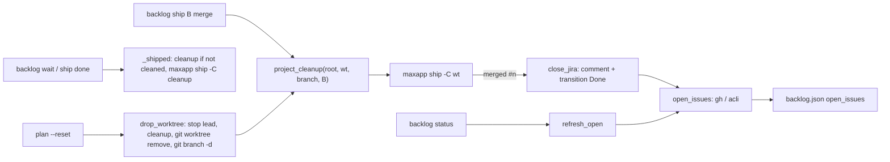
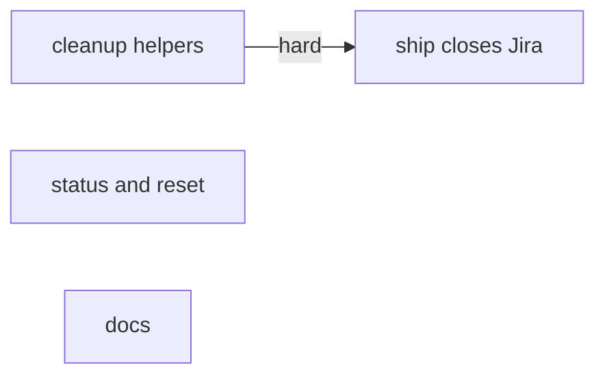

# Superlite: backlog closes Jira issues at ship and cleans up after worktrees (B105)

**Goal:** fix #469 (a Jira-sourced batch ships but its issues stay open and the OPEN marker never refreshes) and #488 (leads leave simulators, build folders and dropped worktrees behind). Max's decision (#469): the ship step transitions the issues, and `status` re-reads the OPEN marker.
**Architecture:** `backlog_run.py` gains the project cleanup (`cleanup_cmd`, `project_cleanup`) and `drop_worktree`; `_shipped` runs the cleanup when the merge did not. `backlog_ship.py` runs the cleanup right before `maxapp ship`, writes `Closes` lines only for GitHub numbers, comments the PR link on each Jira issue and moves it to Done after the merge, and reads open state per tracker (`open_issues`). `backlog.py` re-reads OPEN markers in `status` (`refresh_open`) and removes dropped batches' worktrees on `plan --reset`. Docs name both.
**Tech stack:** Python 3.10+ stdlib, pytest (through `sl run_tests`), Markdown docs.
**Spec:** this file, section Design; issues #469 and #488 Expected.
**Detail:** contracts
**Target-min:** 11
**Wave0:** none
**Coverage:** off

Global constraints:
- New and changed Python code lines carry a trailing `# O(...)` complexity comment, like their neighbours.
- Existing tests stay green. An existing test file changes only when the task Owns it. If another existing test turns red, report it in DONE_WITH_CONCERNS with the test id and the reason instead of editing it.
- Tests never run real `gh`, `acli` or `maxapp`: fake `backlog_ship._run` / `backlog_run._run` (record the argv). Real `git` and `sh` in a tmp_path repo are fine.
- Run `sl` as an executable (`<abs>/sl ...`). Verify with `<abs>/sl run_tests --fast <own test files> --task Tn --background`, then run the printed `wait:` line in the foreground and end the turn only after it reports.
- No version edits (the ship step bumps the version). Never run `scripts/evals.sh`, `claude plugin eval` or `scripts/test_layers.py run`.

Ruling: the cleanup command lives in the main checkout's `.superlite/cleanup-cmd.json` as `{"cleanup": "<shell command>"}`, a file next to test-cmd.json, not a key in it (because test-cmd.json has a user-level per-language default and B106 owns testcmd.py; cost if wrong: one more file to know).
Ruling: the cleanup runs through `/bin/sh -c` in the worktree (the main root when the worktree is gone), with `{worktree}` and `{branch}` replaced shell-quoted and SUPERLITE_WORKTREE, SUPERLITE_BRANCH, SUPERLITE_BATCH set, timeout 600 s; an empty worktree path runs nothing; a failure is one `B project cleanup: ...` line and never stops a ship or a reset (cost if wrong: a leftover simulator, as today).
Ruling: the lead's `merge` runs the cleanup right before `maxapp ship` (which removes the worktree after the merge) and records `cleaned`; `_shipped` runs it only when `cleaned` is unset (a batch main shipped by hand); a RED or RERUN merge runs it again on the next call (because the cleanup must see the worktree; a test rerun recreates the resources; cost if wrong: one extra simulator rebuild after a red check).
Ruling: `plan --reset` stops a dropped batch's lead, runs the cleanup, then `git worktree remove` without --force (a worktree with uncommitted changes stays, named) and `git branch -d` (a branch with unmerged commits stays, named) (because committed and uncommitted work survives a reset; cost if wrong: a kept folder to remove by hand). `skip` keeps its worktree as before (#506).
Ruling: Jira close after a merged PR: per key not already in status category done, `acli jira workitem comment create --key K --body "Shipped in https://github.com/<repo>/pull/<n> (superlite batch <B>[, version <v>])."`, then `acli jira workitem transition --key K --status Done --yes`; a key is open when `acli jira workitem view K --fields status --json` fails or its `fields.status.statusCategory.key` is not `done`; each failed step prints `jira K: <comment|transition> failed: <tail>` (cost if wrong: a project whose final status is not named Done shows OPEN and the jira line names why).
Ruling: `with_closes` adds `Closes #N` only for GitHub numbers; Jira keys get none. The 10 s re-read after the merge applies to GitHub numbers only.
Ruling: `status` (also `--all`) re-reads every batch's OPEN marker once per call with no 10 s retry; a read failure keeps the marker; only changed lists are written back, and only when the stored list is still the one read (cost if wrong: one gh or acli call per open issue per status).
Ruling: backlog_ship.py is edited outside the brief's list (no open batch owns it); notes.md names it. Detail contracts; no probe adapter (cases are named tests); already in the lead worktree; layers unit and headless, evals stamped by ruling (no eval case covers /superlite:backlog, as in B86).
LAYERS: unit, headless

## Design

### 1. Cleanup (T1, backlog_run.py)
`cleanup_cmd(root)`: reads `<root>/.superlite/cleanup-cmd.json`; missing file: None, silent; unreadable or bad JSON: stderr `cleanup-cmd.json ignored: <error>`, None; not an object with a non-empty string `cleanup`: stderr `cleanup-cmd.json ignored: needs a JSON object with a "cleanup" command`, None. `project_cleanup(root, wt, branch, bid)`: None when nothing is configured or `str(wt)` is `""` or `"."`; else runs as the ruling says; exit 0: None; other exit: `"<bid> project cleanup: exit <rc>"` plus `": <last non-blank output line, 120 chars>"` when there is output; timeout: `"<bid> project cleanup: timed out after 600 s"`; OSError: `"<bid> project cleanup: <error>"`. `drop_worktree(root, b)`: [] when `b` has no `worktree` or the folder is missing; refuses the main root (`["<B> worktree <wt> kept: it is the main checkout"]`); stops `b["lead"]` when set (`_stop`); appends a cleanup failure line; `git worktree remove <wt>` (cwd root) fails: `"<B> worktree <wt> kept: <last line of git's output>"`; success: `"<B> worktree <wt> removed"` plus `", branch   deleted"` (`git branch -d  ` exit 0) or `", branch   kept (not merged)"`, nothing for no branch. `_shipped`: when `b.get("cleaned")` is falsy and `b.get("worktree")`, runs `project_cleanup(root, Path(b["worktree"]), b.get("branch") or "", bid)` before `maxapp ship -C`; a failure line goes after the OPEN line.

### 2. Ship (T2, backlog_ship.py)
`with_closes` ignores non-int issues. `_merge`: title refs through `backlog_state.ref`; before `maxapp ship` it runs `backlog_run.project_cleanup(root, wt, b.get("branch") or "", bid)` and `_set(root, bid, cleaned=True)`; a failure line joins `ctx["pre"]`. After a merged PR: `close_jira(repo, issues, n, b, root)` (lines), then `open_issues(repo, issues, root)`. The lead's shipped output is `pre` lines, the shipped line, `OPEN <ref>` per open issue (`bs.ref`: `#6`, `PIX-9`), then the jira lines; main's path passes `cleaned: True` to `_shipped` and appends the jira lines. `_done` runs `close_jira` before `open_issues` and prints its lines after `_shipped`'s. `open_issues` replaces `_open_issues` (callers updated); `_run` calls for gh and acli pass `timeout=60`.

### 3. Status and reset (T3, backlog.py)
`refresh_open(root)` as T3's Produces; `cmd_status` calls it before loading the data it prints. `cmd_plan` with `--reset`: inside `apply`, deep copies of the batches it drops go to `shown["dropped"]`; after the update, each one with a `worktree` goes through `backlog_run.drop_worktree(root, b)` and its lines print after the status and cut lines.

### 4. Docs (T4)
Exact texts in T4.

## File structure

- `skills/subagent-driven-development/scripts/backlog_run.py`: cleanup command, drop_worktree, `_shipped` cleanup (T1)
- `tests/scripts/test_backlog_cleanup_488.py`: cleanup and drop_worktree tests (T1)
- `skills/subagent-driven-development/scripts/backlog_ship.py`: cleanup before merge, Jira close, open_issues (T2)
- `tests/scripts/test_backlog_ship_jira_469.py`: ship tests (T2)
- `skills/subagent-driven-development/scripts/backlog.py`: refresh_open, reset worktree removal (T3)
- `tests/scripts/test_backlog_status_reset_469_488.py`: status and reset tests (T3)
- `commands/backlog.md`, `skills/subagent-driven-development/backlog.md`, `tests/scripts/test_backlog_docs_469_488.py`: docs (T4)

## Task graph

```mermaid
%% schedule
gantt
  title Predicted schedule (mm:ss)
  dateFormat X
  axisFormat %M:%S
  section lane 1
  T1 project cleanup and worktree removal :t1, 0, 98s
  T2 ship cleans up first and closes Jira :t2, 98, 99s
  section lane 2
  T3 status re-reads OPEN reset removes wo :t3, 0, 98s
  section lane 3
  T4 docs name Jira close status re-read a :t4, 0, 96s
```

critical path: T1 → T2 (3.3 min) · peak width 3 · predicted build 3.3 min · predicted total ≈ 6.8 min (target ✓)

## Package: backlog runner cleanup

App type: CLI library. Categories: file (missing, bad cleanup-cmd.json), state (worktree kept or removed), encoding (shell quoting of paths with spaces). **Probe entry:** none (git and shell helpers on paths; cases are named tests).

### T1 project cleanup and worktree removal · Complexity 4 · Est. context 40k
**Owns:** skills/subagent-driven-development/scripts/backlog_run.py, tests/scripts/test_backlog_cleanup_488.py
**Components:** 1
**LOC owned:** 190
**Tests:** fast
**Model:** sonnet
**Est. time:** 3.0 min (1 component, about 190 LOC, fast tests)
**Covers:** 1
**Consumes:** none
**Produces:** backlog_run.cleanup_cmd(root: Path) -> str | None · backlog_run.project_cleanup(root: Path, wt: Path, branch: str, bid: str) -> str | None · backlog_run.drop_worktree(root: Path, b: dict) -> list
e.g. project_cleanup(root, wt, "superlite/b1-x", "B1") with no cleanup-cmd.json -> None
e.g. project_cleanup(root, wt, "superlite/b1-x", "B1") with {"cleanup": "echo oops; exit 3"} -> "B1 project cleanup: exit 3: oops"
e.g. drop_worktree(root, {"id": "B2", "worktree": "<root>/wts/b2", "branch": "superlite/b2-x"}) on a clean worktree with no own commits -> ["B2 worktree <root>/wts/b2 removed, branch superlite/b2-x deleted"]
**Review Focus:** file: `test_cleanup_cmd_missing_bad_json_and_empty`; encoding: `test_cleanup_quotes_a_worktree_path_with_spaces` (wt `<tmp>/my wt`, command `printf %s {worktree} > out.txt` writes exactly the path; env SUPERLITE_WORKTREE, SUPERLITE_BRANCH, SUPERLITE_BATCH equal wt, branch, bid); state: `test_cleanup_runs_nothing_for_an_empty_worktree` (wt Path("") with a configured command: None and no out.txt), `test_cleanup_failure_and_timeout_lines` (monkeypatch CLEANUP_TIMEOUT to 1 and `sleep 5`: "B1 project cleanup: timed out after 1 s"), `test_drop_worktree_removes_a_clean_one_and_its_merged_branch`, `test_drop_worktree_keeps_uncommitted_work` (an untracked file: line starts "B2 worktree <wt> kept: ", folder still there), `test_drop_worktree_keeps_an_unmerged_branch` (one commit on the branch: "..., branch superlite/b2-x kept (not merged)"), `test_drop_worktree_refuses_the_main_root`, `test_drop_worktree_stops_the_lead_and_runs_the_cleanup_first` (fake `_stop` records the lead; the cleanup command writes a file inside the worktree folder before removal, `printf x > {worktree}/../ran.txt`), `test_shipped_runs_the_cleanup_unless_cleaned` (fake `_run` and `_stop`; cleaned False: the command ran, its failure line ends the output; cleaned True: not run).
**Steps:** 1 write the tests (real git in tmp_path: `git init -q -b main`, one commit, `git worktree add -q <wt> -b superlite/b2-x`; `_stop` faked with monkeypatch), 2 run: FAIL, 3 implement the Design section 1, 4 run: PASS, also `tests/scripts/test_backlog_run.py tests/scripts/test_backlog_run_lifecycle.py tests/scripts/test_backlog_ship_done.py tests/scripts/test_backlog_ship_from_main.py`.
**Notes:** `CLEANUP = Path(".superlite") / "cleanup-cmd.json"`, `CLEANUP_TIMEOUT = 600` module constants, read at call time. Run the command with `subprocess.run(["/bin/sh", "-c", cmd], cwd=..., env={**os.environ, ...}, capture_output=True, text=True, timeout=CLEANUP_TIMEOUT)` directly, not through `_run` (whose test fakes take (cmd, cwd)). `drop_worktree` runs git through `_run(cmd, root)`; compare `Path(wt).resolve()` with `Path(root).resolve()` for the main-root refusal.

## Package: ship step

App type: CLI. Categories: protocol (gh and acli argv), state (open markers, cleaned flag), encoding (Jira keys in titles and bodies).

**Probe entry:** none (subprocess wrappers; cases are named tests).

### T2 ship cleans up first and closes Jira issues · Complexity 5 · Est. context 46k
**Owns:** skills/subagent-driven-development/scripts/backlog_ship.py, tests/scripts/test_backlog_ship_jira_469.py
**Components:** 1
**LOC owned:** 210
**Tests:** fast
**Model:** sonnet
**Est. time:** 3.4 min (1 component, about 210 LOC, fast tests)
**Covers:** 2
**Consumes:** backlog_run.project_cleanup(root: Path, wt: Path, branch: str, bid: str) -> str | None (T1)
**Produces:** backlog_ship.open_issues(repo: str, issues: list, root: Path, retry: bool = True) -> list · backlog_ship.close_jira(repo: str, issues: list, pr: int, b: dict, root: Path) -> list
e.g. open_issues("o/r", [5, 6], root) with gh state 5 CLOSED, 6 OPEN (twice) -> [6]
e.g. open_issues("o/r", ["PIX-1", "PIX-2"], root) with acli view PIX-1 statusCategory "done", PIX-2 "new" -> ["PIX-2"]; acli exit 1 for PIX-1 -> ["PIX-1", "PIX-2"]
e.g. close_jira("o/r", [5, "PIX-1"], 201, {"id": "B1", "version": "1.5.8"}, root) with PIX-1 open and every acli call exit 0 -> [] after `acli jira workitem comment create --key PIX-1 --body "Shipped in https://github.com/o/r/pull/201 (superlite batch B1, version 1.5.8)."` and `acli jira workitem transition --key PIX-1 --status Done --yes`
**Review Focus:** protocol: `test_close_jira_comments_then_transitions_each_open_key` (exact argv above, order comment then transition, no acli call for 5), `test_close_jira_skips_a_key_already_done` (view says done: no comment, no transition), `test_close_jira_names_each_failed_step` (comment exit 1 "boom": line "jira PIX-1: comment failed: boom", the transition still runs); state: `test_open_issues_reads_gh_and_acli`, `test_open_issues_retries_only_github_numbers` (one `_sleep(10)` only when an int is left; retry=False never sleeps), `test_merge_runs_the_cleanup_before_maxapp_ship_and_marks_cleaned` (fake `backlog_run.project_cleanup` records its call; it comes before the maxapp argv in the call log; batch `cleaned` is True; a returned "B1 project cleanup: exit 3" line comes first in the output), `test_merge_jira_batch_closes_and_reports` (issues ["PIX-1", "PIX-2"], transition of PIX-2 fails, view stays "new": output ends "OPEN PIX-2\njira PIX-2: transition failed: <tail>\n", title "B1: PIX-1 PIX-2", body has no `Closes` line, `open_issues` == ["PIX-2"]); encoding: `test_with_closes_skips_jira_keys` (with_closes("", [5, "PIX-1"]) == "Closes #5\n"); `test_done_closes_jira_too` (`ship B1 done --pr 201` on a parked Jira batch runs the comment and transition).
**Steps:** 1 write the tests (reuse the `sh` fixture pattern of tests/scripts/test_backlog_ship.py; fake `backlog_run.project_cleanup` with `monkeypatch.setattr(backlog_run, "project_cleanup", fake)`), 2 run: FAIL, 3 implement the Design section 2, 4 run: PASS, also `tests/scripts/test_backlog_ship.py tests/scripts/test_backlog_ship_done.py tests/scripts/test_backlog_ship_from_main.py tests/scripts/test_backlog_ship_notes_476.py`.
**Notes:** the acli view argv is `["acli", "jira", "workitem", "view", K, "--fields", "status", "--json"]`; its JSON is an object (take item 0 when it is a list). Keep the gh argv exactly as today. Hard edge: wait for T1's commit (existing merge tests run the real `project_cleanup`).

## Package: backlog CLI

App type: CLI. Categories: state (markers written back, dropped batches), protocol (output lines).

**Probe entry:** none (CLI over backlog.json; cases are named tests).

### T3 status re-reads OPEN, reset removes worktrees · Complexity 3 · Est. context 40k
**Owns:** skills/subagent-driven-development/scripts/backlog.py, tests/scripts/test_backlog_status_reset_469_488.py
**Components:** 1
**LOC owned:** 140
**Tests:** fast
**Model:** sonnet
**Est. time:** 2.6 min (1 component, about 140 LOC, fast tests)
**Covers:** 3
**Consumes:** backlog_ship.open_issues(repo: str, issues: list, root: Path, retry: bool = True) -> list (T2) · backlog_run.drop_worktree(root: Path, b: dict) -> list (T1)
**Produces:** backlog.refresh_open(root: Path) -> dict
e.g. refresh_open(root) with B1 shipped open_issues [5, "PIX-9"] and open_issues(...) -> [] -> {"B1": []}; backlog.json B1 open_issues == []
e.g. refresh_open(root) with no batch holding open_issues -> {} and backlog_ship not imported
**Review Focus:** state: `test_status_drops_closed_markers_and_keeps_failed_reads` (fake open_issues returns [5] for [5, 6]: status row shows "OPEN #5", backlog.json [5], called with retry=False), `test_status_all_refreshes_earlier_rounds`, `test_refresh_skips_a_list_changed_meanwhile` (the fake rewrites the batch's open_issues to [7] before returning: stored [7] stays), `test_reset_removes_dropped_worktrees` (a parked B2 with worktree: fake drop_worktree records it and returns ["B2 worktree W removed"]; that line ends the plan output; a planned batch without worktree is not passed), `test_plain_plan_drops_nothing` (no reset: drop_worktree never called).
**Steps:** 1 write the tests (the `bk` fixture of tests/scripts/test_backlog_cli.py; fake producers with `monkeypatch.setattr(backlog_ship, "open_issues", f, raising=False)` and the same for `backlog_run.drop_worktree`, skipped when SUPERLITE_REAL is 1), 2 run: FAIL, 3 implement the Design section 3, 4 run: PASS, also `tests/scripts/test_backlog_cli.py tests/scripts/test_backlog_plan_reset_369.py tests/scripts/test_backlog_status_rounds_406.py tests/scripts/test_backlog_status_b86.py`.
**Notes:** `refresh_open` returns {bid: new list} for each changed batch only. Import backlog_ship and backlog_run inside the functions, and only when there is a marker or a dropped worktree.

## Package: docs

App type: docs. **Probe entry:** none (docs; the pins are the check).

### T4 docs name Jira close, status re-read and cleanup · Complexity 2 · Est. context 28k
**Owns:** commands/backlog.md, skills/subagent-driven-development/backlog.md, tests/scripts/test_backlog_docs_469_488.py
**Components:** 1
**LOC owned:** 40
**Tests:** fast
**Kind:** mechanical
**Model:** haiku
**Est. time:** 1.6 min (1 component, about 40 LOC, fast tests)
**Covers:** 4
**Consumes:** none
**Produces:** none
**Review Focus:** none (docs; the pins are the check).
Texts (exact; the test asserts each appears whitespace-normalized in its file):
- SDD1 = "For a Jira key the ship step itself comments the PR link on the issue and moves it to Done, so `B OPEN KEY` means that failed; `status` re-reads every OPEN marker from GitHub or Jira and drops the closed ones."
- SDD2 = "`--reset` also removes each dropped batch's worktree: it stops its lead, runs the project cleanup command, then `git worktree remove` (a worktree with uncommitted changes stays) and `git branch -d` (a branch with unmerged commits stays); each prints one line."
- SDD3 = "For a Jira key `merge` adds no `Closes` line; after the merge it comments `Shipped in <PR URL> (superlite batch B, version V).` on the issue and moves it to Done through `acli`, and prints `OPEN KEY` and a `jira KEY: <step> failed: <error>` line only when that failed."
- SDD4 = "Resources named after a worktree (simulators, build folders): the main checkout's `.superlite/cleanup-cmd.json`, `{\"cleanup\": \"<shell command>\"}`, runs in the worktree right before `maxapp ship` removes it (`merge`, `ship B done`, `plan --reset`); `{worktree}` and `{branch}` expand shell-quoted, and `SUPERLITE_WORKTREE`, `SUPERLITE_BRANCH` and `SUPERLITE_BATCH` are set; a failure prints one `B project cleanup: ...` line and never stops the ship."
- CMD1 = "`--reset` also removes each dropped batch's worktree (its lead stopped and the project cleanup command run first); a worktree with uncommitted changes and a branch with unmerged commits stay, each named in one line."
- CMD2 = "A `B OPEN #N` (Jira: `B OPEN KEY`) line names an issue the merge could not close: for Jira the ship step already commented the PR link and moved the issue to Done, so OPEN means that failed; `status` re-reads every OPEN marker and drops it once the issue is closed."
- CMD3 = "Simulators, build folders and other resources named after a lead's worktree: put a cleanup command into `.superlite/cleanup-cmd.json` as `{\"cleanup\": \"<shell command>\"}` (`{worktree}` and `{branch}` expand shell-quoted); it runs before each worktree goes."
Edits: 1. skills/subagent-driven-development/backlog.md, line `5. `: insert SDD1 right after "A `B OPEN #N` line names an issue the merge left open; `status` shows it too." 2. same file, line `2. `: append SDD2 at its end. 3. same file, `## Lead` bullet starting "- Keep your notes": insert SDD3 right after "`merge` adds a missing line and prints `OPEN #N` for an issue still open after the merge." 4. same file, `## Limits`: append SDD4 as a new paragraph. 5. commands/backlog.md step 2: insert CMD1 right after "a running or needs_decision batch still refuses it (a plain `plan` names `--reset` in its `BLOCKED:` line)." 6. step 5: append CMD2 at its end. 7. step 4: append CMD3 at its end.
**Steps:** 1 write the test file (`norm = " ".join(text.split())`; one test per file asserting its texts; also assert "B OPEN #N" and "its worktree kept" still appear), 2 run: FAIL, 3 make the seven edits, 4 run: PASS, also `tests/scripts/test_backlog_docs.py tests/scripts/test_backlog_docs_369_370.py tests/scripts/test_backlog_docs_b89.py tests/scripts/test_backlog_docs_b90.py tests/scripts/test_backlog_main_docs.py tests/scripts/test_backlog_user_docs.py tests/scripts/test_docs_b72_backlog.py`.

## Self-review

1. Coverage: #469 ship transitions with a hand-off comment (T2 close tests), OPEN only on failure (T2 `test_merge_jira_batch_closes_and_reports`), status re-reads (T3), no inert `Closes #KEY` (T2); #488 reset removes the worktree (T1 drop, T3 wiring), cleanup command before the worktree goes (T1 `_shipped`, T2 merge); docs (T4).
2. Placeholders: none (`<shell command>`, `<PR URL>`, `<tail>` are literal doc or output text).
3. Types: T2 and T3 consume T1/T2 Produces exactly.
4. Graph: T1 -> T2 hard (existing merge tests run the real project_cleanup); T3 fakes its producers; T4 fixed texts; no shared files.
5. Fields set. 6. Review Focus per package, probe entries none with reasons. 7. Schedule and lint run next.
