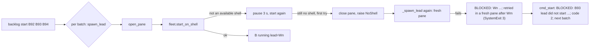
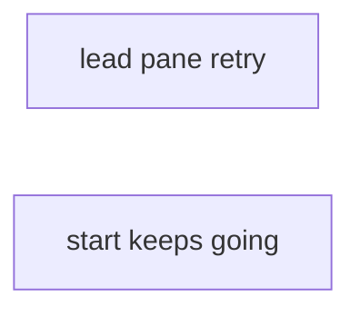

# Superlite: backlog start retries a lead pane that is no shell (B120)

**Goal:** fix #551: `sl backlog start` stops with `BLOCKED: Wn account A startup: agent target pane P is not an available shell` (exit 3) and leaves the batches named after it unstarted. A lead pane that is not a shell yet gets the worker's same-pane retry, then one start in a fresh pane; a lead that still does not start blocks only its own batch.
**Architecture:** `fleet.py` gains `start_on_shell`, the one same-pane shell retry that `_spawn` already inlines; `_spawn` calls it (unchanged behaviour). `fleet_lead.py` calls it too and, when the pane is still no shell, closes the pane and starts the lead once more in a fresh pane (new exception `fleet_lead.NoShell`, caught in `spawn_lead` next to `fleet._Slow`). `backlog_run.cmd_start` catches a lead's `SystemExit`, prints a batch-named BLOCKED line, sets exit 2 and goes on with the next batch.
**Tech stack:** Python 3.10+ stdlib, pytest (through `sl run_tests`), Markdown docs.
**Spec:** this file, section Design; issue #551 Expected.
**Detail:** tests
**Target-min:** 11
**Wave0:** none
**Coverage:** off

Global constraints:
- Every Python code line keeps the file's trailing `# O(...)` complexity comment.
- Existing tests stay green, `tests/scripts/test_fleet_spawn_shell_retry.py` and `tests/scripts/test_docs_b26.py` unchanged. An existing test file changes only when the task Owns it. If another existing test turns red, report it in DONE_WITH_CONCERNS with the test id and the reason instead of editing it.
- Run `sl` as an executable (`<abs>/sl ...`). Verify with `<abs>/sl run_tests --fast <own test files> --task Tn --background`, then run the printed `wait:` line in the foreground and end the turn only after it reports.
- No version edits (the ship step bumps the version). Never run `scripts/evals.sh`, `claude plugin eval` or `scripts/test_layers.py run`.
- Never touch `docs/tools.md`, `skills/subagent-driven-development/SKILL.md`, `skills/subagent-driven-development/scripts/run_tests.py` (other batches own them).

Ruling: the lead gets both remedies the issue names, in order: the worker's same-pane retry (3 s pause, one more start) and then one start in a fresh pane, because the reports show both a slow shell under load (~390) and a pane that a rerun seconds later replaced with a working one; cost if wrong: up to about 6 s more before a BLOCKED line.
Ruling: the fresh-pane start uses the normal account choice (`fleet.choose_account`), not `_retry_account`, because a pane that is no shell is no account problem; at most one extra start per lead in total (a `_Slow` first try followed by a shell failure, or the reverse, ends BLOCKED).
Ruling: worker spawns (`fleet._spawn`) keep their documented contract (one same-pane retry, `; retried once`); no fresh pane for workers in this batch, because docs/tools.md pins that text and B118/B119 own it.
Ruling: a lead that does not start counts as a refused batch: `BLOCKED: B lead did not start; B keeps its state, rerun sl backlog start B`, exit 2 (not 3), and the batches after it still start, matching backlog.md step 4 (exit 2 when any was refused; exit 3 only for Herdr missing).
Ruling: no probe adapter (Herdr-bound spawn paths; Review Focus cases are named tests); T2's doc text is fixed in this plan, so T2 has no edge to T1; already in the lead worktree, no `sl worktree ensure`; layers unit and headless (backlog.md is under skills/, not scripts/).
LAYERS: unit, headless



## Design

### 1. Lead pane retry (T1)
`fleet.start_on_shell(name, pane, argv) -> str`: `hc.start_agent(name, pane, argv)`; a `HerdrError` whose `message` holds `SHELL_MSG` gets `_pause(SHELL_PAUSE_S)` and one more `hc.start_agent`. Returns `""` (first start worked) or `"; retried once"`. A non-shell first error is re-raised as is (no `retried` attribute). A failed second start re-raises that error after setting `e.retried = "; retried once"`. `_spawn` replaces its inline retry with it and reads `getattr(e, "retried", "")` for the BLOCKED suffix: same calls, pauses and texts as today.
`fleet_lead`: `class NoShell(Exception)` with `wid`, `account`, `why` (like `fleet._Slow`). `_spawn_lead` starts through `fleet.start_on_shell`; on a start error that is not the trust case, a message holding `fleet.SHELL_MSG` makes the reason `startup: <e.message><e.retried>` (the screen's first line otherwise, as today). `fail(why, screen, slow, shell)`: sets the worker blocked, closes the pane; when `after is None` and `shell`: `fleet._keep(main_sd, wid, why, screen, "fleet spawn retry")`, then raise `NoShell(wid, account, why)`. `spawn_lead` catches `(fleet._Slow, NoShell)` and runs `_spawn_lead` once more with `after=first`. With `after` a `NoShell`: account from `fleet.choose_account`, stderr line `<after.wid> <after.why>; retrying in a fresh pane`, tail `; retried in a fresh pane after <after.wid>`. With `after` a `_Slow`: as today.

### 2. Start goes on after a failed lead (T2)
`cmd_start`: `except SystemExit` around `spawn_lead` prints `BLOCKED: {bid} lead did not start; {bid} keeps its state, rerun sl backlog start {bid}`, sets `code = 2` and continues; the batch record is not touched. Docstring and backlog.md step 4 say so.

## File structure

- `skills/subagent-driven-development/scripts/fleet.py`: `start_on_shell`, `_spawn` uses it (T1)
- `skills/subagent-driven-development/scripts/fleet_lead.py`: `NoShell`, same-pane then fresh-pane retry (T1)
- `docs/fleet.md`: one bullet on the lead's fresh-pane retry (T1)
- `tests/scripts/test_fleet_lead_shell_551.py`: helper and lead retry tests (T1)
- `skills/subagent-driven-development/scripts/backlog_run.py`: `cmd_start` goes on after a failed lead (T2)
- `skills/subagent-driven-development/backlog.md`: step 4 sentence (T2)
- `tests/scripts/test_backlog_run.py`: one assertion 3 -> 2 (T2)
- `tests/scripts/test_backlog_start_551.py`: start keeps going (T2)

## Task graph

```mermaid
%% schedule
gantt
  title Predicted schedule (mm:ss)
  dateFormat X
  axisFormat %M:%S
  section lane 1
  T1 Lead spawn retries a pane that is no :t1, 0, 141s
  section lane 2
  T2 backlog start goes on after a failed :t2, 0, 95s
```





critical path: T1 (2.3 min) · peak width 2 · predicted build 2.3 min · predicted total ≈ 5.8 min (target ✓)

## Package: lead spawn

App type: library over a CLI (Herdr). Categories: protocol (Herdr error codes and messages), state (worker records, panes closed, account choice). **Probe entry:** none (Herdr-bound spawn; cases are named tests).

### T1 Lead spawn retries a pane that is no shell · Complexity 4 · Est. context 45k
**Owns:** skills/subagent-driven-development/scripts/fleet.py, skills/subagent-driven-development/scripts/fleet_lead.py, docs/fleet.md, tests/scripts/test_fleet_lead_shell_551.py
**Components:** 2
**LOC owned:** 150
**Tests:** fast
**Model:** sonnet
**Est. time:** 3.0 min (2 components, about 150 LOC, fast tests)
**Covers:** 1
**Consumes:** none
**Produces:** fleet.start_on_shell(name: str, pane: str, argv: list) -> str · fleet_lead.NoShell(Exception)
**Review Focus:** protocol: `test_start_on_shell_non_shell_error_is_not_retried` (first error `agent_not_ready` re-raised, no pause, no `retried`); state: `test_lead_starts_in_a_fresh_pane_after_two_shell_failures` (W1 blocked, its pane closed, W2 ready, two panes opened), `test_lead_blocks_after_the_fresh_pane_fails_too` (exactly 4 starts, 2 pauses, BLOCKED line ends `; retried once; retried in a fresh pane after W1`), `test_other_lead_startup_errors_get_no_fresh_pane`.
**Test code (verbatim):** new file tests/scripts/test_fleet_lead_shell_551.py:
```python
"""#551: a lead pane that is not a shell yet gets one more start after a pause, then one start in a fresh pane."""
import json
import pytest
from test_fleet import REAL, fleet, world  # noqa: F401  (world is a fixture)
from test_fleet_spawn_shell_retry import MSG, script, starts
import fleet_lead as fl  # noqa: E402

pytestmark = pytest.mark.skipif(REAL, reason="scripted start failures need the in-process fake")
SHELL = ("agent_start_failed", MSG)


@pytest.fixture
def pauses(monkeypatch):
    p = []
    monkeypatch.setattr(fleet, "_pause", p.append)
    return p


def lead(world, tmp_path, monkeypatch):
    monkeypatch.setenv("SUPERLITE_HOME", str(tmp_path / "home"))
    fleet.main(["on", "--accounts", "claude1,claude3"])
    wt = tmp_path / "wt"; wt.mkdir(exist_ok=True)
    return wt


def panes_opened(world):
    return [c for c in world.fh.calls if c[0] in ("create_workspace", "split_pane", "create_tab")]


def test_start_on_shell_first_start_works(world, pauses):
    assert fleet.start_on_shell("a", "w6:p1", ["x"]) == "" and len(starts(world)) == 1 and pauses == []


def test_start_on_shell_retries_once_after_a_pause(world, pauses):
    script(world, {1: SHELL})
    assert fleet.start_on_shell("a", "w6:p1", ["x"]) == "; retried once"
    assert len(starts(world)) == 2 and pauses == [fleet.SHELL_PAUSE_S]


def test_start_on_shell_second_failure_carries_retried(world, pauses):
    script(world, {1: SHELL, 2: SHELL})
    with pytest.raises(world.fh.HerdrError) as e:
        fleet.start_on_shell("a", "w6:p1", ["x"])
    assert e.value.retried == "; retried once" and e.value.message == MSG and len(pauses) == 1


def test_start_on_shell_non_shell_error_is_not_retried(world, pauses):
    script(world, {1: ("agent_not_ready", "blocked during startup")})
    with pytest.raises(world.fh.HerdrError) as e:
        fleet.start_on_shell("a", "w6:p1", ["x"])
    assert getattr(e.value, "retried", "") == "" and pauses == [] and len(starts(world)) == 1


def test_lead_retries_the_same_pane_after_a_pause(world, tmp_path, monkeypatch, pauses):
    wt = lead(world, tmp_path, monkeypatch); script(world, {1: SHELL})
    r = fl.spawn_lead(world.sd, wt, "opus", env={"HOME": "/u"})
    assert r["id"] == "W1" and len(starts(world)) == 2 and pauses == [fleet.SHELL_PAUSE_S] and len(panes_opened(world)) == 1
    assert json.loads((world.sd / "fleet.json").read_text())["workers"]["W1"]["state"] == "ready"


def test_lead_starts_in_a_fresh_pane_after_two_shell_failures(world, tmp_path, monkeypatch, pauses, capsys):
    wt = lead(world, tmp_path, monkeypatch); capsys.readouterr(); script(world, {1: SHELL, 2: SHELL})
    r = fl.spawn_lead(world.sd, wt, "opus", env={"HOME": "/u"})
    out, err = capsys.readouterr()
    workers = json.loads((world.sd / "fleet.json").read_text())["workers"]
    assert r["id"] == "W2" and (workers["W1"]["state"], workers["W2"]["state"]) == ("blocked", "ready")
    assert ("close_pane", "w6:p1") in world.fh.calls and len(panes_opened(world)) == 2 and len(starts(world)) == 3
    assert pauses == [fleet.SHELL_PAUSE_S] and "BLOCKED" not in out
    assert f"W1 startup: {MSG}; retried once; retrying in a fresh pane" in err


def test_lead_blocks_after_the_fresh_pane_fails_too(world, tmp_path, monkeypatch, pauses, capsys):
    wt = lead(world, tmp_path, monkeypatch); capsys.readouterr(); script(world, {1: SHELL, 2: SHELL, 3: SHELL, 4: SHELL})
    with pytest.raises(SystemExit) as e:
        fl.spawn_lead(world.sd, wt, "opus", env={"HOME": "/u"})
    line = [x for x in capsys.readouterr().out.splitlines() if x.startswith("BLOCKED: ")][0]
    assert e.value.code == 3 and line.startswith("BLOCKED: W2 account ")
    assert line.endswith(f"startup: {MSG}; retried once; retried in a fresh pane after W1")
    assert len(starts(world)) == 4 and len(pauses) == 2


def test_other_lead_startup_errors_get_no_fresh_pane(world, tmp_path, monkeypatch, pauses, capsys):
    wt = lead(world, tmp_path, monkeypatch); capsys.readouterr()
    world.fh.start_error = "agent_not_ready"; world.fh.screen = "Select login method\n"
    with pytest.raises(SystemExit):
        fl.spawn_lead(world.sd, wt, "opus", env={"HOME": "/u"})
    out, err = capsys.readouterr()
    assert out.startswith("BLOCKED: W1 ") and "fresh pane" not in out + err
    assert len(starts(world)) == 1 and pauses == [] and len(panes_opened(world)) == 1
```
**Steps:** 1 write the test file, 2 run: FAIL, 3 implement `start_on_shell` in fleet.py next to `_pause` and use it in `_spawn` (keep every existing text), 4 `NoShell`, `fail(..., shell=False)` and the `after` handling in fleet_lead.py as in Design 1, 5 docstrings: fleet.py line `A start that fails with ...` names `start_on_shell`; fleet_lead.py adds `A pane still no shell after that retry is closed and the lead starts once more in a fresh pane (#551).`, 6 docs/fleet.md: directly after the bullet ending `the same holds for a lead.` add the bullet below, 7 run own tests plus tests/scripts/test_fleet_spawn_shell_retry.py tests/scripts/test_fleet_lead.py tests/scripts/test_fleet_lead_b87.py tests/scripts/test_fleet_spawn_account_retry_428.py tests/scripts/test_docs_b26.py: PASS.
docs/fleet.md bullet (verbatim): ``- A lead whose pane is still not a shell after that 3 s retry (`not an available shell`) starts once more in a fresh pane: the first pane closes, stderr says `Wn startup: <Herdr message>; retried once; retrying in a fresh pane`, and a BLOCKED reason after the fresh pane ends `; retried in a fresh pane after Wn` (#551).``
**Notes:** the shell reason uses `e.message` (the screen of a never-started agent says nothing); `fleet._blocked` already prints the line and raises `SystemExit(3)`.

## Package: backlog start

App type: CLI. Categories: protocol (stdout lines, exit codes), state (batch records). **Probe entry:** none (main-only command over Herdr; cases are named tests).

### T2 backlog start goes on after a failed lead · Complexity 2 · Est. context 35k
**Owns:** skills/subagent-driven-development/scripts/backlog_run.py, skills/subagent-driven-development/backlog.md, tests/scripts/test_backlog_run.py, tests/scripts/test_backlog_start_551.py
**Components:** 1
**LOC owned:** 70
**Tests:** fast
**Model:** sonnet
**Est. time:** 2.0 min (1 component, about 70 LOC, fast tests)
**Covers:** 2
**Consumes:** none
**Produces:** backlog_run.cmd_start(a: argparse.Namespace) -> int
**Review Focus:** protocol: `test_a_failed_lead_does_not_stop_the_batches_after_it` (exact stdout lines, exit 2); state: `test_every_lead_failing_keeps_each_batch_and_exits_2` (parked batch keeps state and reason).
**Test code (verbatim):** new file tests/scripts/test_backlog_start_551.py:
```python
"""#551: a lead that does not start blocks only its own batch; the batches named after it still start."""
import sys
from backlog_fixtures import batch as b
from test_backlog_run import bk, get, put, run  # noqa: F401  (bk is a fixture)

LINE = "BLOCKED: W9 account c3 startup: agent target pane w:p{n} is not an available shell; retried once; retried in a fresh pane after W8"


def flaky(monkeypatch, fail_on):
    mod = sys.modules["fleet_lead"]; orig, n = mod.spawn_lead, [0]
    def spawn(main_sd, wt, model="opus", env=None):
        n[0] += 1
        if n[0] in fail_on:
            print(LINE.format(n=n[0])); raise SystemExit(3)
        return orig(main_sd, wt, model, env)
    monkeypatch.setattr(mod, "spawn_lead", spawn)


def test_a_failed_lead_does_not_stop_the_batches_after_it(bk, capsys, monkeypatch):
    put(bk, b("B92", ["a.py"]), b("B93", ["b.py"]), b("B94", ["c.py"]))
    flaky(monkeypatch, {2})
    rc, out = run(capsys, "start", "B92", "B93", "B94", "--cap", "8")
    w92, w94 = bk.root / "wts" / "superlite-b92-t", bk.root / "wts" / "superlite-b94-t"
    assert rc == 2
    assert out.splitlines() == [f"B92 running lead=W1 worktree={w92}", LINE.format(n=2),
                                "BLOCKED: B93 lead did not start; B93 keeps its state, rerun sl backlog start B93",
                                f"B94 running lead=W2 worktree={w94}"]
    assert [get(bk, x)["state"] for x in ("B92", "B93", "B94")] == ["running", "planned", "running"]
    assert get(bk, "B93")["lead"] is None
    assert ("send", "W2", "lead.md", "B94") in bk.calls and not any(c[0] == "send" and c[-1] == "B93" for c in bk.calls)


def test_every_lead_failing_keeps_each_batch_and_exits_2(bk, capsys, monkeypatch):
    put(bk, b("B1", ["a.py"], "parked", reason="tui red", worktree=str(bk.root / "wts" / "superlite-b1-t")), b("B2", ["b.py"]))
    flaky(monkeypatch, {1, 2})
    rc, out = run(capsys, "start", "B1", "B2")
    assert rc == 2
    assert [x for x in out.splitlines() if not x.startswith("BLOCKED: W9 ")] == [
        "BLOCKED: B1 lead did not start; B1 keeps its state, rerun sl backlog start B1",
        "BLOCKED: B2 lead did not start; B2 keeps its state, rerun sl backlog start B2"]
    assert (get(bk, "B1")["state"], get(bk, "B1")["reason"], get(bk, "B2")["state"]) == ("parked", "tui red", "planned")
```
In tests/scripts/test_backlog_run.py, `test_start_resumes_a_parked_batch_and_survives_a_blocked_spawn`: change its last line's `[0] == 3` to `[0] == 2`; nothing else.
**Steps:** 1 write the test file and the one-line change, 2 run: FAIL, 3 in `cmd_start` replace `except SystemExit as e: return e.code ...` with a handler that prints `BLOCKED: {bid} lead did not start; {bid} keeps its state, rerun sl backlog start {bid}`, sets `code = 2` and `continue`s, 4 module docstring: after ``each refusal prints BLOCKED, the others start.`` add `` A lead that does not start prints `BLOCKED: B lead did not start; ...` after its spawn's own line, sets exit 2 and the batches after it still start (#551).``, 5 backlog.md step 4: directly after `Exit 3 (Herdr missing) is BLOCKED.` insert the sentence below (same line, one space before it), 6 run own tests plus tests/scripts/test_backlog_run.py tests/scripts/test_docs_b26.py tests/scripts/test_backlog_docs.py: PASS.
backlog.md sentence (verbatim): ``A lead that does not start counts as refused: its spawn's `BLOCKED:` line is followed by `BLOCKED: B lead did not start; B keeps its state, rerun sl backlog start B`, and the batches after it still start; a lead pane that is not a shell yet gets one more start after 3 s, then one in a fresh pane (#551).``
**Notes:** keep the existing `B running lead=...` line and the send_brief failure path unchanged.

## Self-review

Coverage: Design 1 -> T1, Design 2 -> T2. No placeholders. No shared files; no edges (T2's docs text is fixed here). Every task has Components, LOC owned, Tests, Model.
