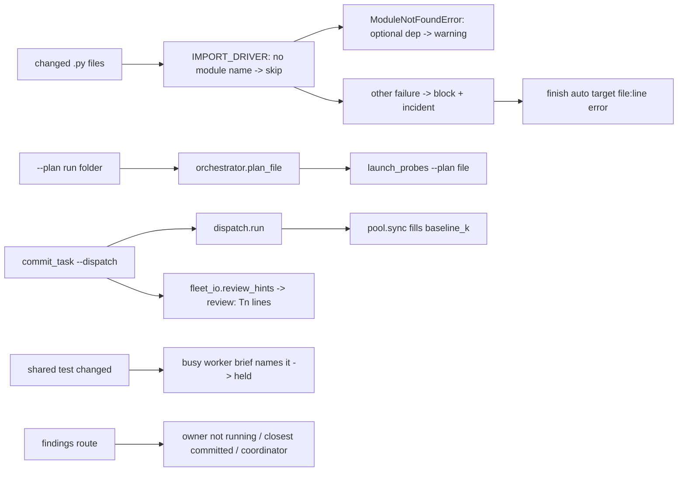
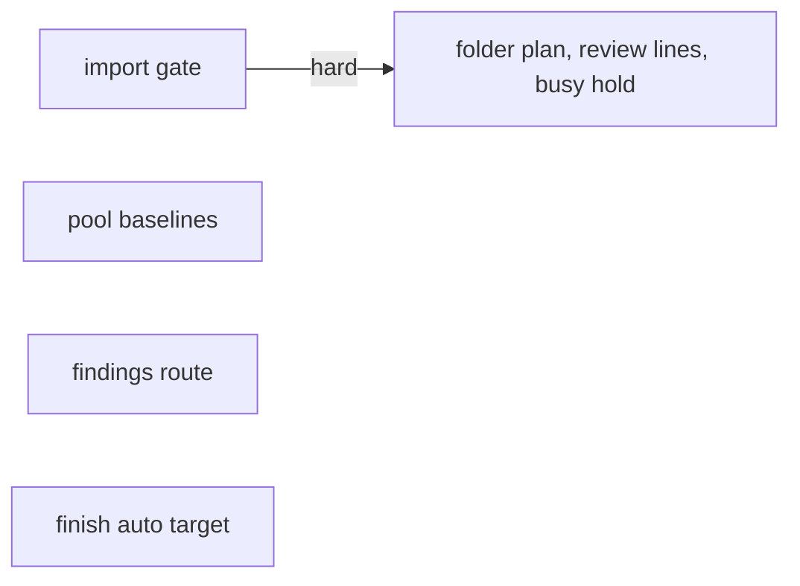

# Superlite: commit_task import gate, folder plan, review hints, busy-worker hold; findings route never to a running task; pool baselines (B94)

**Goal:** fix #471 (the import gate skips files no import can name, warns on a missing optional dependency, and the auto feedback entry names the error), #456 (`commit_task --plan <run folder>` reads the plan file, so the background `probe_run --commit` gets `--plan`), #455 (dispatch counts worker context from the READY baseline; `commit_task --dispatch` prints `review: Tn` lines) and #484 (a shared test a busy worker edits stays out of another task's checkpoint; findings route never sends a fix to a task in progress).
**Architecture:** `commit_task.py` (T1 import gate, T2 folder plan, review lines, busy-worker hold), `finish.py` (T5 auto-entry target), `pool.py` (T3 baseline fill in `sync`, which `dispatch.run` calls for every dispatch path), `findings.py` and `fixing.md` (T4 routing).
**Tech stack:** Python 3.10+ stdlib (`tomllib` when present), pytest (through `sl run_tests`).
**Spec:** this file, section Design; the Expected lines of issues #455, #456, #471, #484.
**Detail:** contracts
**Target-min:** 11
**Wave0:** none
**Max chars:** 30000

Global constraints:
- Every new or changed code line in the owned `.py` files carries the repo's trailing `# O(...)` complexity comment. Stdlib only.
- Existing tests stay green and existing test files stay unchanged; if one turns red, report it in DONE_WITH_CONCERNS with the test id and the reason instead of editing it.
- Run `sl` as an executable (`<abs>/sl ...`). Verify with the task's `run_tests --fast ... --task Tn --background`, then run the printed `wait:` line in the foreground and end the turn only after it reports. Never raw `pytest`, never the e2e or eval layers (coordinator's step).
- No version edits (the ship step bumps the version). Touch only the files in Owns; `fleet.py`, `fleet_io.py`, `dispatch.py`, `assign.py`, `testcmd.py` and every doc outside Owns stay unchanged.

Ruling: #456 is already fixed for a plan file (B76, #417: `launch_probes` passes `--plan` when the plan is a file); the open case is `--plan <run folder>`, which today crashes `commit_task` with IsADirectoryError: it now resolves the folder's plan file with `orchestrator.plan_file`, as `fleet spawn --for-dispatch` does (#508) - cost if wrong: none, a folder never worked.
Ruling: #455 baseline fill goes into `pool.sync` (lazy `fleet_io.baseline_k` for herdr agents without one), which `dispatch.run` runs first, so `commit_task --dispatch`, `sl dispatch` and `pool sync` all count from the baseline; `fleet.for_dispatch` keeps its own fill (its test fakes `dispatch.run`) - cost if wrong: one duplicate fill of a cached value.
Ruling: #455 `review:` lines print only with `--dispatch` (the coordinator's call; fixers commit without it), only while fleet is on (the hint names `fleet spawn --for-review`), and only for tasks this call committed, in `fleet.for_dispatch`'s exact text - cost if wrong: a task committed earlier without a review gets its hint from the next `fleet spawn --for-dispatch` round, as today.
Ruling: #471 "no module of the project's packages" = a file with neither an identifier dotted name from the repo root, `src/` or an import root, nor one from its package base; the driver's exec-by-path fallback is removed and such files are skipped with a stderr note (syntax is still checked by py_compile). In this repo a scripts file is still imported when the plan's Produces names its module (pyroots import root) - cost if wrong: a flat script folder with no Produces line loses its import check; the test run still imports it.
Ruling: #471 optional dependency = a requirement name in pyproject's optional groups (`[project.optional-dependencies]`, `[dependency-groups]`, poetry groups, `[tool.uv].dev-dependencies`) and not in the main dependencies; a ModuleNotFoundError for such a name is a warning; on Python 3.10 (no tomllib) nothing is optional - cost if wrong: an import name that differs from its distribution name (PyYAML/yaml) still blocks.
Ruling: #471 "the exception entry carries the error line" = the `auto` feedback entry `finish` writes: its target becomes `file:line <error>` for an import or syntax failure; a scope block (`blocked by commit_task`) keeps the bare file - cost if wrong: none for grouping (auto groups by tool and reason).
Ruling: #484 a busy worker "touches" a file when the brief it is working on (`<sd>/briefs/<its task label>.md`, the label `fleet send --brief` sets) names the path; only shared-test files are held (the issue's case), the calling worker (`SUPERLITE_FLEET_WORKER`) never holds its own commit - cost if wrong: a fixer sent with a custom `--label` is not seen and its edit can still be swept.
Ruling: #484 findings route: an owned file goes to its first owner not in progress; an unowned file to the closest committed task not in progress (most shared path and stem words, ties to the later task); a run with no commit at all keeps the old last-task rule; nothing left gives a coordinator-only brief (`task=coordinator`, the fixer does not commit) - cost if wrong: a fix waits for the coordinator's commit.
Ruling: detail contracts; five tasks: T1 then T2 (both own commit_task.py, hard edge), T3, T4 and T5 parallel; T3 and T5 mechanical on haiku; no Wave 0; no probe adapter (repo tools; cases are named tests); LAYERS unit, headless - cost if wrong: about 2 min of serial build time.
Ruling: already in the lead worktree on branch superlite/b94-commit-task-gates-and-routing - cost if wrong: none.
LAYERS: unit, headless

## Design

T1 (#471), commit_task.py:
1. `IMPORT_DRIVER`: the last branch (import by file path with `spec_from_file_location`) goes. A file whose `parts` (name from root, `src/` or an import root) and `dotted` (name from its package base) are both empty or not all identifiers gets the entry `{"file": rel, "line": 0, "error": "", "skip": "no module name"}` and is not imported. A failure entry gains `"missing": e.name` when `e` is a `ModuleNotFoundError`. Output stays one JSON list; argv stays `[py, "-I", "-c", IMPORT_DRIVER, root, json roots, *files]`.
2. `optional_deps(root) -> set[str]`: normalized names (lowercase; each run of `-`, `_`, `.` becomes `_`) of the requirements in `root/pyproject.toml`'s `[project.optional-dependencies]` (every group), `[dependency-groups]` (string entries only), `[tool.poetry.group.<g>.dependencies]` keys (every group) and `[tool.uv].dev-dependencies`, minus the names in `[project].dependencies` and the keys of `[tool.poetry.dependencies]`. A requirement's name is its leading `[A-Za-z0-9][A-Za-z0-9._-]*`. No file, a parse error, or no `tomllib` gives an empty set.
3. `import_errors(files, roots=None, root=".", notes=None)` returns the blocking `(file, line, error)` list as today. A `skip` entry is no error and appends `("skip", file, 0, "no module name")` to `notes` (when a list); a failure whose `missing` top-level name (text before the first `.`), normalized as in 2, is in `optional_deps(root)` is no error and appends `("warn", file, line, error)`. The crash paths stay unchanged.
4. `commit_one` passes a notes list and prints each note once per call (`note_once`): `import check skipped (no module name): F` and `import warning F:LINE ERROR (optional dependency not installed; not blocking)`. The docstring's Steps sentence names both.

T2 (#456, #455, #484), commit_task.py:
5. `main`: a `--plan` that names a directory becomes `orchestrator.plan_file(state.plan_dir(P))`; None prints `error: --plan P is a run folder with no plan file (stable.json, pool.json or plan.md name none); pass the plan file` on stderr and returns 2. `sd` is still `state.for_plan(P)` of the folder as given and `plan_arg` (the dismiss hint) stays as given; everything else, `launch_probes` included, uses the plan file.
6. With `--dispatch`, after the dispatch block and only when `fleet_state.is_on(sd)`: for each `(tid, reasons)` of `fleet_io.review_hints(sd, a.plan)` with `tid` committed by this call, print `review: {tid} ({'; '.join(reasons)}); run {nt.SCRIPTS / 'sl'} fleet spawn --for-review {tid} --plan {a.plan}`. Any exception prints `warning: no review hints (<e>)` on stderr; the exit code is unchanged.
7. `busy_briefs(sd, me) -> dict[str, tuple[str, str]]`: `{worker id: (task label, brief text)}` for each worker in `<sd>/fleet.json` with `state == "busy"`, id != `me`, role set and not `implementer` or `lead`, whose `<sd>/briefs/<label>.md` exists; an unreadable fleet.json gives `{}`. A brief names F when F occurs in it with no `[\w./-]` character before and no `[\w/-]` character after.
8. `commit_one`: each file of `shared` (after `changed_vs_parent`) that a brief of `busy_briefs(a.sd, os.environ.get("SUPERLITE_FLEET_WORKER"))` names leaves `mine` and `shared`: note_once `left uncommitted (edited by busy W7 (fix-F-T5-1); commit_task T4 again once it is done): F` (several workers: `W7 (l1), W9 (l2)`). No `shared-test` line and no workaround incident for it. A task left with nothing fails `nothing to commit; held for busy W7: F` (ids and files sorted, `, `-joined). `main` stores `a.sd = sd`. Docstring names 5, 6 and 8.

T3 (#455), pool.py:
9. `sync(data, sl_dir, now_ms=None)`: at the top of each agent's loop body, when `ag.get("backend") == "herdr"`, `ag.get("baseline_k") is None` and `Path(sl_dir) / "fleet.json"` is a file: `import fleet_io` (lazy) and `k = fleet_io.baseline_k(sl_dir, ag["id"])` inside one `try` (any Exception gives None); a number is stored as `ag["baseline_k"]`. Other agents are untouched; without fleet.json `fleet_io` is never imported. The docstring's `sync` sentence adds `baseline_k`.

T4 (#484), findings.py and fixing.md:
10. `running_tasks(sd) -> set[str]`, `closest_task(path, tasks, committed, running)`, the target rule and the coordinator brief: see T4.

T5 (#471), finish.py:
11. `read_stops`: for an open `commit_task` exception whose context does not contain `blocked by commit_task`, the target is the file, `:LINE` when line > 0, then ` ` and the reason: the context without a leading task id and `: ` (`^[A-Z]{1,3}\d+[A-Za-z]?: `) and without a trailing `; nothing committed`, whitespace collapsed, cut to 150 characters; an empty reason keeps the bare file. The rule/cwd suffix code is unchanged.

## Coverage

| Category | State | Basis |
|---|---|---|
| Scope and success criteria | settled | issue Expected lines |
| Domain and data model | ruled | module name rule, optional groups, closest-task score |
| Persistence and migration | n/a | pool.json gains a field it already has elsewhere |
| Interfaces and contracts | ruled | stderr notes, `review:` text, `task=coordinator` line, brief Commit line |
| UI states | n/a | CLI only |
| Concurrency and state ownership | ruled | busy briefs and running tasks read once per call, no lock |
| Error handling and recovery | ruled | unreadable fleet.json, pool.json, pyproject give no hold, no running task, no optional name |
| Security and privacy | n/a | local tool |
| Performance and limits | settled | one fleet.json read and one brief read per busy worker per call |
| Observability | settled | the notes and lines above |
| Testing strategy | settled | five new test files |
| Compatibility | ruled | file `--plan`, runs without a ledger and scope blocks behave as before |
| Rollout | ruled | one PR; version bump at ship |
| Research unknowns | n/a | read from the code and the feedback entries |

## File structure
- `skills/subagent-driven-development/scripts/commit_task.py`: Design 1-4 (T1), 5-8 (T2).
- `skills/subagent-driven-development/scripts/pool.py`: Design 9 (T3).
- `skills/subagent-driven-development/scripts/findings.py`, `skills/subagent-driven-development/fixing.md`: T4.
- `skills/subagent-driven-development/scripts/finish.py`: Design 11 (T5).
- `tests/scripts/test_commit_import_gate_471.py`, `test_commit_task_b94.py`, `test_pool_baseline_455.py`, `test_findings_route_484.py`, `test_finish_auto_error_471.py`: the tasks' cases.

## Task graph

```mermaid
%% schedule
gantt
  title Predicted schedule (mm:ss)
  dateFormat X
  axisFormat %M:%S
  section lane 1
  T4 findings route :t4, 0, 109s
  section lane 2
  T1 import gate :t1, 0, 108s
  T2 folder plan review lines busy hold :t2, 108, 129s
  section lane 3
  T3 pool baselines :t3, 0, 82s
  section lane 4
  T5 finish auto target :t5, 0, 81s
```

critical path: T1 → T2 (4.0 min) · peak width 4 · predicted build 4.0 min · predicted total ≈ 7.5 min (target ✓)

## Package: superlite scripts (CLI tools over the run folder)
App type: CLI. Categories: protocol (stdout/stderr lines other tools and the coordinator read), file (run-folder JSON, pyproject, briefs), state (busy workers, running tasks, ledger).
**Probe entry:** none (repo tools; the Review Focus cases are named tests).

### T1 import gate · Complexity 4 · Est. context 62k
**Owns:** skills/subagent-driven-development/scripts/commit_task.py, tests/scripts/test_commit_import_gate_471.py
**Components:** 2
**LOC owned:** 190
**Tests:** fast
**Model:** sonnet
**Est. time:** 2.5 min (2 components, about 190 LOC, fast tests)
**Covers:** 1, 2, 3, 4
**Produces:** commit_task.optional_deps(root: str | Path) -> set[str] · commit_task.import_errors(files: list[str], roots: list[str] | None = None, root: str = ".", notes: list | None = None) -> list[tuple[str, int, str]]
**Review Focus:** file: `test_dashed_folder_file_is_skipped`, `test_non_identifier_stem_is_skipped`; protocol: `test_commit_prints_skip_and_warning`.
**Test code (contracts):** helpers `write` from `test_run_scripts`, a repo and `commit` as in `test_commit_pix_v2` / `test_commit_import_packages`. Optional-dependency cases are `skipif(sys.version_info < (3, 11))`.
- `test_dashed_folder_file_is_skipped`: `agents/macos-import/fake_api.py` = `import sys\nsys.exit(3)\n`; `notes = []`; `import_errors(["agents/macos-import/fake_api.py"], [], root=tmp_path, notes=notes) == []` and `notes == [("skip", "agents/macos-import/fake_api.py", 0, "no module name")]`.
- `test_non_identifier_stem_is_skipped`: `docs/plans/2026-11-10-x.dash-120-migration.py` = `raise RuntimeError("ran")\n` and `notebooks/01_frame.py` = `import marimo_absent_xyz\n`: result `[]`, notes are the two skip tuples in file order.
- `test_identifier_namespace_file_still_checked`: `notebooks/frame.py` = `import module_that_does_not_exist_xyz\n`, no pyproject: one error `("notebooks/frame.py", 1, ...)` whose text starts `ModuleNotFoundError`, notes `[]`.
- `test_optional_dependency_is_a_warning`: pyproject `[project.optional-dependencies]\nnotebooks = ["marimo_absent_xyz>=0.9"]\n`; `notebooks/frame.py` = `import marimo_absent_xyz\n`: result `[]`, `notes == [("warn", "notebooks/frame.py", 1, "ModuleNotFoundError: No module named 'marimo_absent_xyz'")]`.
- `test_main_dependency_still_blocks`: the same name also in `[project]\ndependencies = ["marimo_absent_xyz"]`: one error, no warn note.
- `test_optional_deps_names`: pyproject `[project]\ndependencies = ["requests>=2"]\n[project.optional-dependencies]\nnotebooks = ["marimo>=0.9", "Plotly.Express"]\n[dependency-groups]\ndev = ["pytest", {include-group = "notebooks"}]\n[tool.uv]\ndev-dependencies = ["ruff"]\n`: `optional_deps(tmp_path) == {"marimo", "plotly_express", "pytest", "ruff"}`; a broken pyproject (`[project`) gives `set()`; no file gives `set()`.
- `test_commit_prints_skip_and_warning`: a repo whose plan's T1 owns `tools-x/gen.py` and `notebooks/frame.py`, the optional pyproject above committed at the base; both files changed: `commit_task T1` exits 0, stderr has `import check skipped (no module name): tools-x/gen.py` and `import warning notebooks/frame.py:1 ModuleNotFoundError: No module named 'marimo_absent_xyz' (optional dependency not installed; not blocking)`, each once.
**Steps:** 1 failing tests, 2 run: FAIL, 3 implement, 4 run: PASS

### T2 folder plan, review lines, busy hold · Complexity 5 · Est. context 66k
**Owns:** skills/subagent-driven-development/scripts/commit_task.py, tests/scripts/test_commit_task_b94.py
**Components:** 3
**LOC owned:** 240
**Tests:** fast
**Model:** sonnet
**Est. time:** 3.5 min (3 components, about 240 LOC, fast tests)
**Covers:** 5, 6, 7, 8
**Produces:** commit_task.busy_briefs(sd: Path, me: str | None) -> dict[str, tuple[str, str]]
e.g. busy_briefs(sd, "W1") -> {"W7": ("fix-F-T5-1", "# Fix F-T5-1 ...\n- F-T5-1 tests/registry/test_x.py:4 - p - x ...")}
e.g. busy_briefs(<sd without fleet.json>, None) -> {}
**Review Focus:** state: `test_shared_test_named_in_busy_fixer_brief_is_held`, `test_own_worker_brief_does_not_hold`; protocol: `test_dispatch_prints_review_line_for_committed_task`; file: `test_folder_plan_without_plan_file_exits_2`.
**Test code (contracts):** in-process `commit_task.main([...])` in a git repo in `tmp_path` (helpers as in `test_commit_shared_test.py` / `test_commit_probe_files_417.py`); `spawn_background` monkeypatched to record commands; `dispatch.run`/`dispatch.render` monkeypatched where `--dispatch` is used.
- `test_folder_plan_resolves_and_passes_plan_to_probe_run`: plan at `docs/plans/p.md` (T1 owns `src/a.py`), `.superlite/stable.json` = `{"plan": "<abs plan>"}`, `SUPERLITE_PROBE_RUN` names an existing file; `main(["T1", "--plan", "<abs .superlite>"]) == 0`; the recorded command holding `--commit` ends with `["--plan", "<abs plan>"]`.
- `test_folder_plan_without_plan_file_exits_2`: an empty `.superlite` folder: `main(["T1", "--plan", str(sd)]) == 2`, stderr has `is a run folder with no plan file (stable.json, pool.json or plan.md name none); pass the plan file`, nothing committed.
- `test_dispatch_prints_review_line_for_committed_task`: fleet on in sd (`fleet.json` `{"on": true, ...}` as `fleet_state` writes it, or `fleet_state` helpers); `fleet_io.review_hints` monkeypatched to `[("T1", ["seam T1-T2"]), ("T3", ["Complexity 6"])]`; `main(["T1", "--plan", plan, "--dispatch"])`: stdout holds exactly one `review:` line, `review: T1 (seam T1-T2); run <SCRIPTS>/sl fleet spawn --for-review T1 --plan <plan>`.
- `test_no_review_line_without_dispatch_or_fleet_off`: the same hints: no `review:` line without `--dispatch`, and none with `--dispatch` while fleet is off; a hints call that raises `OSError("x")` prints `warning: no review hints (x)` on stderr and exit 0.
- `test_shared_test_named_in_busy_fixer_brief_is_held`: tracked `tests/registry/test_x.py` modified, T4 owns `src/a.py` (changed), `sd/fleet.json` workers `{"W7": {"state": "busy", "role": "fixer", "task": "fix-F-T5-1"}}`, `sd/briefs/fix-F-T5-1.md` holds `- F-T5-1 tests/registry/test_x.py:4 - p - x`: exit 0, stderr has `left uncommitted (edited by busy W7 (fix-F-T5-1); commit_task T4 again once it is done): tests/registry/test_x.py` and no `shared-test` line; the checkpoint's files are `["src/a.py"]`.
- `test_own_worker_brief_does_not_hold`: the same with env `SUPERLITE_FLEET_WORKER=W7`: stderr has `shared-test tests/registry/test_x.py`, the file is in the checkpoint.
- `test_idle_worker_or_unnamed_file_does_not_hold`: W7 `state: "idle"`: committed as shared test; W7 busy with a brief naming only `tests/registry/test_x2.py`: committed as shared test.
- `test_only_held_file_fails`: T4 has no other change: stdout `T4 FAILED: nothing to commit; held for busy W7: tests/registry/test_x.py`, exit 1.
**Steps:** 1 failing tests, 2 run: FAIL, 3 implement, 4 run: PASS

### T3 pool baselines · Complexity 2 · Est. context 30k
**Owns:** skills/subagent-driven-development/scripts/pool.py, tests/scripts/test_pool_baseline_455.py
**Components:** 1
**LOC owned:** 80
**Tests:** fast
**Kind:** mechanical
**Model:** haiku
**Est. time:** 1.5 min (1 component, about 80 LOC, fast tests)
**Covers:** 9
**Review Focus:** file: `test_sync_without_fleet_json_never_calls_baseline`.
**Test code (contracts):** `import pool, fleet_io, assign` from `SCRIPTS`; `fleet_io.baseline_k` monkeypatched; `now_ms=0`.
- `test_sync_fills_missing_baseline_for_herdr_agents`: `sd/fleet.json` = `{}`; data `{"agents": [{"id": "W1", "backend": "herdr"}, {"id": "W2", "backend": "herdr", "baseline_k": 9.5}, {"id": "a3"}]}`; baseline_k = `lambda sd, wid: {"W1": 14.4, "W2": 1.0, "a3": 2.0}[wid]`; after `pool.sync(data, sd, 0)`: W1 `baseline_k == 14.4`, W2 `== 9.5`, `"baseline_k" not in` a3.
- `test_sync_without_fleet_json_never_calls_baseline`: no fleet.json, baseline_k raises AssertionError: sync returns, W1 has no `baseline_k`.
- `test_sync_baseline_none_or_error_leaves_key_absent`: W1 gives None, W2 (`backend: herdr`, no baseline) raises OSError: neither has `baseline_k`.
- `test_eligibility_counts_from_filled_baseline`: W1 `{"id": "W1", "backend": "herdr", "context_k": 70}`, baseline 40.0: `assign.eligibility(W1, 20.0, None, 2.0) == "context over 80k"` before sync and `is None` after.
**Steps:** 1 failing tests, 2 run: FAIL, 3 implement, 4 run: PASS

### T4 findings route · Complexity 4 · Est. context 40k
**Owns:** skills/subagent-driven-development/scripts/findings.py, skills/subagent-driven-development/fixing.md, tests/scripts/test_findings_route_484.py
**Components:** 2
**LOC owned:** 200
**Tests:** fast
**Model:** sonnet
**Est. time:** 2.5 min (2 components, about 200 LOC, fast tests)
**Covers:** 10
**Produces:** findings.running_tasks(sd: Path) -> set[str] · findings.closest_task(path: str, tasks: list, committed: set[str], running: set[str]) -> Task | None
e.g. running_tasks(<pool {"agents": [{"id": "W1", "busy": true, "current": "T5"}, {"id": "W2", "busy": false, "current": "T4"}]}, fleet {"workers": {"W3": {"state": "busy", "task": "T6,T7"}, "W4": {"state": "busy", "role": "fixer", "task": "fix-F-T1-1"}}}>) -> {"T5", "T6", "T7"}
e.g. closest_task("tests/registry/test_registry_finance_store.py", [T1 src/registry/finance_store.py, T2 src/cli/main.py], {"T1", "T2"}, set()) -> T1
**Review Focus:** state: `test_unowned_file_never_goes_to_running_task`, `test_owned_file_of_running_task_goes_to_coordinator`; protocol: `test_all_candidates_running_gives_coordinator_brief`.
**Notes:**
- `running_tasks`: busy agents of `<sd>/pool.json` (`pool.currents(agent)`) plus `<sd>/fleet.json` workers with `state == "busy"` and role missing or `implementer`, their `task` split on `,`, ids matching `^[A-Z]{1,3}\d+[A-Za-z]?$`; a missing or unreadable file adds nothing.
- `closest_task`: among `committed - running` tasks, the highest `(shared tokens, plan index)`; a path's tokens are its `/` parts and its stem's words (split on `_`, `-`, `.`), lowercased, without `tests`, `test`, `src`, `py` and empty strings; a task's tokens are the union over its Owns entries. None when no task qualifies.
- Target per finding file: tasks whose Owns match it (plan order): the first not running; all running gives the coordinator. No owner: `closest_task(...)`; else, when the ledger (`commit_task.committed_tasks(<sd>/progress.md)`) has no commit at all, the last task not running; else the coordinator.
- Coordinator group, after the task groups: ids `F-C-<n>` (continuing via `last_n(sd, "C")`), brief `<sd>/briefs/fix-F-C-<n>.md`, heading `# Fix <ids> · tier <t> · coordinator commit`, `Task: none · running: <running ids in plan order, ", "-joined, or ->` in place of the Task line, the same Findings, Per finding and Verify paragraphs, and in place of the Commit and claim lines: ``Commit: none by you: no committed task is free (<running ids> in progress). Do not run commit_task; end your report with `commit: held for the coordinator` instead of the commit id. The coordinator commits these files once those tasks are done.`` Printed line `fixer tier=<t> brief=<abs> files=<a,b> task=coordinator`.
- The module docstring states the rule. `fixing.md`, after the **Fleet on:** paragraph, one paragraph: ``A file no task owns goes to the closest committed task that is not in progress; a `task=coordinator` line (every owner, or every committed task, in progress) is a brief whose fixer does not commit (`commit: held for the coordinator`): once those tasks are done, commit an owned file with its owner's `commit_task Tn` and an unowned one with `commit_task Tn --also F --ruling "final-review fix outside every Owns"` for a committed task.``
**Test code (contracts):** the `run` fixture style of `test_findings_route.py` (`make_plan`, reports under `sd/fleet/reports`), the ledger at `sd/progress.md`, pool at `sd/pool.json`.
- `test_running_tasks_from_pool_and_fleet`: the first `e.g.` above.
- `test_unowned_file_goes_to_closest_committed_task`: T1 owns `src/registry/finance_store.py`, T2 `src/cli/main.py`, T3 `src/d.py`; ledger commits T1 and T2; pool W1 busy on T3; a finding on `tests/registry/test_registry_finance_store.py:4` tier 1: `[f"fixer tier=sonnet brief={b / 'fix-F-T1-1.md'} files=tests/registry/test_registry_finance_store.py task=T1"]`, the brief holds `commit_task T1 --claim tests/registry/test_registry_finance_store.py --ruling`.
- `test_unowned_file_never_goes_to_running_task`: T1 `src/a.py`, T2 `src/b.py`; ledger commits T1; pool busy on T2; finding `scripts/x.py:2`: `task=T1`.
- `test_all_candidates_running_gives_coordinator_brief`: no ledger commit, pool busy on T1 and T2; finding `scripts/x.py:2` tier 2: `[f"fixer tier=sonnet-high brief={b / 'fix-F-C-1.md'} files=scripts/x.py task=coordinator"]`; the brief has `# Fix F-C-1 · tier 2 · coordinator commit`, `Task: none · running: T1, T2`, `commit: held for the coordinator`, and no `commit_task T`.
- `test_owned_file_of_running_task_goes_to_coordinator`: T1 owns `src/a.py`, T2 `src/b.py`, T1 busy; findings on `src/a.py` and `src/b.py`: `task=T2` line first, then the `task=coordinator` line with `files=src/a.py`.
- `test_coordinator_ids_continue`: `sd/briefs/fix-F-C-2.md` exists: the next coordinator brief is `fix-F-C-3.md`.
**Steps:** 1 failing tests, 2 run: FAIL, 3 implement, 4 run: PASS

### T5 finish auto target · Complexity 2 · Est. context 30k
**Owns:** skills/subagent-driven-development/scripts/finish.py, tests/scripts/test_finish_auto_error_471.py
**Components:** 1
**LOC owned:** 70
**Tests:** fast
**Kind:** mechanical
**Model:** haiku
**Est. time:** 1.5 min (1 component, about 70 LOC, fast tests)
**Covers:** 11
**Review Focus:** protocol: `test_scope_block_keeps_bare_file`.
**Test code (contracts):** write one JSON line per entry to `tmp_path / "incidents.jsonl"`, call `finish.read_stops(path)`; every entry has `"kind": "exception", "agent": "commit_task", "resolution": "open"`.
- `test_import_failure_target_carries_error`: file `notebooks/01_frame.py`, line 3, context `T2: ModuleNotFoundError: No module named 'marimo'; nothing committed` -> `[("exception", "commit_task", "notebooks/01_frame.py:3 ModuleNotFoundError: No module named 'marimo'")]`.
- `test_line_zero_crash_target`: file `pkg/a.py`, line 0, context `T1: import check crashed under /x/python: boom; nothing committed` -> target `pkg/a.py import check crashed under /x/python: boom`.
- `test_scope_block_keeps_bare_file`: file `src/x.py`, line 0, context `T1: change outside Owns blocked by commit_task; nothing committed` -> target `src/x.py`.
- `test_long_reason_cut`: file `a.py`, line 1, context `"T1: " + "E" * 300` -> target `"a.py:1 " + "E" * 150`.
- `test_empty_reason_keeps_file`: file `a.py`, line 2, context `T1: ` -> target `a.py:2`.
**Steps:** 1 failing tests, 2 run: FAIL, 3 implement, 4 run: PASS

## Review Focus
Package superlite scripts (CLI): protocol (exact stdout/stderr lines: notes once per call, `review:` text equal to `fleet.for_dispatch`'s, `task=coordinator`), file (pyproject variants, missing and broken run-folder JSON, briefs that are absent), state (calling worker vs other busy workers, running vs committed tasks). Each case is a named test in its task.

## Self-review
- Coverage: #471 -> T1, T5; #456 -> T2 (5); #455 -> T3, T2 (6); #484 -> T2 (7, 8), T4.
- No placeholders; every Produces with consumers outside its task has examples; T1 and T2 share commit_task.py behind a hard edge; no other task pair shares a file.
