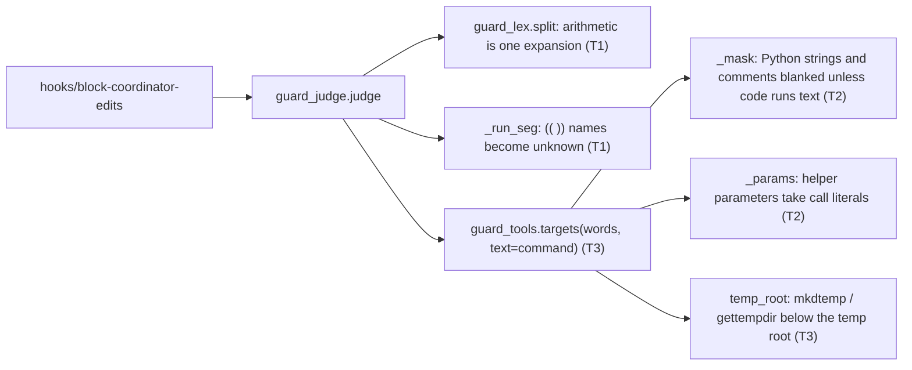
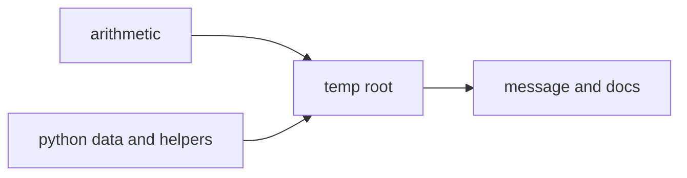

# Superlite: coordinator guard false blocks (B99)

**Goal:** fix #478 and #458. `$(( ))`, `(( ))` and `for (( ))` arithmetic is never a write target (today `$(( $(date +%s) - start ))` blocks as a write to `start`, `$((a>b))` as a write to `b`). A writer call inside a Python string literal or comment is data, and a module-level helper's parameter takes the literals of its calls, so the two #478 heredoc programs (test text naming the gate file; a `sub(path, old, new)` helper) pass while idle. `tempfile.mkdtemp()` and `tempfile.gettempdir()` name the temp root (#458), and the block message says "rm a file or folder".
**Architecture:** the shell lexer `guard_lex.py` reads arithmetic as one expansion (T1; `guard_judge.py` clears the names it assigns); the code reader `guard_tools.py` masks Python strings and comments with `tokenize` and binds helper parameters with `ast` (T2), then reads the temp root (T3; `guard_judge.py` passes the command text); T4 changes the message in the hook and the judge and describes it all in `docs/hooks.md`.
**Tech stack:** Python 3.10+ stdlib (`ast`, `tokenize`, `io`, `tempfile`), bash 3.2 hook, pytest through `sl run_tests`.
**Spec:** this file, section Design; issues #458 and #478.
**Detail:** tests
**Target-min:** 11
**Wave0:** none
**Max chars:** 32000

Global constraints:
- Every code line in `guard_*.py` keeps a trailing `# O(...)` complexity comment like its neighbours; stdlib only.
- Never weaken a block outside the false blocks named here. Existing tests stay green; an existing test file changes only when the task Owns it. Another red test: report it in DONE_WITH_CONCERNS with the test id and the reason, never edit it.
- Run `sl` as an executable (`<abs>/sl ...`). Verify with `<abs>/sl run_tests --fast <own test files> tests/scripts/test_block_coordinator_edits.py tests/scripts/test_guard_for_loop_289.py tests/scripts/test_guard_lex.py --task Tn --background`, then run the printed `wait:` line in the foreground and end the turn only after it reports.
- No version edits (the ship step bumps it). Never run `scripts/evals.sh`, `claude plugin eval` or `scripts/test_layers.py run`.

Ruling: arithmetic is read where bash reads it: `$((` anywhere a `$(` is read, and `((` at command position (only control words such as `if`, `while`, `!`, `time` before it) or right after `for`; when the first `)` at paren depth 0 is not followed by `)`, it is the old substitution or group (bash's fallback). `$[ ]` stays as today (deprecated) - cost if wrong: one false block for `$[a>b]`.
Ruling: string and comment masking is Python only; js, ruby, php and perl code is read as today - cost if wrong: their false blocks stay.
Ruling: code that can run text keeps its strings visible (exec, eval, bare compile, `__import__`, getattr, bare system or popen, builtins, runpy, importlib, subprocess, `os.system|popen|exec*|spawn*`, pty, pickle, marshal, ctypes, the code module), as does code `tokenize` cannot read; f-strings are never masked (their fields run) - cost if wrong: a coordinator script that also runs subprocess keeps today's false blocks.
Ruling: only module-level functions defined once, without `*args`, `**kwargs`, positional-only or keyword-only parameters, whose name is used only in direct calls, bind their parameters (`ast`); a syntax error binds nothing - cost if wrong: a helper in a class stays an unknown target.
Ruling: the temp root is `tempfile.gettempdir()` of the judge's own environment, as `$TMPDIR` already is; only the dotted `tempfile.mkdtemp`/`tempfile.gettempdir` are read; a command whose text names TMPDIR, TEMP, TMP or tempdir other than `$TMPDIR`/`${TMPDIR}` (same for TEMP, TMP) gets no temp root - cost if wrong: a Bash tool whose TMPDIR differs from the hook's writes into a different temp folder, still outside the project.
Ruling: the historical plan `docs/plans/2026-11-06-guards.md` keeps its old message line; already in the lead worktree, so no `sl worktree ensure`; no probe adapter (named regression cases instead); layers unit and headless (`hooks/**` changes) - cost if wrong: one NEEDS_CONTEXT round.
LAYERS: unit, headless



## Design

### 1. Arithmetic (T1)
- `guard_types.Segment` gains `arith: str | None = field(default=None, compare=False)`: the text inside a `(( ))` command or `for (( ))` header. `guard_lex._empty` counts it.
- `_Lex._arith(i, bodies) -> tuple[str, int] | None`: `i` is after `((`. It scans to the `))` that closes at paren depth 0 and returns (inner text, index after `))`); `\` skips two chars, `'...'` is skipped whole, `"` goes through `_dquote`, backticks through `_backtick`, `${` through `_brace`, `$(` through `_subst`; `(` and `)` count depth. A `)` at depth 0 not followed by `)`, the end of the text, or `self.depth >= MAX_DEPTH` return None. Substitution bodies go to a scratch list and reach `bodies` only on success; `self.depth` rises by one around the scan.
- `_Lex._subst(i, bodies) -> tuple[str, int, bool]`: `s[i]` is `$` and `s[i+1]` `(`: `$((` read by `_arith` gives (`s[i:end]`, end, False), else `_paren(i + 2, bodies)`. `_dollar`, `_brace_scan`, `_substitutions` (via its `lx`) and `_arith` call it instead of `_paren` for `$(`.
- `_parse`, `c == "("`, before the group branch: when `s[i+1] == "("`, not `closed`, and every word in `cur.words` is in `_CONTROL` (none counts) or `cur.words == ["for"]`, try `_arith(i + 2, cur.bodies)`; on success set `cur.arith`, `self.i` after `))`, `closed = True`; else the group code as today.
- `guard_judge._run_seg`: right after the leading-keyword loop, `if seg.arith is not None`, every name `_arith_names(seg.arith)` finds is assigned None (before the `for`/`NO_CMD_KW` returns).

### 2. Python strings, comments and helper parameters (T2)
- `_mask(code) -> str | None`: `tokenize.generate_tokens` over the code; every STRING token whose prefix holds no `f`/`F` and every COMMENT token has each character but `\n` replaced by a space (same length, same offsets). Any exception: None.
- `_RUNS_TEXT`: `(?<![\w.])(?:exec|eval|compile|execfile|__import__|getattr|system|popen)\s*\(`, `\b(?:builtins|__builtins__|runpy|importlib|subprocess|pty|pickle|marshal|ctypes)\b`, `\bos\s*\.\s*(?:system|popen|exec\w*|spawn\w*|posix_spawn\w*)\b`, `\b(?:import\s+code|from\s+code\s+import)\b`.
- `_code(code, lang)`: for `py`, `scan = _mask(code)` when it is not None and `_RUNS_TEXT` finds nothing in it, else `scan = code`. Call patterns (`_code1`), `_py_methods` and the assignment and `for` events of `_assigned` are found in `scan`; arguments, receivers, literals and `_PY_PATH` still read `code` at the same offsets.
- `_params(code, known)`: `ast.parse` (any exception: no bindings). Per qualifying module-level def (Ruling above) and each parameter: at every direct call `NAME(...)` in the tree, its positional or keyword argument, else its default; a `str` constant is its value, any other node is `_compose_raw(ast.get_source_segment(code, node), known)` without `_UNK`, else the parameter is unknown. No call, a starred or `**` argument, an unknown keyword, or any other use of NAME make all its parameters unknown. More than 64 values: unknown. `_assigned` runs once without parameters (that result is `known`), then again with one event per parameter at the def's offset: values extend the name, unknown marks it bad.

### 3. Temp root (T3)
- `temp_root(text) -> str | None`: None when text is None or, after removing `$TMPDIR`, `${TMPDIR}`, `$TEMP`, `${TEMP}`, `$TMP`, `${TMP}`, `\b(?:TMPDIR|TEMP|TMP|tempdir)\b` matches; else `tempfile.gettempdir()` with `\` as `/`, trailing `/` cut, when absolute and NUL-free.
- `_Comp.atom`: `tempfile.gettempdir()` with no argument is `[root]`; `tempfile.mkdtemp(...)` is `[root + "/?"]` when it has at most two arguments, each a plain string literal or `prefix=`/`suffix=` one, without `/`, `\` or `..`. No root, or any other argument: `[_UNK]`. The root reaches the composer through a module list `_TEMP` set and restored by `_code`, like `_NAMES`.
- `targets(..., text)` passes `temp_root(text)` to `_code`; `guard_judge` passes `text=ctx.text` to every `guard_tools.targets` call (`_prog_pairs` takes it as a parameter).

### 4. Message and docs (T4)
- "and rm a file git does not track" becomes "and rm a file or folder git does not track" in the hook's block message, its rule-3 comment ("a stray untracked file or folder"), `guard_judge` MESSAGES and the two tests that pin it; `docs/hooks.md` describes sections 1-3.

## Coverage

| Category | State | Basis |
|---|---|---|
| Scope and success criteria | settled | #458 and #478 bodies; the two real #478 programs |
| Domain and data model | n/a | no data |
| Persistence and migration | n/a | none |
| Interfaces and contracts | ruled | `Segment.arith` defaults to None; `targets` keeps its signature |
| UI states | n/a | message text only |
| Concurrency and state ownership | n/a | pure functions |
| Error handling and recovery | ruled | tokenize or ast failure: today's reading |
| Security and privacy | ruled | runs-text gate; temp root gated on TMPDIR names |
| Performance and limits | ruled | one tokenize and one ast parse per Python text, inside the judge budget |
| Observability | n/a | block messages unchanged but one line |
| Testing strategy | settled | named lexer, code-reader, judge and hook cases |
| Compatibility | settled | Python 3.10+ token kinds; bash 3.2 hook untouched but text |
| Rollout | ruled | one PR; version bump at ship |
| Research unknowns | n/a | none |

## File structure
- `skills/subagent-driven-development/scripts/guard_types.py`: `Segment.arith` (T1).
- `skills/subagent-driven-development/scripts/guard_lex.py`: arithmetic (T1).
- `skills/subagent-driven-development/scripts/guard_judge.py`: arith names (T1), `text=` (T3), message (T4).
- `skills/subagent-driven-development/scripts/guard_tools.py`: masking and parameters (T2), temp root (T3).
- `tests/scripts/test_guard_false_blocks.py`: T1 and T3 cases. `tests/scripts/test_guard_tools.py`: T2 and T3 cases.
- `hooks/block-coordinator-edits`, `docs/hooks.md`, `tests/scripts/test_judge_housekeeping.py`, `tests/scripts/test_coordinator_doc_images.py`: T4.

## Task graph

```mermaid
%% schedule
gantt
  title Predicted schedule (mm:ss)
  dateFormat X
  axisFormat %M:%S
  section lane 1
  T1 arithmetic is no write target :t1, 0, 135s
  T3 tempfile's temp root :t3, 135, 135s
  T4 message and docs :t4, 271, 97s
  section lane 2
  T2 Python strings and comments are data :t2, 0, 135s
```




critical path: T1 → T3 → T4 (6.1 min) · peak width 2 · predicted build 6.1 min · predicted total ≈ 9.6 min (target ✓)

## Package: coordinator guard
App type: library / parser. Categories: deep (nested substitutions in arithmetic), encoding (quotes, f-strings, comments), state (names arithmetic and helpers assign). Specific risks: an arithmetic or string reading that hides a real write (a `$(...)` inside `$(( ))`, `exec` of a string, a helper called with a non-literal path); a temp folder that leads into the project.
**Probe entry:** none (Ruling: the guard's cases are named regression tests).

### T1 arithmetic is no write target · Complexity 5 · Est. context 55k
**Owns:** skills/subagent-driven-development/scripts/guard_lex.py, skills/subagent-driven-development/scripts/guard_types.py, skills/subagent-driven-development/scripts/guard_judge.py, tests/scripts/test_guard_false_blocks.py
**Components:** 2
**LOC owned:** 140
**Tests:** fast
**Model:** sonnet
**Est. time:** 3 min
**Covers:** 1
**Consumes:** none
**Produces:** guard_lex._Lex._arith(i: int, bodies: list[str]) -> tuple[str, int] | None
**Review Focus:** deep: `test_arithmetic_keeps_real_writes_blocked`; encoding: `test_dollar_arith_keeps_its_text_and_only_its_substitutions`; state: `test_arithmetic_keeps_real_writes_blocked` (the `while (( v++ ))` case).
**Test code (verbatim):** append to tests/scripts/test_guard_false_blocks.py:
```python
# --- #478: arithmetic is no command, redirect or heredoc; only its substitutions run ---------------------------------
import sys  # noqa: E402
from pathlib import Path as _Path  # noqa: E402

sys.path.insert(0, str(_Path(__file__).resolve().parents[2] / "skills" / "subagent-driven-development" / "scripts"))
import guard_lex  # noqa: E402


def test_dollar_arith_keeps_its_text_and_only_its_substitutions():
    (s,) = guard_lex.split("echo $(( $(date +%s) - start ))")
    assert s.words == ["echo", "$(( $(date +%s) - start ))"] and s.dyn == [False, True]
    assert s.bodies == ["date +%s"] and s.redirects == []
    (s,) = guard_lex.split('echo "t $(( $(date) - s ))s"')
    assert s.words == ["echo", "t $(( $(date) - s ))s"] and s.bodies == ["date"]
    (s,) = guard_lex.split("echo $((a>b)) $((c<<2)) ${x:-$((d>e))}")
    assert s.bodies == [] and s.redirects == [] and s.heredocs == []


def test_arith_command_and_for_header():
    (s,) = guard_lex.split("(( n > 3 ))")
    assert (s.words, s.redirects, s.subshell, s.arith) == ([], [], None, " n > 3 ")
    segs = guard_lex.split("for (( i=0; i>5; i++ )); do :; done")
    assert segs[0].words == ["for"] and segs[0].arith == " i=0; i>5; i++ " and segs[0].subshell is None
    segs = guard_lex.split("if (( $(date +%s) > 3 )); then :; fi")
    assert segs[0].words == ["if"] and segs[0].bodies == ["date +%s"] and segs[0].redirects == []


def test_unbalanced_double_paren_stays_a_substitution_or_group():
    (s,) = guard_lex.split("x=$((echo hi > a) )")
    assert s.bodies == ["(echo hi > a) "]
    (s,) = guard_lex.split("((echo a) )")
    assert s.subshell == "(echo a)" and s.arith is None


def test_unquoted_heredoc_arith_runs_only_its_substitution():
    (s,) = guard_lex.split("cat > /tmp/b99.txt <<EOF\nelapsed $(( $(date +%s) - start ))\nEOF")
    assert s.bodies == ["date +%s"]


@pytest.mark.parametrize("cmd", [
    "start=$(date +%s); sleep 0; echo \"took $(( $(date +%s) - start ))s\"",
    "start=$(date +%s); x=$(( $(date +%s) - start )); echo $x",
    "start=$(date +%s); CI=true Scripts/ci.sh ios-test > /tmp/b99-ci.log 2>&1; code=$?; "
    "echo \"exit=$code seconds=$(( $(date +%s) - start ))\"",
    "echo $((a>b)) $((c<<2))",
    "(( n > 3 )) && echo ok",
    "for (( i=0; i>5; i++ )); do :; done",
    "while (( n > 0 )); do n=$((n-1)); done",
    "start=1; cat > /tmp/b99.txt <<EOF\nelapsed $(( $(date +%s) - start ))\nEOF",
])
def test_arithmetic_is_no_write_target(proj, cmd):
    assert bash(proj, cmd).returncode == 0, cmd


@pytest.mark.parametrize("cmd", [
    "echo $(( $(echo 1 | tee src/a.py) + 1 ))",
    "(( $(echo 1 > src/a.py) ))",
    "echo $(( 1 + 2 )) > src/a.py",
    "x=$((echo hi > src/a.py) )",
    "((echo hi > src/a.py) )",
    "v=.superlite/a; while (( v++ < 3 )); do :; done; echo > $v",
])
def test_arithmetic_keeps_real_writes_blocked(proj, cmd):
    assert bash(proj, cmd).returncode == 2, cmd
```
**Steps:** 1 append the tests, 2 run: FAIL, 3 implement Design 1, 4 run: PASS (the arithmetic cases in test_guard_for_loop_289.py stay green).

### T2 Python strings and comments are data; helper parameters bind · Complexity 6 · Est. context 60k
**Owns:** skills/subagent-driven-development/scripts/guard_tools.py, tests/scripts/test_guard_tools.py
**Components:** 2
**LOC owned:** 170
**Tests:** fast
**Model:** sonnet
**Est. time:** 4 min
**Covers:** 2
**Consumes:** none
**Produces:** guard_tools._mask(code: str) -> str | None · guard_tools._params(code: str, known: dict[str, list[str]]) -> list[tuple[int, str, list[str] | None]]
**Review Focus:** encoding: `test_fstring_fields_and_unreadable_code_stay_visible`; deep: `test_code_that_can_run_text_keeps_strings_visible`, `test_lookalike_names_are_no_runners`; state: `test_helper_parameter_with_an_unreadable_use_stays_unknown`, `test_only_plain_module_level_helpers_are_bound`, `test_issue_478_programs_pass_while_idle`.
**Test code (verbatim):** append to tests/scripts/test_guard_tools.py:
```python
# --- #478: Python string literals and comments are data; helper parameters take their call literals ---------------

DATA_PROG = "\n".join([
    "from pathlib import Path",
    "p = Path('docs/a.md')",
    "s = p.read_text()",
    's += """',
    "def test_x(tmp_path):",
    "    (tmp_path / '.superlite' / 'orchestrator.json').write_text('{}')",
    "    open(name, 'w').write('x')",
    "    p = something()",
    "a run (main or a lead) and subprocess.run(x)",
    '"""',
    "p.write_text(s)",
    "",
])
HELPER = "\n".join([
    "from pathlib import Path",
    "def sub(path, old, new, count=1):",
    "    p = Path(path); s = p.read_text(encoding='utf-8')",
    "    assert s.count(old) == count",
    "    p.write_text(s.replace(old, new), encoding='utf-8')",
    "sub('docs/hooks.md', 'a', 'b')",
    "sub(path='README.md', old='c', new='d', count=2)",
    "",
])


def test_write_calls_in_strings_and_comments_are_data():
    assert targets(["python3", "-c", DATA_PROG]) == ["docs/a.md"]
    assert targets(["python3", "-c", "# open('src/a.py', 'w')\nprint(1)  # shutil.rmtree('src')\n"]) == []


def test_fstring_fields_and_unreadable_code_stay_visible():
    assert targets(["python3", "-c", "x = f\"{open('src/a.py', 'w').write('x')}\"\n"]) == ["src/a.py"]
    assert targets(["python3", "-c", "s = '''open('src/a.py', 'w')\n"]) == ["src/a.py"]   # tokenize fails


@pytest.mark.parametrize("runner", [
    "exec(s)", "eval(s)", "compile(s, 'x', 'exec')", "__import__('os')", "getattr(os, 'remove')",
    "import builtins", "import runpy", "import importlib", "os.system('true')", "import pickle",
])
def test_code_that_can_run_text_keeps_strings_visible(runner):
    code = "import os\ns = \"open('src/a.py', 'w').write('x')\"\n" + runner + "\n"
    assert "src/a.py" in targets(["python3", "-c", code])


@pytest.mark.parametrize("other", ["r = re.compile('x')", "v = ast.literal_eval('1')", "print(code)"])
def test_lookalike_names_are_no_runners(other):
    code = "import re, ast\ns = \"open('src/a.py', 'w').write('x')\"\n" + other + "\n"
    assert targets(["python3", "-c", code]) == []


def test_helper_parameter_takes_the_literals_of_its_calls():
    assert sorted(targets(["python3", "-c", HELPER])) == ["README.md", "docs/hooks.md"]
    gate = HELPER + "sub('.superlite/orchestrator.json', 'x', 'y')\n"
    assert ".superlite/orchestrator.json" in targets(["python3", "-c", gate])


@pytest.mark.parametrize("extra", [
    "import sys\nsub(sys.argv[1], 'e', 'f')\n",
    "f = sub\n",
    "sub(*['docs/x.md', 'a', 'b'])\n",
])
def test_helper_parameter_with_an_unreadable_use_stays_unknown(extra):
    assert "?" in targets(["python3", "-c", HELPER + extra])


@pytest.mark.parametrize("code", [
    "from pathlib import Path\ndef main():\n    def w(path):\n        Path(path).write_text('x')\n    w('docs/a.md')\nmain()\n",
    "from pathlib import Path\ndef w(path, *rest):\n    Path(path).write_text('x')\nw('docs/a.md')\n",
    "from pathlib import Path\nclass K:\n    def w(self, path):\n        Path(path).write_text('x')\nK().w('docs/a.md')\n",
    "from pathlib import Path\ndef w(path):\n    Path(path).write_text('x')\nw('docs/a.md')\ndef broken(:\n",
])
def test_only_plain_module_level_helpers_are_bound(code):
    assert targets(["python3", "-c", code]) == ["?"]


def test_issue_478_programs_pass_while_idle(tmp_path):
    import guard_judge
    P = str(tmp_path.resolve())
    (tmp_path / ".superlite").mkdir()
    sd = (P + "/.superlite",)
    gate = "(tmp_path / '.superlite' / 'orchestrator.json').write_text('{}')"
    cmd = ("cat > tests/test_x.py <<'EOF'\ndef test_a(tmp_path):\n    " + gate + "\nEOF\n"
           "python3 - <<'EOF'\nfrom pathlib import Path\np = Path('tests/test_y.py')\ns = p.read_text()\n"
           "s += '''\ndef test_b(tmp_path):\n    " + gate + "\n'''\np.write_text(s)\nEOF")
    assert guard_judge.judge(cmd, P, P, "idle", sd) is None
    doc = "'the gate file .superlite/orchestrator.json, a run (main or a lead)'"
    cmd2 = "python3 - <<'EOF'\n" + HELPER + "sub('docs/hooks.md', 'x', " + doc + ")\nEOF"
    assert guard_judge.judge(cmd2, P, P, "idle", sd) is None
    unknown = ("python3 - <<'EOF'\nimport os\nname = 'orchestrator.json'\n"
               "open(os.path.join(os.environ['D'], name), 'w')\nEOF")
    v = guard_judge.judge(unknown, P, P, "idle", sd)
    assert v is not None and v.kind == "protected"
```
**Steps:** 1 append the tests, 2 run: FAIL, 3 implement Design 2, 4 run: PASS (also tests/scripts/test_guard_*.py that read interpreter code).
**Notes:** `_params` returns (offset of the def line, parameter name, values or None) per parameter of each qualifying def.

### T3 tempfile's temp root · Complexity 4 · Est. context 50k
**Owns:** skills/subagent-driven-development/scripts/guard_tools.py, skills/subagent-driven-development/scripts/guard_judge.py, tests/scripts/test_guard_tools.py, tests/scripts/test_guard_false_blocks.py
**Components:** 2
**LOC owned:** 120
**Tests:** fast
**Model:** sonnet
**Est. time:** 3 min
**Covers:** 3
**Consumes:** none
**Produces:** guard_tools.temp_root(text: str | None) -> str | None
**Review Focus:** state: `test_temp_root_reads_the_command_text`; file: `test_temp_folders_the_guard_cannot_place_stay_unknown`, `test_temp_root_with_a_named_folder_stays_unknown`.
**Test code (verbatim):** append to tests/scripts/test_guard_tools.py:
```python
# --- #458: tempfile's temp root ----------------------------------------------------------------------------------
import tempfile  # noqa: E402


@pytest.fixture
def troot(monkeypatch, tmp_path):
    r = tmp_path / "troot"
    r.mkdir()
    monkeypatch.setattr(tempfile, "tempdir", str(r))
    return str(r)


def _py(code):
    return targets(["python3", "-c", code], text=code)


def test_temp_root_reads_the_command_text(troot):
    assert guard_tools.temp_root("python3 x.py") == troot
    assert guard_tools.temp_root("cp a $TMPDIR/b; ls ${TMPDIR} $TMP") == troot
    for text in ("TMPDIR=/p python3 x.py", "export TEMP=/p", "unset TMP", "tempfile.tempdir = '/p'",
                 "os.environ['TMPDIR'] = '/p'", "echo ${TMPDIR:-/p}", None):
        assert guard_tools.temp_root(text) is None, text


def test_mkdtemp_and_gettempdir_name_the_temp_root(troot):
    assert _py("import tempfile, os\nd = tempfile.mkdtemp()\nopen(os.path.join(d, 'a.txt'), 'w').write('x')\n") == [
        troot + "/?/a.txt"]
    assert _py("import tempfile\nfrom pathlib import Path\n"
               "(Path(tempfile.mkdtemp(prefix='sl-', suffix='.d')) / 'a.txt').write_text('x')\n") == [troot + "/?/a.txt"]
    assert _py("import tempfile, os\nopen(os.path.join(tempfile.gettempdir(), 'sl-a.json'), 'w')\n") == [
        troot + "/sl-a.json"]
    assert _py("import tempfile\nopen(tempfile.gettempdir() + '/a', 'w')\n") == [troot + "/a"]


@pytest.mark.parametrize("code", [
    "import tempfile, os\nd = tempfile.mkdtemp(dir='src')\nopen(os.path.join(d, 'a'), 'w')\n",
    "import tempfile, os\nd = tempfile.mkdtemp('', '', 'src')\nopen(os.path.join(d, 'a'), 'w')\n",
    "import tempfile, os\nd = tempfile.mkdtemp(prefix='../x')\nopen(os.path.join(d, 'a'), 'w')\n",
    "import tempfile, os\nd = tempfile.mkdtemp(prefix=p)\nopen(os.path.join(d, 'a'), 'w')\n",
    "import tempfile, os\ntempfile.tempdir = 'src'\nopen(os.path.join(tempfile.gettempdir(), 'a'), 'w')\n",
    "import tempfile, os\nos.environ['TMPDIR'] = 'src'\nd = tempfile.mkdtemp()\nopen(os.path.join(d, 'a'), 'w')\n",
    "from tempfile import mkdtemp\nimport os\nopen(os.path.join(mkdtemp(), 'a'), 'w')\n",
    "import tempfile\nopen(tempfile.gettempdir('x') + '/a', 'w')\n",
])
def test_temp_folders_the_guard_cannot_place_stay_unknown(troot, code):
    assert _py(code) == ["?"]


def test_without_the_command_text_the_temp_root_is_unknown(troot):
    assert targets(["python3", "-c", "import tempfile\nopen(tempfile.gettempdir() + '/a', 'w')\n"]) == ["?"]
```
and append to tests/scripts/test_guard_false_blocks.py:
```python
# --- #458: a heredoc script writing below tempfile's temp root ---------------------------------------------------
import json  # noqa: E402
import os  # noqa: E402
import subprocess  # noqa: E402

from test_block_coordinator_edits import BASH, HOOK  # noqa: E402

TMP_PROG = "import tempfile, os\nd = tempfile.mkdtemp()\nopen(os.path.join(d, 'a.txt'), 'w').write('x')\n"


def hook_tmpdir(proj, cmd, tmpdir):
    raw = json.dumps({"tool_name": "Bash", "tool_input": {"command": cmd}})
    env = {**os.environ, "CLAUDE_PROJECT_DIR": str(proj), "TMPDIR": str(tmpdir)}
    return subprocess.run([BASH, str(HOOK)], input=raw, capture_output=True, text=True, env=env)


def test_heredoc_script_writing_below_the_temp_root_passes(proj, tmp_path_factory):
    troot, s = tmp_path_factory.mktemp("troot"), tmp_path_factory.mktemp("scratch")
    cmd = f"S={s}; cat > $S/x.py <<'EOF'\n{TMP_PROG}EOF\npython3 $S/x.py"
    assert hook_tmpdir(proj, cmd, troot).returncode == 0
    gettemp = cmd.replace("d = tempfile.mkdtemp()", "d = tempfile.gettempdir()")
    assert hook_tmpdir(proj, gettemp, troot).returncode == 0
    inline = "python3 -c \"" + TMP_PROG.replace("\n", "; ") + "\""
    assert hook_tmpdir(proj, inline, troot).returncode == 0


@pytest.mark.parametrize("change", [
    ("d = tempfile.mkdtemp()", "d = tempfile.mkdtemp(dir='src')"),
    ("import tempfile, os", "import tempfile, os\ntempfile.tempdir = 'src'"),
    ("S=", "export TMPDIR=PROJ/src; S="),
])
def test_temp_root_with_a_named_folder_stays_unknown(proj, tmp_path_factory, change):
    troot, s = tmp_path_factory.mktemp("troot"), tmp_path_factory.mktemp("scratch")
    cmd = f"S={s}; cat > $S/x.py <<'EOF'\n{TMP_PROG}EOF\npython3 $S/x.py"
    cmd = cmd.replace(change[0], change[1], 1).replace("PROJ", str(proj))
    assert hook_tmpdir(proj, cmd, troot).returncode == 2, cmd
```
**Steps:** 1 append the tests, 2 run: FAIL, 3 implement Design 3, 4 run: PASS.

### T4 message and docs · Complexity 2 · Est. context 30k
**Owns:** hooks/block-coordinator-edits, skills/subagent-driven-development/scripts/guard_judge.py, tests/scripts/test_judge_housekeeping.py, tests/scripts/test_coordinator_doc_images.py, docs/hooks.md
**Components:** 1
**LOC owned:** 20
**Tests:** fast
**Kind:** mechanical
**Model:** haiku
**Est. time:** 1.5 min
**Covers:** 4
**Consumes:** none
**Produces:** none
**Test code (verbatim):** in tests/scripts/test_judge_housekeeping.py `BLOCK_LINE` and tests/scripts/test_coordinator_doc_images.py `LINE`, replace the words `and rm a file git does not track` (split across string pieces there: `and rm a "` + `"file git does not track` and `and rm a file git does not track`) so the joined text reads `and rm a file or folder git does not track and no task Owns.`; run both files: FAIL.
**Steps:** 1 change the two test constants, 2 run: FAIL, 3 in hooks/block-coordinator-edits change the message line `... and rm a file git does not track and no task Owns.` to `... and rm a file or folder git does not track and no task Owns.` and the rule-3 header comment `(a stray untracked file may also be removed with rm)` to `(a stray untracked file or folder may also be removed with rm)`; in guard_judge.py MESSAGES["code"] join `and rm a file or folder git ` + `does not track and no task Owns.`; 4 in docs/hooks.md append the text block below to the end of the line that starts with `- ` and the backticked `block-coordinator-edits` (after `read as its joined value.`), one space before it, keeping it one line; 5 run the two files and tests/scripts/test_guard_false_blocks.py: PASS.
**Notes:** the docs text, verbatim (one line):
```text
Arithmetic is no command, redirect or heredoc: `$(( ))`, a `(( ))` command and a `for (( ))` header only run the `$(...)`, backtick and `${...}` substitutions inside them (when the first `)` at depth 0 is not followed by `)`, bash's substitution or group reading stands). In Python code (`python -c`, a heredoc program, a script the command wrote) a writer call inside a string literal (not an f-string) or a comment is data, unless the code can run text (`exec`, `eval`, a bare `compile`, `__import__`, `getattr`, `system`, `popen`, `builtins`, `runpy`, `importlib`, `subprocess`, `os.system`/`popen`/`exec*`/`spawn*`, `pty`, `pickle`, `marshal`, `ctypes`, the `code` module) or cannot be tokenized; a parameter of a module-level function (defined once, no `*args`, `**kwargs`, positional-only or keyword-only parameters, its name used only in direct calls) stands for the literals its calls pass. `tempfile.mkdtemp()` (no `dir`; at most a literal prefix and suffix without a slash, a backslash or `..`) is a new folder below the temp root and `tempfile.gettempdir()` the temp root (the hook's own, like `$TMPDIR`), unless the command names `TMPDIR`, `TEMP`, `TMP` or `tempdir` other than as `$TMPDIR` or `${TMPDIR}` (likewise `$TEMP`, `$TMP`); `from tempfile import mkdtemp` is not read.
```

## Self-review
- Coverage: Design 1 -> T1, 2 -> T2, 3 -> T3, 4 -> T4; #458 bullet 1 -> T3, bullet 2 -> T4; #478 -> T1, T2.
- Files: T1 and T2 share none; T3 follows both, T4 follows T3.
- The two real #478 programs: program 1 needs T2's masking; program 2 needs T2's masking (a `run (` in docs text) and helper binding.
