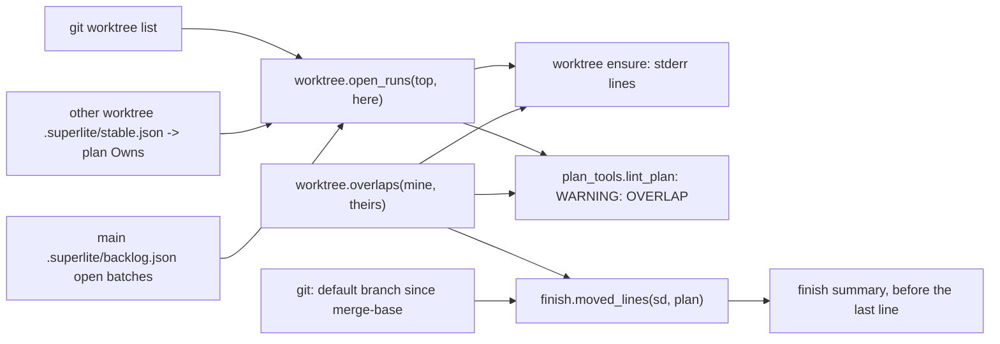
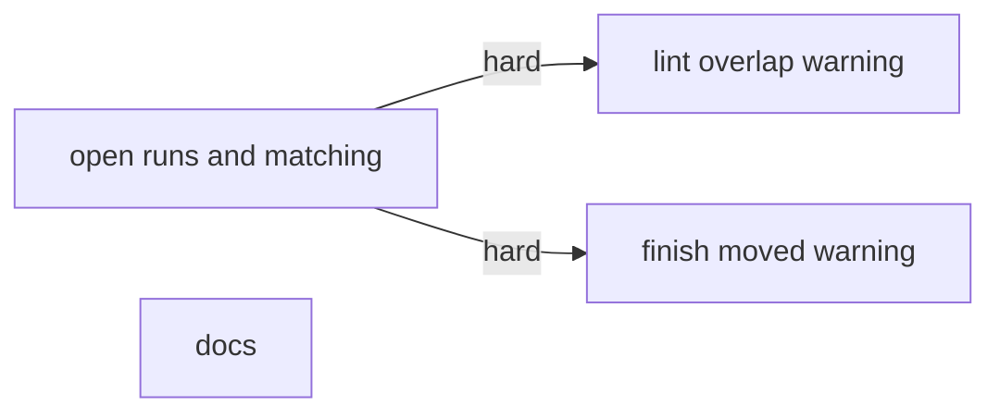

# Superlite: warn when two runs own the same files (B108)

**Goal:** fix #493: a run learns when another open superlite run of the same repository owns the files it plans to change. `sl worktree ensure` and plan lint compare the plan's Owns with the files of the other open runs and warn; `sl finish` warns when the default branch moved in files the run owns. Max's decision: warn only.
**Architecture:** `worktree.py` gains `open_runs(top, here)` (the other open runs: registered worktrees whose `.superlite/stable.json` names a plan, plus open `backlog.json` batches with a worktree on disk), the pure matcher `overlaps(mine, theirs)`, the formatters `shown_list` and `overlap_line`, and the ensure stderr lines. `plan_tools.lint_plan` adds one `WARNING: OVERLAP:` per run (`cross_run_warnings`). `finish.summary` adds `moved_lines(sd, plan)`. `docs/tools.md` names all three.
**Tech stack:** Python 3.10+ stdlib, pytest (through `sl run_tests`), Markdown docs.
**Spec:** this file, section Design; issue #493 Expected.
**Detail:** tests
**Target-min:** 11
**Wave0:** none
**Coverage:** off

Global constraints:
- Every Python code line keeps the file's trailing `# O(...)` complexity comment.
- Existing tests stay green. An existing test file changes only when the task Owns it. If another existing test turns red, report it in DONE_WITH_CONCERNS with the test id and the reason instead of editing it.
- Run `sl` as an executable (`<abs>/sl ...`). Verify with `<abs>/sl run_tests --fast <own test files> --task Tn --background`, then run the printed `wait:` line in the foreground and end the turn only after it reports.
- Warn only: no new exit code, no new ISSUE, nothing on stdout of `worktree ensure` (stdout stays the path). Any failure in the new code (git error, unreadable JSON or plan) gives no line, never an exception.
- No version edits (the ship step bumps the version). Never run `scripts/evals.sh`, `claude plugin eval` or `scripts/test_layers.py run`.

Ruling: an open run is a registered worktree other than the caller's (the main checkout too) whose `.superlite/stable.json` names a plan file that exists, or a `backlog.json` batch in state running, needs_decision or parked whose worktree folder exists; planned batches have no worktree yet and shipped ones are done (because `orchestrator end` archives stable.json, so its presence marks a live run; cost if wrong: a planned batch's files are not warned about until it starts).
Ruling: a run's files are its plan's Owns (local tasks, `Task.owns`) united with the batch's `files`; its label is `<id> (<state>)` for a batch, else the worktree's branch, else its folder name.
Ruling: Owns entries overlap when equal, when a folder entry (ending in `/`) holds the other, when a glob matches the other path, or for two globs when one literal prefix starts the other (loose on purpose: a false warning costs a glance, a missed one a conflict).
Ruling: `worktree ensure` with no plan in the run folder yet names each open run and its files in one stderr line (the moment of #493's incident: a run starting next to a batch); with a plan it prints only the OVERLAP lines.
Ruling: finish compares the default branch (`origin/HEAD`'s name, else `main`, else `master`) as the local branch and as `origin/<name>` (same commit: one line) from this branch's merge-base with it; the run owns its plan's Owns, the branch's changes since that merge-base and its uncommitted tracked changes.
Ruling: new test files tests/scripts/test_owns_overlap_lint_493.py, test_finish_moved_493.py, test_docs_493_overlap.py and docs/tools.md are outside the brief's list; no open batch lists them, so notes.md names them. The docs task's texts are fixed here, so it has no edge; layers: unit only (no SKILL.md, hooks or agents change).
LAYERS: unit



## Design

### 1. Open runs and matching (T1)
`worktree.py`: `run_plan(root)` reads `root/.superlite/stable.json` key `plan` (a Path when that file exists, else None). `_plan_owns(plan)` lazily imports `plan_tools` and returns every `Task.owns` entry of `Plan.load(str(plan))` ([] on any exception). `open_runs` parses `git worktree list --porcelain` from `top` (first block = main checkout; skip `bare` blocks, missing folders and the folder equal to `here` resolved), then reads `<main>/.superlite/backlog.json` `batches`; a batch on a worktree already found merges its files and takes the batch label. Files sorted and unique; runs without files dropped; result sorted by path. `overlaps` normalises `\` to `/` and a leading `./` for comparison but returns the `mine` entries as written, sorted, unique. `shown_list(items, limit=5)` joins with `, ` and adds ` (+N more)`. `ensure_lines(path, state)` builds the ensure stderr lines (texts in T1's tests); `main()` prints them after the existing state lines, before the path. `ensure()` itself is unchanged (backlog_run calls it).

### 2. Lint (T2)
`plan_tools.cross_run_warnings(plan)`: root `stable_root(str(plan.path))`, runs `worktree.open_runs(root, here=root)`; per run, per task, `worktree.overlaps(t.owns, run["files"])`; each shared entry lists its task ids in plan order (`src/x.py (T1, T2)`), entries sorted; one `"WARNING: " + worktree.overlap_line(run, shared)` per run with a hit. `lint_plan` extends `warnings` with it (only when `plan.path`), inside `try/except Exception`, after the platform notes. Plain lint and `lint --stable` both print warnings already.

### 3. Finish (T3)
`finish.moved_lines(sd, plan=None)` as in the Ruling; line text in T3's tests. `summary()` appends its lines right before the takeover hint (so `next:` stays last), inside `try/except Exception`. Module docstring names it.

### 4. Docs (T4)
Exact texts in T4.

## File structure

- `skills/subagent-driven-development/scripts/worktree.py`: open runs, matching, ensure lines (T1)
- `tests/scripts/test_owns_overlap_493.py`: open_runs, overlaps, ensure CLI (T1)
- `skills/subagent-driven-development/scripts/plan_tools.py`: lint OVERLAP warning (T2)
- `tests/scripts/test_owns_overlap_lint_493.py`: lint end to end (T2)
- `skills/subagent-driven-development/scripts/finish.py`: moved-files warning (T3)
- `tests/scripts/test_finish_moved_493.py`: finish against temp repositories (T3)
- `docs/tools.md`, `tests/scripts/test_docs_493_overlap.py`: docs (T4)

## Task graph

```mermaid
%% schedule
gantt
  title Predicted schedule (mm:ss)
  dateFormat X
  axisFormat %M:%S
  section lane 1
  T1 worktree finds other open runs :t1, 0, 140s
  T3 finish warns when the default branch :t3, 140, 97s
  section lane 2
  T4 docs name the overlap warnings :t4, 0, 96s
  T2 lint warns on another run's files :t2, 140, 97s
```





critical path: T1 → T3 (4.0 min) · peak width 2 · predicted build 4.0 min · predicted total ≈ 7.5 min (target ✓)

## Package: cross-run overlap

App type: library + CLI. Categories: file (missing or broken stable.json, backlog.json, plan), state (which runs count as open), protocol (stderr and lint line texts). **Probe entry:** none (git-backed helpers over temp repositories; cases are named tests).

### T1 worktree finds other open runs · Complexity 5 · Est. context 42k
**Owns:** skills/subagent-driven-development/scripts/worktree.py, tests/scripts/test_owns_overlap_493.py
**Components:** 2
**LOC owned:** 210
**Tests:** fast
**Model:** sonnet
**Est. time:** 3.5 min (2 components, about 210 LOC, fast tests)
**Covers:** 1
**Consumes:** none
**Produces:** worktree.open_runs(top: Path, here: Path | None = None) -> list[dict] · worktree.overlaps(mine: list[str], theirs: list[str]) -> list[str] · worktree.shown_list(items: list[str], limit: int = 5) -> str · worktree.overlap_line(run: dict, shared: list[str]) -> str
e.g. open_runs(<repo with worktree superlite-b9 whose stable.json plan owns src/x.py>, here=<own worktree>) -> [{"label": "superlite/b9", "path": "/r/.claude/worktrees/superlite-b9", "files": ["src/x.py"]}]
e.g. overlaps(["a.py", "src/b.py", "docs/x.md"], ["src/", "a.py"]) -> ["a.py", "src/b.py"]; overlaps(["a.py"], ["b.py"]) -> []
e.g. overlap_line({"label": "B9 (running)", "path": "/r/wt", "files": ["a.py"]}, ["a.py"]) -> "OVERLAP: a.py also owned by open run B9 (running) at /r/wt; the run that merges second merges the default branch first"
**Review Focus:** state: `test_own_run_and_ended_runs_are_skipped`, `test_open_backlog_batches_count_planned_and_shipped_do_not`, `test_own_batch_is_skipped`; file: `test_missing_plan_file_is_skipped`, `test_broken_backlog_json_is_ignored`; protocol: `test_ensure_with_plan_warns_only_on_overlap`.
**Test code (verbatim):** new file tests/scripts/test_owns_overlap_493.py:
```python
"""#493: other open superlite runs of the repository and the files they own (worktree.open_runs, overlaps, ensure lines)."""
from __future__ import annotations

import json
import subprocess
import sys
from pathlib import Path

import pytest

ROOT = Path(__file__).resolve().parents[2]
SCRIPTS = ROOT / "skills" / "subagent-driven-development" / "scripts"
SL = SCRIPTS / "sl"
sys.path.insert(0, str(SCRIPTS))

import worktree  # noqa: E402

PLAN = "# P\n\n### T1 a\n**Owns:** {owns}\n"
TAIL = "; the run that merges second merges the default branch first"


def git(cwd, *args):
    return subprocess.run(["git", "-C", str(cwd), *args], capture_output=True, text=True, check=True).stdout


def repo(tmp_path):
    main = tmp_path.resolve() / "repo"
    main.mkdir()
    git(main, "init", "-q", "-b", "main")
    git(main, "config", "user.name", "t")
    git(main, "config", "user.email", "t@t")
    (main / "a.py").write_text("a\n")
    git(main, "add", ".")
    git(main, "commit", "-q", "-m", "init")
    return main


def add_plan(root, owns):
    plan = root / "docs" / "plan.md"
    plan.parent.mkdir(parents=True, exist_ok=True)
    plan.write_text(PLAN.format(owns=owns), encoding="utf-8")
    (root / ".superlite").mkdir(exist_ok=True)
    (root / ".superlite" / "stable.json").write_text(json.dumps({"plan": str(plan)}), encoding="utf-8")
    return plan


def add_wt(main, name, owns=None):
    wt = main / ".claude" / "worktrees" / name
    git(main, "worktree", "add", "-q", "-b", f"superlite/{name}", str(wt), "HEAD")
    if owns is not None:
        add_plan(wt, owns)
    return wt


def backlog(main, *batches):
    (main / ".superlite").mkdir(exist_ok=True)
    (main / ".superlite" / "backlog.json").write_text(json.dumps({"batches": list(batches)}), encoding="utf-8")


def test_plan_run_found_with_its_owns(tmp_path):
    main = repo(tmp_path)
    mine = add_wt(main, "mine")
    other = add_wt(main, "other", owns="tests/test_x.py, src/x.py")
    assert worktree.open_runs(mine, here=mine) == [
        {"label": "superlite/other", "path": other.as_posix(), "files": ["src/x.py", "tests/test_x.py"]}]


def test_own_run_and_ended_runs_are_skipped(tmp_path):
    main = repo(tmp_path)
    mine = add_wt(main, "mine", owns="src/x.py")
    add_wt(main, "ended")
    assert worktree.open_runs(mine, here=mine) == []


def test_missing_plan_file_is_skipped(tmp_path):
    main = repo(tmp_path)
    mine = add_wt(main, "mine")
    other = add_wt(main, "other", owns="src/x.py")
    (other / "docs" / "plan.md").unlink()
    assert worktree.open_runs(mine, here=mine) == []


def test_open_backlog_batches_count_planned_and_shipped_do_not(tmp_path):
    main = repo(tmp_path)
    mine = add_wt(main, "mine")
    b9, b10 = add_wt(main, "b9"), add_wt(main, "b10")
    backlog(main,
            {"id": "B9", "state": "running", "worktree": str(b9), "files": ["src/y.py"]},
            {"id": "B10", "state": "shipped", "worktree": str(b10), "files": ["src/z.py"]},
            {"id": "B11", "state": "planned", "worktree": None, "files": ["src/w.py"]},
            {"id": "B12", "state": "parked", "worktree": str(main / "gone"), "files": ["src/v.py"]})
    assert worktree.open_runs(mine, here=mine) == [{"label": "B9 (running)", "path": b9.as_posix(), "files": ["src/y.py"]}]


def test_batch_files_and_plan_owns_merge(tmp_path):
    main = repo(tmp_path)
    mine = add_wt(main, "mine")
    b9 = add_wt(main, "b9", owns="src/x.py, src/y.py")
    backlog(main, {"id": "B9", "state": "needs_decision", "worktree": str(b9), "files": ["src/y.py", "docs/d.md"]})
    assert worktree.open_runs(mine, here=mine) == [
        {"label": "B9 (needs_decision)", "path": b9.as_posix(), "files": ["docs/d.md", "src/x.py", "src/y.py"]}]


def test_own_batch_is_skipped(tmp_path):
    main = repo(tmp_path)
    mine = add_wt(main, "mine")
    backlog(main, {"id": "B8", "state": "running", "worktree": str(mine), "files": ["a.py"]})
    assert worktree.open_runs(mine, here=mine) == []


def test_broken_backlog_json_is_ignored(tmp_path):
    main = repo(tmp_path)
    mine = add_wt(main, "mine")
    other = add_wt(main, "other", owns="src/x.py")
    (main / ".superlite").mkdir()
    (main / ".superlite" / "backlog.json").write_text("{not json", encoding="utf-8")
    assert [r["path"] for r in worktree.open_runs(mine, here=mine)] == [other.as_posix()]


def test_main_checkout_run_counts(tmp_path):
    main = repo(tmp_path)
    mine = add_wt(main, "mine")
    add_plan(main, "a.py")
    assert worktree.open_runs(mine, here=mine) == [{"label": "main", "path": main.as_posix(), "files": ["a.py"]}]


def test_no_repository_gives_nothing(tmp_path):
    assert worktree.open_runs(tmp_path, here=tmp_path) == []


@pytest.mark.parametrize("mine, theirs, want", [
    (["a.py", "src/b.py", "docs/x.md"], ["src/", "a.py"], ["a.py", "src/b.py"]),
    (["tests/test_*.py"], ["tests/test_x.py"], ["tests/test_*.py"]),
    (["tests/test_x.py"], ["tests/test_*.py"], ["tests/test_x.py"]),
    (["src/a*.py"], ["src/ab*.py"], ["src/a*.py"]),
    (["src/a*.py"], ["src/b*.py"], []),
    (["./a.py"], ["a.py"], ["./a.py"]),
    (["a.py", "a.py"], ["a.py"], ["a.py"]),
    (["a.py"], ["b.py"], []),
    ([], ["a.py"], []),
])
def test_overlaps(mine, theirs, want):
    assert worktree.overlaps(mine, theirs) == want


def test_shown_list_and_overlap_line():
    assert worktree.shown_list(["a", "b"]) == "a, b"
    assert worktree.shown_list([f"f{i}" for i in range(7)]) == "f0, f1, f2, f3, f4 (+2 more)"
    run = {"label": "B9 (running)", "path": "/r/wt", "files": ["a.py"]}
    assert worktree.overlap_line(run, ["a.py"]) == "OVERLAP: a.py also owned by open run B9 (running) at /r/wt" + TAIL


def ensure(cwd, topic):
    return subprocess.run([str(SL), "worktree", "ensure", topic], cwd=cwd, capture_output=True, text=True, timeout=60)


def test_ensure_without_plan_names_open_runs(tmp_path):
    main = repo(tmp_path)
    other = add_wt(main, "other", owns="src/x.py, src/y.py")
    one = add_wt(main, "one", owns="lib/z.py")
    r = ensure(main, "new thing")
    assert r.returncode == 0
    assert r.stdout.strip() == (main / ".claude" / "worktrees" / "superlite-new-thing").as_posix()
    hint = "; keep your plan's Owns off them (plan lint warns on a shared file)"
    lines = [ln for ln in r.stderr.splitlines() if "open run" in ln]
    assert lines == [f"worktree: open run superlite/one at {one.as_posix()} owns 1 file: lib/z.py" + hint,
                     f"worktree: open run superlite/other at {other.as_posix()} owns 2 files: src/x.py, src/y.py" + hint]


def test_ensure_with_plan_warns_only_on_overlap(tmp_path):
    main = repo(tmp_path)
    mine = add_wt(main, "mine", owns="src/x.py, docs/m.md")
    other = add_wt(main, "other", owns="src/x.py, src/y.py")
    add_wt(main, "third", owns="lib/z.py")
    r = ensure(mine, "mine")
    assert r.returncode == 0 and r.stdout.strip() == mine.as_posix()
    assert r.stderr.splitlines() == [
        f"worktree: WARNING: OVERLAP: src/x.py also owned by open run superlite/other at {other.as_posix()}" + TAIL]


def test_ensure_alone_prints_no_run_line(tmp_path):
    main = repo(tmp_path)
    r = ensure(main, "solo")
    assert r.returncode == 0 and "open run" not in r.stderr and "OVERLAP" not in r.stderr
```
**Steps:** 1 write the test file, 2 run: FAIL, 3 implement Design section 1 (module docstring: one sentence on the new stderr lines; "Stdlib only" becomes "Stdlib only; another run's plan is read through plan_tools"), 4 run: PASS
**Notes:** the no-plan line says `1 file` / `N files`. `here` and every worktree path are compared resolved (macOS `/private/var`).

### T2 lint warns on another run's files · Complexity 3 · Est. context 36k
**Owns:** skills/subagent-driven-development/scripts/plan_tools.py, tests/scripts/test_owns_overlap_lint_493.py
**Components:** 1
**LOC owned:** 90
**Tests:** fast
**Model:** sonnet
**Est. time:** 2.0 min (1 component, about 90 LOC, fast tests)
**Covers:** 2
**Consumes:** worktree.open_runs(top: Path, here: Path | None = None) -> list[dict] (T1) · worktree.overlaps(mine: list[str], theirs: list[str]) -> list[str] (T1) · worktree.overlap_line(run: dict, shared: list[str]) -> str (T1)
**Produces:** plan_tools.cross_run_warnings(plan: Plan) -> list[str]
**Review Focus:** protocol: `test_lint_warns_per_run_with_task_ids`; state: `test_overlap_is_never_an_issue`; file: `test_plan_outside_git_has_no_overlap_line`.
**Test code (verbatim):** new file tests/scripts/test_owns_overlap_lint_493.py:
```python
"""#493: plan lint warns when the plan's Owns share a file with another open superlite run."""
from __future__ import annotations

import sys

from test_owns_overlap_493 import TAIL, add_wt, backlog, repo
from test_plan_tools import SCRIPTS, pt

sys.path.insert(0, str(SCRIPTS))
import plan_tools  # noqa: E402

TWO = ("# P\n**Goal:** t.\n\n```mermaid\nflowchart LR\n  T1[a]\n  T2[b]\n  %% taskgraph\n  T1 --> T2\n```\n\n"
       "### T1 a · Complexity 1 · Est. context 20k\n**Owns:** src/x.py, tests/test_x.py\n**Components:** 1\n"
       "**LOC owned:** 10\n**Tests:** fast\n**Model:** sonnet\n\n"
       "### T2 b · Complexity 1 · Est. context 20k\n**Owns:** src/x.py, docs/d.md\n**Components:** 1\n"
       "**LOC owned:** 10\n**Tests:** fast\n**Model:** sonnet\n")


def my_plan(tmp_path):
    main = repo(tmp_path)
    mine = add_wt(main, "mine")
    plan = mine / "docs" / "p.md"
    plan.parent.mkdir(parents=True)
    plan.write_text(TWO, encoding="utf-8")
    return main, plan


def overlap(out):
    return [ln for ln in out.splitlines() if "OVERLAP" in ln]


def test_lint_warns_per_run_with_task_ids(tmp_path):
    main, plan = my_plan(tmp_path)
    b9 = add_wt(main, "b9")
    backlog(main, {"id": "B9", "state": "running", "worktree": str(b9), "files": ["src/x.py", "tests/"]})
    other = add_wt(main, "other", owns="docs/*.md")
    assert overlap(pt("lint", "--plan", plan).out) == [
        f"WARNING: OVERLAP: src/x.py (T1, T2), tests/test_x.py (T1) also owned by open run B9 (running) at {b9.as_posix()}" + TAIL,
        f"WARNING: OVERLAP: docs/d.md (T2) also owned by open run superlite/other at {other.as_posix()}" + TAIL]


def test_overlap_is_never_an_issue(tmp_path):
    main, plan = my_plan(tmp_path)
    before = pt("lint", "--plan", plan)
    add_wt(main, "other", owns="src/x.py")
    after = pt("lint", "--plan", plan)
    assert overlap(before.out) == [] and len(overlap(after.out)) == 1
    assert after.returncode == before.returncode
    issues = lambda out: [ln for ln in out.splitlines() if ln.startswith("ISSUE:")]
    assert issues(after.out) == issues(before.out)


def test_cross_run_warnings_direct(tmp_path):
    main, plan = my_plan(tmp_path)
    other = add_wt(main, "other", owns="src/")
    assert plan_tools.cross_run_warnings(plan_tools.Plan.load(str(plan))) == [
        f"WARNING: OVERLAP: src/x.py (T1, T2) also owned by open run superlite/other at {other.as_posix()}" + TAIL]


def test_no_other_run_no_warning(tmp_path):
    _, plan = my_plan(tmp_path)
    assert plan_tools.cross_run_warnings(plan_tools.Plan.load(str(plan))) == []


def test_plan_outside_git_has_no_overlap_line(tmp_path):
    plan = tmp_path / "p.md"
    plan.write_text(TWO, encoding="utf-8")
    assert overlap(pt("lint", "--plan", plan).out) == []
```
**Steps:** 1 write the test file, 2 run: FAIL, 3 implement Design section 2, 4 run: PASS

### T3 finish warns when the default branch moved · Complexity 4 · Est. context 38k
**Owns:** skills/subagent-driven-development/scripts/finish.py, tests/scripts/test_finish_moved_493.py
**Components:** 1
**LOC owned:** 150
**Tests:** fast
**Model:** sonnet
**Est. time:** 2.5 min (1 component, about 150 LOC, fast tests)
**Covers:** 3
**Consumes:** worktree.overlaps(mine: list[str], theirs: list[str]) -> list[str] (T1) · worktree.shown_list(items: list[str], limit: int = 5) -> str (T1)
**Produces:** finish.moved_lines(sd: Path, plan: str | None = None) -> list[str]
**Review Focus:** state: `test_merged_default_branch_is_quiet`, `test_origin_ahead_of_local_gets_its_own_line`; file: `test_outside_git_is_quiet`; protocol: `test_summary_prints_the_warning_before_the_last_line`.
**Test code (verbatim):** new file tests/scripts/test_finish_moved_493.py:
```python
"""#493: finish warns when the default branch moved in files the run owns."""
from __future__ import annotations

import subprocess
import sys
from pathlib import Path

ROOT = Path(__file__).resolve().parents[2]
SCRIPTS = ROOT / "skills" / "subagent-driven-development" / "scripts"
sys.path.insert(0, str(SCRIPTS))

import finish  # noqa: E402

TAIL = "; merge {ref} into this branch before shipping (finishing skill: conflict step)"


def git(cwd, *args):
    return subprocess.run(["git", "-C", str(cwd), *args], capture_output=True, text=True, check=True).stdout.strip()


def commit(cwd, files, msg):
    for name, text in files.items():
        p = cwd / name
        p.parent.mkdir(parents=True, exist_ok=True)
        p.write_text(text)
    git(cwd, "add", "-A")
    git(cwd, "commit", "-q", "-m", msg)


def setup(tmp_path):
    main = tmp_path.resolve() / "repo"
    main.mkdir()
    git(main, "init", "-q", "-b", "main")
    git(main, "config", "user.name", "t")
    git(main, "config", "user.email", "t@t")
    commit(main, {"src/a.py": "a\n", "src/b.py": "b\n", "docs/d.md": "d\n"}, "init")
    base = git(main, "rev-parse", "HEAD")
    wt = main / ".claude" / "worktrees" / "run"
    git(main, "worktree", "add", "-q", "-b", "superlite/run", str(wt), "HEAD")
    (wt / ".superlite").mkdir()
    return main, wt, base


def line(ref, n, k, base, files):
    return (f"WARNING: {ref} moved in {n} file{'s' if n != 1 else ''} this run owns ({k} commit{'s' if k != 1 else ''} "
            f"since this branch left it at {base[:10]}): {files}" + TAIL.format(ref=ref))


def test_moved_in_owned_file_warns(tmp_path):
    main, wt, base = setup(tmp_path)
    commit(wt, {"src/a.py": "a2\n"}, "run edits a")
    commit(main, {"src/a.py": "a3\n", "docs/d.md": "d2\n"}, "main edits a and d")
    assert finish.moved_lines(wt / ".superlite") == [line("main", 1, 1, base, "src/a.py")]


def test_plan_owns_count_without_a_branch_change(tmp_path):
    main, wt, base = setup(tmp_path)
    plan = wt / "plan.md"
    plan.write_text("# P\n\n### T1 a\n**Owns:** src/b.py, src/new.py\n", encoding="utf-8")
    commit(main, {"src/b.py": "b2\n"}, "one")
    commit(main, {"src/c.py": "c\n"}, "two")
    assert finish.moved_lines(wt / ".superlite", str(plan)) == [line("main", 1, 2, base, "src/b.py")]


def test_uncommitted_tracked_change_counts(tmp_path):
    main, wt, base = setup(tmp_path)
    (wt / "src" / "b.py").write_text("b-dirty\n")
    commit(main, {"src/b.py": "b2\n"}, "main edits b")
    assert finish.moved_lines(wt / ".superlite") == [line("main", 1, 1, base, "src/b.py")]


def test_nothing_moved_or_disjoint_is_quiet(tmp_path):
    main, wt, base = setup(tmp_path)
    commit(wt, {"src/a.py": "a2\n"}, "run edits a")
    assert finish.moved_lines(wt / ".superlite") == []
    commit(main, {"docs/d.md": "d2\n"}, "main edits d only")
    assert finish.moved_lines(wt / ".superlite") == []


def test_merged_default_branch_is_quiet(tmp_path):
    main, wt, base = setup(tmp_path)
    plan = wt / "plan.md"
    plan.write_text("# P\n\n### T1 a\n**Owns:** src/b.py\n", encoding="utf-8")
    commit(main, {"src/b.py": "b2\n"}, "main edits b")
    assert finish.moved_lines(wt / ".superlite", str(plan)) == [line("main", 1, 1, base, "src/b.py")]
    git(wt, "merge", "-q", "--no-edit", "main")
    assert finish.moved_lines(wt / ".superlite", str(plan)) == []


def test_origin_same_commit_gives_one_line(tmp_path):
    main, wt, base = setup(tmp_path)
    commit(wt, {"src/a.py": "a2\n"}, "run edits a")
    commit(main, {"src/a.py": "a3\n"}, "main edits a")
    git(main, "update-ref", "refs/remotes/origin/main", git(main, "rev-parse", "HEAD"))
    git(main, "symbolic-ref", "refs/remotes/origin/HEAD", "refs/remotes/origin/main")
    assert finish.moved_lines(wt / ".superlite") == [line("main", 1, 1, base, "src/a.py")]


def test_origin_ahead_of_local_gets_its_own_line(tmp_path):
    main, wt, base = setup(tmp_path)
    commit(wt, {"src/a.py": "a2\n"}, "run edits a")
    commit(main, {"src/a.py": "a3\n"}, "main edits a")
    git(main, "update-ref", "refs/remotes/origin/main", git(main, "rev-parse", "HEAD"))
    git(main, "reset", "-q", "--hard", base)
    assert finish.moved_lines(wt / ".superlite") == [line("origin/main", 1, 1, base, "src/a.py")]


def test_many_files_are_cut(tmp_path):
    main, wt, base = setup(tmp_path)
    names = {f"src/m{i}.py": "x\n" for i in range(7)}
    commit(wt, names, "run adds seven")
    commit(main, {k: "y\n" for k in names}, "main adds the same seven")
    got = finish.moved_lines(wt / ".superlite")
    assert got == [line("main", 7, 1, base, "src/m0.py, src/m1.py, src/m2.py, src/m3.py, src/m4.py (+2 more)")]


def test_outside_git_is_quiet(tmp_path):
    (tmp_path / ".superlite").mkdir()
    assert finish.moved_lines(tmp_path / ".superlite") == []


def test_summary_prints_the_warning_before_the_last_line(tmp_path):
    main, wt, base = setup(tmp_path)
    commit(wt, {"src/a.py": "a2\n"}, "run edits a")
    commit(main, {"src/a.py": "a3\n"}, "main edits a")
    sd = wt / ".superlite"
    (sd / "progress.md").write_text(f"- start {base}\n", encoding="utf-8")
    lines = finish.summary(str(sd / "progress.md"), str(sd / "incidents.jsonl")).splitlines()
    assert line("main", 1, 1, base, "src/a.py") in lines
    assert lines[-1].startswith("next: sl orchestrator end")
```
**Steps:** 1 write the test file, 2 run: FAIL, 3 implement Design section 3, 4 run: PASS
**Notes:** the run folder's worktree is `git -C <sd parent> rev-parse --show-toplevel`; refs are `refs/heads/<name>` then `refs/remotes/origin/<name>`, a ref at the same commit as one already checked is skipped, a ref whose merge-base with HEAD is the ref itself has not moved. Moved files: `git diff --name-only -z <merge-base> <ref>`; owned: plan Owns + `git diff --name-only -z <merge-base> HEAD` + `git diff --name-only -z HEAD`; hits = `worktree.overlaps(moved, owned)`.

### T4 docs name the overlap warnings · Complexity 1 · Est. context 22k
**Owns:** docs/tools.md, tests/scripts/test_docs_493_overlap.py
**Components:** 1
**LOC owned:** 30
**Tests:** fast
**Kind:** mechanical
**Model:** haiku
**Est. time:** 1.5 min (1 component, about 30 LOC, fast tests)
**Covers:** 4
**Consumes:** none
**Produces:** none
**Test code (verbatim):** new file tests/scripts/test_docs_493_overlap.py:
```python
"""#493: docs/tools.md names the cross-run overlap warnings."""
from pathlib import Path

ROOT = Path(__file__).resolve().parents[2]
TOOLS = (ROOT / "docs" / "tools.md").read_text(encoding="utf-8")
WT = ("Other open superlite runs of the repository (a worktree whose `.superlite/stable.json` names a plan, or a running, "
      "needs_decision or parked `backlog.json` batch with its worktree on disk) print on stderr: one `worktree: open run "
      "<label> at <path> owns N files: ...; keep your plan's Owns off them (plan lint warns on a shared file)` line each, "
      "or, once the run has a plan, `worktree: WARNING: OVERLAP: <files> also owned by open run <label> at <path>; the run "
      "that merges second merges the default branch first` for each run sharing a file with its Owns (#493, a warning only).")
PT = ("Lint prints `WARNING: OVERLAP: <file> (<tasks>), ... also owned by open run <label> at <path>; the run that merges "
      "second merges the default branch first` (a warning, never an issue) when a task's Owns share a file with another "
      "open superlite run of the repository (another worktree's plan, or an open `backlog.json` batch's files; #493).")
FIN = ("when the default branch (local, then `origin/`'s) moved since this branch left it in files the run owns (the "
       "plan's Owns, the branch's own changes and its uncommitted tracked changes) it prints `WARNING: <ref> moved in N "
       "files this run owns (K commits since this branch left it at <sha>): ...; merge <ref> into this branch before "
       "shipping (finishing skill: conflict step)` (#493);")


def row(name):
    return next(ln for ln in TOOLS.splitlines() if ln.startswith(f"| `{name}` |"))


def test_rows_name_the_warnings():
    assert WT in row("worktree")
    assert PT in row("plan_tools")
    assert FIN in row("finish")
```
**Steps:** 1 write the test file, 2 run: FAIL, 3 edit three rows of docs/tools.md (each row is one line): (a) `worktree` row: right after the sentence ending `and Wave 0 adds a lockfile bootstrap step.` insert one space and the text of `WT`; (b) `plan_tools` row: right after `exits 2 without writing \`stable.json\` when blocked.` insert one space and the text of `PT` (the row's end stays unchanged: tests/scripts/test_docs_b67_tools.py pins it); (c) `finish` row: right before `; its last line is \`next: sl orchestrator end` insert `; ` followed by the text of `FIN` without its final `;`, so the row reads `... <FIN text> (#493); its last line is ...`. 4 run: PASS, and run tests/scripts/test_docs_b67_tools.py and tests/scripts/test_docs_b95_tools.py too: both stay green.

## Review Focus

Package cross-run overlap (library + CLI): state (open-run rules: own run, ended run, planned and shipped batches, parked batch without a folder), file (missing plan, broken backlog.json, no repository), protocol (exact line texts, stdout of ensure unchanged, `next:` stays finish's last line). Probe entry: none (see the package).

## Self-review

Coverage: issue Expected (ensure and lint compare Owns with other open worktrees' plans and backlog batches: T1, T2; finish warns on default-branch moves in owned files: T3; docs: T4). No placeholders. Consumes match T1's Produces. Edges: T2 and T3 run T1's code in their tests (hard). Parallel tasks share no file.
