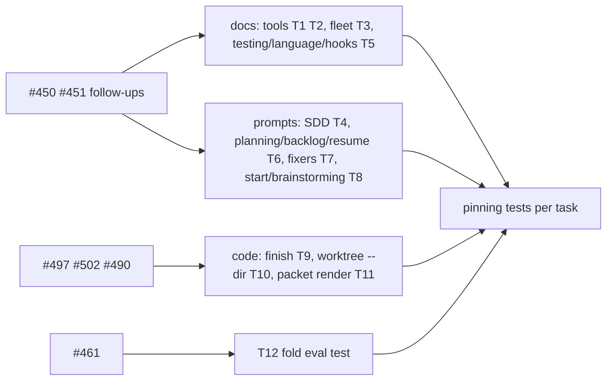
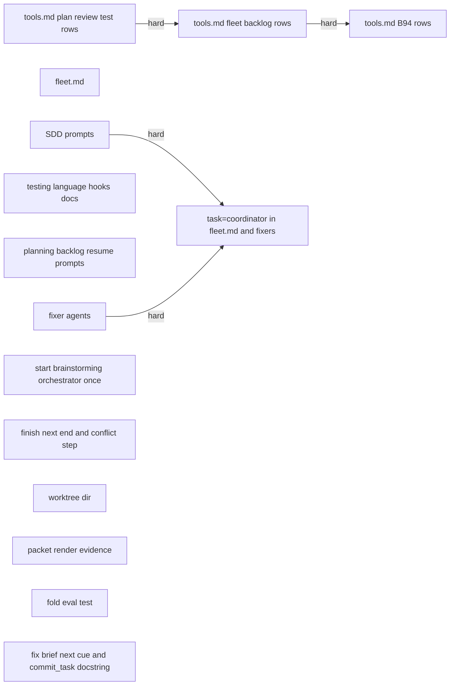

# Superlite: docs and prompts catch up with 1.5.77 to 1.5.103, fixer and finish gaps (B95)

**Goal:** close #450 and #451 (docs/*.md and the skill, agent and command texts name what shipped in 1.5.77 to 1.5.103, including the follow-ups batches B75 to B93 left for these files and main's B93 follow-up for docs/tools.md), #461 (fold test_evals_no_questions_414 into the suite test), #485 (fixers outside a run), #486 (the orchestrator step stated once), #490 (render screenshots in the review packet), #497 (merge conflict after finish), #502 (`--branch` named, `--dir NAME` for the folder).
**Architecture:** text edits per file group, each pinned by a new test file that asserts the key tokens at their place; three small code changes: finish.py ends with a `next: sl orchestrator end` line (T9), worktree.py takes `--dir NAME` (T10), pt_review.py's packet lists render images (T11).
**Tech stack:** Markdown docs; Python 3.10+ stdlib, pytest (through `sl run_tests`).
**Spec:** this file, section Design; issues #450 #451 #461 #485 #486 #490 #497 #502.
**Detail:** tests
**Target-min:** 11
**Wave0:** none
**Coverage:** off
**Max chars:** 60000

Global constraints:
- Touch only the files in Owns. Existing tests stay green; change an existing test file only when your Owns lists it. If another existing test turns red, report it in DONE_WITH_CONCERNS with the test id and the reason instead of editing it.
- Every fact you write is checked against the code first: read the commit named in your task (`git show <sha> -- <file>`) and the script's docstring. Write what the code does now, not what an older ruling said. Keep the house style: plain words, one fact per clause, flags and printed lines in backticks.
- Text outside the spots you change stays byte-identical: older tests pin whole rows, lines and paragraphs (tests/scripts/test_docs_*.py, test_fleet_*docs*.py, test_fixer_*.py, test_backlog_*docs*.py). Run the tests that read your files before you report (`grep -l <file name> tests/scripts/*.py`).
- docs/tools.md rows stay one table row each: exactly one ` | ` separator, ending ` |`.
- skills/subagent-driven-development/SKILL.md stays at most 11700 characters (`len(text)`); skills/using-superlite/SKILL.md is not touched.
- Run `sl` as an executable (`<abs>/sl ...`). Verify with the task's `run_tests --fast ... --task Tn --background` line, then run the printed `wait:` line in the foreground and end the turn only after it reports. Never raw `pytest`, never the e2e or eval layers (coordinator's step).
- No version edits (the ship step bumps the version).

Ruling: scope is every docs follow-up that names these files from B75 to B93 plus main's B93 tell, not only 1.5.77 to 1.5.92, because the later batches assigned their docs follow-ups to B95 - cost if wrong: a longer diff.
Ruling: #502 gets `--dir NAME` (folder `<main root>/.claude/worktrees/NAME`, case kept) instead of keeping a key's case in the slug, because the slug rule is Max's B82 ruling and a case change would rename folders on case-insensitive disks - cost if wrong: one more flag.
Ruling: #490: pt_review's packet lists `.superlite/render/*.png|jpg|jpeg` under `## Render evidence`; the final reviewer opens each listed image, also on the fast path; the fast-path rule itself is unchanged - cost if wrong: a UI run without images keeps today's review.
Ruling: #497: finish's last line becomes `next: sl orchestrator end ...` (the old mid-summary `after finishing:` line goes); the finishing skill gets a conflict step that merges the base branch into the run's branch (no rebase, so no force-push) - cost if wrong: none.
Ruling: #485: a fixer outside a run (no `Tn`, or commit_task finds no run) commits its own fixed files with plain `git commit` and may run the full suite when its brief asks for it; inside a run nothing changes - cost if wrong: a fixer commits by hand outside a run.
Ruling: #486: commands/start.md states the orchestrator step once; feature.md and mvp.md only point to it; brainstorming reads `sl orchestrator status` and asks or sets only when it names none - cost if wrong: none.
Ruling: findings.py (fix brief `next:` cue, #438) and the commit_task.py docstring `)` (#461) belong to running B94: follow-ups in notes.md - cost if wrong: one more small batch.
Ruling: docs/hooks.md, commands/feature.md, commands/mvp.md, commands/backlog.md, skills/writing-plans/SKILL.md, skills/subagent-driven-development/{SKILL,backlog,fixing}.md, agents/{package-reviewer,final-reviewer}.md, finish.py, worktree.py, pt_review.py and the eval and worktree test files are outside the brief's list but no open batch owns them: edited here, named in notes.md - cost if wrong: none.
Ruling: T1 and T2 both own docs/tools.md, so `T1 -->|hard| T2` keeps them apart (rows split plan/review/test vs fleet/backlog) - cost if wrong: T2 starts later.
Ruling: coverage off: docs and prompt catch-up with three bounded code changes, no decision category open - cost if wrong: none.
LAYERS: unit, headless, evals



## Design

Each gap becomes inserted or replaced text at its place; each task's new test asserts the key tokens (flags, printed line heads, file names) in the right row, section or file, and asserts old wrong wording is gone. Tokens are the code's own strings; the prose around them is the implementer's, checked against the named commit. Code changes are small and each has its own tests.

Sources (commit, what it shipped): 07165cb plan --issues GitHub numbers, carry-over ranked first (#434) · eaf0271 contract name default, exception classes checked by base (#435) · 7d93f6e last green file list per checkout (#436) · d6c1690 Swift -only-testing by target membership (#437) · 7b4c919 run_tests next cue (#438) · b5438f6 fleet spawn account retry, dropped workers stopped, stall wait (#439) · a16b02f commit_task claim notes (#440) · 89ae85e probe_run raises=, run= start-up, --plan (#441) · 4d824bf coordinator guard folder rm, Refused command, Python + (#442) · b9004e8 probe_run --dismiss, lint ADAPTER/RUN, probe-files line (#443) · b16a9e9 incident resolve --kind, triage held back, stale packet line (#444) · 0166003 IMPORT warning beyond SwiftPM (#445) · 20101d6 lean launch, --for-review, review: lines (#446) · 814b200 sl status, orchestrator resume, pool prune (#447) · 89955a4 resume per-task checkpoint (B85) · 5cd070b send retry, lead account retry, trust accept, lead --autocompact, run-folder --plan (B87) · 662e508 backlog source, --github, --max-batches, left-out reasons (B86) · 03219ab run_tests --limit, --also, task .latest, tree .superlite link, test_layers run --wait (B88) · 48337b5 backlog skip parked, plan --add, start --note, owned-files brief line (B89) · 3d63680 labelled reports, ASKED, concerns=, --brief --full (B91) · c0cd7c3 backlog tell, followups=/undone=, answers by, approve-ship --source prompt, notes cut (B90) · fa31190 Edges: hard, PROBE imports Python, PLATFORM warning, owned-module-first contract (B93) · 32256c0 output.log, no-count stop, located Swift failures (B92).

New names this plan fixes (T1, T8 and T9 to T11 use exactly these):
- `sl worktree ensure TOPIC [--repo DIR] [--branch NAME] [--dir NAME]`: `--dir NAME` puts the worktree at `<main root>/.claude/worktrees/NAME` (NAME as given, case kept; `[A-Za-z0-9][A-Za-z0-9._-]{0,79}`, else exit 2 `worktree: invalid folder name: NAME`); the branch rule is unchanged.
- finish's last line: `next: sl orchestrator end --plan <plan> (archives the run markers; the coordinator guard blocks every edit, a merge-conflict fix too, until it runs)`; without `--plan`: `next: sl orchestrator end (archives ...)` with the same parenthesis.
- The packet section `## Render evidence`: lead line `Open each image with Read and judge the rendered UI against the spec and the Review Focus:`, then `- <absolute path>` per image under `<run root>/.superlite/render/` (`.png`, `.jpg`, `.jpeg`, sorted by name, at most 20, then `- (+N more not listed)`).

## File structure

- docs/tools.md rows plan_tools, pt_review, probe_run, commit_task, testcmd, run_tests, incident, feedback, finish, status (new row after `orchestrator`), pool, orchestrator, worktree, guard paragraph (T1); rows fleet, fleet_io, backlog, backlog_run, backlog_ship (T2).
- docs/fleet.md (T3). docs/testing.md, docs/language.md, docs/hooks.md (T5).
- skills/subagent-driven-development/{fleet,SKILL,fixing}.md, agents/package-reviewer.md (T4).
- skills/writing-plans/SKILL.md, commands/backlog.md, skills/subagent-driven-development/backlog.md, commands/resume.md (T6).
- agents/fixer-{sonnet,sonnet-high,opus}.md (T7). commands/{start,feature,mvp}.md, skills/brainstorming/SKILL.md (T8).
- finish.py + skills/finishing-a-development-branch/SKILL.md (T9); worktree.py (T10); pt_review.py + agents/final-reviewer.md (T11); tests/scripts/test_evals_suite.py (T12).

## Task graph

```mermaid
%% schedule
gantt
  title Predicted schedule (mm:ss)
  dateFormat X
  axisFormat %M:%S
  section lane 1
  T1 tools.md plan review and test rows :t1, 0, 107s
  T2 tools.md fleet and backlog rows :t2, 107, 85s
  section lane 2
  T4 SDD fleet SKILL fixing and package-re :t4, 0, 106s
  section lane 3
  T9 finish next end line and conflict ste :t9, 0, 106s
  section lane 4
  T11 packet render evidence and final-rev :t11, 0, 106s
  section lane 5
  T5 testing language and hooks docs :t5, 0, 105s
  section lane 6
  T6 writing-plans backlog and resume text :t6, 0, 105s
  section lane 7
  T10 worktree ensure --dir :t10, 0, 85s
  section lane 8
  T3 fleet.md catch-up :t3, 0, 84s
  section lane 9
  T7 fixer agents outside a run :t7, 0, 84s
  section lane 10
  T8 orchestrator step once and --branch :t8, 0, 83s
  T12 fold the no-questions eval test into :t12, 83, 83s
```





critical path: T1 → T2 (3.2 min) · peak width 10 · predicted build 3.2 min · predicted total ≈ 6.7 min (target ✓)

## Predicted schedule

## Docs

### T1 tools.md plan, review and test rows · Complexity 3 (O-1) · Est. context 60k
**Owns:** docs/tools.md, tests/scripts/test_docs_b72_tools.py, tests/scripts/test_docs_b95_tools.py
**Components:** 2
**LOC owned:** 110
**Tests:** fast
**Model:** sonnet
**Est. time:** 4 min (2 components, about 110 LOC, fast tests)
**Consumes:** none
**Produces:** none
**Review Focus:** `test_rows_keep_table_shape`: every edited row has exactly one ` | ` and ends ` |`.
**Test code (verbatim):** tests/scripts/test_docs_b95_tools.py
```python
"""B95 (#450, B75-B93 follow-ups): docs/tools.md plan, review and test rows name what shipped in 1.5.77 to 1.5.103."""
from pathlib import Path

ROOT = Path(__file__).resolve().parents[2]
TOOLS = (ROOT / "docs" / "tools.md").read_text(encoding="utf-8")
ROWS = ("plan_tools", "pt_review", "probe_run", "commit_task", "testcmd", "run_tests", "incident", "feedback",
        "finish", "status", "pool", "orchestrator", "worktree")


def row(name):
    rows = [ln for ln in TOOLS.splitlines() if ln.startswith(f"| `{name}` |")]
    assert len(rows) == 1, name
    return rows[0]


def has(text, *tokens):
    missing = [t for t in tokens if t not in text]
    assert not missing, missing


def test_rows_keep_table_shape():
    for name in ROWS:
        r = row(name)
        assert r.count(" | ") == 1 and r.endswith(" |"), name


def test_plan_tools_row():
    r = row("plan_tools")
    has(r, "**Edges:** hard", "imports Python", "WARNING: PLATFORM:", "ADAPTER: rebuilt", "ADAPTER: removed",
        "RUN: <sl> plan_tools adapter --plan P", "import-linter", "package.json")
    assert "SwiftPM only" not in r


def test_pt_review_row():
    has(row("pt_review"), "Name(Exception)", "owning task", "write the full module path", "## Render evidence",
        ".superlite/render/")


def test_probe_run_row():
    has(row("probe_run"), "--plan", "raises=", "--dismiss", 'results["dismissed"]', "dismissed.json")


def test_commit_task_row():
    r = row("commit_task")
    has(r, "probe files committed", "claimed by T2, changed after its checkpoint",
        "commit_task T2 commits it once T2 is done")
    assert "(`left uncommitted (claimed by Tn): F`)" not in r


def test_testcmd_row():
    has(row("testcmd"), "membership", "not in a test target")


def test_run_tests_row():
    has(row("run_tests"), "--limit", "wall-clock limit", "--also", "test-summary-Tn.latest", ".output.log",
        "run_tests: output", "no tests ran", "runner:", "(crashed)")


def test_incident_feedback_finish_rows():
    has(row("incident"), "resolve --kind", "--reason")
    has(row("feedback"), "held back")
    has(row("finish"), "review packet: older than the last full run", "next: sl orchestrator end")


def test_status_pool_orchestrator_worktree_rows():
    has(row("status"), "sl status")
    has(row("pool"), "prune", "session")
    has(row("orchestrator"), "resume")
    has(row("worktree"), "--dir NAME", "--branch NAME")


def test_guard_paragraph():
    para = [ln for ln in TOOLS.splitlines() if ln.startswith("The coordinator guard")]
    assert len(para) == 1
    has(para[0], "Refused command:", "rmdir", "+")
```
**Steps:** 1 write the test, 2 run: FAIL, 3 edit the rows and update tests/scripts/test_docs_b72_tools.py's commit_task pin (`test_commit_task_row_names_the_notes`) to the new claim text, 4 run both test files and every test that reads docs/tools.md: PASS
**Notes:** items and sources: plan_tools: IMPORT warning reads SwiftPM, import-linter contracts and workspace package.json, Python and TS check the home module (0166003); `lint --stable` prints `ADAPTER: rebuilt|removed ...`, plain lint `RUN: <sl> plan_tools adapter --plan P (...)` (b9004e8); the `**Edges:** hard` header switch, `PROBE: <kind>=<target> imports Python, but ...`, `WARNING: PLATFORM: Tn has code behind #if ...` (fa31190). pt_review: an exception class Produces lists its bases (`Name(Exception)`) and is checked by base (eaf0271); contract resolves a Produces name in the owning task's non-test .py Owns first and prints the ambiguity `note: ... write the full module path` (fa31190); packet `## Render evidence` (Design, T11). probe_run: `--plan P`, `raises=`, run= warm-up and timeout (89ae85e); `--dismiss ID [--reason T]`, `dismissed.json`, `results["dismissed"]` (b9004e8). commit_task: the two claim notes and the two no-line cases (a16b02f, replacing the old `claimed by Tn` text); the `Tn: probe files committed:` line (b9004e8). testcmd: target-membership lookup, the target-wide id for a suite-less file, the unfiltered fallback (d6c1690). run_tests: `--limit`, `--also`, `.latest` redirect, tree `.superlite` link (03219ab); `.output.log`, `run_tests: output`/`output:` lines, the `no tests ran ...; runner: ...` stop, located Swift failures, covered closing and `(crashed)` (32256c0). incident `resolve --kind K --reason R`, feedback held-back line, finish stale-packet line (b16a9e9); finish `next:` line (Design). New `status` row (`sl status [--plan P]`, 814b200); pool `prune` and the `session` key (814b200); orchestrator `resume` (814b200, 89955a4). worktree `--dir NAME` (Design). Guard paragraph: folder `rm -r`/`rmdir` rule, `Refused command:` line, Python string `+` composition (4d824bf).

### T2 tools.md fleet and backlog rows · Complexity 3 (O-1) · Est. context 55k
**Owns:** docs/tools.md, tests/scripts/test_docs_b95_tools_fleet.py
**Components:** 1
**LOC owned:** 80
**Tests:** fast
**Model:** sonnet
**Est. time:** 3 min (1 component, about 80 LOC, fast tests)
**Consumes:** none
**Produces:** none
**Review Focus:** `test_fleet_rows_keep_table_shape`: every edited row has exactly one ` | ` and ends ` |`.
**Test code (verbatim):** tests/scripts/test_docs_b95_tools_fleet.py
```python
"""B95 (#450, B86-B91 follow-ups): docs/tools.md fleet and backlog rows name what shipped in 1.5.82 to 1.5.101."""
from pathlib import Path

ROOT = Path(__file__).resolve().parents[2]
TOOLS = (ROOT / "docs" / "tools.md").read_text(encoding="utf-8")


def row(name):
    rows = [ln for ln in TOOLS.splitlines() if ln.startswith(f"| `{name}` |")]
    assert len(rows) == 1, name
    return rows[0]


def has(text, *tokens):
    missing = [t for t in tokens if t not in text]
    assert not missing, missing


def test_fleet_rows_keep_table_shape():
    for name in ("fleet", "fleet_io", "backlog", "backlog_run", "backlog_ship"):
        r = row(name)
        assert r.count(" | ") == 1 and r.endswith(" |"), name


def test_fleet_row():
    has(row("fleet"), "--for-review", "--package", "review: Tn", "--strict-mcp-config", "another account",
        "dropped", "--autocompact", "trust")


def test_fleet_io_row():
    has(row("fleet_io"), "ASKED", "concerns=N", "--full", "Files changed:", "retr")


def test_backlog_row():
    has(row("backlog"), "GitHub numbers", "ranked first", "--github", "--max-batches", "--add", "overlap:",
        "--note FILE", "note:", "parked", "tell B --text T", "--approve-ship --source prompt", '"by"')


def test_backlog_run_and_ship_rows():
    has(row("backlog_run"), "followups=N", "undone=M", "follow-up:", "left undone:")
    has(row("backlog_ship"), "B.notes.md", "[cut: full text in B.notes.md]")
```
**Steps:** 1 write the test, 2 run: FAIL, 3 edit the rows, 4 run it and every test that reads docs/tools.md: PASS
**Notes:** fleet: spawn stops dropped workers, waits for a stalled prime, retries a slow start once on another account and names it on stderr (b5438f6); lean launch flags and denied tools, `--for-review Tn [Tm ...] | --package X`, `review: Tn (<why>)` lines from `--for-dispatch` (20101d6); lead account retry, trust-dialog accept, run-folder `--plan`, lead `--autocompact` (5cd070b). fleet_io: send resends once after a stall or Herdr's timeout unless the worker shows working (5cd070b); labelled-report parse, `ASKED` line, ` concerns=N`, `send Wn --brief <packet> --full` (3d63680). backlog: `--issues` GitHub numbers, carry-over ranked first (07165cb); `--github`, `--max-batches N`, the stored source, left-out reasons (662e508); `plan --issues N --add`, `overlap:` lines, `start --note FILE`, `note:` status line, skip on parked batches (48337b5); `tell B --text T`, `decide --approve-ship --source prompt`, the answers file's `"by"` key (c0cd7c3). backlog_run: shipped wait line `followups=N undone=M` with `B follow-up:`/`B left undone:` lines, owned-files brief line (c0cd7c3, 48337b5). backlog_ship: full notes in `.superlite/backlog/B.notes.md`, a note line over 400 characters cut with `[cut: full text in B.notes.md]` (c0cd7c3).

### T3 fleet.md catch-up · Complexity 3 (O-1) · Est. context 50k
**Owns:** docs/fleet.md, tests/scripts/test_docs_b95_fleet.py
**Components:** 1
**LOC owned:** 70
**Tests:** fast
**Model:** sonnet
**Est. time:** 3 min (1 component, about 70 LOC, fast tests)
**Consumes:** none
**Produces:** none
**Review Focus:** none (docs only)
**Test code (verbatim):** tests/scripts/test_docs_b95_fleet.py
```python
"""B95 (#450, B87-B91 follow-ups): docs/fleet.md names what shipped in 1.5.82 to 1.5.101."""
from pathlib import Path

ROOT = Path(__file__).resolve().parents[2]
FLEET = (ROOT / "docs" / "fleet.md").read_text(encoding="utf-8")


def section(title):
    head = f"## {title}\n"
    assert head in FLEET, title
    return FLEET.split(head, 1)[1].split("\n## ", 1)[0]


def has(text, *tokens):
    missing = [t for t in tokens if t not in text]
    assert not missing, missing


def test_commands_section():
    has(section("Commands"), "--for-review", "--package", "review: Tn", "--strict-mcp-config", "dropped",
        "another account", "ASKED", "concerns=N", "--brief", "--full", "Files changed:")


def test_batch_leads_section():
    has(section("Batch leads (backlog mode)"), "--add", "overlap:", "--note FILE", "note:", "parked",
        "tell B --text T", "--approve-ship --source prompt", '"by"', "followups=N", "undone=M",
        "--autocompact", "Files other open batches own", "incident resolve --kind")


def test_troubleshooting_trust_dialog():
    has(section("Troubleshooting"), "Yes, I trust this folder", "lead")
```
**Steps:** 1 write the test, 2 run: FAIL, 3 edit fleet.md, 4 run it and every test that reads docs/fleet.md: PASS
**Notes:** Commands: dropped-worker stop, 30 s stall wait, account retry and its stderr line (b5438f6); `--for-review`, `--package`, the `review:` lines, the lean launch (20101d6); send retry after a stall, run-folder `--plan` (5cd070b); labelled reports, `ASKED`, ` concerns=N`, `send --brief <packet> --full` (3d63680). Batch leads: lead `--autocompact` and account retry (5cd070b); `plan --issues N --add`, `overlap:`, `start --note FILE`, `note:` line, the `Files other open batches own` brief line, skip on parked (48337b5); `tell B --text T`, `decide --approve-ship --source prompt`, the `"by"` key, the `followups=N undone=M` wait line (c0cd7c3); `incident resolve --kind K --reason R` for main's bulk close (b16a9e9). Troubleshooting: the trust dialog is also accepted after a one-turn worker or a lead starts, and a primed worker without READY gets its prime once more (5cd070b).

### T4 SDD fleet, SKILL, fixing and package-reviewer texts · Complexity 3 (O-1) · Est. context 55k
**Owns:** skills/subagent-driven-development/fleet.md, skills/subagent-driven-development/SKILL.md, skills/subagent-driven-development/fixing.md, agents/package-reviewer.md, tests/scripts/test_docs_b95_sdd.py
**Components:** 2
**LOC owned:** 70
**Tests:** fast
**Model:** sonnet
**Est. time:** 3.5 min (2 components, about 70 LOC, fast tests)
**Consumes:** none
**Produces:** none
**Review Focus:** `test_skill_stays_under_cap`: SKILL.md at most 11700 characters.
**Test code (verbatim):** tests/scripts/test_docs_b95_sdd.py
```python
"""B95 (#451): SDD fleet.md, SKILL.md, fixing.md and the package reviewer name 1.5.82 to 1.5.100."""
from pathlib import Path

ROOT = Path(__file__).resolve().parents[2]
SDD = ROOT / "skills" / "subagent-driven-development"
FLEET = (SDD / "fleet.md").read_text(encoding="utf-8")
SKILL = (SDD / "SKILL.md").read_text(encoding="utf-8")
FIXING = (SDD / "fixing.md").read_text(encoding="utf-8")
PKG = (ROOT / "agents" / "package-reviewer.md").read_text(encoding="utf-8")


def has(text, *tokens):
    missing = [t for t in tokens if t not in text]
    assert not missing, missing


def test_fleet_md():
    has(FLEET, "--for-review", "--package", "review: Tn", "dropped", "another account", "ASKED", "concerns=N",
        "--full")


def test_skill_reviews_and_probes():
    has(SKILL, "--for-review", "review:", "--dismiss")


def test_skill_stays_under_cap():
    assert len(SKILL) <= 11700


def test_fixing_md():
    has(FIXING, "--dismiss", 'results["dismissed"]', "ADAPTER:", "RUN:", "probe files committed")


def test_package_reviewer():
    has(PKG, "probe_run --plan", "--dismiss")
```
**Steps:** 1 write the test, 2 run: FAIL, 3 edit the four files, 4 run it and every test that reads them: PASS
**Notes:** fleet.md: dropped-worker stop, 30 s stall wait, account retry and its stderr line (b5438f6); Other roles, Package reviewer: `fleet spawn --for-review Tn [Tm ...] --plan $PLAN` or `--package X` writes and sends the brief, `--for-dispatch` prints `review: Tn (<why>)`, workers start lean (20101d6); send retry (5cd070b); Waiting: `Wn <label> ASKED`, ` concerns=N`, `fleet send Wn --brief <packet> --full` (3d63680). SKILL.md (11682 of 11700 characters: trim unpinned words to make room): Reviews names `--for-review`/`--package` and the `review:` lines; steps 5-6 name `probe_run --dismiss` for a ruled false positive (b9004e8, 20101d6). fixing.md: `probe_run --dismiss ID`, `results["dismissed"]`, lint `ADAPTER:`/`RUN:` lines, commit_task's probe-files line (b9004e8). package-reviewer.md: `probe_run --plan` (89ae85e) and `--dismiss` (b9004e8).

### T5 testing, language and hooks docs · Complexity 2 (O-1) · Est. context 45k
**Owns:** docs/testing.md, docs/language.md, docs/hooks.md, tests/scripts/test_docs_b95_testing.py
**Components:** 2
**LOC owned:** 50
**Tests:** fast
**Model:** sonnet
**Est. time:** 2.5 min (2 components, about 50 LOC, fast tests)
**Consumes:** none
**Produces:** none
**Review Focus:** none (docs only)
**Test code (verbatim):** tests/scripts/test_docs_b95_testing.py
```python
"""B95 (#450, B88 and B92 follow-ups): testing, language and hooks docs name 1.5.79 to 1.5.103."""
from pathlib import Path

ROOT = Path(__file__).resolve().parents[2]
TESTING = (ROOT / "docs" / "testing.md").read_text(encoding="utf-8")
LANGUAGE = (ROOT / "docs" / "language.md").read_text(encoding="utf-8")
HOOKS = (ROOT / "docs" / "hooks.md").read_text(encoding="utf-8")


def has(text, *tokens):
    missing = [t for t in tokens if t not in text]
    assert not missing, missing


def test_testing_store_line_is_per_checkout():
    assert "the file list of the last green run live in one store" not in TESTING
    has(TESTING, "each checkout's last green file list")


def test_testing_unit_layer():
    has(TESTING, "run --wait", "SUPERLITE_UNIT_WAIT", "unit: running", "exit 4", "--limit", ".output.log",
        "no tests ran")


def test_language_xcode_and_swift():
    has(LANGUAGE, "membership", "not in a test target", "file:line", "(crashed)")


def test_hooks_guard():
    has(HOOKS, "Refused command:", "rmdir", "+")
```
**Steps:** 1 write the test, 2 run: FAIL, 3 edit the three docs, 4 run it and every test that reads them: PASS
**Notes:** testing.md: the store holds each checkout's last green file list (7d93f6e); unit layer `test_layers.py run --wait S` (else `SUPERLITE_UNIT_WAIT`, else 540), `unit: running ...` and exit 4, `run_tests --limit S` (03219ab); every run keeps `<summary stem>.output.log`, a zero-count run stops with `no tests ran: ...; runner: ...` (32256c0). language.md Xcode: the `{only_testing}` mapping by target membership (pbxproj unit and UI test targets, `.testTarget` names), the target-wide id for a suite-less file, the unfiltered fallback with its stderr note (d6c1690); xcodebuild failures located at `file:line` with their suite path, a counted run covers its files, a crash relaunch names `<name> (crashed)` (32256c0). hooks.md block-coordinator-edits: folder `rm -r`/`rmdir` rule, `Refused command:` line, Python string `+` composition (4d824bf).

## Prompts

### T6 writing-plans, backlog and resume texts · Complexity 2 (O-1) · Est. context 50k
**Owns:** skills/writing-plans/SKILL.md, commands/backlog.md, skills/subagent-driven-development/backlog.md, commands/resume.md, tests/scripts/test_docs_b95_prompts.py
**Components:** 2
**LOC owned:** 40
**Tests:** fast
**Model:** sonnet
**Est. time:** 2.5 min (2 components, about 40 LOC, fast tests)
**Consumes:** none
**Produces:** none
**Review Focus:** none (docs only)
**Test code (verbatim):** tests/scripts/test_docs_b95_prompts.py
```python
"""B95 (#451): writing-plans, backlog and resume texts name 1.5.77 to 1.5.95."""
from pathlib import Path

ROOT = Path(__file__).resolve().parents[2]
WP = (ROOT / "skills" / "writing-plans" / "SKILL.md").read_text(encoding="utf-8")
CMD_BACKLOG = (ROOT / "commands" / "backlog.md").read_text(encoding="utf-8")
SDD_BACKLOG = (ROOT / "skills" / "subagent-driven-development" / "backlog.md").read_text(encoding="utf-8")
RESUME = (ROOT / "commands" / "resume.md").read_text(encoding="utf-8")


def has(text, *tokens):
    missing = [t for t in tokens if t not in text]
    assert not missing, missing


def test_writing_plans_produces_and_probe():
    has(WP, "Name(Exception)", "raises=")
    assert "each probe call has a 10 s timeout" not in WP


def test_backlog_issues_and_carry_over():
    for text in (CMD_BACKLOG, SDD_BACKLOG):
        has(text, "GitHub numbers", "ranked first")


def test_resume_calls_orchestrator_resume():
    has(RESUME, "sl orchestrator resume", "sl status")
```
**Steps:** 1 write the test, 2 run: FAIL, 3 edit the four files, 4 run it and every test that reads them: PASS
**Notes:** writing-plans Produces row: an exception class item lists its bases (`Name(Exception)`); a name default must stay a name in the code (eaf0271). Probe entry bullet: name `raises=Name[,Name]`; replace the 10 s timeout clause with the run timeout (5 s, or the measured start-up: max(5, 3 x second call + 1) s, at most 60) (89ae85e). commands/backlog.md and SDD backlog.md: `plan --issues` takes GitHub numbers, and issues an earlier cap left out are ranked first (07165cb). commands/resume.md: run `sl orchestrator resume --plan <plan>` first (per task: checkpoint, files edited after it, uncommitted Owns files, its last test run) and act on its keep/drop hints; `sl status` shows the run state (814b200, 89955a4).

### T7 fixer agents outside a run · Complexity 2 (O-1) · Est. context 35k
**Owns:** agents/fixer-sonnet.md, agents/fixer-sonnet-high.md, agents/fixer-opus.md, tests/scripts/test_fixer_outside_run_485.py
**Components:** 1
**LOC owned:** 50
**Tests:** fast
**Model:** sonnet
**Est. time:** 2.5 min (1 component, about 50 LOC, fast tests)
**Consumes:** none
**Produces:** none
**Review Focus:** none (docs only)
**Test code (verbatim):** tests/scripts/test_fixer_outside_run_485.py
```python
"""#485, #438: a fixer says what it does outside an sl run and names the run_tests next: cue."""
from pathlib import Path

import pytest

AGENTS = Path(__file__).resolve().parents[2] / "agents"


@pytest.mark.parametrize("name", ["fixer-sonnet", "fixer-sonnet-high", "fixer-opus"])
def test_fixer_outside_run(name):
    text = (AGENTS / f"{name}.md").read_text(encoding="utf-8")
    head = text.split("---\n")[1]
    assert "outside a run" in head
    for need in ("Outside a run", "git commit", "the full suite when your brief asks for it", "`next:`"):
        assert need in text, (name, need)
```
**Steps:** 1 write the test, 2 run: FAIL, 3 edit the three agents, 4 run it plus tests/scripts/test_fixer_*.py: PASS
**Notes:** Description: "... then commits (commit_task in a run, plain git commit outside a run)." New rule bullet `- Outside a run` (no task id `Tn` in the brief, or `commit_task` reports no run): commit only your fixed files and their tests with plain `git add <files>` and `git commit` in the brief's folder; run the full suite when your brief asks for it. Inside a run every existing rule stays. The test-run rule names the cue: the `--background` run prints a `next:` cue and, last, the `wait:` line (7b4c919). Keep the three files identical except their head and the lines that differ today.

### T8 orchestrator step once and --branch · Complexity 2 (O-1) · Est. context 40k
**Owns:** commands/start.md, commands/feature.md, commands/mvp.md, skills/brainstorming/SKILL.md, tests/scripts/test_orchestrator_once_486.py
**Components:** 1
**LOC owned:** 40
**Tests:** fast
**Model:** sonnet
**Est. time:** 2.5 min (1 component, about 40 LOC, fast tests)
**Consumes:** none
**Produces:** none
**Review Focus:** none (docs only)
**Test code (verbatim):** tests/scripts/test_orchestrator_once_486.py
```python
"""#486, #502: start states the orchestrator step once; later texts read it; --branch and --dir are named."""
from pathlib import Path

ROOT = Path(__file__).resolve().parents[2]


def read(rel):
    return (ROOT / rel).read_text(encoding="utf-8")


def test_start_states_it_once_and_where_it_lives():
    text = read("commands/start.md")
    assert text.count("sl orchestrator set") == 1
    for need in (".superlite/orchestrator.json", "lint --stable", "--branch", "--dir"):
        assert need in text, need


def test_feature_and_mvp_only_read_it():
    for rel in ("commands/feature.md", "commands/mvp.md"):
        text = read(rel)
        assert "sl orchestrator set" not in text, rel
        assert "unless the user already said" not in text, rel
        assert "sl orchestrator status" in text, rel


def test_brainstorming_reads_status_first():
    text = read("skills/brainstorming/SKILL.md")
    assert "sl orchestrator status" in text
    assert text.count("sl orchestrator set") <= 1
    assert "--branch" in text
```
**Steps:** 1 write the test, 2 run: FAIL, 3 edit the four files, 4 run it plus every test that reads them (tests/scripts/test_evals_suite.py, tests/scripts/test_coverage_docs.py, ...): PASS
**Notes:** start.md keeps the one orchestrator question and its `sl orchestrator set human|ai` (headless default AI included, worded so the string appears once), plus one line: the choice lives in `.superlite/orchestrator.json` of the session's run folder (`sl state where`); `lint --stable --plan` binds the session to the plan's worktree run and moves the file along, so a worktree run follows it: never set it again (orchestrator.py, state.py `bind`). A project with a branch rule: `sl worktree ensure <topic> --branch <name>` (for example `feat/KEY-1-slug`), `--dir <name>` names the folder (Design). feature.md and mvp.md: brainstorming reads the choice (`sl orchestrator status`); no restated question. brainstorming step 2: read `sl orchestrator status` first; ask and `set` only when it names none; step 4 bounded/architectural `worktree ensure` names `--branch` for a project with a branch rule.

## Code

### T9 finish next end line and conflict step · Complexity 3 (O-1) · Est. context 45k
**Owns:** skills/subagent-driven-development/scripts/finish.py, skills/finishing-a-development-branch/SKILL.md, tests/scripts/test_finish_next_end_497.py
**Components:** 2
**LOC owned:** 70
**Tests:** fast
**Model:** sonnet
**Est. time:** 3 min (2 components, about 70 LOC, fast tests)
**Consumes:** none
**Produces:** none
**Review Focus:** `test_next_line_is_last`: the summary's last non-empty line is the `next:` line, also when incidents are open; `test_takeover_line_kept`: the takeover hint (tests/scripts/test_finish_unblocked_375.py) stays.
**Test code (verbatim):** tests/scripts/test_finish_next_end_497.py
```python
"""#497: finish ends with `sl orchestrator end` as its own next step; the finishing skill has a conflict step."""
from __future__ import annotations

import json
from pathlib import Path

from test_plan_tools import ROOT, SCRIPTS, run

FINISH = SCRIPTS / "finish.py"
TAIL = " (archives the run markers; the coordinator guard blocks every edit, a merge-conflict fix too, until it runs)"


def lines(tmp_path, *extra, incidents=""):
    led = tmp_path / "progress.md"
    led.write_text("- commit T1 abcdef1234 t1\n", encoding="utf-8")
    (tmp_path / "incidents.jsonl").write_text(incidents, encoding="utf-8")
    out = run(FINISH, "--ledger", led, "--log", tmp_path / "incidents.jsonl", *extra, cwd=tmp_path).out
    return [ln for ln in out.splitlines() if ln.strip()]


def test_next_line_is_last(tmp_path):
    out = lines(tmp_path)
    assert out[-1] == "next: sl orchestrator end" + TAIL
    assert not any(ln.startswith("after finishing:") for ln in out)


def test_next_line_is_last_with_open_incidents(tmp_path):
    inc = json.dumps({"file": "a.py", "line": 3, "context": "boom", "agent": "probe_run", "status": "open"}) + "\n"
    out = lines(tmp_path, incidents=inc)
    assert out[-1] == "next: sl orchestrator end" + TAIL


def test_finishing_skill_has_conflict_step():
    text = (ROOT / "skills" / "finishing-a-development-branch" / "SKILL.md").read_text(encoding="utf-8")
    for need in ("conflict", "sl orchestrator end", "git merge", "run_tests --full"):
        assert need in text, need
```
**Steps:** 1 write the test, 2 run: FAIL, 3 implement, 4 run it plus tests/scripts/test_finish_*.py: PASS
**Notes:** finish.py `summary()`: drop the `after finishing:` line; end the output with the takeover hint (when another live session owns the run, unchanged text) and then `next: sl orchestrator end --plan <plan>` + TAIL when `plan` is given, else `next: sl orchestrator end` + TAIL, as the last line (after the open-incidents block). Update the module docstring. Finishing SKILL.md: a short step (after Execute, before Worktree cleanup, or a section) "Conflict after finish (the PR or the merge conflicts with the base branch): run `sl orchestrator end --plan <abs plan>` first (the coordinator guard blocks every edit until then), merge the base branch into the run's branch (`git fetch origin` and `git merge origin/<base>`, never a rebase: no force-push), resolve, run `sl run_tests --full`, push." Step 6 stays.

### T10 worktree ensure --dir · Complexity 3 (O-1) · Est. context 40k
**Owns:** skills/subagent-driven-development/scripts/worktree.py, tests/scripts/test_worktree_plan.py, tests/scripts/test_worktree_dir_502.py
**Components:** 1
**LOC owned:** 90
**Tests:** fast
**Model:** sonnet
**Est. time:** 3 min (1 component, about 90 LOC, fast tests)
**Consumes:** none
**Produces:** worktree.ensure(topic: str, start: Path, branch: str | None = None, folder: str | None = None) -> tuple[Path, str]
**Review Focus:** `test_dir_rejects_bad_names` (protocol): `../x`, `a/b`, `.hidden`, `` and a 81-character name exit 2; `test_dir_keeps_case` (file): `--dir KEY-1632-topic` gives the folder `KEY-1632-topic`.
**Test code (verbatim):** tests/scripts/test_worktree_dir_502.py
```python
"""#502: sl worktree ensure --dir NAME names the worktree folder, case kept."""
from __future__ import annotations

import subprocess
import sys
from pathlib import Path

import pytest

ROOT = Path(__file__).resolve().parents[2]
SCRIPTS = ROOT / "skills" / "subagent-driven-development" / "scripts"
sys.path.insert(0, str(SCRIPTS))

import worktree  # noqa: E402


def git(cwd, *args):
    return subprocess.run(["git", "-C", str(cwd), *args], capture_output=True, text=True, check=True).stdout


@pytest.fixture
def repo(tmp_path, monkeypatch):
    for k in ("SUPERLITE_FLEET_ROLE", "SUPERLITE_FLEET_PARENT_DIR", "SUPERLITE_STATE_DIR"):
        monkeypatch.delenv(k, raising=False)
    r = tmp_path / "repo"
    r.mkdir()
    git(r, "init", "-q", "-b", "main")
    git(r, "config", "user.name", "t")
    git(r, "config", "user.email", "t@t")
    (r / "a.txt").write_text("one\n")
    git(r, "add", ".")
    git(r, "commit", "-q", "-m", "init")
    return r


def test_dir_keeps_case(repo):
    path, state = worktree.ensure("KEY-1632 some topic", repo, folder="KEY-1632-topic")
    assert state == "created"
    assert path.name == "KEY-1632-topic" and path.parent.name == "worktrees" and path.parent.parent.name == ".claude"
    assert git(path, "rev-parse", "--abbrev-ref", "HEAD").strip() == "superlite/key-1632-some-topic"


def test_dir_with_branch(repo):
    path, _ = worktree.ensure("x", repo, branch="feat/KEY-1-slug", folder="KEY-1-slug")
    assert path.name == "KEY-1-slug"
    assert git(path, "rev-parse", "--abbrev-ref", "HEAD").strip() == "feat/KEY-1-slug"


def test_dir_reused(repo):
    first, _ = worktree.ensure("x", repo, folder="Run-A")
    again, state = worktree.ensure("x", repo, folder="Run-A")
    assert again == first and state == "exists"


@pytest.mark.parametrize("bad", ["../x", "a/b", ".hidden", "", "x" * 81])
def test_dir_rejects_bad_names(repo, bad, capsys):
    assert worktree.main(["ensure", "t", "--repo", str(repo), "--dir", bad]) == 2
    assert f"worktree: invalid folder name: {bad}" in capsys.readouterr().err
    assert not (repo / ".claude" / "worktrees").exists() or not any((repo / ".claude" / "worktrees").iterdir())


def test_dir_cli_prints_path(repo, capsys):
    assert worktree.main(["ensure", "t", "--repo", str(repo), "--dir", "My-Run"]) == 0
    assert capsys.readouterr().out.strip().endswith("/.claude/worktrees/My-Run")
```
**Steps:** 1 write the test, 2 run: FAIL, 3 implement, 4 run it plus tests/scripts/test_worktree*.py: PASS
**Notes:** `ensure(topic, start, branch=None, folder=None)`: validate `folder` with `re.fullmatch(r"[A-Za-z0-9][A-Za-z0-9._-]{0,79}", folder)` before anything is created (raise BadBranch-like `BadFolder` -> exit 2, stderr `worktree: invalid folder name: NAME`); target = `top / PARENT / folder` when given, else today's `superlite-<slug>`; the exclude probe uses the same folder; branch rule unchanged; reuse and Taken rules unchanged. From a linked worktree `--dir` changes nothing (stderr `worktree: linked worktree is <path>; --dir ignored` when its folder name differs). Add `--dir NAME` to argparse, the docstring and the usage line `usage: worktree ensure TOPIC [--repo DIR] [--branch NAME] [--dir NAME] | inplace --reason TEXT [--plan P]`; update the `USAGE` constant in tests/scripts/test_worktree_plan.py to it.

### T11 packet render evidence and final-reviewer text · Complexity 3 (O-1) · Est. context 55k
**Owns:** skills/subagent-driven-development/scripts/pt_review.py, agents/final-reviewer.md, tests/scripts/test_packet_render_490.py
**Components:** 2
**LOC owned:** 70
**Tests:** fast
**Model:** sonnet
**Est. time:** 3 min (2 components, about 70 LOC, fast tests)
**Consumes:** none
**Produces:** pt_review.render_section(root: Path) -> str
**Review Focus:** `test_render_section_caps_at_20` (file): 25 images list 20 and `- (+5 more not listed)`; `test_render_section_empty` (file): no folder or only `.txt` files give "".
**Test code (verbatim):** tests/scripts/test_packet_render_490.py
```python
"""#490, #445: the review packet lists render screenshots; the final reviewer opens them."""
from __future__ import annotations

import sys
from pathlib import Path

ROOT = Path(__file__).resolve().parents[2]
sys.path.insert(0, str(ROOT / "skills" / "subagent-driven-development" / "scripts"))

import pt_review  # noqa: E402

LEAD = "Open each image with Read and judge the rendered UI against the spec and the Review Focus:"


def test_render_section_lists_images(tmp_path):
    d = tmp_path / ".superlite" / "render"
    d.mkdir(parents=True)
    for n in ("b.png", "a.jpg", "c.jpeg", "notes.txt"):
        (d / n).write_bytes(b"x")
    text = pt_review.render_section(tmp_path)
    lines = text.strip().splitlines()
    assert lines[0] == "## Render evidence"
    assert lines[1] == LEAD
    assert lines[2:] == [f"- {(d / n).resolve().as_posix()}" for n in ("a.jpg", "b.png", "c.jpeg")]


def test_render_section_caps_at_20(tmp_path):
    d = tmp_path / ".superlite" / "render"
    d.mkdir(parents=True)
    for i in range(25):
        (d / f"s{i:02d}.png").write_bytes(b"x")
    lines = pt_review.render_section(tmp_path).strip().splitlines()
    assert len(lines) == 2 + 20 + 1 and lines[-1] == "- (+5 more not listed)"


def test_render_section_empty(tmp_path):
    assert pt_review.render_section(tmp_path) == ""
    (tmp_path / ".superlite" / "render").mkdir(parents=True)
    (tmp_path / ".superlite" / "render" / "x.txt").write_text("x")
    assert pt_review.render_section(tmp_path) == ""


def test_final_reviewer_names_render_and_import():
    text = (ROOT / "agents" / "final-reviewer.md").read_text(encoding="utf-8")
    for need in ("## Render evidence", "also on the fast path", "import-linter", "package.json"):
        assert need in text, need
    assert "SwiftPM target its `Package.swift` does not list) is not in the packet" not in text
```
**Steps:** 1 write the test, 2 run: FAIL, 3 implement, 4 run it plus tests/scripts/test_adapter_and_packet.py, test_packet_inline.py: PASS
**Notes:** `render_section(root)` returns "" or the section text (heading, LEAD, one `- <abs posix path>` per image, sorted by name, cap 20, `- (+N more not listed)`), ending with a newline. `cmd_packet` appends it to the packet body after the Review Focus section (find where sections are joined); no other packet change, the FAST PATH rule is untouched. final-reviewer.md: the read rule names the second exception: every image the packet lists under `## Render evidence`, one Read each, also on the fast path, each with a `Checked:` line; the IMPORT bullet says the warning covers SwiftPM target dependencies, import-linter contracts and workspace package.json dependencies (0166003).

### T12 fold the no-questions eval test into the suite test · Complexity 1 (O-1) · Est. context 25k
**Owns:** tests/scripts/test_evals_suite.py, tests/scripts/test_evals_no_questions_414.py
**Components:** 1
**LOC owned:** 60
**Tests:** fast
**Kind:** mechanical
**Model:** haiku
**Est. time:** 1.5 min (1 component, about 60 LOC, fast tests)
**Consumes:** none
**Produces:** none
**Review Focus:** none (test move)
**Test code (verbatim):** append to tests/scripts/test_evals_suite.py
```python
def test_no_questions_tests_live_in_the_suite():
    assert not (ROOT / "tests" / "scripts" / "test_evals_no_questions_414.py").exists()
```
**Steps:** 1 append the test above, 2 run: FAIL, 3 move every test of tests/scripts/test_evals_no_questions_414.py (its `split()` helper renamed `no_questions_split()`, its `GRADER` constant renamed `NO_QUESTIONS`, test names unchanged) into tests/scripts/test_evals_suite.py right after `test_one_batch_counts_only_decisions`, then delete tests/scripts/test_evals_no_questions_414.py (`git rm` is not yours: delete the file; commit_task records the deletion), 4 run tests/scripts/test_evals_suite.py: PASS with the moved tests counted
**Notes:** keep the moved tests' bodies byte-identical except the two renames; the suite file already imports `Path` and defines `ROOT` and `EVALS`.

## B94 follow-ups (main's second tell; B94 shipped 1.5.104, dcf3e1d)

### T13 tools.md rows for B94 · Complexity 2 (O-1) · Est. context 30k
**Owns:** docs/tools.md, tests/scripts/test_docs_b95_tools_b94.py
**Components:** 1
**LOC owned:** 50
**Tests:** fast
**Model:** sonnet
**Est. time:** 2 min (1 component, about 50 LOC, fast tests)
**Consumes:** none
**Produces:** none
**Review Focus:** `test_b94_rows_keep_table_shape`: every edited or new row has exactly one ` | ` and ends ` |`.
**Test code (verbatim):** tests/scripts/test_docs_b95_tools_b94.py
```python
"""B95 (B94 follow-up): docs/tools.md names what B94 shipped in 1.5.104."""
from pathlib import Path

ROOT = Path(__file__).resolve().parents[2]
TOOLS = (ROOT / "docs" / "tools.md").read_text(encoding="utf-8")


def row(name):
    rows = [ln for ln in TOOLS.splitlines() if ln.startswith(f"| `{name}` |")]
    assert len(rows) == 1, name
    return rows[0]


def has(text, *tokens):
    missing = [t for t in tokens if t not in text]
    assert not missing, missing


def test_b94_rows_keep_table_shape():
    for name in ("commit_task", "findings", "pool"):
        r = row(name)
        assert r.count(" | ") == 1 and r.endswith(" |"), name


def test_commit_task_row_b94():
    has(row("commit_task"), "import check skipped (no module name)", "import warning", "--plan <run folder>",
        "review: Tn", "busy")


def test_findings_row():
    has(row("findings"), "findings route", "closest committed task", "task=coordinator",
        "commit: held for the coordinator")


def test_pool_row_baseline():
    has(row("pool"), "baseline_k")
```
**Steps:** 1 write the test, 2 run: FAIL, 3 edit the rows (a new `findings` row goes right after `commit_task`), 4 run it and every test that reads docs/tools.md: PASS
**Notes:** read `git show dcf3e1d -- skills/subagent-driven-development/scripts/commit_task.py skills/subagent-driven-development/scripts/findings.py skills/subagent-driven-development/scripts/pool.py` and the docstrings. commit_task: the import gate skips a file no import can name (`import check skipped (no module name): F`), a missing optional or dev dependency is a non-blocking `import warning F:LINE ...`, `--plan <run folder>` resolves the run's plan file (so the background probe_run gets `--plan`), `--dispatch` with fleet on prints `review: Tn` lines for this call's tasks, a shared test that a busy non-implementer worker's brief names is held out. New `findings` row: `findings route --plan P REPORT.json ...` writes one fixer brief per group and prints `fixer tier=T brief=P files=F task=Tn`; it never routes to a task in progress: an owned file goes to its first owner not running, an unowned one to the closest committed task not running (shared path words, later task on a tie), a run with no commit to the last task not running, else a `task=coordinator` brief (`F-C-n`) whose fixer does not commit and reports `commit: held for the coordinator`. pool: `sync` fills `baseline_k` for Herdr workers from their READY baseline.

### T14 task=coordinator brief in fleet.md and the fixers · Complexity 2 (O-1) · Est. context 30k
**Owns:** skills/subagent-driven-development/fleet.md, agents/fixer-sonnet.md, agents/fixer-sonnet-high.md, agents/fixer-opus.md, tests/scripts/test_fixer_coordinator_b94.py
**Components:** 1
**LOC owned:** 30
**Tests:** fast
**Model:** sonnet
**Est. time:** 2 min (1 component, about 30 LOC, fast tests)
**Consumes:** none
**Produces:** none
**Review Focus:** none (docs only)
**Test code (verbatim):** tests/scripts/test_fixer_coordinator_b94.py
```python
"""B95 (B94 follow-up): SDD fleet.md and the fixers name the task=coordinator brief and its report line."""
from pathlib import Path

import pytest

ROOT = Path(__file__).resolve().parents[2]
LINE = "commit: held for the coordinator"


def test_sdd_fleet_names_task_coordinator():
    text = (ROOT / "skills" / "subagent-driven-development" / "fleet.md").read_text(encoding="utf-8")
    assert "task=coordinator" in text and LINE in text


@pytest.mark.parametrize("name", ["fixer-sonnet", "fixer-sonnet-high", "fixer-opus"])
def test_fixer_names_task_coordinator(name):
    text = (ROOT / "agents" / f"{name}.md").read_text(encoding="utf-8")
    assert "task=coordinator" in text or "task coordinator" in text, name
    assert LINE in text, name
```
**Steps:** 1 write the test, 2 run: FAIL, 3 edit the four files, 4 run it plus tests/scripts/test_fixer_*.py and tests/scripts/test_docs_b95_sdd.py: PASS
**Notes:** read `git show dcf3e1d -- skills/subagent-driven-development/scripts/findings.py skills/subagent-driven-development/fixing.md` first and match its wording. SDD fleet.md Fixers bullet: a `findings route` line with `task=coordinator` has a brief whose fixer does not commit; the fixer reports `commit: held for the coordinator`, and the coordinator commits the fix itself through `commit_task` with the owning task id once that task is done. Fixers, Commit rule: a brief whose task is `coordinator` (no task to commit to) means no `commit_task`: report `commit: held for the coordinator` instead of the commit id. Keep the three fixer files identical apart from their head and the lines that already differ.

### T15 fix brief next cue and commit_task docstring · Complexity 1 (O-1) · Est. context 30k
**Owns:** skills/subagent-driven-development/scripts/findings.py, skills/subagent-driven-development/scripts/commit_task.py, tests/scripts/test_fix_brief_cue_438_461.py
**Components:** 2
**LOC owned:** 30
**Tests:** fast
**Model:** sonnet
**Est. time:** 2 min (2 components, about 30 LOC, fast tests)
**Consumes:** none
**Produces:** none
**Review Focus:** none (text in code)
**Test code (verbatim):** tests/scripts/test_fix_brief_cue_438_461.py
```python
"""#438: the fix brief names the run_tests next: cue; #461: commit_task's docstring has no stray parenthesis."""
from __future__ import annotations

import ast
import sys
from pathlib import Path

SCRIPTS = Path(__file__).resolve().parents[2] / "skills" / "subagent-driven-development" / "scripts"
sys.path.insert(0, str(SCRIPTS))

import findings  # noqa: E402


def test_fix_brief_names_the_next_cue():
    text = "\n".join(findings.shared_lines("/abs/sl"))
    assert "`next:`" in text and "`wait:`" in text


def test_commit_task_docstring_parentheses_balance():
    doc = ast.get_docstring(ast.parse((SCRIPTS / "commit_task.py").read_text(encoding="utf-8")))
    assert doc.count("(") == doc.count(")")
```
**Steps:** 1 write the test, 2 run: FAIL, 3 implement, 4 run it plus tests/scripts/test_findings*.py and tests/scripts/test_commit_*.py: PASS
**Notes:** findings.shared_lines Verify line: say the `--background` run prints a `next:` cue and, last, the `wait:` line, then keep the rest of the sentence; check tests that pin that line (`grep -l "Verify:" tests/scripts/*.py`) and keep them green. commit_task.py docstring: the hold sentence ends `... are never held), py_compile ...` and the sentence before ends `... not once per task). A file ...`; one of these `)` has no opening `(`: find it by balancing and remove only that character. Change no code.

## Review Focus

Docs package (T1-T8): app type docs; categories: accuracy against the code (each new clause matches the named commit), pinned text kept byte-identical. Code package (T9-T11): app type CLI; categories protocol (finish's last line, `--dir` validation), file (render images, folder names). **Probe entry:** none (docs and small CLI changes; the Review Focus cases are named tests in T9-T11).

## Self-review

Coverage: #450 (T1-T3, T5), #451 (T4, T6, T7, T11), #461 (T12, docstring as follow-up), #485 (T7), #486 (T8), #490 (T11), #497 (T9), #502 (T8, T10), main's B93 tell (T1). Owns are disjoint except docs/tools.md (T1 -->|hard| T2). No placeholders.
