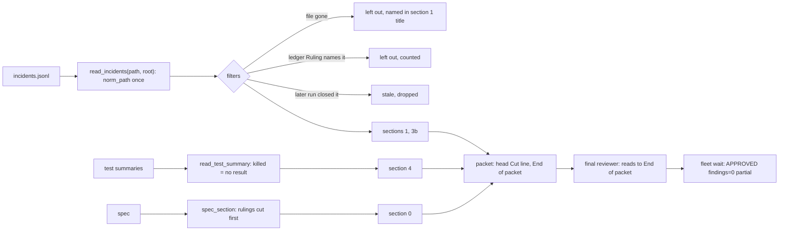
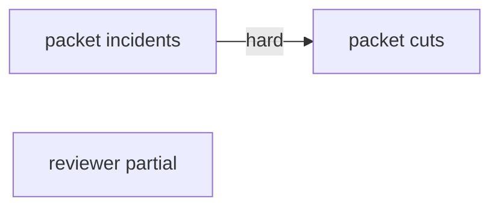

# Superlite: final-review packet cuts and stale incidents (B127)

**Goal:** fix #591 (packet --inline cuts the spec, diff stat and Review Focus silently; partial approvals) and #592 (the packet lists stale, outdated and killed-run incidents as open findings).
**Architecture:** `pt_review.py packet` filters incidents once at read time (paths resolved against the root, deleted files, ledger rulings, runs that closed them), reads a killed or result-less summary as "no result", cuts the spec's rulings before its text, never cuts the diff stat or Review Focus, names every cut in the packet head and on stdout, and ends the packet with an `End of packet (N lines)` line. `agents/final-reviewer.md` reads the whole packet and labels an approval that did not `partial`; `fleet wait` shows that label.
**Tech stack:** Python 3.10+ stdlib, pytest (through `sl run_tests`), Markdown.
**Spec:** this file, section Design; issues #591 and #592 (Expected lines).
**Detail:** contracts
**Target-min:** 11
**Wave0:** none
**Coverage:** off

Global constraints:
- Every Python code line keeps the file's trailing `# O(...)` complexity comment.
- Existing tests stay green. An existing test file changes only when the task Owns it. If another existing test turns red, report it in DONE_WITH_CONCERNS with the test id and the reason instead of editing it.
- Run `sl` as an executable (`<abs>/sl ...`). Verify with `<abs>/sl run_tests --fast <own test files> --task Tn --background`, then run the printed `wait:` line in the foreground and end the turn only after it reports.
- No version edits (the ship step bumps the version). Never run `scripts/evals.sh`, `claude plugin eval` or `scripts/test_layers.py run`.
- Packet texts below are exact; tests assert them verbatim.

Ruling: detail contracts, no probe adapter (packet tooling; Review Focus cases are named tests); the lead worktree is the run root, no `sl worktree ensure` (because the backlog lead already runs in its worktree; cost if wrong: none).
Ruling: T1 and T2 both edit pt_review.py, so T1 -->|hard| T2 orders them; T3 runs alongside (cost if wrong: about 3 min of wall time).
Ruling: the spec cap stays SPEC_CHARS (6000); its truncated markers name the spec file, so the reviewer reads it in full instead of reporting it unverified (because the reviewer has Read; cost if wrong: one Read per long spec).
Ruling: an incident is ruled when a `Ruling:` line of `.superlite/progress.md` names its `file:line` (line > 0) or, for a test failure, `file::test` (because the coordinator records rulings there; `sl incident resolve` already closes the rest; cost if wrong: a ruled item stays listed).
Ruling: a killed run is a summary whose `error` starts with `run_tests stopped by SIG` or `wall-clock limit: test run killed`; it counts no failure, and the newest run with a result is shown under it (cost if wrong: a killed full run reads as no result instead of red).
Ruling: a partial approval keeps the json status APPROVED; the reviewer writes `Verdict: APPROVED (partial: lines A-B not read)` and `fleet wait` appends ` partial` after `findings=N`; fleet_report.py, fleet_io.py and SDD fleet.md change for it (no open batch lists them).
LAYERS: unit, headless, evals



## Design

### 1. Incidents (T1, #592)
Paths are resolved once: `read_incidents(path, root)` rewrites each `file` with `norm_path`; `read_test_summary` and `stale_in_run` see summaries whose `files` keys and failure file parts went through `norm_path` (`norm_summary`). Then, before ranking: incidents on files no longer on disk are left out (section 1 title line `left out N incident(s) on files no longer on disk: a, b` with at most 5 names then `, +K more`); incidents a ledger ruling names are left out (title line `left out N incident(s) a ledger Ruling: names`); `stale_in_run` also closes a `no-result` entry, and a `test-failure` entry whose file is `-`, when a later run with a result exists (same `task` as the entry, or a full run; a `-` test failure also needs that run green). `claimed_fix_items` skips `test-failure` and `no-result` entries (runs decide them) and entries whose context names a changed file. `outdated_incidents` skips entries whose file is `-` or empty.

### 2. Test summary (T1, #592)
A summary with `error` has no result. `read_test_summary(path, root, changed, runs)`: killed (Ruling above): first row `- killed run, no result: <error, 200 chars>`; another error: `- run without a result: <error, 200 chars>` plus `- FAILING: <error, 200 chars>` and one failing test counted. Then, when `runs` holds a summary with a result (no `error`, passed+failed+skipped > 0), the first such one in `runs` order: `- newest run with a result:` and its usual rows, its failures counted. A summary without `error` reads as today.

### 3. Cuts (T2, #591)
Section 0: `spec_section` cuts ruling lines from the last one back, then the spec text from its end, with `(truncated: ...; read <abs spec> in full)` markers. Sections 0b and 0c get the same marker form with their file. The diff stat (section 6) and Review Focus (section 7) are never cut; over the size cap only section 8 shrinks, then the packet stays over the cap. Every cut becomes one note: printed as `cut: <note>` on stdout after the `wrote` line, and joined with `; ` into the head line `Cut to fit the size cap: <notes>`. The head's tool line matches the reviewer's tools, the packet's last line is `End of packet (N lines)` and the head names N.

### 4. Reviewer (T3, #591)
Exact texts in T3.

## File structure

- `skills/subagent-driven-development/scripts/pt_review.py`: incident filters, section 4 (T1); cuts, head, end line (T2)
- `tests/scripts/test_packet_incidents_592.py`: T1 tests
- `tests/scripts/test_packet_cuts_591.py`, `tests/scripts/test_packet_inline.py`: T2 tests
- `agents/final-reviewer.md`, `skills/subagent-driven-development/scripts/fleet_report.py`, `skills/subagent-driven-development/scripts/fleet_io.py`, `skills/subagent-driven-development/fleet.md`, `tests/scripts/test_final_reviewer_brief_564.py`, `tests/scripts/test_final_reviewer_partial_591.py`: T3

## Task graph




critical path: T1 → T2 (4.7 min) · peak width 2 · predicted build 4.7 min · predicted total ≈ 8.2 min (target ✓)

## Package: review packet

App type: CLI / file generator. Categories: file (paths, missing files), encoding (markers, exact lines), state (which summary and incident counts). **Probe entry:** none (one CLI over a run folder; cases are named tests).

### T1 packet drops stale, ruled and gone incidents · Complexity 5 · Est. context 55k
**Owns:** skills/subagent-driven-development/scripts/pt_review.py, tests/scripts/test_packet_incidents_592.py
**Components:** 2
**LOC owned:** 260
**Tests:** fast
**Model:** sonnet
**Est. time:** 4.0 min (2 components, about 260 LOC, fast tests)
**Covers:** 1, 2
**Consumes:** none
**Produces:** pt_review.norm_path(root: Path, file: str) -> str · pt_review.ledger_rulings(path: Path) -> list[str] · pt_review.ruled(entry: dict, rulings: list[str]) -> bool · pt_review.on_disk(root: Path, file: str) -> bool · pt_review.killed(summary: dict) -> bool
e.g. norm_path(root, f"{root}/pkg/tests/test_a.py") -> "pkg/tests/test_a.py"; norm_path(root, "pkg/pkg/tests/test_a.py") -> "pkg/tests/test_a.py" when only root/pkg/tests/test_a.py exists; norm_path(root, "-") -> "-"; norm_path(root, "./a.py") -> "a.py"
e.g. ruled({"file": "a.py", "line": 3, "kind": "exception"}, ["a.py:3 is out of plan"]) -> True; ruled({"file": "a.py", "line": 3}, ["a.py:30 waits"]) -> False; ruled({"file": "tests/t.py", "line": 0, "kind": "test-failure", "context": "tests/t.py::test_x: boom"}, ["tests/t.py::test_x fails on main too"]) -> True
e.g. killed({"error": "run_tests stopped by SIGTERM; its test processes were killed"}) -> True; killed({"error": "no test command found: ..."}) -> False; killed({"passed": 3}) -> False
**Review Focus:** file: `test_doubled_package_path_resolved_once`, `test_incident_on_deleted_file_left_out_and_named`; state: `test_no_result_closed_by_later_task_run`, `test_dash_failure_closed_by_later_green_task_run`, `test_ledger_ruling_leaves_incident_out`, `test_run_tests_close_is_no_claimed_fix`, `test_claim_naming_changed_file_is_no_claimed_fix`; encoding: `test_dash_entry_never_outdated`, `test_killed_run_shows_no_result`, `test_error_summary_shows_newest_result_run`.
**Test code:** new file tests/scripts/test_packet_incidents_592.py (build a git repo in tmp_path as tests/scripts/test_packet_outdated_366.py does; run `pt_review.py packet --plan <plan> --root <repo> --out <repo>/packet.md --wait-timeout 1 --base <sha>`; epochs: entry NOW-100, later summary `started` NOW-50):
- `test_norm_path_values`: the four norm_path e.g. lines.
- `test_doubled_package_path_resolved_once`: incident file `pkg/pkg/src/a.py` line 2 (kind exception, agent package-reviewer, unresolved), only `pkg/src/a.py` on disk -> section 1 has `pkg/src/a.py:2` and no `pkg/pkg/`.
- `test_incident_on_deleted_file_left_out_and_named`: unresolved exception at `tests/test_tmp.py:4`, file absent -> section 1 holds `left out 1 incident(s) on files no longer on disk: tests/test_tmp.py` and no `### [` item for it; the head reads `FAST PATH` when nothing else is open.
- `test_ledger_ruling_leaves_incident_out`: unresolved exception at `a.py:3`; `.superlite/progress.md` holds `- Ruling: a.py:3 is out of plan - pre-existing - none` -> `left out 1 incident(s) a ledger Ruling: names` and no `a.py:3` item; the same with `a.py:30` in the ruling keeps the item.
- `test_no_result_closed_by_later_task_run`: entry `{"file": "-", "line": 0, "kind": "no-result", "agent": "run_tests", "task": "T1", "resolution": "open", "context": "no tests ran: x", "epoch": NOW-100}`, summary `test-summary-a1.json` `{"passed": 4, "failed": 0, "skipped": 0, "mode": "fast", "task": "T1", "started": NOW-50, "failures": [], "files": {"tests/test_m.py": [4, 0]}}` -> no `-:0` item; with `"task": "T2"` and mode fast the item stays; with no task and mode full it goes.
- `test_dash_failure_closed_by_later_green_task_run`: kind test-failure, file `-`, task T1, same later T1 summary green -> no `-:0` item; that summary with `"failed": 1` keeps it.
- `test_dash_entry_never_outdated`: run_tests test-failure at `-:0`, base given, a changed file -> section 4 has no `OUTDATED incident: -:0`.
- `test_run_tests_close_is_no_claimed_fix`: `tests/test_m.py:0` test-failure open (agent run_tests, epoch NOW-100), then the same location `resolution: fixed`, context `fixed: passed on a later run`, test file unchanged since base -> no `claimed fixed by` text.
- `test_claim_naming_changed_file_is_no_claimed_fix`: exception at `a.py:3` fixed by package-reviewer, context `fixed in b.py: moved the guard`, `b.py` changed since base, `a.py` not -> no `claimed fixed by`; context `fixed` alone keeps `a.py:3  claimed fixed by package-reviewer, file unchanged since base`.
- `test_killed_run_shows_no_result`: test-summary.json `{"passed": 0, "failed": 1, "skipped": 0, "mode": "fast", "error": "run_tests stopped by SIGTERM; its test processes were killed", "failures": ["run_tests stopped by SIGTERM; its test processes were killed"], "files": {}}` and no other summary -> section 4 starts `- killed run, no result: run_tests stopped by SIGTERM`, has no `FAILING`, head `FAST PATH`.
- `test_error_summary_shows_newest_result_run`: test-summary.json holds the `no test command found: add ...` error summary; `test-summary-b2.json` (mtime older) holds `{"passed": 5, "failed": 1, "mode": "full", "failures": ["tests/test_m.py::test_y: boom"], "files": {"tests/test_m.py": [5, 1]}, "started": NOW-50}` -> section 4 has `- run without a result: no test command found`, `- newest run with a result:`, `- FAILING: tests/test_m.py::test_y: boom`, and the head counts `failing tests 2`.
- `test_ruled_and_killed_values`: the ruled and killed e.g. lines.
**Steps:** 1 failing tests, 2 run: FAIL, 3 implement (Design 1 and 2; `cmd_packet` passes `root` to read_incidents, `--ledger` flag default `<root>/.superlite/progress.md`, runs to read_test_summary), 4 run: PASS, then the existing tests/scripts/test_packet_*.py and test_pt_review*.py: PASS.
**Notes:** `on_disk(root, f)`: True for `-` and empty; else root/f or root/src/f is a file. A ruling matches `file:line` only when no digit follows. Section 1 title lines go under the existing `dropped`/`moved` lines.

### T2 packet names every cut, never cuts focus or stat · Complexity 5 · Est. context 55k
**Owns:** skills/subagent-driven-development/scripts/pt_review.py, tests/scripts/test_packet_cuts_591.py, tests/scripts/test_packet_inline.py
**Components:** 2
**LOC owned:** 230
**Tests:** fast
**Model:** sonnet
**Est. time:** 3.8 min (2 components, about 230 LOC, fast tests)
**Covers:** 3
**Consumes:** none
**Produces:** pt_review.spec_section(plan: Plan, spec: Path, limit: int = SPEC_CHARS) -> tuple[str, list[str]]
e.g. spec_section(<spec of 2000 chars, no Ruling lines>, Path("/r/spec.md")) -> (<the spec text>, [])
e.g. spec_section(<1000-char body, 100 lines `- Ruling: rN ...` of 80 chars, then `## Reviewer notes` and `PREAMBLE-LINE`>, Path("/r/spec.md"), 6000) -> (text holding the body, `- Ruling: r1`, `PREAMBLE-LINE`, one line `(truncated: K of 100 ruling lines cut at the spec cap; read /r/spec.md in full)` where the first cut ruling stood, no `- Ruling: r100`; ["section 0: K of 100 ruling lines cut (read /r/spec.md in full)"])
e.g. spec_section(<20000-char body, no rulings>, Path("/r/spec.md"), 6000) -> (text of at most 6000 chars ending `(truncated: spec cut at 6000 of 20000 characters; read /r/spec.md in full)`, ["section 0: spec cut at 6000 of 20000 characters (read /r/spec.md in full)"])
**Review Focus:** encoding: `test_head_tool_line_matches_reviewer`, `test_end_of_packet_line_counts_lines`; file: `test_cut_notes_on_stdout_and_head`, `test_left_out_files_named_in_head`; state: `test_focus_and_stat_never_cut`, `test_over_cap_shrinks_section_8_only`.
**Test code:** new file tests/scripts/test_packet_cuts_591.py (inline repo fixture as tests/scripts/test_packet_inline.py; exact texts):
- `test_spec_section_values`: the three e.g. lines (K is any integer 1..100; the returned text is at most 6000 chars).
- `test_rulings_cut_before_spec_text`: inline packet over that 100-ruling spec -> section 0 holds `PREAMBLE-LINE` and the marker; stdout holds `cut: section 0: ` and ` ruling lines cut (read <abs spec> in full)`.
- `test_head_tool_line_matches_reviewer`: line 3 of the packet is exactly `Answer in one turn: a verdict, then findings as \`file:line - problem - fix\`. Read the whole packet first; beyond it, Read only a file a \`read <path> in full\` marker or the Cut line names, the Render evidence images and what your brief names. Anything marked unverified is judged from its excerpt or listed as a finding.`; the packet holds no `no tools`.
- `test_end_of_packet_line_counts_lines`: the last line is `End of packet (N lines)` with N == len(text.splitlines()); the head holds `This packet has N lines and ends with \`End of packet (N lines)\`; when one Read stops early, Read on with an offset. An APPROVED that leaves lines unread is \`Verdict: APPROVED (partial: lines A-B not read)\`.`
- `test_focus_and_stat_never_cut`: a spec whose Review Focus has 40 items `- RF-ITEM-n` of 120 chars and 300 changed files, run with `--max-tokens 2000` -> `- RF-ITEM-40` in section 7 and the last changed file's row in section 6; stdout holds `packet over the size cap by ` when the text is longer than the cap.
- `test_over_cap_shrinks_section_8_only`: 8 files of 400 changed lines with `--max-tokens 3000` -> sections 6 and 7 complete, section 8 starts with its `Left out: ` line, no `(packet truncated at the size cap)` anywhere.
- `test_cut_notes_on_stdout_and_head`: `--previous` file of 9000 chars -> section 0b ends `(truncated: earlier rounds cut at 4000 of 9000 characters; read <abs prev> in full)`; stdout has `cut: section 0b: earlier rounds cut at 4000 of 9000 characters (read <abs prev> in full)`; the head has a line starting `Cut to fit the size cap: ` holding that note.
- `test_left_out_files_named_in_head`: a packet whose section 8 has `Left out: src/f7.py` -> the head's Cut line holds `section 8 left out: src/f7.py`, stdout `cut: section 8 left out: src/f7.py`; an uncut packet has no `Cut to fit` line and no `cut:` stdout line.
In tests/scripts/test_packet_inline.py change only line 120's `"(truncated)" in prev` to `"(truncated: earlier rounds cut at 4000 of" in prev`.
**Steps:** 1 failing tests, 2 run: FAIL, 3 implement (Design 3), 4 run: PASS, then the existing tests/scripts/test_packet_*.py, test_adapter_and_packet.py, test_0_3_1_scripts.py and test_pt_review*.py: PASS.
**Notes:** Ruling lines match `^\s*(?:[-*+]\s+|\d+[.)]\s+)?(?:\*\*)?Ruling\b[^:\n]{0,40}:`. Notes: `section 0: ...`, `section 0b: earlier rounds cut at A of B characters (read P in full)`, `section 0c: coverage cut at A of B characters (read <abs plan> in full)`, `sections 1-3: N lower-ranked item(s) omitted`, `section 5: N seam calls, some omitted`, `section 8 left out: a, b`, `section 8 truncated: <file>` per `(truncated: ...; read <file> in full)` line of section 8. The fast-path head line becomes `Nothing is open: no open incidents, probe failures, unverified categories, contract mismatches or failing tests. Reply with a short APPROVED once you read it all.` N is computed after assembly (the N lines do not change the count).

### T3 reviewer reads the whole packet; partial approvals · Complexity 3 · Est. context 40k
**Owns:** agents/final-reviewer.md, skills/subagent-driven-development/scripts/fleet_report.py, skills/subagent-driven-development/scripts/fleet_io.py, skills/subagent-driven-development/fleet.md, tests/scripts/test_final_reviewer_brief_564.py, tests/scripts/test_final_reviewer_partial_591.py
**Components:** 2
**LOC owned:** 90
**Tests:** fast
**Model:** sonnet
**Est. time:** 2.5 min (2 components, about 90 LOC, fast tests)
**Covers:** 4
**Consumes:** none
**Produces:** fleet_report.partial(text: str) -> bool
e.g. partial("Verdict: APPROVED (partial: lines 685-1212 not read)\nChecked: ...") -> True; partial("Verdict: APPROVED\nChecked: head: read") -> False; partial("**Verdict:** APPROVED (partial: lines 9-20 not read)") -> True
**Review Focus:** protocol: `test_wait_line_appends_partial`, `test_plain_approval_has_no_partial`; encoding: `test_reviewer_texts_exact`.
**Test code:** new file tests/scripts/test_final_reviewer_partial_591.py:
- `test_partial_values`: the three e.g. lines; `parse` of the first still gives status APPROVED.
- `test_wait_line_appends_partial`: fleet_io._finish on a one-turn worker whose text is the first e.g. reply plus a json block `{"status": "APPROVED", "files": [], "tests": "", "findings": [], "summary": "x"}` prints a line holding `APPROVED findings=0 partial ` (patch `_stop_worker`, `_ready`, `pane_label`, `pane_title` as tests/scripts/test_fleet_wait_report_b91.py does).
- `test_plain_approval_has_no_partial`: the same without `(partial: ...)` -> no ` partial`.
- `test_reviewer_texts_exact`: agents/final-reviewer.md holds READ, PARTIAL and VERDICT_LINE below as whole lines; `"no tools"` not in it.
Edit tests/scripts/test_final_reviewer_brief_564.py: `R_BRIEF` becomes the new brief line below; `test_brief_rule_follows_the_read_paragraph` finds the line starting ``Read `.superlite/review-packet.md` whole``.
**Steps:** 1 failing tests, 2 run: FAIL, 3 implement, 4 run: PASS, then tests/scripts/test_docs_b67_review_finish.py, test_packet_render_490.py, test_packet_inline.py, test_adapter_and_packet.py, test_fleet_report.py, test_fleet_wait_report_b91.py: PASS.
**Notes:** agents/final-reviewer.md: replace the line starting ``Read `.superlite/review-packet.md` once`` with READ:
``Read `.superlite/review-packet.md` whole, to its last line `End of packet (N lines)`: when one Read stops early, Read on with an offset; nothing else. Exceptions: what your brief names (first rule below), a file the packet marks `(truncated: ...; read <path> in full)` you may read in full, one Read per such file, to judge what the excerpt cut, a file the head's `Cut to fit the size cap:` line names as left out of section 8, one Read each (the file as it is now, not its diff), and every image the packet lists under `## Render evidence`, one Read each, also on the fast path, each with a `Checked:` line. Answer in one turn: no other searches or reads. The packet holds open incidents, probe failures, categories with no `verified` entry, contract mismatches, the test summary, cross-package seams, code excerpts, the diff stat and the plan's Review Focus. An inline build's packet adds the spec (section 0); a later round adds the earlier findings and their fixes (section 0b). Judge from it.``
The brief line (two lines below) becomes:
``- Your brief (the message, or the brief file sent as your packet) may name files to read or a search to run: read each named file, one Read each, and run each named search with Grep or Glob, also on the fast path, each with a `Checked:` line. A brief that names them overrides `nothing else` for exactly those; never answer that your role forbids them.``
Insert PARTIAL right after the `- Fast path:` line:
``- Partial: an approval that did not read every packet line up to `End of packet` starts `Verdict: APPROVED (partial: lines A-B not read)` and lists those lines in a `Checked:` line as `unverified`; never a plain `Verdict: APPROVED` then.``
VERDICT_LINE replaces the line ``Verdict: APPROVED` or `Verdict: CHANGES_REQUESTED``` (keep `starting directly with:` on the line above):
``Verdict: APPROVED`, `Verdict: APPROVED (partial: lines A-B not read)` or `Verdict: CHANGES_REQUESTED``
fleet_report: `PARTIAL = re.compile(r"^\s*\**Verdict:\**\s*APPROVED\s*\(partial\b", re.M | re.I)`; `partial(text)` searches it; `parse` output keys stay as they are. fleet_io `_finish`: append `" partial"` after the concerns part when `rep["status"] == "APPROVED" and fleet_report.partial(text)`; its docstring names ` partial`. SDD fleet.md: insert after the `  - \`BLOCKED\`: treat the task as BLOCKED.` line:
``  - ` partial` (a final reviewer's APPROVED that left packet lines unread): no approval; start a fresh final reviewer for the round.``

## Review Focus

Package review packet (CLI / file generator): file, encoding, state; each case is a named test in T1, T2 or T3. Risks: an incident dropped that is still open (a ruling or path match too loose), a packet that grows past what one Read shows, a pinned old text in another test.

## Self-review

Coverage: #591 expected items map to T2 (rulings before spec, never cut focus/stat, stdout and head names cuts, tool line) and T3 (partial verdict); #592 items to T1. No placeholders; no Consumes; T1 and T2 share pt_review.py and are ordered by the hard edge.
