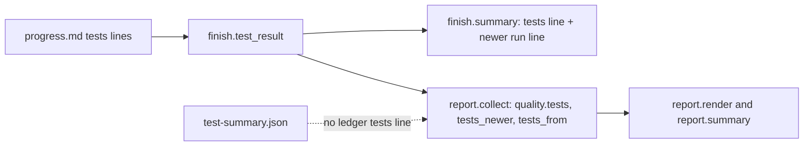
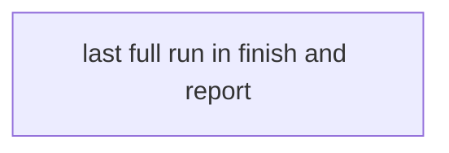

# Superlite: finish and the build report take the run's last full run (B100)

**Goal:** fix #498: `sl finish` and the build report take the run's last full test run as its result and name a newer fast run beside it, instead of the newest test summary (a one-suite rerun made to classify a flake showed as `tests (fast): 12 passed, 0 failed` while the last `run_tests --full` was `5777 passed, 4 failed`). Also B96's follow-up: finish's checkpoint note names `sl autocommit apply --trailer "Key: value"` (repeatable) instead of "no trailer".
**Architecture:** one helper in `finish.py`, `test_result(ledger)`, reads the progress ledger's `tests` lines (append-only, one per run_tests run, recorded runs too) and returns the last full one, the newest run after it and their count. `finish.summary` prints from it; `report.collect` (which already imports finish) uses it on `<dir>/progress.md` and falls back to `test-summary.json` only when the ledger holds no `tests` line. One task.
**Tech stack:** Python 3.10+ stdlib, pytest (through `sl run_tests`).
**Spec:** this file, section Design; issue #498 Expected line.
**Detail:** tests
**Target-min:** 11
**Wave0:** none

Global constraints:
- Every code line in the scripts keeps the file's trailing `# O(...)` complexity comment.
- Existing tests stay green. An existing test file changes only when the task Owns it. If another existing test turns red, report it in DONE_WITH_CONCERNS with the test id and the reason instead of editing it.
- Run `sl` as an executable (`<abs>/sl ...`). Verify with `<abs>/sl run_tests --fast <own test files> --task Tn --background`, then run the printed `wait:` line in the foreground and end the turn only after it reports.
- No version edits (the ship step bumps the version). Never run `scripts/evals.sh`, `claude plugin eval` or `scripts/test_layers.py run`.

Ruling: the ledger's `tests` lines are the one source for both finish and the build report (because test-summary.json is overwritten by every foreground run, while the ledger keeps every run in order) - cost if wrong: a ledger edited by hand changes the reported result.
Ruling: the run's result is the last `tests full` line (a `recorded` one too; `run_tests --full --task Tn` lines count, they ran the whole suite), else the newest line; a newer run is any line after it, the newest one named, the count shown when over one - cost if wrong: a task-tree full run counts as the run's result.
Ruling: the report labels a ledger result that is not a full run `(<mode> run; no full run)`; a test-summary.json fallback gets no label (the run's history is unknown there) - cost if wrong: one unlabelled fallback line.
Ruling: report.py and docs/tools.md (finish row) are edited outside B100's file list; no open batch lists them - cost if wrong: a rebase conflict.
Ruling: detail tests; no probe adapter (text output; Review Focus cases are named pytest cases); already in the lead worktree, so no `sl worktree ensure`; layers: unit only (scripts and tests/scripts; docs/tools.md needs none) - cost if wrong: one NEEDS_CONTEXT round.
LAYERS: unit



## Design

### 1. The helper (T1)
`finish.test_result(ledger) -> tuple[dict | None, dict | None, int]`: parse every line of the ledger with the existing `TESTS` regex, in order, into `{"mode": str, "passed": int, "failed": int, "skipped": int, "seconds": float, "recorded": bool}`. The result is the last line whose mode is `full`, else the last line; the newer run is the last line after the result (None when the result is the last line), and the int counts the lines after the result. A missing or unreadable ledger, or one without a `tests` line, gives `(None, None, 0)`. `read_ledger` stays as it is.

### 2. finish output (T1)
`summary()` prints, in place of today's newest-line `tests (...)` line: `tests (<mode>[, recorded]): P passed, F failed, S skipped in <seconds:.1f>s` from the result; then, when a newer run exists, `- newer <mode> run (not the run's result): P passed, F failed, S skipped in <seconds:.1f>s` (count 1) or `- N newer <mode> runs (not the run's result), newest: P passed, ...` (count N > 1; `<mode>` is the newest one's). No `tests` line: `tests: none recorded` as today. Module docstring: "the last test counts" becomes the run's result as above (#498).
Line 346: `to commit: \`sl autocommit apply\` (one commit per task, same titles; add \`--trailer "Key: value"\`, repeatable, for each attribution line your harness requires) or \`git add -A && git commit\``.

### 3. Build report (T1)
`report.collect`: `res, newer, _ = finish.test_result(sl / "progress.md")`; `quality.tests` = `res` when it is not None, else the `test-summary.json` dict as today; `quality.tests_newer` = `newer` (always present, None when none); `quality.tests_from` = `"progress.md"`, `"test-summary.json"` or None. One text helper used by `render` and `summary`: `tests P passed, F failed`, then ` (last full run; newer <mode> run: P passed, F failed)` when `tests_newer` is set, else ` (<mode> run; no full run)` when `tests_from` is `progress.md` and the mode is not `full`; a missing dict keeps today's `tests n/a (no test-summary.json)` (render) and `tests n/a` (summary). A saved report without these keys (`--show` of an older build) renders as today (`.get`). Module docstring: "Actual: ... test-summary.json" names the ledger's last full run first.

### 4. Docs (T1)
`docs/tools.md` `finish` row: "(rulings, commits or checkpoints, test counts, open incidents)" becomes "(rulings, commits or checkpoints, the run's test result: the ledger's last `tests full` line, recorded ones too, else the newest, with a newer run named beside it as `- newer fast run (not the run's result): ...` (#498); the build report takes the same result as `quality.tests`, the newer run as `quality.tests_newer`, open incidents)".

## Coverage

| Category | State | Basis |
|---|---|---|
| Scope and success criteria | settled | #498 Expected line; B96 follow-up text |
| Domain and data model | ruled | ledger `tests` lines; report json gains tests_newer, tests_from |
| Persistence and migration | settled | old saved reports render as before |
| Interfaces and contracts | ruled | new finish.test_result; read_ledger unchanged |
| UI states | settled | one extra finish line only when a newer run exists |
| Concurrency and state ownership | n/a | read-only |
| Error handling and recovery | settled | missing ledger: (None, None, 0), fallback to test-summary.json |
| Security and privacy | n/a | none |
| Performance and limits | settled | one more ledger read, O(R*w) |
| Observability | settled | this is the observability fix |
| Testing strategy | settled | new tests/scripts/test_finish_last_full_498.py |
| Compatibility | settled | existing finish and report pins keep their text |
| Rollout | ruled | one PR; version bump at ship |
| Research unknowns | n/a | none |

## File structure
- `skills/subagent-driven-development/scripts/finish.py`: `test_result`, the tests lines, the checkpoint note text (T1).
- `skills/subagent-driven-development/scripts/report.py`: quality.tests from the ledger, the newer run in the text (T1).
- `tests/scripts/test_finish_last_full_498.py`: new tests (T1).
- `docs/tools.md`: finish row (T1).

## Task graph

```mermaid
%% schedule
gantt
  title Predicted schedule (mm:ss)
  dateFormat X
  axisFormat %M:%S
  section lane 1
  T1 last full run in finish and report :t1, 0, 130s
```




critical path: T1 (2.2 min) · peak width 1 · predicted build 2.2 min · predicted total ≈ 5.7 min (target ✓)

## Package: finish and report
App type: CLI text output over run files. Categories: state (which ledger line is the result), encoding (labels and number formats), file (missing ledger, fallback). Specific risks: a recorded full line losing its `recorded` label; an older saved report crashing `--show`; the report labelling a test-summary.json fallback it cannot judge.
**Probe entry:** none (Ruling: no probe adapter).

### T1 last full run in finish and report · Complexity 3 · Est. context 36k
**Owns:** skills/subagent-driven-development/scripts/finish.py, skills/subagent-driven-development/scripts/report.py, tests/scripts/test_finish_last_full_498.py, docs/tools.md
**Components:** 2
**LOC owned:** 170
**Tests:** fast
**Model:** sonnet
**Est. time:** 3 min (2 components, about 170 LOC, fast tests)
**Covers:** 1, 2, 3, 4
**Consumes:** none
**Produces:** finish.test_result(ledger: str | Path) -> tuple[dict | None, dict | None, int]
e.g. finish.test_result(p) with lines full 5777/4/2 812.3, fast 12/0/0 1.2 -> ({"mode": "full", "passed": 5777, "failed": 4, "skipped": 2, "seconds": 812.3, "recorded": False}, {"mode": "fast", "passed": 12, "failed": 0, "skipped": 0, "seconds": 1.2, "recorded": False}, 1)
e.g. finish.test_result(p) with lines fast 12/0/0, full 5777/4/2 -> ({"mode": "full", ...}, None, 0)
e.g. finish.test_result(missing_path) -> (None, None, 0)
**Review Focus:** state: `test_test_result_last_full_wins_and_names_newer_fast`, `test_test_result_counts_every_newer_run_and_keeps_the_newest`, `test_test_result_recorded_full_counts_as_full`, `test_test_result_without_full_run_is_the_newest_line`; file: `test_test_result_none_and_missing`, `test_report_fast_only_says_so_and_falls_back_without_ledger_lines`, `test_report_renders_an_old_saved_report_without_tests_newer`; encoding: `test_finish_recorded_and_fast_only_keep_their_labels`, `test_checkpoint_note_names_the_trailer_flag`.
**Test code (verbatim):** new file tests/scripts/test_finish_last_full_498.py:
```python
"""finish and the build report take the run's last full run as its test result and name a newer run beside it (#498);
finish's checkpoint note names `sl autocommit apply --trailer` (B96 follow-up)."""
import json
import sys

from test_plan_tools import SCRIPTS, run
from test_report import fixture, go

sys.path.insert(0, str(SCRIPTS))
import finish  # noqa: E402
import report  # noqa: E402

FULL = "- tests full passed=5777 failed=4 skipped=2 seconds=812.3"
FAST = "- tests fast passed=12 failed=0 skipped=0 seconds=1.2"
FAST2 = "- tests fast passed=3 failed=1 skipped=0 seconds=0.8"
REC = "- tests full passed=1333 failed=0 skipped=0 seconds=900 recorded"


def ledger(tmp_path, *lines):
    sl = tmp_path / ".superlite"
    sl.mkdir(exist_ok=True)
    p = sl / "progress.md"
    p.write_text("# Progress ledger\n- start abc1234\n" + "".join(x + "\n" for x in lines), encoding="utf-8")
    return p


def finish_out(tmp_path, p):
    cp = run(SCRIPTS / "finish.py", "--ledger", p, "--log", p.with_name("incidents.jsonl"), cwd=tmp_path)
    assert cp.returncode == 0, cp.both
    return cp.out


def test_test_result_last_full_wins_and_names_newer_fast(tmp_path):
    res, newer, n = finish.test_result(ledger(tmp_path, FAST2, FULL, FAST))
    assert res == {"mode": "full", "passed": 5777, "failed": 4, "skipped": 2, "seconds": 812.3, "recorded": False}
    assert newer == {"mode": "fast", "passed": 12, "failed": 0, "skipped": 0, "seconds": 1.2, "recorded": False} and n == 1


def test_test_result_counts_every_newer_run_and_keeps_the_newest(tmp_path):
    res, newer, n = finish.test_result(ledger(tmp_path, FULL, FAST2, FAST))
    assert res["passed"] == 5777 and newer["passed"] == 12 and n == 2


def test_test_result_full_newest_has_no_newer(tmp_path):
    res, newer, n = finish.test_result(ledger(tmp_path, FAST, FULL))
    assert res["mode"] == "full" and res["passed"] == 5777 and newer is None and n == 0


def test_test_result_recorded_full_counts_as_full(tmp_path):
    res, newer, n = finish.test_result(ledger(tmp_path, FULL, REC, FAST))
    assert res == {"mode": "full", "passed": 1333, "failed": 0, "skipped": 0, "seconds": 900.0, "recorded": True}
    assert newer["passed"] == 12 and n == 1


def test_test_result_without_full_run_is_the_newest_line(tmp_path):
    res, newer, n = finish.test_result(ledger(tmp_path, FAST, FAST2))
    assert res["mode"] == "fast" and res["passed"] == 3 and newer is None and n == 0


def test_test_result_none_and_missing(tmp_path):
    assert finish.test_result(ledger(tmp_path)) == (None, None, 0)
    assert finish.test_result(tmp_path / "nope" / "progress.md") == (None, None, 0)


def test_finish_prints_the_full_run_and_the_newer_fast_run(tmp_path):
    lines = finish_out(tmp_path, ledger(tmp_path, FULL, FAST)).splitlines()
    i = lines.index("tests (full): 5777 passed, 4 failed, 2 skipped in 812.3s")
    assert lines[i + 1] == "- newer fast run (not the run's result): 12 passed, 0 failed, 0 skipped in 1.2s"
    assert not any(x.startswith("tests (fast)") for x in lines)


def test_finish_counts_several_newer_runs(tmp_path):
    out = finish_out(tmp_path, ledger(tmp_path, FULL, FAST2, FAST))
    assert "- 2 newer fast runs (not the run's result), newest: 12 passed, 0 failed, 0 skipped in 1.2s" in out.splitlines()


def test_finish_full_newest_prints_one_line(tmp_path):
    out = finish_out(tmp_path, ledger(tmp_path, FAST, FULL))
    assert "tests (full): 5777 passed, 4 failed, 2 skipped in 812.3s" in out.splitlines() and "newer fast run" not in out


def test_finish_recorded_and_fast_only_keep_their_labels(tmp_path):
    assert "tests (full, recorded): 1333 passed, 0 failed, 0 skipped in 900.0s" in finish_out(tmp_path, ledger(tmp_path, REC)).splitlines()
    assert "tests (fast): 3 passed, 1 failed, 0 skipped in 0.8s" in finish_out(tmp_path, ledger(tmp_path, FAST, FAST2)).splitlines()
    assert "tests: none recorded" in finish_out(tmp_path, ledger(tmp_path)).splitlines()


def test_checkpoint_note_names_the_trailer_flag(tmp_path, monkeypatch):
    import autocommit
    p = ledger(tmp_path)
    (p.parent / "checkpoints.json").write_text(json.dumps({"run": "r1", "entries": [{"title": "T1 x", "files": ["a.py"]}]}), encoding="utf-8")
    monkeypatch.setattr(autocommit, "is_on", lambda *a, **k: False)
    text = "\n".join(finish.checkpoint_note(p))
    assert "no trailer" not in text
    assert ('`sl autocommit apply` (one commit per task, same titles; add `--trailer "Key: value"`, repeatable, '
            "for each attribution line your harness requires)") in text


def test_report_takes_the_last_full_run_and_names_the_newer_fast_run(tmp_path):
    p = fixture(tmp_path)
    sl = tmp_path / ".superlite"
    ledger(tmp_path, FULL, FAST)
    (sl / "test-summary.json").write_text(json.dumps({"passed": 12, "failed": 0, "skipped": 0, "mode": "fast"}), encoding="utf-8")
    c = json.loads(go(tmp_path, p, "--json"))
    assert c["quality"]["tests"]["passed"] == 5777 and c["quality"]["tests"]["failed"] == 4
    assert c["quality"]["tests_newer"]["passed"] == 12 and c["quality"]["tests_from"] == "progress.md"
    want = "tests 5777 passed, 4 failed (last full run; newer fast run: 12 passed, 0 failed)"
    assert want + "; first-time pass" in go(tmp_path, p)
    assert "quality: " + want + "; first-time pass" in go(tmp_path, p, "--full")


def test_report_fast_only_says_so_and_falls_back_without_ledger_lines(tmp_path):
    p = fixture(tmp_path)
    sl = tmp_path / ".superlite"
    ledger(tmp_path, FAST)
    assert "tests 12 passed, 0 failed (fast run; no full run); first-time pass" in go(tmp_path, p)
    ledger(tmp_path)
    (sl / "test-summary.json").write_text(json.dumps({"passed": 9, "failed": 1, "skipped": 0, "mode": "fast"}), encoding="utf-8")
    c = json.loads(go(tmp_path, p, "--json"))
    assert c["quality"]["tests"]["failed"] == 1 and c["quality"]["tests_newer"] is None and c["quality"]["tests_from"] == "test-summary.json"
    assert "tests 9 passed, 1 failed; first-time pass" in go(tmp_path, p)


def test_report_renders_an_old_saved_report_without_tests_newer(tmp_path):
    p = fixture(tmp_path)
    c = json.loads(go(tmp_path, p, "--json"))
    for k in ("tests_newer", "tests_from"):
        c["quality"].pop(k, None)
    c["quality"]["tests"] = {"passed": 9, "failed": 1}
    assert "tests 9 passed, 1 failed;" in report.render(c) and "tests 9 passed, 1 failed;" in report.summary(c, "x.md")
```
**Steps:** 1 add the test file, 2 run: FAIL, 3 implement sections 1-4, 4 run: PASS (also tests/scripts/test_report.py, test_finish_packet_bulk_416.py, test_run_scripts.py and test_run_tests_record.py stay green).
**Notes:** `seconds` prints with `:.1f` (a recorded `seconds=900` line shows `900.0s`). The report's `--json` output must always carry `tests_newer` and `tests_from` keys.
