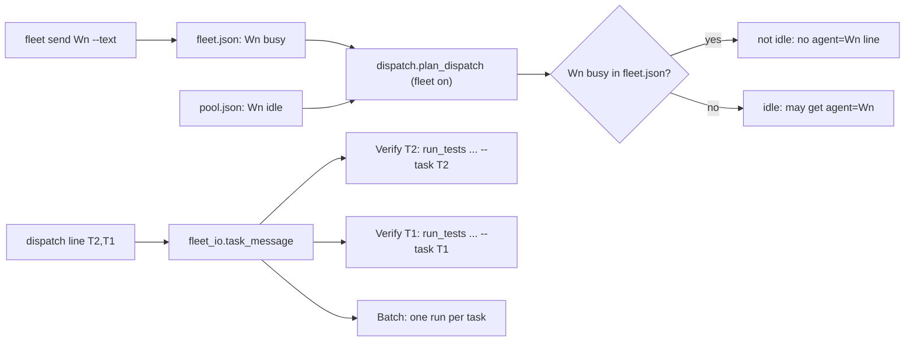
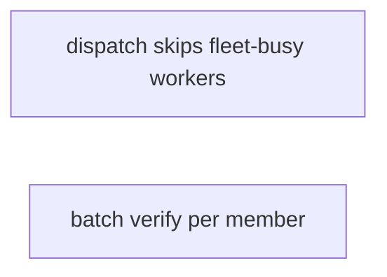

# Superlite: dispatch skips fleet-busy workers, batched workers verify per member (B113)

**Goal:** fix #553 (a worker answering a `fleet send --text` is busy in fleet.json but idle in pool.json, so the next `fleet spawn --for-dispatch` gives it a new task) and #556 (a batched worker's single `run_tests --fast <all members' tests> --task <first member>` runs in the first member's tree, without the other member's files). Max's decision for #556: the task message tells the worker to run each member with its own `--task`.
**Architecture:** `dispatch.plan_dispatch` leaves every worker that fleet.json marks `busy` out of its idle agents while fleet mode is on, in memory only (pool.json is not written), so `dispatch`, `commit_task --dispatch` and `fleet spawn --for-dispatch` never offer it. `fleet_io.task_message` gives a batch one `Verify Tn:` line per member (each with that member's own test paths and `--task Tn`) plus one `Batch:` line; a single-task message stays byte-identical.
**Tech stack:** Python 3.10+ stdlib, pytest (through `sl run_tests`), Markdown docs.
**Spec:** this file, section Design; issues #553 and #556 (Expected lines).
**Detail:** tests
**Target-min:** 11
**Wave0:** none
**Coverage:** off

Global constraints:
- Every Python code line keeps the file's trailing `# O(...)` complexity comment.
- Existing tests stay green. An existing test file changes only when the task Owns it. If another existing test turns red, report it in DONE_WITH_CONCERNS with the test id and the reason instead of editing it.
- Run `sl` as an executable (`<abs>/sl ...`). Verify with `<abs>/sl run_tests --fast <own test files> --task Tn --background`, then run the printed `wait:` line in the foreground and end the turn only after it reports.
- No version edits (the ship step bumps the version). Never run `scripts/evals.sh`, `claude plugin eval` or `scripts/test_layers.py run`.

Ruling: #553 is fixed in dispatch (the issue's "dispatch skips fleet-busy workers"), not by marking the pool busy in `send_text` (because pool.sync clears `busy` at the worker's next stop, so a pool mark would let dispatch hand a new task to a worker whose `--text` answer the coordinator has not collected with `fleet wait`; fleet.json `busy` lasts until `fleet wait` reports; cost if wrong: one extra fresh worker while a busy one finishes).
Ruling: the exclusion lives in `dispatch.plan_dispatch`, in memory, so every dispatch path in fleet mode gets it and pool.json never carries a mark that could outlive the answer; B113 therefore also edits dispatch.py, fleet_io.py, docs/fleet.md and tests (no open batch lists them; notes.md names them); fleet.py gets only its docstring line.
Ruling: a fleet-busy worker left out of the idle agents is never evicted in that round (eviction only judges idle agents), as for any busy pool agent.
Ruling: no probe adapter (pure functions over files; Review Focus cases are named tests); detail tests; already in the lead worktree, no `sl worktree ensure`; T1 and T2 share no file and no edge; layers unit only (the change touches no headless, TUI or eval path; cost if wrong: one rerun).
LAYERS: unit



## Design

### 1. Dispatch skips fleet-busy workers (T1, #553)
In `plan_dispatch`, compute `fleet` (fleet mode on for `sl_dir`) before the idle list, read the workers fleet.json marks `busy` (`fleet_state.workers(Path(sl_dir), "busy")`) and drop them from `idle`. Nothing is written: pool.json keeps the worker idle, and the round after `fleet wait` has reported it (fleet.json `ready`) offers it again. With fleet off nothing changes. `fleet.py`'s docstring and `docs/fleet.md` name the rule.

### 2. One Verify line per batch member (T2, #556)
In `task_message`, the non-external branch always loops over the members: one task keeps `Verify: ...` exactly as today; a batch gets `Verify Tn: ...` per member in message order, each built from that member's own Owns (`testcmd.verify_paths(t.owns)`), its own `Tests: build` and its own `cmd=`, then the `Batch:` line (exact text in T2). The old single batch line (`run_tests --fast <every member's tests> --task <first member>`) is gone.

## File structure

- `skills/subagent-driven-development/scripts/dispatch.py`: fleet-busy workers are not idle (T1)
- `skills/subagent-driven-development/scripts/fleet.py`: docstring line (T1)
- `docs/fleet.md`: one sentence on the rule (T1)
- `tests/scripts/test_dispatch_fleet_busy_553.py`: dispatch tests (T1)
- `skills/subagent-driven-development/scripts/fleet_io.py`: per-member Verify lines and the Batch line (T2)
- `tests/scripts/test_fleet_io.py`: the old batch assertion follows the new line (T2)
- `tests/scripts/test_fleet_io_batch_verify_556.py`: task message tests (T2)

## Task graph

```mermaid
%% schedule
gantt
  title Predicted schedule (mm:ss)
  dateFormat X
  axisFormat %M:%S
  section lane 1
  T1 dispatch skips fleet-busy workers :t1, 0, 96s
  section lane 2
  T2 batch verify per member :t2, 0, 96s
```





critical path: T1 (1.6 min) · peak width 2 · predicted build 1.6 min · predicted total ≈ 5.1 min (target ✓)

## Package: fleet dispatch and task message

App type: library + CLI. Categories: state (fleet.json busy vs pool.json idle), protocol (task message lines). **Probe entry:** none (pure functions over files; cases are named tests).

### T1 dispatch skips fleet-busy workers · Complexity 3 · Est. context 35k
**Owns:** skills/subagent-driven-development/scripts/dispatch.py, skills/subagent-driven-development/scripts/fleet.py, docs/fleet.md, tests/scripts/test_dispatch_fleet_busy_553.py
**Components:** 1
**LOC owned:** 70
**Tests:** fast
**Model:** sonnet
**Est. time:** 2.0 min (1 component, about 70 LOC, fast tests)
**Consumes:** none
**Produces:** dispatch.plan_dispatch(plan, pool, committed, running, cap, tiers=None, cfg=None, lane_virtual=0, sl_dir=None, batch=None, held=None) -> tuple[list, dict]
e.g. plan_dispatch(plan with ready T1, pool {W1 idle sonnet}, [], [], 10, sl_dir=sd) with fleet.json on and W1 busy -> ([("T1", "fresh tier=sonnet agent=superlite:implementer")], {})
e.g. the same with W1 ready in fleet.json -> ([("T1", "agent=W1 tier=sonnet")], {})
**Review Focus:** state: `test_fleet_busy_worker_gets_no_task`, `test_fleet_ready_worker_still_gets_the_task`, `test_fleet_off_ignores_fleet_json`, `test_cli_dispatch_skips_busy_and_leaves_pool_as_is`.
**Test code (verbatim):** new file tests/scripts/test_dispatch_fleet_busy_553.py:
```python
"""#553: dispatch never offers a worker fleet.json marks busy (a `fleet send --text` answer still running)."""
import json
import sys
from pathlib import Path

from test_plan_tools import SCRIPTS, run, make_plan
from test_stable_split import DISPATCH

sys.path.insert(0, str(SCRIPTS))
import dispatch as dp  # noqa: E402

AGENT = {"id": "W1", "tier": "sonnet", "tasks": ["T9"], "files": ["src/z.py"], "context_k": 20, "idle_min": 1, "busy": False}
ROOT = Path(__file__).resolve().parents[2]


def world(tmp_path, state, on=True):
    plan = make_plan(tmp_path, [{"id": "T1", "owns": "src/a.py"}])
    sd = tmp_path / ".superlite"
    sd.mkdir(exist_ok=True)
    (sd / "pool.json").write_text(json.dumps({"agents": [dict(AGENT)]}), encoding="utf-8")
    workers = {"W1": {"state": state, "task": "T9", "sent": 5, "role": "implementer"}}
    (sd / "fleet.json").write_text(json.dumps({"on": on, "workers": workers, "next": 2, "accounts": [], "workspace_id": None, "root_pane": None, "label": "sl:x"}), encoding="utf-8")
    return plan, sd


def lines(plan, sd):
    out, _ = dp.plan_dispatch(plan, json.loads((sd / "pool.json").read_text(encoding="utf-8")), [], [], 10, sl_dir=sd)
    return out


def test_fleet_busy_worker_gets_no_task(tmp_path):
    plan, sd = world(tmp_path, "busy")
    out = lines(plan, sd)
    assert [t for t, _ in out] == ["T1"]
    assert out[0][1].startswith("fresh ") and "W1" not in out[0][1]


def test_fleet_ready_worker_still_gets_the_task(tmp_path):
    plan, sd = world(tmp_path, "ready")
    out = lines(plan, sd)
    assert [t for t, _ in out] == ["T1"] and out[0][1].startswith("agent=W1 ")


def test_fleet_off_ignores_fleet_json(tmp_path):
    plan, sd = world(tmp_path, "busy", on=False)
    out = lines(plan, sd)
    assert [t for t, _ in out] == ["T1"] and "W1" in out[0][1] and not out[0][1].startswith("fresh")


def test_busy_worker_is_not_evicted(tmp_path):
    plan, sd = world(tmp_path, "busy")
    pool = json.loads((sd / "pool.json").read_text(encoding="utf-8"))
    pool["agents"][0]["context_k"] = 500
    _, evict = dp.plan_dispatch(plan, pool, [], [], 10, sl_dir=sd)
    assert "W1" not in evict


def test_cli_dispatch_skips_busy_and_leaves_pool_as_is(tmp_path):
    plan, sd = world(tmp_path, "busy")
    out = run(DISPATCH, "--plan", str(plan), "--pool", str(sd / "pool.json"), "--ledger", str(sd / "ledger.md"), cwd=tmp_path).out
    assert "T1 fresh" in out and "agent=W1" not in out
    agents = json.loads((sd / "pool.json").read_text(encoding="utf-8"))["agents"]
    assert [a["id"] for a in agents] == ["W1"] and agents[0]["busy"] is False and "current" not in agents[0]


def test_docs_name_the_rule():
    assert "#553" in (ROOT / "docs" / "fleet.md").read_text(encoding="utf-8")
    assert "#553" in (ROOT / "skills" / "subagent-driven-development" / "scripts" / "fleet.py").read_text(encoding="utf-8").split('"""')[1]
```
**Steps:** 1 write the test file, 2 run: FAIL (busy W1 still gets `agent=W1`; docs lack #553), 3 implement, 4 run: PASS.
**Notes:** In `plan_dispatch`, move the existing line `fleet = bool(fleet_state and sl_dir is not None and fleet_state.is_on(Path(sl_dir)))` up to just before `idle = ...`, then add `fleet_busy = set(fleet_state.workers(Path(sl_dir), "busy")) if fleet else set()` (comment: `#553: a worker fleet.json marks busy, such as one answering a send --text, is never idle; pool.json stays as it is`) and make the idle list `[ag for ag in agents if is_idle(ag) and ag.get("id") not in fleet_busy]`; delete the old `fleet = ...` line further down (it is used by the poll branch, which still sees the same value). dispatch.py docstring: one line `In fleet mode a worker fleet.json marks busy is not idle: no agent= line offers it, and pool.json is not written (#553).` fleet.py docstring: one line after the #424 line: `` `spawn --for-dispatch` sends no task to a worker fleet.json marks busy, such as one still answering a `send --text` (dispatch leaves it out of the idle agents) (#553). `` docs/fleet.md: append to the paragraph that describes `fleet send W1 --text` the sentence `` While a worker is busy in fleet.json (for example answering a `--text`), `dispatch`, `commit_task --dispatch` and `fleet spawn --for-dispatch` offer it no task; the round after `fleet wait` has reported it offers it again (#553). ``

### T2 batch verify per member · Complexity 3 · Est. context 35k
**Owns:** skills/subagent-driven-development/scripts/fleet_io.py, tests/scripts/test_fleet_io.py, tests/scripts/test_fleet_io_batch_verify_556.py
**Components:** 1
**LOC owned:** 70
**Tests:** fast
**Model:** sonnet
**Est. time:** 2.0 min (1 component, about 70 LOC, fast tests)
**Consumes:** none
**Produces:** fleet_io.task_message(plan, tasks, sl_path, superlite_root, tier="sonnet") -> str
e.g. task_message(plan, ["T2", "T1"], "/sl/sl", "/sl") with T1 owning src/a.py, tests/test_a.py and T2 owning src/b.py, tests/test_b.py -> a message holding "Verify T2: `/sl/sl run_tests --fast tests/test_b.py --task T2 --background`, then run the printed `wait:` line in the foreground." then the same line for T1, then the Batch line
e.g. task_message(plan, ["T1"], "/sl/sl", "/sl") -> unchanged: "Verify: `/sl/sl run_tests --fast tests/test_a.py --task T1 --background`, then run the printed `wait:` line in the foreground." and no Batch line
**Review Focus:** protocol: `test_batch_without_cmd_gets_a_line_per_member`, `test_build_member_and_code_member`, `test_docs_only_member_gets_its_own_no_test_line`, `test_single_task_message_unchanged`.
**Test code (verbatim):** new file tests/scripts/test_fleet_io_batch_verify_556.py:
```python
"""#556: a batched task message gives each member its own Verify line with its own --task, and says one run per task."""
import sys

from test_plan_tools import SCRIPTS, make_plan

sys.path.insert(0, str(SCRIPTS))
import fleet_io as io  # noqa: E402

TAIL = ", then run the printed `wait:` line in the foreground."
BATCH = ("Batch: run each task's Verify command on its own (the red run too), never one run_tests for several tasks; "
         "a `--task Tn` run may use Tn's own tree, which holds Tn's files but not another member's unfinished ones, "
         "so each task's change must work without the other's.")


def verify_lines(msg):
    return [ln for ln in msg.splitlines() if ln.startswith("Verify")]


def test_batch_without_cmd_gets_a_line_per_member(tmp_path):
    plan = make_plan(tmp_path, [{"id": "T1", "owns": "src/a.py, tests/test_a.py"}, {"id": "T2", "owns": "src/b.py, tests/test_b.py"}])
    msg = io.task_message(plan, ["T2", "T1"], "/sl/sl", "/sl")
    assert verify_lines(msg) == [
        "Verify T2: `/sl/sl run_tests --fast tests/test_b.py --task T2 --background`" + TAIL,
        "Verify T1: `/sl/sl run_tests --fast tests/test_a.py --task T1 --background`" + TAIL,
    ]
    lines = msg.splitlines()
    assert BATCH in lines and lines.index(BATCH) == lines.index(verify_lines(msg)[-1]) + 1


def test_build_member_and_code_member(tmp_path):
    plan = make_plan(tmp_path, [{"id": "T2", "owns": "Sources/App/AppShell.swift", "tests": "build"}, {"id": "T4", "owns": "src/d.py, tests/test_d.py"}])
    msg = io.task_message(plan, ["T2", "T4"], "/sl/sl", "/sl")
    assert verify_lines(msg) == [
        "Verify T2: `/sl/sl run_tests --full --task T2 --background` (Tests: build, a build check)" + TAIL,
        "Verify T4: `/sl/sl run_tests --fast tests/test_d.py --task T4 --background`" + TAIL,
    ]


def test_docs_only_member_gets_its_own_no_test_line(tmp_path):
    plan = make_plan(tmp_path, [{"id": "T1", "owns": "docs/a.md"}, {"id": "T2", "owns": "src/b.py, tests/test_b.py"}])
    msg = io.task_message(plan, ["T1", "T2"], "/sl/sl", "/sl")
    assert verify_lines(msg) == [
        "Verify T1: no test command (no code file in Owns); check that each owned file exists and says what the task asks.",
        "Verify T2: `/sl/sl run_tests --fast tests/test_b.py --task T2 --background`" + TAIL,
    ]


def test_single_task_message_unchanged(tmp_path):
    plan = make_plan(tmp_path, [{"id": "T1", "owns": "src/a.py, tests/test_a.py"}, {"id": "T2", "owns": "docs/b.md"}])
    msg = io.task_message(plan, ["T1"], "/sl/sl", "/sl")
    assert verify_lines(msg) == ["Verify: `/sl/sl run_tests --fast tests/test_a.py --task T1 --background`" + TAIL]
    assert "Batch:" not in msg
    assert verify_lines(io.task_message(plan, ["T2"], "/sl/sl", "/sl")) == ["Verify: no test command (no code file in Owns); check that each owned file exists and says what the task asks."]


def test_haiku_batch_gets_the_same_lines(tmp_path):
    plan = make_plan(tmp_path, [{"id": "T1", "owns": "src/a.py, tests/test_a.py"}, {"id": "T2", "owns": "src/b.py, tests/test_b.py"}])
    msg = io.task_message(plan, ["T1", "T2"], "/sl/sl", "/sl", tier="haiku")
    assert [ln.split(":", 1)[0] for ln in verify_lines(msg)] == ["Verify T1", "Verify T2"] and BATCH in msg.splitlines()
```
**Steps:** 1 write the test file, 2 run: FAIL (a batch gets one `Verify:` line with the first member's `--task`), 3 implement, 4 run: PASS.
**Notes:** In `task_message`, replace the `elif any(cmds.values()): ...` and the final `else: ...` branches with one `else:` branch that loops over `mine` exactly as the current `elif` loop does (`tt = testcmd.verify_paths(t.owns)`, `line(None, t.id, tt, t.features.get("tests") == "build", bool(tt))`, prefix `Verify: ` for one task and `Verify {t.id}: ` for a batch, the same `no test command ...` fallback), then, when `len(mine) > 1`, append the `Batch:` line (text exactly as `BATCH` in the test). Drop the variables only the old branch used (`tests`, `code`, `build`) when nothing else reads them. In tests/scripts/test_fleet_io.py change the one assertion in `test_build_task_verifies_with_a_full_run` from `"run_tests --fast tests/test_d.py --task T2 --background"` to `"run_tests --fast tests/test_d.py --task T4 --background"` (that old line asserted #556's bug). fleet_io.py docstring: one line `A batch's task message has one Verify Tn line per member, each with its own --task, and a Batch line: one run per task (#556).`

## Review Focus

- T1 state: a fleet-busy worker is never offered; a ready one is; fleet off ignores fleet.json; pool.json is not written by the exclusion.
- T2 protocol: per-member Verify lines in message order; single-task messages unchanged.

## Self-review

- No placeholders; T1 and T2 share no file and no edge; both test files are verbatim; the only existing test edit (test_fleet_io.py) is owned by T2.
