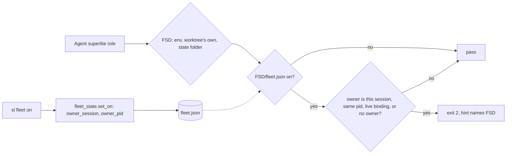
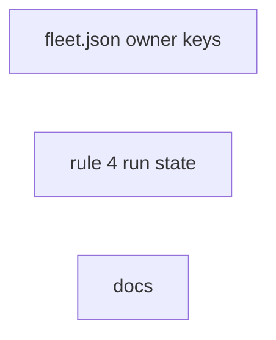

# Superlite: the fleet rule reads the run the session works in (B104, #495)

**Goal:** fix #495: an inline build in a worktree had `Agent superlite:final-reviewer` blocked with "fleet is on", because the session's binding named the main checkout's state folder, where another session's finished run had left fleet on; the hint named `--plan PLAN`, which an inline build does not have.
**Architecture:** hooks/block-coordinator-edits rule 4 picks the folder whose fleet.json it reads (the worktree's own `.superlite` when the cwd is in a linked worktree and the state folder lies outside it, as state.py's foreign_worktree rule), skips a fleet another session turned on (fleet.json `owner_session`, `owner_pid`, written by `sl fleet on` through fleet_state.set_on), and names the state folder as PLAN for a build without a plan. Docs name all three.
**Tech stack:** Bash builtins (the hook), Python 3.10+ stdlib (fleet_state.py), pytest through `sl run_tests`.
**Spec:** this file, section Design; issue #495 Expected line.
**Detail:** contracts
**Target-min:** 11
**Wave0:** none

Global constraints:
- Every code line in `skills/subagent-driven-development/scripts/*.py` carries the repo's trailing `# O(...)` complexity comment where the surrounding function's lines do; tests do not. Stdlib only.
- hooks/block-coordinator-edits stays Bash builtins only on the Agent path: no new process (no `$(...)`, subshell, pipe, `tr`, `sed`, `cat`); read files with `IFS= read -r`. LF line endings.
- Existing tests stay green. An existing test file changes only when the task Owns it. If another existing test turns red, report it in DONE_WITH_CONCERNS with the test id and the reason instead of editing it.
- fleet.json keys (the contract between T1 and T2): `"owner_session": "<session id>"` (matches `^[A-Za-z0-9_-]{1,128}$`) and `"owner_pid": <int>` at the top level; either may be absent.
- Run `sl` as an executable (`<abs>/sl ...`). Verify with `<abs>/sl run_tests --fast <own test files> --task Tn --background`, then run the printed `wait:` line in the foreground and end the turn only after it reports.
- Tests drop every `SUPERLITE_*` variable and set `CLAUDE_PID`, `CLAUDE_PROJECT_DIR` (`""`) and `SUPERLITE_HOME` (a tmp folder) explicitly for each hook subprocess; Python tests use `monkeypatch.delenv(..., raising=False)`.
- No version edits (the ship step bumps the version). Never run `scripts/evals.sh`, `claude plugin eval` or `scripts/test_layers.py run`.

Ruling: the fleet folder (FSD) is `$SUPERLITE_STATE_DIR` when set; else the cwd's linked worktree's `.superlite` when the state folder lies outside that worktree and is not the session's private folder under sessions/; else the state folder (because state.py's resolve refuses such a binding as Foreign, #224, so the hook now agrees with `sl`) - cost if wrong: a coordinator in a worktree whose fleet is on in the main checkout runs roles in-process.
Ruling: a fleet whose fleet.json `owner_session` names another session does not block, unless its `owner_pid` equals the hook's `$CLAUDE_PID` (same Claude process: /clear) or `<SUPERLITE_HOME>/sessions/<owner_session>` still names FSD; no `owner_session` (older fleet.json, or no session id) blocks as before; with `$SUPERLITE_STATE_DIR` set the check is skipped (an explicit folder's fleet is the session's: leads, hosts without session ids) - cost if wrong: one stale fleet keeps blocking until `sl fleet on` claims it.
Ruling: `sl fleet on` claims the fleet: set_on drops both owner keys and writes the current ones; fleet_state.py is outside B104's list and no open batch owns it, so B104 edits it and names it in notes.md - cost if wrong: none.
Ruling: the generic block message gains `PLAN is the plan file, or <FSD> for a build without a plan.`; the researcher message keeps its pinned `before a plan exists` sentence with FSD in place of the state folder; the incident row goes to `<FSD>/incidents.jsonl` - cost if wrong: one wording follow-up.
Ruling: detail contracts (every case is an exact hook input -> exit code and stderr); no probe adapter; already in the lead worktree; layers unit and headless (hooks/** and skills/**/fleet.md) - cost if wrong: one NEEDS_CONTEXT round.
LAYERS: unit, headless



## Design

### 1. fleet.json records who turned fleet on (T1)
- `fleet_state.owner() -> dict`: `{"owner_session": state.session_id()}` when that is not None, plus `{"owner_pid": int(os.environ["CLAUDE_PID"])}` when `CLAUDE_PID` matches `[0-9]+` (re.fullmatch); else those keys are left out. Import `state` inside the function.
- `fleet_state.set_on(sd, label, accounts)`: after the existing update, pop `owner_session` and `owner_pid` from the data, then `data.update(owner())`, then save. So `sl fleet on` by another session takes the fleet over, and one without a session id leaves no owner.

### 2. Rule 4 reads the session's run (T2)
- New builtin step before `"$sd/fleet.json"` is read, setting `FSD`: `$sd` when `SUPERLITE_STATE_DIR` is non-empty. Else take the call's `cwd` (jstr cwd, `\\` to `/`, then norm); walk up to the nearest folder holding `.git`; when that `.git` is a file whose first line is `gitdir: X` and X (backslashes to `/`, trailing `/` dropped) has `worktrees` as its parent folder's name, that folder is the worktree top W. With W found, `$sd` (normed) not equal to `W/.superlite`, not starting with `W/`, and not under `${SUPERLITE_HOME:-$HOME/.superlite}/sessions/`: `FSD=W/.superlite`. Otherwise `FSD=$sd`.
- Rule 4 reads `$FSD/fleet.json`. When it says on, and `SUPERLITE_STATE_DIR` is empty, and it holds `"owner_session": "S"`: S not equal to the input's `session_id`, `"owner_pid": N` absent or not equal to `$CLAUDE_PID`, and the first line of `<sessions>/S` (CR dropped, trailing `/` dropped, normed) absent or not equal to FSD (normed): the fleet is stale and rule 4 is skipped (the code after it runs as for fleet off).
- Messages and the incident row use FSD for every path that named `$sd`. The generic message is exactly `Blocked: fleet is on, so $REPLY runs as a fleet worker, not an in-process Agent call. $again Use: sl fleet spawn --role $frole --plan PLAN, then sl fleet send Wn --brief <abs brief> --plan PLAN (fleet.md). PLAN is the plan file, or $FSD for a build without a plan. sl fleet off goes back to in-process agents.`
- The header comment's rule 4 says the folder, the owner skip and the PLAN form in at most four lines.

### 3. Docs (T3)
- docs/fleet.md, `## What it is`, right after `With fleet on, an in-process \`Agent\` call for a superlite role is blocked.`: insert the sentence block D1 (verbatim, one space before it):
  D1 = ``That block reads the `fleet.json` of the run the session works in: `$SUPERLITE_STATE_DIR` when set, else the session's state folder; from a linked worktree, a state folder outside it (a binding to the main checkout) gives way to the worktree's own `.superlite`, so a worktree without a `fleet.json` has fleet off (#495). `sl fleet on` records who turned it on (`owner_session` and `owner_pid` in `fleet.json`); a fleet another session turned on does not block unless that session is still bound to the folder or runs in the same Claude process (after `/clear`), and a `fleet.json` without `owner_session` blocks as before. The block message names `--plan PLAN`: the plan file, or the state folder it names for a build without a plan (inline).``
- docs/fleet.md, `## Troubleshooting`, a new last bullet D2 (verbatim): ``- `Blocked: fleet is on` in a session that never ran `sl fleet on`: the folder the message names holds a fleet without `owner_session` (turned on before #495). When its run is finished, `sl fleet off --plan <that folder>`; to use it, `sl fleet on --plan <that folder>` takes it over.``
- skills/subagent-driven-development/fleet.md, first paragraph, right after `a hook blocks it.`: insert S1 (verbatim, one space before it): ``It reads the session's own run (from a worktree: the worktree's `.superlite`, never a binding's folder in another checkout) and skips a fleet another session turned on (`owner_session` in `fleet.json`); without a plan, `--plan` takes the state folder the block names.``

## Coverage

| Category | State | Basis |
|---|---|---|
| Scope and success criteria | settled | #495 Expected line: run's own state, stale fleet passes, hint for no plan |
| Domain and data model | ruled | two optional top-level fleet.json keys |
| Persistence and migration | ruled | old fleet.json without owner keys blocks as before |
| Interfaces and contracts | ruled | fleet_state.owner(); block message sentence; FSD rule mirrors state.foreign_worktree |
| UI states | n/a | hook stderr only |
| Concurrency and state ownership | ruled | `fleet on` claims the fleet; owner live = binding names FSD or same pid |
| Error handling and recovery | ruled | unreadable files read as absent; the hook fails open as before |
| Security and privacy | n/a | session ids are local file names |
| Performance and limits | ruled | builtins only, Agent calls only |
| Observability | settled | incident row in FSD; message names FSD |
| Testing strategy | settled | hook subprocess cases per rule; set_on unit cases; doc pins |
| Compatibility | settled | SUPERLITE_STATE_DIR sessions (leads, tests) unchanged |
| Rollout | ruled | one PR; version bump at ship |
| Research unknowns | n/a | none |

## File structure
- `skills/subagent-driven-development/scripts/fleet_state.py`, `tests/scripts/test_fleet_owner_495.py` (T1).
- `hooks/block-coordinator-edits`, `tests/scripts/test_guard_fleet_run_state_495.py` (T2).
- `docs/fleet.md`, `skills/subagent-driven-development/fleet.md`, `tests/scripts/test_docs_b104_fleet.py` (T3).

## Task graph

```mermaid
%% schedule
gantt
  title Predicted schedule (mm:ss)
  dateFormat X
  axisFormat %M:%S
  section lane 1
  T2 block-coordinator-edits rule 4 reads :t2, 0, 99s
  section lane 2
  T1 fleet_state fleet on records its owne :t1, 0, 97s
  section lane 3
  T3 docs fleet rule reads the run's own s :t3, 0, 96s
```




critical path: T2 (1.6 min) · peak width 3 · predicted build 1.6 min · predicted total ≈ 5.1 min (target ✓)

## Package: fleet state
App type: library. Categories: state (owner keys replaced, not merged), encoding (pid digits only).
**Probe entry:** none (owner() takes no argument; cases are named pytest tests).

### T1 fleet_state: fleet on records its owner · Complexity 2 · Est. context 26k
**Owns:** skills/subagent-driven-development/scripts/fleet_state.py, tests/scripts/test_fleet_owner_495.py
**Components:** 1
**LOC owned:** 70
**Tests:** fast
**Model:** sonnet
**Est. time:** 1.8 min (1 component, about 70 LOC, fast tests)
**Covers:** 1
**Consumes:** none
**Produces:** fleet_state.owner() -> dict
  e.g. owner() with SUPERLITE_SESSION_ID=s1, CLAUDE_PID=42 -> {"owner_session": "s1", "owner_pid": 42}
  e.g. owner() with no session id and CLAUDE_PID unset -> {}
  e.g. owner() with CLAUDE_CODE_SESSION_ID=abc, CLAUDE_PID=12a -> {"owner_session": "abc"}
**Review Focus:**
Test fixture: `sys.path.insert(0, SCRIPTS)`, `import fleet_state as fs`; `d = tmp_path / "proj" / ".superlite"` created; every test deletes SUPERLITE_SESSION_ID, CLAUDE_CODE_SESSION_ID, CLAUDE_PID and SUPERLITE_FLEET_* first.
encoding: `test_owner_reads_session_and_pid`, `test_owner_empty_without_env`, `test_owner_skips_non_digit_pid` (the three e.g. lines above, exact dicts).
state: `test_set_on_records_owner` (env s1/42; `fs.set_on(d, "sl:x", [])` -> `fs.load(d)` has `on` True, `owner_session` "s1", `owner_pid` 42).
state: `test_set_on_again_takes_over` (set_on with s1/42, then SUPERLITE_SESSION_ID=s2 and CLAUDE_PID deleted, set_on again -> `owner_session` "s2" and no `owner_pid` key; `label` is the second call's).
state: `test_set_on_without_session_drops_owner` (set_on with s1/42, then both deleted, set_on -> neither key in `fs.load(d)`).
protocol: `test_sl_fleet_on_records_owner` (subprocess `[SL, "fleet", "on", "--plan", str(d)]`, env without SUPERLITE_*, plus SUPERLITE_SESSION_ID=s9, CLAUDE_PID=7 -> returncode 0; `json.loads((d / "fleet.json").read_text())` has `owner_session` "s9" and `owner_pid` 7).
**Steps:** 1 failing tests, 2 run: FAIL, 3 implement Design 1, 4 run: PASS (own file plus `tests/scripts/test_fleet_state.py tests/scripts/test_fleet_cli_b54.py`).

## Package: coordinator guard
App type: CLI (a PreToolUse hook: JSON on stdin, exit code and stderr). Categories: state (which folder, which owner), file (worktree `.git` file, binding file), protocol (message text).
Specific risks: a submodule `.git` file taken for a worktree; the private folder redirected; a lead (SUPERLITE_STATE_DIR) unblocked; an owner key inside a worker entry.
**Probe entry:** none (a Bash hook; cases are named pytest tests).

### T2 block-coordinator-edits: rule 4 reads the session's run · Complexity 5 · Est. context 45k
**Owns:** hooks/block-coordinator-edits, tests/scripts/test_guard_fleet_run_state_495.py
**Components:** 1
**LOC owned:** 190
**Tests:** fast
**Model:** sonnet
**Est. time:** 3.4 min (1 component, about 190 LOC, fast tests)
**Covers:** 2
**Consumes:** none
**Produces:** none
**Review Focus:**
Test fixture: `run_hook` from `test_fleet_hooks`; `home = tmp_path / "home"`; `main = tmp_path / "main"` with `main/.git` a folder; `msd = main / ".superlite"` (created, `session` file `s1`); `wt = main / ".claude" / "worktrees" / "wt1"` with `wt/.git` the file `gitdir: <main>/.git/worktrees/wt1\n`; binding `home/sessions/s1` = `f"{msd}\n123\n{main}\n"`; helper `on(folder, **owner)` writes `{"on": true, "label": "sl:x", "next": 1, "workers": {}, **owner}`; helper `call(cwd, agent="superlite:final-reviewer", env=None)` runs the hook with stdin `{"session_id": "s1", "tool_name": "Agent", "cwd": str(cwd), "tool_input": {"subagent_type": agent, "description": "d", "prompt": "p"}}`, env `{"SUPERLITE_HOME": str(home), "CLAUDE_PROJECT_DIR": "", "CLAUDE_PID": "999", **env}`, cwd `cwd`.
state: `test_worktree_ignores_main_checkout_fleet` (#495's case: `on(msd)`, `call(wt)` -> returncode 0; `msd/incidents.jsonl` absent).
state: `test_worktree_own_fleet_blocks` (`on(msd)`, `on(wt/".superlite", owner_session="s1")`, `call(wt)` -> 2; stderr holds `f"PLAN is the plan file, or {wt}/.superlite for a build without a plan."`; last row of `wt/.superlite/incidents.jsonl` has rule `fleet`; `msd/incidents.jsonl` absent).
state: `test_main_checkout_keeps_binding` (`on(msd)`, `call(main)` -> 2; stderr holds `f"or {msd} for a build without a plan."`).
state: `test_binding_inside_worktree_kept` (binding s1 names `wt/.superlite` (created, `session` s1), `on(wt/".superlite")`, `call(wt / "sub")` with `sub` created -> 2).
state: `test_private_folder_kept` (binding s1 names `home/sessions/s1.d/.superlite` (created), `on` there, `call(wt)` -> 2; stderr names that folder).
file: `test_submodule_git_file_is_no_worktree` (`sub = main / "sub"`, `sub/.git` = `gitdir: ../.git/modules/sub\n`, `on(msd)`, `call(sub)` -> 2).
state: `test_state_dir_env_wins` (`on(msd, owner_session="s0")`, `call(wt, env={"SUPERLITE_STATE_DIR": str(msd)})` -> 2).
state: `test_other_finished_session_passes` (`on(msd, owner_session="s0", owner_pid=111)`, no `home/sessions/s0`, `call(main)` -> 0; no `msd/incidents.jsonl`).
state: `test_own_session_blocks` (`on(msd, owner_session="s1", owner_pid=111)`, `call(main)` -> 2).
state: `test_same_process_after_clear_blocks` (`on(msd, owner_session="s0", owner_pid=999)`, `call(main)` -> 2).
state: `test_live_owner_bound_here_blocks` (`on(msd, owner_session="s0", owner_pid=111)`, `home/sessions/s0` = `f"{msd}/\n111\n"`, `call(main)` -> 2).
state: `test_owner_bound_elsewhere_passes` (as above but `home/sessions/s0` = `f"{tmp_path}/other/.superlite\n111\n"` -> 0).
state: `test_fleet_without_owner_blocks` (`on(msd)`, `call(main)` -> 2).
protocol: `test_generic_hint_names_the_no_plan_form` (parametrized over implementer, fixer-opus, package-reviewer, final-reviewer; `on(msd)`, `call(main, agent=f"superlite:{r}")` -> stderr holds `f"(fleet.md). PLAN is the plan file, or {msd} for a build without a plan. sl fleet off goes back to in-process agents."`).
protocol: `test_research_path_names_the_run_folder` (`on(wt/".superlite", owner_session="s1")`, `call(wt, agent="superlite:researcher")` -> 2; stderr holds `f"write the prompt to {wt}/.superlite/briefs/<name>.md;"` and `f"PLAN is the plan file, or {wt}/.superlite before a plan exists."`).
protocol: `test_other_agents_pass_a_live_fleet` (`on(msd)`, `call(main, agent="Explore")` -> 0).
**Notes:** worker entries never hold `owner_session` or `owner_pid` (only set_on writes them, at the top level), so the first regex match in the fleet.json text is the owner. Write fleet.json in the tests with `json.dumps(..., indent=2)`, as fleet_state.save does.
**Steps:** 1 failing tests, 2 run: FAIL, 3 implement Design 2, 4 run: PASS (own file plus `tests/scripts/test_guard_fleet_agents.py tests/scripts/test_guard_fleet_research_hint.py tests/scripts/test_fleet_hooks.py`).

## Package: docs
App type: file I/O (Markdown). Categories: file (verbatim texts in the right place).
**Probe entry:** none (docs only).

### T3 docs: fleet rule reads the run's own state · Complexity 1 · Est. context 22k
**Owns:** docs/fleet.md, skills/subagent-driven-development/fleet.md, tests/scripts/test_docs_b104_fleet.py
**Kind:** mechanical
**Components:** 1
**LOC owned:** 40
**Tests:** fast
**Model:** haiku
**Est. time:** 1.6 min (1 component, about 40 LOC, fast tests)
**Covers:** 3
**Consumes:** none
**Produces:** none
**Review Focus:** file: `test_fleet_doc_names_run_state`, `test_fleet_doc_troubleshooting_names_stale_fleet`, `test_sdd_fleet_names_run_state` (code below; D1, D2, S1 are Design 3's texts).
**Test code (verbatim):**
```python
"""B104 (#495): the fleet docs name the run the fleet rule reads, the owner skip and the no-plan PLAN form."""
import re
from pathlib import Path

ROOT = Path(__file__).resolve().parents[2]
PLAN = (ROOT / "docs" / "plans" / "2026-11-11-fleet-rule-run-state.md").read_text(encoding="utf-8")
DOCS = (ROOT / "docs" / "fleet.md").read_text(encoding="utf-8")
SDD = (ROOT / "skills" / "subagent-driven-development" / "fleet.md").read_text(encoding="utf-8")


def _text(name):
    m = re.search(rf"{name} \(verbatim[^)]*\): ``(.+?)``$", PLAN, re.M) or re.search(rf"{name} = ``(.+?)``$", PLAN, re.M)
    assert m, name
    return m.group(1)


D1, D2, S1 = _text("D1"), _text("D2"), _text("S1")


def _section(text, heading):
    start = text.index(heading + "\n")
    end = text.find("\n## ", start + len(heading))
    return text[start:] if end == -1 else text[start:end]


def test_fleet_doc_names_run_state():
    assert DOCS.count("is blocked. " + D1) == 1
    assert "is blocked. " + D1 in _section(DOCS, "## What it is")


def test_fleet_doc_troubleshooting_names_stale_fleet():
    assert D2 in _section(DOCS, "## Troubleshooting").splitlines()


def test_sdd_fleet_names_run_state():
    assert SDD.count("a hook blocks it. " + S1) == 1
```
**Steps:** 1 failing tests, 2 run: FAIL, 3 insert the texts of Design 3, 4 run: PASS (own file plus `tests/scripts/test_fleet_capacity.py tests/scripts/test_docs_b67_fleet.py tests/scripts/test_fleet_research_docs_b43.py`).

## Review Focus
- fleet state: state, encoding; cases in T1.
- coordinator guard: state, file, protocol; cases in T2.
- docs: file; cases in T3.

## Self-review
Coverage: Design 1 -> T1, 2 -> T2, 3 -> T3. No edges: T2's tests write fleet.json directly (the key contract is a Global constraint), T3 pins text only. No shared files.
