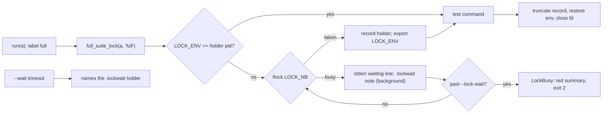
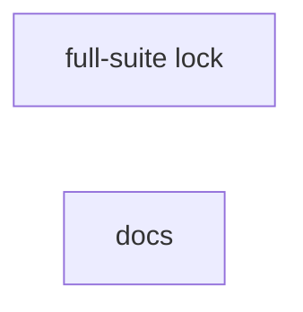

# Superlite: machine-wide full-suite lock (B109)

**Goal:** fix #480: full-suite runs on one machine go one at a time, through a lock under `~/.superlite/locks` (Max's decision), so parallel leads, implementers and layers no longer push the load to 130-280 and make wall-clock-bound tests flaky.
**Architecture:** `run_tests.py` gains a context manager `full_suite_lock(a, label)` that holds an `fcntl.flock` on `<superlite home>/locks/full-suite.lock` around the test command of every full run (the OS frees it when the process ends, so no stale-lock logic), records its holder in the file, exports `SUPERLITE_FULL_SUITE_LOCK=<pid>` to the test processes so a nested run skips it, and bounds the wait with `--lock-wait S`. `--wait` names the lock a background run still waits for. Docs name it.
**Tech stack:** Python 3.10+ stdlib, pytest (through `sl run_tests`), Markdown docs.
**Spec:** this file, section Design; issue #480 Expected.
**Detail:** tests
**Target-min:** 11
**Wave0:** none
**Coverage:** off

Global constraints:
- Every Python code line keeps the file's trailing `# O(...)` complexity comment.
- Existing tests stay green. An existing test file changes only when the task Owns it. If another existing test turns red, report it in DONE_WITH_CONCERNS with the test id and the reason instead of editing it.
- Run `sl` as an executable (`<abs>/sl ...`). Verify with `<abs>/sl run_tests --fast <own test files> --task Tn --background`, then run the printed `wait:` line in the foreground and end the turn only after it reports. Never run `run_tests --full` yourself: the lead runs the full suite.
- The lock path is read at call time (`state.home()`, so `SUPERLITE_HOME` moves it), never cached at import.
- No version edits (the ship step bumps the version). Never run `scripts/evals.sh`, `claude plugin eval` or `scripts/test_layers.py run`.

Ruling: one machine-wide lock `<superlite home>/locks/full-suite.lock`, not one per repository (because the load the issue measured is the machine's; cost if wrong: a per-repo slug later).
Ruling: one slot, an flock taken with LOCK_NB and polled every 0.5 s, no FIFO order (because the OS frees an flock when its holder dies, so there is no stale holder to judge, and a full run lasts minutes, so a 0.5 s poll is fair enough; cost if wrong: a semaphore with N slots later).
Ruling: a full run is run()'s label `full`: no `--fast`, no `-m`, no `**Tests:** cmd=`; `--full --task Tn` takes it too; `--record`, `--wait` and the `--background` parent never take it, the detached child does (because those are the heavy runs the issue names; cost if wrong: one condition).
Ruling: `--lock-wait S` defaults to 3600 s (DEFAULT_LIMIT), 0 = no limit; past it the run stops with exit 2, a red summary `full-suite lock: still held by ... after S s (run_tests --lock-wait S; 0 = no limit)`, the zero line and no incident (because the wait is an environment state, not a test result; cost if wrong: a feedback entry missed).
Ruling: a run skips the lock when `SUPERLITE_FULL_SUITE_LOCK` equals the pid in the lock file's holder record (a test of the suite or a test-cmd.json that calls run_tests --full under the holder would otherwise wait for its own parent); a leftover variable naming another pid does not skip it (cost if wrong: one deadlock until --lock-wait).
Ruling: a lock that cannot be used (mkdir, open or flock raising anything but BlockingIOError) never stops a run: one stderr line `run_tests: full-suite lock not taken: <error>; running without it`; no lock on Windows (no fcntl) (cost if wrong: an unlimited run on a read-only home).
Ruling: the unit-layer snapshot stays before the lock wait (conservative: a file edited during the wait reads stale after the stamp; cost if wrong: one more unit run).
Ruling: no niceness limit and no rerun-alone step (Max chose the lock).
Ruling: docs/tools.md and tests/scripts/test_docs_480_full_suite_lock.py lie outside the brief's file list and no open batch lists them: T2 edits them and notes.md names them.
Ruling: no probe adapter (a lock around a subprocess; Review Focus cases are named tests); detail tests; already in the lead worktree, no `sl worktree ensure`; T2's doc text is fixed in this plan, so T2 has no edge; layer unit only (run_tests.py is excluded from headless, docs/tools.md is in no layer) (cost if wrong: one rerun).
LAYERS: unit



## Design

### 1. Lock (T1)
`run_tests.py`, new module-level names: `LOCK_ENV = "SUPERLITE_FULL_SUITE_LOCK"`, `LOCK_POLL = 0.5`, `DEFAULT_LOCK_WAIT = 3600.0`, `fcntl` imported in `try/except ImportError` (None on Windows), and the four functions and one class of T1's Produces.
- `full_lock_path()`: `state.home() / "locks" / "full-suite.lock"`.
- `lock_holder(path)`: the JSON object in the file when it is a dict whose `pid` is an int, else None (missing, empty, half-written, not JSON).
- `holder_text(info)`: `pid <pid> in <root>[ (task <task>)][ since <HH:MM:SS local of started>]`; `another run` for None; the task part only for a non-empty task, the since part only for a number `started`.
- `full_suite_lock(a, label)` (contextlib.contextmanager), reading `a.lock_wait` (seconds, None = no limit), `a.task`, `a.run_id`, `a.summary`: label not `full` or no fcntl: yield, nothing else. When `os.environ.get(LOCK_ENV)` equals `str(lock_holder(path)["pid"])`: yield, nothing else. Else mkdir the parent (`mode=0o700`), `os.open(path, O_RDWR | O_CREAT, 0o600)` (non-inheritable by default, so no test process keeps the lock); an OSError there prints the not-taken line and yields. Loop: `flock(fd, LOCK_EX | LOCK_NB)`; on BlockingIOError read the holder; the first time print `run_tests: waiting for the full-suite lock (held by <holder_text>); full runs on one machine run one at a time` on stderr and, when `a.run_id` is set, write `json.dumps(holder or {})` to `Path(a.summary).with_suffix(".lockwait")` (atomic_write); past `a.lock_wait` raise `LockBusy(a.lock_wait, holder)`; sleep `min(LOCK_POLL, remaining)`. Another OSError from flock: the not-taken line, yield. Taken: delete the note, print `run_tests: full-suite lock taken after <N> s` (`{:.0f}`) only when it waited, write the record `{"pid": os.getpid(), "root": str(Path.cwd()), "task": a.task, "started": time.time()}` (lseek 0, ftruncate 0, write), set `os.environ[LOCK_ENV] = str(os.getpid())`, yield; finally restore the earlier `LOCK_ENV` value (or remove it), ftruncate 0. The outer finally deletes the note and closes the fd (frees the flock).

### 2. Wiring (T1)
- `main`: `--lock-wait S` (float, default DEFAULT_LOCK_WAIT, help `seconds a full run waits for the machine-wide full-suite lock (default 3600; 0 = no limit)`); `a.lock_wait = a.lock_wait if a.lock_wait > 0 else None`. `except LockBusy as e` (before the BaseException clause): reason `full-suite lock: still held by <holder_text(e.holder)> after <e.seconds:g> s (run_tests --lock-wait S; 0 = no limit)`, print `run_tests: <reason>` on stderr, `write_summary(a.summary, "full", zero counts, [], 0.0, error=reason)`, `publish_summary(a)`, print `0 0 0 0.0`, return 2; no incident.
- `run`: the pytest path wraps `t0`, `run_captured(...)` and `seconds` in `with full_suite_lock(a, label):`; the other-runner path wraps `rc = run_other(...)` the same way.
- `wait_background` timeout branch: when `mine.with_suffix(".lockwait")` exists, print `run_tests: <mine> is waiting for the full-suite lock (held by <holder_text(lock_holder(note))>)` right before the unchanged `tests: no result yet ...` line.
- The module docstring gains one paragraph with the texts above.

### 3. Docs (T2)
Exact text in T2.

## File structure

- `skills/subagent-driven-development/scripts/run_tests.py`: the lock, its wiring, the --wait note, docstring (T1)
- `tests/scripts/test_full_suite_lock_480.py`: lock unit tests and run_tests runs against a holder process (T1)
- `docs/tools.md`, `tests/scripts/test_docs_480_full_suite_lock.py`: the run_tests row names the lock (T2)

## Task graph




critical path: T1 (1.7 min) · peak width 2 · predicted build 1.7 min · predicted total ≈ 5.2 min (target ✓)

## Package: full-suite lock

App type: concurrency + CLI. Categories: state (holder record, env restore, note cleanup, a nested run), protocol (stderr lines, exit 2, the summary error, the --wait note), file (unusable lock path). **Probe entry:** none (a lock around a subprocess; cases are named tests).

### T1 run_tests takes the full-suite lock · Complexity 5 · Est. context 46k
**Owns:** skills/subagent-driven-development/scripts/run_tests.py, tests/scripts/test_full_suite_lock_480.py
**Components:** 1
**LOC owned:** 260
**Tests:** fast
**Model:** sonnet
**Est. time:** 3.8 min (1 component, about 260 LOC, fast tests)
**Covers:** 1, 2
**Consumes:** none
**Produces:** run_tests.full_lock_path() -> Path · run_tests.lock_holder(path: Path) -> dict | None · run_tests.holder_text(info: dict | None) -> str · run_tests.full_suite_lock(a, label: str) -> contextlib.AbstractContextManager · run_tests.LockBusy(Exception)
e.g. holder_text({"pid": 4242, "root": "/x/proj", "task": "T3", "started": <epoch of 14:03:07 local>}) -> "pid 4242 in /x/proj (task T3) since 14:03:07"
e.g. holder_text({"pid": 4242, "root": "/x/proj", "task": None, "started": <same>}) -> "pid 4242 in /x/proj since 14:03:07"; holder_text(None) -> "another run"
e.g. lock_holder(<file holding "">) -> None; lock_holder(<file holding {"pid": 7, "root": "/r", "task": null, "started": 1.0}>) -> {"pid": 7, "root": "/r", "task": None, "started": 1.0}
**Review Focus:** state: `test_full_label_holds_the_lock_and_records_the_holder`, `test_nested_run_under_the_holder_skips_the_lock`, `test_a_stale_marker_does_not_skip_the_lock`, `test_the_test_processes_inherit_the_marker`; protocol: `test_lock_wait_limit_is_a_red_summary_without_incident`, `test_wait_names_the_lock_a_background_run_waits_for`; file: `test_unusable_lock_path_runs_without_the_lock`.
**Test code (verbatim):** new file tests/scripts/test_full_suite_lock_480.py:
```python
"""#480: full-suite runs take a machine-wide lock under ~/.superlite/locks, so full suites on one machine run one at a time."""
from __future__ import annotations

import json
import os
import subprocess
import sys
import time
from pathlib import Path
from types import SimpleNamespace

import pytest

from test_plan_tools import SCRIPTS, run

sys.path.insert(0, str(SCRIPTS))
import run_tests  # noqa: E402

pytestmark = pytest.mark.skipif(os.name == "nt", reason="flock is POSIX only")

RUN_TESTS = SCRIPTS / "run_tests.py"
HOLDER = r'''
import fcntl, json, os, sys, time
p = sys.argv[1]
os.makedirs(os.path.dirname(p), exist_ok=True)
fd = os.open(p, os.O_RDWR | os.O_CREAT, 0o600)
fcntl.flock(fd, fcntl.LOCK_EX)
os.ftruncate(fd, 0)
os.write(fd, json.dumps({"pid": os.getpid(), "root": "/elsewhere", "task": "T9", "started": time.time()}).encode())
print("held", flush=True)
time.sleep(float(sys.argv[2]))
'''
PROBE = r'''
import fcntl, os, sys
fd = os.open(sys.argv[1], os.O_RDWR | os.O_CREAT, 0o600)
try:
    fcntl.flock(fd, fcntl.LOCK_EX | fcntl.LOCK_NB)
except BlockingIOError:
    sys.exit(1)
'''


@pytest.fixture(autouse=True)
def _no_outer_lock(monkeypatch):
    monkeypatch.delenv(run_tests.LOCK_ENV, raising=False)  # a suite started by run_tests --full exports it


def hold(seconds):
    proc = subprocess.Popen([sys.executable, "-c", HOLDER, str(run_tests.full_lock_path()), str(seconds)],
                            stdout=subprocess.PIPE, text=True)
    assert proc.stdout.readline().strip() == "held"
    return proc


def stop(proc):
    proc.kill()
    proc.wait(timeout=10)
    proc.stdout.close()


def is_free():
    return subprocess.run([sys.executable, "-c", PROBE, str(run_tests.full_lock_path())]).returncode == 0


def args(tmp_path, lock_wait=30.0, task=None, run_id=None):
    return SimpleNamespace(lock_wait=lock_wait, task=task, run_id=run_id,
                           summary=str(tmp_path / ".superlite" / "test-summary.json"))


def project(tmp_path, test="def test_ok():\n    assert True\n"):
    (tmp_path / ".superlite").mkdir(exist_ok=True)
    (tmp_path / "test_ok.py").write_text(test, encoding="utf-8")
    (tmp_path / "pytest.ini").write_text("[pytest]\nmarkers =\n    quick: q\n", encoding="utf-8")


def summary(tmp_path):
    return json.loads((tmp_path / ".superlite" / "test-summary.json").read_text(encoding="utf-8"))


def test_lock_path_follows_superlite_home(tmp_path, monkeypatch):
    monkeypatch.setenv("SUPERLITE_HOME", str(tmp_path / "h"))
    assert run_tests.full_lock_path() == tmp_path / "h" / "locks" / "full-suite.lock"


def test_holder_text():
    started = time.mktime((2026, 11, 11, 14, 3, 7, 0, 0, -1))
    assert run_tests.holder_text({"pid": 4242, "root": "/x/proj", "task": "T3", "started": started}) == "pid 4242 in /x/proj (task T3) since 14:03:07"
    assert run_tests.holder_text({"pid": 4242, "root": "/x/proj", "task": None, "started": started}) == "pid 4242 in /x/proj since 14:03:07"
    assert run_tests.holder_text(None) == "another run"


def test_lock_holder_reads_only_a_record(tmp_path):
    p = tmp_path / "l.lock"
    assert run_tests.lock_holder(p) is None
    for text in ("", "{half", "[1]", json.dumps({"pid": "7"})):
        p.write_text(text, encoding="utf-8")
        assert run_tests.lock_holder(p) is None, text
    p.write_text(json.dumps({"pid": 7, "root": "/r", "task": None, "started": 1.0}), encoding="utf-8")
    assert run_tests.lock_holder(p) == {"pid": 7, "root": "/r", "task": None, "started": 1.0}


def test_fast_label_takes_no_lock(tmp_path):
    with run_tests.full_suite_lock(args(tmp_path), "fast"):
        assert not run_tests.full_lock_path().exists()
        assert run_tests.LOCK_ENV not in os.environ


def test_full_label_holds_the_lock_and_records_the_holder(tmp_path, monkeypatch):
    monkeypatch.chdir(tmp_path)
    p = run_tests.full_lock_path()
    with run_tests.full_suite_lock(args(tmp_path, task="T4"), "full"):
        assert not is_free()
        h = run_tests.lock_holder(p)
        assert (h["pid"], h["root"], h["task"]) == (os.getpid(), str(Path.cwd()), "T4")
        assert os.environ[run_tests.LOCK_ENV] == str(os.getpid())
        assert p.stat().st_mode & 0o777 == 0o600
        assert p.parent.stat().st_mode & 0o777 == 0o700
    assert is_free()
    assert run_tests.lock_holder(p) is None
    assert run_tests.LOCK_ENV not in os.environ


def test_waits_for_another_holder_then_takes_it(tmp_path, capsys):
    proc = hold(2)
    try:
        t0 = time.monotonic()
        with run_tests.full_suite_lock(args(tmp_path), "full"):
            waited = time.monotonic() - t0
            assert run_tests.lock_holder(run_tests.full_lock_path())["pid"] == os.getpid()
    finally:
        stop(proc)
    assert waited >= 1.0
    err = capsys.readouterr().err
    assert f"run_tests: waiting for the full-suite lock (held by pid {proc.pid} in /elsewhere (task T9) since " in err
    assert "); full runs on one machine run one at a time" in err
    assert "run_tests: full-suite lock taken after " in err


def test_wait_limit_raises_lock_busy_and_clears_the_note(tmp_path):
    (tmp_path / ".superlite").mkdir()
    a = args(tmp_path, lock_wait=1.0, run_id="r1")
    proc = hold(30)
    try:
        with pytest.raises(run_tests.LockBusy) as e:
            with run_tests.full_suite_lock(a, "full"):
                pytest.fail("entered while another run holds the lock")
    finally:
        stop(proc)
    assert e.value.seconds == 1.0
    assert e.value.holder["pid"] == proc.pid
    assert not Path(a.summary).with_suffix(".lockwait").exists()


def test_nested_run_under_the_holder_skips_the_lock(tmp_path):
    with run_tests.full_suite_lock(args(tmp_path), "full"):
        t0 = time.monotonic()
        with run_tests.full_suite_lock(args(tmp_path, lock_wait=1.0), "full"):
            assert time.monotonic() - t0 < 0.5
        assert os.environ[run_tests.LOCK_ENV] == str(os.getpid())
        assert not is_free()
    assert is_free()


def test_a_stale_marker_does_not_skip_the_lock(tmp_path, monkeypatch):
    monkeypatch.setenv(run_tests.LOCK_ENV, "999999")
    proc = hold(30)
    try:
        with pytest.raises(run_tests.LockBusy):
            with run_tests.full_suite_lock(args(tmp_path, lock_wait=1.0), "full"):
                pass
    finally:
        stop(proc)
    assert os.environ[run_tests.LOCK_ENV] == "999999"


def test_unusable_lock_path_runs_without_the_lock(tmp_path, monkeypatch, capsys):
    blocker = tmp_path / "file"
    blocker.write_text("x", encoding="utf-8")
    monkeypatch.setattr(run_tests, "full_lock_path", lambda: blocker / "locks" / "full-suite.lock")
    ran = []
    with run_tests.full_suite_lock(args(tmp_path), "full"):
        ran.append(True)
    assert ran == [True]
    err = capsys.readouterr().err
    assert "run_tests: full-suite lock not taken: " in err and "; running without it" in err


def test_full_run_waits_for_the_lock_then_runs(tmp_path, monkeypatch, capsys):
    project(tmp_path)
    monkeypatch.chdir(tmp_path)
    proc = hold(2)
    try:
        assert run_tests.main(["--full", "--lock-wait", "30"]) == 0
    finally:
        stop(proc)
    assert summary(tmp_path)["passed"] == 1
    assert "run_tests: full-suite lock taken after " in capsys.readouterr().err


def test_the_test_processes_inherit_the_marker(tmp_path, monkeypatch):
    project(tmp_path, "import json, os\n\ndef test_ok():\n"
                      "    rec = json.load(open(os.path.join(os.environ['SUPERLITE_HOME'], 'locks', 'full-suite.lock')))\n"
                      "    assert os.environ['SUPERLITE_FULL_SUITE_LOCK'] == str(rec['pid'])\n")
    monkeypatch.chdir(tmp_path)
    assert run_tests.main(["--full"]) == 0
    assert summary(tmp_path)["passed"] == 1


def test_lock_wait_limit_is_a_red_summary_without_incident(tmp_path, monkeypatch, capsys):
    project(tmp_path)
    monkeypatch.chdir(tmp_path)
    proc = hold(30)
    try:
        assert run_tests.main(["--full", "--lock-wait", "1"]) == 2
    finally:
        stop(proc)
    data = summary(tmp_path)
    assert data["error"].startswith(f"full-suite lock: still held by pid {proc.pid} in /elsewhere (task T9) since ")
    assert data["error"].endswith(" after 1 s (run_tests --lock-wait S; 0 = no limit)")
    assert data["passed"] == 0
    log = tmp_path / run_tests.ct.DEFAULT_LOG
    assert not log.exists() or "full-suite lock" not in log.read_text(encoding="utf-8")
    assert capsys.readouterr().out.splitlines()[-1] == "0 0 0 0.0"


def test_fast_and_marker_runs_take_no_lock(tmp_path, monkeypatch):
    project(tmp_path, "import pytest\n\n@pytest.mark.quick\ndef test_ok():\n    assert True\n")
    monkeypatch.chdir(tmp_path)
    proc = hold(30)
    try:
        assert run_tests.main(["--fast", "test_ok.py", "--lock-wait", "1"]) == 0
        assert run_tests.main(["-m", "quick", "--lock-wait", "1"]) == 0
    finally:
        stop(proc)


def test_wait_names_the_lock_a_background_run_waits_for(tmp_path):
    project(tmp_path)
    proc = hold(60)
    try:
        cp = run(RUN_TESTS, "--full", "--background", "--lock-wait", "60", cwd=tmp_path)
        assert cp.returncode == 0, cp.both
        mine = Path(cp.out.splitlines()[0].split("summary: ", 1)[1])
        deadline = time.monotonic() + 20
        while not mine.with_suffix(".lockwait").exists() and time.monotonic() < deadline:
            time.sleep(0.2)
        w = run(RUN_TESTS, "--wait", str(mine), "--timeout", "1", cwd=tmp_path)
        assert w.returncode == 2, w.both
        lines = w.err.splitlines()
        assert lines[-2].startswith(f"run_tests: {mine} is waiting for the full-suite lock (held by pid {proc.pid} in /elsewhere (task T9) since "), w.err
        assert lines[-1].startswith("tests: no result yet after 1 s"), w.err
    finally:
        stop(proc)
    done = run(RUN_TESTS, "--wait", str(mine), "--timeout", "60", cwd=tmp_path)
    assert done.returncode == 0, done.both
    assert not mine.with_suffix(".lockwait").exists()
```
**Steps:** 1 write the test file, 2 run: FAIL, 3 implement the Design sections 1 and 2 in run_tests.py, 4 run: PASS, also `tests/scripts/test_run_tests_exit_paths.py tests/scripts/test_run_tests_limit_489.py tests/scripts/test_run_tests_wait.py tests/scripts/test_run_tests_unit_stamp.py tests/scripts/test_run_tests_task_cmd_475.py tests/scripts/test_run_tests_fleet_env.py`.
**Notes:** `full_suite_lock` calls `full_lock_path()` through the module global (a test patches it). The record write is `os.lseek(fd, 0, 0)`, `os.ftruncate(fd, 0)`, `os.write(fd, json.dumps(record).encode())`. `LockBusy.__init__(self, seconds, holder)` sets `self.seconds` and `self.holder`. Restore `LOCK_ENV` exactly: an earlier value comes back, an absent one stays absent.

## Package: docs

App type: docs. Categories: none beyond the pinned texts. **Probe entry:** none (docs only).

### T2 docs name the full-suite lock · Complexity 1 · Est. context 26k
**Owns:** docs/tools.md, tests/scripts/test_docs_480_full_suite_lock.py
**Components:** 1
**LOC owned:** 30
**Tests:** fast
**Kind:** mechanical
**Model:** haiku
**Est. time:** 1.5 min (1 component, about 30 LOC, fast tests)
**Covers:** 3
**Consumes:** none
**Produces:** none
**Review Focus:** none (docs; the tests pin the text).
**Test code (verbatim):** new file tests/scripts/test_docs_480_full_suite_lock.py:
```python
"""#480: docs/tools.md names the machine-wide full-suite lock in the run_tests row."""
from pathlib import Path

ROOT = Path(__file__).resolve().parents[2]


def row():
    text = (ROOT / "docs" / "tools.md").read_text(encoding="utf-8")
    return next(line for line in text.splitlines() if line.startswith("| `run_tests` |"))


def test_row_names_the_lock():
    r = row()
    for part in (
        "a full run (no `--fast`, no `-m`, no `**Tests:** cmd=`) first takes the machine-wide full-suite lock `~/.superlite/locks/full-suite.lock`",
        "`--lock-wait S` (default 3600; 0 = no limit)",
        "`full-suite lock: still held by ... after S s`",
        "`SUPERLITE_FULL_SUITE_LOCK`",
        "`run_tests: full-suite lock not taken: <error>; running without it`",
        "is waiting for the full-suite lock (held by ...)",
    ):
        assert part in r, part


def test_lock_text_follows_the_limit_text():
    r = row()
    assert r.index("a `no-result` incident); a full run (no `--fast`") > r.index("`--limit S` (default 3600; 0 = none)")
    assert r.endswith("and a `--fast` run without `--task` closes nothing |")
```
**Steps:** 1 write the test file, 2 run: FAIL, 3 in docs/tools.md's `run_tests` row, find the --limit sentence (it ends with the words `a no-result incident);` with no-result in backticks, followed by one space and then the backticked `--task Tn --also F [F ...]`); insert the text below plus one space between that space and the backticked `--task Tn --also F [F ...]` (one line, no line break), 4 run: PASS, also `tests/scripts/test_docs_b67_tools.py tests/scripts/test_docs_b72_tools.py`.
Text to insert (from `a full run` up to and including the final semicolon): a full run (no `--fast`, no `-m`, no `**Tests:** cmd=`) first takes the machine-wide full-suite lock `~/.superlite/locks/full-suite.lock` (an flock the OS frees when the run ends; `SUPERLITE_HOME` moves it), so full runs on one machine run one at a time (#480): a run that waits prints `run_tests: waiting for the full-suite lock (held by pid N in ROOT (task Tn) since HH:MM:SS); full runs on one machine run one at a time`, then `run_tests: full-suite lock taken after N s`; `--lock-wait S` (default 3600; 0 = no limit) bounds the wait, then the run stops with exit 2 and a red summary `full-suite lock: still held by ... after S s` (no incident); the holder exports `SUPERLITE_FULL_SUITE_LOCK` to its test processes, so a run started under it skips the lock; a lock that cannot be opened prints `run_tests: full-suite lock not taken: <error>; running without it`; a `--wait` that times out on a background run still waiting for the lock prints `run_tests: <summary> is waiting for the full-suite lock (held by ...)` before its last line;
**Notes:** edit only that one row; the row's start and end stay byte-identical (other docs tests pin them).

## Review Focus

Package full-suite lock (concurrency + CLI): state, protocol, file; cases are T1's named tests. Specific risks: a test process inheriting the lock fd (os.open fds are non-inheritable; the holder test proves the lock frees when the context ends), a nested run waiting for its own parent (`test_nested_run_under_the_holder_skips_the_lock`), a leaked marker disabling the lock (`test_a_stale_marker_does_not_skip_the_lock`), the `--wait` last line staying parseable by scripts/test_layers.py's NO_RESULT regex (the note goes before it).

## Self-review

Coverage: Design 1 and 2 map to T1, 3 to T2. No placeholders. No Consumes. No edges: T2's text is fixed here. Fields filled. Owns disjoint.
