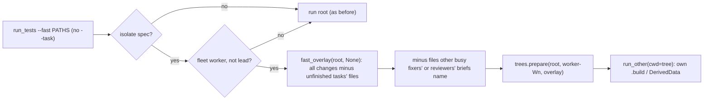

# Superlite: isolated reviewer and fixer builds (B110)

**Goal:** fix #479: on a compiled stack, fleet workers in one run root share one build folder and one test target, so a package reviewer's `run_tests --fast` compiles a sibling implementer's red tests and parallel fixers collide in one xcodebuild build folder. Max's decision: an isolated tree per worker, as `run_tests --task` does.
**Architecture:** `run_tests.py` gives a fleet worker's `--fast` run without `--task` (package reviewer, fixer) on an isolated stack its own tree, `.superlite/trees/worker-<Wn>`, through the same `trees.prepare` path `--task` uses: base commit (newest checkpoint) plus every working-tree change, minus the files of unfinished plan tasks and the changed files another busy fixer's or reviewer's brief names. Each tree has its own build folder (SwiftPM `.build`, Xcode DerivedData keyed by project path). Leads, `--full` runs, `--task` runs, runs outside a fleet and pytest runs behave as before.
**Tech stack:** Python 3.10+ stdlib, pytest (through `sl run_tests`), Markdown docs.
**Spec:** this file, section Design; issue #479 Expected.
**Detail:** contracts
**Target-min:** 11
**Wave0:** none
**Coverage:** off

Global constraints:
- Every Python code line keeps the file's trailing `# O(...)` complexity comment.
- Existing tests stay green. An existing test file changes only when the task Owns it. If another existing test turns red, report it in DONE_WITH_CONCERNS with the test id and the reason instead of editing it.
- Run `sl` as an executable (`<abs>/sl ...`). Verify with `<abs>/sl run_tests --fast <own test files> --task Tn --background`, then run the printed `wait:` line in the foreground and end the turn only after it reports.
- Tests that run `run_tests.py` as a subprocess build their env from `os.environ` without every `SUPERLITE_FLEET_*` key and without `SUPERLITE_STATE_DIR`, then add the test's own fleet keys (a lead pane exports them).
- No version edits (the ship step bumps the version). Never run `scripts/evals.sh`, `claude plugin eval` or `scripts/test_layers.py run`.

Ruling: the worker id is `SUPERLITE_FLEET_WORKER`, used only when `SUPERLITE_FLEET_ROLE` and `SUPERLITE_FLEET_AGENT` are not `lead` and the id fully matches `[A-Za-z0-9][A-Za-z0-9_.-]{0,63}` (because fleet workers export it and a lead's own runs must stay in the run root; cost if wrong: fleet-off Agent reviewers keep testing in the root, as before).
Ruling: the tree name is `worker-<id>` (because task ids are 1-3 capital letters and a number, so `W3` could be a task id; `worker-` never is; `trees clean` removes these trees too).
Ruling: only a `--fast` run (paths or `-m`) without `--task` uses the worker tree; `--task Tn` keeps `.superlite/trees/Tn` and `--full` keeps the run root (because full runs already hold the machine-wide lock, one at a time, and implementers' task trees are read elsewhere; cost if wrong: a worker's full run shares the root's build folder).
Ruling: the worker tree's plan is `--plan`, else the first existing of stable.json's plan and the default plan; with none, no task holds a file (because a fleet worker outside a plan run still gets its own build folder; no usage error).
Ruling: changed files named by another busy fixer's or package reviewer's brief (fleet.json `state: busy`, brief `.superlite/briefs/<task label>.md`, `commit_task.busy_briefs`) stay at base unless the worker's own brief names them too (because otherwise a fix round's parallel fixers compile each other's half-edits; the base holds the committed version). The fleet folder is the run root's `.superlite/`, never `SUPERLITE_STATE_DIR` (tests inherit the lead's).
Ruling: no probe adapter (run_tests is a CLI over git trees; Review Focus cases are named tests); detail contracts (one task, exact named tests); already in the lead worktree, no `sl worktree ensure`; layer unit only (paths under skills/**/scripts/**, tests/scripts/**, docs/; no SKILL.md, agents or hooks change).
Ruling: pt_review.py needs no change (the packet reads the summary, not the tree); docs/fleet.md (no open batch lists it) gets the worker-tree line and notes.md names it.
LAYERS: unit

## Design

### 1. Worker tree (T1)
`worker_tree_name(env)` returns `worker-<id>` or None (Ruling 1, 2). In `run`, when the spec is not Python, `spec.get("isolate")` is true, there is no `--task`, the label is `fast` and `worker_tree_name()` gives a name, run the worker branch: resolve the plan (Ruling 4; `info = {}` without one), `ct.add_also_owns(info, a.ledger)`, `fast_overlay(".", None, info, a.ledger)` (with `task=None`, `unfinished_owners` holds a path for every uncommitted task owning it), then `busy_held(Path(".superlite"), wid, overlay)` moves the paths other busy workers' briefs name from the overlay into a second held map. Then the same steps as the `--task` branch with the worker name in place of the task id: `trees.prepare(".", name, overlay)` (an error is the usage error `isolated tree for <name> not prepared: <err>`), `_link_dir` of `.superlite`, the overlay read back, `refresh_mtimes`, `announce_tree(tree, name, True, held, busy)`, `link_node_modules`, `node_install_line(tree, spec)`; `run_other(..., cwd=tree)`. A red worker run (rc 1) whose changed files are missing from the tree prints `run_tests: N changed file(s) not in <name>'s tree: a, b; kept at base while their task or worker is busy` (first 5, `(+K more)`), no `--also` hint. `announce_tree` gains `busy=None` (`{path: [worker ids]}`), appended as `; kept at base: M file(s) of busy W5 W6`. The module docstring gets one line naming the worker tree.

### 2. Docs (T1)
docs/fleet.md, section "Run root and task trees": replace the bullet that starts `- Fixers run \`run_tests --fast\` without \`--task\`, in the run root.` with exactly:

`- A fleet worker's \`run_tests --fast\` without \`--task\` (a package reviewer, a fixer) on such a stack builds and tests in the worker's own tree, \`.superlite/trees/worker-Wn\`: the base commit plus the working-tree changes minus the files of unfinished tasks and the changed files another busy fixer's or reviewer's brief names (unless the worker's own brief names them too). Its build folder (SwiftPM \`.build\`, Xcode DerivedData) is its own, so a reviewer does not compile a running sibling's red tests and fixers may run at once. A lead's runs, \`--full\` runs and fleet-off (Agent) workers test in the run root: there, send one fixer at a time per run root on a compiled stack, the next after the previous fixer's \`commit_task\`. On other stacks fixers with disjoint files may run at once; a test that turns red in another fixer's file is rerun after that fixer's commit.`

## File structure

- `skills/subagent-driven-development/scripts/run_tests.py`: worker tree name, busy-brief holds, worker branch in `run`, announce and red hint (T1)
- `tests/scripts/test_isolated_review_builds_479.py`: worker tree unit and end-to-end tests (T1)
- `docs/fleet.md`: the worker-tree bullet (T1)

## Task graph

```mermaid
%% schedule
gantt
  title Predicted schedule (mm:ss)
  dateFormat X
  axisFormat %M:%S
  section lane 1
  T1 fleet workers test in their own tree :t1, 0, 98s
```

critical path: T1 (1.6 min) · peak width 1 · predicted build 1.6 min · predicted total ≈ 5.1 min (target ✓)

## run_tests

**Probe entry:** none (a CLI over git worktrees; the Review Focus cases are named tests in T1)

### T1 fleet workers test in their own tree · Complexity 5 · Est. context 52k
**Owns:** skills/subagent-driven-development/scripts/run_tests.py, tests/scripts/test_isolated_review_builds_479.py, docs/fleet.md
**Components:** 1
**LOC owned:** 190
**Tests:** fast
**Model:** sonnet
**Est. time:** 3.2 min (1 component, about 190 LOC, fast tests)
**Covers:** 1, 2
**Produces:** run_tests.worker_tree_name(env: dict | None = None) -> str | None · run_tests.busy_held(sd: Path, me: str, paths: list[str]) -> dict[str, list[str]]
  e.g. worker_tree_name({"SUPERLITE_FLEET_WORKER": "W3", "SUPERLITE_FLEET_AGENT": "fixer-sonnet"}) -> "worker-W3"
  e.g. worker_tree_name({"SUPERLITE_FLEET_WORKER": "W9", "SUPERLITE_FLEET_ROLE": "lead", "SUPERLITE_FLEET_AGENT": "lead"}) -> None
  e.g. busy_held(Path(".superlite"), "W3", ["src/c.py", "src/d.py"]) -> {"src/c.py": ["W5"]} (W5 busy fixer, brief names src/c.py; W3's brief names src/d.py)
**Review Focus:** state: `test_reviewer_tree_holds_unfinished_task_files`, `test_busy_fixer_brief_files_kept_at_base`, `test_two_workers_get_separate_trees`; protocol: `test_lead_and_plain_runs_stay_in_root`, `test_task_flag_keeps_task_tree`, `test_full_run_by_worker_stays_in_root`; file: `test_red_worker_run_names_held_files`.
**Test code (contracts):** new file tests/scripts/test_isolated_review_builds_479.py. Fixture: a git repo in tmp_path with `.gitignore` `.superlite/`, files `src/a.py src/b.py src/c.py src/d.py` holding `base`, a plan made with `test_plan_tools.make_plan` (T1 owns src/a.py, T2 owns src/b.py, T3 owns src/c.py, src/d.py), committed; `.superlite/test-cmd.json` `{"language": "swift", "test": CMD, "test_file": CMD, "isolate": true}` where CMD runs `sys.executable -c` writing `os.getcwd()` to `<tmp_path>/cwd.txt` (absolute) and printing `Executed 2 tests, with 0 failures (0 unexpected) in 0.1 (0.1) seconds`. Runs go through `run_tests.py` as a subprocess with `--plan <plan>` and the env of Global constraints plus the named keys.
- `test_worker_tree_name`: the two `e.g.` cases; `{}` -> None; `{"SUPERLITE_FLEET_WORKER": "../x", "SUPERLITE_FLEET_AGENT": "fixer-sonnet"}` -> None; `{"SUPERLITE_FLEET_WORKER": "W4", "SUPERLITE_FLEET_AGENT": "package-reviewer"}` -> `"worker-W4"`.
- `test_fleet_worker_fast_run_uses_its_own_tree`: env WORKER=W3, AGENT=package-reviewer; `--fast src/b.py` exits 0; stderr holds `run_tests: tree .superlite/trees/worker-W3 = base + all working-tree changes (--fast)`; `cwd.txt` resolves to `(tmp_path/.superlite/trees/worker-W3).resolve()`.
- `test_reviewer_tree_holds_unfinished_task_files`: ledger `.superlite/progress.md` holds `- commit T2 5e9dd8b464 x`; src/a.py and src/b.py rewritten `new`; W3 fast run: the tree's src/a.py reads `base`, src/b.py reads `new`; stderr holds `; kept at base: 1 file of unfinished T1`.
- `test_busy_fixer_brief_files_kept_at_base`: ledger commits T1 T2 T3; `.superlite/fleet.json` `{"workers": {"W3": {"state": "busy", "role": "fixer", "task": "fix-T3a"}, "W5": {"state": "busy", "role": "fixer", "task": "fix-T3b"}, "W6": {"state": "idle", "role": "fixer", "task": "fix-T3c"}}}`; briefs `fix-T3a.md` names `src/d.py`, `fix-T3b.md` names `src/c.py` and `src/a.py`, `fix-T3c.md` names `src/b.py`; src/a.py src/b.py src/c.py src/d.py rewritten `new`; plus `busy_held` called directly returns `{"src/c.py": ["W5"]}` for paths `["src/b.py", "src/c.py", "src/d.py"]` when W3's brief also names nothing else; the W3 run: tree src/c.py `base`, src/d.py `new`, src/b.py `new` (idle W6 holds nothing); a second brief edit adding `src/c.py` to `fix-T3a.md` makes the next W3 run overlay src/c.py `new`; stderr holds `of busy W5`.
- `test_two_workers_get_separate_trees`: a W3 run then a W4 run: both `.superlite/trees/worker-W3` and `.superlite/trees/worker-W4` hold `.git`, and the two `cwd.txt` values differ.
- `test_lead_and_plain_runs_stay_in_root`: env WORKER=W9, ROLE=lead, AGENT=lead, and then no fleet keys at all: `--fast src/b.py` exits 0, stderr has no `run_tests: tree` line, `cwd.txt` is tmp_path resolved, no `.superlite/trees/worker-W9`.
- `test_task_flag_keeps_task_tree`: env WORKER=W3 AGENT=implementer, `--fast src/b.py --task T2`: stderr names `.superlite/trees/T2`, no `.superlite/trees/worker-W3`.
- `test_full_run_by_worker_stays_in_root`: env WORKER=W3 AGENT=fixer-sonnet, `--full`: `cwd.txt` is tmp_path resolved, no worker tree.
- `test_red_worker_run_names_held_files`: CMD prints `Executed 2 tests, with 1 failure (0 unexpected) in 0.1 (0.1) seconds` and exits 1; src/a.py (unfinished T1) rewritten; W3 fast run exits 1; stderr holds `1 changed file(s) not in worker-W3's tree: src/a.py; kept at base while their task or worker is busy` and no `--also`.
- `test_fleet_doc_names_worker_tree`: docs/fleet.md holds `.superlite/trees/worker-Wn`, `fixers may run at once` and still `one fixer at a time per run root`.
**Steps:** 1 failing tests, 2 run: FAIL, 3 implement, 4 run: PASS
**Notes:** keep the `--task` branch's behaviour byte for byte (existing tests in tests/scripts/test_run_tests_fast_tree*.py, test_run_tests_also_517.py pin it); share code with it through small helpers rather than copying the block. `busy_held` reads `commit_task.busy_briefs(sd, None)` once, takes the caller's own brief out of it, and uses `commit_task.brief_names` for the match.

## Review Focus

- run_tests (CLI): protocol (which runs get a worker tree), state (held files, tree reuse per worker), file (tree contents, red-run hint). Cases are T1's named tests.

## Self-review

One task, no consumers, no edges; Owns are disjoint from B108 and B111's files; docs text fixed above; Rulings cover the open choices.
