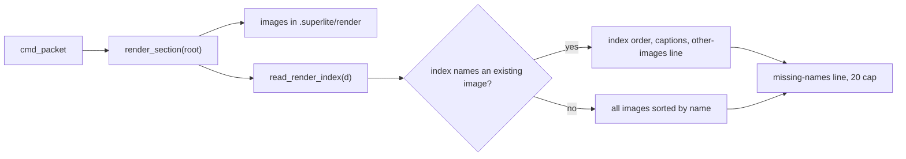
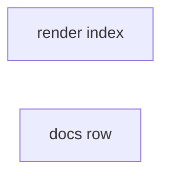

# Superlite: packet Render evidence reads render/index.md (B114)

**Goal:** fix #558: the review packet's `## Render evidence` section lists every image under `.superlite/render` (superseded pre-fix shots too) with no captions. Max's decision: read an optional `.superlite/render/index.md` with one caption per current image and list only those.
**Architecture:** `pt_review.py` gains `read_render_index(d)` (parses index.md into ordered `(name, caption)` pairs) and `render_section(root)` uses it: index mode lists only the named images with captions, else the old sorted listing. `docs/tools.md` `pt_review` row names the file and its lines.
**Tech stack:** Python 3.10+ stdlib, pytest (through `sl run_tests`), Markdown docs.
**Spec:** this file, section Design; issue #558 Expected.
**Detail:** tests
**Target-min:** 11
**Wave0:** none
**Coverage:** off

Global constraints:
- Every Python code line keeps the file's trailing `# O(...)` complexity comment.
- Existing tests stay green. An existing test file changes only when the task Owns it. If another existing test turns red, report it in DONE_WITH_CONCERNS with the test id and the reason instead of editing it.
- Run `sl` as an executable (`<abs>/sl ...`). Verify with `<abs>/sl run_tests --fast <own test files> --task Tn --background`, then run the printed `wait:` line in the foreground and end the turn only after it reports.
- No version edits (the ship step bumps the version). Never run `scripts/evals.sh`, `claude plugin eval` or `scripts/test_layers.py run`.

Ruling: index.md lines: an optional list marker (`-`, `*`, `+`, `1.` or `1)`), the file name (optionally in backticks; ends in `.png`, `.jpg` or `.jpeg`, any case; no `/`, `\` or `:`; spaces allowed), then nothing or a separator (`:`, `-`, `—`, `–`) and the caption; every other line (headings, prose, tables) is ignored (because one bullet per image is what a lead writes; cost if wrong: a table-shaped index falls back to the full listing).
Ruling: index mode needs at least one named file that exists in `.superlite/render/` (exact name); else the old listing (sorted, all images) stays, so an index without any current image never hides the shots (cost if wrong: a stale index shows old shots, as today).
Ruling: index mode lists in index order, first mention wins, caption cut to 197 characters plus `...` when over 200, the same 20 cap and `- (+N more not listed)`, then `- (K other image(s) not named in index.md, not listed)`; a named file that is not there adds `- (index.md names files not found: a.png, b.png)` in both modes (because the reviewer should know a shot is missing; cost if wrong: one extra line).
Ruling: an index.md that is not a file or cannot be read counts as absent; bytes that are not UTF-8 decode with `errors="replace"` (cost if wrong: a garbled caption).
Ruling: no "newest per name" fallback (Max chose index.md); the subagent-driven-development SKILL.md final-review step should tell coordinators to write index.md, but B112 owns that file: a notes.md follow-up (cost if wrong: leads learn it from docs/tools.md only).
Ruling: no probe adapter (render_section takes a run root, not text; Review Focus cases are named tests); detail tests; already in the lead worktree, no `sl worktree ensure`; T2's doc text is fixed in this plan, so T2 has no edge; layer unit only (cost if wrong: one rerun).
LAYERS: unit



## Design

### 1. Index-aware render section (T1)
`read_render_index(d: Path) -> list[tuple[str, str]]`: `d / "index.md"` not a file or unreadable -> `[]`; else each line matched against the Ruling's grammar, ordered, deduplicated by name (first wins), caption stripped and cut (197 + `...` when over 200 characters). `render_section(root)`: images as today (`RENDER_EXTS`, files directly in the folder); none -> `""`. `entries = read_render_index(d)`; `names = {f.name: f for f in imgs}`; `shown = [(names[n], c) for n, c in entries if n in names]`; `missing = [n for n, _ in entries if n not in names]`. With `shown`: list `shown[:RENDER_MAX]` as `- <abs posix path>: <caption>` (`- <path>` when the caption is empty), then `- (+N more not listed)` when over 20, then the other-images line when images exist that the index does not name. Without `shown`: today's lines exactly. Last, the missing line when `missing`. Heading and LEAD line unchanged.

### 2. Docs (T2)
Exact text in T2.

## File structure

- `skills/subagent-driven-development/scripts/pt_review.py`: `read_render_index`, index-aware `render_section` (T1)
- `tests/scripts/test_packet_render_index_558.py`: index parsing and listing (T1)
- `docs/tools.md`, `tests/scripts/test_docs_558_render_index.py`: `pt_review` row (T2)

## Task graph




critical path: T1 (1.6 min) · peak width 2 · predicted build 1.6 min · predicted total ≈ 5.1 min (target ✓)

## Package: packet render evidence

App type: file I/O / generator. Categories: file (index.md missing, a folder, bad bytes), encoding (captions, names with spaces). **Probe entry:** none (render_section takes a run root; cases are named tests).

### T1 packet render evidence reads index.md · Complexity 3 · Est. context 36k
**Owns:** skills/subagent-driven-development/scripts/pt_review.py, tests/scripts/test_packet_render_index_558.py
**Components:** 1
**LOC owned:** 140
**Tests:** fast
**Model:** sonnet
**Est. time:** 2.4 min (1 component, about 140 LOC, fast tests)
**Covers:** 1
**Consumes:** none
**Produces:** pt_review.read_render_index(d: Path) -> list[tuple[str, str]]
e.g. read_render_index(Path("<dir with index.md '# Shots\n- `b.png` - after fix\n1. a.png\n'>")) -> [("b.png", "after fix"), ("a.png", "")]
e.g. read_render_index(Path("<dir without index.md>")) -> []
**Review Focus:** file: `test_index_bad_bytes_and_directory`, `test_index_only_no_images_gives_empty`; encoding: `test_index_entry_without_caption_and_duplicates`, `test_index_caption_cut_at_200`, `test_index_name_with_spaces`.
**Test code (verbatim):** new file tests/scripts/test_packet_render_index_558.py:
```python
"""#558: the packet's Render evidence reads .superlite/render/index.md and lists only the current images."""
from __future__ import annotations

import sys
from pathlib import Path

ROOT = Path(__file__).resolve().parents[2]
sys.path.insert(0, str(ROOT / "skills" / "subagent-driven-development" / "scripts"))

import pt_review  # noqa: E402

LEAD = "Open each image with Read and judge the rendered UI against the spec and the Review Focus:"


def shots(tmp_path, *names):
    d = tmp_path / ".superlite" / "render"
    d.mkdir(parents=True)
    for n in names:
        (d / n).write_bytes(b"x")
    return d


def p(d, n):
    return (d / n).resolve().as_posix()


def body(tmp_path):
    return pt_review.render_section(tmp_path).strip().splitlines()


def test_read_render_index_examples(tmp_path):
    (tmp_path / "index.md").write_text("# Shots\n- `b.png` - after fix\n1. a.png\n", encoding="utf-8")
    assert pt_review.read_render_index(tmp_path) == [("b.png", "after fix"), ("a.png", "")]
    assert pt_review.read_render_index(tmp_path / "nowhere") == []


def test_index_lists_only_named_images_in_index_order_with_captions(tmp_path):
    d = shots(tmp_path, "a-before.png", "b-after.png", "c-detail.jpg")
    (d / "index.md").write_text("# Current shots\n\nSome prose.\n- c-detail.jpg: settings sheet at 390pt\n"
                                "- `b-after.png` - login after the fix\n", encoding="utf-8")
    assert body(tmp_path) == ["## Render evidence", LEAD,
                              f"- {p(d, 'c-detail.jpg')}: settings sheet at 390pt",
                              f"- {p(d, 'b-after.png')}: login after the fix",
                              "- (1 other image not named in index.md, not listed)"]


def test_index_entry_without_caption_and_duplicates(tmp_path):
    d = shots(tmp_path, "a.png", "b.png")
    (d / "index.md").write_text("a.png\n* a.png: second mention ignored\n1. b.png — dark mode\n", encoding="utf-8")
    assert body(tmp_path)[2:] == [f"- {p(d, 'a.png')}", f"- {p(d, 'b.png')}: dark mode"]


def test_index_name_with_spaces(tmp_path):
    d = shots(tmp_path, "Screen Shot 1.PNG", "old.png")
    (d / "index.md").write_text("+ Screen Shot 1.PNG: home tab\n", encoding="utf-8")
    assert body(tmp_path)[2:] == [f"- {p(d, 'Screen Shot 1.PNG')}: home tab",
                                  "- (1 other image not named in index.md, not listed)"]


def test_index_names_missing_file(tmp_path):
    d = shots(tmp_path, "a.png")
    (d / "index.md").write_text("- a.png: home\n- gone.png: deleted shot\n", encoding="utf-8")
    assert body(tmp_path)[2:] == [f"- {p(d, 'a.png')}: home", "- (index.md names files not found: gone.png)"]


def test_index_without_existing_image_falls_back_to_all(tmp_path):
    d = shots(tmp_path, "b.png", "a.png")
    (d / "index.md").write_text("Notes only, no file names here.\n- gone.png: old\n- sub/a.png: nested\n", encoding="utf-8")
    assert body(tmp_path)[2:] == [f"- {p(d, 'a.png')}", f"- {p(d, 'b.png')}",
                                  "- (index.md names files not found: gone.png)"]


def test_index_caps_at_20(tmp_path):
    names = [f"s{i:02d}.png" for i in range(23)]
    d = shots(tmp_path, *names, "old.png")
    (d / "index.md").write_text("".join(f"- {n}: shot {n}\n" for n in names), encoding="utf-8")
    lines = body(tmp_path)
    assert len(lines) == 2 + 20 + 2
    assert lines[21] == f"- {p(d, 's19.png')}: shot s19.png"
    assert lines[-2:] == ["- (+3 more not listed)", "- (1 other image not named in index.md, not listed)"]


def test_index_caption_cut_at_200(tmp_path):
    d = shots(tmp_path, "a.png", "b.png")
    (d / "index.md").write_text("- a.png: " + "x" * 300 + "\n- b.png: " + "y" * 200 + "\n", encoding="utf-8")
    assert body(tmp_path)[2:] == [f"- {p(d, 'a.png')}: " + "x" * 197 + "...", f"- {p(d, 'b.png')}: " + "y" * 200]


def test_index_counts_other_images_plural(tmp_path):
    shots(tmp_path, "a.png", "b.png", "c.png")
    (tmp_path / ".superlite" / "render" / "index.md").write_text("- c.png: final\n", encoding="utf-8")
    assert body(tmp_path)[-1] == "- (2 other images not named in index.md, not listed)"


def test_index_only_no_images_gives_empty(tmp_path):
    d = tmp_path / ".superlite" / "render"
    d.mkdir(parents=True)
    (d / "index.md").write_text("- a.png: gone\n", encoding="utf-8")
    assert pt_review.render_section(tmp_path) == ""


def test_index_bad_bytes_and_directory(tmp_path):
    d = shots(tmp_path, "a.png", "b.png")
    (d / "index.md").write_bytes(b"- b.png: caf\xe9\n")
    assert body(tmp_path)[2:] == [f"- {p(d, 'b.png')}: caf�",
                                  "- (1 other image not named in index.md, not listed)"]
    (d / "index.md").unlink()
    (d / "index.md").mkdir()
    assert body(tmp_path)[2:] == [f"- {p(d, 'a.png')}", f"- {p(d, 'b.png')}"]
```
**Steps:** 1 write the test file, 2 run: FAIL, 3 implement the Design section 1 in pt_review.py next to `render_section`, 4 run: PASS, also `tests/scripts/test_packet_render_490.py`.
**Notes:** keep `render_section`'s signature and the call in `cmd_packet`; without index.md the output must stay byte-identical (test_packet_render_490 pins it). Use a module-level compiled regex, for example `RENDER_INDEX_LINE = re.compile(r"^\s*(?:[-*+]|\d+[.)])?\s*`?(?P<name>[^`/\\:]+?\.(?:png|jpe?g))`?\s*(?:[:–—-]\s*(?P<cap>.*?))?\s*$", re.IGNORECASE)`; a line whose stripped text starts with `#` is skipped; name stripped.

## Package: docs

App type: docs. **Probe entry:** none (docs).

### T2 docs name the render index · Complexity 2 · Est. context 26k
**Owns:** docs/tools.md, tests/scripts/test_docs_558_render_index.py
**Components:** 1
**LOC owned:** 30
**Tests:** fast
**Kind:** mechanical
**Model:** haiku
**Est. time:** 1.5 min (1 component, about 30 LOC, fast tests)
**Covers:** 2
**Consumes:** none
**Produces:** none
**Review Focus:** none (docs; the pins below are the check).
**Test code (verbatim):** new file tests/scripts/test_docs_558_render_index.py:
```python
"""#558: docs/tools.md names the optional .superlite/render/index.md."""
from pathlib import Path

ROOT = Path(__file__).resolve().parents[2]
TOOLS = (ROOT / "docs" / "tools.md").read_text(encoding="utf-8")
NEW = ("with an optional `<run root>/.superlite/render/index.md` that names at least one image there (one line per "
       "current image: an optional list marker, the file name, optionally in backticks, then nothing or `:`, ` - ` or "
       "` — ` and its caption; other lines are ignored) it lists only those images in index order as "
       "`- <path>: <caption>` (first mention wins, a caption over 200 characters cut to 197 plus `...`), then "
       "`- (N other images not named in index.md, not listed)`")
OLD = "image under `<run root>/.superlite/render/` (sorted by name, at most 20, then `- (+N more not listed)`) after the line"


def test_pt_review_row_names_render_index():
    row = next(ln for ln in TOOLS.splitlines() if ln.startswith("| `pt_review` |"))
    assert NEW in row
    assert "`- (index.md names files not found: <names>)`" in row
    assert OLD not in row
```
Edit (exact): docs/tools.md `pt_review` row: replace
`the packet adds a `## Render evidence` section that lists each `.png`, `.jpg` and `.jpeg` image under `<run root>/.superlite/render/` (sorted by name, at most 20, then `- (+N more not listed)`) after the line `Open each image with Read and judge the rendered UI against the spec and the Review Focus:`;`
with
`the packet adds a `## Render evidence` section after the line `Open each image with Read and judge the rendered UI against the spec and the Review Focus:`: with an optional `<run root>/.superlite/render/index.md` that names at least one image there (one line per current image: an optional list marker, the file name, optionally in backticks, then nothing or `:`, ` - ` or ` — ` and its caption; other lines are ignored) it lists only those images in index order as `- <path>: <caption>` (first mention wins, a caption over 200 characters cut to 197 plus `...`), then `- (N other images not named in index.md, not listed)`; without one it lists each `.png`, `.jpg` and `.jpeg` image under `<run root>/.superlite/render/` sorted by name; both stop at 20 (`- (+N more not listed)`), and a named file that is not there adds `- (index.md names files not found: <names>)`;`
**Steps:** 1 write the test file, 2 run: FAIL, 3 make the edit, 4 run: PASS, also `tests/scripts/test_docs_b95_tools.py`.

## Self-review

1. Coverage: #558 Expected (index.md, one caption per file, only current images): T1 `test_index_lists_only_named_images_in_index_order_with_captions`; superseded shots out: the other-images line; no index: `test_packet_render_490` unchanged plus `test_index_without_existing_image_falls_back_to_all`; docs: T2.
2. Placeholders: none (`<path>`, `<caption>`, `<names>`, `<run root>` are literal doc text).
3. Types: T1 produces `read_render_index`; no consumer task.
4. Graph: no edges; no shared files.
5. Fields: all set. 6. Review Focus per package; probe entries none with reasons. 7. Limits: schedule and lint run next.
