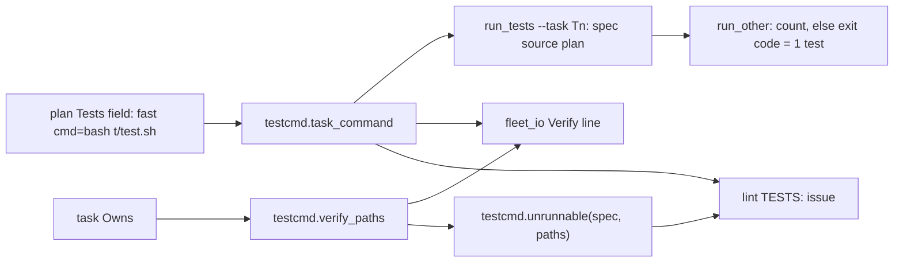
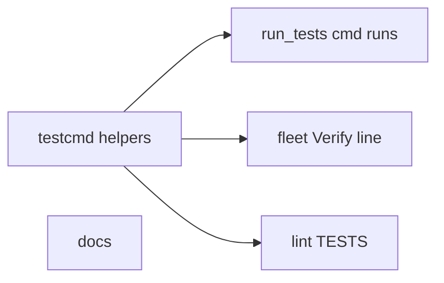

# Superlite: per-task verify command (B106)

**Goal:** fix #475: a task whose tests the project's test command cannot run (a shell test script under pytest) names its own verify command in the plan, `**Tests:** fast cmd=bash tests/hooks/test.sh`; `run_tests --task Tn` runs and counts it, the fleet task message's Verify line names it, and plan lint rejects (`TESTS:`) a task whose verify paths the project's test command cannot run and that has no `cmd=`.
**Architecture:** `testcmd.py` gains three helpers (`task_command`, `verify_paths`, `unrunnable`). `run_tests.py` reads the task's Tests field through `next_tasks.parse_plan` and swaps the resolved spec for a `source: plan` spec; `run_other` counts an uncounted green cmd run as one passed test. `fleet_io.task_message` takes its test paths from `verify_paths` and prints a cmd Verify line. `plan_tools` lint adds the `TESTS:` issue. Docs: the writing-plans Tests row and two docs/tools.md rows.
**Tech stack:** Python 3.10+ stdlib, pytest (through `sl run_tests`), Markdown docs.
**Spec:** this file, section Design; issue #475.
**Detail:** contracts
**Target-min:** 11
**Wave0:** none
**Edges:** hard
**Coverage:** off

Global constraints:
- Every Python code line keeps the file's trailing `# O(...)` complexity comment.
- Existing tests stay green. An existing test file changes only when the task Owns it. If another existing test turns red, report it in DONE_WITH_CONCERNS with the test id and the reason instead of editing it.
- Run `sl` as an executable (`<abs>/sl ...`). Verify with `<abs>/sl run_tests --fast <own test files> --task Tn --background`, then run the printed `wait:` line in the foreground and end the turn only after it reports.
- The `cmd=` syntax: in a task's `**Tests:**` field, `cmd=` at the field start or after whitespace, followed by the command (the rest of the field); one surrounding pair of backticks is stripped. The speed word stays first: `**Tests:** fast cmd=bash tests/hooks/test.sh`.
- No version edits (the ship step bumps the version). Never run `scripts/evals.sh`, `claude plugin eval` or `scripts/test_layers.py run`.

Ruling: the verify command lives in the `**Tests:**` field as `cmd=<command>` after the speed word (because the issue names `Tests: cmd=...` and the speed regex still reads `fast`; a separate `**Verify:**` field is one more field every tool must learn; cost if wrong: a field later).
Ruling: a `--task Tn` run of a task with `cmd=` runs only that command, from the run root (the task's isolated tree when the project spec isolates), with the project spec's `setup`, `env` and `isolate`; `--fast` paths are not passed to it (stderr note); the run is labelled `fast` even with `--full`, so it never stamps the unit layer, closes failures as a full run, or becomes finish's `tests full` result (cost if wrong: a task that needs two runners writes `cmd=a && b`).
Ruling: a `cmd=` run with no readable test count counts its exit code as one test: exit 0 is 1 passed, any other exit 1 failed (`exit code N from ...`); a readable count (JUnit through `{junit}`, `N passed`, `ok` lines) wins (because a verify script is one check, and B92's no-count stop guards filters that select nothing, which a plan command has not; cost if wrong: an empty script passes).
Ruling: a `--task` run whose plan is not found, whose task is unknown, or whose task has no `cmd=` behaves exactly as today (Python `--task` runs never needed the plan).
Ruling: lint `TESTS:` is a task-scoped issue for a non-draft local task that is not `Tests: build`, has no `cmd=`, and whose verify paths hold a test-code file the project's runner cannot run; runners known: python, javascript, typescript, go, rust, swift, csharp; another language or no resolved command checks nothing (cost if wrong: a custom runner gets no lint help).
Ruling: the PLATFORM check reads the speed word through `Task.features`, so `slow cmd=...` still counts as `Tests: slow`.
Ruling: the `run_tests --background` parent gates (Node guard, `{only_testing}` gate) keep reading the project spec; the detached child runs the cmd (cost if wrong: a Node project without node_modules refuses a shell verify in the parent).
Ruling: detail contracts (each helper is pinned by named cases with exact inputs and outputs); Edges hard (Wave0 none, so consumers' tests import T1's real helpers); no probe adapter (cases are named tests); already in the lead worktree, no `sl worktree ensure`; T5's texts are fixed here, so T5 has no edge; layers unit and headless.
Ruling: B106 also edits skills/subagent-driven-development/scripts/fleet_io.py, plan_tools.py and docs/tools.md (no open batch lists them); notes.md names them.
LAYERS: unit, headless



## Design

1. **Helpers (T1).** `testcmd.task_command`, `verify_paths` (the rule `fleet_io.task_message` uses today, moved), `unrunnable` (test-code suffixes the resolved runner cannot run).
2. **run_tests (T2).** `task_cmd_spec(a)` finds the plan as the isolate path does, reads the task's Tests field, and returns a `source: plan` spec; `run` uses it in place of `fast_spec`; `run_other` counts an uncounted green cmd run as one test.
3. **Fleet (T3).** The task message's Verify line for a cmd task is `run_tests --task Tn --background`.
4. **Lint (T4).** `TESTS:` issue; PLATFORM reads the speed word from features.
5. **Docs (T5).** Exact texts in T5.

## File structure

- `skills/subagent-driven-development/scripts/testcmd.py`, `tests/scripts/test_testcmd_task_cmd_475.py`: helpers (T1)
- `skills/subagent-driven-development/scripts/run_tests.py`, `tests/scripts/test_run_tests_task_cmd_475.py`: cmd runs (T2)
- `skills/subagent-driven-development/scripts/fleet_io.py`, `tests/scripts/test_fleet_io_task_cmd_475.py`: Verify line (T3)
- `skills/subagent-driven-development/scripts/plan_tools.py`, `tests/scripts/test_lint_tests_cmd_475.py`: lint (T4)
- `skills/writing-plans/SKILL.md`, `docs/tools.md`, `tests/scripts/test_docs_475_task_cmd.py`: docs (T5)

## Task graph

```mermaid
%% schedule
gantt
  title Predicted schedule (mm:ss)
  dateFormat X
  axisFormat %M:%S
  section lane 1
  T1 testcmd task command verify paths run :t1, 0, 97s
  T2 run_tests runs a task's cmd :t2, 97, 98s
  section lane 2
  T5 docs name cmd= :t5, 0, 96s
  T4 plan lint TESTS issue :t4, 97, 98s
  section lane 3
  T3 fleet task message names the cmd Veri :t3, 97, 97s
```





critical path: T1 → T2 (3.3 min) · peak width 3 · predicted build 3.3 min · predicted total ≈ 6.8 min (target ✓)

## Package: per-task verify command

App type: library + CLI. Categories: encoding (the field text), state (which runner runs), protocol (CLI flags, message lines). **Probe entry:** none (path and text helpers; cases are named tests).

### T1 testcmd task command, verify paths, runnable check · Complexity 3 · Est. context 32k
**Owns:** skills/subagent-driven-development/scripts/testcmd.py, tests/scripts/test_testcmd_task_cmd_475.py
**Components:** 1
**LOC owned:** 130
**Tests:** fast
**Model:** sonnet
**Est. time:** 2.5 min (1 component, about 130 LOC, fast tests)
**Consumes:** none
**Produces:** testcmd.task_command(tests_field: str) -> str | None · testcmd.verify_paths(owns: list[str]) -> list[str] · testcmd.unrunnable(spec: dict | None, paths: list[str]) -> list[str]
e.g. task_command("fast cmd=bash tests/hooks/test.sh") -> "bash tests/hooks/test.sh"; task_command("fast cmd=`bash x/test.sh -q`") -> "bash x/test.sh -q"; task_command("fast") -> None
e.g. verify_paths(["src/a.py", "tests/test_a.py", "docs/a.md"]) -> ["tests/test_a.py"]; verify_paths(["hooks/x", "src/x_test.go"]) -> ["src/x_test.go"]; verify_paths(["README.md", "tests/fixtures/a.json"]) -> []
e.g. unrunnable({"language": "python", "python": True}, ["tests/hooks/test.sh", "tests/test_a.py"]) -> ["tests/hooks/test.sh"]; unrunnable({"language": "go", "python": False}, ["x_test.go"]) -> []; unrunnable(None, ["t.sh"]) -> []
**Contract:** `task_command`: the first `cmd=` at the start or after whitespace; the rest of the text, stripped; a result of 2+ characters that starts and ends with a backtick loses them and is stripped again; empty is None. `verify_paths`: the rule from `fleet_io.task_message`, moved verbatim: `DOC_EXT = (".md", ".markdown", ".mdx", ".rst", ".txt", ".adoc")` (lowercased suffix); data = a lowercased folder part in fixtures, fixture, testdata; code = owns minus docs and data; result = code entries with a folder part `tests` or `test`, else code entries `is_test_path` accepts, else code; order kept. `unrunnable`: `TEST_CODE_EXT = {".sh", ".bash", ".zsh", ".bats", ".py", ".js", ".mjs", ".cjs", ".jsx", ".ts", ".mts", ".cts", ".tsx", ".go", ".rs", ".swift", ".cs", ".rb", ".pl", ".php", ".lua", ".java", ".kt"}`; `RUNNER_EXT = {"python": {".py"}, "javascript": JS, "typescript": JS, "go": {".go"}, "rust": {".rs"}, "swift": {".swift"}, "csharp": {".cs"}}`, `JS = {".js", ".mjs", ".cjs", ".jsx", ".ts", ".mts", ".cts", ".tsx"}`; the runner key is `python` when `spec["python"]`, else `spec["language"]`; a path (backslashes to `/`) is unrunnable when the lowercased suffix of its last part is in TEST_CODE_EXT and not in the runner's set; spec None or an unknown key gives []; order kept. The module docstring's Library line names the three.
**Review Focus:** encoding: `test_task_command_strips_backticks`, `test_task_command_inside_word_is_none` ("fast mycmd=x" -> None), `test_task_command_empty_is_none` ("slow cmd=  " -> None); state: `test_verify_paths_cases` (the e.g. cases, and ["tests/hooks/test.sh", "hooks/h.sh"] -> ["tests/hooks/test.sh"]), `test_unrunnable_glob_suffix` (python, ["tests/*.sh"] -> ["tests/*.sh"]), `test_unrunnable_skips_non_code` (python, ["tests/data.json", "tests/dir/"] -> []), `test_unrunnable_node` ({"language": "typescript", "python": False}, ["t/a.test.ts", "t/b.sh"] -> ["t/b.sh"]).
**Steps:** named tests first (red), then the helpers.

### T2 run_tests runs a task's cmd · Complexity 5 · Est. context 46k
**Owns:** skills/subagent-driven-development/scripts/run_tests.py, tests/scripts/test_run_tests_task_cmd_475.py
**Components:** 1
**LOC owned:** 190
**Tests:** fast
**Model:** sonnet
**Est. time:** 3.5 min (1 component, about 190 LOC, fast tests)
**Consumes:** testcmd.task_command(tests_field: str) -> str | None (T1)
**Produces:** run_tests.task_cmd_spec(a: argparse.Namespace) -> dict | None
**Contract:** `task_cmd_spec(a)`: None without `a.task`; plan = `a.plan`, else the first existing of `stable_plan()` and `nt.DEFAULT_PLAN`; None when no plan file, the task is not in `nt.parse_plan(plan)`, or `testcmd.task_command(nt._field(info[a.task]["body"], "Tests"))` is None. Else base = `testcmd.resolve(".", ())` (None on any exception) and the spec `{"language": "task", "python": False, "command": cmd, "junit": "", "env": base env or {}, "setup": base setup or "", "source": "plan", "origin": f"{plan}: {a.task} **Tests:** cmd=", "isolate": bool(base isolate)}`. `run(a)`: right after the `--also` claims, a tspec makes the label `fast`, prints `run_tests: {a.task} runs its **Tests:** cmd: {cmd}` on stderr, and with `--fast` paths also `run_tests: --fast paths are not passed to {a.task}'s **Tests:** cmd=` (paths not expanded); `a.unit_snap = None`; spec = tspec (no `fast_spec`, no "no test command" stop); every later step unchanged: the placeholder gate passes (`source` plan), the Node guard, `-m` on a non-pytest cmd is the existing usage error, the non-Python branch with its isolated tree. `run_other`: after `parse_output`, `spec.get("source") == "plan"`, exit 0 and not `p["counted"]` give `passed = 1` (no "no tests ran" stop). The module docstring gains: `With --task Tn whose plan **Tests:** field holds cmd=<command>, the run executes that command instead of the project's runner (a fast run; --fast paths are not passed; with no readable count its exit code is one test).`
**Review Focus:** state: `test_cmd_runs_instead_of_pytest` (pyproject.toml project, plan T1 `**Tests:** fast cmd=bash tests/hooks/test.sh`, script exits 0 silently: exit 0, summary passed 1, failed 0, mode fast, task T1; ledger `- tests fast passed=1 failed=0`), `test_cmd_red_exit_is_one_failure` (exit 3: rc 1, failed 1, a failure holding ``exit code 3 from `bash tests/hooks/test.sh` ``), `test_cmd_count_wins` (script prints `4 passed`: passed 4), `test_full_flag_still_fast` (`--full --task T1`: mode fast, stderr without `unit layer stamped`), `test_fast_paths_not_passed` (`--fast tests/hooks/test.sh --task T1`: exit 0, stderr holds `not passed to T1`), `test_task_without_cmd_unchanged` (T2 `**Tests:** fast`, tests/test_ok.py: pytest passed 1), `test_no_plan_unchanged` (`--task T9`, no plan: pytest runs as today), `test_no_project_command_still_runs_cmd` (no marker files: exit 0, passed 1); protocol: `test_marker_with_shell_cmd_is_usage_error` (`-m x --task T1`: exit 2, stderr `is not pytest`).
**Notes:** reuse the `run()` helper pattern of tests/scripts/test_run_tests_marker_468.py and pass `--plan <plan>` (except in `test_no_plan_unchanged`).

### T3 fleet task message names the cmd Verify line · Complexity 3 · Est. context 30k
**Owns:** skills/subagent-driven-development/scripts/fleet_io.py, tests/scripts/test_fleet_io_task_cmd_475.py
**Components:** 1
**LOC owned:** 100
**Tests:** fast
**Model:** sonnet
**Est. time:** 2.0 min (1 component, about 100 LOC, fast tests)
**Consumes:** testcmd.task_command(tests_field: str) -> str | None (T1) · testcmd.verify_paths(owns: list[str]) -> list[str] (T1)
**Produces:** none
**Contract:** `task_message` takes the test list from `testcmd.verify_paths(owns)` (the inline docs, fixture and test-folder lambdas go; `DOCS` stays as a module name) and keeps every current Verify text byte for byte. A local task whose `testcmd.task_command(t.field_text("tests"))` is a command gets, in place of the build, no-code or fast line: ``Verify: `<sl> run_tests --task Tn --background` (runs its **Tests:** cmd=`<cmd>`), then run the printed `wait:` line in the foreground.`` A batch holding a cmd task gives every task its own line headed `Verify Tn:` instead of `Verify:`: the cmd line for cmd tasks, for the others the line their own Owns give by the current rules, with their own id. External tasks keep their line.
**Review Focus:** protocol: `test_cmd_task_verify_line` (one task, sl `/sl/sl`: the exact line above), `test_batch_with_cmd_task_gets_line_per_task` (T1 cmd, T2 owning tests/test_b.py: a `Verify T1:` cmd line and ``Verify T2: `/sl/sl run_tests --fast tests/test_b.py --task T2 --background`, then run the printed `wait:` line in the foreground.``), `test_no_cmd_lines_unchanged` (a fast, a build and a docs-only task: the same lines as before the change).

### T4 plan lint TESTS issue · Complexity 4 · Est. context 40k
**Owns:** skills/subagent-driven-development/scripts/plan_tools.py, tests/scripts/test_lint_tests_cmd_475.py
**Components:** 1
**LOC owned:** 150
**Tests:** fast
**Model:** sonnet
**Est. time:** 3.0 min (1 component, about 150 LOC, fast tests)
**Consumes:** testcmd.task_command(tests_field: str) -> str | None (T1) · testcmd.verify_paths(owns: list[str]) -> list[str] (T1) · testcmd.unrunnable(spec: dict | None, paths: list[str]) -> list[str] (T1)
**Produces:** plan_tools.tests_issues(plan: Plan, root: Path | None) -> list[Issue]
**Contract:** `tests_issues`: [] when root is None; spec = `testcmd.resolve(root, ())` once (lazy import; any exception gives []); per task, skipping `status == "draft"`, external tasks (`t.repo`), `t.features.get("tests") == "build"` and tasks with a `cmd=`: bad = `testcmd.unrunnable(spec, testcmd.verify_paths(t.owns))`; a non-empty bad gives `Issue(msg, [t.id])`, msg = `TESTS: {id} verifies with {first 3 of bad, ", "-joined}{" (+N more)" when more}, which the project's test command ({runner}) cannot run; name its command on the Tests line: **Tests:** {speed} cmd={suggestion}` with runner `pytest` for `spec["python"]`, else `spec["command"]` cut at 60 characters; speed = `t.features.get("tests") or "fast"`; suggestion `bash <p>` for .sh and .bash, `zsh <p>` for .zsh, `bats <p>` for .bats, else `<command>`, p = bad[0]. `lint_plan` extends issues with it right after the platform warnings, root `stable_root(str(plan.path))` when `plan.path`, else None, inside `try/except (OSError, ValueError)`. PLATFORM: `t.field_text("tests").strip().lower() == "slow"` becomes `t.features.get("tests") == "slow"`.
**Review Focus:** state: `test_shell_test_in_python_project_is_an_issue` (pyproject.toml project, T1 Owns tests/hooks/test.sh: `TESTS: T1 verifies with tests/hooks/test.sh` and `cmd=bash tests/hooks/test.sh` in the message; `lint --stable` lists T1 under FIX), `test_cmd_silences_it` (same task, `**Tests:** fast cmd=bash tests/hooks/test.sh`: no `TESTS:`), `test_build_and_draft_skipped`, `test_python_tests_pass` (tests/test_a.py only: no `TESTS:`), `test_unknown_runner_checks_nothing` (.superlite/test-cmd.json `{"language": "shell", "test": "bats tests"}`: no `TESTS:`), `test_platform_slow_cmd_counts_as_slow` (a task text with `#if os(iOS)` and `**Tests:** slow cmd=xcodebuild build -destination 'generic/platform=iOS'`: no `WARNING: PLATFORM:`).
**Notes:** reuse the plan-writing and lint helpers of tests/scripts/test_plan_tools.py; the plan file sits inside the tmp project so `stable_root` finds it.

### T5 docs name cmd= · Complexity 1 · Est. context 22k
**Owns:** skills/writing-plans/SKILL.md, docs/tools.md, tests/scripts/test_docs_475_task_cmd.py
**Components:** 1
**LOC owned:** 40
**Tests:** fast
**Kind:** mechanical
**Model:** haiku
**Est. time:** 1.5 min (1 component, about 40 LOC, fast tests)
**Consumes:** none
**Produces:** none
**Contract:** (a) skills/writing-plans/SKILL.md, `Tests` row: right after `` `build` is a compile check for targets without tests (app shells).`` insert ``When the project's test command cannot run the task's tests (a shell script under pytest), name the command after the speed word: `**Tests:** fast cmd=bash tests/hooks/test.sh`; `run_tests --task Tn` then runs it instead of the runner (with no test count printed, its exit code is one test), and lint rejects (`TESTS:`) such a task without it.`` (one space before it). (b) docs/tools.md `run_tests` row: right before `` a rejected `test-cmd.json` warns`` insert ``` `--task Tn` of a task whose plan `**Tests:**` field holds `cmd=<command>` runs that command instead of the runner (a fast run; `--fast` paths are not passed; with no readable count its exit code is one test),```. (c) docs/tools.md `plan_tools` row: right before `Lint issues include an Owns entry` insert ``Lint rejects (`TESTS: Tn verifies with <paths>, which the project's test command (<runner>) cannot run; ...`) a local task, not `Tests: build`, whose verify paths hold a test file the project's runner cannot run (a `.sh` file under pytest) and whose `**Tests:**` field has no `cmd=<command>`. `` (ending with one space).
**Review Focus:** none (docs; the cases are the named tests below).
**Test code:** tests/scripts/test_docs_475_task_cmd.py: `test_writing_plans_names_cmd` (SKILL.md holds `**Tests:** fast cmd=bash tests/hooks/test.sh` and `lint rejects (`TESTS:`)`), `test_tools_run_tests_row` (the run_tests row holds `` `--task Tn` of a task whose plan `**Tests:**` field holds `cmd=<command>` ``), `test_tools_plan_tools_row` (the plan_tools row holds ``Lint rejects (`TESTS: Tn verifies with``). Then run every tests/scripts/test_docs_*.py file and tests/scripts/test_coverage_docs.py: all green.
