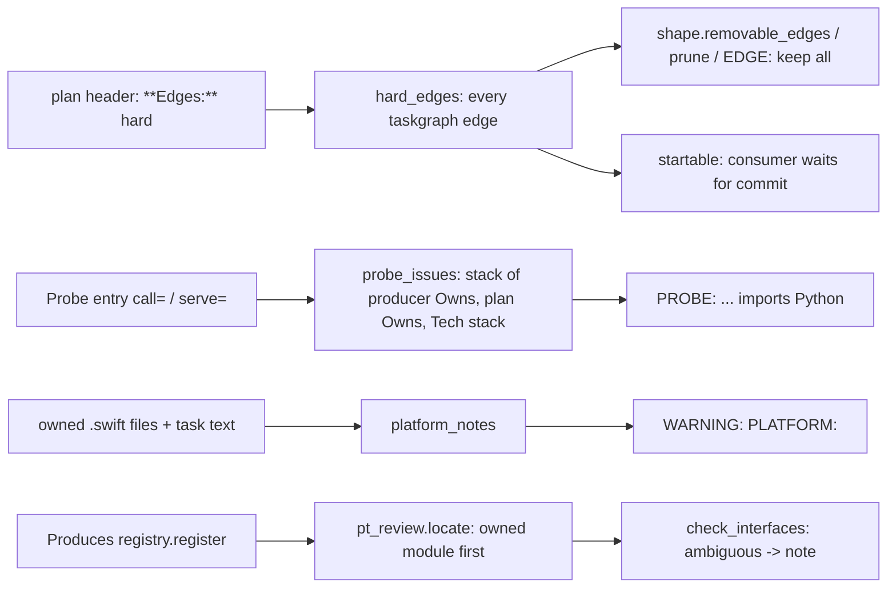
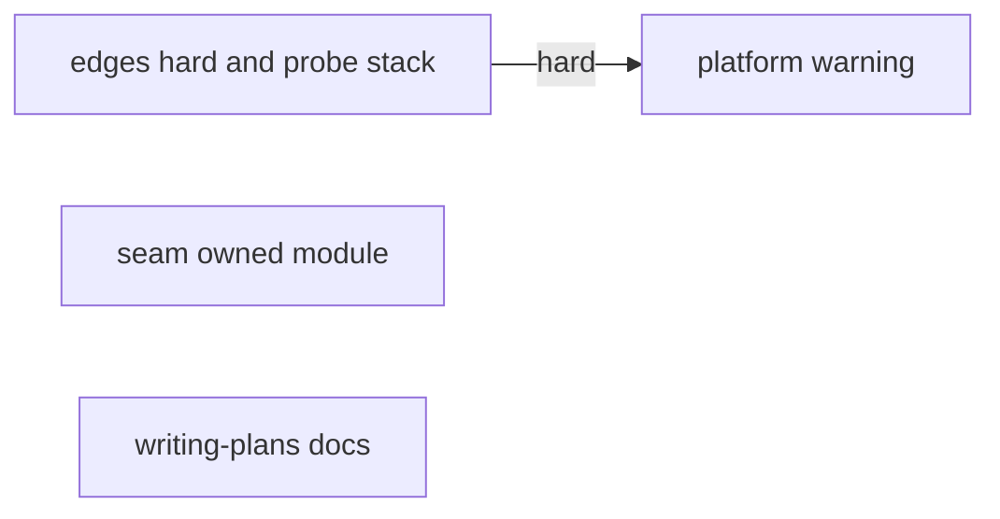

# Superlite: Edges hard switch, probe stack lint, platform build warning, seam check owned module (B93)

**Goal:** fix #491 (a per-plan switch keeps every Consumes edge for a whole-package compile), #496 (lint rejects a `call=`/`serve=` Probe entry in a plan whose code is not Python), #516 (lint flags tasks whose Swift code sits behind `#if os(...)` and needs a second platform build) and #512 (the seam check resolves a plan name to the module the owning task owns, or flags the ambiguity instead of a mismatch).
**Architecture:** #491, #496 and #516 live in `skills/subagent-driven-development/scripts/plan_tools.py` (`Plan`, `hard_edges`, `probe_issues`, a new `platform_notes` called from `lint_plan`); `shape.py` stays unchanged because it already reads `hard_edges`. #512 lives in `skills/subagent-driven-development/scripts/pt_review.py` (`locate`, `check_interfaces`, `cmd_contract`). `skills/writing-plans/SKILL.md` documents the new header line and lint messages.
**Tech stack:** Python 3.10+ stdlib, pytest (through `sl run_tests`).
**Spec:** this file, section Design; the Expected lines of issues #491, #496, #512, #516.
**Detail:** contracts
**Target-min:** 11
**Wave0:** none
**Max chars:** 30000

Global constraints:
- Every new or changed code line in `plan_tools.py` and `pt_review.py` carries the repo's trailing `# O(...)` complexity comment. Stdlib only.
- Existing tests stay green and existing test files stay unchanged; if one turns red, report it in DONE_WITH_CONCERNS with the test id and the reason instead of editing it.
- Run `sl` as an executable (`<abs>/sl ...`). Verify with the task's `run_tests --fast ... --task Tn --background`, then run the printed `wait:` line in the foreground and end the turn only after it reports. Never raw `pytest`, never the e2e or eval layers (coordinator's step).
- No version edits (the ship step bumps the version). Touch only the files in Owns; `shape.py`, `predict.py`, `testcmd.py`, `commit_task.py`, `findings.py` and every doc outside Owns stay unchanged.

Ruling: #491 switch is the plan header line `**Edges:** hard` (Max's decision: per-plan switch line); it turns every taskgraph edge into a hard edge inside `hard_edges`, so prune, `EDGE:`, the `shape:` count, `EXAMPLE:` and `startable` follow without touching shape.py - cost if wrong: a plan with the switch gets no example-based parallelism at all (that is the point of the switch).
Ruling: #496 a Probe entry's `call=` and `serve=` both import Python, so both are checked; the stack comes from the producing task's Owns extensions (call=), else the Owns of every task, else the header Tech stack line; no known language means no check - cost if wrong: a plan with only folder Owns and no Tech stack line stays unchecked, as today.
Ruling: #516 is a lint `WARNING: PLATFORM:` line, never an issue, and the predictor stays unchanged: no measured data exists to fit a second-platform cost, and `Tests: slow` is the existing lever the warning names; the warning goes quiet once the task is `Tests: slow` and its text names a platform build - cost if wrong: predictions stay low for such tasks until a refit.
Ruling: #512 owned non-test `.py` files are tried first (full module name, then a dotted suffix); two owned files that both fit and both or neither define the name are a `note:` line, not a mismatch, and that item is not compared - cost if wrong: an ambiguous item goes unchecked until the plan writes the full path.
Ruling: detail contracts; four tasks: T1 then T2 (both own plan_tools.py, hard edge), T3 and T4 parallel (T4's exact text is in this plan); no Wave 0; no probe adapter (repo tools; cases are named tests); LAYERS unit, headless, evals (evals stamped by ruling: an additive body edit of writing-plans SKILL.md that no eval case covers) - cost if wrong: about 2 min of serial build time.
Ruling: already in the lead worktree on branch superlite/b93-plan-lint-and-seam-checks - cost if wrong: none.
LAYERS: unit, headless, evals

## Design

T1 (#491, #496), plan_tools.py:
1. `Plan.header_edges_hard() -> bool`: True when the plan header (the text before the first `##`-or-deeper heading, as `header_wave0_off` reads it) has a line starting `**Edges:**` whose value starts with the word `hard` (case-insensitive; text after it is allowed, such as `hard (Swift: whole-package compile)`).
2. `hard_edges(plan)`: when `plan.header_edges_hard()`, the result also holds every `(dep, task)` edge of `parse_taskgraph(plan)`; a `PlanError` there leaves only the explicit hard edges, as today. Docstring names the header line. No other function changes for #491.
3. `LANG_EXT`: `.py`/`.pyi` Python; `.ts`, `.tsx`, `.mts`, `.cts` TypeScript; `.js`, `.jsx`, `.mjs`, `.cjs` JavaScript; `.swift` Swift; `.go` Go; `.rs` Rust; `.kt`, `.kts` Kotlin; `.java` Java; `.cs` C#; `.rb` Ruby. `owned_languages(task) -> set[str]`: the display names of the task's `written_owns` entries (a trailing ` (note)` dropped first, extension compared case-insensitively); folders and unknown extensions add nothing.
4. `stack_languages(plan) -> set[str]`: the languages named on the header's Tech stack line (`**Tech stack:**` or `Tech stack:`), whole words, case-insensitive: python, typescript, javascript (also node, node.js), swift, go (also golang), rust, kotlin, java, c# (also csharp, .net), ruby; empty when there is no such line.
5. `probe_issues`: for each `call=` or `serve=` part of a Probe entry line, before the existing checks, find its languages: `call=` with Produces candidates uses the union of `owned_languages` of the candidates' tasks (`who` = the first candidate's task id); `serve=` uses the holder task's `owned_languages` (`who` = holder). When that is empty: the union of `owned_languages` over all tasks, else `stack_languages(plan)` (`who` = none). Languages non-empty and without Python: the issue `PROBE: <key>=<target> imports Python, but <who> owns no Python file (<Langs>); use run= with a built command or **Probe entry:** none (<why>)`, or with no `who`: `PROBE: <key>=<target> imports Python, but the plan's stack is <Langs>; use run= with a built command or **Probe entry:** none (<why>)` (`<Langs>` sorted, joined `, `; `<why>` stays literal), with the existing scope rule (holder task, else plan); that part then skips the parameter checks. Otherwise the existing `call=` checks run unchanged; `serve=` keeps no other check. `run=` is never checked.

T2 (#516), plan_tools.py:
6. `platform_notes(plan, root: Path | None) -> list[str]`: per non-draft task, in plan order: conditions from (a) every line of the task's block text (`t.text`, fenced lines too) and (b) each existing local `.swift` file in its `written_owns` (`root / entry`; skipped when `root` is None, the task has `**Repo:**`, or the file is missing; read UTF-8 with `errors="replace"`). A line counts when it matches `^\s*#(?:if|elseif)\b`; its conditions are every `os(...)`, `canImport(...)` and `targetEnvironment(...)` on it, written `kind(arg)` with the argument's spaces stripped, de-duplicated in first-seen order. A task with conditions gets `WARNING: PLATFORM: <Tn> has code behind #if <c1, c2, c3> (<sources>); a build for the host platform skips it: put that platform's build in the task's steps (e.g. xcodebuild build -destination 'generic/platform=iOS') and set **Tests:** slow`: at most three conditions, then ` +N more`; `<sources>` = the owned files where one was found, as written, then `task text` when the block had one, joined `, `. No warning when the task's `Tests` field is `slow` and its block text matches `-destination\b`, `\s-sdk\s`, `--swift-sdk\b` or `--triple\b`.
7. `lint_plan` adds `platform_notes(plan, stable_root(str(plan.path)) if plan.path else None)` to the warnings right after the import warnings, inside its own `try` (`OSError`, `ValueError` give no lines). `lint --stable` already prints `WARNING` lines; a PLATFORM warning never makes a task FIX.

T3 (#512), pt_review.py:
8. `locate(root, plan, p)` first tries the owning task's non-test `.py` Owns (the `source_owns`-style list the function already builds from `plan.tasks[p.task].owns()` without `TEST_PATH_RE` matches): for `k` from `len(p.parts)` down to 1, `name = ".".join(parts[:k])`; the files whose `module_name(root, f)` equals `name`, else those whose module ends with `"." + name`. One file: return `(module_name(root, f), parts[k:], f)`. Several: keep those where `k < len(parts)` and `parts[k]` is in `_top_level_names(f)`; one left: return it; else the item is ambiguous: append `<Tn> Produces <p.qual>: <name> matches <rel a>, <rel b>; write the full module path` (`rel_to(root, f)`, plan order) to a new module list `AMBIGUOUS_NOTES` and return `("", parts, None)`. No file for any `k`: the existing steps run unchanged (package prefix, absolute name, owned files with tests, top-level names).
9. `check_interfaces` clears `AMBIGUOUS_NOTES` with the other note lists and does not compare an item whose `locate` was ambiguous (no `Mismatch` for it); it still counts in the returned number. `cmd_contract` prints each as `note: part1: <text>` in both the `--seam` and the plain branch, after the existing part1 notes. The packet's call is unchanged (no mismatch for that item).
10. The docstring's Plan conventions note: a Produces name resolves to the owning task's module first.

T4 (docs): `skills/writing-plans/SKILL.md` gets exactly the four edits in T4's Notes.

## Coverage

| Category | State | Basis |
|---|---|---|
| Scope and success criteria | settled | issue Expected lines; Max's decision on #491 |
| Domain and data model | ruled | languages from Owns extensions, then Tech stack |
| Persistence and migration | n/a | no stored format changes |
| Interfaces and contracts | ruled | header `**Edges:** hard`; PROBE and PLATFORM message texts; `note: part1:` ambiguity line |
| UI states | n/a | CLI only |
| Concurrency and state ownership | n/a | pure functions over the plan |
| Error handling and recovery | ruled | unreadable files and graph errors give no lines |
| Security and privacy | n/a | local tool |
| Performance and limits | settled | one read per owned .swift file per lint |
| Observability | settled | lint and contract output lines above |
| Testing strategy | settled | three new test files plus a docs test |
| Compatibility | ruled | Python plans and plans without the header lint as before |
| Rollout | ruled | one PR; version bump at ship |
| Research unknowns | n/a | read from the code |

## File structure
- `skills/subagent-driven-development/scripts/plan_tools.py`: Design 1-5 (T1), 6-7 (T2).
- `skills/subagent-driven-development/scripts/pt_review.py`: Design 8-10 (T3).
- `skills/writing-plans/SKILL.md`: T4's four edits.
- `tests/scripts/test_plan_edges_probe_stack_491_496.py`: T1's cases.
- `tests/scripts/test_lint_platform_516.py`: T2's cases.
- `tests/scripts/test_pt_review_locate_512.py`: T3's cases.
- `tests/scripts/test_docs_b93_writing_plans.py`: T4's cases.

## Task graph

```mermaid
%% schedule
gantt
  title Predicted schedule (mm:ss)
  dateFormat X
  axisFormat %M:%S
  section lane 1
  T1 edges hard and probe stack :t1, 0, 109s
  T2 platform warning :t2, 109, 89s
  section lane 2
  T3 seam owned module :t3, 0, 90s
  section lane 3
  T4 writing-plans docs :t4, 0, 83s
```

critical path: T1 → T2 (3.3 min) · peak width 3 · predicted build 3.3 min · predicted total ≈ 6.8 min (target ✓)

## Package: plan lint (library over plan text)
App type: library / parser. Categories: deep (header scope, fenced lines, multi-condition lines), encoding (Owns notes and ticks, case of extensions), state (taskgraph edges vs header switch).
**Probe entry:** none (repo tools; the Review Focus cases are named tests).

### T1 edges hard and probe stack · Complexity 4 · Est. context 60k
**Owns:** skills/subagent-driven-development/scripts/plan_tools.py, tests/scripts/test_plan_edges_probe_stack_491_496.py
**Components:** 2
**LOC owned:** 230
**Tests:** fast
**Model:** sonnet
**Est. time:** 2.5 min (2 components, about 230 LOC, fast tests)
**Covers:** 1, 2, 3, 4, 5
**Produces:** plan_tools.owned_languages(task: Task) -> set[str] · plan_tools.stack_languages(plan: Plan) -> set[str]
e.g. owned_languages(<task with Owns `src/text.ts, tests/text.test.ts`>) -> {"TypeScript"}
e.g. stack_languages(<plan with `**Tech stack:** TypeScript 5, Node 20`>) -> {"TypeScript", "JavaScript"}
**Review Focus:** state: `test_edges_hard_header_makes_every_edge_hard`, `test_edges_hard_waits_for_the_producer_commit_with_wave0`; deep: `test_edges_header_below_first_section_is_ignored`; encoding: `test_owns_note_and_upper_case_extension_count`.
**Test code (contracts):** tests build plans in `tmp_path` like `tests/scripts/test_lint_probe_examples.py` (`run`, `pt`, `SCRIPTS` from `test_plan_tools`), with their own `task`/`plan` helpers that take Owns and a header.
- `test_edges_hard_header_makes_every_edge_hard`: header `**Edges:** hard (Swift: whole-package compile)`; T1 Produces `mod.parse(text: str) -> Node` with `e.g. parse("1") -> Node(1)`; T2 Consumes `mod.parse(text: str) -> Node (T1)`; edge `T1 --> T2`. `pt.hard_edges(plan) == {("T1", "T2")}`; lint output has no `EDGE:` line; `plan_tools prune --plan P` prints `pruned: no removable edges` and the plan still has the line `T1 --> T2`.
- `test_without_header_the_edge_stays_removable`: the same plan without the header: lint prints a line starting `EDGE: T2 waits for T1 only for interfaces that have examples`; prune prints `pruned: T1->T2`.
- `test_edges_hard_waits_for_the_producer_commit_with_wave0`: same two plans, empty `.superlite/progress.md`: `pt.startable(plan, sl_dir)` is `{"T1"}` with the header and `{"T1", "T2"}` without.
- `test_edges_header_below_first_section_is_ignored`: `**Edges:** hard` written under a `## Design` heading: `header_edges_hard()` is False and `hard_edges` is empty.
- `test_edges_value_other_than_hard_is_ignored`: `**Edges:** soft` in the header: `hard_edges` is empty.
- `test_call_entry_in_typescript_plan_is_a_probe_error`: Tech stack TypeScript; T1 Owns `src/text.ts, tests/text.test.ts`, Produces `firstSentence(text: string) -> string`, its block's Probe entry line `call=firstSentence`. Lint exits 1 with `ISSUE: PROBE: call=firstSentence imports Python, but T1 owns no Python file (TypeScript); use run= with a built command or **Probe entry:** none (<why>)`; `lint --stable` lists that reason under T1 in stable.json `fix`.
- `test_call_entry_with_folder_owns_uses_tech_stack`: T1 Owns `src/text/` only, Tech stack `TypeScript 5, Node 20`: `PROBE: call=firstSentence imports Python, but the plan's stack is JavaScript, TypeScript; use run= ...`.
- `test_mixed_plan_python_producer_passes`: T1 Owns `src/pkg/a.py` Produces `pkg.a.first(text: str) -> str`; T2 Owns `web/app.ts`; Probe entry `call=pkg.a.first`: no `PROBE` line.
- `test_mixed_plan_typescript_producer_fails`: same plan, T2 Produces `render(text: string) -> string`, Probe entry `call=render`: `PROBE: call=render imports Python, but T2 owns no Python file (TypeScript); ...`.
- `test_serve_entry_in_swift_plan_is_a_probe_error`: Owns `Sources/App/Server.swift`, Tech stack Swift, a section-level Probe entry line `serve=App.makeServer` outside every task: plan-scoped issue `PROBE: serve=App.makeServer imports Python, but the plan's stack is Swift; ...` (stable.json `plan` side, no task in `fix` for it).
- `test_run_entry_in_typescript_plan_passes`: Probe entry `run=node dist/cli.js` in the TypeScript plan: no `PROBE` line.
- `test_python_plan_call_checks_unchanged`: Owns `.py`, Produces `mod.f(a: str, b: int) -> bool`, `call=mod.f`: the existing `PROBE: call=mod.f takes 2 required parameters; probes pass one text argument`.
- `test_owns_note_and_upper_case_extension_count`: Owns ``src/App.TS (entry)`` gives `owned_languages == {"TypeScript"}`.
**Steps:** 1 write the test file, 2 run: FAIL (record `Red run:`), 3 implement Design 1-5, 4 run: PASS.
**Notes:** verify paths: `tests/scripts/test_plan_edges_probe_stack_491_496.py tests/scripts/test_lint_probe_examples.py tests/scripts/test_shape.py tests/scripts/test_plan_tools.py`. A Probe entry line in a test plan must start the line as `**Probe entry:** ...`.

### T2 platform warning · Complexity 3 · Est. context 50k
**Owns:** skills/subagent-driven-development/scripts/plan_tools.py, tests/scripts/test_lint_platform_516.py
**Components:** 1
**LOC owned:** 160
**Tests:** fast
**Model:** sonnet
**Est. time:** 1.9 min (1 component, about 160 LOC, fast tests)
**Covers:** 6, 7
**Produces:** plan_tools.platform_notes(plan: Plan, root: Path | None) -> list[str]
e.g. platform_notes(<T1 owning Sources/App/Haptics.swift whose second line is the iOS os condition>, root) -> ["WARNING: PLATFORM: T1 has code behind #if os(iOS) (Sources/App/Haptics.swift); a build for the host platform skips it: put that platform's build in the task's steps (e.g. xcodebuild build -destination 'generic/platform=iOS') and set **Tests:** slow"]
**Review Focus:** deep: `test_several_conditions_listed_once_in_order`, `test_condition_in_task_text_warns`; state: `test_slow_task_with_destination_build_is_silent`; encoding: `test_missing_or_unreadable_file_is_skipped`.
**Test code (contracts):** files written under `tmp_path`, called as `pt.platform_notes(pt.Plan.load(p), tmp_path)` unless named otherwise.
- `test_owned_swift_file_with_if_os_warns`: `Sources/App/Haptics.swift` = `import Foundation`, the iOS os condition line, `import UIKit`, the end line; T1 Owns `Sources/App/Haptics.swift, Tests/AppTests/HapticsTests.swift`, Tests fast: exactly the `e.g.` list above.
- `test_condition_in_task_text_warns`: no file on disk; T1's block holds a fenced swift snippet whose line is an elseif with `canImport( AppKit )`: one warning naming `#if canImport(AppKit)` and `(task text)`.
- `test_several_conditions_listed_once_in_order`: file lines: an if with `os(iOS) || os(tvOS)`, later an if with `targetEnvironment(simulator)`, later an if with `os(iOS)` again, and an if with `os(watchOS)`: the warning says `#if os(iOS), os(tvOS), targetEnvironment(simulator) +1 more`.
- `test_plain_if_debug_does_not_warn`: only an if with `DEBUG`: `[]`.
- `test_slow_task_with_destination_build_is_silent`: the first file, Tests slow, Steps naming `xcodebuild build -destination 'generic/platform=iOS'`: `[]`; Tests slow without that build: one warning.
- `test_draft_task_is_skipped`: the first case with `**Status:** draft`: `[]`.
- `test_missing_or_unreadable_file_is_skipped`: Owns a `.swift` file that does not exist and a folder: `[]`; `root=None` on the first case: `[]`.
- `test_lint_prints_platform_warning_and_task_stays_stable`: the first case through `plan_tools lint --stable --plan P` (cwd `tmp_path`): output holds the warning line and stable.json `stable` holds T1.
**Steps:** 1 write the test file, 2 run: FAIL (record `Red run:`), 3 implement Design 6-7, 4 run: PASS.
**Notes:** verify paths: `tests/scripts/test_lint_platform_516.py tests/scripts/test_plan_edges_probe_stack_491_496.py tests/scripts/test_lint_probe_examples.py tests/scripts/test_plan_tools.py`. Build on T1's committed plan_tools.py and keep its code.

## Package: seam check (pt_review contract)
App type: library. Categories: deep (module name matching), state (note lists across calls).
**Probe entry:** none (repo tools; the Review Focus cases are named tests).

### T3 seam owned module · Complexity 4 · Est. context 45k
**Owns:** skills/subagent-driven-development/scripts/pt_review.py, tests/scripts/test_pt_review_locate_512.py
**Components:** 1
**LOC owned:** 170
**Tests:** fast
**Model:** sonnet
**Est. time:** 1.9 min (1 component, about 170 LOC, fast tests)
**Covers:** 8, 9, 10
**Produces:** pt_review.locate(root: Path, plan: Plan, p: Planned) -> tuple[str, list[str], Path | None]
e.g. locate(root, plan, <T1 item registry.register, T1 owns src/proj/sub/registry.py, src/proj/registry.py also exists>) -> ("proj.sub.registry", ["register"], root / "src/proj/sub/registry.py")
**Review Focus:** deep: `test_owned_module_wins_over_same_named_package_module`, `test_owned_suffix_of_two_parts`; state: `test_ambiguous_owned_modules_note_instead_of_mismatch`.
**Test code (contracts):** load pt_review by path as `tests/scripts/test_pt_review_owned_decl_383.py` does; plans written to `tmp_path / "plan.md"` with `src/proj/__init__.py` and `src/proj/sub/__init__.py` present.
- `test_owned_module_wins_over_same_named_package_module`: `src/proj/registry.py` = `def register(a, b): pass`; `src/proj/sub/registry.py` = `def register(name: str) -> None: pass`; T1 Owns `src/proj/sub/registry.py, tests/test_registry.py`, Produces `registry.register(name: str) -> None`: `locate` gives the `e.g.` result; `contract --plan P --root R` exits 0 and prints `PASS: verified: contract`.
- `test_owned_suffix_of_two_parts`: Produces `sub.registry.register(name: str) -> None`: module `proj.sub.registry`.
- `test_full_module_path_still_resolves`: Produces `proj.sub.registry.register(name: str) -> None`: module `proj.sub.registry`, contract exit 0.
- `test_two_owned_modules_pick_the_one_that_defines_the_name`: T1 owns `src/proj/a/registry.py` (defines `register`) and `src/proj/b/registry.py` (defines only `other`), both packages with `__init__.py`: module `proj.a.registry`.
- `test_ambiguous_owned_modules_note_instead_of_mismatch`: both files define `register` with different parameters: `contract` exits 0, prints `note: part1: T1 Produces registry.register: registry matches src/proj/a/registry.py, src/proj/b/registry.py; write the full module path` and no `Produces:` mismatch line; `check_interfaces(plan, root, None)` returns no mismatches and count 1.
- `test_ambiguous_note_in_seam_run`: same files, T2 Consumes `registry.register(name: str) -> None (T1)`, edge `T1 --> T2`: `contract --seam T1,T2` prints the same note line.
- `test_unowned_name_keeps_old_resolution`: T1 owns `src/proj/sub/other.py` only, Produces `registry.register(a, b) -> None`: module `proj.registry` (the package-prefix step, as before).
**Steps:** 1 write the test file, 2 run: FAIL (record `Red run:`), 3 implement Design 8-10, 4 run: PASS.
**Notes:** verify paths: `tests/scripts/test_pt_review_locate_512.py tests/scripts/test_pt_review.py tests/scripts/test_pt_review_owned_decl_383.py tests/scripts/test_adapter_and_packet.py`.

## Package: docs
App type: docs. Categories: none beyond exact text.
**Probe entry:** none (docs).

### T4 writing-plans docs · Complexity 1 · Est. context 25k
**Owns:** skills/writing-plans/SKILL.md, tests/scripts/test_docs_b93_writing_plans.py
**Components:** 1
**LOC owned:** 40
**Tests:** fast
**Kind:** mechanical
**Model:** haiku
**Est. time:** 1.6 min (1 component, about 40 LOC, fast tests)
**Test code (contracts):** `test_docs_b93_writing_plans.py` reads `skills/writing-plans/SKILL.md` (path from `Path(__file__).resolve().parents[2]`) and asserts each edit's new text: `test_header_names_edges_hard` (edit 1's inserted sentence), `test_prune_paragraph_names_edges_hard` (edit 3's inserted clause), `test_probe_entry_names_stack_error` (edit 2's inserted sentence), `test_tests_row_names_platform_warning` (edit 4's inserted sentence), each as an exact substring.
**Steps:** 1 write the test file, 2 run: FAIL (record `Red run:`), 3 make the four edits, 4 run: PASS.
**Notes:** verify path: `tests/scripts/test_docs_b93_writing_plans.py tests/scripts/test_docs_b72_skills.py`. The four edits, each an exact insertion into the current text:
1. Plan shape item 1 (Header): after `` `**Wave0:** none` (no Wave 0 skeleton; use it when the project already builds), `` insert `` `**Edges:** hard` (every taskgraph edge is hard: prune and `EDGE:` keep them all, `EXAMPLE:` skips their consumers, and a consumer waits for its producer's commit even with Wave 0 stubs; use it when a consumer cannot compile without its producer, such as a Swift package's whole-package compile), ``.
2. Review Focus rules, the Probe entry bullet: after `` `call=` and `serve=` import Python; `` insert `` lint fails `PROBE: call=<target> imports Python, but T2 owns no Python file (TypeScript)` (also for `serve=`, or `but the plan's stack is <languages>` when no Owns entry names a source file and the Tech stack line does) when the code it would import is not Python; `` and keep the rest of the sentence (`other languages use run= ...`).
3. After writing, the `prune` paragraph: after `` or list it in a `%% hard: T1->T2` line inside the taskgraph `` insert `` (or set `**Edges:** hard` in the plan header to make every edge hard) ``.
4. Task template table, the `Tests` row: append the sentence `` Swift code behind `#if os(...)`, `#if canImport(...)` or `#if targetEnvironment(...)` compiles only in that platform's build: lint prints `WARNING: PLATFORM: Tn has code behind ...` until the task is `Tests: slow` and its text names that build (`-destination`, `-sdk`, `--swift-sdk` or `--triple`). `` to the end of the row's rule cell.

## Review Focus
- state: the header switch reaches prune, `EDGE:`, `EXAMPLE:`, the shape line and `startable`; `AMBIGUOUS_NOTES` cleared per `check_interfaces` call.
- deep: header scope (before the first `##` heading only), multi-condition `#if` lines, owned-module suffix matching vs package-prefix resolution.
- encoding: Owns entries with notes, ticks and upper-case extensions; Tech stack words (`Java` vs `JavaScript`).

## Self-review
Coverage: Design 1-5 in T1, 6-7 in T2, 8-10 in T3, docs in T4. Placeholders: none (`<why>` is literal message text). Types: `header_edges_hard -> bool`, `owned_languages -> set[str]`, `stack_languages -> set[str]`, `platform_notes -> list[str]`, `locate` unchanged signature. Graph: one hard edge (shared file), no cycle; T3 and T4 parallel with distinct files. Fields: all set. Limits: four tasks inside the band; schedule and lint run below.
