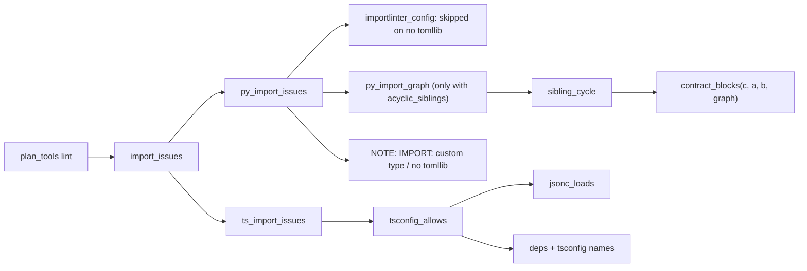
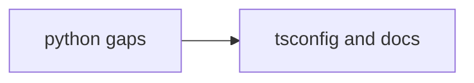

# Superlite: plan lint import check gaps (B107, #457)

**Goal:** fix #457, the follow-ups of #445: the Python seam import check also reads import-linter `acyclic_siblings` contracts, names custom contract types it cannot check, and says when a Python without `tomllib` (3.10) skips a `pyproject.toml` config; the TypeScript check reads `tsconfig.json` project references and `compilerOptions.paths` aliases. Max's decision: on Python 3.10 the `pyproject.toml` config is skipped with a lint note.
**Architecture:** all in `plan_tools.py` next to the existing checks. Python: `py_import_graph` scans the root packages' current imports (ast), `sibling_cycle` finds the cycle a planned import would close, `contract_blocks` takes the graph, `importlinter_config` reports a skipped `pyproject.toml`, `py_import_issues` prints `NOTE: IMPORT:` lines. TypeScript: `jsonc_loads` reads tsconfig files, `tsconfig_allows` maps each package to the packages its tsconfig lets it import, `ts_import_issues` counts them as dependencies.
**Tech stack:** Python 3.10+ stdlib (ast, json, configparser), pytest through `sl run_tests`, Markdown docs.
**Spec:** this file, section Design; issue #457.
**Detail:** tests
**Target-min:** 11
**Wave0:** none
**Coverage:** off
**Edges:** hard (T2 edits the same plan_tools.py and test file after T1)

Global constraints:
- Every Python code line keeps the file's trailing `# O(...)` complexity comment.
- Existing tests stay green, `tests/scripts/test_plan_lint_imports_python_404.py` and `tests/scripts/test_plan_lint_imports_ts_404.py` unchanged. An existing test file changes only when the task Owns it. If another existing test turns red, report it in DONE_WITH_CONCERNS with the test id and the reason instead of editing it.
- `importlinter_config` keeps its exact return shape for every existing case (the `skipped` key appears only on the no-tomllib path); `_il_contract` adds no key a contract does not set.
- Run `sl` as an executable (`<abs>/sl ...`). Verify with `<abs>/sl run_tests --fast <test files> --task Tn --background`, then run the printed `wait:` line in the foreground and end the turn only after it reports.
- No version edits (the ship step bumps the version). Never run `scripts/evals.sh`, `claude plugin eval` or `scripts/test_layers.py run`.

Ruling: an `acyclic_siblings` contract blocks a planned import importer -> imported when, among the children of their lowest common package P, the imported side's child already reaches the importer's child through the code's current imports (minus `ignore_imports`); P must match an `ancestors` expression or lie at most `depth` (default 10) generations below one, and no prefix of P at or below that ancestor may match `skip_descendants` (because that is the only edge set where import-linter sees the planned import; other planned seams are not added to the graph; cost if wrong: a cycle through two new seams goes unwarned).
Ruling: a contract whose type is not forbidden, layers, independence, protected or acyclic_siblings (a custom type from `contract_types`) prints `NOTE: IMPORT: import-linter contract "<name>" in <file> has type <type>, which plan lint does not check`, once per contract and lint, only when a seam's consumer owns a module under the root packages (because a note on every lint of an unrelated plan is noise; cost if wrong: a silent skip in a plan with no Python consumer).
Ruling: with no `tomllib`, a `pyproject.toml` that holds a `[tool.importlinter` table yields `{"file": "pyproject.toml", "roots": [], "contracts": [], "skipped": "Python X.Y has no tomllib"}` and py_import_issues prints `NOTE: IMPORT: pyproject.toml [tool.importlinter] not read (Python X.Y has no tomllib); the import-linter seam check is skipped (Python 3.11+ reads it)` only when a seam's consumer owns a non-test .py file (Max: skip with a lint note; no tomli fallback).
Ruling: tsconfig links only add allowed packages, never remove one; `references` count only from the package's own `tsconfig.json` (a root solution config is not a permission), `paths` from the package's nearest `tsconfig.json` (its folder, then each parent up to the root) through relative `extends`; package names still come from package.json (cost if wrong: a tsconfig-only monorepo stays unchecked, as before).
Ruling: a TS warning whose importer has tsconfig links ends `; tsconfig (<config>) allows: <names>`; the Python acyclic warning ends `; cycle a -> b -> a` inside the parenthesis; the other warning texts stay byte for byte.
Ruling: docs/tools.md (plan_tools row) and its pinned span in tests/scripts/test_docs_b67_tools.py get one sentence (T2; no open batch lists them); skills/writing-plans/SKILL.md's contract list stays (a skills body edit costs the evals layer; follow-up).
Ruling: no probe adapter (lint helpers over files; Review Focus cases are named tests); detail tests; already in the lead worktree, no `sl worktree ensure`; LAYERS unit only (scripts, tests/scripts and docs/tools.md).
LAYERS: unit



## Design

### 1. Python (T1)
- `py_import_graph(root, roots)`: every `.py` file under `root/<pkg>` and `root/src/<pkg>` for each root package (the `_py_classes` walk), module name from `py_module`; a key for every parsed module, value the set of modules under the roots it imports anywhere in the file (`ast.walk`): `import a.b` -> `a.b`; `from a.b import c` -> `a.b.c` when that is a scanned module, else `a.b`; relative imports resolve from the module's package (an `__init__.py` is its own package); names outside the roots and self-imports are dropped; a file that does not parse is no key.
- `sibling_cycle(contract, importer, imported, graph)`: the rule in the first Ruling; returns `[s1, s2, ..., s1]` (s1 the importer's child of P, then the shortest path from s2 to s1, neighbours visited in sorted order) or None. `depth` is read with `int()`, a bad value is 10.
- `contract_blocks(contract, importer, imported, graph=None)`: `acyclic_siblings` returns `bool(sibling_cycle(...))` with a graph, False without; `ignore_imports` still applies first.
- `_il_contract`: `ancestors` and `skip_descendants` join `IL_LISTS`; `depth` is set only when the raw contract has it, as an int (bad value: 10).
- `importlinter_config`: on `ImportError` for `tomllib` with a `^\s*\[\[?\s*tool\.importlinter\b` line in the file, the skipped dict of the third Ruling; otherwise unchanged.
- `py_import_issues`: the no-tomllib NOTE; custom-type NOTEs first, then warnings; the graph is built once, only when a contract is `acyclic_siblings` and seam pairs exist.

### 2. TypeScript and docs (T2)
- `jsonc_loads(text)`: drops `//` and `/* */` comments and a comma before `}` or `]` (whitespace and comments between), all outside strings, then `json.loads`; bad JSON raises ValueError.
- `tsconfig_allows(root, pkgs)`: per package, the rules of the fourth Ruling; `extends` is a string or list, only values starting `./`, `../` or `/` are followed, `.json` is added when the path lacks it and the file does not exist, at most 5 levels, a cycle stops; the config itself overrides its bases, a later list entry an earlier one; `paths` targets are cut at their first `*`, resolved against the nearest `baseUrl` in the chain (relative to the config that sets it), else against the folder of the config that sets `paths`; a reference path ending `.json` means its folder; the package whose folder is or holds the resolved path counts (deepest wins), never the package itself; unreadable or bad configs count as none.
- `ts_import_issues`: `tsconfig_allows` runs after the early returns; a module set passes when `m == importer`, `m in deps` or `m` in the importer's names.

## File structure

- `skills/subagent-driven-development/scripts/plan_tools.py`: Python import graph, sibling cycles, notes (T1); tsconfig reading (T2)
- `tests/scripts/test_plan_lint_import_check.py`: #457 tests (T1 creates, T2 appends)
- `docs/tools.md`, `tests/scripts/test_docs_b67_tools.py`: plan_tools row sentence (T2)

## Task graph

```mermaid
%% schedule
gantt
  title Predicted schedule (mm:ss)
  dateFormat X
  axisFormat %M:%S
  section lane 1
  T1 Python import-linter gaps :t1, 0, 140s
  T2 tsconfig references and aliases :t2, 140, 140s
```





critical path: T1 → T2 (4.7 min) · peak width 1 · predicted build 4.7 min · predicted total ≈ 8.2 min (target ✓)

## Lint helpers

**Probe entry:** none (lint helpers over repo files; the Review Focus cases are named tests in T1 and T2)

### T1 Python import-linter gaps · Complexity 6 (O-1) · Est. context 48k
**Owns:** skills/subagent-driven-development/scripts/plan_tools.py, tests/scripts/test_plan_lint_import_check.py
**Components:** 2
**LOC owned:** 230
**Tests:** fast
**Model:** sonnet
**Kind:** design
**Est. time:** 4 min (2 components, about 230 LOC, fast tests)
**Consumes:** none
**Produces:** py_import_graph(root: Path, roots: list[str]) -> dict[str, set[str]] · sibling_cycle(contract: dict, importer: str, imported: str, graph: dict[str, set[str]]) -> list[str] | None · contract_blocks(contract: dict, importer: str, imported: str, graph: dict[str, set[str]] | None = None) -> bool
**Review Focus:** `test_import_graph_resolves_absolute_relative_and_names` (relative levels, broken file); `test_sibling_cycle_depth_skip_and_ignore` (depth 0 vs 1, wildcard skip); `test_no_tomllib_note` (ImportError path)
**Test code (verbatim):**
```python
"""Plan lint import check gaps (#457): acyclic_siblings, custom contracts, no tomllib, tsconfig."""
from __future__ import annotations

import importlib.util
import json
import sys
from pathlib import Path

import pytest

ROOT = Path(__file__).resolve().parents[2]
SCRIPTS = ROOT / "skills" / "subagent-driven-development" / "scripts"
sys.path.insert(0, str(SCRIPTS))
_spec = importlib.util.spec_from_file_location("plan_tools", SCRIPTS / "plan_tools.py")
plan_tools = importlib.util.module_from_spec(_spec)
sys.modules["plan_tools"] = plan_tools
_spec.loader.exec_module(plan_tools)

PLAN = '''# Plan
**Goal:** test.

### T1 producer · Complexity 3 (O-1) · Est. context 40k
**Owns:** {t1}
**Produces:** {item}
**Consumes:** none

### T2 consumer · Complexity 3 (O-1) · Est. context 40k
**Owns:** {t2}
**Produces:** Model()
**Consumes:** {item} (T1)
'''
PY_ITEM = "load(order: Order) -> Receipt"
ACYCLIC = "[importlinter]\nroot_package = shop\n\n[importlinter:contract:acyc]\nname = Acyclic\ntype = acyclic_siblings\nancestors = shop\n"
CUSTOM = "[importlinter]\nroot_package = shop\ncontract_types =\n    no_print: shop_lint.NoPrint\n\n[importlinter:contract:np]\nname = No print\ntype = no_print\n"
PYPROJECT = '[tool.importlinter]\nroot_package = "shop"\n\n[[tool.importlinter.contracts]]\nname = "Layers"\ntype = "layers"\nlayers = ["shop.a", "shop.b"]\n'
WARN = ('WARNING: IMPORT: T2 consumes load(order: Order) -> Receipt from T1, but load is declared in shop.a.x, '
        'which shop.b.y may not import (import-linter contract ')


def write(p: Path, text: str) -> None:
    p.parent.mkdir(parents=True, exist_ok=True)
    p.write_text(text, encoding="utf-8")


def plan_in(root: Path, t1: str, t2: str, item: str = PY_ITEM):
    write(root / "plan.md", PLAN.format(t1=t1, t2=t2, item=item))
    return plan_tools.Plan.load(str(root / "plan.md"))


def shop(root: Path, a_x: str = "from shop.b import y\n", b_y: str = "") -> None:
    for f in ("shop/__init__.py", "shop/a/__init__.py", "shop/b/__init__.py"):
        write(root / f, "")
    write(root / "shop/a/x.py", a_x)
    write(root / "shop/b/y.py", b_y)


def test_import_graph_resolves_absolute_relative_and_names(tmp_path):
    shop(tmp_path, a_x="from shop.b import y\nimport shop.c\n", b_y="from ..a import x\nfrom . import helpers\nimport os\n")
    write(tmp_path / "shop/b/helpers.py", "from .y import thing\n")
    write(tmp_path / "shop/c.py", "def f():\n    from shop.a.x import load\n")
    write(tmp_path / "shop/broken.py", "def (:\n")
    g = plan_tools.py_import_graph(tmp_path, ["shop"])
    assert g["shop.a.x"] == {"shop.b.y", "shop.c"}
    assert g["shop.b.y"] == {"shop.a.x", "shop.b.helpers"}
    assert g["shop.b.helpers"] == {"shop.b.y"}
    assert g["shop.c"] == {"shop.a.x"}
    assert g["shop"] == set() and g["shop.a"] == set()
    assert "shop.broken" not in g


def test_import_graph_src_layout(tmp_path):
    write(tmp_path / "src/shop/__init__.py", "")
    write(tmp_path / "src/shop/a.py", "from shop import b\n")
    write(tmp_path / "src/shop/b.py", "")
    assert plan_tools.py_import_graph(tmp_path, ["shop"]) == {"shop": set(), "shop.a": {"shop.b"}, "shop.b": set()}


def test_sibling_cycle_values():
    c = {"type": "acyclic_siblings", "name": "A", "ancestors": ["shop"]}
    g = {"shop.a.x": {"shop.b.y"}, "shop.b.y": set()}
    f = plan_tools.sibling_cycle
    assert f(c, "shop.b.y", "shop.a.x", g) == ["shop.b", "shop.a", "shop.b"]
    assert f(c, "shop.a.x", "shop.b.y", g) is None
    assert f(c, "shop.a.x", "shop.a.z", g) is None
    assert f(c, "shop.b.y", "other.a", g) is None
    assert f(c, "shop.a", "shop.a.x", g) is None
    g3 = {"shop.a.x": {"shop.b.y"}, "shop.b.y": {"shop.c.z"}, "shop.c.z": set()}
    assert f(c, "shop.c.z", "shop.a.x", g3) == ["shop.c", "shop.a", "shop.b", "shop.c"]


def test_sibling_cycle_depth_skip_and_ignore():
    g = {"shop.p.a.x": {"shop.p.b.y"}}
    f = plan_tools.sibling_cycle
    base = {"type": "acyclic_siblings", "ancestors": ["shop"]}
    cyc = ["shop.p.b", "shop.p.a", "shop.p.b"]
    assert f(base, "shop.p.b.y", "shop.p.a.x", g) == cyc
    assert f({**base, "depth": 0}, "shop.p.b.y", "shop.p.a.x", g) is None
    assert f({**base, "depth": 1}, "shop.p.b.y", "shop.p.a.x", g) == cyc
    assert f({**base, "depth": "x"}, "shop.p.b.y", "shop.p.a.x", g) == cyc
    assert f({**base, "skip_descendants": ["shop.p"]}, "shop.p.b.y", "shop.p.a.x", g) is None
    assert f({**base, "skip_descendants": ["shop.*"]}, "shop.p.b.y", "shop.p.a.x", g) is None
    assert f({**base, "ancestors": ["shop.*"]}, "shop.p.b.y", "shop.p.a.x", g) == cyc
    assert f({**base, "ancestors": ["other"]}, "shop.p.b.y", "shop.p.a.x", g) is None
    assert f({**base, "ignore_imports": ["shop.p.a.x -> shop.p.b.y"]}, "shop.p.b.y", "shop.p.a.x", g) is None
    assert f({**base, "ignore_imports": ["shop.p.a.* -> shop.p.b.*"]}, "shop.p.b.y", "shop.p.a.x", g) is None


def test_contract_blocks_acyclic_needs_graph():
    c = {"type": "acyclic_siblings", "ancestors": ["shop"]}
    g = {"shop.a.x": {"shop.b.y"}}
    assert plan_tools.contract_blocks(c, "shop.b.y", "shop.a.x", g) is True
    assert plan_tools.contract_blocks(c, "shop.b.y", "shop.a.x") is False
    assert plan_tools.contract_blocks({**c, "ignore_imports": ["shop.b.y -> shop.a.x"]}, "shop.b.y", "shop.a.x", g) is False


def test_config_reads_acyclic_options(tmp_path):
    write(tmp_path / ".importlinter", ACYCLIC + "depth = 3\nskip_descendants =\n    shop.p\n")
    c = plan_tools.importlinter_config(tmp_path)["contracts"][0]
    assert c["type"] == "acyclic_siblings" and c["ancestors"] == ["shop"]
    assert c["depth"] == 3 and c["skip_descendants"] == ["shop.p"]
    write(tmp_path / ".importlinter", ACYCLIC + "depth = deep\n")
    assert plan_tools.importlinter_config(tmp_path)["contracts"][0]["depth"] == 10
    write(tmp_path / ".importlinter", ACYCLIC)
    assert "depth" not in plan_tools.importlinter_config(tmp_path)["contracts"][0]


def test_acyclic_seam_warns(tmp_path):
    write(tmp_path / ".importlinter", ACYCLIC)
    shop(tmp_path)
    out = plan_tools.import_issues(plan_in(tmp_path, "shop/a/x.py", "shop/b/y.py"), tmp_path)
    assert out == [WARN + '"Acyclic" in .importlinter; cycle shop.b -> shop.a -> shop.b)']


def test_acyclic_no_cycle_silent(tmp_path):
    write(tmp_path / ".importlinter", ACYCLIC)
    shop(tmp_path, a_x="")
    assert plan_tools.import_issues(plan_in(tmp_path, "shop/a/x.py", "shop/b/y.py"), tmp_path) == []


def test_custom_contract_note(tmp_path):
    write(tmp_path / ".importlinter", CUSTOM)
    out = plan_tools.import_issues(plan_in(tmp_path, "shop/a/x.py", "shop/b/y.py"), tmp_path)
    assert out == ['NOTE: IMPORT: import-linter contract "No print" in .importlinter has type no_print, which plan lint does not check']


def test_custom_contract_note_before_warnings(tmp_path):
    write(tmp_path / ".importlinter", CUSTOM + "\n[importlinter:contract:lay]\nname = Layers\ntype = layers\nlayers =\n    shop.a\n    shop.b\n")
    out = plan_tools.import_issues(plan_in(tmp_path, "shop/a/x.py", "shop/b/y.py"), tmp_path)
    assert out == ['NOTE: IMPORT: import-linter contract "No print" in .importlinter has type no_print, which plan lint does not check',
                   WARN + '"Layers" in .importlinter)']


def test_custom_contract_note_needs_python_consumer(tmp_path):
    write(tmp_path / ".importlinter", CUSTOM)
    assert plan_tools.import_issues(plan_in(tmp_path, "web/a.ts", "web/b.ts"), tmp_path) == []


def test_no_tomllib_note(tmp_path, monkeypatch):
    monkeypatch.setitem(sys.modules, "tomllib", None)
    write(tmp_path / "pyproject.toml", PYPROJECT)
    v = f"{sys.version_info[0]}.{sys.version_info[1]}"
    assert plan_tools.importlinter_config(tmp_path) == {"file": "pyproject.toml", "roots": [], "contracts": [],
                                                       "skipped": f"Python {v} has no tomllib"}
    out = plan_tools.import_issues(plan_in(tmp_path, "shop/a/x.py", "shop/b/y.py"), tmp_path)
    assert out == [f"NOTE: IMPORT: pyproject.toml [tool.importlinter] not read (Python {v} has no tomllib); "
                   "the import-linter seam check is skipped (Python 3.11+ reads it)"]


def test_no_tomllib_quiet_cases(tmp_path, monkeypatch):
    monkeypatch.setitem(sys.modules, "tomllib", None)
    write(tmp_path / "pyproject.toml", "[project]\nname = 'x'\n")
    assert plan_tools.importlinter_config(tmp_path) is None
    write(tmp_path / "pyproject.toml", PYPROJECT)
    assert plan_tools.import_issues(plan_in(tmp_path, "web/a.ts", "web/b.ts"), tmp_path) == []
    write(tmp_path / ".importlinter", "[importlinter]\nroot_package = shop\n")
    assert plan_tools.importlinter_config(tmp_path) == {"file": ".importlinter", "roots": ["shop"], "contracts": []}


def test_layers_text_unchanged_with_tomllib(tmp_path):
    write(tmp_path / "pyproject.toml", PYPROJECT)
    out = plan_tools.import_issues(plan_in(tmp_path, "shop/a/x.py", "shop/b/y.py"), tmp_path)
    assert out == [WARN + '"Layers" in pyproject.toml)']
```
**Steps:** 1 write the test file, 2 run: FAIL, 3 implement Design 1, 4 run: PASS
**Verify:** `<abs sl> run_tests --fast tests/scripts/test_plan_lint_import_check.py tests/scripts/test_plan_lint_imports_python_404.py --task T1 --background`
**Notes:** `json` and `pytest` imports serve T2's tests. The consumer's non-test .py check for the no-tomllib note reuses `_py_owned`'s filter (extract it into a small helper if needed). Keep `test_py_declarations_scanned_once` green: the import graph is built only when a contract is `acyclic_siblings`.

### T2 tsconfig references and aliases · Complexity 5 (O-1) · Est. context 46k
**Owns:** skills/subagent-driven-development/scripts/plan_tools.py, tests/scripts/test_plan_lint_import_check.py, docs/tools.md, tests/scripts/test_docs_b67_tools.py
**Components:** 2
**LOC owned:** 190
**Tests:** fast
**Model:** sonnet
**Kind:** design
**Est. time:** 3.5 min (2 components, about 190 LOC, fast tests)
**Consumes:** none
**Produces:** jsonc_loads(text: str) -> object · tsconfig_allows(root: Path, pkgs: dict[str, dict]) -> dict[str, dict]
**Review Focus:** `test_jsonc_loads_values` (comment markers inside strings); `test_tsconfig_bad_inputs_quiet` (extends cycle, package-name extends, bad JSON); `test_tsconfig_override_and_ancestor_references` (solution config is no permission)
**Test code (verbatim, appended to tests/scripts/test_plan_lint_import_check.py):**
```python
TS_ITEM = "loadOrder(id: string) -> Order"


def pkg(root: Path, rel: str, name: str, **extra) -> None:
    data = {"name": name}
    data.update(extra)
    write(root / rel / "package.json", json.dumps(data))


def ts_two(root: Path) -> None:
    pkg(root, "packages/core", "@shop/core")
    pkg(root, "packages/web", "@shop/web", dependencies={"react": "18"})


def ts_plan(root: Path):
    return plan_in(root, "packages/core/src/order.ts", "packages/web/src/page.tsx", TS_ITEM)


def allows(root: Path):
    return plan_tools.tsconfig_allows(root, plan_tools.ts_packages(root))


def test_jsonc_loads_values():
    f = plan_tools.jsonc_loads
    assert f('{"a": 1, // note\n "b": [2, 3,],\n /* block\n */ "c": {"d": "x",},}') == {"a": 1, "b": [2, 3], "c": {"d": "x"}}
    assert f('{"u": "http://x/*y*/", "v": "a // b", "w": "q\\"//"}') == {"u": "http://x/*y*/", "v": "a // b", "w": 'q"//'}
    assert f('[1, /* c */ ]') == [1]
    with pytest.raises(ValueError):
        f('{"a": }')


def test_tsconfig_references_allow(tmp_path):
    ts_two(tmp_path)
    write(tmp_path / "packages/web/tsconfig.json", '{\n  // project refs\n  "references": [{"path": "../core"},],\n}')
    assert allows(tmp_path) == {"@shop/web": {"names": ["@shop/core"], "config": "packages/web/tsconfig.json"}}
    assert plan_tools.ts_import_issues(ts_plan(tmp_path), tmp_path) == []


def test_tsconfig_reference_to_file(tmp_path):
    ts_two(tmp_path)
    write(tmp_path / "packages/web/tsconfig.json", '{"references": [{"path": "../core/tsconfig.build.json"}]}')
    assert allows(tmp_path)["@shop/web"]["names"] == ["@shop/core"]


def test_tsconfig_paths_through_extends(tmp_path):
    ts_two(tmp_path)
    write(tmp_path / "tsconfig.base.json", '{"compilerOptions": {"baseUrl": ".", "paths": '
          '{"@shop/core/*": ["packages/core/src/*"], "@x": ["vendor/x"]}}}')
    write(tmp_path / "packages/web/tsconfig.json", '{"extends": "../../tsconfig.base.json", "compilerOptions": {"strict": true}}')
    assert allows(tmp_path) == {"@shop/web": {"names": ["@shop/core"], "config": "packages/web/tsconfig.json"}}
    assert plan_tools.ts_import_issues(ts_plan(tmp_path), tmp_path) == []


def test_tsconfig_paths_without_baseurl_and_nearest_config(tmp_path):
    ts_two(tmp_path)
    write(tmp_path / "tsconfig.json", '{"compilerOptions": {"paths": {"@core": ["./packages/core/src/index.ts"]}}}')
    assert allows(tmp_path) == {"@shop/web": {"names": ["@shop/core"], "config": "tsconfig.json"}}


def test_tsconfig_override_and_ancestor_references(tmp_path):
    ts_two(tmp_path)
    pkg(tmp_path, "packages/util", "@shop/util")
    write(tmp_path / "tsconfig.json", '{"files": [], "references": [{"path": "packages/core"}, {"path": "packages/web"}]}')
    assert allows(tmp_path) == {}
    write(tmp_path / "base.json", '{"compilerOptions": {"paths": {"@core": ["packages/core/src"]}}}')
    write(tmp_path / "packages/web/tsconfig.json", '{"extends": ["../../base"], "compilerOptions": '
          '{"baseUrl": "..", "paths": {"@util": ["util/src"]}}}')
    assert allows(tmp_path) == {"@shop/web": {"names": ["@shop/util"], "config": "packages/web/tsconfig.json"}}


def test_tsconfig_bad_inputs_quiet(tmp_path):
    ts_two(tmp_path)
    write(tmp_path / "packages/web/tsconfig.json", '{"extends": ["@tsconfig/node20/tsconfig.json", "./a.json"]}')
    write(tmp_path / "packages/web/a.json", '{"extends": "./tsconfig.json"}')
    write(tmp_path / "packages/core/tsconfig.json", "{not json")
    assert allows(tmp_path) == {}


def test_tsconfig_names_in_warning(tmp_path):
    ts_two(tmp_path)
    pkg(tmp_path, "packages/util", "@shop/util")
    write(tmp_path / "packages/web/tsconfig.json", '{"references": [{"path": "../util"}]}')
    assert plan_tools.ts_import_issues(ts_plan(tmp_path), tmp_path) == [
        "WARNING: IMPORT: T2 consumes loadOrder(id: string) -> Order from T1, but loadOrder is declared in @shop/core, "
        "which package @shop/web may not import (packages/web/package.json) dependencies: react; "
        "tsconfig (packages/web/tsconfig.json) allows: @shop/util"]


def test_tsconfig_absent_text_unchanged(tmp_path):
    ts_two(tmp_path)
    assert plan_tools.ts_import_issues(ts_plan(tmp_path), tmp_path) == [
        "WARNING: IMPORT: T2 consumes loadOrder(id: string) -> Order from T1, but loadOrder is declared in @shop/core, "
        "which package @shop/web may not import (packages/web/package.json) dependencies: react"]
```
**Steps:** 1 append the tests, 2 run: FAIL, 3 implement Design 2, 4 run: PASS, 5 docs: in `docs/tools.md` (plan_tools row) and in the `PLAN_TOOLS` constant of `tests/scripts/test_docs_b67_tools.py`, right after `and a Python or TypeScript producer is checked against its home module.`, insert this text with one leading space: ``Python `acyclic_siblings` contracts are checked against the code's current imports (a planned import must not close a cycle between siblings); a custom contract type, or a `pyproject.toml` config on a Python without `tomllib` (3.10), is not checked and prints `NOTE: IMPORT: ...`. A TypeScript package's `tsconfig.json` `references` and its `compilerOptions.paths` aliases (through relative `extends`) count as dependencies.``
**Verify:** `<abs sl> run_tests --fast tests/scripts/test_plan_lint_import_check.py tests/scripts/test_plan_lint_imports_ts_404.py tests/scripts/test_docs_b67_tools.py tests/scripts/test_docs_b95_tools.py --task T2 --background`
**Notes:** keep T1's tests and code as committed; `_target_of` matches a file path, so look up a folder through a path inside it.

## Review Focus

Package `Lint helpers`: app type library/parser; categories deep (import and extends cycles), encoding (JSONC strings, comment markers), file (missing, unreadable, bad configs). Specific risks: a relative import above the root package, an `extends` cycle, a `paths` target outside every package. Cases are the named tests in T1 and T2.

## Self-review

Coverage: the three #457 bullets map to T1 (acyclic_siblings, custom contracts, Python 3.10) and T2 (tsconfig references and aliases). No placeholders. T1 and T2 share files, so the one hard edge orders them. Every task has Components, LOC owned, Tests and Model.
