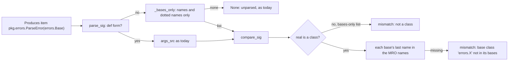
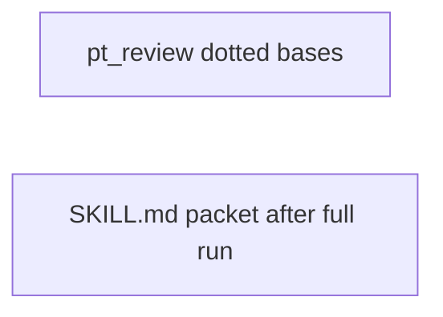

# Superlite: dotted class bases in Produces, review packet after the full run (B98)

**Goal:** fix #453: `pt_review.parse_sig` reads a Produces class item whose argument list is a class bases list with a dotted name (`pkg.errors.ParseError(errors.Base)`) and the contract check compares those bases with the class's MRO; fix #460: SDD `SKILL.md` Final review runs the full suite and waits for it before it builds the review packet, so the packet is never older than the full run (Max's decision: reorder the SKILL.md steps).
**Architecture:** `pt_review.py` gets one helper, `_bases_only(args_src)`: when the argument list does not parse as a def parameter list, it reads it as a class bases list of names and dotted names. `parse_sig` and `_base_names` fall back to it; `compare_sig` compares each base by its last name and never runs the parameter compare on a bases-only list. `SKILL.md` Final review: diagram, step 2 and the batching line reordered within the 11700-character cap. Two independent tasks.
**Tech stack:** Python 3.10+ stdlib (ast), pytest (through `sl run_tests`), Markdown.
**Spec:** this file, section Design; issues #453 and #460 Expected lines.
**Detail:** tests
**Target-min:** 11
**Wave0:** none

Global constraints:
- Every new or changed line in `pt_review.py` keeps the file's trailing `# O(...)` complexity comment.
- `skills/subagent-driven-development/SKILL.md` stays at most 11700 characters (`len(text)`), pinned by several existing tests.
- Existing tests stay green. An existing test file changes only when the task Owns it. If another existing test turns red, report it in DONE_WITH_CONCERNS with the test id and the reason instead of editing it.
- Run `sl` as an executable (`<abs>/sl ...`). Verify with `<abs>/sl run_tests --fast <own test files> --task Tn --background`, then run the printed `wait:` line in the foreground and end the turn only after it reports.
- No version edits (the ship step bumps the version). Never run `scripts/evals.sh`, `claude plugin eval` or `scripts/test_layers.py run`.

Ruling: a bases list is read only when the def form fails, and only when every base is a name or a dotted name with no keyword (`metaclass=`), starred, subscripted or called base; anything else stays unparsed as today - cost if wrong: such an item stays unchecked, as before.
Ruling: a dotted base matches by its last name (`errors.Base` against the MRO name `Base`), because the real side lists bare `__name__`s and `_Norm` already reads `http.server.X` as `X` - cost if wrong: two same-named bases from different modules pass.
Ruling: a bases-only list on something that is not a class is a mismatch (`planned base classes (...), but it is not a class`), never a parameter compare (which would raise SyntaxError) - cost if wrong: one extra mismatch line.
Ruling: #460 waits in step 2 with the full run's printed `wait:` line, then builds the packet; the batching line names both waits; no pt_review or finish.py change (finish.py belongs to B100) - cost if wrong: the reviewer starts a few minutes later.
Ruling: detail tests; no probe adapter (a checker and a doc; Review Focus cases are named tests); already in the lead worktree, so no `sl worktree ensure`; the SKILL.md test goes in a new file `tests/scripts/test_docs_b98_sdd.py` (no open batch lists it) - cost if wrong: one NEEDS_CONTEXT round.
LAYERS: unit, headless, evals



## Design

### 1. Dotted bases in pt_review (T1)
- New `_bases_only(args_src: str) -> list[str] | None`: `None` when `def _f(<args_src>): pass` parses (a def list is never a bases-only list) or when `class _C(<args_src>): pass` does not parse; `None` when the class node has keywords, no bases, or a base that is not an `ast.Name` or an `ast.Attribute` chain ending in an `ast.Name`; else `[ast.unparse(b) for b in bases]` (`"Exception, pkg.errors.Base"` -> `["Exception", "pkg.errors.Base"]`).
- `parse_sig`: where the def form's `SyntaxError` now returns `None`, return `None` only when `_bases_only(args)` is also `None`; otherwise return `(name, args, ret)` as for the def form.
- `_base_names`: on the `SyntaxError` from `_params_from_src`, return `_bases_only(args_src)`.
- `compare_sig`, after the `declared` early return: `only = _bases_only(p.args_src) if p.args_src is not None else None`; when `only` and `bases is None`: return `[f"{p.qual}: planned base classes ({p.args_src}), but it is not a class"]`. The base check compares `n.rsplit(".", 1)[-1]` with `bases` and runs when `names` and (`real.get("params") is None` or `only` or every last name is in `bases`); its message keeps the name as planned (`base class 'errors.KeyError' not in its bases (...)`).
- Module docstring line 24: after "lists its bases" add ", a dotted base (`errors.Base`) matched by its last name".

### 2. Packet after the full run in SDD SKILL.md (T2)
Exact replacements in `skills/subagent-driven-development/SKILL.md` (result 11686 characters):
- `- Every test run is \`run_tests ... --background\`; wait once (Final review 5).` -> `- Every test run is \`run_tests ... --background\`; wait in Final review 2 and 5.`
- Diagram lines `  G[all tasks reviewed + committed] --> PK[packet from existing summary]` and `  G --> ST[run_tests --full, background]` -> `  G[all tasks reviewed + committed] --> ST[run_tests --full, wait]` and `  ST --> PK[packet from its summary]`; delete the line `  ST --> V`.
- Step 2: `2. Build the packet: ` -> `2. \`run_tests --full --background\`, then its \`wait:\` line. Then build the packet: `; `uses the test summary,` -> `uses that run's summary,`; delete the trailing ` Same message: \`run_tests --full --background\`, no wait.`

## Coverage

| Category | State | Basis |
|---|---|---|
| Scope and success criteria | settled | #453 and #460 Expected lines; Max: reorder SKILL.md steps |
| Domain and data model | n/a | no data change |
| Persistence and migration | n/a | no stored data |
| Interfaces and contracts | ruled | Produces syntax gains dotted bases; parse_sig return shape unchanged |
| UI states | n/a | none |
| Concurrency and state ownership | n/a | none |
| Error handling and recovery | ruled | a bases list on a non-class is a mismatch, never a crash |
| Security and privacy | n/a | ast parse only, no eval |
| Performance and limits | ruled | one or two extra ast parses per item; SKILL.md 11686 of 11700 |
| Observability | settled | mismatch lines as today |
| Testing strategy | settled | named pytest cases; a doc test for SKILL.md |
| Compatibility | settled | def-form items parse and compare as before |
| Rollout | ruled | one PR; version bump at ship |
| Research unknowns | n/a | none |

## File structure
- `skills/subagent-driven-development/scripts/pt_review.py`: `_bases_only`, parse_sig, _base_names, compare_sig, docstring (T1).
- `tests/scripts/test_pt_review.py`: #453 cases (T1).
- `skills/subagent-driven-development/SKILL.md`: Final review order (T2).
- `tests/scripts/test_docs_b98_sdd.py`: new, #460 doc test (T2).

## Task graph

```mermaid
%% schedule
gantt
  title Predicted schedule (mm:ss)
  dateFormat X
  axisFormat %M:%S
  section lane 1
  T1 pt_review reads dotted class bases :t1, 0, 95s
  section lane 2
  T2 SKILL.md builds the packet after the :t2, 0, 95s
```




critical path: T1 (1.6 min) · peak width 2 · predicted build 1.6 min · predicted total ≈ 5.1 min (target ✓)

## Package: pt_review contract check
App type: library / parser. Categories: deep (nested dotted names), encoding (backticked items, odd bases), state (class vs function, own `__init__`). Specific risks: the parameter compare raising SyntaxError on a bases list; a keyword or subscripted base parsed as a bases list; def-form items changing behaviour.
**Probe entry:** none (Ruling: no probe adapter).

### T1 pt_review reads dotted class bases · Complexity 4 · Est. context 34k
**Owns:** skills/subagent-driven-development/scripts/pt_review.py, tests/scripts/test_pt_review.py
**Components:** 1
**LOC owned:** 95
**Tests:** fast
**Model:** sonnet
**Est. time:** 2.0 min (1 component, about 95 LOC, fast tests)
**Covers:** 1
**Consumes:** none
**Produces:** none
**Review Focus:** encoding: `test_parse_sig_reads_dotted_bases` (keyword, starred, subscripted, called bases stay `None`); deep: `test_base_names_dotted`; state: `test_dotted_base_on_class_with_init_checks_bases_only`, `test_dotted_base_on_a_function_is_a_mismatch`; compatibility: `test_parse_sig_def_form_unchanged`.
**Test code (verbatim):** append to tests/scripts/test_pt_review.py:
```python
# --- #453: a dotted base in a Produces class item ---------------------------------------------------------------------

DOTTED_ERRORS = '''\
class Base(Exception):
    pass


class ParseError(Base):
    pass


class CodedError(ValueError):
    def __init__(self, msg: str, code: int = 1) -> None:
        super().__init__(msg)
        self.code = code


def boom(n: int) -> None:
    raise ParseError(n)
'''


def _dotted_check(root: Path, produces: str) -> tuple[list[str], int]:
    (root / "src" / "pkg").mkdir(parents=True)
    (root / "src" / "pkg" / "__init__.py").write_text("", encoding="utf-8")
    (root / "src" / "pkg" / "errors.py").write_text(DOTTED_ERRORS, encoding="utf-8")
    (root / "plan.md").write_text(
        "# p\n\n```mermaid\nflowchart LR\n%% taskgraph\nT1\n```\n\n"
        f"### T1 errors · Complexity 3\n**Owns:** src/pkg/errors.py\n**Produces:** {produces}\n\n"
        "## Review Focus\n- errors: state\n", encoding="utf-8")
    out, n = pt_review.check_interfaces(pt_review.parse_plan(root / "plan.md"), root, None)
    return [m.msg for m in out], n


@pytest.mark.parametrize("item, want", [
    ("pkg.errors.ParseError(errors.Base)", ("pkg.errors.ParseError", "errors.Base", None)),
    ("`pkg.errors.ParseError(Exception, pkg.errors.Base)`",
     ("pkg.errors.ParseError", "Exception, pkg.errors.Base", None)),
    ("pkg.errors.ParseError(errors.Base) -> None", ("pkg.errors.ParseError", "errors.Base", "None")),
    ("pkg.errors.ParseError(typing.Generic[T])", None),
    ("pkg.errors.ParseError(errors.make())", None),
    ("pkg.errors.ParseError(errors.Base, metaclass=Meta)", None),
    ("pkg.errors.ParseError(*errors.bases)", None),
    ("pkg.errors.ParseError(a.b=1)", None),
])
def test_parse_sig_reads_dotted_bases(item, want):
    assert pt_review.parse_sig(item) == want


def test_parse_sig_def_form_unchanged():
    assert pt_review.parse_sig("pkg.mod.f(a: int, b=1) -> str") == ("pkg.mod.f", "a: int, b=1", "str")
    assert pt_review.parse_sig("pkg.errors.ParseError(Exception)") == ("pkg.errors.ParseError", "Exception", None)
    assert pt_review.parse_sig("pkg.mod.f(a b)") is None


@pytest.mark.parametrize("args_src, names", [
    ("errors.Base", ["errors.Base"]),
    ("Exception, pkg.errors.Base", ["Exception", "pkg.errors.Base"]),
    ("typing.Generic[T]", None),
    ("errors.Base, metaclass=Meta", None),
    ("Exception", ["Exception"]),
])
def test_base_names_dotted(args_src, names):
    assert pt_review._base_names(args_src) == names


def test_dotted_base_matches_by_last_name(tmp_path):
    produces = ("pkg.errors.ParseError(errors.Base) · pkg.errors.ParseError(pkg.errors.Base) · "
                "pkg.errors.ParseError(builtins.Exception) · pkg.errors.ParseError(Exception, errors.Base)")
    assert _dotted_check(tmp_path, produces) == ([], 4)


def test_wrong_dotted_base_is_a_mismatch(tmp_path):
    msgs, n = _dotted_check(tmp_path, "pkg.errors.ParseError(errors.KeyError)")
    assert (msgs, n) == (["T1 Produces: pkg.errors.ParseError: base class 'errors.KeyError' not in its bases "
                          "(Base, Exception, BaseException, object)"], 1)


def test_dotted_base_on_class_with_init_checks_bases_only(tmp_path):
    assert _dotted_check(tmp_path / "a", "pkg.errors.CodedError(builtins.ValueError)") == ([], 1)
    msgs, _n = _dotted_check(tmp_path / "b", "pkg.errors.CodedError(errors.Base)")
    assert msgs == ["T1 Produces: pkg.errors.CodedError: base class 'errors.Base' not in its bases "
                    "(ValueError, Exception, BaseException, object)"]


def test_dotted_base_on_a_function_is_a_mismatch(tmp_path):
    msgs, n = _dotted_check(tmp_path, "pkg.errors.boom(errors.Base)")
    assert (msgs, n) == (["T1 Produces: pkg.errors.boom: planned base classes (errors.Base), but it is not a class"], 1)
```
**Steps:** 1 append the tests, 2 run: FAIL, 3 implement Design section 1, 4 run: PASS (also `tests/scripts/test_pt_review_exception_class_415.py`, unchanged).
**Notes:** `_bases_only` checks an `ast.Attribute` chain by walking `.value` until a non-Attribute node, which must be an `ast.Name`.

## Package: SDD SKILL.md
App type: docs. Categories: none beyond the doc test. **Probe entry:** none (a doc).

### T2 SKILL.md builds the packet after the full run · Complexity 1 · Est. context 22k
**Owns:** skills/subagent-driven-development/SKILL.md, tests/scripts/test_docs_b98_sdd.py
**Kind:** mechanical
**Components:** 1
**LOC owned:** 30
**Tests:** fast
**Model:** haiku
**Est. time:** 1.0 min (1 component, about 30 LOC, fast tests)
**Covers:** 2
**Consumes:** none
**Produces:** none
**Review Focus:** `test_full_run_waits_before_the_packet`, `test_diagram_runs_the_suite_before_the_packet`, `test_batching_names_both_waits_and_cap_holds`.
**Test code (verbatim):** new file tests/scripts/test_docs_b98_sdd.py:
```python
"""B98 (#460): SDD Final review builds the review packet after the full run, never before it."""
from pathlib import Path

ROOT = Path(__file__).resolve().parents[2]
SKILL = (ROOT / "skills" / "subagent-driven-development" / "SKILL.md").read_text(encoding="utf-8")
FINAL = SKILL.split("## Final review", 1)[1].split("## Measure and budget", 1)[0]


def test_full_run_waits_before_the_packet():
    step2 = next(line for line in FINAL.splitlines() if line.startswith("2. "))
    assert (step2.index("run_tests --full --background") < step2.index("`wait:` line")
            < step2.index("plan_tools packet"))
    assert "uses that run's summary" in step2
    assert "no wait" not in FINAL and "Same message" not in FINAL


def test_diagram_runs_the_suite_before_the_packet():
    assert "  G[all tasks reviewed + committed] --> ST[run_tests --full, wait]\n  ST --> PK[packet from its summary]\n" in FINAL
    assert "G --> ST" not in FINAL and "ST --> V" not in FINAL


def test_batching_names_both_waits_and_cap_holds():
    assert "- Every test run is `run_tests ... --background`; wait in Final review 2 and 5." in SKILL
    assert "wait once (Final review 5)" not in SKILL
    assert len(SKILL) <= 11700
```
**Steps:** 1 write the test file, 2 run: FAIL, 3 make the exact replacements of Design section 2, 4 run: PASS (also `tests/scripts/test_docs_b95_sdd.py`, `tests/scripts/test_docs_b10.py`).
**Notes:** change nothing else in SKILL.md; the result is 11686 characters.

## Self-review
Coverage: #453 -> T1, #460 -> T2. No placeholders. No Consumes or edges; T1 and T2 share no file. Fields filled. Layers: unit (scripts, tests), headless and evals (SKILL.md).
