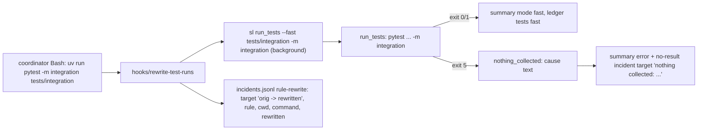
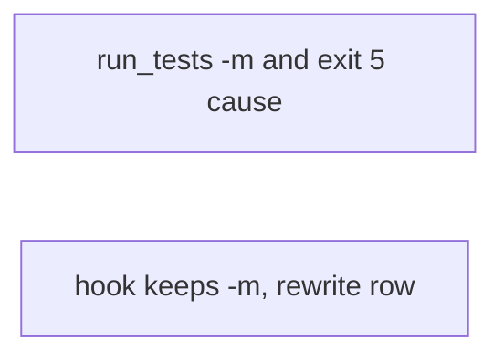

# Superlite: run_tests takes a pytest marker, exit 5 names its cause, the rewrite entry names both commands (B101)

**Goal:** fix #468: the Bash rewrite of `uv run pytest -m integration tests/integration` keeps the marker (`sl run_tests --fast tests/integration -m integration`), `run_tests` takes `-m EXPR` (Max's decision: add -m to run_tests), a pytest exit 5 names "nothing collected" and its likely cause (a deselecting marker in the project's `addopts`, or paths without tests), and the `rule-rewrite` incident carries the original and the rewritten command, its rule and cwd, so the auto feedback entry can be judged.
**Architecture:** two independent tasks. T1: `run_tests.py` gains `-m/--marker EXPR` (pytest runner: appended to the pytest argv; a test-cmd.json pytest command: appended to the command; any other runner: usage error), a marker run counts as a narrowed (`fast`) run, and pytest exit 5 gets a cause text from two new helpers. T2: `hooks/rewrite-test-runs` lifts `-m EXPR` out of a pytest segment, appends it to the rewritten `sl run_tests` segment, and writes a richer `rule-rewrite` row. No edge: T2's tests check the hook's output text only.
**Tech stack:** bash hook (builtins only, bash 3.2 compatible), Python 3.10+ stdlib, pytest (through `sl run_tests`).
**Spec:** this file, section Design; issue #468 Expected line.
**Detail:** contracts
**Target-min:** 11
**Wave0:** none
**Coverage:** off

Global constraints:
- The hook stays bash builtins only (no sed, awk, grep or other process) and must run on stock macOS bash 3.2: no `${var,,}`, no `declare -A`, no expansion of an empty array without a `${#arr[@]}` check.
- Existing tests stay green. An existing test file changes only when the task Owns it. If another existing test turns red, report it in DONE_WITH_CONCERNS with the test id and the reason instead of editing it.
- Run `sl` as an executable (`<abs>/sl ...`). Verify with `<abs>/sl run_tests --fast <own test files> --task Tn --background`, then run the printed `wait:` line in the foreground and end the turn only after it reports.
- Subprocess tests drop every `SUPERLITE_*` variable from the env they pass (a lead pane sets them) and set `SUPERLITE_HOME` to a temp folder.
- `docs/tools.md` rows: insert text mid-row only; `tests/scripts/test_docs_b67_tools.py` pins the ends of the run_tests row and `test_docs_b72_tools.py` pins quoted texts.
- No version edits (the ship step bumps the version). Never run `scripts/evals.sh`, `claude plugin eval` or `scripts/test_layers.py run`.

Ruling: a run with `-m` is a narrowed run: labelled `fast` everywhere (summary and background pointer `mode`, ledger `- tests fast`), so it never stamps the unit layer, never logs `verified` incidents and never closes failures as a full run would; `finish` keeps reading the last unfiltered full run (because a marker selects part of the suite) - cost if wrong: a marker-only suite never counts as the run's full result.
Ruling: `-m` with a test-cmd.json command appends ` -m <shell-quoted EXPR>` when the command runs pytest (a word `pytest` or `py.test`, path prefix allowed, or `-m pytest`), else it is a usage error (exit 2, no incident) - cost if wrong: a pytest wrapper script without the word pytest is refused with a clear message.
Ruling: a pytest exit 5 keeps its no-result incident and exit 1, and now writes its reason as the summary `error` (failed=1 in the summary, as every other no-result stop), so `--wait` prints the cause; the incident `target` starts with `nothing collected: <cause>; ` - cost if wrong: a deliberately empty run reads red in the summary (it already exits 1).
Ruling: the hook keeps `-m EXPR` only for pytest segments (`pytest`, `py.test`, `python -m pytest`, any `uv run` style prefix); EXPR is a bare word or one double- or single-quoted string kept as written; a quote anywhere else in the segment still leaves the command unchanged - cost if wrong: `-k "expr"` runs stay unrewritten, as today.
Ruling: no probe adapter (a bash hook and a CLI script, both covered by subprocess tests); already in the lead worktree, so no `sl worktree ensure`; layers unit and headless (`hooks/**`) - cost if wrong: one NEEDS_CONTEXT round.
LAYERS: unit, headless

## Design

### 1. run_tests takes -m (T1)
- `ap.add_argument("-m", "--marker", default=None, metavar="EXPR")`: help "pytest marker expression, passed to pytest as -m EXPR (a narrowed run: mode fast)". `--fast` (nargs +) stops at `-m`, and `start_background` passes it through to the child unchanged.
- `run()`: `label = "fast" if paths or a.marker else "full"`. The pytest runner appends `"-m", a.marker` right after the paths (or `python_full_args`); the command-line `-m` overrides an `addopts` `-m`. The LimitHit and crash summaries in `main()` and the background pointer's `mode` use the same rule (`fast` when `--fast` or `-m`).
- A non-Python spec with `a.marker`: `with_marker(spec["command"], a.marker)`; None means `usage_error(a, label, "-m EXPR selects pytest markers; the test command `<command>` is not pytest")`; else run with the returned command (copy the spec, do not change the cached one).

### 2. Exit 5 names its cause (T1)
- Pytest runner, `r.returncode == 5`: reason `pytest collected nothing (exit 5): <cause>`, plus ` | <last 3 output lines>` when any, cut at 400 chars. It goes to stderr, the summary `error` (now also for exit 5) and the no-result incident; the incident `target` becomes `nothing collected: <cause>; ` + today's `exit 5 from ...; log ...` text. Every other exit keeps today's `pytest produced no results (exit N): ...` text and target.
- `nothing_collected(output, paths, marker, root)` picks the cause; `addopts_marker(root)` reads the pytest config in pytest's order: `pytest.ini` (`[pytest]`, also when the file holds no addopts), `pyproject.toml` (`[tool.pytest.ini_options]`, through `tomllib`; skipped without it), `tox.ini` (`[pytest]`), `setup.cfg` (`[tool:pytest]`); the first file holding its section decides. In its `addopts` (a string, or a TOML list joined by spaces) it takes the value after a `-m` word (`shlex.split`), or the rest of a `-mEXPR` word. A file it cannot read or parse counts as absent.

### 3. The hook keeps the marker (T2)
- Coordinator branch, per test segment matched by `re_test`: when the matched runner is pytest (`pytest` or `py.test` in `BASH_REMATCH[0]`), search only the text after the runner match for `-m` followed by whitespace and EXPR, or `-m` glued to a bare word. EXPR: `"..."`, `'...'` or a bare word without quotes. Remove that `-m EXPR` from the segment, then run today's quote check, `files_from_seg` and rewrite on the rest, and append ` -m EXPR` (as written; glued form becomes ` -m WORD`) to the rewritten segment after `--full` or after the `--fast` files. `python -m pytest` never yields `pytest` as a marker.
- The `rule-rewrite` row: `{"kind":"rule-rewrite","agent":"coordinator","tool":"Bash","target":"<orig> -> <short>","rule":"raw-test-run","cwd":"<cwd>","command":"<orig>","rewritten":"<short>"}`. `orig` is the original command (`>&`, `&>` restored), every control character turned into a space, cut at 200 chars, then JSON-escaped with `esc` (quotes kept). `short` is the rewritten command with `bash "<root>/skills/subagent-driven-development/scripts/sl"` replaced by `sl`, outer spaces trimmed, the same cleaning and cut. `cwd` is today's `cwdv`.
- Header comment and `docs/hooks.md`'s `rewrite-test-runs` bullet name the kept marker and the row's fields.

## Tasks

```mermaid
%% schedule
gantt
  title Predicted schedule (mm:ss)
  dateFormat X
  axisFormat %M:%S
  section lane 1
  T1 run_tests takes -m exit 5 names its c :t1, 0, 136s
  section lane 2
  T2 the hook keeps -m and writes a full r :t2, 0, 97s
```

critical path: T1 (2.3 min) · peak width 2 · predicted build 2.3 min · predicted total ≈ 5.8 min (target ✓)

### T1 run_tests takes -m, exit 5 names its cause · Complexity 4 (O-1) · Est. context 50k
**Owns:** skills/subagent-driven-development/scripts/run_tests.py, tests/scripts/test_run_tests_marker_468.py, docs/tools.md
**Components:** 2
**LOC owned:** 230
**Tests:** fast
**Model:** sonnet
**Kind:** design
**Est. time:** 4 min (2 components, about 230 LOC, fast tests)
**Covers:** 1, 2
**Produces:** run_tests.with_marker(command: str, marker: str) -> str | None
  e.g. with_marker("uv run pytest -q", "not slow") -> "uv run pytest -q -m 'not slow'"
  e.g. with_marker("python -m pytest", "integration") -> "python -m pytest -m integration"
  e.g. with_marker("go test ./...", "integration") -> None
**Produces:** run_tests.addopts_marker(root: Path) -> tuple[str, str] | None
  e.g. addopts_marker(p) with p/pyproject.toml `[tool.pytest.ini_options]` `addopts = "-q -m 'not integration'"` -> ("not integration", "pyproject.toml")
  e.g. addopts_marker(p) with p/pytest.ini `[pytest]` `addopts = -mslow` -> ("slow", "pytest.ini")
  e.g. addopts_marker(p) with no config file -> None
**Produces:** run_tests.nothing_collected(output: str, paths: list[str], marker: str | None, root: Path) -> str
  e.g. nothing_collected("4 deselected in 0.01s", ["tests/integration"], None, p) with the pyproject above -> "all 4 collected tests deselected by addopts -m 'not integration' in pyproject.toml; pass run_tests -m EXPR to select them"
  e.g. nothing_collected("4 deselected in 0.01s", [], "slow", p) -> "all 4 collected tests deselected by -m 'slow'"
  e.g. nothing_collected("4 deselected in 0.01s", [], None, p) with no config -> "all 4 collected tests deselected by a -m or -k filter"
  e.g. nothing_collected("no tests ran in 0.01s", ["src/app", "src/lib"], None, p) -> "no tests found in src/app, src/lib"
  e.g. nothing_collected("no tests ran in 0.01s", [], None, p) -> "no tests found (check testpaths and python_files in the pytest config)"
**Review Focus:** protocol (argv), encoding (quoted EXPR), state (ledger, summary, incidents), file (config parsing)
**Test code:** in tests/scripts/test_run_tests_marker_468.py; the end-to-end cases run `run_tests.py` as a subprocess in a tmp project (a `pyproject.toml` with `[tool.pytest.ini_options]` `addopts = "-m 'not integration'"` and `markers = ["integration"]`, `tests/integration/test_i.py` with one `@pytest.mark.integration` test that passes, `tests/test_u.py` with one plain passing test, `--log`, `--ledger`, `--summary` under tmp `.superlite/`):
- `test_with_marker_cases`: the three `with_marker` examples, plus `with_marker("/opt/venv/bin/py.test", "a or b") -> "/opt/venv/bin/py.test -m 'a or b'"`.
- `test_addopts_marker_sources`: the three examples, plus setup.cfg `[tool:pytest]` `addopts = -m "not slow"` -> ("not slow", "setup.cfg"), a pyproject list `addopts = ["-m", "fast"]` -> ("fast", "pyproject.toml"), a pytest.ini `[pytest]` without addopts beside a pyproject with one -> None, and an unparsable pyproject.toml -> None.
- `test_nothing_collected_cases`: the five examples.
- `test_marker_overrides_addopts`: `--fast tests/integration -m integration` -> exit 0, summary passed 1, mode "fast", ledger ends with a `- tests fast passed=1` line.
- `test_marker_only_run_is_fast`: `-m integration` (no --fast) -> exit 0, summary mode "fast", passed 1, stderr without `unit layer stamped`, incidents without a `verified` row.
- `test_marker_with_space_is_one_arg`: `-m "not integration"` as one argv item -> exit 0, passed 1 (tests/test_u.py).
- `test_exit5_names_addopts_marker`: `--fast tests/integration` (no -m) -> exit 1, summary `error` starts with `pytest collected nothing (exit 5): all 1 collected tests deselected by addopts -m 'not integration' in pyproject.toml`, failed 1; the no-result incident's `target` starts with `nothing collected: all 1 collected tests deselected` and still holds `exit 5 from `.
- `test_exit5_source_folder_without_tests`: a `src/app/` folder holding only `mod.py`, `--fast src/app` -> exit 1, summary error holds `no tests found in src/app` (if expand_fast_paths maps it elsewhere, assert the cause names the path pytest got).
- `test_marker_refused_for_non_pytest_command`: `.superlite/test-cmd.json` `{"language": "go", "test": "go test ./..."}`, `-m integration` -> exit 2, stderr holds `-m EXPR selects pytest markers`, no incident row.
- `test_marker_appended_to_pytest_test_cmd`: `.superlite/test-cmd.json` `{"language": "python", "test": "<sys.executable> -m pytest -q tests"}`, `-m integration` -> exit 0 and the summary's `output` log names `-m integration`.
- `test_background_pointer_mode_fast_with_marker`: `--background -m integration` -> `test-summary.latest` has `"mode": "fast"`; then the `wait:` command exits 0.
- `test_exit3_text_unchanged`: the existing `pytest produced no results (exit N)` text stays for an exit other than 5 (reuse the zero_run pattern of test_run_tests_no_result_trace.py with a fake pytest exiting 3).
**Steps:** 1 failing tests, 2 run: FAIL, 3 implement, 4 run: PASS, 5 docstring and docs.
**Notes:** Docstring of run_tests.py: one paragraph for `-m` and the exit 5 cause. `docs/tools.md` run_tests row: mid-row, one sentence: "`-m EXPR` passes a pytest marker (a test-cmd.json pytest command gets it appended, another runner refuses it) and makes the run a fast run; a pytest exit 5 names `nothing collected` and its cause (a deselecting addopts `-m`, or paths without tests)." Keep `--fast` paths parsing as is.

### T2 the hook keeps -m and writes a full rewrite row · Complexity 4 (O-1) · Est. context 48k
**Owns:** hooks/rewrite-test-runs, tests/scripts/test_rewrite_test_runs.py, docs/hooks.md
**Components:** 1
**LOC owned:** 140
**Tests:** fast
**Model:** sonnet
**Kind:** design
**Est. time:** 3 min (1 component, about 140 LOC, fast tests)
**Covers:** 3
**Produces:** hooks/rewrite-test-runs marker pass-through and rule-rewrite row (Design 3)
**Review Focus:** protocol (segment parsing), encoding (quotes in EXPR, JSON escaping), state (incident row)
**Test code:** new cases in tests/scripts/test_rewrite_test_runs.py (SLFULL, SLFAST, `rewritten()` as in the file):
- `test_marker_kept` parametrized (cmd -> mode, rewritten command stripped):
  `uv run pytest -m integration tests/integration` -> fast, `SLFAST tests/integration -m integration`;
  `pytest -m "not slow"` -> full, `SLFULL -m "not slow"`;
  `pytest -m 'a or b' tests/x.py` -> fast, `SLFAST tests/x.py -m 'a or b'`;
  `pytest -mslow tests/x.py` -> fast, `SLFAST tests/x.py -m slow`;
  `python -m pytest -m integration tests` -> fast, `SLFAST tests -m integration`;
  `py -3 -m pytest -x` -> full, `SLFULL` (no marker taken from `-m pytest`).
- `test_marker_in_chain`: `cd app && pytest -m integration` -> `cd app && SLFULL -m integration ` (exact, as test_chained_commands_keep_other_work).
- `test_other_quote_still_unchanged`: `pytest -m "x" -k "y" tests` -> exit 0, empty stdout, no incident file.
- `test_npm_keeps_no_marker`: `npm test -- -m x` -> full, `SLFULL` as today (only pytest segments carry a marker).
- `test_rewrite_row_names_both_commands`: payload with `cwd` = str(proj), command `pytest -m "not slow" tests/a.py` -> the one incidents.jsonl row parses as JSON with kind `rule-rewrite`, tool `Bash`, rule `raw-test-run`, cwd str(proj), command `pytest -m "not slow" tests/a.py`, rewritten `sl run_tests --fast tests/a.py -m "not slow"`, target `pytest -m "not slow" tests/a.py -> sl run_tests --fast tests/a.py -m "not slow"`; and `finish.read_stops(<incidents>)` returns `[("rule-rewrite", "Bash", "<that target> (rule raw-test-run, cwd <proj>)")]`.
- `test_rewrite_row_cuts_and_cleans`: a 300-char chained command with a tab -> `command` is 200 chars, holds no tab.
- `test_subagent_marker_with_file_allowed`: subagent payload (`agent_id`), `pytest -m integration tests/integration` -> exit 0, empty stdout (a named path passes, as today).
**Steps:** 1 failing tests, 2 run: FAIL, 3 implement, 4 run: PASS, 5 header comment and docs/hooks.md.
**Notes:** Update the existing incident assertions in this file to the new row shape if any check the old one. docs/hooks.md bullet: after "it logs a `rule-rewrite` incident" add "(with `target` `<original> -> <rewritten>`, `rule raw-test-run`, `cwd`, `command` and `rewritten`)"; after "a bare runner to `--full`" add "; a pytest `-m EXPR` (a word or one quoted string) stays on the rewritten command".

**Probe entry:** none (a bash hook and a CLI script; Review Focus cases are named tests)

## Review Focus
- Package hook (protocol, encoding, state): `python -m pytest` and `py -3 -m pytest` never yield a marker; a quoted EXPR stays one argument in the rewritten command and in the JSON `updatedInput`; the incident row stays valid JSON for commands holding `"`, `\` and tabs.
- Package run_tests (CLI: protocol, encoding, state, file): `-m` after `--fast` paths ends the path list; a marker run never stamps the unit layer nor closes failures as a full run; `addopts_marker` never raises on a broken config.

## Self-review
- Coverage: #468 Expected: marker kept (T2 + T1), exit 5 cause (T1), rule-rewrite entry (T2).
- No edges: T2's tests never run run_tests.
- No shared files between T1 and T2.
