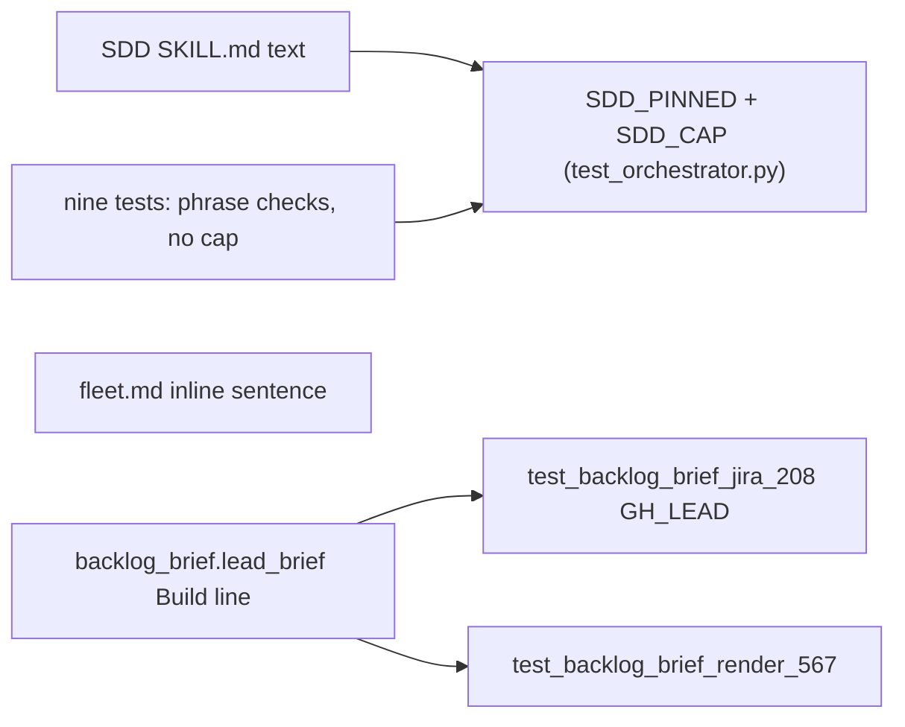
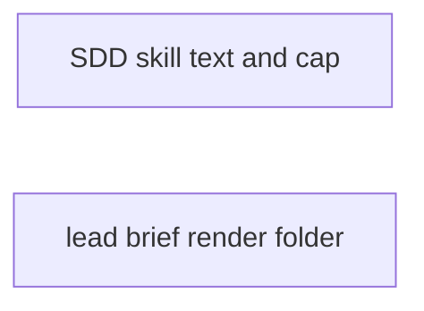

# Superlite: SDD skill text fixes (B112)

**Goal:** fix #549, #555, #559, #562 and #567: the SDD `SKILL.md` names the fleet final reviewer (inline builds too), the full inline packet call, a complete coordinator `incident add` call and `.superlite/render/` for UI screenshots; its size cap moves to one test with headroom, next to one list of every pinned phrase; the lead brief names `.superlite/render/`. Max's decision: raise the cap and pin phrases in one test.
**Architecture:** text edits in `skills/subagent-driven-development/SKILL.md` and `fleet.md`; `tests/scripts/test_orchestrator.py` holds `SDD_CAP` and `SDD_PINNED`, and nine other tests drop their own `<= 11700` clause; `backlog_brief.lead_brief`'s Build line names the render folder.
**Tech stack:** Markdown docs, Python 3.10+ stdlib, pytest (through `sl run_tests`).
**Spec:** this file, section Design; issues #549, #555, #559, #562, #567 (Expected lines).
**Detail:** tests
**Target-min:** 11
**Wave0:** none
**Coverage:** off

Global constraints:
- Every Python code line under `skills/**/scripts/` keeps the file's trailing `# O(...)` complexity comment.
- Existing tests stay green. An existing test file changes only when the task Owns it. If another existing test turns red, report it in DONE_WITH_CONCERNS with the test id and the reason instead of editing it.
- Run `sl` as an executable (`<abs>/sl ...`). Verify with `<abs>/sl run_tests --fast <own test files> --task Tn --background`, then run the printed `wait:` line in the foreground and end the turn only after it reports.
- Doc texts in Design are copied byte for byte (backticks, quotes, `$SL`, `$PLAN`).
- No version edits (the ship step bumps the version). Never run `scripts/evals.sh`, `claude plugin eval` or `scripts/test_layers.py run`.

Ruling: the SDD SKILL.md cap is 13000 characters, held once as `SDD_CAP` in tests/scripts/test_orchestrator.py (because Max chose "raise cap and pin phrases in one test"; 13000 leaves about 700 characters after B112's additions; cost if wrong: one more raise later).
Ruling: the nine other tests that assert `len(...) <= 11700` on the SDD SKILL.md drop that clause and keep their phrase checks (because two caps drift; no open batch lists those test files, so T1 owns them and notes.md names them; cost if wrong: none, the cap stays tested once).
Ruling: `SDD_PINNED` lists every phrase another test pins in the SDD SKILL.md, collected by T1 from the test files, plus B112's new phrases; one test asserts the cap and each phrase (because a trim then fails in one fast test; cost if wrong: a later pin missing from the list, caught only by its own test as today).
Ruling: the coordinator incident call is `incident add --agent coordinator --file <task file> --line 0 --context "BLOCKED Tn: <why>"`, no `--kind` (because `--line 0` is valid and no kind fits BLOCKED; `incident add --help` lists the kinds; cost if wrong: an unkinded incident in hotspots).
Ruling: fleet.md's "An inline build without a taskgraph starts no worker" says implementer worker and names the final reviewer worker (because with fleet on the hook blocks the Agent final reviewer, inline too; no open batch lists fleet.md; cost if wrong: one sentence).
Ruling: the lead brief's Build line, not backlog.md, names `.superlite/render/` (issue #567 asks for the lead brief; backlog_brief.py and test_backlog_brief_jira_208.py are listed by no open batch).
Ruling: no probe adapter (docs and one brief line; Review Focus cases are named tests); detail tests; already in the lead worktree, no `sl worktree ensure`; T1 and T2 share no file and no edge; layers unit, headless and evals (SKILL.md changes; B98 ran the same).
LAYERS: unit, headless, evals



## Design

### 1. SDD SKILL.md and fleet.md (T1)

Replace these whole lines of `skills/subagent-driven-development/SKILL.md` (old line, then the new line):

Old: ``- Incidents: `"$SL" incident add`; log BLOCKED, NEEDS_CONTEXT as `--agent coordinator`.``
New: ``- Incidents: a BLOCKED or NEEDS_CONTEXT report is `"$SL" incident add --agent coordinator --file <task file> --line 0 --context "BLOCKED Tn: <why>"` (`--file`, `--line`, `--context` required; `--kind` optional, `incident add --help` lists the kinds).``

Old: the Final review line starting `2. `.
New: ``2. `run_tests --full --background`, then its `wait:` line. Then build the packet: `"$SL" plan_tools packet --plan $PLAN --base <start-sha>` (a run without a plan: `"$SL" plan_tools packet --inline --spec <spec.md> --base <start-sha>`, no `--plan`; later rounds add `--previous <rounds.md>`) uses that run's summary, probe results and incidents, and writes `.superlite/review-packet.md`. UI screenshots (`.png`, `.jpg`, `.jpeg`) go in `.superlite/render/` first: the packet's `## Render evidence` section lists them for the reviewer.``

Old: the Final review line starting `3. `.
New: ``3. Start a fresh final reviewer then. Fleet on (inline builds too): `"$SL" fleet spawn --role final-reviewer --plan $PLAN`, then `"$SL" fleet send Wn --brief <abs>/.superlite/review-packet.md --label FR<round> --plan $PLAN`. Fleet off: Agent `superlite:final-reviewer`, brief = the absolute `sl` path and "read .superlite/review-packet.md", nothing more. The tree stays frozen. It answers once: `Verdict: APPROVED` or `CHANGES_REQUESTED` plus `file:line - problem - fix - tier N` lines. No `Checked:` block (fast path too) is no review: start a fresh one. Full review asked: add `--full` to the `fleet send` (Agent: `Full review` in the brief).``

In `skills/subagent-driven-development/fleet.md` replace the sentence `An inline build without a taskgraph starts no worker: tell the user.` with `An inline build without a taskgraph starts no implementer worker (tell the user); its final reviewer is still a worker (`SKILL.md` Final review 3).`

### 2. Lead brief (T2)

In `backlog_brief.lead_brief` the Build line becomes exactly:
`Build: superlite:brainstorming (AI orchestrator, no questions), superlite:writing-plans, superlite:subagent-driven-development with fleet on, the final review (UI screenshots go in .superlite/render/, its packet lists them), the test layers.`

## File structure

- `skills/subagent-driven-development/SKILL.md`: Incidents line, Final review steps 2 and 3 (T1)
- `skills/subagent-driven-development/fleet.md`: inline sentence (T1)
- `tests/scripts/test_orchestrator.py`: `SDD_CAP`, `SDD_PINNED`, the B112 text tests (T1)
- `tests/scripts/test_docs_b10.py`, `test_docs_b102.py`, `test_docs_b72_skills.py`, `test_docs_b95_sdd.py`, `test_docs_b98_sdd.py`, `test_fleet_hard_stop.py`, `test_fleet_roles_skill.py`, `test_fleet_wait_report_b91.py`, `test_implementer_red_prime_b65.py`: drop the 11700 clause (T1)
- `skills/subagent-driven-development/scripts/backlog_brief.py`: Build line (T2)
- `tests/scripts/test_backlog_brief_jira_208.py`: GH_LEAD Build line (T2)
- `tests/scripts/test_backlog_brief_render_567.py`: render folder in the lead brief (T2)

## Task graph

```mermaid
%% schedule
gantt
  title Predicted schedule (mm:ss)
  dateFormat X
  axisFormat %M:%S
  section lane 1
  T1 SDD SKILL.md names the fleet reviewer :t1, 0, 141s
  section lane 2
  T2 Lead brief names the render folder :t2, 0, 95s
```





critical path: T1 (2.4 min) · peak width 2 · predicted build 2.4 min · predicted total ≈ 5.9 min (target ✓)

## Package: SDD docs and the lead brief

App type: docs + CLI text. Categories: protocol (each documented call parses as written), state (the cap and pins stay in one place). **Probe entry:** none (doc text and one brief line; cases are named tests).

### T1 SDD SKILL.md names the fleet reviewer, inline packet, incident call and render folder · Complexity 3 · Est. context 45k
**Owns:** skills/subagent-driven-development/SKILL.md, skills/subagent-driven-development/fleet.md, tests/scripts/test_orchestrator.py, tests/scripts/test_docs_b10.py, tests/scripts/test_docs_b102.py, tests/scripts/test_docs_b72_skills.py, tests/scripts/test_docs_b95_sdd.py, tests/scripts/test_docs_b98_sdd.py, tests/scripts/test_fleet_hard_stop.py, tests/scripts/test_fleet_roles_skill.py, tests/scripts/test_fleet_wait_report_b91.py, tests/scripts/test_implementer_red_prime_b65.py
**Components:** 2
**LOC owned:** 160
**Tests:** fast
**Model:** sonnet
**Est. time:** 3.0 min (2 components, about 160 LOC, fast tests)
**Covers:** 1
**Consumes:** none
**Produces:** none
**Review Focus:** protocol: `test_sdd_incident_example_runs` (the documented call exits 0 and logs agent, file, line 0, context); state: `test_sdd_skill_cap_and_every_pinned_phrase` (one cap, every pinned phrase), `test_sdd_final_review_names_fleet_reviewer_inline_packet_and_render`, `test_fleet_md_inline_names_the_reviewer_worker`.
**Test code (verbatim):** append to tests/scripts/test_orchestrator.py, after its existing tests:
```python
SDD_SKILL = REPO / "skills" / "subagent-driven-development" / "SKILL.md"
SDD_CAP = 13000  # the one size cap of the SDD SKILL.md (#555); other tests pin phrases, never its size

# Every phrase another test in tests/scripts/ pins in the SDD SKILL.md, so a trim fails here first (#555).
# A test that pins a new SKILL.md phrase adds it here too.
SDD_PINNED = (
    # B112 (#549, #559, #562, #567)
    '"$SL" incident add --agent coordinator --file <task file> --line 0 --context "BLOCKED Tn: <why>"',
    '"$SL" plan_tools packet --inline --spec <spec.md> --base <start-sha>',
    "UI screenshots (`.png`, `.jpg`, `.jpeg`) go in `.superlite/render/` first",
    '"$SL" fleet spawn --role final-reviewer --plan $PLAN',
    "--label FR<round> --plan $PLAN",
)


def sdd_text() -> str:
    return SDD_SKILL.read_text(encoding="utf-8")


def test_sdd_skill_cap_and_every_pinned_phrase():
    sdd = sdd_text()
    assert len(sdd) <= SDD_CAP, len(sdd)
    missing = [p for p in SDD_PINNED if p not in sdd]
    assert not missing, missing


def test_sdd_final_review_names_fleet_reviewer_inline_packet_and_render():
    final = sdd_text().split("## Final review", 1)[1].split("## Measure and budget", 1)[0]
    step2 = next(ln for ln in final.splitlines() if ln.startswith("2. "))
    step3 = next(ln for ln in final.splitlines() if ln.startswith("3. "))
    assert '"$SL" plan_tools packet --inline --spec <spec.md> --base <start-sha>`, no `--plan`' in step2
    assert "(inline: `--inline --spec" not in step2
    assert "`.superlite/render/`" in step2 and "`## Render evidence`" in step2
    assert "Fleet on (inline builds too)" in step3 and "Fleet off: Agent `superlite:final-reviewer`" in step3
    assert step3.index("fleet spawn --role final-reviewer") < step3.index("fleet send Wn --brief") < step3.index("Fleet off")
    assert "Start `superlite:final-reviewer` then" not in step3


def test_sdd_incident_line_is_a_full_call():
    line = next(ln for ln in sdd_text().splitlines() if ln.startswith("- Incidents:"))
    assert "`--file`, `--line`, `--context` required" in line and "`incident add --help` lists the kinds" in line


def test_sdd_incident_example_runs(tmp_path):
    log = tmp_path / "incidents.jsonl"
    cp = run(SCRIPTS / "incident.py", "add", "--agent", "coordinator", "--file", "src/a.py", "--line", "0",
             "--context", "BLOCKED T3: no fixture", "--log", log)
    assert cp.returncode == 0, cp.both
    entry = json.loads(log.read_text(encoding="utf-8").splitlines()[-1])
    assert (entry["agent"], entry["file"], entry["line"], entry["context"]) == ("coordinator", "src/a.py", 0, "BLOCKED T3: no fixture")


def test_fleet_md_inline_names_the_reviewer_worker():
    t = (REPO / "skills" / "subagent-driven-development" / "fleet.md").read_text(encoding="utf-8")
    assert "An inline build without a taskgraph starts no implementer worker (tell the user); its final reviewer is still a worker (`SKILL.md` Final review 3)." in t
    assert "starts no worker: tell the user" not in t


def test_no_other_test_holds_the_sdd_cap():
    here = Path(__file__).resolve().parent
    stale = [p.name for p in sorted(here.glob("test_*.py")) if "<= 11700" in p.read_text(encoding="utf-8")]
    assert not stale, stale
```
**Steps:** 1 append the tests above to tests/scripts/test_orchestrator.py; 2 run: FAIL; 3 edit SKILL.md and fleet.md as in Design 1; 4 in test_orchestrator.py change both existing `<= 11700` SDD asserts (lines near 140 and 284) to `<= SDD_CAP` (a module-level name, resolved when the test runs), and in each of the nine other owned tests delete only the `len(...) <= 11700` clause (an `and len(x) <= 11700` tail or a whole `assert len(x) <= 11700` line), keeping every phrase check; 5 collect into SDD_PINNED, above the B112 block, every string literal any tests/scripts/test_*.py asserts `in` the SDD SKILL.md text or a slice of it (grep for files reading `subagent-driven-development` / `SKILL.md`: test_agent_mcp_tools, test_docs_b10, test_docs_b102, test_docs_b32_sdd, test_docs_b72_skills, test_docs_b95_sdd, test_docs_b98_sdd, test_docs_contract, test_fleet_hard_stop, test_fleet_roles_skill, test_fleet_wait_report_b91, test_implementer_red_prime_b65, test_isolation_wording, test_orchestrator and any other the grep finds), verbatim, one entry per phrase, each once, with a `# <test file>` comment line per group; skip `not in` checks; 6 run: PASS.
**Notes:** the phrases the tests already pin must stay in SKILL.md as they are; if a Design text would remove one, report DONE_WITH_CONCERNS naming it instead of changing the Design text.

### T2 Lead brief names the render folder · Complexity 1 · Est. context 25k
**Owns:** skills/subagent-driven-development/scripts/backlog_brief.py, tests/scripts/test_backlog_brief_jira_208.py, tests/scripts/test_backlog_brief_render_567.py
**Components:** 1
**LOC owned:** 20
**Tests:** fast
**Kind:** mechanical
**Model:** haiku
**Est. time:** 1.5 min (1 component, about 20 LOC, fast tests)
**Covers:** 2
**Consumes:** none
**Produces:** none
**Review Focus:** protocol: `test_lead_brief_build_line_names_the_render_folder` (the Build line text exactly).
**Test code (verbatim):** new file tests/scripts/test_backlog_brief_render_567.py:
```python
"""#567: the lead brief names .superlite/render/ for UI screenshots, so the review packet lists them."""
import sys
from test_plan_tools import SCRIPTS
sys.path.insert(0, str(SCRIPTS))
import backlog_brief as bb  # noqa: E402

CTX = {"sl": "/x/sl", "repo": "o/r", "backlog_md": "/x/backlog.md", "titles": {"7": "Seven"}, "summaries": [],
       "approved": {"by": "AskUserQuestion", "time": "t"}}
BUILD = ("Build: superlite:brainstorming (AI orchestrator, no questions), superlite:writing-plans, "
         "superlite:subagent-driven-development with fleet on, the final review (UI screenshots go in .superlite/render/, "
         "its packet lists them), the test layers.")


def test_lead_brief_build_line_names_the_render_folder():
    t = bb.lead_brief({"id": "B1", "topic": "t", "issues": [7], "files": ["a.py"], "answers": {}}, CTX)
    assert BUILD in t.splitlines()
    assert "the final review, the test layers." not in t
```
**Steps:** 1 write the test file above; 2 run: FAIL; 3 in backlog_brief.py change the Build line's second string to `"superlite:subagent-driven-development with fleet on, the final review (UI screenshots go in .superlite/render/, its packet lists them), the test layers."` (keep its `# O(1)` comment); 4 in tests/scripts/test_backlog_brief_jira_208.py change the GH_LEAD Build line to the same text (`the final review (UI screenshots go in .superlite/render/, its packet lists them), the test layers.\n`); 5 run both files: PASS.

## Review Focus

Package SDD docs and the lead brief: app type docs + CLI text; categories protocol, state. Risks: a documented call that the tool refuses (incident add, packet --inline); a trim that drops a pinned phrase; a second cap left in another test.

## Self-review

Coverage: #549 step 3 and fleet.md (T1); #555 SDD_CAP and SDD_PINNED (T1); #559 step 2 (T1); #562 Incidents line (T1); #567 step 2 (T1) and the Build line (T2). No placeholders; no Consumes; no edges; T1 and T2 share no file.
