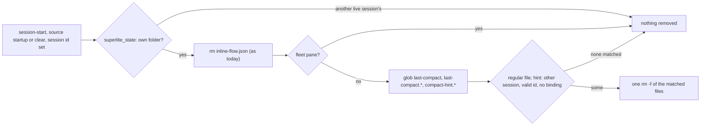

# Superlite: session-start drops stale compact stamps and hint markers (B97)

**Goal:** fix #466: a new session (startup or /clear) removes the old 30-minute nudge stamps (`last-compact`, `last-compact.<sid>`, unread since 1.5.92) and the size hint's `compact-hint.<sid>` markers of sessions that no longer exist from its state folder, so `.superlite` stops collecting one empty file per session.
**Architecture:** `hooks/session-start` already resolves this session's folder on startup and /clear (the `inline-flow.json` clear); the prune runs in that block, bash builtins plus one `rm -f` only when something matched (Max's decision: in hooks/session-start). `compact_due.py` gets one docstring sentence naming who removes its markers; `docs/hooks.md` names the prune. One task.
**Tech stack:** bash (3.2 compatible) hook, Python 3.10+ stdlib, pytest (through `sl run_tests`).
**Spec:** this file, section Design; issue #466 Expected lines.
**Detail:** tests
**Target-min:** 11
**Wave0:** none

Global constraints:
- The hook must run on stock macOS bash 3.2 under `set -euo pipefail`: no `${var,,}`, no `declare -A`, no `"${arr[@]}"` expansion of an empty array (check `${#arr[@]}` first), `shopt -u nullglob` again after the loop. Every hook line keeps the file's trailing `# O(...)` complexity comment.
- Existing tests stay green. An existing test file changes only when the task Owns it. If another existing test turns red, report it in DONE_WITH_CONCERNS with the test id and the reason instead of editing it.
- Run `sl` as an executable (`<abs>/sl ...`). Verify with `<abs>/sl run_tests --fast <own test files> --task Tn --background`, then run the printed `wait:` line in the foreground and end the turn only after it reports.
- Hook subprocess tests drop every `SUPERLITE_*` variable and `CLAUDE_ENV_FILE`, `CLAUDE_PID` from the env (a lead pane sets them; the hook appends to `CLAUDE_ENV_FILE`), and set `SUPERLITE_HOME` to a temp folder.
- No version edits (the ship step bumps the version). Never run `scripts/evals.sh`, `claude plugin eval` or `scripts/test_layers.py run`.

Ruling: a `compact-hint.<s>` marker's session no longer exists when `s` is not this session's id and `${SUPERLITE_HOME:-$HOME/.superlite}/sessions/<s>` is not a file (superlite already calls a session live while its binding exists, and `sl` prunes bindings after 14 days) - cost if wrong: a running unbound session sees the 500k hint line once more.
Ruling: no prune in a fleet pane (`SUPERLITE_FLEET_WORKER` set, leads too): a worker starting in main's folder must not drop main's marker, and leads are never hinted - cost if wrong: a lead's worktree keeps its old stamps until the worktree is removed.
Ruling: only regular files named `last-compact`, `last-compact.*` or `compact-hint.<s>` with `s` matching `^[A-Za-z0-9_-]{1,128}$` are removed; the bare `compact-hint` (the id-less sessions' shared marker) and any other name stay - cost if wrong: one leftover file.
Ruling: compact and resume starts prune nothing (the same session goes on); no prune without a session id - cost if wrong: the prune waits for the next startup.
Ruling: detail tests; no probe adapter (a bash hook; Review Focus cases are named pytest cases); already in the lead worktree, so no `sl worktree ensure`; layers unit, headless and tui (hooks/session-start is in all three) - cost if wrong: one NEEDS_CONTEXT round.
LAYERS: unit, headless, tui



## Design

### 1. The prune (T1)
- In `hooks/session-start`, inside the existing `re_new` block, after `rm -f "$SL_SD/inline-flow.json"`: when `SUPERLITE_FLEET_WORKER` is empty, `shopt -s nullglob`, loop over `"$SL_SD"/last-compact "$SL_SD"/last-compact.* "$SL_SD"/compact-hint.*`; skip a name that is not a regular file (`[ -f ]`); for a `compact-hint.*` name take `s="${n#compact-hint.}"` and keep it unless `s` matches the id pattern, differs from `$sid` and `[ -f "$sessions_dir/$s" ]` fails; collect the rest into an array; `shopt -u nullglob`; when the array is not empty, one `rm -f -- "${arr[@]}" 2>/dev/null || true`. Update the block's comment (startup or /clear: inline-flow marker, plus the prune and why, #466).
- The no-run case still prunes (the folder needs no run marker); the block's existing guards stay: a session id, `superlite_state` returning 0 (another live session's folder is left alone) and an existing folder.

### 2. Docs (T1)
- `docs/hooks.md` `session-start` bullet, after its first sentence: "At startup and `/clear` (not in a fleet pane) it removes the old `last-compact` and `last-compact.<session_id>` stamps from the session's state folder, and the `compact-hint.<session_id>` markers of other sessions that have no binding in `~/.superlite/sessions`." `compact-nudge` bullet: after "(it marks `.superlite/compact-hint.<session_id>`" add "; `session-start` removes the marker once the session has neither the id of the starting session nor a binding".
- `compact_due.py` module docstring: one sentence after the CLI paragraph: "`hooks/session-start` removes `compact-hint.<sid>` markers of other sessions without a binding, and the old `last-compact*` stamps, at startup and /clear."

## Coverage

| Category | State | Basis |
|---|---|---|
| Scope and success criteria | settled | #466 Expected lines; Max: in hooks/session-start |
| Domain and data model | n/a | no data change |
| Persistence and migration | ruled | removes old files once, keeps live markers |
| Interfaces and contracts | n/a | no API change |
| UI states | n/a | hook output unchanged |
| Concurrency and state ownership | ruled | another live session's folder and fleet panes are skipped |
| Error handling and recovery | settled | rm errors are silent; the hook exits 0 |
| Security and privacy | ruled | only regular files with the exact names in the session's own folder |
| Performance and limits | ruled | builtins; one rm only when a file matched |
| Observability | n/a | silent |
| Testing strategy | settled | hook subprocess cases in test_compact_due.py, also on /bin/bash 3.2 |
| Compatibility | settled | bash 3.2; compact and resume unchanged |
| Rollout | ruled | one PR; version bump at ship |
| Research unknowns | n/a | none |

## File structure
- `hooks/session-start`: the prune (T1).
- `tests/scripts/test_compact_due.py`: session-start cases (T1).
- `skills/subagent-driven-development/scripts/compact_due.py`: docstring sentence (T1).
- `docs/hooks.md`: session-start and compact-nudge bullets (T1).

## Task graph

```mermaid
%% schedule
gantt
  title Predicted schedule (mm:ss)
  dateFormat X
  axisFormat %M:%S
  section lane 1
  T1 session-start drops stale stamps :t1, 0, 94s
```




critical path: T1 (1.6 min) · peak width 1 · predicted build 1.6 min · predicted total ≈ 5.1 min (target ✓)

## Package: session-start prune
App type: file I/O (a hook). Categories: file (which names go), state (whose markers, which folder), encoding (odd names). Specific risks: a fleet worker's start dropping main's marker; another live session's folder pruned; an empty array under `set -u` on bash 3.2 failing the hook.
**Probe entry:** none (Ruling: no probe adapter).

### T1 session-start drops stale stamps · Complexity 3 · Est. context 30k
**Owns:** hooks/session-start, tests/scripts/test_compact_due.py, skills/subagent-driven-development/scripts/compact_due.py, docs/hooks.md
**Components:** 1
**LOC owned:** 110
**Tests:** fast
**Model:** sonnet
**Est. time:** 2.2 min (1 component, about 110 LOC, fast tests)
**Covers:** 1, 2
**Consumes:** none
**Produces:** none
**Review Focus:** file: `test_startup_drops_old_stamps_and_unbound_hint_markers`; state: `test_clear_drops_them_too`, `test_compact_and_resume_keep_everything`, `test_fleet_pane_prunes_nothing`, `test_another_live_sessions_folder_is_left_alone`, `test_without_a_session_id_nothing_is_removed`; encoding: `test_folders_with_marker_names_survive`; compatibility: `test_prune_runs_on_stock_bash`.
**Test code (verbatim):** append to tests/scripts/test_compact_due.py:
```python
# --- session-start: stale stamps and hint markers (#466) -------------------------------------------------------------

START = ROOT / "hooks" / "session-start"
_START_DROPPED = ("CLAUDE_ENV_FILE", "CLAUDE_PID", "CURSOR_PLUGIN_ROOT", "CURSOR_AGENT", "CURSOR_TRACE_ID",
                  "COPILOT_CLI", "MUSE_PLUGIN_ROOT")
KEPT = {MODE_FILE, "compact-hint.live", "compact-hint.s1", "compact-hint", "compact-hint.odd.name", "notes.md"}


def _start(tmp_path, source="startup", sid="s1", bash=None, **extra):
    env = {k: v for k, v in os.environ.items() if not k.startswith("SUPERLITE_") and k not in _START_DROPPED}
    env.update({"CLAUDE_PLUGIN_ROOT": str(ROOT), "CLAUDE_PROJECT_DIR": str(tmp_path),
                "SUPERLITE_HOME": str(tmp_path / "home")})
    env.update(extra)
    inp = {"hook_event_name": "SessionStart", "source": source, "cwd": str(tmp_path)}
    if sid:
        inp["session_id"] = sid
    r = subprocess.run([bash or BASH, str(START)], input=json.dumps(inp), capture_output=True, text=True,
                       encoding="utf-8", env=env, cwd=str(tmp_path))
    assert r.returncode == 0, r.stderr
    json.loads(r.stdout)
    return r


def _stale_folder(tmp_path):
    sl = _sl(tmp_path)
    for name in ("last-compact", "last-compact.old-1", "last-compact.old-2", "compact-hint.dead",
                 "compact-hint.live", "compact-hint.s1", "compact-hint", "compact-hint.odd.name", "notes.md"):
        (sl / name).write_text("", encoding="utf-8")
    sessions = tmp_path / "home" / "sessions"
    sessions.mkdir(parents=True)
    (sessions / "live").write_text(str(tmp_path / "elsewhere" / ".superlite") + "\n", encoding="utf-8")
    (sessions / "dead.d").mkdir()                     # a private folder is no binding
    return sl


def _names(sl):
    return {p.name for p in sl.iterdir()}


def test_startup_drops_old_stamps_and_unbound_hint_markers(tmp_path):
    sl = _stale_folder(tmp_path)
    r = _start(tmp_path)
    assert _names(sl) == KEPT
    assert "You have superlite" in r.stdout


def test_clear_drops_them_too(tmp_path):
    sl = _stale_folder(tmp_path)
    _start(tmp_path, source="clear", sid="s9")
    assert _names(sl) == KEPT - {"compact-hint.s1"}    # /clear ended s1: s9 is the session now


def test_compact_and_resume_keep_everything(tmp_path):
    sl = _stale_folder(tmp_path)
    before = _names(sl)
    for source in ("compact", "resume"):
        _start(tmp_path, source=source)
        assert _names(sl) == before


def test_fleet_pane_prunes_nothing(tmp_path):
    sl = _stale_folder(tmp_path)
    before = _names(sl)
    for role in ("implementer", "lead"):
        _start(tmp_path, SUPERLITE_FLEET_WORKER="W3", SUPERLITE_FLEET_ROLE=role)
        assert _names(sl) == before


def test_another_live_sessions_folder_is_left_alone(tmp_path):
    sl = _stale_folder(tmp_path)
    (sl / "session").write_text("owner\n", encoding="utf-8")
    (tmp_path / "home" / "sessions" / "owner").write_text(str(sl) + "\n", encoding="utf-8")
    before = _names(sl)
    _start(tmp_path)
    assert _names(sl) == before


def test_without_a_session_id_nothing_is_removed(tmp_path):
    sl = _stale_folder(tmp_path)
    before = _names(sl)
    _start(tmp_path, sid=None)
    assert _names(sl) == before


def test_folders_with_marker_names_survive(tmp_path):
    sl = _sl(tmp_path)
    (sl / "last-compact.dir").mkdir()
    (sl / "compact-hint.gone").mkdir()
    (sl / "last-compact").write_text("", encoding="utf-8")
    _start(tmp_path)
    assert _names(sl) == {MODE_FILE, "last-compact.dir", "compact-hint.gone"}


def test_prune_runs_on_stock_bash(tmp_path):
    if os.name == "nt" or not os.path.exists("/bin/bash"):
        pytest.skip("no /bin/bash")
    sl = _stale_folder(tmp_path)
    _start(tmp_path, bash="/bin/bash")
    assert _names(sl) == KEPT
    (sl / "compact-hint.s1").unlink()
    _start(tmp_path, bash="/bin/bash")                # nothing left to remove: the empty list must not fail
    assert _names(sl) == KEPT - {"compact-hint.s1"}
```
Add `import pytest` to the file's imports.
**Steps:** 1 append the tests, 2 run: FAIL, 3 implement the prune and the docs, 4 run: PASS
**Notes:** `superlite_state` resolves the test folder through the legacy path (`CLAUDE_PROJECT_DIR`/.superlite, no binding for `s1`); the `owner` binding's first line must equal that folder for the live-owner skip. `test_session_start.py` and `test_inline_flow_clear.py` must stay green unchanged.

## Review Focus
- Package session-start prune (file I/O hook): file, state, encoding cases as named tests in T1.

## Self-review
Coverage: both #466 Expected lines map to T1 (old stamps once; dead sessions' hint markers). No placeholders. No Consumes or Produces. One task, no edges. Fields filled. Layers named.
