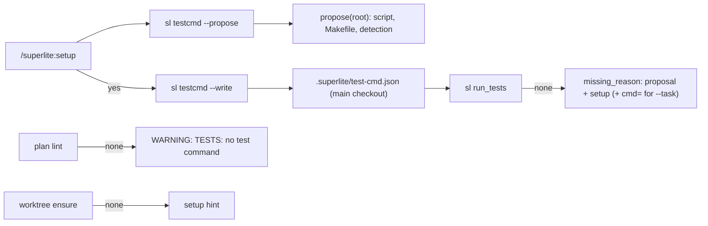
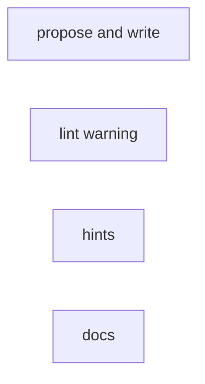

# Superlite: setup writes the project test command; lint warns without one (B115)

**Goal:** fix #570 (a Swift app tested through its project script, `Scripts/test.sh` beside a nested `Packages/<X>/Package.swift`, resolves no test command, so every `sl run_tests` stops with `no test command found`) and #566 (a verify command named only in the plan's Global constraints did not steer workers off `sl run_tests`). Max's decision: setup proposes the detected project test command and writes it.
**Architecture:** `testcmd.py` gains `propose(root)` (project test script, then a Makefile `test` target, then marker detection), `config_target(root)` and `write_config(root, config)` plus the CLI flags `--propose` and `--write`; `missing_reason` names the proposal and `/superlite:setup`. `plan_tools.py` lint warns once when no test command resolves and local tasks name no `cmd=`. `run_tests.py` adds a `**Tests:** fast cmd=` hint to a `--task` run's no-command stop; `worktree ensure` prints a setup hint when the run has no test command. `commands/setup.md` and `docs/tools.md` describe it.
**Tech stack:** Python 3.10+ stdlib, pytest (through `sl run_tests`), Markdown docs.
**Spec:** this file, section Design; issues #566 and #570.
**Detail:** tests
**Target-min:** 11
**Wave0:** none
**Coverage:** off
**Max chars:** 32000

Global constraints:
- Every Python code line keeps the file's trailing `# O(...)` complexity comment.
- Existing tests stay green. An existing test file changes only when the task Owns it. If another existing test turns red, report it in DONE_WITH_CONCERNS with the test id and the reason instead of editing it.
- Tests set `SUPERLITE_USER_TEST_CMD` to a missing file, so the machine's user-level test-cmd.json never leaks in.
- Run `sl` as an executable (`<abs>/sl ...`). Verify with `<abs>/sl run_tests --fast <own test files> --task Tn --background`, then run the printed `wait:` line in the foreground and end the turn only after it reports.
- No version edits (the ship step bumps the version). Never run `scripts/evals.sh`, `claude plugin eval` or `scripts/test_layers.py run`.

Ruling: setup writes the file only after the user's yes, through `sl testcmd --write`, never by hand; `--write` never overwrites and refuses (exit 2) while any `test-cmd.json` already sets the command (because setup changes nothing without a yes, Max's decision; cost if wrong: one extra command).
Ruling: from a linked worktree `--write` targets the main checkout's `.superlite/test-cmd.json`, which every worktree reads (#533) and `backlog start` seeds (because a worktree's `.superlite/` dies with it; cost if wrong: a write lands one folder up).
Ruling: proposal order: project test script (names `test.sh`, `test`, `tests.sh`, `tests`, `run-tests.sh`, `run-tests`, `run_tests.sh`, name-first, in folders `scripts`, `script`, `bin`, matched case-insensitively), then a Makefile `test` target (`make test`), then marker detection; a Python project gets no proposal (the pytest path needs no file) (because the project's own script is what its CI runs; cost if wrong: the user edits the proposal).
Ruling: lint's no-command case is one plan-level `WARNING: TESTS:` line, not an issue: a probe that made it an issue turned 61 existing lint tests red (cost if wrong: an AI coordinator may skip a warning; the run_tests stop names the fix too).
Ruling: `worktree ensure` prints one setup hint line when the run resolves no test command (the earliest point a coordinator learns it, before the plan); it never writes (Max chose setup).
Ruling (after build): the `worktree ensure` hint is dropped: it repeated on every ensure and broke three exact-stderr tests; plan lint's `WARNING: TESTS:` already reaches the coordinator before dispatch (cost if wrong: the missing command shows at lint, one step later).
Ruling: no probe adapter (all entries take folders, not text; Review Focus cases are named tests); detail tests; already in the lead worktree, no `sl worktree ensure`; T4's doc text is fixed here, so no edges.
LAYERS: unit, headless, evals



## Design

### 1. Proposal and write (T1, `testcmd.py`)
`propose(root: Path) -> dict | None`: `None` when `config_source(root)` has source `test-cmd.json` (the project's or the main checkout's file). Else, first hit wins:
1. Project test script: for each name in `SCRIPT_NAMES = ("test.sh", "test", "tests.sh", "tests", "run-tests.sh", "run-tests", "run_tests.sh")`, then each folder in `SCRIPT_DIRS = ("scripts", "script", "bin")`: a folder of root whose lowercased name equals it, holding a file whose lowercased name equals the name (real names kept). `rel = "<folder>/<file>"`; the command is `rel` when the file is executable (`os.access(X_OK)`), else `bash <rel>`. `from` = `project test script <rel>`.
2. A `Makefile`, `makefile` or `GNUmakefile` with a line matching `^test\s*:(?!=)` (multiline): command `make test`, `from` = `Makefile target test`.
3. `detect(root)` not None and its language is not `python`: its config without empty-string values and without an empty `env`; `from` = `detection`.
4. Else `None`.
For 1 and 2 the config is `{"language": L, "test": command}` with `L` = the detected language, else `swift` when root holds an `.xcodeproj`/`.xcworkspace` or a `Package.swift` one or two folder levels down (skipping `SKIP_DIRS` and dot folders), else no `language` key. A swift script whose text (first 64 KB, errors ignored) holds both `xcodebuild` and `$@` also gets `"test_file": "<command> {only_testing}"`. Key order: language, test, test_file.
`config_target(root: Path) -> Path`: `(main checkout root when root is a linked worktree, else root).resolve() / CONFIG`.
`write_config(root: Path, config: dict) -> Path`: raises `FileExistsError` when the target exists; else creates the folder, writes `json.dumps(config, indent=2) + "\n"`, returns the target.
CLI (`main`): `--propose` prints `{"proposal": config|null, "from": str|null, "target": "<config_target posix>", "exists": bool}`, exit 0. `--write [--test CMD] [--test-file T] [--language L]`: exit 2 with stderr `testcmd: <origin> already sets the test command; nothing written` when `config_source` gives source `test-cmd.json`, or `testcmd: <target> exists; nothing written`. Config = the proposal's; `--test` replaces `test` and drops a proposed `test_file`; `--test-file` and `--language` set those keys; a `--test` without a proposal starts from `{"language": <the language rule above, when any>}`. No `test` key: stderr `testcmd: nothing to write: no project test script, Makefile test target or marker file found; pass --test CMD`, exit 1. Else write, stdout `wrote <target posix>: <test>`, exit 0. Without either flag `main` is unchanged.
`missing_reason(root)` appends to both texts `; /superlite:setup proposes `<test>` (<from>) and writes it to .superlite/test-cmd.json` when `propose(root)` returns one, else `; /superlite:setup writes .superlite/test-cmd.json from the command you name`.

### 2. Lint warning (T2, `plan_tools.py`)
`no_command_warnings(plan: Plan, root: Path | None) -> list[str]`: `[]` when root is None, when `testcmd.resolve(root, ())` raises or returns a spec, or when no task qualifies. A task qualifies unless it is draft, has `t.repo`, is `Tests: build`, or names `cmd=`, and only when `testcmd.verify_paths(t.owns)` is non-empty. One line: `WARNING: TESTS: no test command resolves for this project; <ids> name no **Tests:** cmd=, so their sl run_tests --task stops with "no test command found": run /superlite:setup (it proposes the project's test command and writes .superlite/test-cmd.json) or name each task's command: **Tests:** fast cmd=<command>`; `<ids>` = the first five joined by `, `, then ` +N more`. `lint_plan` extends `warnings` with it right after the `tests_issues` call, in its own `try` (`OSError`, `ValueError`).

### 3. Hints (T3, `run_tests.py`, `worktree.py`)
`run_tests.run`: in the `spec is None` branch, with `a.task`, the reason gets `; or name <task>'s own command on its Tests line: **Tests:** fast cmd=<command>` appended (stderr and summary `error`). `worktree.command_hint(path: Path, state: str) -> str | None`: `None` for `no-repo`, when `testcmd.resolve(path, ())` returns a spec, or on any exception; else `worktree: no test command resolves for this run; /superlite:setup proposes the project's test command and writes .superlite/test-cmd.json (or name each task's **Tests:** fast cmd=<command>)`. `main` prints it on stderr after the `ensure_lines` loop; `testcmd` is imported lazily inside `command_hint`.

## File structure

- `skills/subagent-driven-development/scripts/testcmd.py`, `tests/scripts/test_testcmd_propose_570.py` (T1)
- `skills/subagent-driven-development/scripts/plan_tools.py`, `tests/scripts/test_lint_tests_nocmd_566.py` (T2)
- `skills/subagent-driven-development/scripts/run_tests.py`, `skills/subagent-driven-development/scripts/worktree.py`, `tests/scripts/test_nocmd_hints_566.py` (T3)
- `commands/setup.md`, `docs/tools.md`, `tests/scripts/test_docs_570_setup_writes.py` (T4)

## Task graph

```mermaid
%% schedule
gantt
  title Predicted schedule (mm:ss)
  dateFormat X
  axisFormat %M:%S
  section lane 1
  T1 testcmd proposes and writes the test :t1, 0, 142s
  section lane 2
  T3 run_tests and worktree ensure name th :t3, 0, 140s
  section lane 3
  T2 lint warns when no test command resol :t2, 0, 96s
  section lane 4
  T4 setup and tools docs name propose and :t4, 0, 95s
```





critical path: T1 (2.4 min) · peak width 4 · predicted build 2.4 min · predicted total ≈ 5.9 min (target ✓)

## Package: test command

App type: CLI and file I/O. Categories: file (existing target, linked worktree, non-executable script), protocol (flags, exit codes), state (which source wins). **Probe entry:** none (every entry takes a folder; cases are named tests).

### T1 testcmd proposes and writes the test command · Complexity 4 · Est. context 45k
**Owns:** skills/subagent-driven-development/scripts/testcmd.py, tests/scripts/test_testcmd_propose_570.py
**Components:** 2
**LOC owned:** 230
**Tests:** fast
**Model:** sonnet
**Est. time:** 3.5 min (2 components, about 230 LOC, fast tests)
**Covers:** 1
**Consumes:** none
**Produces:** testcmd.propose(root: Path) -> dict | None · testcmd.config_target(root: Path) -> Path · testcmd.write_config(root: Path, config: dict) -> Path
e.g. propose(Path("<app with App.xcodeproj, Packages/AppKit/Package.swift, executable Scripts/test.sh running xcodebuild ... \"$@\">")) -> {"config": {"language": "swift", "test": "Scripts/test.sh", "test_file": "Scripts/test.sh {only_testing}"}, "from": "project test script Scripts/test.sh"}
e.g. propose(Path("<root with go.mod only>")) -> {"config": {"language": "go", "test": "go test ./...", "test_file": "go test {files}"}, "from": "detection"}
**Review Focus:** file: `test_write_creates_file_and_refuses_second`, `test_write_in_linked_worktree_targets_main_checkout`, `test_propose_script_preference_and_non_executable`; protocol: `test_write_overrides_and_nothing_to_write`; state: `test_propose_order_script_then_makefile_then_detection`, `test_propose_none_when_project_file_exists`.
**Test code (verbatim):** new file tests/scripts/test_testcmd_propose_570.py:
```python
"""#570: testcmd proposes the project's own test command and writes .superlite/test-cmd.json."""
from __future__ import annotations

import json
import subprocess
import sys

import pytest

from test_plan_tools import SCRIPTS, run

sys.path.insert(0, str(SCRIPTS))
import testcmd  # noqa: E402

TESTCMD = SCRIPTS / "testcmd.py"
XCODE_SCRIPT = ("#!/usr/bin/env bash\nset -euo pipefail\ncd \"$(dirname \"$0\")/../Packages/AppKit\" && "
                "exec xcodebuild test -scheme AppKit-Package -destination 'platform=macOS' \"$@\"\n")
SWIFT_CFG = {"language": "swift", "test": "Scripts/test.sh", "test_file": "Scripts/test.sh {only_testing}"}


@pytest.fixture(autouse=True)
def no_user_file(tmp_path, monkeypatch):
    monkeypatch.setenv("SUPERLITE_USER_TEST_CMD", str(tmp_path / "no-user-file.json"))


def script(root, rel, body=XCODE_SCRIPT, executable=True):
    p = root / rel
    p.parent.mkdir(parents=True, exist_ok=True)
    p.write_text(body, encoding="utf-8")
    p.chmod(0o755 if executable else 0o644)
    return p


def swift_app(tmp_path):
    root = tmp_path / "app"
    (root / "App.xcodeproj").mkdir(parents=True)
    (root / "Packages" / "AppKit").mkdir(parents=True)
    (root / "Packages" / "AppKit" / "Package.swift").write_text("// swift-tools-version:5.9\n", encoding="utf-8")
    script(root, "Scripts/test.sh")
    return root


def saved(root):
    return json.loads((root / ".superlite" / "test-cmd.json").read_text(encoding="utf-8"))


def git(cwd, *args):
    subprocess.run(["git", "-C", str(cwd), *args], check=True, capture_output=True)


def test_propose_project_test_script_swift(tmp_path):
    assert testcmd.propose(swift_app(tmp_path)) == {"config": SWIFT_CFG, "from": "project test script Scripts/test.sh"}


def test_propose_nested_package_without_xcodeproj_is_swift(tmp_path):
    root = tmp_path / "pkg"
    (root / "Packages" / "Core").mkdir(parents=True)
    (root / "Packages" / "Core" / "Package.swift").write_text("// swift-tools-version:5.9\n", encoding="utf-8")
    script(root, "scripts/test", body="#!/bin/sh\nswift test --package-path Packages/Core\n")
    assert testcmd.propose(root) == {"config": {"language": "swift", "test": "scripts/test"}, "from": "project test script scripts/test"}


def test_propose_script_preference_and_non_executable(tmp_path):
    root = tmp_path / "r"
    script(root, "bin/test", body="#!/bin/sh\nexit 0\n")
    script(root, "script/run-tests.sh", body="echo hi\n", executable=False)
    assert testcmd.propose(root) == {"config": {"test": "bin/test"}, "from": "project test script bin/test"}
    (root / "bin" / "test").unlink()
    assert testcmd.propose(root) == {"config": {"test": "bash script/run-tests.sh"}, "from": "project test script script/run-tests.sh"}


def test_propose_makefile_target(tmp_path):
    root = tmp_path / "m"
    root.mkdir()
    (root / "Makefile").write_text("CC := cc\ntest:\n\t./run\n", encoding="utf-8")
    assert testcmd.propose(root) == {"config": {"test": "make test"}, "from": "Makefile target test"}
    (root / "Makefile").write_text("test := 1\ntests: all\n", encoding="utf-8")
    assert testcmd.propose(root) is None


def test_propose_order_script_then_makefile_then_detection(tmp_path):
    root = tmp_path / "g"
    root.mkdir()
    (root / "go.mod").write_text("module m\n", encoding="utf-8")
    assert testcmd.propose(root) == {"config": {"language": "go", "test": "go test ./...", "test_file": "go test {files}"}, "from": "detection"}
    (root / "Makefile").write_text("test:\n\tgo test ./...\n", encoding="utf-8")
    assert testcmd.propose(root) == {"config": {"language": "go", "test": "make test"}, "from": "Makefile target test"}
    script(root, "scripts/test.sh", body="#!/bin/sh\ngo test ./...\n")
    assert testcmd.propose(root) == {"config": {"language": "go", "test": "scripts/test.sh"}, "from": "project test script scripts/test.sh"}


def test_propose_python_project_and_empty_folder(tmp_path):
    py = tmp_path / "py"
    py.mkdir()
    (py / "pyproject.toml").write_text("[project]\nname='x'\n", encoding="utf-8")
    assert testcmd.propose(py) is None
    (tmp_path / "empty").mkdir()
    assert testcmd.propose(tmp_path / "empty") is None


def test_propose_none_when_project_file_exists(tmp_path):
    root = swift_app(tmp_path)
    (root / ".superlite").mkdir()
    (root / ".superlite" / "test-cmd.json").write_text('{"test": "x"}', encoding="utf-8")
    assert testcmd.propose(root) is None


def test_write_creates_file_and_refuses_second(tmp_path):
    root = swift_app(tmp_path)
    target = (root / ".superlite" / "test-cmd.json").resolve()
    cp = run(TESTCMD, "--root", root, "--write")
    assert cp.returncode == 0, cp.both
    assert cp.out.strip() == f"wrote {target.as_posix()}: Scripts/test.sh"
    assert saved(root) == SWIFT_CFG
    assert testcmd.resolve(root)["command"] == "Scripts/test.sh"
    again = run(TESTCMD, "--root", root, "--write")
    assert again.returncode == 2 and "nothing written" in again.err
    with pytest.raises(FileExistsError):
        testcmd.write_config(root, {"test": "y"})


def test_write_overrides_and_nothing_to_write(tmp_path):
    root = tmp_path / "e"
    root.mkdir()
    cp = run(TESTCMD, "--root", root, "--write")
    assert cp.returncode == 1 and "nothing to write" in cp.err
    assert not (root / ".superlite" / "test-cmd.json").exists()
    cp = run(TESTCMD, "--root", root, "--write", "--test", "make check", "--language", "rust")
    assert cp.returncode == 0, cp.both
    assert saved(root) == {"language": "rust", "test": "make check"}


def test_write_test_override_drops_proposed_test_file(tmp_path):
    root = swift_app(tmp_path)
    cp = run(TESTCMD, "--root", root, "--write", "--test", "lockf /tmp/x Scripts/test.sh")
    assert cp.returncode == 0, cp.both
    assert saved(root) == {"language": "swift", "test": "lockf /tmp/x Scripts/test.sh"}


def test_write_in_linked_worktree_targets_main_checkout(tmp_path):
    main = swift_app(tmp_path)
    git(main, "init", "-q", "-b", "main")
    git(main, "add", ".")
    git(main, "-c", "user.name=t", "-c", "user.email=t@t", "commit", "-q", "-m", "init")
    wt = tmp_path / "wt"
    git(main, "worktree", "add", "-q", "-b", "topic", str(wt))
    target = (main / ".superlite" / "test-cmd.json").resolve()
    assert testcmd.config_target(wt) == target
    cp = run(TESTCMD, "--root", wt, "--propose")
    assert cp.returncode == 0, cp.both
    assert json.loads(cp.out) == {"proposal": SWIFT_CFG, "from": "project test script Scripts/test.sh",
                                  "target": target.as_posix(), "exists": False}
    assert run(TESTCMD, "--root", wt, "--write").returncode == 0
    assert target.is_file() and not (wt / ".superlite" / "test-cmd.json").exists()
    assert testcmd.resolve(wt)["command"] == "Scripts/test.sh"


def test_missing_reason_names_setup_and_proposal(tmp_path):
    root = swift_app(tmp_path)
    r = testcmd.missing_reason(root)
    assert r.startswith("no test command found: add .superlite/test-cmd.json") and "{only_testing}" in r
    assert r.endswith("; /superlite:setup proposes `Scripts/test.sh` (project test script Scripts/test.sh) and writes it to .superlite/test-cmd.json")
    (tmp_path / "e").mkdir()
    assert testcmd.missing_reason(tmp_path / "e").endswith("; /superlite:setup writes .superlite/test-cmd.json from the command you name")
```
**Steps:** 1 write the test file, 2 run: FAIL, 3 implement Design section 1 in testcmd.py (module docstring: add `propose`, `config_target`, `write_config` to the Library line and the two flags to the usage line), 4 run: PASS, also `tests/scripts/test_testcmd.py`, `tests/scripts/test_testcmd_user_default_533.py`, `tests/scripts/test_testcmd_xcode.py`.
**Notes:** the folder walk for a nested `Package.swift` reuses `SKIP_DIRS`; read `config_source` once in `propose`.

## Package: lint

App type: library. Categories: state (which tasks count). **Probe entry:** none (takes a plan and a folder).

### T2 lint warns when no test command resolves · Complexity 3 · Est. context 40k
**Owns:** skills/subagent-driven-development/scripts/plan_tools.py, tests/scripts/test_lint_tests_nocmd_566.py
**Components:** 1
**LOC owned:** 110
**Tests:** fast
**Model:** sonnet
**Est. time:** 2.2 min (1 component, about 110 LOC, fast tests)
**Covers:** 2
**Consumes:** none
**Produces:** plan_tools.no_command_warnings(plan: Plan, root: Path | None) -> list[str]
**Review Focus:** state: `test_no_command_warns_once_for_tasks_without_cmd`, `test_more_than_five_tasks_are_cut`, `test_draft_task_skipped_and_no_root`.
**Test code (verbatim):** new file tests/scripts/test_lint_tests_nocmd_566.py:
```python
"""#566: lint warns when no test command resolves and a task names no **Tests:** cmd=."""
from __future__ import annotations

import subprocess
import sys

import pytest

from test_plan_tools import SCRIPTS

sys.path.insert(0, str(SCRIPTS))
import plan_tools  # noqa: E402

TAIL = ('so their sl run_tests --task stops with "no test command found": run /superlite:setup (it proposes the '
        "project's test command and writes .superlite/test-cmd.json) or name each task's command: **Tests:** fast cmd=<command>")


@pytest.fixture(autouse=True)
def no_user_file(tmp_path, monkeypatch):
    monkeypatch.setenv("SUPERLITE_USER_TEST_CMD", str(tmp_path / "no-user-file.json"))


def task(n, owns, tests="fast", extra=()):
    return [f"### T{n} t{n} · Complexity 1", f"**Owns:** {owns}", f"**Tests:** {tests}", "**Components:** 1",
            "**LOC owned:** 20", *extra, ""]


def project(tmp_path, tasks, marker=None):
    subprocess.run(["git", "init", "-q", str(tmp_path)], check=True)
    (tmp_path / ".superlite").mkdir(exist_ok=True)
    if marker:
        (tmp_path / marker[0]).write_text(marker[1], encoding="utf-8")
    nodes = [f"  T{i + 1}[t]" for i in range(len(tasks))]
    p = tmp_path / "plan.md"
    p.write_text("\n".join(["# Plan", "**Goal:** test.", "", "```mermaid", "flowchart LR", *nodes, "  %% taskgraph", "```", "",
                            *[ln for t in tasks for ln in t]]), encoding="utf-8")
    return p


def tests_lines(p):
    plan = plan_tools.Plan.load(str(p))
    issues, warns = plan_tools.lint_plan(plan, plan_tools.build_parser().parse_args(["lint", "--plan", str(p)]))
    return [w for w in warns if "TESTS:" in w], [str(i) for i in issues if str(i).startswith("TESTS:")]


def test_no_command_warns_once_for_tasks_without_cmd(tmp_path):
    p = project(tmp_path, [task(1, "Sources/App/A.swift, Tests/AppTests/ATests.swift"),
                           task(2, "Sources/App/B.swift", tests="fast cmd=Scripts/test.sh"),
                           task(3, "App/C.swift", tests="build"),
                           task(4, "docs/notes.md"),
                           task(5, "Sources/App/D.swift")])
    assert tests_lines(p) == (["WARNING: TESTS: no test command resolves for this project; T1, T5 name no **Tests:** cmd=, " + TAIL], [])


def test_no_warning_when_a_command_resolves(tmp_path):
    assert tests_lines(project(tmp_path, [task(1, "src/a.go")], marker=("go.mod", "module m\n"))) == ([], [])


def test_no_warning_when_every_task_names_cmd(tmp_path):
    assert tests_lines(project(tmp_path, [task(1, "Sources/A.swift", tests="fast cmd=Scripts/test.sh")])) == ([], [])


def test_more_than_five_tasks_are_cut(tmp_path):
    p = project(tmp_path, [task(i, f"Sources/F{i}.swift") for i in range(1, 8)])
    assert tests_lines(p)[0] == ["WARNING: TESTS: no test command resolves for this project; T1, T2, T3, T4, T5 +2 more name no **Tests:** cmd=, " + TAIL]


def test_draft_task_skipped_and_no_root(tmp_path):
    p = project(tmp_path, [task(1, "Sources/A.swift", extra=["**Status:** draft"])])
    assert tests_lines(p) == ([], [])
    plan = plan_tools.Plan.load(str(p))
    assert plan_tools.no_command_warnings(plan, None) == []
```
**Steps:** 1 write the test file, 2 run: FAIL, 3 implement Design section 2 next to `tests_issues`, 4 run: PASS, also `tests/scripts/test_lint_tests_cmd_475.py`.

## Package: hints

App type: CLI. Categories: protocol (stderr lines, summary error). **Probe entry:** none (CLI runs need a project folder; cases are named tests).

### T3 run_tests and worktree ensure name the fix · Complexity 2 · Est. context 42k
**Owns:** skills/subagent-driven-development/scripts/run_tests.py, skills/subagent-driven-development/scripts/worktree.py, tests/scripts/test_nocmd_hints_566.py
**Components:** 2
**LOC owned:** 90
**Tests:** fast
**Model:** sonnet
**Est. time:** 2.0 min (2 components, about 90 LOC, fast tests)
**Covers:** 3
**Consumes:** none
**Produces:** worktree.command_hint(path: Path, state: str) -> str | None
**Review Focus:** protocol: `test_task_run_without_command_names_tests_cmd`, `test_run_without_task_has_no_task_hint`, `test_worktree_ensure_hints_setup_without_command`.
**Test code (verbatim):** new file tests/scripts/test_nocmd_hints_566.py:
```python
"""#566: a run with no test command names the fix: run_tests --task the Tests cmd=, worktree ensure /superlite:setup."""
from __future__ import annotations

import json
import os
import subprocess
import sys
from pathlib import Path

SCRIPTS = Path(__file__).resolve().parents[2] / "skills" / "subagent-driven-development" / "scripts"
sys.path.insert(0, str(SCRIPTS))
import worktree  # noqa: E402

TASK_HINT = "; or name T1's own command on its Tests line: **Tests:** fast cmd=<command>"
SETUP_HINT = ("worktree: no test command resolves for this run; /superlite:setup proposes the project's test command and "
              "writes .superlite/test-cmd.json (or name each task's **Tests:** fast cmd=<command>)")


def env(tmp_path):
    e = {k: v for k, v in os.environ.items() if not k.startswith("SUPERLITE_")}
    e.update(SUPERLITE_HOME=str(tmp_path / "home"), SUPERLITE_USER_TEST_CMD=str(tmp_path / "no-user-file.json"),
             PYTHONIOENCODING="utf-8")
    return e


def rt(tmp_path, *args):
    sl = tmp_path / ".superlite"
    sl.mkdir(exist_ok=True)
    return subprocess.run([sys.executable, str(SCRIPTS / "run_tests.py"), *map(str, args), "--log", str(sl / "incidents.jsonl"),
                           "--ledger", str(sl / "ledger.md"), "--summary", str(sl / "test-summary.json")],
                          capture_output=True, cwd=tmp_path, env=env(tmp_path), timeout=120, text=True)


def repo(path, marker=None):
    path.mkdir(parents=True)
    for args in (("init", "-q", "-b", "main"), ("config", "user.name", "t"), ("config", "user.email", "t@t")):
        subprocess.run(["git", "-C", str(path), *args], check=True, capture_output=True)
    (path / "a.txt").write_text("one\n", encoding="utf-8")
    if marker:
        (path / marker[0]).write_text(marker[1], encoding="utf-8")
    subprocess.run(["git", "-C", str(path), "add", "."], check=True, capture_output=True)
    subprocess.run(["git", "-C", str(path), "commit", "-q", "-m", "init"], check=True, capture_output=True)
    return path


def ensure(tmp_path, root):
    return subprocess.run(["bash", str(SCRIPTS / "sl"), "worktree", "ensure", "topic"], capture_output=True, text=True,
                          encoding="utf-8", cwd=root, env=env(tmp_path))


def test_task_run_without_command_names_tests_cmd(tmp_path):
    (tmp_path / "plan.md").write_text("# Plan\n\n### T1 app\n**Owns:** Sources/App/A.swift\n**Tests:** fast\n", encoding="utf-8")
    cp = rt(tmp_path, "--task", "T1", "--plan", tmp_path / "plan.md")
    assert cp.returncode == 2, cp.stdout + cp.stderr
    assert "no test command found" in cp.stderr and TASK_HINT in cp.stderr
    s = json.loads((tmp_path / ".superlite" / "test-summary.json").read_text(encoding="utf-8"))
    assert s["error"].endswith(TASK_HINT)


def test_run_without_task_has_no_task_hint(tmp_path):
    cp = rt(tmp_path, "--full")
    assert cp.returncode == 2 and "no test command found" in cp.stderr
    assert "cmd=<command>" not in cp.stderr


def test_worktree_ensure_hints_setup_without_command(tmp_path):
    root = repo(tmp_path.resolve() / "repo")
    cp = ensure(tmp_path, root)
    assert cp.returncode == 0, cp.stderr
    assert SETUP_HINT in cp.stderr.splitlines()


def test_worktree_ensure_quiet_with_command(tmp_path):
    root = repo(tmp_path.resolve() / "repo", marker=("go.mod", "module m\n"))
    cp = ensure(tmp_path, root)
    assert cp.returncode == 0, cp.stderr
    assert "no test command" not in cp.stderr


def test_command_hint_unit(tmp_path):
    assert worktree.command_hint(tmp_path, "no-repo") is None
    (tmp_path / "go.mod").write_text("module m\n", encoding="utf-8")
    assert worktree.command_hint(tmp_path, "created") is None
```
**Steps:** 1 write the test file, 2 run: FAIL, 3 implement Design section 3 (run_tests: the `spec is None` branch in `run`; worktree: `command_hint` and its call in `main`; module docstrings name the new line), 4 run: PASS, also `tests/scripts/test_worktree.py`, `tests/scripts/test_testcmd.py`.

## Package: docs

App type: docs. **Probe entry:** none (docs).

### T4 setup and tools docs name propose and write · Complexity 2 · Est. context 30k
**Owns:** commands/setup.md, docs/tools.md, tests/scripts/test_docs_570_setup_writes.py
**Components:** 1
**LOC owned:** 40
**Tests:** fast
**Kind:** mechanical
**Model:** haiku
**Est. time:** 1.6 min (1 component, about 40 LOC, fast tests)
**Covers:** 1, 2, 3
**Consumes:** none
**Produces:** none
**Review Focus:** none (docs; the pins below are the check).
**Test code (verbatim):** new file tests/scripts/test_docs_570_setup_writes.py:
```python
"""#566, #570: setup proposes and writes the test command; tools.md names --propose, --write, the lint warning and the hint."""
from pathlib import Path

ROOT = Path(__file__).resolve().parents[2]
SETUP = (ROOT / "commands" / "setup.md").read_text(encoding="utf-8")
TOOLS = (ROOT / "docs" / "tools.md").read_text(encoding="utf-8")


def row(name):
    return next(ln for ln in TOOLS.splitlines() if ln.startswith(f"| `{name}` |"))


def test_setup_proposes_and_writes():
    assert "When `origin` is not a `test-cmd.json` file, run `sl testcmd --propose`" in SETUP
    assert "on a yes `sl testcmd --write` writes it" in SETUP
    assert "report its `command` and `origin`" in SETUP and "~/.config/superlite/test-cmd.json" in SETUP


def test_tools_rows():
    assert "`--propose` prints `{\"proposal\", \"from\", \"target\", \"exists\"}`" in row("testcmd")
    assert "`--write [--test CMD] [--test-file T] [--language L]`" in row("testcmd")
    assert "`WARNING: TESTS: no test command resolves for this project; <ids> name no **Tests:** cmd=, ...`" in row("plan_tools")
    assert "`worktree: no test command resolves for this run; /superlite:setup proposes" in row("worktree")
```
Edit 1 (exact), commands/setup.md first bullet: replace `` `detection`) and that it runs;`` with
`` `detection`) and that it runs. When `origin` is not a `test-cmd.json` file, run `sl testcmd --propose`: `proposal` is the project's own test command (a project test script such as `Scripts/test.sh`, `scripts/test` or `bin/test`, else a Makefile `test` target, else the detected command; null for a Python project or when nothing is found), `from` where it came from, and `target` the file it would write (the main checkout's from a linked worktree). The fix line proposes that command, or asks for one when `proposal` is null; on a yes `sl testcmd --write` writes it (`--test CMD` writes the command the user names instead; it never overwrites a `test-cmd.json`), so `sl run_tests` and every worker find it;``
Edit 2 (exact), docs/tools.md `testcmd` row: after `` Wave 0 (T0) runs it as the check that `run_tests` detects the stack.`` insert
`` `--propose` prints `{"proposal", "from", "target", "exists"}`: the project's own test command when no `test-cmd.json` sets one: a project test script (`test.sh`, `test`, `tests.sh`, `tests`, `run-tests.sh`, `run-tests` or `run_tests.sh` in `scripts/`, `script/` or `bin/`, any case; `bash <path>` when not executable), else a Makefile `test` target (`make test`), else the detected command (a Python project gets none); `language` from detection, an Xcode project or a `Package.swift` up to two folders down; a Swift script that runs xcodebuild with `$@` also gets `test_file` `<script> {only_testing}`. `--write [--test CMD] [--test-file T] [--language L]` writes it to the main checkout's `.superlite/test-cmd.json` (the project's outside a linked worktree): exit 1 with nothing to write, exit 2 when a `test-cmd.json` already sets the command. `/superlite:setup` proposes and writes it; the `no test command found` reason names the proposal and `/superlite:setup`.``
Edit 3 (exact), docs/tools.md `plan_tools` row: after `` and whose `**Tests:**` field has no `cmd=<command>`.`` insert
`` With no test command at all, lint warns once `WARNING: TESTS: no test command resolves for this project; <ids> name no **Tests:** cmd=, ...` for the local tasks (not draft, not `Tests: build`) with code to verify and no `cmd=`; `run_tests --task Tn` then stops with that reason plus `**Tests:** fast cmd=<command>`.``
Edit 4 (exact), docs/tools.md `worktree` row: after `` (#493, a warning only).`` insert
`` A run that resolves no test command gets `worktree: no test command resolves for this run; /superlite:setup proposes the project's test command and writes .superlite/test-cmd.json (or name each task's **Tests:** fast cmd=<command>)` on stderr.``
**Steps:** 1 write the test file, 2 run: FAIL, 3 make the four edits, 4 run: PASS, also `tests/scripts/test_docs_533_user_test_cmd.py`, `tests/scripts/test_docs_b95_tools.py`.

## Self-review

1. Coverage: #570 Expected (setup writes the test command for a SwiftPM project with a project script): T1 `test_propose_project_test_script_swift`, `test_write_in_linked_worktree_targets_main_checkout`, T4 setup text; #566 (steer a plan without a project command to `cmd=`): T2 warning, T3 run_tests and worktree hints, T1 missing_reason.
2. Placeholders: none (`<command>`, `<ids>`, `<path>`, `<script>` are literal doc text).
3. Types: no task consumes another's Produces.
4. Graph: no edges; no shared files.
5. Fields: all set. 6. Review Focus per package; probe entries none with reasons. 7. Limits: schedule and lint run next.
