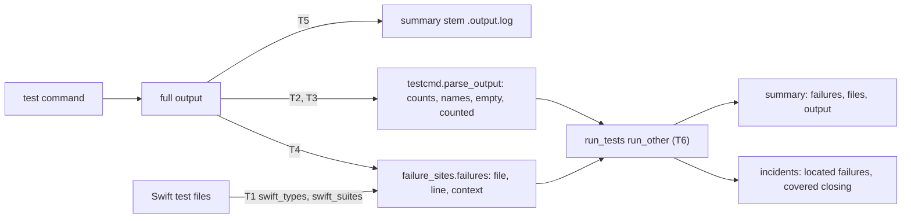
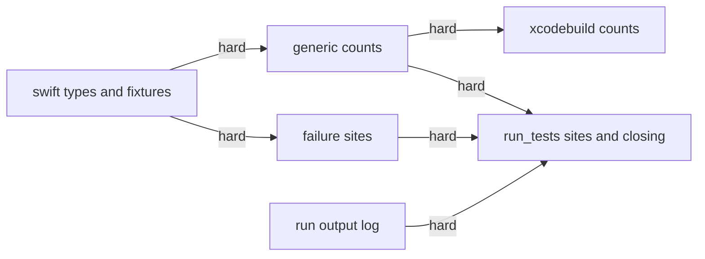

# Superlite: test runner counts, Swift failure sites and run output (B92)

**Goal:** fix #481 (a red vitest run reported `1 passed, 0 failed`), #499 (Swift Testing failures carry no suite or file), #501 (a worker cannot read its own test run's output) and #510 (an indented `@Suite` inside `#if` is not found; the fallback run's counts are wrong).
**Architecture:** `testcmd.py` gets brace-depth Swift type scanning (T1), honest generic counts (T2) and hardened xcodebuild counts (T3), in that order (one file). A new module `failure_sites.py` turns xcodebuild failure lines into `(file, line, context)` sites (T4). `run_tests.py` keeps every run's full output (T5), then uses the sites, closes located failures and names the runner's own "no tests" line (T6).
**Tech stack:** Python 3.10+ stdlib, pytest through `sl run_tests`.
**Spec:** this file, section Design; the issues' Expected lines.
**Detail:** contracts
**Target-min:** 11
**Wave0:** none
**Max chars:** 32000

Global constraints:
- Every code line in `skills/subagent-driven-development/scripts/*.py` carries the repo's trailing `# O(...)` complexity comment where the surrounding function's lines do; tests do not. Stdlib only.
- Existing tests stay green. An existing test file changes only when the task Owns it. If another existing test turns red, report it in DONE_WITH_CONCERNS with the test id and the reason instead of editing it.
- Run `sl` as an executable (`<abs>/sl ...`). Verify with `<abs>/sl run_tests --fast <own test files> --task Tn --background`, then run the printed `wait:` line in the foreground and end the turn only after it reports.
- Tests drop every `SUPERLITE_*` variable from a subprocess env (and `monkeypatch.delenv` SUPERLITE_FLEET_ROLE, SUPERLITE_FLEET_WORKER, SUPERLITE_FLEET_PARENT_DIR, SUPERLITE_STATE_DIR in-process).
- Real xcodebuild captures (Xcode 27.2, anonymized) sit in `.superlite/captures/` of the run root: `kit_full.txt` (serial, 7 failures), `kit_par.txt` (parallel testing), `kit_crash.txt` (a crash and relaunches), `kit_skip.txt` (a skipped test), `media_excerpt.txt` (zero-width-space lines, known issues) and the Swift sources they ran. Fixtures are copied from there byte for byte; never invent xcodebuild lines. The repo is public: no host names, user names or other projects' names in fixtures.
- No version edits (the ship step bumps the version). No edits to `docs/` (another batch owns docs/tools.md and docs/testing.md).

Ruling: #481's cause, reproduced with vitest 3.2.7: a filter that selects no file (`passWithNoTests`) exits 0 and writes an empty JUnit report; run_other falls back to parse_output, whose green-exit fallback turns "nothing read" into one pass. A non-JUnit run whose output holds no test count is now no green: run_tests' existing `no tests ran` stop (exit 1, `no-result` incident) catches it, and the stop names the runner's own no-tests line. This reverses B11's "a green exit with no recognisable output stays one pass" - cost if wrong: a custom test command that prints no count must print one (`N passed`).
Ruling: #481 counts: a vitest or jest `Tests` summary line wins over every other count line (`Test Files`, `Test Suites` and per-file lines no longer add to failed); mocha's `passing`/`failing`/`pending` are read - cost if wrong: a runner printing a `Tests` line in another sense is miscounted.
Ruling: #510 counts reproduced with a crashing Swift test: xcodebuild relaunches the bundle (`Restarting after unexpected exit, crash, or test timeout`) and the last launch's `Test run with 1 test` was all that was counted. After a relaunch line the Swift Testing counts come from distinct test names over all launches, the crashed test failed as `<name> (crashed)`; `➜ ... skipped` lines count as skipped (the run total includes them); parallel-testing `Test case '...' passed|failed on '...'` lines are counted; zero-width characters are stripped. Two Swift Testing tests sharing a function name in different suites count once after a relaunch - cost if wrong: an undercount only in a crashed run.
Ruling: #499: a failure site is `(root-relative file, line, "<suite path>/<test>: <message>")`, the suite path slash-joined as `-only-testing` takes it (`Outer/Inner/deep()`); a display-named test keeps its display name; a failure that cannot be placed stays `-:0`. Located failures close like pytest ones: a later run that read real counts covers its `--fast` files (a full run covers every file), so a covered failure that no longer fails is closed - cost if wrong: a located failure stays open until a green full run.
Ruling: #501: every runner's full output (pytest with `-rP`, so a passing test's captured prints show) goes to `
.output.log` beside the summary (newest 20 kept); the summary gets `"output"`, a foreground run prints `run_tests: output <path>` and `--wait` prints `output: <path>` right above its summary line; docs/tools.md is outside B92's files (follow-up) - cost if wrong: a worker misses the line and asks.
Ruling: detail contracts; no probe adapter (CLI and parser; Review Focus cases are named pytest cases); already in the lead worktree; layer: unit only (only `skills/**/scripts/**` and `tests/scripts/**` change) - cost if wrong: one NEEDS_CONTEXT round.
LAYERS: unit

## Design

### 1. Swift types by brace depth (T1, #510)
`testcmd.swift_types(text) -> list[tuple[str, int, int]]` lists every `class|struct|enum|actor|extension` declaration at any depth of `strip_swift(text)` as (name, first line, last line), 1-based, in source order; its block runs to the matching `}` (brace depth on the stripped text, so `#if`/`#else`/`#endif` lines are transparent); a one-line type ends on its own line; an unclosed one ends on the last line. `swift_suites` keeps its contract (top-level suites, then free `@Test` functions as `name()`, in source order) but "top level" means brace depth 0, not column 0: leading whitespace before attributes and declarations is allowed, and a suite's body is its own brace block. T1 also copies the captures into fixtures (File structure).

### 2. Generic counts (T2, #481)
`parse_output` (non-xcodebuild path): a line matching `^\s*Tests:?\s` with counts (vitest `Tests  3 failed | 15 passed (18)`, jest `Tests:       1 failed, 2 skipped, 15 passed, 18 total`) makes those lines the only count source (summed over all such lines); else mocha `N passing`/`N failing`/`N pending`; else today's rules. The green-exit one-pass fallback is gone. New keys on every return (xcode path included): `"empty"`: the first line matching `No test files found|No tests found|[Nn]o tests to run|[Nn]o test suites? found`, stripped, at most 200 characters, else `""`; `"counted"`: True when a test count was read from the output (a runner summary, per-test result lines, key=value counts, go `ok` lines), False when the counts are the red-exit fallback or zero.

### 3. xcodebuild counts (T3, #510)
`parse_output` strips U+200B, U+200C, U+200D and U+FEFF from every line. `_parse_xcode`: a test name drops a ` with N test case(s)` suffix; distinct `➜ Test <name> skipped` names are `skipped` and are taken out of the passed count; parallel-testing lines `Test case '<id>' (passed|failed|skipped) on '...'` (any present) are the only count source: distinct ids, failed when any case failed, skipped when every case skipped, names = failed ids in first-failure order; after a relaunch line the Swift Testing part counts distinct names over all launches (started `◇ Test <name> started.` lines, not `Test run started`, not `Test case passing ...`, plus every outcome line), each name's last outcome wins, a name started in a launch that ended in a relaunch line with no outcome there and no later pass is failed and named `<name> (crashed)`; XCTest top-level `Executed` sums stay.

### 4. Failure sites (T4, #499)
New `failure_sites.py`. `failures(text, root, paths, names)` reads, after stripping ANSI and zero-width characters: Swift Testing issue lines `✘ Test <name> recorded an issue[ with ...] at <File>.swift:<line>:<col>: <message>` (first issue per name), `✘ Test <name>[ with N test cases] failed after`, XCTest `<path>:<line>: error: -[<Module>.<Class> <method>] : <message>`, parallel `Test case '<id>' failed on '...'` and the `Failing tests:` block (tab-indented lines up to a blank line: `Suite.func()`, `Outer.Inner.func()`, `-[Suite func()]`, `func()`), which only supplies suites. Known-issue lines (`━`) are never failures. Placing a site: an absolute path under `root` becomes root-relative; a basename (or an absolute path outside `root`) is looked up among `paths` first, then by a walk of `root` (skipping `testcmd.NO_SCAN` and dot folders, at most 20000 files); several matches: the one that declares `func <name>`, else the first sorted. Suite path: from `testcmd.swift_types` of the file (types enclosing the line, outer first) when file and line are known, else from the output's suite (parallel id parts or the Failing block, `.` read as `/`). A suite with no file is found as the file whose `testcmd.swift_suites` lists its first part (a free function: lists `name()`), its line the `func <name>` line. One site per failing test; each entry of `names` that no record matches (equal name, ignoring a ` (crashed)` suffix, a ` with N test cases` suffix and XCTest `Class.method` vs suite `Class` plus `method`) adds a name-only site placed through the Failing block when it names it, message `crashed` for a ` (crashed)` name else `failed`, otherwise `("-", 0, "<name>: failed")`.

### 5. Run output log (T5, #501)
`run_tests.output_log_path(summary) -> Path` and `keep_output(summary, command, rc, text) -> str` (writes `command: ...`, `exit: N`, a blank line, then the whole output; keeps the newest 20 `*.output.log` (by modification time) beside it; returns the absolute path, `""` on OSError). Called for the pytest run (which also gets `-rP`), the test-cmd.json command and a `--limit` kill. `write_summary(..., output=None)` adds `"output"`. A foreground run prints `run_tests: output <path>` on stderr; `--wait` prints `output: <path>` on stderr right before its summary line. Module docstring: one sentence.

### 6. run_tests integration (T6, #499, #481)
run_other's non-JUnit branch: `failures = failure_sites.failures(text, str(cwd or root), paths, p["names"])`, then the build-error line and the exit-code line as today; `files = {f: [0, n]}` for located sites. `covered`: when `p["counted"]` and no build error, the `--fast` paths (root-relative posix) for a fast run, `True` for a full run, else none. `finish_run(..., covered=None)` passes it to `resolve_passed(..., covered=None)`, where covered files (all files but `-` for `True`) count as ran in the per-test closing rule. The `no tests ran` reason appends `; runner: <p["empty"]>` when set. Module docstring: one sentence each.

## Coverage

| Category | State | Basis |
|---|---|---|
| Scope and success criteria | settled | the four issues' Expected lines |
| Domain and data model | ruled | failure site tuple, summary `output` key, parse_output `empty`/`counted` |
| Persistence and migration | ruled | output logs beside the summary, newest 20; old summaries lack `output` |
| Interfaces and contracts | ruled | new module failure_sites; new stderr lines; no new flags |
| UI states | n/a | CLI text only |
| Concurrency and state ownership | ruled | per-run output log named by the run's summary |
| Error handling and recovery | ruled | an unwritable log returns "" and changes nothing else |
| Security and privacy | n/a | local files only |
| Performance and limits | ruled | root walk capped at 20000 files, only when a site needs it |
| Observability | settled | output line, runner line in the no-tests stop |
| Testing strategy | settled | real anonymized xcodebuild and vitest shapes; named cases per task |
| Compatibility | ruled | the no-count stop is a deliberate change (Ruling above) |
| Rollout | ruled | one PR; version bump at ship |
| Research unknowns | settled | causes reproduced with vitest 3.2.7 and Xcode 27.2 |

## File structure
- `skills/subagent-driven-development/scripts/testcmd.py`: swift_types and depth-0 swift_suites (T1), generic counts (T2), xcodebuild counts (T3).
- `skills/subagent-driven-development/scripts/failure_sites.py`: failure sites from xcodebuild output (T4).
- `skills/subagent-driven-development/scripts/run_tests.py`: output log (T5), sites, covered closing, runner line (T6).
- Fixtures (T1): `tests/scripts/fixtures/xcode/swift_serial_failures.txt` (kit_full), `swift_parallel.txt` (kit_par), `swift_crash.txt` (kit_crash), `swift_skip.txt` (kit_skip), `swift_known_issues.txt` (media_excerpt), and `tests/scripts/fixtures/xcode/kit/Tests/KitTests/{SpokenTextTests,Indented,Nested,SkipTests,CrashTests}.swift`, `kit/Tests/OtherTests/OtherTests.swift` from the captured sources.
- Tests: `tests/scripts/test_testcmd_suites_510.py` (T1), `test_testcmd_counts_481.py` (T2), `test_testcmd_xcode_counts_510.py` (T3), `test_failure_sites_499.py` (T4), `test_run_tests_output_501.py` (T5), `test_run_tests_failure_sites_499.py` (T6).

## Task graph

```mermaid
%% schedule
gantt
  title Predicted schedule (mm:ss)
  dateFormat X
  axisFormat %M:%S
  section lane 1
  T1 swift types and fixtures :t1, 0, 88s
  T4 failure sites :t4, 88, 111s
  T6 run_tests sites and closing :t6, 199, 106s
  section lane 2
  T5 run output log :t5, 0, 88s
  T2 generic counts :t2, 88, 87s
  T3 xcodebuild counts :t3, 176, 89s
```

critical path: T1 → T4 → T6 (5.1 min) · peak width 2 · predicted build 5.1 min · predicted total ≈ 8.6 min (target ✓)

## Package: test tooling
App type: CLI and output parser. Categories: encoding (ANSI, zero-width characters, Unicode symbols, display names with quotes), deep (nested types, `#if` blocks, nested interpolations), state (incident closing), file (logs, retention, absolute and relative paths). Specific risks: a red run read as green; a count line from a per-file or file-total line; a crash relaunch hiding totals; a site placed in the wrong file of two with one basename; a log of a huge run filling the disk.
**Probe entry:** none (Ruling: no probe adapter).

### T1 swift types and fixtures · Complexity 4 · Est. context 34k
**Owns:** skills/subagent-driven-development/scripts/testcmd.py, tests/scripts/test_testcmd_suites_510.py, tests/scripts/fixtures/xcode/swift_serial_failures.txt, tests/scripts/fixtures/xcode/swift_parallel.txt, tests/scripts/fixtures/xcode/swift_crash.txt, tests/scripts/fixtures/xcode/swift_skip.txt, tests/scripts/fixtures/xcode/swift_known_issues.txt, tests/scripts/fixtures/xcode/kit/Tests/KitTests/SpokenTextTests.swift, tests/scripts/fixtures/xcode/kit/Tests/KitTests/Indented.swift, tests/scripts/fixtures/xcode/kit/Tests/KitTests/Nested.swift, tests/scripts/fixtures/xcode/kit/Tests/KitTests/SkipTests.swift, tests/scripts/fixtures/xcode/kit/Tests/KitTests/CrashTests.swift, tests/scripts/fixtures/xcode/kit/Tests/OtherTests/OtherTests.swift
**Components:** 1
**LOC owned:** 140
**Tests:** fast
**Kind:** design
**Model:** sonnet
**Covers:** 1
**Produces:** testcmd.swift_types(text: str) -> list[tuple[str, int, int]]
e.g. swift_types("struct A {\n  struct B {\n    @Test func x() {}\n  }\n}\n") -> [("A", 1, 5), ("B", 2, 4)]
e.g. swift_types("#if os(macOS)\n    @Suite struct H {\n        @Test func c() {}\n    }\n#endif\n") -> [("H", 2, 4)]
e.g. swift_types("struct One { @Test func a() {} }\n") -> [("One", 1, 1)]
**Produces:** testcmd.swift_suites(text: str) -> list[str]
e.g. swift_suites(<fixture kit/Tests/KitTests/Indented.swift>) -> ["HALInputCaptureTests"]
e.g. swift_suites(<fixture kit/Tests/KitTests/SpokenTextTests.swift>) -> ["SpokenTextTests", "freeFails()"]
e.g. swift_suites(<fixture kit/Tests/KitTests/Nested.swift>) -> ["Outer"]
**Review Focus:** `test_indented_suite_in_if`: the Indented.swift fixture gives `["HALInputCaptureTests"]`; `test_indented_attribute_lines`: `"#if os(macOS)\n    @Suite(\"Name\")\n    @MainActor\n    struct X {\n        @Test func a() {}\n    }\n#endif\n"` gives `["X"]`; `test_indented_free_test`: `"#if DEBUG\n    @Test func lone() {}\n#endif\n"` gives `["lone()"]`; `test_nested_not_listed`: Nested.swift gives `["Outer"]`; `test_types_nested_ranges`: the first e.g. above; `test_types_brace_in_string`: `"struct S {\n  let t = \"}\"\n}\n"` gives `[("S", 1, 3)]`; `test_types_unclosed`: `"struct U {\n  func f() {}\n"` gives `[("U", 1, 2)]`; `test_only_testing_indented_file`: a tmp root with `Package.swift` holding `.testTarget(name: "MediaTests")` and the Indented fixture at `Tests/MediaTests/HAL.swift`: `testcmd.only_testing(["Tests/MediaTests/HAL.swift"], root, notes)` returns `-only-testing:MediaTests/HALInputCaptureTests` and `notes` stays empty.
**Steps:** copy the captures to the fixture paths (sources byte for byte; output files byte for byte), then the failing tests, run: FAIL, implement, run: PASS; the existing `tests/scripts/test_testcmd_xcode_suites.py` and `tests/scripts/test_testcmd_swift_strip.py` stay green.
**Notes:** capture-to-fixture map: kit_full.txt -> swift_serial_failures.txt, kit_par.txt -> swift_parallel.txt, kit_crash.txt -> swift_crash.txt, kit_skip.txt -> swift_skip.txt, media_excerpt.txt -> swift_known_issues.txt; the six .swift captures -> the kit/ paths above (OtherTests.swift under OtherTests/). swift_suites may reuse swift_types' block ranges; one scan for both is fine.

### T5 run output log · Complexity 4 · Est. context 40k
**Owns:** skills/subagent-driven-development/scripts/run_tests.py, tests/scripts/test_run_tests_output_501.py
**Components:** 1
**LOC owned:** 120
**Tests:** fast
**Kind:** design
**Model:** sonnet
**Covers:** 5
**Produces:** run_tests.output_log_path(summary: str) -> Path
e.g. output_log_path("/r/.superlite/test-summary.json") -> Path("/r/.superlite/test-summary.output.log")
e.g. output_log_path("/r/.superlite/test-summary-20261111T001500-123-abcdef.json") -> Path("/r/.superlite/test-summary-20261111T001500-123-abcdef.output.log")
**Produces:** run_tests.keep_output(summary: str, command: str, rc: int, text: str) -> str
e.g. keep_output("/r/.superlite/test-summary.json", "npm test", 1, "x\n") -> "/r/.superlite/test-summary.output.log" (file text "command: npm test\nexit: 1\n\nx\n")
**Review Focus:** `test_pytest_print_in_output_log`: a tmp pytest project whose passing test prints `WIRE-1`: a foreground `run_tests --fast tests/test_a.py` exits 0, stderr has `run_tests: output <abs>` and that file holds `WIRE-1`; `test_wait_names_output`: the same with `--background` then `--wait <path>`: stderr has `output: <abs .output.log of that run>` on the line right before `tests (fast): 1 passed, 0 failed`, the summary JSON's `"output"` equals it; `test_testcmd_output_log`: a tmp project with test-cmd.json `{"test": "sh t.sh"}` where t.sh prints `HELLO` and `1 passed`: the output log holds `HELLO`, `command: sh t.sh`, `exit: 0`; `test_retention_20`: 25 existing `test-summary-<n>.output.log` files beside the summary, one keep_output call leaves 20 `*.output.log` files and the new one among them; `test_unwritable_returns_empty`: keep_output with a summary under a file path (not a folder) returns `""` and raises nothing; `test_limit_kill_keeps_output`: test-cmd.json `{"test": "sh -c 'echo started; sleep 30'"}` with `--limit 1`: exit 2, the summary `"output"` log holds `started`.
**Steps:** 1 failing tests, 2 run: FAIL, 3 implement, 4 run: PASS.
**Notes:** the log name follows the summary the run writes (`--background` children write their own summary, so their logs are per run). Keep `test-output.log` (last 40 lines) as it is.

### T2 generic counts · Complexity 4 · Est. context 36k
**Owns:** skills/subagent-driven-development/scripts/testcmd.py, tests/scripts/test_testcmd_counts_481.py, tests/scripts/test_testcmd.py, tests/scripts/test_testcmd_xcode.py, tests/scripts/test_run_tests_paths_claims.py
**Components:** 1
**LOC owned:** 110
**Tests:** fast
**Kind:** design
**Model:** sonnet
**Covers:** 2
**Produces:** testcmd.parse_output(text: str, rc: int) -> dict
e.g. parse_output(" Test Files  1 failed (1)\n      Tests  3 failed | 15 passed (18)", 1) -> {"passed": 15, "failed": 3, "skipped": 0, "empty": "", "counted": True, ...}
e.g. parse_output("No test files found, exiting with code 0", 0) -> {"passed": 0, "failed": 0, "skipped": 0, "names": [], "empty": "No test files found, exiting with code 0", "counted": False, ...}
e.g. parse_output("done", 1) -> {"passed": 0, "failed": 1, "skipped": 0, "empty": "", "counted": False, ...}
**Review Focus:** `test_vitest_summary_wins`: the first e.g. above plus a per-file line ` ❯ packages/a/test/x.test.ts (18 tests | 3 failed) 25ms` gives (15, 3, 0); `test_vitest_skipped`: `"      Tests  1 failed | 15 passed | 2 skipped (18)"`, rc 1, gives (15, 1, 2); `test_jest_summary`: `"Test Suites: 1 failed, 1 total\nTests:       3 failed, 15 passed, 18 total"`, rc 1, gives (15, 3, 0); `test_mocha_counts`: `"  12 passing (30ms)\n  2 failing\n  1 pending"`, rc 2, gives (12, 2, 1); `test_green_without_count_is_not_green`: `("done", 0)` gives (0, 0, 0) and counted False; `test_no_test_files_line`: the second e.g.; `test_xcode_return_has_keys`: `parse_output("✔ Test run with 2 tests in 1 suite passed after 0.1 seconds.", 0)` has `"empty": ""` and `"counted": True`; `test_run_tests_no_count_stops`: a tmp project with test-cmd.json `{"test": "echo done"}`: `run_tests --full` exits 1 and the summary error starts `no tests ran:`.
**Steps:** update the seven tests that encode the old one-pass rule (`test_run_tests_paths_claims.py::test_green_exit_without_count_stays_green`, `test_testcmd.py::test_exit_code_zero_without_junit_is_green`, `::test_non_python_project_never_asks_for_pytest`, `::test_green_run_lists_no_names`, `::test_background_and_wait_work_for_a_non_python_runner`, `test_testcmd_xcode.py::test_unknown_format_falls_back_to_exit_code`, `::test_error_and_marker_extracted`): a test about something else gets a command that prints `1 passed`; a test about the rule asserts the new one. Then the failing tests, run: FAIL, implement, run: PASS.
**Notes:** `counted` is False for the red-exit `failed = 1` fallback and for `passed = failed = skipped = 0`.

### T4 failure sites · Complexity 6 · Est. context 44k
**Owns:** skills/subagent-driven-development/scripts/failure_sites.py, tests/scripts/test_failure_sites_499.py
**Components:** 2
**LOC owned:** 260
**Tests:** fast
**Kind:** design
**Model:** sonnet
**Covers:** 4
**Consumes:** testcmd.swift_types(text: str) -> list[tuple[str, int, int]] (T1) · testcmd.swift_suites(text: str) -> list[str] (T1)
**Produces:** failure_sites.failures(text: str, root: str, paths: list[str], names: list[str]) -> list[tuple[str, int, str]]
e.g. failures(<swift_serial_failures.txt>, <tmp root holding the kit/ fixture tree>, [], []) contains ("Tests/KitTests/SpokenTextTests.swift", 7, "SpokenTextTests/hugeLineIsLinear(): Expectation failed: one() == 2")
e.g. failures("✘ Test lost() failed after 0.1 seconds with 1 issue.", "/nonexistent", [], ["lost()"]) -> [("-", 0, "lost(): failed")]
e.g. failures("no xcode lines here", "/r", [], []) -> []
**Review Focus:** `test_serial_sites`: on swift_serial_failures.txt with root = a tmp copy of `fixtures/xcode/kit`, the result as a set is exactly {("Tests/KitTests/SpokenTextTests.swift", 7, "SpokenTextTests/hugeLineIsLinear(): Expectation failed: one() == 2"), ("Tests/KitTests/SpokenTextTests.swift", 10, "SpokenTextTests/\"display name here\": Expectation failed: one() == 3"), ("Tests/KitTests/SpokenTextTests.swift", 11, "SpokenTextTests/param(x:): Expectation failed: x == 1"), ("Tests/KitTests/SpokenTextTests.swift", 14, "freeFails(): Expectation failed: one() == 5"), ("Tests/KitTests/Nested.swift", 6, "Outer/Inner/deep(): Expectation failed: one() == 9"), ("Tests/OtherTests/OtherTests.swift", 12, "OtherSwiftTests/bad(): Caught error: CancellationError()"), ("Tests/OtherTests/OtherTests.swift", 7, "LegacyTests/testBad: XCTAssertEqual failed: (\"1\") is not equal to (\"2\")")}; `test_names_matched_not_doubled`: the same call with names `["bad()", "hugeLineIsLinear()", "freeFails()", "\"display name here\"", "param(x:) with 2 test cases", "deep()", "LegacyTests.testBad"]` returns the same 7; `test_parallel_sites`: swift_parallel.txt gives 7 sites, among them ("Tests/KitTests/SpokenTextTests.swift", 5, "SpokenTextTests/hugeLineIsLinear(): failed"), ("Tests/KitTests/Nested.swift", 6, "Outer/Inner/deep(): failed"), ("Tests/KitTests/SpokenTextTests.swift", 14, "freeFails(): failed"), ("Tests/OtherTests/OtherTests.swift", 7, "LegacyTests/testBad(): failed"); `test_crash_site_from_failing_block`: swift_crash.txt with names `["b2() (crashed)"]` gives exactly [("Tests/KitTests/CrashTests.swift", 6, "CrashTests/b2(): crashed")]; `test_known_issues_not_failures`: swift_known_issues.txt gives []; `test_fast_path_wins_basename`: two files named `SpokenTextTests.swift` (in `A/` and `B/`, both declaring the suite) and paths `["B/SpokenTextTests.swift"]`: every SpokenTextTests site is in `B/SpokenTextTests.swift`; `test_unplaced_site`: the serial fixture with root an empty tmp folder: every site has file `-` and line 0, the context still `<suite or name>...`; `test_ansi_and_zero_width`: `"\x1b[31m​✘ Test lost() recorded an issue at Gone.swift:3:1: boom\x1b[0m"` with an empty root gives [("-", 0, "lost(): boom")].
**Steps:** 1 failing tests, 2 run: FAIL, 3 implement, 4 run: PASS.
**Notes:** the parallel line ids use `/` for Swift Testing (`Outer/Inner/deep()`) and `.` for XCTest (`LegacyTests.testBad()`); the site context keeps a trailing `()` exactly as printed. A suite path from `swift_types` uses the types enclosing the line; a free function has none.

### T3 xcodebuild counts · Complexity 5 · Est. context 38k
**Owns:** skills/subagent-driven-development/scripts/testcmd.py, tests/scripts/test_testcmd_xcode_counts_510.py
**Components:** 1
**LOC owned:** 150
**Tests:** fast
**Kind:** design
**Model:** sonnet
**Covers:** 3
**Produces:** testcmd.parse_output(text: str, rc: int) -> dict
e.g. parse_output(<swift_crash.txt>, 65) -> {"passed": 6, "failed": 1, "skipped": 1, "names": ["b2() (crashed)"], "counted": True, ...}
e.g. parse_output(<swift_skip.txt>, 0) -> {"passed": 4, "failed": 0, "skipped": 1, ...}
**Review Focus:** `test_crash_relaunch_counts`: the first e.g.; `test_skip_counts`: the second e.g.; `test_parallel_counts`: swift_parallel.txt, rc 65, gives (5, 7, 0) and names `["LegacyTests.testBad()", "freeFails()", "SpokenTextTests/named()", "Outer/Inner/deep()", "SpokenTextTests/hugeLineIsLinear()", "SpokenTextTests/param(x:)", "OtherSwiftTests/bad()"]`; `test_serial_failures_counts`: swift_serial_failures.txt, rc 65, gives (5, 7, 0) and names contain `"param(x:)"`, not `"param(x:) with 2 test cases"`; `test_known_issues_counts`: swift_known_issues.txt, rc 0, gives (433, 0, 0); `test_zero_width_failed_line`: `"​✘ Test a() failed after 0.1 seconds with 1 issue.\n✘ Test run with 2 tests in 1 suite failed after 0.1 seconds with 1 issue."`, rc 1, gives (1, 1, 0) and names `["a()"]`; the existing `test_testcmd_xcode.py` and `test_testcmd_xcode_suites.py` cases stay green.
**Steps:** 1 failing tests, 2 run: FAIL, 3 implement, 4 run: PASS.

### T6 run_tests sites and closing · Complexity 5 · Est. context 46k
**Owns:** skills/subagent-driven-development/scripts/run_tests.py, tests/scripts/test_run_tests_failure_sites_499.py
**Components:** 2
**LOC owned:** 150
**Tests:** fast
**Kind:** design
**Model:** sonnet
**Covers:** 6
**Consumes:** failure_sites.failures(text: str, root: str, paths: list[str], names: list[str]) -> list[tuple[str, int, str]] (T4) · testcmd.parse_output(text: str, rc: int) -> dict (T2) · run_tests.keep_output(summary: str, command: str, rc: int, text: str) -> str (T5)
**Review Focus:** `test_swift_failures_located`: a tmp project = a copy of `fixtures/xcode/kit` plus test-cmd.json `{"language": "swift", "test": "sh run.sh", "isolate": false}`, run.sh = `cat out.txt; exit "$(cat rc)"`, out.txt = swift_serial_failures.txt and rc = `65`: `run_tests --full` exits 1, the summary `failures` holds `Tests/KitTests/SpokenTextTests.swift::SpokenTextTests/hugeLineIsLinear(): Expectation failed: one() == 2`, `files["Tests/KitTests/SpokenTextTests.swift"] == [0, 4]`, and the incident log has a test-failure at file `Tests/KitTests/Nested.swift` line 6; `test_located_failure_closes_when_covered`: in that project with `--task T1` (a plan naming T1), a red run of out.txt then a run where out.txt is swift_known_issues.txt, rc is `0` and `--fast Tests/KitTests/SpokenTextTests.swift`: the hugeLineIsLinear incident gets a `fixed` entry, the Nested.swift one stays open; `test_uncounted_run_covers_nothing`: a red run whose output is only `Foo.swift:3:5: error: x\n** TEST FAILED **` closes no earlier located incident; `test_no_tests_reason_names_runner`: test-cmd.json `{"test": "echo 'No test files found, exiting with code 0'"}`: exit 1, the summary error ends `; runner: No test files found, exiting with code 0`; `test_vitest_names_unchanged`: test-cmd.json `{"test": "sh t.sh"}`, t.sh printing the lines ` FAIL  a.test.ts > one` and ` Tests  1 failed | 2 passed (3)` then `exit 1`: failures are `-::a.test.ts > one: failed` and counts (2, 1).
**Steps:** 1 failing tests, 2 run: FAIL, 3 implement, 4 run: PASS.
**Notes:** pass the run folder (the task tree when isolated, else the root) as `root`, so absolute XCTest paths in a tree run become the same relative paths. Import failure_sites like testcmd (module import at the top).

## Self-review
Coverage: Design 1 (T1), 2 (T2), 3 (T3), 4 (T4), 5 (T5), 6 (T6). Placeholders: none. Types: T6 consumes T4's `failures` and T2/T5 Produces as written. Graph: the testcmd chain T1 -> T2 -> T3 and the run_tests chain T5 -> T6 share files inside each chain only; T4 imports T1's swift_types, T6 imports failure_sites. Measurable fields filled; probe entry ruled out.
