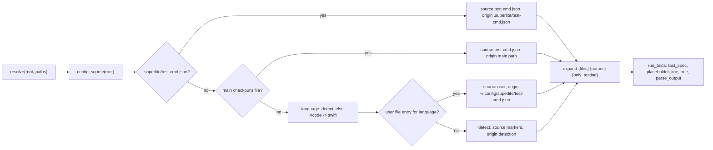
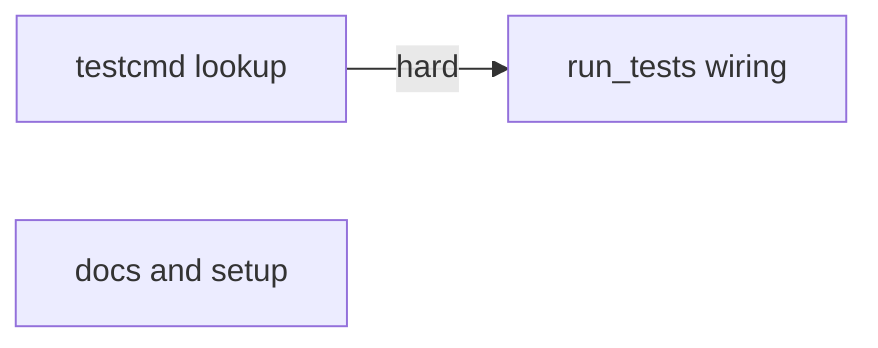

# Superlite: user-level default test command (B103)

**Goal:** fix #533: a user-level default test command, read when the project has no `.superlite/test-cmd.json` of its own, so every run of every checkout and worktree can go through a placement CLI (build-slot scheduler, remote runner) instead of the raw tool. Max's decision: the file is `~/.config/superlite/test-cmd.json`.
**Architecture:** `testcmd.py` gains the lookup: `user_config_path`, `read_user_config(language)` and `config_source(root)` (project file, the main checkout's, the user-level entry for the detected language, detection), and `resolve` reports `source` and the new `origin`. `run_tests.py` reads the effective config through `config_source` (`fast_spec`, `placeholder_line`). Docs and `/superlite:setup` name the file and show the command in effect with its origin.
**Tech stack:** Python 3.10+ stdlib, pytest (through `sl run_tests`), Markdown docs.
**Spec:** this file, section Design; issue #533 Proposal and Acceptance.
**Detail:** tests
**Target-min:** 11
**Wave0:** none
**Coverage:** off

Global constraints:
- Every Python code line keeps the file's trailing `# O(...)` complexity comment.
- Existing tests stay green. An existing test file changes only when the task Owns it. If another existing test turns red, report it in DONE_WITH_CONCERNS with the test id and the reason instead of editing it.
- Run `sl` as an executable (`<abs>/sl ...`). Verify with `<abs>/sl run_tests --fast <own test files> --task Tn --background`, then run the printed `wait:` line in the foreground and end the turn only after it reports.
- The user file path is read at call time from the environment, never cached at import.
- No version edits (the ship step bumps the version). Never run `scripts/evals.sh`, `claude plugin eval` or `scripts/test_layers.py run`.

Ruling: the user file is `$SUPERLITE_USER_TEST_CMD` when set and non-empty, else `Path.home()/.config/superlite/test-cmd.json`; no `XDG_CONFIG_HOME` (because Max named `~/.config/superlite/test-cmd.json`, and a set XDG_CONFIG_HOME would silently move it; the variable exists so tests and odd setups can point elsewhere; cost if wrong: one more lookup line).
Ruling: the entry key is the detected language exactly (`swift`, `python`, `javascript`, `typescript`, `go`, `rust`, `csharp`); an `.xcodeproj`/`.xcworkspace` at the root without other markers counts as `swift` for this lookup only (because the issue's main case is an Xcode project, which detection alone does not name; cost if wrong: a TypeScript user writes two keys).
Ruling: an entry has the project file's shape (`test`, `test_file`, `junit`, `setup`, `env`, `isolate`); `related` and `pythonpath` stay project-only (because they name project paths). `test` is the `--full` command and `test_file` the `--fast` one, which already gives separate placement for the two (issue: separate entries stay possible).
Ruling: `resolve` keeps `source` (`test-cmd.json`, new `user`, `markers`) and adds `origin` (`.superlite/test-cmd.json`, the main checkout's absolute file path, the user file with the home folder as `~`, `detection`); `/superlite:setup` reports `command` and `origin` from `sl testcmd`; run_tests prints no extra line (cost if wrong: a worker does not see that a placement CLI runs).
Ruling: tests/scripts/conftest.py points `SUPERLITE_USER_TEST_CMD` at a missing file under tmp_path for every script test (because a real user file would change every detection test on Max's machine); no open batch lists conftest.py, so T1 owns it and notes.md names it.
Ruling: no probe adapter (resolution helpers on paths; Review Focus cases are named tests); detail tests; already in the lead worktree, no `sl worktree ensure`; T3's doc texts are fixed in this plan, so T3 has no edge; layers unit and headless (cost if wrong: one rerun).
LAYERS: unit, headless



## Design

### 1. Lookup (T1)
`testcmd.py`: `user_config_path()`, `shown(path)`, `read_user_config(language)`, `config_source(root)` as in T1's Produces. `config_source` runs `detect` at most once. `read_user_config`: a missing file or a missing key is None, silently; an unreadable file or bad JSON prints `user test-cmd.json ignored (<shown path>): <error>`; a top level that is not an object prints `user test-cmd.json ignored (<shown path>): needs a JSON object keyed by language`; an entry that is not an object with a non-empty string `test` prints `user test-cmd.json ignored for <language> (<shown path>): needs a JSON object with a "test" command`; each on stderr, then None. The entry is returned as `{**entry, "language": language}`. `resolve` uses `config_source` instead of its own lookup and adds `"origin"` to both returned dicts; `isolate` still follows `language` (swift isolated). `missing_reason`'s Xcode text gains `; or a "swift" entry in <shown user path> for every project without its own`. The module docstring's Order line names the user-level step.

### 2. run_tests (T2)
`fast_spec`: `cfg = testcmd.config_source(Path("."))[0]` instead of `read_config(...) or main_checkout_config(...)`; the rest stays (two-argument `resolve` call unless the template holds `{only_testing}`). `placeholder_line`: acts for `source` `test-cmd.json` and `user`, reads `testcmd.config_source(root)[0]`; for `user`, `where` is `the "<language>" entry of <spec origin>` and the python text says `delete that entry` instead of `delete that file`; the other texts stay. The module docstring names the order (project file, main checkout's, user-level entry for the language, detection).

### 3. Docs (T3)
Exact texts in T3.

## File structure

- `skills/subagent-driven-development/scripts/testcmd.py`: lookup order, user file, origin (T1)
- `tests/scripts/conftest.py`: isolate the user file in script tests (T1)
- `tests/scripts/test_testcmd_user_default_533.py`: lookup unit tests (T1)
- `skills/subagent-driven-development/scripts/run_tests.py`: effective config in fast_spec and placeholder_line (T2)
- `tests/scripts/test_run_tests_user_default_533.py`: wrapped runs end to end, tree run, refusal (T2)
- `docs/language.md`, `docs/tools.md`, `commands/setup.md`, `tests/scripts/test_docs_533_user_test_cmd.py`: docs (T3)

## Task graph

```mermaid
%% schedule
gantt
  title Predicted schedule (mm:ss)
  dateFormat X
  axisFormat %M:%S
  section lane 1
  T1 testcmd reads the user-level default :t1, 0, 99s
  T2 run_tests uses the user-level default :t2, 99, 98s
  section lane 2
  T3 docs and setup name the user-level de :t3, 0, 96s
```





critical path: T1 → T2 (3.3 min) · peak width 2 · predicted build 3.3 min · predicted total ≈ 6.8 min (target ✓)

## Package: test command lookup

App type: library + CLI. Categories: file (missing, unreadable, malformed user file), state (precedence), protocol (`sl testcmd` JSON). **Probe entry:** none (path-based helpers; cases are named tests).

### T1 testcmd reads the user-level default · Complexity 4 · Est. context 40k
**Owns:** skills/subagent-driven-development/scripts/testcmd.py, tests/scripts/conftest.py, tests/scripts/test_testcmd_user_default_533.py
**Components:** 1
**LOC owned:** 190
**Tests:** fast
**Model:** sonnet
**Est. time:** 3.0 min (1 component, about 190 LOC, fast tests)
**Covers:** 1
**Consumes:** none
**Produces:** testcmd.user_config_path() -> Path · testcmd.shown(path: Path) -> str · testcmd.read_user_config(language: str) -> dict | None · testcmd.config_source(root: Path) -> tuple[dict | None, str, str]
e.g. config_source(Path("<proj with .superlite/test-cmd.json {"test": "make t"}>")) -> ({"test": "make t"}, "test-cmd.json", ".superlite/test-cmd.json")
e.g. config_source(Path("<proj with App.xcodeproj only>")) with user file {"swift": {"test": "placer test"}} -> ({"test": "placer test", "language": "swift"}, "user", shown(user_config_path()))
e.g. config_source(Path("<proj with go.mod>")) with no user file -> ({"language": "go", "test": "go test ./...", "test_file": "go test {files}", "junit": "", "setup": ""}, "markers", "detection"); nothing found -> (None, "markers", "none")
**Review Focus:** file: `test_bad_json_is_ignored_with_a_line`, `test_entry_without_test_is_ignored`, `test_top_level_list_is_ignored`; state: `test_project_file_wins`, `test_main_checkout_file_wins_over_user`, `test_no_user_file_changes_nothing`; protocol: `test_cli_prints_origin`.
**Test code (verbatim):** new file tests/scripts/test_testcmd_user_default_533.py:
```python
"""#533: a user-level default test command, read when the project has no .superlite/test-cmd.json."""
from __future__ import annotations

import json
import os
import subprocess
import sys
from pathlib import Path

from test_plan_tools import SCRIPTS, run

sys.path.insert(0, str(SCRIPTS))
import testcmd  # noqa: E402

MIXED = "final class AlphaTests: XCTestCase {\n  func testA() {}\n}\nclass BetaTests: XCTestCase {\n  func testB() {}\n}\n"
PLACER = {"test": "placer test", "test_file": "placer test {only_testing}"}


def user(tmp_path, monkeypatch, data):
    p = tmp_path / "home-config" / "test-cmd.json"
    p.parent.mkdir(parents=True, exist_ok=True)
    p.write_text(data if isinstance(data, str) else json.dumps(data), encoding="utf-8")
    monkeypatch.setenv("SUPERLITE_USER_TEST_CMD", str(p))
    return p


def xcode(tmp_path):
    root = tmp_path / "app"
    (root / "App.xcodeproj").mkdir(parents=True)
    (root / "Tests" / "KitTests").mkdir(parents=True)
    (root / "Tests" / "KitTests" / "Mixed.swift").write_text(MIXED, encoding="utf-8")
    return root


def test_conftest_isolates_the_user_file(tmp_path):
    p = Path(os.environ["SUPERLITE_USER_TEST_CMD"])
    assert not p.exists() and ".config" not in p.parts


def test_user_path_default_and_override(monkeypatch, tmp_path):
    monkeypatch.delenv("SUPERLITE_USER_TEST_CMD")
    assert testcmd.user_config_path() == Path.home() / ".config" / "superlite" / "test-cmd.json"
    assert testcmd.shown(testcmd.user_config_path()) == "~/.config/superlite/test-cmd.json"
    monkeypatch.setenv("SUPERLITE_USER_TEST_CMD", str(tmp_path / "u.json"))
    assert testcmd.user_config_path() == tmp_path / "u.json"


def test_swift_user_default_full_and_fast(tmp_path, monkeypatch):
    p = user(tmp_path, monkeypatch, {"swift": PLACER})
    root = xcode(tmp_path)
    full = testcmd.resolve(root, [])
    assert (full["command"], full["source"], full["origin"], full["language"]) == ("placer test", "user", testcmd.shown(p), "swift")
    assert full["isolate"] is True and full["python"] is False
    fast = testcmd.resolve(root, ["Tests/KitTests/Mixed.swift"])
    assert fast["command"] == "placer test -only-testing:KitTests/AlphaTests -only-testing:KitTests/BetaTests"


def test_entry_isolate_false_is_kept(tmp_path, monkeypatch):
    user(tmp_path, monkeypatch, {"swift": {**PLACER, "isolate": False}})
    assert testcmd.resolve(xcode(tmp_path), [])["isolate"] is False


def test_project_file_wins(tmp_path, monkeypatch):
    user(tmp_path, monkeypatch, {"swift": PLACER})
    root = xcode(tmp_path)
    (root / ".superlite").mkdir()
    (root / ".superlite" / "test-cmd.json").write_text(json.dumps({"language": "swift", "test": "xcodebuild test -scheme X"}), encoding="utf-8")
    r = testcmd.resolve(root, [])
    assert (r["command"], r["source"], r["origin"]) == ("xcodebuild test -scheme X", "test-cmd.json", ".superlite/test-cmd.json")


def _git(cwd, *args):
    subprocess.run(["git", "-C", str(cwd), "-c", "user.email=t@t", "-c", "user.name=t", *args], check=True, capture_output=True)


def test_main_checkout_file_wins_over_user(tmp_path, monkeypatch):
    user(tmp_path, monkeypatch, {"go": {"test": "placer go"}})
    main = tmp_path / "main"
    main.mkdir()
    _git(main, "init", "-q")
    (main / "go.mod").write_text("module m\n", encoding="utf-8")
    _git(main, "add", "go.mod")
    _git(main, "commit", "-qm", "init")
    wt = tmp_path / "wt"
    _git(main, "worktree", "add", "-q", str(wt), "-b", "side")
    (main / ".superlite").mkdir()
    (main / ".superlite" / "test-cmd.json").write_text(json.dumps({"language": "go", "test": "echo main"}), encoding="utf-8")
    r = testcmd.resolve(wt, [])
    assert (r["command"], r["source"]) == ("echo main", "test-cmd.json")
    assert Path(r["origin"]) == (main / ".superlite" / "test-cmd.json").resolve()


def test_no_user_file_changes_nothing(tmp_path):
    (tmp_path / "Package.swift").write_text("// swift-tools-version:5.9\n", encoding="utf-8")
    r = testcmd.resolve(tmp_path, [])
    assert (r["command"], r["source"], r["origin"]) == ("swift test --xunit-output {junit}", "markers", "detection")


def test_other_language_key_falls_through(tmp_path, monkeypatch):
    user(tmp_path, monkeypatch, {"python": {"test": "remote pytest"}})
    (tmp_path / "go.mod").write_text("module m\n", encoding="utf-8")
    assert testcmd.resolve(tmp_path, [])["command"] == "go test ./..."


def test_python_entry_replaces_the_pytest_path(tmp_path, monkeypatch):
    user(tmp_path, monkeypatch, {"python": {"test": "remote pytest", "test_file": "pytest {files}"}})
    (tmp_path / "pyproject.toml").write_text("[project]\n", encoding="utf-8")
    r = testcmd.resolve(tmp_path, ["tests/test_a.py"])
    assert (r["python"], r["command"], r["source"], r["language"]) == (False, "pytest tests/test_a.py", "user", "python")


def test_bad_json_is_ignored_with_a_line(tmp_path, monkeypatch, capsys):
    p = user(tmp_path, monkeypatch, "{not json")
    (tmp_path / "go.mod").write_text("module m\n", encoding="utf-8")
    assert testcmd.resolve(tmp_path, [])["source"] == "markers"
    assert f"user test-cmd.json ignored ({testcmd.shown(p)}):" in capsys.readouterr().err


def test_top_level_list_is_ignored(tmp_path, monkeypatch, capsys):
    user(tmp_path, monkeypatch, [1, 2])
    (tmp_path / "go.mod").write_text("module m\n", encoding="utf-8")
    assert testcmd.resolve(tmp_path, [])["source"] == "markers"
    assert "needs a JSON object keyed by language" in capsys.readouterr().err


def test_entry_without_test_is_ignored(tmp_path, monkeypatch, capsys):
    user(tmp_path, monkeypatch, {"go": {"test_file": "x {files}"}})
    (tmp_path / "go.mod").write_text("module m\n", encoding="utf-8")
    assert testcmd.resolve(tmp_path, [])["source"] == "markers"
    assert 'user test-cmd.json ignored for go (' in capsys.readouterr().err


def test_read_user_config_sets_language(tmp_path, monkeypatch):
    user(tmp_path, monkeypatch, {"rust": {"test": "placer cargo", "language": "other"}})
    assert testcmd.read_user_config("rust") == {"test": "placer cargo", "language": "rust"}
    assert testcmd.read_user_config("go") is None


def test_missing_reason_names_the_user_file(tmp_path):
    root = tmp_path / "app"
    (root / "App.xcodeproj").mkdir(parents=True)
    r = testcmd.missing_reason(root)
    assert "{only_testing}" in r and f'or a "swift" entry in {testcmd.shown(testcmd.user_config_path())}' in r


def test_cli_prints_origin(tmp_path, monkeypatch):
    p = user(tmp_path, monkeypatch, {"swift": PLACER})
    cp = run(SCRIPTS / "testcmd.py", "--root", xcode(tmp_path))
    out = json.loads(cp.out)
    assert (out["origin"], out["source"], out["command"]) == (testcmd.shown(p), "user", "placer test")
```
**Steps:** 1 write the test file, 2 run: FAIL, 3 implement the Design section 1 in testcmd.py and add `monkeypatch.setenv("SUPERLITE_USER_TEST_CMD", str(tmp_path / "_user_test_cmd.json"))` to the autouse fixture in tests/scripts/conftest.py, 4 run: PASS, also `tests/scripts/test_testcmd.py tests/scripts/test_testcmd_xcode.py tests/scripts/test_testcmd_xcode_suites.py`.
**Notes:** `shown(p)` replaces a leading `str(Path.home())` with `~` (else `str(p)`). The main checkout's origin is `str(<common parent>/.superlite/test-cmd.json)`, absolute (refactor `main_checkout_config` through a private helper that also gives the path; its existing callers and tests keep working).

## Package: run_tests wiring

App type: CLI. Categories: protocol (wrapped command output), state (isolated tree), file. **Probe entry:** none (end-to-end runs are named tests).

### T2 run_tests uses the user-level default · Complexity 4 · Est. context 42k
**Owns:** skills/subagent-driven-development/scripts/run_tests.py, tests/scripts/test_run_tests_user_default_533.py
**Components:** 1
**LOC owned:** 150
**Tests:** fast
**Model:** sonnet
**Est. time:** 2.8 min (1 component, about 150 LOC, fast tests)
**Covers:** 2
**Consumes:** testcmd.config_source(root: Path) -> tuple[dict | None, str, str] (T1) · testcmd.shown(path: Path) -> str (T1)
**Produces:** run_tests.placeholder_line(root, spec) -> str | None
**Review Focus:** protocol: `test_wrapped_python_full_and_fast`, `test_wrapped_xcodebuild_output_is_parsed`; state: `test_task_tree_runs_the_user_command`; file: `test_placeholder_refusal_names_the_user_entry`.
**Test code (verbatim):** new file tests/scripts/test_run_tests_user_default_533.py:
```python
"""#533: run_tests runs the user-level default through a wrapper (placement CLI) and parses the wrapped output."""
from __future__ import annotations

import json
import shlex
import subprocess
import sys

from _fixtures import FIXTURES
from test_plan_tools import SCRIPTS, run

sys.path.insert(0, str(SCRIPTS))
import run_tests  # noqa: E402

RUN_TESTS = SCRIPTS / "run_tests.py"
PY = shlex.quote(sys.executable)
WRAP = """import subprocess, sys
open("placed.txt", "w").write(" ".join(sys.argv[1:]))
sys.stdout.write("placement: host-a\\n"); sys.stdout.flush()
sys.exit(subprocess.call(sys.argv[1:]))
"""
FAKE_XCODE = """import sys
open("placed.txt", "w").write(" ".join(sys.argv[2:]))
sys.stdout.write("placement: host-b\\n" + open(sys.argv[1]).read())
sys.exit(65)
"""
MIXED = "final class AlphaTests: XCTestCase {\n  func testA() {}\n}\nclass BetaTests: XCTestCase {\n  func testB() {}\n}\n"


def user(tmp_path, monkeypatch, data):
    p = tmp_path / "home-config" / "test-cmd.json"
    p.parent.mkdir(parents=True, exist_ok=True)
    p.write_text(json.dumps(data), encoding="utf-8")
    monkeypatch.setenv("SUPERLITE_USER_TEST_CMD", str(p))
    return p


def summary(root):
    return json.loads((root / ".superlite" / "test-summary.json").read_text(encoding="utf-8"))


def git(root, *args):
    return subprocess.run(["git", "-C", str(root), "-c", "user.email=t@t", "-c", "user.name=t", *args], check=True, capture_output=True, text=True).stdout


def test_wrapped_python_full_and_fast(tmp_path, monkeypatch):
    proj = tmp_path / "proj"
    (proj / "tests").mkdir(parents=True)
    (proj / "pyproject.toml").write_text("[project]\nname = 'p'\n", encoding="utf-8")
    (proj / "tests" / "test_a.py").write_text("def test_a():\n    assert True\n", encoding="utf-8")
    (proj / "wrap.py").write_text(WRAP, encoding="utf-8")
    base = f"{PY} wrap.py {PY} -m pytest -q -p no:cacheprovider"
    user(tmp_path, monkeypatch, {"python": {"test": base + " tests", "test_file": base + " {files}"}})
    cp = run(RUN_TESTS, "--full", cwd=proj)
    assert cp.returncode == 0, cp.both
    assert summary(proj)["passed"] == 1 and "pytest" in (proj / "placed.txt").read_text()
    cp = run(RUN_TESTS, "--fast", "tests/test_a.py", cwd=proj)
    assert cp.returncode == 0, cp.both
    assert (proj / "placed.txt").read_text().endswith("tests/test_a.py")


def test_wrapped_xcodebuild_output_is_parsed(tmp_path, monkeypatch):
    proj = tmp_path / "kit"
    (proj / "Tests" / "KitTests").mkdir(parents=True)
    (proj / "Package.swift").write_text('let package = Package(name: "Kit", targets: [.testTarget(name: "KitTests")])\n', encoding="utf-8")
    (proj / "Tests" / "KitTests" / "Mixed.swift").write_text(MIXED, encoding="utf-8")
    (proj / "fake.py").write_text(FAKE_XCODE, encoding="utf-8")
    out = shlex.quote(str(FIXTURES / "xcode" / "xctest_two_suites.txt"))
    user(tmp_path, monkeypatch, {"swift": {"test": f"{PY} fake.py {out}", "test_file": f"{PY} fake.py {out} {{only_testing}}"}})
    cp = run(RUN_TESTS, "--fast", "Tests/KitTests/Mixed.swift", cwd=proj)
    s = summary(proj)
    assert cp.returncode == 1 and (s["passed"], s["failed"]) == (4, 1), cp.both
    assert (proj / "placed.txt").read_text() == "-only-testing:KitTests/AlphaTests -only-testing:KitTests/BetaTests"


def test_user_template_notes_get_the_run_tests_prefix(tmp_path, monkeypatch):
    proj = tmp_path / "kit"
    (proj / "Tests" / "KitTests").mkdir(parents=True)
    (proj / "Package.swift").write_text('let package = Package(name: "Kit", targets: [.testTarget(name: "KitTests")])\n', encoding="utf-8")
    (proj / "Tests" / "KitTests" / "Helpers.swift").write_text("import XCTest\n", encoding="utf-8")
    user(tmp_path, monkeypatch, {"swift": {"test": f"{PY} -c pass", "test_file": f"{PY} -c pass {{only_testing}}"}})
    cp = run(RUN_TESTS, "--fast", "Tests/KitTests/Helpers.swift", cwd=proj)
    assert "run_tests: Tests/KitTests/Helpers.swift declares no test suite" in cp.err


PLAN = "# P\n\n## Section A\n\n### T1 first\n**Owns:** src/a.py\n**Produces:** x\n\n### T2 second\n**Owns:** src/b.py\n**Produces:** y\n"


def test_task_tree_runs_the_user_command(tmp_path, monkeypatch):
    repo = tmp_path / "repo"
    (repo / "src").mkdir(parents=True)
    git(repo, "init", "-q")
    (repo / ".git" / "info").mkdir(exist_ok=True)
    (repo / ".git" / "info" / "exclude").write_text(".superlite/\n")
    (repo / "Package.swift").write_text("// swift-tools-version:5.9\n")
    (repo / "src" / "a.py").write_text("A = 1\n")
    (repo / "src" / "b.py").write_text("B = 1\n")
    (repo / "plan.md").write_text(PLAN)
    git(repo, "add", ".")
    git(repo, "commit", "-qm", "base")
    (repo / "src" / "a.py").write_text("A = (\n")  # a sibling's half edit stays out of T2's tree
    cmd = (f"{PY} -c \"import src.a, src.b; open('ran-here.txt','w').write('x'); "
           "print('Executed 1 test, with 0 failures (0 unexpected) in 0.001 (0.002) seconds')\"")
    user(tmp_path, monkeypatch, {"swift": {"test": cmd, "test_file": cmd}})
    monkeypatch.chdir(repo)
    rc = run_tests.main(["--fast", "src/b.py", "--task", "T2", "--plan", "plan.md", "--summary", ".superlite/test-summary.json",
                         "--log", ".superlite/incidents.jsonl", "--ledger", ".superlite/progress.md"])
    assert rc == 0
    assert (repo / ".superlite" / "trees" / "T2" / "ran-here.txt").exists() and not (repo / "ran-here.txt").exists()
    assert summary(repo)["passed"] == 1


def test_placeholder_refusal_names_the_user_entry(tmp_path, monkeypatch):
    proj = tmp_path / "py"
    (proj / "tests").mkdir(parents=True)
    git(proj, "init", "-q")
    (proj / "pyproject.toml").write_text("[project]\n", encoding="utf-8")
    (proj / "tests" / "test_a.py").write_text("def test_a():\n    pass\n", encoding="utf-8")
    p = user(tmp_path, monkeypatch, {"python": {"test": "pytest", "test_file": "pytest {only_testing}"}})
    cp = run(RUN_TESTS, "--fast", "tests/test_a.py", cwd=proj)
    assert cp.returncode == 2, cp.both
    assert 'the "python" entry of ' in cp.err and "delete that entry" in cp.err
    spec = {"python": False, "source": "user", "language": "python", "origin": str(p), "command": "pytest"}
    assert run_tests.placeholder_line(proj, spec) is not None
```
**Steps:** 1 write the test file, 2 run: FAIL, 3 implement the Design section 2 in run_tests.py, 4 run: PASS, also `tests/scripts/test_trees.py tests/scripts/test_testcmd.py tests/scripts/test_run_tests_tree_node_modules.py tests/scripts/test_run_tests_exit_paths.py`.
**Notes:** the existing tree tests fake `testcmd.resolve(root, paths)` with two arguments and a spec without `origin`: read `spec.get("origin")` and keep the two-argument call. Before T1 commits, `config_source` is missing: wait for T1's commit (hard edge).

## Package: docs

App type: docs. **Probe entry:** none (docs).

### T3 docs and setup name the user-level default · Complexity 2 · Est. context 30k
**Owns:** docs/language.md, docs/tools.md, commands/setup.md, tests/scripts/test_docs_533_user_test_cmd.py
**Components:** 1
**LOC owned:** 40
**Tests:** fast
**Kind:** mechanical
**Model:** haiku
**Est. time:** 1.6 min (1 component, about 40 LOC, fast tests)
**Covers:** 3
**Consumes:** none
**Produces:** none
**Review Focus:** none (docs; the pins below are the check).
**Test code (verbatim):** new file tests/scripts/test_docs_533_user_test_cmd.py:
```python
"""#533: docs name the user-level default test command."""
from pathlib import Path

ROOT = Path(__file__).resolve().parents[2]
LANGUAGE = (ROOT / "docs" / "language.md").read_text(encoding="utf-8")
TOOLS = (ROOT / "docs" / "tools.md").read_text(encoding="utf-8")
SETUP = (ROOT / "commands" / "setup.md").read_text(encoding="utf-8")
LANG_FIRST = "(`.superlite/test-cmd.json`, else the user-level default `~/.config/superlite/test-cmd.json`, else detection from its marker files)"
LANG_PARA = "**User-level default.** `~/.config/superlite/test-cmd.json` (`SUPERLITE_USER_TEST_CMD` names another file) holds one entry per language"
TOOLS_ROW = "else the user-level default `~/.config/superlite/test-cmd.json` (one entry per detected language, `swift` for an Xcode project too; `SUPERLITE_USER_TEST_CMD` names another file), else detection"
SETUP_LINE = "report its `command` and `origin`"


def test_language_md():
    assert LANG_FIRST in LANGUAGE and LANG_PARA in LANGUAGE
    assert "the single file on the worker's machine, the full suite on the remote runner" in LANGUAGE


def test_tools_row():
    row = next(ln for ln in TOOLS.splitlines() if ln.startswith("| `testcmd` |"))
    assert TOOLS_ROW in row and "`origin`" in row
    assert "`related` is set. Wave 0 (T0) runs it as the check that `run_tests` detects the stack." in row


def test_setup_md():
    assert SETUP_LINE in SETUP and "~/.config/superlite/test-cmd.json" in SETUP
```
Edits (exact):
1. docs/language.md, first paragraph: replace `(`.superlite/test-cmd.json`, else detection from its marker files)` with the `LANG_FIRST` text above.
2. docs/language.md: append a new paragraph after the **Swift.** paragraph: **User-level default.** `~/.config/superlite/test-cmd.json` (`SUPERLITE_USER_TEST_CMD` names another file) holds one entry per language, each shaped like a project file: `{"swift": {"test": "<placement-cli> test", "test_file": "<placement-cli> test {only_testing}"}, "python": {"test": "<runner> pytest", "test_file": "<runner> pytest {files}"}}`. It applies to every project without its own `.superlite/test-cmd.json` (a worktree falls back to the main checkout's first) whose detected language names an entry (`swift` also for an `.xcodeproj` or `.xcworkspace` without `Package.swift`; `python`, `javascript`, `typescript`, `go`, `rust`, `csharp`), so every checkout and worktree runs its tests through a placement CLI (a build-slot scheduler, a remote runner) instead of the raw tool. `test` is the `--full` command and `test_file` the `--fast` one, so each can go to its own machine: the single file on the worker's machine, the full suite on the remote runner. The wrapped command's output is parsed as the wrapped tool's, compiled stacks still run `--task` in their isolated tree, and a configured command never stamps the unit layer. `sl testcmd` prints the command in effect with its `origin` (the file, or `detection`); an unreadable file or an entry without `test` is skipped with a `user test-cmd.json ignored` line on stderr.
3. docs/tools.md `testcmd` row: replace `Resolves the project's test command: `.superlite/test-cmd.json`, else detection (npm, go, cargo, dotnet, Python);` with `Resolves the project's test command: `.superlite/test-cmd.json` (a worktree without one: the main checkout's), else the user-level default `~/.config/superlite/test-cmd.json` (one entry per detected language, `swift` for an Xcode project too; `SUPERLITE_USER_TEST_CMD` names another file), else detection (npm, go, cargo, dotnet, Python); the result names `source` (`test-cmd.json`, `user`, `markers`) and `origin` (the file, or `detection`);`
4. commands/setup.md, first bullet: replace `(`sl testcmd`, `test-cmd.json` or detection)` with `(`sl testcmd`: report its `command` and `origin`, the file it came from: the project's `.superlite/test-cmd.json`, the main checkout's, the user-level `~/.config/superlite/test-cmd.json` entry for the project's language, or `detection`)`.
**Steps:** 1 write the test file, 2 run: FAIL, 3 make the four edits, 4 run: PASS, also `tests/scripts/test_docs_b10.py tests/scripts/test_docs_b16.py tests/scripts/test_docs_b95_testing.py tests/scripts/test_docs_contract.py tests/scripts/test_fixer_commit_wording.py`.

## Self-review

1. Coverage: Acceptance 1 (swift user default for --fast and --full, `{only_testing}` per file): T1 `test_swift_user_default_full_and_fast`, T2 `test_wrapped_xcodebuild_output_is_parsed`; 2 (project file wins): T1 `test_project_file_wins`, `test_main_checkout_file_wins_over_user`; 3 (no user file, nothing changes): T1 `test_no_user_file_changes_nothing` plus the existing suites; 4 (trees and parsing with a wrapped command): T2 `test_task_tree_runs_the_user_command`, `test_wrapped_python_full_and_fast`. Setup shows the command and origin: T1 `test_cli_prints_origin`, T3.
2. Placeholders: none (`<placement-cli>` and `<runner>` are literal doc text).
3. Types: T2 consumes `config_source` and `shown` exactly as T1 produces them.
4. Graph: T1 -> T2 hard (T2's tests run T1's lookup); T3 has fixed texts and no edge; no shared files.
5. Fields: all set. 6. Review Focus per package; probe entries none with reasons. 7. Limits: schedule and lint run next.
