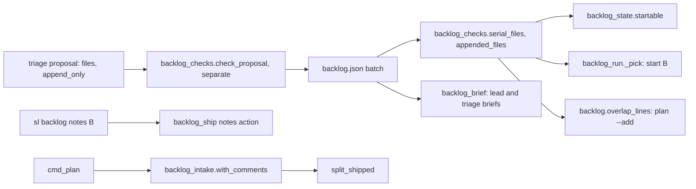
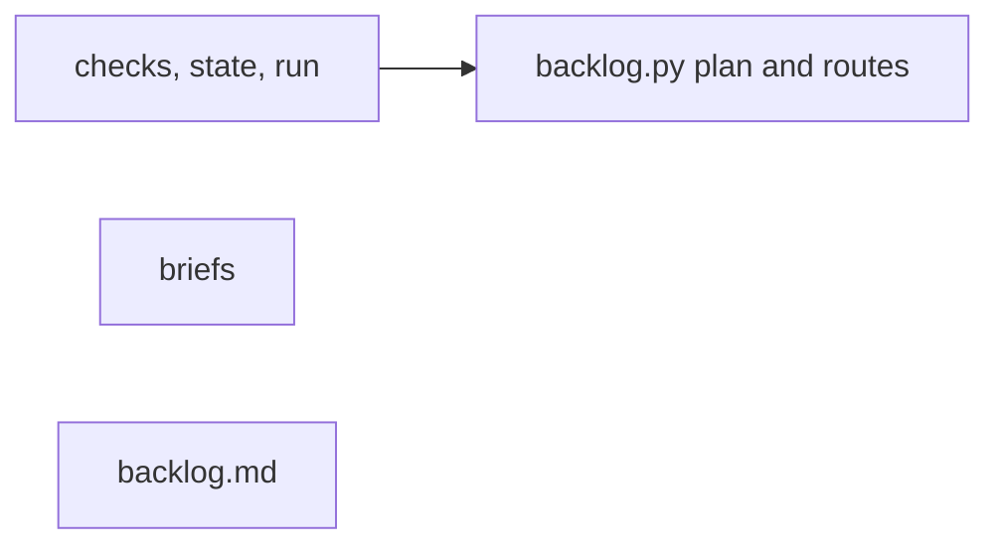

# Superlite: append-only files share batches, adjacent fixes stay in the batch (B144)

**Goal:** fix #602: a batch's `append_only` list (declared in the triage proposal) names the files it only adds lines to; a file two batches both list there no longer serialises them (proposal merge, `start`, plan's `overlap:` lines, briefs); a lead fixes an adjacent defect inside its own files and names it. Main's follow-ups ride along: `sl backlog notes B` routes to `ship B notes`, and `cmd_plan` reads each issue's latest comments (`with_comments`) before `split_shipped`.
**Architecture:** two pure helpers in `backlog_checks` (`serial_files`, `appended_files`) replace every plain file intersection of the overlap rule (`separate`, `backlog_state._clash`, `backlog_run._pick`, `backlog.overlap_lines`); `check_proposal` validates and keeps `append_only`; brief and doc text gain lines.
**Tech stack:** Python 3.10+ stdlib, pytest (through `sl run_tests`); Markdown.
**Spec:** this file, section Design; issue #602.
**Detail:** contracts
**Target-min:** 11
**Wave0:** none
**Coverage:** off (bounded change inside the existing backlog flow; no new subsystem)

Global constraints:
- Existing tests stay green. An existing test file changes only when the task Owns it. If another existing test turns red, report it in DONE_WITH_CONCERNS with the test id and the reason instead of editing it.
- Run `sl` as an executable (`<abs>/sl ...`). Verify with `<abs>/sl run_tests --fast <own test files> --task Tn --background`, then run the printed `wait:` line in the foreground and end the turn only after it reports. Never `run_tests -m`.
- Format only the files you changed; never run a format command over the whole tree.
- No version edits. Never run `scripts/evals.sh`, `claude plugin eval` or `scripts/test_layers.py run`.
- Keep each file's per-line `# O(...)` complexity comments on new code lines, as the file does.
- A batch dict carries `append_only` only when it is non-empty: every writer omits the key for an empty list, every reader uses `b.get("append_only") or []`. Old backlog.json batches have no key and behave exactly as before.

Ruling: per-batch `append_only` (Max's decision: the plan declares append-only files; they do not serialise; conflicts resolve at the ship rebase). A file shared by two batches serialises them unless both list it in `append_only` (because a batch that rewrites a strings file must still not race one that appends to it; cost if wrong: one more batch runs serially).
Ruling: an `append_only` entry missing from the batch's `files` is added to `files`, never an error (because the declaration implies the batch touches it; cost if wrong: none, the file list only grows).
Ruling: a merged batch (`separate`) keeps a file in `append_only` only when no part touches it without declaring it (because one rewriting part makes the whole batch a rewriter; cost if wrong: an extra hold).
Ruling: `overlap_lines` names only serialising files in the existing line; a pair that shares only append-only files gets its own line ending `append-only in both, no hold; conflicts resolve at the ship rebase` (because main should still see that two leads edit one file).
Ruling: brief changes are additions (a new lead-brief line, an ` (append-only)` marker, one sentence after OPEN_TAIL only when an open batch declares append-only files), so every existing brief test stays byte-stable.
Ruling: main's follow-up 5 (a reason per dependency in `backlog status`) is left out: it is about depends, not the overlap rule, and main said not to widen the batch.
Ruling: backlog_checks.py, backlog_state.py, backlog_run.py, backlog_brief.py and backlog_intake.py are outside the batch's file list but listed by no open batch: tasks edit them and notes.md names them; docs/tools.md belongs to B153 (running), so its rows become a follow-up.
Ruling: already in the lead worktree, no `sl worktree ensure`; Graphify skipped (`graphify_gate`: allowed false); no probe adapter (named tests cover every case).
LAYERS: unit, headless

## Design

### 1. Data (#602)

A proposal batch may carry `"append_only": ["<path>", ...]`: files of its `files` the batch only adds lines to (a strings catalog every user-visible string goes into, a changelog, a module doc or agent instructions file each change appends to). `check_proposal` validates it like `files` (a list of plain relative paths), adds missing entries to `files`, and stores it sorted, only when non-empty. Two batches **serialise** on the files they share minus the files both list in `append_only`; files both list there are **appended** (shared, no hold).

### 2. Overlap rule sites

`separate` merges two proposal batches only when `serial_files` is non-empty (and neither depends on the other). `backlog_state._clash` (auto-start) and `backlog_run._pick` (`start B`, message unchanged: `B shares files with running B1`) use `serial_files`. `backlog.overlap_lines` prints the existing line for serialising files and the append-only line for a pair that shares only appended files. `open_batches` carries `append_only`.

### 3. Briefs

Lead brief: after `Files this batch may touch: ...` comes, only for a batch with `append_only`, `Append-only files (add lines; never reorder, rewrite or delete existing ones; another batch may append to them too: keep both sides when the ship rebase conflicts on one): a.md.` Owned and open-batch file lists mark each append-only file ` (append-only)`. Triage brief: the rule reads `no two batches share a file unless one depends on the other or both list it in append_only (<APPEND_TRIAGE>)`, the schema gains `"append_only": []` after `"files"`, and the open-batches line gains `OPEN_APPEND` after OPEN_TAIL when an open batch declares append-only files.

### 4. Lead rules (backlog.md)

Adjacent fix bound and append-only conflict handling as Lead bullets; the plan paragraph names `append_only`; the notes route is named.

### 5. Main's follow-ups

`sl backlog notes B [--plan P]` calls `backlog_ship.main([B, "notes", ...rest])`; without a batch it prints `BLOCKED: usage: sl backlog notes B` and exits 2. `cmd_plan` calls `trusted, extra = bi.with_comments(trusted, info["nameWithOwner"], public, jira)` and `notes += extra` right before `bi.split_shipped(...)`; `_gh_chunk` and the Jira comment read treat a non-dict answer as no comments, so fakes that answer every `gh` call with an issue list keep working.

## File structure

- `skills/subagent-driven-development/scripts/backlog_checks.py`: `serial_files`, `appended_files`, `append_only` in `check_proposal` and `separate` (T1).
- `skills/subagent-driven-development/scripts/backlog_state.py`, `backlog_run.py`: `_clash`, `_pick` through `serial_files` (T1).
- `skills/subagent-driven-development/scripts/backlog_brief.py`: lead and triage brief lines (T2).
- `skills/subagent-driven-development/scripts/backlog.py`, `backlog_intake.py`: `overlap_lines`, `open_batches`, `notes` route, `with_comments` wiring and non-dict guard (T3).
- `skills/subagent-driven-development/backlog.md`: lead and main rules (T4).

## Task graph

```mermaid
%% schedule
gantt
  title Predicted schedule (mm:ss)
  dateFormat X
  axisFormat %M:%S
  section lane 1
  T1 overlap helpers proposal append_only :t1, 0, 554s
  T3 backlog.py overlap lines notes route :t3, 554, 554s
  section lane 2
  T2 brief lines for append-only files :t2, 0, 502s
  section lane 3
  T4 backlog.md lead and main rules :t4, 0, 449s
```

critical path: T1 → T3 (18.5 min) · peak width 3 · predicted build 18.5 min · predicted total ≈ 33.0 min (target ✗ 11.0)

## Package: scripts

App type: CLI (protocol, state, file). **Probe entry:** none (named tests cover every case; the CLI needs a backlog.json fixture).

### T1 overlap helpers, proposal append_only, start rule · Complexity 4 · Est. context 45k
**Owns:** skills/subagent-driven-development/scripts/backlog_checks.py, skills/subagent-driven-development/scripts/backlog_state.py, skills/subagent-driven-development/scripts/backlog_run.py, tests/scripts/test_backlog_append_only_602.py
**Components:** 3
**LOC owned:** 150
**Tests:** fast
**Model:** sonnet
**Est. time:** 3 min (3 components, about 150 LOC, fast tests)
**Covers:** 1, 2
**Consumes:** none
**Produces:** backlog_checks.serial_files(a: dict, b: dict) -> list[str] · backlog_checks.appended_files(a: dict, b: dict) -> list[str]
e.g. serial_files({"files": ["a.md", "x.py"], "append_only": ["a.md"]}, {"files": ["a.md"], "append_only": ["a.md"]}) -> []
e.g. serial_files({"files": ["a.md", "x.py"], "append_only": ["a.md"]}, {"files": ["a.md", "x.py"]}) -> ["a.md", "x.py"]
e.g. appended_files({"files": ["a.md", "x.py"], "append_only": ["a.md"]}, {"files": ["a.md", "x.py"], "append_only": ["a.md"]}) -> ["a.md"]
**Review Focus:** `test_separate_merge_drops_a_rewritten_file_from_append_only` (state); `test_check_proposal_rejects_bad_append_only` (protocol); `test_pick_refuses_only_the_rewriting_batch` (state).
**Test code (named, exact):** new file tests/scripts/test_backlog_append_only_602.py (import pattern: tests/scripts/test_backlog_checks.py; batch dicts: `backlog_fixtures.batch`):
- `test_serial_files_drops_files_both_append`: the first two e.g. lines above.
- `test_serial_files_without_append_only_is_the_plain_intersection`: serial_files({"files": ["b.py", "a.py"]}, {"files": ["a.py", "b.py", "c.py"]}) == ["a.py", "b.py"].
- `test_appended_files_needs_both_sides`: the third e.g. line; appended_files({"files": ["a.md"], "append_only": ["a.md"]}, {"files": ["a.md"]}) == [].
- `test_check_proposal_keeps_append_only`: check_proposal({"batches": [{"id": "B1", "topic": "t", "issues": [1], "files": ["x.py"], "append_only": ["a.md"], "depends": [], "decisions": []}]}, {1}) gives errs [] and out[0]["files"] == ["a.md", "x.py"], out[0]["append_only"] == ["a.md"].
- `test_check_proposal_omits_an_empty_append_only`: the same batch without the key, and with "append_only": [], gives a batch with no "append_only" key.
- `test_check_proposal_rejects_bad_append_only`: "append_only": "a.md" gives an error "B1: append_only must be a list"; "append_only": ["/etc/x"] gives an error "B1: append_only file '/etc/x' is not a plain relative path".
- `test_separate_keeps_batches_that_share_only_append_only_files`: separate of B1 {files [a.md, x.py], append_only [a.md], depends []} and B2 {files [a.md, y.py], append_only [a.md], depends []} (plus issues, decisions) returns two batches, B2's depends [].
- `test_separate_merge_drops_a_rewritten_file_from_append_only`: B1 {files [a.md, s.md], append_only [a.md, s.md]} and B2 {files [s.md, x.py]} merge into one B1 with files [a.md, s.md, x.py] and append_only [a.md].
- `test_separate_merge_without_append_only_files_has_no_key`: B1 {files [s.md], append_only [s.md]} and B2 {files [s.md]} merge into one B1 with no "append_only" key.
- `test_startable_skips_only_a_rewriting_batch`: data {"batches": [batch("B1", ["a.md"], "running", append_only=["a.md"]), batch("B2", ["a.md", "y.py"], append_only=["a.md"]), batch("B3", ["a.md"])]}: backlog_state.startable(data, cap=3) == ["B2"].
- `test_pick_refuses_only_the_rewriting_batch`: the same data: backlog_run._pick(data, ["B2", "B3"], 3, {}) == (["B2"], ["B3 shares files with running B1"]).
**Steps:** 1 failing tests, 2 run: FAIL, 3 implement, 4 run: PASS
**Notes:** `serial_files` = sorted((files(a) & files(b)) - (append_only(a) & append_only(b))); `appended_files` = sorted(files(a) & files(b) & append_only(a) & append_only(b)); both read `x.get("files") or []` and `x.get("append_only") or []`. In `separate`, compute the merged append_only before merging files: (oa - (fb - ob)) | (ob - (fa - oa)); set the key only when non-empty, else drop it. `backlog_run` imports backlog_checks itself (`import backlog_checks as bc`). Keep the `_pick` message text. Add one clause naming append_only (#602) to the module docstrings of backlog_checks.py and backlog_run.py when they list features.

### T2 brief lines for append-only files · Complexity 3 · Est. context 38k
**Owns:** skills/subagent-driven-development/scripts/backlog_brief.py, tests/scripts/test_backlog_brief_602.py
**Components:** 2
**LOC owned:** 90
**Tests:** fast
**Model:** sonnet
**Est. time:** 2 min (2 components, about 90 LOC, fast tests)
**Covers:** 3
**Consumes:** none
**Produces:** backlog_brief.APPEND_LINE: str · backlog_brief.APPEND_TRIAGE: str · backlog_brief.OPEN_APPEND: str
**Review Focus:** `test_lead_brief_without_append_only_is_unchanged` (protocol: no new line, no marker); `test_owned_files_mark_append_only` (encoding: the marker follows the cleaned path).
**Test code (named, exact):** new file tests/scripts/test_backlog_brief_602.py (B and CTX like tests/scripts/test_backlog_brief.py):
- `test_lead_brief_names_append_only_files`: lead_brief({**B, "files": ["a.md", "x.py"], "append_only": ["a.md"]}, CTX) has the line `Files this batch may touch: a.md, x.py. Another lead may own any other file.` followed directly by `Append-only files (add lines; never reorder, rewrite or delete existing ones; another batch may append to them too: keep both sides when the ship rebase conflicts on one): a.md.`
- `test_lead_brief_without_append_only_is_unchanged`: lead_brief(B, CTX) contains no "Append-only files" and no "(append-only)".
- `test_owned_files_mark_append_only`: lead_brief(B, {**CTX, "owned": [{"id": "B9", "state": "running", "files": ["a.md", "z.py"], "append_only": ["a.md"]}]}) contains `Files other open batches own: B9 (running) a.md (append-only), z.py.`
- `test_triage_rules_name_append_only`: triage_brief([{"number": 1, "title": "t", "body": ""}], {"repo": "o/r", "max_batches": 7}) contains `no two batches share a file unless one depends on the other or both list it in append_only (` + APPEND_TRIAGE + `)`, and `"files": ["<path>"], "append_only": [], "depends": []`.
- `test_triage_open_line_marks_append_only`: with ctx "open": [{"id": "B9", "state": "running", "files": ["a.md"], "append_only": ["a.md"]}] the text contains `B9 running: a.md (append-only). ` + OPEN_TAIL + " " + OPEN_APPEND.
- `test_triage_open_line_without_append_only_is_unchanged`: with "open": [{"id": "B9", "state": "running", "files": ["a.md"]}] the open line ends with OPEN_TAIL and the text has no OPEN_APPEND.
**Steps:** 1 failing tests, 2 run: FAIL, 3 implement, 4 run: PASS
**Notes:** APPEND_LINE = "Append-only files (add lines; never reorder, rewrite or delete existing ones; another batch may append to them too: keep both sides when the ship rebase conflicts on one): " (the brief appends the cleaned files joined by ", " and a "."). APPEND_TRIAGE = "append_only lists the files of a batch's files it only adds lines to, such as a strings catalog every user-visible string goes into, a changelog, or a module doc or agent instructions file each change adds a line to; plan and start do not serialise two batches on a file both list there, and conflicts resolve at the ship rebase; a file a batch rewrites, reorders or deletes lines in is never append_only for it". OPEN_APPEND = "A file both batches list in append_only is shared without a hold." `_files(o)` adds " (append-only)" after each file in `o.get("append_only") or []`. Keep the prefix `"Rules: " + ROOT_DOC_TRIAGE + TRIAGE_RUN + "no two batches share a file"` (pinned by test_backlog_brief_b89/b90).

### T3 backlog.py: overlap lines, notes route, comments in plan · Complexity 4 · Est. context 50k
**Owns:** skills/subagent-driven-development/scripts/backlog.py, skills/subagent-driven-development/scripts/backlog_intake.py, tests/scripts/test_backlog_plan_602.py
**Components:** 3
**LOC owned:** 150
**Tests:** fast
**Model:** sonnet
**Est. time:** 3 min (3 components, about 150 LOC, fast tests)
**Covers:** 2, 5
**Consumes:** backlog_checks.serial_files(a: dict, b: dict) -> list[str] (T1) · backlog_checks.appended_files(a: dict, b: dict) -> list[str] (T1)
**Produces:** backlog.overlap_lines(new: list, open_: list) -> list · backlog.open_batches(data: dict) -> list
**Review Focus:** `test_plan_reads_comments_and_plans_a_reopened_shipped_issue` (protocol); `test_gh_chunk_treats_a_non_dict_answer_as_no_comments` (encoding); `test_notes_without_batch_is_refused` (protocol).
**Test code (named, exact):** new file tests/scripts/test_backlog_plan_602.py (plan fixture pattern: tests/scripts/test_backlog_plan_shipped_585.py; comment fakes: tests/scripts/test_backlog_intake_comments_563.py):
- `test_overlap_line_for_append_only_shared_file`: overlap_lines([{"id": "B3", "files": ["a.md", "x.py"], "append_only": ["a.md"]}], [{"id": "B1", "state": "running", "files": ["a.md"], "append_only": ["a.md"]}]) == ["overlap: B3 shares a.md with B1 (running): append-only in both, no hold; conflicts resolve at the ship rebase"].
- `test_overlap_line_names_only_serialising_files`: new {"id": "B3", "files": ["a.md", "b.py"], "append_only": ["a.md"]}, open {"id": "B1", "state": "planned", "files": ["a.md", "b.py"], "append_only": ["a.md"]} gives ["overlap: B3 shares b.py with B1 (planned): whichever starts first holds the files"].
- `test_open_batches_carries_append_only`: open_batches({"batches": [{"id": "B2", "state": "planned", "files": ["a.md"], "append_only": ["a.md"]}, {"id": "B1", "state": "running", "files": ["b.py"]}, {"id": "B0", "state": "shipped", "files": ["c.py"]}]}) == [{"id": "B1", "state": "running", "files": ["b.py"]}, {"id": "B2", "state": "planned", "files": ["a.md"], "append_only": ["a.md"]}].
- `test_notes_routes_to_ship_notes`: with backlog_ship.main monkeypatched to record argv and return 0: main(["notes", "B4"]) == 0 with ["B4", "notes"] recorded; main(["notes", "B4", "--plan", ".superlite"]) records ["B4", "notes", "--plan", ".superlite"].
- `test_notes_without_batch_is_refused`: main(["notes"]) == 2 and main(["notes", "--plan", "x"]) == 2, each printing exactly "BLOCKED: usage: sl backlog notes B\n"; backlog_ship.main is not called.
- `test_help_lists_notes`: main(["--help"]) raises SystemExit(0) and stdout contains "notes".
- `test_plan_reads_comments_and_plans_a_reopened_shipped_issue`: a shipped batch B1 holds #7 (pr 70); the open issues are [#7 "Seven" by an OWNER]; the `api graphql` call answers {"data": {"repository": {"i7": {"stateReason": "REOPENED", "comments": {"nodes": [{"authorAssociation": "OWNER", "author": {"login": "max"}, "body": "still broken"}]}}}}}: the plan output contains "reopened: #7 was shipped in B1" and the triage brief contains "## #7 Seven (reopened)" and "still broken".
- `test_gh_chunk_treats_a_non_dict_answer_as_no_comments`: backlog._gh answering [] gives backlog_intake._gh_chunk("o", "r", [1, 2], True) == {1: ([], False), 2: ([], False)}.
- `test_jira_comment_answer_not_a_dict_gives_no_comments`: backlog._acli answering [] gives with_comments([{"number": "PIX-1", "title": "t", "body": ""}], "o/r", False, jira=True) == ([{"number": "PIX-1", "title": "t", "body": "", "comments": []}], []).
**Steps:** 1 failing tests, 2 run: FAIL, 3 implement, 4 run: PASS
**Notes:** `overlap_lines`: per pair, `serial = bc.serial_files(n, o)`; non-empty: the existing line built from `serial`; else `shared = bc.appended_files(n, o)`; non-empty: `overlap: <n> shares <shown> with <o> (<state>): append-only in both, no hold; conflicts resolve at the ship rebase` (same `shown` cut at 3 files). `open_batches` adds "append_only" only when non-empty. The `notes` route sits in `main()` before argparse, next to the `ship` route; `--help` lists `("notes", "print a batch's full reason, no-change text and notes: notes B")`. The `with_comments` call goes right before `bi.split_shipped(...)` in `cmd_plan`; guard `_gh_chunk`'s `res` and the Jira `res` with `isinstance(res, dict)`. Run the existing plan tests (`tests/scripts/test_backlog_plan*.py`, `test_backlog_cli*.py`, `test_backlog_jira_208.py`, `test_external_repo_plan.py`) once with your own: they must stay green. Add one clause naming append_only overlap and `notes B` (#602) to backlog.py's module docstring.

## Package: docs

App type: docs. **Probe entry:** none (prose).

### T4 backlog.md lead and main rules · Complexity 1 · Est. context 25k
**Owns:** skills/subagent-driven-development/backlog.md, tests/scripts/test_backlog_docs_602.py
**Components:** 1
**LOC owned:** 40
**Tests:** fast
**Kind:** mechanical
**Model:** haiku
**Est. time:** 1.5 min (1 component, about 40 LOC, fast tests)
**Covers:** 4
**Consumes:** none
**Produces:** none
**Review Focus:** `test_backlog_md_names_append_only_and_adjacent_fixes` (protocol: the exact sentences).
**Test code (named, exact):** new file tests/scripts/test_backlog_docs_602.py reads skills/subagent-driven-development/backlog.md (path pattern: tests/scripts/test_backlog_docs_590.py) and asserts each of S1, S2, S3, S4 below is in the text:
- `test_backlog_md_names_append_only_and_adjacent_fixes`: S1, S2 and S3 are in the text; S2 and S3 sit in the `## Lead` section (after "## Lead", before "## Permissions").
- `test_backlog_md_names_the_notes_route`: S4 is in the text.
**Steps:** 1 failing tests, 2 run: FAIL, 3 implement, 4 run: PASS
**Notes:** Insert the sentences exactly. S1 goes at the end of Main item 2 (after its last sentence, same line, one space before): "A batch's `append_only` (in the triage proposal) lists the files of its `files` it only adds lines to, such as a strings catalog, a changelog or a module doc; a file two batches both list there does not serialise them: the proposal needs no `depends` for it, `start` holds neither batch on it, and its `overlap:` line ends `append-only in both, no hold; conflicts resolve at the ship rebase` (#602)." S2 is a new Lead bullet right before the "- Ship in four steps" bullet: "- Adjacent fixes: a defect you find on the screen or flow your batch already changes (a render check, a review, a test) is fixed in this batch when the fix stays inside your batch's files and needs no new design decision; name it in notes.md as one `Ruling: adjacent fix: <what>` line and in pr-body.md. A fix outside those files, or one that needs a decision, stays a `Follow-up:` line (#602)." S3 is the next new Lead bullet, also before "- Ship in four steps": "- Append-only files: your brief's `Append-only files` line names files of your batch that another batch may append to at the same time. Add your lines and never reorder, rewrite or delete existing ones; when the ship rebase conflicts on such a file (`bump` exits 5), keep both sides' lines, finish the rebase and rerun `bump` (#602)." S4 goes in Main item 5 right after the sentence ending "prints a batch's full reason, no-change text and notes (any session, read-only)." (same line, one space before): "`\"$SL\" backlog notes B` does the same." (in the file: a backtick, "$SL" with plain double quotes, then ` backlog notes B`, a backtick). Run tests/scripts/test_backlog_docs*.py, test_backlog_main_docs.py and test_docs*.py with your own: they must stay green (they quote item text).

## Review Focus

CLI package: protocol (the `notes` route and its refusal, the brief and doc sentences), state (merge of append_only in `separate`, start holds), file (backlog.json batches without the key). Specific risks: an `append_only` key written as `[]` into backlog.json breaks exact-dict tests; a fake `gh` answering `api graphql` with an issue list crashes `_gh_chunk`; a merged batch keeps a file append-only that one part rewrites. Each case is a named test in T1 or T3.

## Self-review

Coverage: sections 1 and 2 (T1, T3), 3 (T2), 4 (T4), 5 (T3). No placeholders. Consumes in T3 match T1's Produces. Owns are disjoint; the one edge T1 -> T3 is hard (T3's overlap tests run T1's helpers and there is no Wave 0). Every task has Components, LOC owned, Tests and Model.
