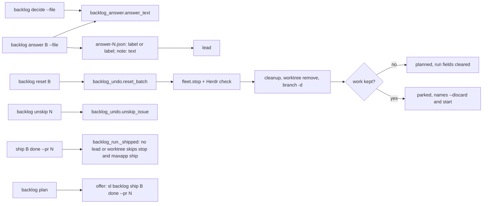
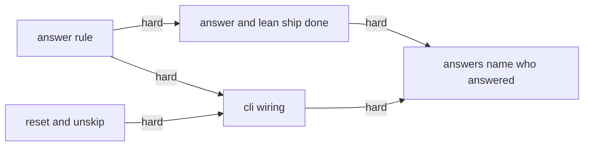

# Superlite: backlog CLI gaps (B126)

**Goal:** fix #586: `sl backlog unskip <issue>`, `sl backlog reset B` (stop the lead, back to planned, fresh worktree), `sl backlog --help` lists every subcommand, a `next:` line when only parked batches are left, and one answer rule in `decide --file` and `answer B --file` (label, or label plus a note that reaches the lead). Plus main's follow-up from B125 (#585 Expected): `sl backlog ship B done --pr N` records a batch without worktree or lead, and plan offers it for a batch whose issues a merged PR already names.
**Architecture:** new `backlog_answer.py` holds the one answer rule (pure); new `backlog_undo.py` holds `reset_batch` and `unskip_issue`; `backlog_run.py` uses the rule in `answer` and lets `_shipped` run without lead or worktree; `backlog_ship.py` `_done` takes a planned batch; `backlog.py` wires decide, the new subcommands, the full help, the parked-only `next:` line, the skipped hint and the plan offer line.
**Tech stack:** Python 3.10+ stdlib, pytest (through `sl run_tests`).
**Spec:** this file, section Design; issue #586 (Expected line) and #585 (Expected line, the `ship B done` offer).
**Detail:** contracts
**Target-min:** 11
**Wave0:** none
**Edges:** hard
**Coverage:** off

Global constraints:
- Every Python code line keeps the file's trailing `# O(...)` complexity comment style where the file uses it (backlog.py, backlog_run.py, backlog_ship.py, the new modules).
- Existing tests stay green. An existing test file changes only when the task Owns it. Another existing test turning red: report it in DONE_WITH_CONCERNS with the test id and reason.
- Run `sl` as an executable (`<abs>/sl ...`). Verify with `<abs>/sl run_tests --fast <own test files> --task Tn --background`, then run the printed `wait:` line in the foreground and end the turn only after it reports.
- Tests fake every outside call (gh, git, Herdr, fleet, ship lock); no test reaches the network or a real Herdr pane.
- Text printed to the terminal that came from files or users loses control characters (answers keep newline and tab).
- No version edits (the ship step bumps). No docs edits (backlog.md, commands/backlog.md, docs/tools.md belong to other open batches). Never run `scripts/test_layers.py run`, `scripts/evals.sh` or `claude plugin eval`.

Ruling: the answer rule and reset/unskip go in two new modules, `backlog_answer.py` and `backlog_undo.py` (because the brief's files are backlog.py and backlog_run.py, which four other open batches also list; new modules keep their diffs small and let tasks build in parallel; notes.md names them; cost if wrong: two small modules more).
Ruling: one answer rule for both commands: a string that is an option label (` (Recommended)` optional) is stored as the bare label; any other string of 1 to 2000 characters without control characters (newline, tab allowed) is stored as given (a label plus a note, or Max's own text); `{"label": L, "note": N}` is stored as `L; note: N` (`L` alone for an empty note), with `L` checked against the question's labels when they are known. The ship and Admit questions take only their labels. Free text stays allowed in decide (Max's "Other" answer); answer B's cap rises from 300 to 2000 (#586; cost if wrong: a note longer than the lead needs).
Ruling: `reset B` is non-destructive by default: it stops the lead (and the lead's own workers), checks in Herdr that the lead is gone, releases the ship lock, runs the project cleanup, then `git worktree remove` and `git branch -d`; with work left (uncommitted files, unmerged commits) it parks the batch with its worktree and branch and names `--discard` (`--force` remove, `branch -D`) and `start B` (resume). A shipped or merged batch, and a planned one with no lead and no worktree, is refused (#586; cost if wrong: one more command when the work really is junk).
Ruling: `unskip` only takes the issue out of `skipped`; it never re-adds it to a batch; the next plan (or `plan --issues N --add`) plans it (#586).
Ruling: taking main's follow-up (it is the same backlog CLI and two of its three files are this batch's): `ship B done --pr N` accepts a planned batch and one without worktree or lead (no notes, version from `--version`, the batch or the main checkout; no lead stop, no project cleanup, no `maxapp ship -C`); plan prints an `offer:` line for each new batch whose issues are all named by one merged PR (#585; backlog_ship.py is listed by no open batch; cost if wrong: an offer main ignores).
Ruling: detail contracts, no probe adapter (CLI wiring over fakes; cases are named tests), unit layer only (only `skills/**/scripts/**` and tests change); already in the lead worktree.
LAYERS: unit

## Design

1. Answer rule (T1): pure `answer_text` and `labels_of`; texts in T1's Produces.
2. Reset and unskip (T2): `reset_batch` and `unskip_issue`; texts in T2's Notes.
3. Run and ship (T3): `answer` reads the lead's `question.json` for labels and stores the rule's text; `_shipped` and `_done` work without lead or worktree.
4. CLI (T4): decide uses the rule (ship and Admit questions fixed), `unskip` and `reset` subcommands, the full help, the parked-only `next:` line, the skipped hint, the plan `offer:` line.
5. Who answered (T5, main's follow-up from B127 #557): an answers file without `by` is refused by decide and answer (exit 2, naming `user` and `main`); a by map names every answered question; decide prints how many it recorded as the user's.

Ruling: taking main's second follow-up item 1 (answers name who answered) as T5, because backlog_checks.py is listed by no open batch and decide/answer are this batch's; item 2 (move the `Pinned:` line into backlog_brief.triage_brief) is left undone: backlog_brief.py belongs to B121 (running) and B122 (cost if wrong: one more batch touches the triage brief).

## File structure

- `skills/subagent-driven-development/scripts/backlog_answer.py`, `tests/scripts/test_backlog_answer_586.py`: the answer rule (T1)
- `skills/subagent-driven-development/scripts/backlog_undo.py`, `tests/scripts/test_backlog_undo_586.py`: reset and unskip (T2)
- `skills/subagent-driven-development/scripts/backlog_run.py`, `skills/subagent-driven-development/scripts/backlog_ship.py`, `tests/scripts/test_backlog_run_answer_586.py`, `tests/scripts/test_backlog_ship_done.py`: answer, `_shipped`, `_done` (T3)
- `skills/subagent-driven-development/scripts/backlog.py`, `tests/scripts/test_backlog_cli_586.py`, `tests/scripts/test_backlog_plan_pin_433.py`: CLI wiring (T4)

## Task graph

```mermaid
%% schedule
gantt
  title Predicted schedule (mm:ss)
  dateFormat X
  axisFormat %M:%S
  section lane 1
  T2 reset a batch and unskip an issue :t2, 0, 169s
  T4 CLI decide rule unskip reset full hel :t4, 169, 163s
  T5 an answers file must name who answere :t5, 332, 105s
  section lane 2
  T1 one answer rule for decide and answer :t1, 0, 101s
  T3 answer takes the rule ship done witho :t3, 101, 155s
```

critical path: T2 → T4 → T5 (7.3 min) · peak width 2 · predicted build 7.3 min · predicted total ≈ 10.8 min (target ✓)

## Package: backlog CLI gaps

App type: CLI + library. Categories: protocol (subcommands, flags, output lines), encoding (answer text, control characters), state (backlog.json batch fields, skipped list, ship lock), file (worktree and branch removal). **Probe entry:** none (CLI wiring over fakes; cases are named tests).

### T1 one answer rule for decide and answer · Complexity 3 · Est. context 30k
**Owns:** skills/subagent-driven-development/scripts/backlog_answer.py, tests/scripts/test_backlog_answer_586.py
**Components:** 1
**LOC owned:** 90
**Tests:** fast
**Model:** sonnet
**Est. time:** 1.8 min (1 component, about 90 LOC, fast tests)
**Covers:** 1
**Consumes:** none
**Produces:** backlog_answer.labels_of(question: dict) -> list[str] · backlog_answer.answer_text(value: object, labels: list[str], fixed: bool = False) -> tuple[str | None, str] · backlog_answer.RULE: str
e.g. labels_of({"question": "Keep the v1 API?", "options": [{"label": "Keep (Recommended)"}, {"label": "Drop"}]}) -> ["Keep", "Drop"]; labels_of({"question": "Q?"}) -> []
e.g. answer_text("Keep (Recommended)", ["Keep", "Drop"]) -> ("Keep", ""); answer_text("Drop, additive only", ["Keep", "Drop"]) -> ("Drop, additive only", "")
e.g. answer_text({"label": "Drop", "note": "old runs unchanged"}, ["Keep", "Drop"]) -> ("Drop; note: old runs unchanged", ""); answer_text({"label": "Drop", "note": ""}, ["Keep", "Drop"]) -> ("Drop", "")
e.g. answer_text("Maybe", ["Approve shipping", "Not yet"], fixed=True) -> (None, "answer must be one of: Approve shipping, Not yet"); answer_text({"label": "Admit", "note": "x"}, ["Admit", "Skip"], fixed=True) -> (None, "this question takes only its label, no note")
e.g. answer_text({"label": "Later", "note": ""}, ["Keep", "Drop"]) -> (None, 'label "Later" is not one of: Keep, Drop'); answer_text("x\x1b[2J", ["Keep"]) -> (None, RULE); answer_text(3, []) -> (None, RULE)
**Review Focus:** encoding: `test_control_characters_refused_newline_kept` ("a\nb\tc" accepted as is; "\x07" or "\x7f" in value or note -> RULE); numeric: `test_length_bounds` (2000 characters ok, 2001 -> RULE, "" and "   " -> RULE); protocol: `test_object_keys` ({"label": "Drop", "extra": 1} -> RULE; {"note": "x"} -> RULE; label not a string -> RULE); `test_unknown_labels_accept_any_label` (labels [] and {"label": "Whatever (Recommended)"} -> ("Whatever", "")); `test_fixed_takes_recommended_suffix` ("Approve shipping (Recommended)" fixed -> ("Approve shipping", "")).
**Steps:** 1 failing tests, 2 run: FAIL, 3 implement, 4 run: PASS
**Notes:** `RULE = 'an answer is an option label, a label plus a note ("<label>; note: <text>" or {"label": L, "note": N}), or your own text: 1 to 2000 characters, no control characters but newline and tab'`. Strings are stripped before the checks; a label match ignores a trailing ` (Recommended)` (use `backlog_checks.REC`). Control characters: code < 32 except `\n` and `\t`, and 127. An object may hold only `label` (required string) and `note` (optional string, may be empty); its label is stripped and loses ` (Recommended)`; with labels known it must be one of them. A fixed question takes a string only when it is a label, and an object only with an empty note. `labels_of` skips options that are no dict or have no string label.

### T2 reset a batch and unskip an issue · Complexity 5 · Est. context 45k
**Owns:** skills/subagent-driven-development/scripts/backlog_undo.py, tests/scripts/test_backlog_undo_586.py
**Components:** 2
**LOC owned:** 230
**Tests:** fast
**Model:** sonnet
**Est. time:** 3.6 min (2 components, about 230 LOC, fast tests)
**Covers:** 2
**Consumes:** none
**Produces:** backlog_undo.unskip_issue(data: dict, n: int | str) -> str · backlog_undo.reset_batch(root: Path, bid: str, discard: bool = False) -> tuple[int, list[str]]
e.g. unskip_issue({"skipped": [5, "PIX-1"], "batches": []}, 5) -> "unskipped #5: the next sl backlog plan triages it again; sl backlog plan --issues 5 --add plans it now" and skipped becomes ["PIX-1"]
e.g. unskip_issue({"skipped": []}, "PIX-2") raises ValueError("PIX-2 is not skipped")
e.g. reset_batch(root, "B1") with B1 running (lead W1, agent sl-m-W1, clean worktree, merged branch) -> (0, ["B1 lead W1 stopped", "B1 worktree <wt> removed", "B1 branch superlite/b1-t deleted", "B1 reset: planned; sl backlog start B1 starts a fresh lead in a fresh worktree"])
e.g. reset_batch(root, "B9") -> (2, ["refused: unknown batch B9"]); reset_batch(root, "B2") with B2 planned and no lead or worktree -> (2, ["refused: B2 is planned; nothing to reset"])
**Review Focus:** state: `test_reset_clears_run_fields_keeps_decisions` (after reset: state planned, lead/agent/worktree/branch/pr/version None, since/ship_runs/questions 0, merged False, reason "", keys reprompted, question_reprompted, gone_seen, gone_workers, open_issues, followups, undone, cleaned, parked_by, parked_at gone; issues, files, depends, decisions, answers, answered_by kept); `test_reset_keeps_work_and_parks` (worktree remove fails "contains modified or untracked files" -> (3, [..., "B1 worktree <wt> kept: contains modified or untracked files", "BLOCKED: B1 parked: reset kept its worktree; sl backlog reset B1 --discard drops it, sl backlog start B1 resumes it"]), state parked, worktree and branch kept, lead and agent None; branch -d fails -> "B1 branch superlite/b1-t kept (not merged)" and "kept its branch"); `test_discard_forces` (`git worktree remove --force <wt>` and `git branch -D  ` are the calls); `test_lead_still_live_blocks_without_change` (agent stays in agent_states after fleet.stop, exit_agent and close_pane -> (3, ["BLOCKED: B1 lead W1 still runs after stop; close its Herdr pane, then rerun sl backlog reset B1"]), backlog.json unchanged); `test_herdr_down_blocks` (agent_states raises -> (3, ["BLOCKED: Herdr not reachable (<e>); B1 keeps its state"])); protocol: `test_refusals` (shipped -> "refused: B1 is shipped"; merged True with pr 7 -> "refused: B1 merged PR #7; sl backlog wait records it as shipped"; SUPERLITE_FLEET_WORKER set -> "refused: sl backlog reset runs only in the main session"; each exit 2, nothing changed); file: `test_main_checkout_is_never_removed` (worktree == root -> "B1 worktree <root> kept: it is the main checkout", no git worktree remove call); `test_missing_worktree_prunes_then_deletes_branch` (recorded path gone -> `git worktree prune`, then `git branch -d`); state: `test_parked_by_main_unparks` (parked, reason "dup", parked_by main, no lead or worktree -> (0, ["B1 reset: planned; ..."])); `test_ship_lock_released` (ship_lock.release called with lock_path(repo) and "B1").
**Steps:** 1 failing tests, 2 run: FAIL, 3 implement, 4 run: PASS
**Notes:** Import inside the functions (tests swap `sys.modules` entries): `backlog_state as bs`, `fleet` (use `fleet.stop(sd, [lead])`, `fleet.stop(<wt>/.superlite, all_=True)` when that folder exists, and `fleet.hc.agent_states()`, `fleet.hc.exit_agent(name)`, `fleet.hc.close_pane(pane_id)`, `fleet.hc.HerdrError`), `fleet_state` (`workers(sd)` -> {wid: record}; pane from `record["pane_id"]`), `ship_lock` (`release(lock_path(repo), bid)`, errors ignored), `backlog_run` (`_run(cmd, cwd) -> (rc, text)`, `project_cleanup(root, wt, branch, bid) -> str | None`). `sd = root / ".superlite"`; data at `bs.path(root)`, changed only through `bs.update`. Order: refusals; stop the lead and its fleet (each call in try, exceptions ignored); when the batch has an agent: read `agent_states()` (HerdrError -> BLOCKED, nothing changed), while the agent is listed call `exit_agent` and `close_pane` once, then re-read every `POLL_S = 1` s through a module-level `_sleep` up to `STOP_WAIT_S = 10` s (tests patch `_sleep`); then the ship lock, project cleanup (its line when not None), git (cwd root): `worktree remove [--force] <wt>`; if the recorded worktree folder is gone: `worktree prune`; the branch only when the worktree is gone: `branch -d|-D  `; a kept line ends with the last line of git's output cut to 120 characters. Lines: `B1 lead W1 stopped` when it had a lead; `B1 worktree <wt> removed|kept: <why>`; `B1 branch   deleted|kept (not merged)`. `what` is `worktree`, `branch` or `worktree and branch`. A kept reset sets state parked, reason `reset kept its <what>; sl backlog reset B1 --discard drops it, sl backlog start B1 resumes it`, lead and agent None, since 0, reprompted and question_reprompted False, worktree and branch kept. `unskip_issue` prints refs as `#N` (int) or the key, and `sl backlog ...` arguments as `N` or the key.

### T3 answer takes the rule; ship done without lead or worktree · Complexity 4 · Est. context 50k
**Owns:** skills/subagent-driven-development/scripts/backlog_run.py, skills/subagent-driven-development/scripts/backlog_ship.py, tests/scripts/test_backlog_run_answer_586.py, tests/scripts/test_backlog_ship_done.py
**Components:** 2
**LOC owned:** 140
**Tests:** fast
**Model:** sonnet
**Est. time:** 2.6 min (2 components, about 140 LOC, fast tests)
**Covers:** 3
**Consumes:** backlog_answer.answer_text(value: object, labels: list[str], fixed: bool = False) -> tuple[str | None, str] (T1) · backlog_answer.labels_of(question: dict) -> list[str] (T1)
**Produces:** backlog_run._shipped(p: Path, sd: Path, root: Path, b: dict, wt: Path | None) -> list
**Review Focus:** protocol: `test_answer_label_plus_note_reaches_lead` (question.json Q, answers {"Keep the v1 API?": {"label": "Keep", "note": "additive only, old runs unchanged"}} -> exit 0, answer-1.json answers {"Keep the v1 API?": "Keep; note: additive only, old runs unchanged"}, batch answers the same); `test_answer_long_free_text` (a 1200-character string -> stored as given); `test_answer_bad_label_names_the_rule` ({"label": "Later"} -> exit 2, stdout `BLOCKED: bad answer for Keep the v1 API?: label "Later" is not one of: Keep, Drop`, no answer file, state needs_decision); encoding: `test_answer_control_characters` ("x\x1b[2J" -> exit 2, line starts `BLOCKED: bad answer for K?: an answer is an option label`); state: `test_done_records_a_planned_batch_without_lead_or_worktree` (B1 planned, lead None, worktree None, gh pr view MERGED -> exit 0, first line starts `B1 shipped PR #262`, state shipped, merged True, no fleet stop call, no `maxapp ship` call, summary file written); `test_done_still_refuses_a_shipped_batch` ("refused: B1 is shipped, not planned, running or parked"); `test_wait_ships_without_worktree_field` (`_shipped` with b lacking lead and worktree -> no stop, no maxapp call).
**Steps:** 1 failing tests, 2 run: FAIL, 3 implement, 4 run: PASS
**Notes:** `cmd_answer`: before moving question.json, read it (unreadable -> no labels); for each answer key find the question whose `question` equals the key and pass `labels_of(it)` (else []) with fixed False; keys stay 1 to 4 strings without control characters; an error prints `BLOCKED: bad answer for <key cut to 60>: <error>` (exit 2, nothing written). The stored text goes into answer-N.json and the batch's `answers`. Import `backlog_answer` at the top next to `backlog_checks`. `_shipped`: skip `_stop` when `b.get("lead")` is falsy; skip project cleanup and `maxapp ship -C` when `b.get("worktree")` is falsy. `backlog_ship._done`: refuse only a state outside planned, running, needs_decision, parked (`refused: <B> is <state>, not planned, running or parked`); require only the repo (`refused: <B> has no repo recorded`); with a worktree folder read notes and the version from it as now, else notes "" and version `--version`, the batch's, or `_current_version(root)`; pass `wt` None to `_shipped` then. Update the one planned-refusal expectation in test_backlog_ship_done.py. Docstrings of both files name the change (#586, #585).

### T4 CLI: decide rule, unskip, reset, full help, next and offer lines · Complexity 5 · Est. context 55k
**Owns:** skills/subagent-driven-development/scripts/backlog.py, tests/scripts/test_backlog_cli_586.py, tests/scripts/test_backlog_plan_pin_433.py
**Components:** 2
**LOC owned:** 190
**Tests:** fast
**Model:** sonnet
**Est. time:** 3.4 min (2 components, about 190 LOC, fast tests)
**Covers:** 4
**Consumes:** backlog_answer.answer_text(value: object, labels: list[str], fixed: bool = False) -> tuple[str | None, str] (T1) · backlog_answer.labels_of(question: dict) -> list[str] (T1) · backlog_undo.unskip_issue(data: dict, n: int | str) -> str (T2) · backlog_undo.reset_batch(root: Path, bid: str, discard: bool = False) -> tuple[int, list[str]] (T2)
**Produces:** backlog.offer_lines(new: list, merged: dict) -> list[str] · backlog.parked_next(data: dict) -> str | None
e.g. offer_lines([{"id": "B2", "issues": [6]}], {6: "PR #20"}) -> ["offer: B2 holds only #6, named by merged PR #20: sl backlog ship B2 done --pr 20 records it as shipped (no lead, no worktree)"]
e.g. offer_lines([{"id": "B2", "issues": [6, 7]}], {6: "PR #20", 7: "commit a1b2c3d"}) -> []; offer_lines([{"id": "B3", "issues": ["PIX-3", "PIX-4"]}], {"PIX-3": "PR #9", "PIX-4": "PR #9"}) -> ["offer: B3 holds only PIX-3 PIX-4, named by merged PR #9: sl backlog ship B3 done --pr 9 records it as shipped (no lead, no worktree)"]
e.g. parked_next({"batches": [{"id": "B60", "state": "parked"}, {"id": "B59", "state": "shipped"}]}) -> "next: sl backlog start B60 resumes the parked batch, or sl backlog plan --reset drops it and plans every open issue again"
e.g. parked_next with B60 and B61 parked -> "next: sl backlog start B60 B61 resumes the parked batches, or sl backlog plan --reset drops them and plans every open issue again"; with any planned, running or needs_decision batch, or none parked -> None
**Review Focus:** protocol: `test_help_lists_every_subcommand` (`main(["--help"])` exits 0 and prints each of status, plan, decide, start, wait, answer, tell, ship, skip, unskip, park, reset); `test_unskip_cli` (skipped [2] -> `unskip 2` exit 0 with the T2 line, skipped []; again -> (2, "refused: #2 is not skipped\n"); SUPERLITE_FLEET_WORKER set -> refused, exit 2); `test_reset_cli_passes_discard` (fake reset_batch records (root, "B1", True) for `reset B1 --discard`, prints its lines, returns its code); `test_skipped_pin_names_unskip` (`BLOCKED: --issues: #2 is skipped; sl backlog unskip 2 takes it back`, `PIX-1 is skipped; sl backlog unskip PIX-1 takes it back`); state: `test_status_parked_only_next_line` (last status line is parked_next's line); encoding: `test_decide_label_plus_note` (batch question answered {"label": "Drop", "note": "log it"} -> stored "Drop; note: log it"); `test_decide_ship_refuses_note_and_free_text` (ship answered "Yes please" -> exit 2, `BLOCKED: bad answer for Approve that every batch lead ships its own batch (rebase, : answer must be one of: Approve shipping, Not yet`, nothing recorded); `test_decide_free_text_still_accepted` (batch question "Drop, and log it" -> recorded as given); `test_plan_offers_ship_done` (pinned #6, subjects ["a1b2c3d\tFix #6 (#20)"], fast path or fake proposal B1 [6] -> output has the offer line for the new id).
**Steps:** 1 failing tests, 2 run: FAIL, 3 implement, 4 run: PASS
**Notes:** decide `--file`: before `bs.answer`, map each answer through `answer_text(value, labels_of(q), fixed)` where `q` is the open question (from `bs.open_questions(d)`) with that text and fixed is `text == bs.SHIP_Q or text.startswith("Admit outside issue #")`; a text with no open question passes unchanged (bs.answer reports it); errors print one `BLOCKED: bad answer for <text cut to 60>: <error>` line each, exit 2, nothing recorded. `unskip <issue>` (same `_issue_arg`) runs through `_main_only("unskip", ...)`. `reset B [--discard]` calls `backlog_undo.reset_batch(_root(), B, discard)`, prints its lines, returns its code. Help: every subparser gets a one-line `help=`; start, wait, answer, tell and ship get parsers only for the listing (they stay routed before parsing). `cmd_status`: after the existing `next: sl backlog plan` rule, append `parked_next(d)` when not None. Plan: compute `merged = bi.merged_refs(subjects, jira)` once and pass it to `split_shipped`; record the new batches in `apply` (both branches) and print `offer_lines(new, merged)` after the status lines. offer_lines: only `PR #N` values, all issues of the batch naming the same PR; refs `#N` or the key. Update the two skipped expectations in test_backlog_plan_pin_433.py. Docstring names #586 and the offer.

### T5 an answers file must name who answered · Complexity 3 · Est. context 40k
**Owns:** skills/subagent-driven-development/scripts/backlog_checks.py, skills/subagent-driven-development/scripts/backlog.py, tests/scripts/test_backlog_by_required_586.py, tests/scripts/test_backlog_state_b90.py, tests/scripts/test_backlog_cli.py, tests/scripts/test_backlog_cli_586.py, tests/scripts/test_backlog_decide_by_477.py, tests/scripts/test_backlog_run.py, tests/scripts/test_backlog_run_lifecycle.py, tests/scripts/test_backlog_run_b90.py, tests/scripts/test_backlog_run_answer_586.py, tests/scripts/test_backlog_wait_question.py, tests/scripts/test_backlog_checks.py
**Components:** 1
**LOC owned:** 110
**Tests:** fast
**Model:** sonnet
**Est. time:** 2.2 min (1 component, about 110 LOC, fast tests)
**Covers:** 5
**Consumes:** none
**Produces:** backlog_checks.answer_by(obj: dict, answers: dict) -> tuple[dict, str] · backlog_checks.BY_MISSING: str
e.g. answer_by({"answers": {"A?": "x"}}, {"A?": "x"}) -> ({}, BY_MISSING)
e.g. answer_by({"answers": {"A?": "x", "B?": "y"}, "by": {"A?": "main"}}, {"A?": "x", "B?": "y"}) -> ({}, "by: the map names no one for B?")
e.g. answer_by({"answers": {"A?": "x"}, "by": "user"}, {"A?": "x"}) -> ({"A?": "user"}, ""); answer_by({"answers": {"A?": "x"}, "by": {"A?": "main"}}, {"A?": "x"}) -> ({"A?": "main"}, "")
**Review Focus:** protocol: `test_decide_refuses_missing_by` (decide --file without `by` -> (2, "BLOCKED: " + BY_MISSING + "\n"), nothing recorded); `test_answer_refuses_missing_by` (answer B1 --file without `by` -> exit 2, stdout `BLOCKED: ` + BY_MISSING, no answer-1.json, state needs_decision); `test_partial_map_refused` (the second example above, cut question to 60 characters, control characters as `?`); state: `test_decide_counts_user_answers` (two answers by user -> "recorded 2 answers (2 as the user's), 0 open"; one user, one main -> "recorded 2 answers (1 as the user's, 1 ruled by main), N open"; one main -> "recorded 1 answers (1 ruled by main), N open").
**Steps:** 1 failing tests, 2 run: FAIL, 3 implement, 4 run: PASS
**Notes:** `BY_MISSING = 'by: missing; name who answered: "by": "user" for AskUserQuestion answers, "by": "main" for main\'s rulings, or a {question: "user"|"main"} map naming every answered question'`. A missing `by` key (or a non-dict obj) gives BY_MISSING; a string or map with other values keeps `BY_ERR`; a map with a key that has no answer keeps `by: no answer for <q>`; a map that leaves an answered question out gives `by: the map names no one for <q cut to 60>`. `backlog_run._answers` already returns answer_by's error, so `answer` needs no code change; `decide` prints `BLOCKED: <err>`. decide's count line: parts `<u> as the user's` and `<m> ruled by main`, each only when above 0, joined by `, ` in parentheses. Existing tests that write an answers file without `by` get `"by": "user"` added (behaviour they test stays the user's); expectations of the count line change as above. The docs (backlog.md, commands/backlog.md, docs/tools.md) belong to other batches: no docs edits.

## Review Focus

Package backlog CLI gaps (CLI + library): protocol, encoding, state, file. Specific risks: an answer note that never reaches the lead; a reset that deletes uncommitted work without `--discard`; a reset that leaves a live lead pane writing into a removed worktree; a reset of a batch whose PR already merged; `ship B done` on a planned batch calling `maxapp ship -C None`; help that still omits routed subcommands.

## Self-review

Coverage: unskip T2/T4, reset T2/T4, help T4, parked-only next T4, answer rule T1/T3/T4, ship done offer T3/T4. No placeholders. Consumes match Produces. Edges are hard (tests run the producer's real module); T3 and T4 own disjoint files.
