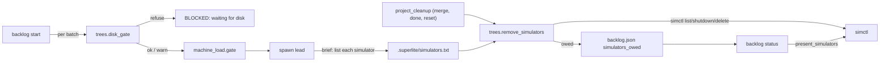
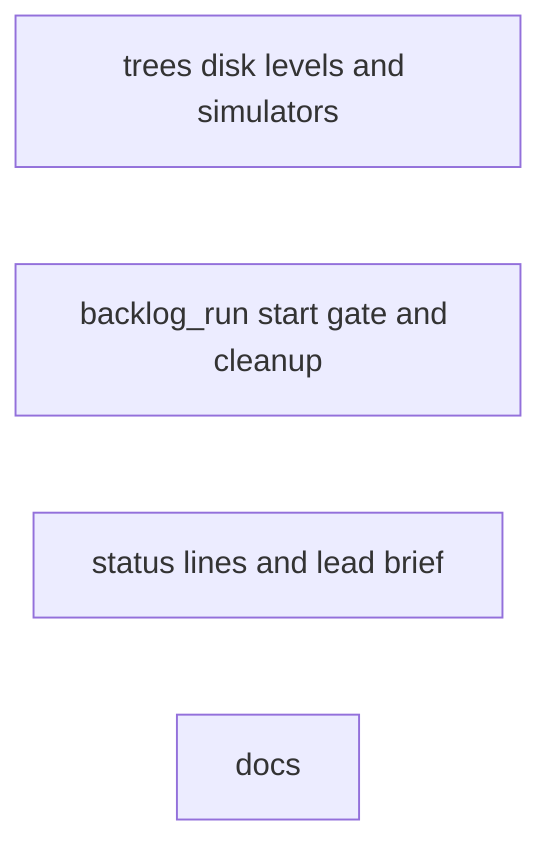

# Superlite: backlog start disk floor; shipped batches delete their simulators (B164)

**Goal:** fix #672: `sl backlog start` starts no lead below the free-disk floor, `sl backlog status` names a low disk, and the ship cleanup shuts down and deletes every simulator the lead listed in `.superlite/simulators.txt`, naming the ones it could not in `status`.
**Architecture:** `trees.py` gains `disk_levels` and the simulator helpers (`listed_simulators`, `simctl_argv`, `simulator_devices`, `remove_simulators`, `present_simulators`). `backlog_run.cmd_start` runs `trees.disk_gate` per batch before the machine gate; `backlog_run.project_cleanup` removes the listed simulators before the project cleanup command and records the rest as the batch's `simulators_owed`. `backlog.cmd_status` prints the machine line also when the disk is below the warn level and one owed line per batch, re-reading the owed simulators once. The lead brief tells leads and workers to list each simulator they create. Docs name it all.
**Tech stack:** Python 3.10+ stdlib, pytest (through `sl run_tests`); Markdown docs.
**Spec:** this file, section Design; issue #672.
**Detail:** contracts
**Target-min:** 11
**Wave0:** none
**Coverage:** off

Global constraints:
- Every Python code line keeps the file's trailing `# O(...)` complexity comment.
- Existing tests stay green. An existing test file changes only when the task Owns it. If another existing test turns red, report it in DONE_WITH_CONCERNS with the test id and the reason instead of editing it.
- Run `sl` as an executable (`<abs>/sl ...`). Verify with `<abs>/sl run_tests --fast <own test files> --task Tn --background`, then run the printed `wait:` line in the foreground and end the turn only after it reports.
- No version edits. Never run `scripts/evals.sh`, `claude plugin eval` or `scripts/test_layers.py run`. No test calls the real `xcrun simctl`: every test that writes a `simulators.txt` or a `simulators_owed` record sets `SUPERLITE_SIMCTL` to a stand-in (`f"{sys.executable} {script}"`, a Python script in `tmp_path` that appends its argv to a log file, answers `list devices -j` from a JSON file, removes a deleted UDID from that file, exits 0 on `shutdown`). No test reads the real disk level: tests set `SUPERLITE_DISK_FLOOR_GB`/`SUPERLITE_DISK_WARN_GB` and monkeypatch `trees.free_gb` or `shutil.disk_usage`.
- Fakes only where the producer is missing: a test that needs another task's function fakes it (`monkeypatch.setattr(mod, name, fake, raising=False)`) only when `not hasattr(mod, name)`, so the full suite runs the real code. A fake returns exactly the producer's `e.g.` values.
- Standing rules (main's note): this repository is public: no host names, user names, home paths, other project or repository names, ticket keys or account names in code, tests, docs or commit messages. Never change the machine's gate config or `~/.superlite/machine.json`; tests use private temp homes and state dirs. No real app builds as proof; this repository's own test suite is the check. Friction with superlite itself goes to `sl feedback add`.
- Builds: the verdict is `sl run_tests`; task trees build in <tree>/.build/DerivedData and any build of your own goes under .build/ of the worktree, never -derivedDataPath outside the worktree; a product, simulator or device build stays on this machine and runs only when an issue's acceptance asks for a running-app check (none here).
- Never edit `backlog_ship.py`, `backlog_undo.py`, `backlog_state.py`, `fleet.py` or `dispatch.py`.

Ruling: the disk floor is checked per batch before the machine gate (so a full disk never waits 100 s on memory), with `trees.disk_gate(root)` on the main checkout; `--over-limit` does not skip it (only `SUPERLITE_DISK_FLOOR_GB=0` does); the refusal is exit 2 and leaves the batch's state and record untouched (because a full disk crashes runs, while memory clears; cost if wrong: a user must set the env var to force a start).
Ruling: below the warn level `start` prints the gate's `disk: WARNING: ...` line once per call on stdout and starts the batch.
Ruling: `status` prints its `machine:` line while a batch is open (as now) or while free disk is below the warn level; below the warn level the disk part reads `machine: 41.2 GB free disk, below the 50 GB warn level`, below the floor `machine: 12.0 GB free disk, below the 20 GB floor (sl backlog start starts no lead)`.
Ruling: a `simulators.txt` line whose first word is a UDID (8-4-4-4-12 hex) names that UDID; any other line names a simulator by its whole stripped text; blank lines, `#` lines, lines starting with `-` and lines with control characters are skipped; entries are deduplicated in order. A name that matches more than one device is never deleted (owed: `N simulators share this name; list its UDID`), an entry no device matches counts as already gone (because deleting by an ambiguous name could remove another session's simulator; cost if wrong: one owed line main deletes by hand).
Ruling: `SUPERLITE_SIMCTL` (shell-split) replaces `xcrun simctl` everywhere; each simctl call has a 60 s timeout.
Ruling: what cleanup could not delete is stored as the batch's `simulators_owed` (`[{"sim": entry, "why": reason}]`) in the main checkout's backlog.json; `status` re-reads them with one `simctl list devices -j` and drops the gone ones; `_shipped` adds the owed line to main's `wait` output when the lead's merge did the cleanup.
Ruling: the lead brief names the absolute `<worktree>/.superlite/simulators.txt`, since workers run in task trees with their own `.superlite`.
Ruling: `docs/tools.md` is append-only for this batch: one new table row, no existing row changed.
LAYERS: unit

## Design

### 1. Disk floor at start (#672 item 1)
`cmd_start`, per picked batch, before `machine_load.gate`: `level, line = trees.disk_gate(root)`. Refuse: print `BLOCKED: waiting for disk: {bid} not started: {line minus its "disk: " prefix} sl backlog start {bid} ({bid} keeps its state)`, set exit 2, go to the next batch; no worktree, brief or spawn. Example: `BLOCKED: waiting for disk: B7 not started: 12.0 GB free on /r, below the 20 GB floor; run sl trees clean (trees, orphaned Xcode DerivedData) and free space, then rerun sl backlog start B7 (B7 keeps its state)`.

### 2. Status names a low disk (#672 item 2)
`machine_line` adds the warn or floor part (Rulings); `cmd_status` prints it also with no open batch while the disk is below the warn level, always before any `next:` line.

### 3. Simulators (#672 item 3, main's ruling: lead lists them in simulators.txt)
Lead brief sentence; `project_cleanup` removal and owed record; `_shipped` line; `status` owed line and re-read.

### 4. Tests (#672 item 4) and docs
Each task's named tests; `backlog.md` and one `docs/tools.md` row.

## File structure

- `skills/subagent-driven-development/scripts/trees.py`, `tests/scripts/test_trees_simulators_672.py`: T1
- `skills/subagent-driven-development/scripts/backlog_run.py`, `tests/scripts/test_backlog_run_disk_sims_672.py`: T2
- `skills/subagent-driven-development/scripts/backlog.py`, `skills/subagent-driven-development/scripts/backlog_brief.py`, `tests/scripts/test_backlog_status_brief_672.py`, `tests/scripts/test_backlog_brief_jira_208.py`: T3
- `skills/subagent-driven-development/backlog.md`, `docs/tools.md`, `tests/scripts/test_docs_672.py`: T4

## Task graph

```mermaid
%% schedule
gantt
  title Predicted schedule (mm:ss)
  dateFormat X
  axisFormat %M:%S
  section lane 1
  T3 status lines and lead brief sentence :t3, 0, 598s
  section lane 2
  T2 backlog_run start disk gate and simul :t2, 0, 560s
  section lane 3
  T1 trees disk levels and simulator helpe :t1, 0, 559s
  section lane 4
  T4 docs for the disk floor and simulator :t4, 0, 540s
```

critical path: T3 (10.0 min) · peak width 4 · predicted build 10.0 min · predicted total ≈ 26.5 min (target ✗ 11.0)

## Package: trees

App type: library over a subprocess. Categories: protocol (simctl argv and JSON), file (simulators.txt parsing), state (owed vs gone). **Probe entry:** none (needs a simctl stand-in; cases are named tests).

### T1 trees disk levels and simulator helpers · Complexity 4 · Est. context 40k
**Owns:** skills/subagent-driven-development/scripts/trees.py, tests/scripts/test_trees_simulators_672.py
**Components:** 1
**LOC owned:** 160
**Tests:** fast
**Model:** sonnet
**Est. time:** 2.7 min (1 component, about 160 LOC, fast tests)
**Covers:** 1, 2, 3
**Produces:** trees.disk_levels() -> tuple[float, float]
e.g. disk_levels() with SUPERLITE_DISK_FLOOR_GB unset and SUPERLITE_DISK_WARN_GB unset -> (20.0, 50.0)
e.g. disk_levels() with SUPERLITE_DISK_FLOOR_GB="0" and SUPERLITE_DISK_WARN_GB="x" -> (0.0, 50.0)
**Produces:** trees.listed_simulators(worktree: str | Path) -> list[str]
e.g. listed_simulators(wt) with simulators.txt "4F1A2B3C-0000-4000-8000-00000000000A booted by T3\n\n# note\niPhone 16 clone\n-rf\n4f1a2b3c-0000-4000-8000-00000000000a\n" -> ["4F1A2B3C-0000-4000-8000-00000000000A", "iPhone 16 clone"]
e.g. listed_simulators(wt) with no .superlite/simulators.txt -> []
**Produces:** trees.simctl_argv() -> list[str]
**Produces:** trees.simulator_devices() -> dict[str, str]
**Produces:** trees.remove_simulators(worktree: str | Path) -> tuple[list[str], list[str], list[dict]]
e.g. remove_simulators(wt) listing ["4F1A2B3C-0000-4000-8000-00000000000A", "iPhone 16 clone", "old-sim"], devices {"4F1A2B3C-0000-4000-8000-00000000000A": "sl-check-wt", "5B2C3D4E-0000-4000-8000-00000000000B": "iPhone 16 clone"}, deletes exit 0 -> (["4F1A2B3C-0000-4000-8000-00000000000A", "iPhone 16 clone"], ["old-sim"], [])
e.g. remove_simulators(wt) listing ["4F1A2B3C-0000-4000-8000-00000000000A"] with SUPERLITE_SIMCTL naming a missing program -> ([], [], [{"sim": "4F1A2B3C-0000-4000-8000-00000000000A", "why": "simctl not runnable: <OSError text>"}])
e.g. remove_simulators(wt) with no simulators.txt -> ([], [], []) and no simctl call
**Produces:** trees.present_simulators(sims: list[str]) -> list[str] | None
e.g. present_simulators(["4F1A2B3C-0000-4000-8000-00000000000A", "old-sim"]) with devices {"4F1A2B3C-0000-4000-8000-00000000000A": "x"} -> ["4F1A2B3C-0000-4000-8000-00000000000A"]
e.g. present_simulators(["a"]) when `list devices -j` exits 1 -> None
**Review Focus:** `test_ambiguous_name_is_never_deleted`: two devices named "iPhone 16 clone", the entry "iPhone 16 clone" -> owed with why "2 simulators share this name; list its UDID" and no `delete` in the stand-in log; `test_failed_delete_is_owed`: stand-in exits 1 on delete printing "Unable to delete" on stderr -> owed why "delete failed: Unable to delete"; `test_shutdown_runs_before_delete`: the log reads `shutdown <udid>` then `delete <udid>`; `test_entry_never_reaches_a_shell`: an entry `a; touch pwned` creates no file (argv list, no shell).
**Steps:** 1 failing tests, 2 run: FAIL, 3 implement, 4 run: PASS
**Notes:**
- `disk_levels` reads both env values through `_env_gb` (defaults 20 and 50); `disk_gate` uses it, its output unchanged.
- `SIMULATORS = Path(".superlite") / "simulators.txt"`; `listed_simulators` reads `<worktree>/SIMULATORS` (an OSError or UnicodeDecodeError gives []), parsing per the Rulings; a UDID is upper-cased.
- `simctl_argv`: `shlex.split(os.environ["SUPERLITE_SIMCTL"])` when set and non-empty, else `["xcrun", "simctl"]`.
- `simulator_devices`: runs `simctl_argv() + ["list", "devices", "-j"]` (capture, text, timeout 60); returns `{udid.upper(): name}` over every runtime's list in `"devices"`; raises `RuntimeError` with a one-line reason: `simctl not runnable: <e>` (OSError), `simctl list timed out after 60 s`, `simctl list exit <rc>: <last output line cut to 120>`, `simctl list gave no device JSON`.
- `remove_simulators`: no entries: return at once. Device list error: every entry owed with that reason. Per entry: a UDID matches a device key; a name matches every device with that name; 0 matches: gone; 2+: owed; 1: `shutdown <udid>` (result ignored), then `delete <udid>`; exit 0: removed (the entry as listed), else owed `delete failed: <last stderr/stdout line cut to 120>` (timeout: `delete timed out after 60 s`). Never raises.
- `present_simulators`: one device list; an entry is present when it matches a UDID or a name; a list error gives None.
- Docstring: add the new functions to the module docstring's cleanup paragraph.
- Named tests: the e.g. lines, the Review Focus tests, `test_disk_gate_unchanged` (floor 20, `free_gb` 12 -> `("refuse", "disk: 12.0 GB free on ..., below the 20 GB floor; ...")`), `test_simctl_argv_override`.

## Package: backlog

App type: CLI. Categories: protocol (exact output lines, exit codes), state (batch record kept or changed), file (backlog.json, simulators.txt). **Probe entry:** none (needs Herdr and backlog.json fixtures; cases are named tests).

### T2 backlog_run start disk gate and simulator cleanup · Complexity 5 · Est. context 50k
**Owns:** skills/subagent-driven-development/scripts/backlog_run.py, tests/scripts/test_backlog_run_disk_sims_672.py
**Components:** 1
**LOC owned:** 170
**Tests:** fast
**Model:** sonnet
**Est. time:** 3.0 min (1 component, about 170 LOC, fast tests)
**Covers:** 1, 3, 4
**Consumes:** trees.remove_simulators(worktree: str | Path) -> tuple[list[str], list[str], list[dict]] (T1)
**Produces:** backlog_run.simulators_owed_line(bid: str, owed: list[dict]) -> str
e.g. simulators_owed_line("B7", [{"sim": "4F1A2B3C-0000-4000-8000-00000000000A", "why": "delete failed: Unable to delete"}]) -> "B7 simulators owed: 4F1A2B3C-0000-4000-8000-00000000000A (delete failed: Unable to delete); delete each with xcrun simctl delete <udid>, then sl backlog status"
e.g. simulators_owed_line("B2", [{"sim": "a", "why": "x"}, {"sim": "b", "why": "y"}]) -> "B2 simulators owed: a (x), b (y); delete each with xcrun simctl delete <udid>, then sl backlog status"
**Review Focus:** `test_start_below_floor_starts_nothing`: `SUPERLITE_DISK_FLOOR_GB=20`, `trees.free_gb` patched to 12.0, `start B7 B8` (bk fixture from test_backlog_run) -> exit 2, two `BLOCKED: waiting for disk: B7 not started: 12.0 GB free on ..., below the 20 GB floor; ... then rerun sl backlog start B7 (B7 keeps its state)` lines, no spawn, no ensure, no machine gate call, both batches still `planned` with no `worktree` key; `test_start_after_space_frees`: the same batch starts on the next call with `free_gb` 100; `test_parked_batch_keeps_its_reason`: a parked batch refused for disk keeps state `parked` and its `reason`; `test_cleanup_removes_listed_simulator`: real trees (when it has `remove_simulators`) with the stand-in: one listed UDID -> stand-in log `shutdown`, `delete`, stdout `B1 simulators: removed 1: <udid>`, return None; `test_owed_recorded_and_returned`: delete fails -> the return value holds the owed line and the batch in `<root>/.superlite/backlog.json` carries `simulators_owed`; `test_no_file_no_simctl_call`.
**Steps:** 1 failing tests, 2 run: FAIL, 3 implement, 4 run: PASS
**Notes:**
- `cmd_start`: lazy `import trees`; the disk check is the first thing per batch in the `for bid in ids` loop (Design 1). A warn result prints its line once per call (stdout).
- `cmd_start` ctx gets `"worktree": str(wt)` (T3's brief sentence reads it).
- `project_cleanup`: after the scratch sweep, before `cleanup_cmd(root)`: `removed, gone, owed = trees.remove_simulators(wt)` (any exception: treat as nothing listed). `removed or gone`: print `{bid} simulators: removed {n}: {', '.join(removed)}` and, with gone ones, `; already gone: {', '.join(gone)}` (removed 0 prints `removed 0`). Owed: `line = simulators_owed_line(bid, owed)` and store `simulators_owed = owed` on batch `bid` in `bs.path(root)`; nothing owed but something listed: drop the key. The store is best effort (no backlog.json or no such batch: skip). Return: the owed line and the cleanup command's failure line joined by `\n` (each only when present), else None; with no cleanup command the owed line or None.
- `_shipped`: when `b.get("cleaned")`, re-read batch `bid` from `p`; a non-empty `simulators_owed` appends `simulators_owed_line(bid, ...)` to `out` after the OPEN line.
- Cleanup test fixture: `if not hasattr(trees, "remove_simulators")`, fake it with the e.g. values; else the real one with the stand-in from the Global constraints.
- Docstring: one sentence each for the disk floor and the simulator cleanup.

### T3 status lines and lead brief sentence · Complexity 4 · Est. context 44k
**Owns:** skills/subagent-driven-development/scripts/backlog.py, skills/subagent-driven-development/scripts/backlog_brief.py, tests/scripts/test_backlog_status_brief_672.py, tests/scripts/test_backlog_brief_jira_208.py
**Components:** 2
**LOC owned:** 140
**Tests:** fast
**Model:** sonnet
**Est. time:** 2.8 min (2 components, about 140 LOC, fast tests)
**Covers:** 2, 3, 4
**Consumes:** trees.disk_levels() -> tuple[float, float] (T1) · trees.present_simulators(sims: list[str]) -> list[str] | None (T1) · backlog_run.simulators_owed_line(bid: str, owed: list[dict]) -> str (T2)
**Review Focus:** `test_machine_line_below_warn`: warn 50, floor 20, disk 41.2 GB -> `machine: 41.2 GB free disk, below the 50 GB warn level`; `test_machine_line_below_floor`: 12.0 GB -> `machine: 12.0 GB free disk, below the 20 GB floor (sl backlog start starts no lead)`; `test_status_low_disk_without_open_batch`: every batch shipped, 41.2 GB -> the machine line comes right before `next: sl backlog plan` (last); `test_status_owed_line_and_reread`: a shipped batch with two owed simulators, one still present -> one `B7 simulators owed: <present one> (...)` line before the machine/next lines, backlog.json keeps only the present one; `test_status_owed_kept_when_list_fails`: `present_simulators` None -> both stay and both print; `test_brief_names_simulators_file`: ctx worktree `/w/b1` -> the brief holds `/w/b1/.superlite/simulators.txt` and `copy this sentence into every worker brief`.
**Steps:** 1 failing tests, 2 run: FAIL, 3 implement, 4 run: PASS
**Notes:**
- `machine_line(root)`: free from `shutil.disk_usage(root)` as now; `floor, warn = trees.disk_levels()`; the disk part gets the Rulings' suffix (floor checked first; a 0 level is off); the slots part stays after it. The existing exact-text tests in `test_backlog_status_machine_627.py` run with both levels 0 and stay green.
- `cmd_status`: the machine line also when no batch is open but free disk is below a non-zero warn level. Owed lines: collect every batch's non-empty `simulators_owed`; none: no simctl call. Else one `trees.present_simulators(all entries)` call; not None: keep the present entries, write back the changed batches with `bs.update` (an emptied list drops the key). Print `backlog_run.simulators_owed_line(id, owed)` per batch still owing, after the status lines and before the machine line and `next:`.
- `lead_brief`: a new `out.append` right after the `Build: ... Builds: ...` line: ``Simulators: append the UDID of each simulator you or a worker creates (`xcrun simctl create` or `clone`; a checker's `Simulators:` line marks its created ones) as one line to {f}; never list one you did not create; ship cleanup shuts down and deletes each listed one; copy this sentence into every worker brief.`` with `{f}` = `<ctx["worktree"]>/.superlite/simulators.txt`, or `.superlite/simulators.txt of your worktree` without a worktree. Update `GH_LEAD` in `test_backlog_brief_jira_208.py` with this line (worktree absent there).
- Fakes per the Global constraints (`hasattr` on `trees` and `backlog_run`).

## Package: docs

App type: docs. Categories: none beyond wording. **Probe entry:** none (Markdown).

### T4 docs for the disk floor and simulators · Complexity 2 · Est. context 34k
**Owns:** skills/subagent-driven-development/backlog.md, docs/tools.md, tests/scripts/test_docs_672.py
**Components:** 1
**LOC owned:** 40
**Tests:** fast
**Model:** sonnet
**Est. time:** 1.5 min (1 component, about 40 LOC, fast tests)
**Covers:** 4
**Steps:** 1 failing tests, 2 run: FAIL, 3 implement, 4 run: PASS
**Notes:**
- `backlog.md`, each addition at the end of its paragraph, no other word changed: Main step 1 adds ``A `machine:` line also shows while free disk is below the warn level (50 GB, `SUPERLITE_DISK_WARN_GB`), naming that level or the floor; a `B simulators owed: ...` line names simulators a ship cleanup could not delete (status re-reads them and drops the gone ones).`` Main step 4 adds ``Below the free-disk floor (20 GB on the main checkout's volume, `SUPERLITE_DISK_FLOOR_GB`; `--over-limit` does not skip it) a batch is not started: one `BLOCKED: waiting for disk: B not started: <free> GB free on <path>, below the <floor> GB floor; ...` line, exit 2, and the batch keeps its state, so a later `start` starts it once space is free (#672).`` The Lead section gets a new bullet after the Adjacent fixes bullet: ``- Simulators: append the UDID of each simulator you or a worker creates to `<worktree>/.superlite/simulators.txt` (one per line; a name works when only one device has it). The ship cleanup (merge, `ship B done`, `plan --reset`, `reset`) shuts down and deletes each listed one before the project cleanup command (`B simulators: removed N: ...`); one it could not delete is kept as the batch's `simulators_owed` and named by `wait` and `status` (#672).`` The Limits paragraph on resources named after a worktree adds ``Simulators a lead lists in `.superlite/simulators.txt` are removed by superlite itself (Lead: Simulators).``
- `docs/tools.md` is append-only: add one new line right after the `| \`backlog_brief\` |` row, starting ``| `backlog_run` disk floor, simulators (#672) | `` and stating: start's per-batch disk gate and its `BLOCKED: waiting for disk:` line (exit 2, state kept, `--over-limit` does not skip it); status's machine line below the warn level; `.superlite/simulators.txt`, its parsing (UDID first word, else the whole line as a name; ambiguous names never deleted), the cleanup's `B simulators: removed N: ...` line, the `simulators_owed` record and `B simulators owed: ...` line in `wait` and `status`, and `SUPERLITE_SIMCTL`. Change no existing line.
- `tests/scripts/test_docs_672.py`: assert each backlog.md sentence above is in the file, and the new tools.md row exists and holds `BLOCKED: waiting for disk:`, `simulators.txt`, `simulators_owed` and `SUPERLITE_SIMCTL`, and that it is the line right after the `| \`backlog_brief\` |` row.

## Review Focus

- trees: simctl argv only (no shell), ambiguous names, owed vs gone, list failure, timeouts.
- backlog_run: the refused batch gets no worktree, brief, spawn or state change; cleanup output and the owed record; return value joins.
- backlog: `next:` stays last; no simctl call without owed records; brief line placement.

## Self-review

Coverage: items 1-4 of #672 map to T1-T4; main's ruling (simulators.txt) is Design 3. No placeholders. Consumes match Produces (T1, T2). No two tasks share a file; no edges (fakes only where a producer is missing). Every task has its measurable fields.
