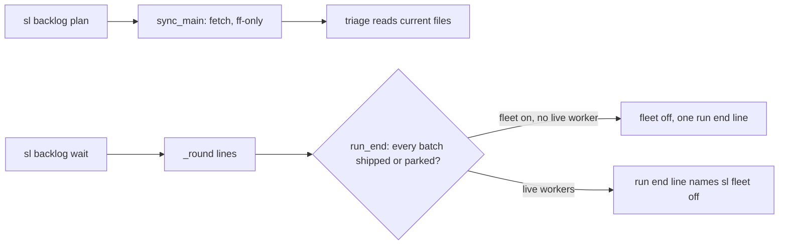
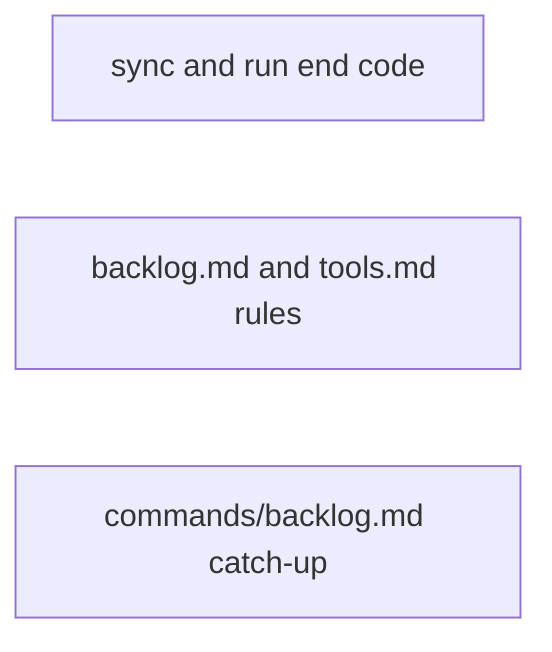

# Superlite: backlog main housekeeping (B140)

**Goal:** fix #590: `backlog plan` fast-forwards the main checkout when it is on the default branch, clean and behind; the `backlog wait` that sees the run end turns main's fleet off when only stopped workers remain, or names `sl fleet off`; the rules say how main hands over while a lead runs and that the closing report lists other-repository follow-ups in their own section. Main's catch-up list for `commands/backlog.md` (B134, B135 follow-ups) goes in too.
**Architecture:** `backlog_run.sync_main(root, repo)` (git only) is called once at the top of `backlog.cmd_plan`, after its refusals and before triage reads files; `backlog_run.run_end(root, sd, p)` is appended to the output of every `cmd_wait` exit; prose rules in `skills/subagent-driven-development/backlog.md`, `commands/backlog.md` and `docs/tools.md`.
**Tech stack:** Python 3.10+ stdlib, git CLI; pytest through `sl run_tests`; Markdown prompts.
**Spec:** this file, section Design; issue #590.
**Detail:** contracts
**Target-min:** 11
**Wave0:** none
**Coverage:** off

Global constraints:
- Existing tests stay green. An existing test file changes only when the task Owns it. If another existing test turns red, report it in DONE_WITH_CONCERNS with the test id and the reason instead of editing it.
- Run `sl` as an executable (`<abs>/sl ...`). Verify with `<abs>/sl run_tests --fast <own test files> --task Tn --background`, then run the printed `wait:` line in the foreground and end the turn only after it reports.
- No version edits (the ship step bumps the version). Never run `scripts/evals.sh`, `claude plugin eval` or `scripts/test_layers.py run`.
- The exact output lines in Design 1 and 2 are the contract: code prints them byte for byte, docs quote them byte for byte.
- Code style as in backlog_run.py: a `# O(...)` complexity comment on each new line, fleet modules imported inside functions so tests can swap them.

Ruling: main's ruling (orchestrator, not Max): the main checkout is fast-forwarded in `backlog plan`, not in `backlog wait`; a dirty tree is skipped with a note.
Ruling: B140 edits backlog.py (listed by B144, planned, which depends on B140 and starts after it) with exactly one call in cmd_plan, because `plan` lives there and main's ruling needs it; main's tell allowed taking backlog.py when the plan touches cmd_plan (cost if wrong: B144 rebases over three added lines).
Ruling: main's older follow-up (wire bi.with_comments into cmd_plan before bi.split_shipped) is not taken: this plan does not touch that call; it is named in the lead's summary for B144.
Ruling: run end turns the fleet off itself only when no worker is live (nothing running is lost, `start` turns the fleet on again); with a live worker it names `sl fleet off` (because stopping a live worker is main's call; cost if wrong: one more command for main).
Ruling: the run ends when the backlog holds at least one batch and every batch is shipped or parked (a planned batch means main starts more).
Ruling: a lead writes a follow-up for another repository as `Follow-up: other repository <name>: <text>`, so the wait line reads `B follow-up: other repository <name>: ...` and main sorts it into its own report section (no parser change: the `Follow-up:` prefix stays).
Ruling: docs/tools.md is edited by T2 (no open batch lists it); named in notes.md.
Ruling: one code task (sync_main and run_end share backlog_run.py), two prose tasks; already in the lead worktree, no `sl worktree ensure`; no probe adapter (git and fleet side effects, covered by named tests).
LAYERS: unit, headless, evals

## Design

### 1. `sync_main(root, repo)` in backlog_run.py
Returns a list of output lines (at most one); never raises (OSError and `subprocess.TimeoutExpired` become the failure lines). Git runs with `git -C <root>`, fetch timeout 60 s, others 30 s; `<err>` is the last non-empty line of git's stderr, cut to 200 characters. Steps in order, `<d>` = the default branch (`git symbolic-ref --short refs/remotes/origin/HEAD` minus `origin/`):
1. `SUPERLITE_FLEET_WORKER` set: `[]` (a lead or worker never moves main's checkout).
2. No `origin` in `git remote`: `[]`.
3. origin/HEAD unset: `sync: origin/HEAD is not set; not fast-forwarded (git remote set-head origin --auto sets it)`
4. HEAD not on `<d>`: `sync: main checkout is on <branch>, not <d>; not fast-forwarded, triage reads the local files` (`<branch>` is `a detached HEAD` when detached).
5. `repo` non-empty and `ship_lock.holder(ship_lock.lock_path(repo))` names a batch: `sync: <B> holds the ship lock; not fast-forwarded (its merge fast-forwards the checkout)`
6. `git fetch --quiet origin <d>` fails: `sync: git fetch origin <d> failed (<err>); triage reads the local files`
7. behind = `rev-list --count HEAD..origin/<d>`; 0: `[]`. ahead = `rev-list --count origin/<d>..HEAD`; above 0: `sync: main checkout is <behind> behind and <ahead> ahead of origin/<d>; not fast-forwarded, triage reads the local files`
8. `git status --porcelain --untracked-files=no` not empty: `sync: main checkout is <behind> behind origin/<d> and has uncommitted changes; not fast-forwarded, triage reads the local files` (untracked files never count).
9. `git merge --ff-only --quiet origin/<d>` fails: `sync: git merge --ff-only origin/<d> failed (<err>); triage reads the local files`; succeeds: `sync: main checkout fast-forwarded <old>..<new> to origin/<d> (<behind> new)` (`<old>`, `<new>`: 7-character SHAs).

`backlog.cmd_plan` calls it right after the open-batch refusal (`if open_ and not add and ...: return 2`) and before the proposal is read: `import backlog_run`, then `print(line, flush=True)` per line of `backlog_run.sync_main(root, str(d.get("repo") or ""))`. A refused plan never syncs.

### 2. `run_end(root, sd, p)` in backlog_run.py and cmd_wait
Returns `[]` when `SUPERLITE_FLEET_WORKER` is set, the backlog has no batch, any batch is `planned`, `running` or `needs_decision`, or `fleet_state.is_on(sd)` is false. Otherwise live = the worker ids of `fleet_state.load(sd).get("workers", {})` whose `state` is not `stopped`, ordered by their number (W3 before W10):
- live empty: `fleet.main(["off", "--plan", str(sd)])` with its stdout swallowed, then `run end: every batch shipped or parked; fleet off (stopped workers cleared: <n>)` (`<n>` = worker records before the call). An exception, SystemExit or non-zero return: `run end: every batch shipped or parked; sl fleet off failed (<err>): run it again`.
- live: `run end: every batch shipped or parked; live workers W3 W7 still run: sl fleet off stops and clears them` (fleet untouched).

`cmd_wait` appends `run_end(...)` to what it prints at each exit: after the round lines, and after `no running batch` (both places). `TIMEOUT` gets nothing.

### 3. Rules (prose)
- HANDOVER: main ends its session while leads run with a WAITING report naming each running batch; leads build and ship without main (the ship approval is recorded), so main never stops a lead, resets a batch or turns the fleet off to hand over. The next main session in that checkout runs `sl backlog status`, then `sl backlog wait`, which reports every lead that ended meanwhile; a needs_decision batch waits for `decide --print --batch B` and `answer`.
- CLOSING: the closing report lists shipped PRs, parked batches with reasons, outside issues, follow-ups and left-undone steps, and in its own section the follow-ups for another repository (`B follow-up: other repository <name>: ...`): main files none of them here; the user takes each to that repository's tracker.
- LEADFU: a lead writes a follow-up for another repository as `Follow-up: other repository <name>: <text>`.
- SYNC and RUNEND: the lines of Design 1 and 2, described for main.

## File structure
- `skills/subagent-driven-development/scripts/backlog_run.py`: sync_main, run_end, cmd_wait, module docstring (T1).
- `skills/subagent-driven-development/scripts/backlog.py`: the one sync call in cmd_plan (T1).
- `tests/scripts/test_backlog_sync_590.py`, `tests/scripts/test_backlog_run_end_590.py` (T1).
- `skills/subagent-driven-development/backlog.md`, `docs/tools.md`, `tests/scripts/test_backlog_docs_590.py` (T2).
- `commands/backlog.md`, `tests/scripts/test_backlog_command_590.py` (T3).

## Task graph

```mermaid
%% schedule
gantt
  title Predicted schedule (mm:ss)
  dateFormat X
  axisFormat %M:%S
  section lane 1
  T1 sync and run end in backlog_run :t1, 0, 260s
  section lane 2
  T2 backlog.md and tools.md name sync run :t2, 0, 228s
  section lane 3
  T3 commands/backlog.md catches up with b :t3, 0, 187s
```

critical path: T1 (4.3 min) · peak width 3 · predicted build 4.3 min · predicted total ≈ 10.8 min (target ✓)

## Package: backlog runner

**Probe entry:** none (git and fleet side effects; the Review Focus cases are named tests in T1)
App type: CLI. Categories: state, file, protocol. Risks: moving a dirty or diverged checkout, fast-forwarding a lead's tree, turning off a fleet with a live worker, changing output of existing wait tests.

### T1 sync and run end in backlog_run · Complexity 4 · Est. context 45k
**Owns:** skills/subagent-driven-development/scripts/backlog_run.py, skills/subagent-driven-development/scripts/backlog.py, tests/scripts/test_backlog_sync_590.py, tests/scripts/test_backlog_run_end_590.py
**Components:** 2
**LOC owned:** 260
**Tests:** fast
**Model:** sonnet
**Est. time:** 4 min (2 components, about 260 LOC, fast tests)
**Produces:** backlog_run.sync_main(root: Path, repo: str = "") -> list[str] · backlog_run.run_end(root: Path, sd: Path, p: Path) -> list[str]
**Review Focus:** state: a dirty tracked file, a diverged HEAD, another branch or a fleet-worker env never moves HEAD; an untracked file does not block the fast-forward; run_end never stops a live worker; existing wait tests keep their exact output (their fake fleet_state.is_on is false).
**Test code:** `tests/scripts/test_backlog_sync_590.py` builds real repos in tmp_path: a bare `o.git` with `main` and one commit, a clone `root` (origin/HEAD set by the clone), a second clone `other` that commits and pushes; `monkeypatch.delenv("SUPERLITE_FLEET_WORKER", raising=False)` in every test. Named tests (each asserts the exact list and, where named, HEAD):
- `test_behind_and_clean_fast_forwards`: other pushes 2 commits; result is one line matching `^sync: main checkout fast-forwarded [0-9a-f]{7}\.\.[0-9a-f]{7} to origin/main \(2 new\)$`; root HEAD equals origin/main.
- `test_up_to_date_prints_nothing`: no push; `[]`, HEAD unchanged.
- `test_dirty_tracked_file_is_left_alone`: push 1, edit a tracked file in root; `["sync: main checkout is 1 behind origin/main and has uncommitted changes; not fast-forwarded, triage reads the local files"]`; HEAD and the edit unchanged.
- `test_untracked_file_does_not_block`: push 1, new untracked file in root; one fast-forward line `(1 new)`; the file is still there.
- `test_other_branch_and_detached_head`: `git switch -c feature`: `["sync: main checkout is on feature, not main; not fast-forwarded, triage reads the local files"]`; `git checkout --detach`: `["sync: main checkout is on a detached HEAD, not main; not fast-forwarded, triage reads the local files"]`.
- `test_diverged_checkout`: other pushes 1, root commits 2; `["sync: main checkout is 1 behind and 2 ahead of origin/main; not fast-forwarded, triage reads the local files"]`; HEAD unchanged.
- `test_fetch_failure`: `git remote set-url origin <tmp>/gone.git`; one line that starts `sync: git fetch origin main failed (` and ends `); triage reads the local files`.
- `test_no_origin_is_silent`: a `git init` repo with one commit and no remote: `[]`.
- `test_origin_head_unset`: `git remote set-head origin -d`: `["sync: origin/HEAD is not set; not fast-forwarded (git remote set-head origin --auto sets it)"]`.
- `test_fleet_worker_is_silent`: `SUPERLITE_FLEET_WORKER=W3`, push 1: `[]`, HEAD unchanged.
- `test_ship_lock_holder_blocks`: `ship_lock.holder` monkeypatched to return `{"batch": "B7"}`, push 1, `repo="o/r"`: `["sync: B7 holds the ship lock; not fast-forwarded (its merge fast-forwards the checkout)"]`; the same with `repo=""` fast-forwards.
- `test_plan_prints_sync_lines_before_its_output`: `backlog_run.sync_main` monkeypatched to `lambda root, repo: ["sync: X"]`; a `backlog plan --proposal FILE` run (as in test_backlog_plan_proposal_297.py) prints `sync: X` as its first line; a plan refused by an open batch prints no `sync:` line.

`tests/scripts/test_backlog_run_end_590.py` uses fakes in `sys.modules` for `fleet` (`main` logs argv, returns 0) and `fleet_state` (`is_on`, `load`) as the `bk` fixture in test_backlog_run.py does, and `delenv SUPERLITE_FLEET_WORKER`:
- `test_run_end_clears_a_fleet_of_stopped_workers`: B1 shipped, B2 parked; workers W1, W2 stopped; `["run end: every batch shipped or parked; fleet off (stopped workers cleared: 2)"]`; fleet.main got `["off", "--plan", str(sd)]`.
- `test_run_end_names_fleet_off_for_live_workers`: W1 stopped, W10 busy, W3 idle: `["run end: every batch shipped or parked; live workers W3 W10 still run: sl fleet off stops and clears them"]`; fleet.main not called.
- `test_run_end_waits_for_open_batches`: one batch each `planned`, `running`, `needs_decision` next to a shipped one: `[]`.
- `test_run_end_silent`: fleet off, no batches, or `SUPERLITE_FLEET_WORKER` set: `[]`.
- `test_run_end_reports_a_failed_off`: fleet.main raises `SystemExit(3)`: `["run end: every batch shipped or parked; sl fleet off failed (3): run it again"]` (`<err>` is the exception text, `str(e)`).
- `test_wait_appends_the_run_end_line`: a running merged B1 as only batch, fleet on with stopped workers: wait prints `B1 shipped ...` then the run end line; a backlog of only shipped batches: `no running batch` then the run end line.
**Steps:** 1 failing tests, 2 run: FAIL, 3 implement, 4 run: PASS, 5 run test_backlog_run.py, test_backlog_run_lifecycle.py and the test_backlog_plan_*.py files once: still green.
**Notes:** keep `cmd_plan`'s change to the three lines of Design 1. Add one sentence each for sync_main and run_end to backlog_run.py's module docstring.

## Package: backlog rules

**Probe entry:** none (prose)
App type: docs. Risks: a quoted line that differs from Design 1 or 2, a rule that contradicts backlog.md's existing text, breaking existing doc tests (test_backlog_docs*.py, test_backlog_main_docs.py, test_docs_607_backlog.py, test_docs_b72_backlog.py).

### T2 backlog.md and tools.md name sync, run end, handover · Complexity 2 · Est. context 35k
**Owns:** skills/subagent-driven-development/backlog.md, docs/tools.md, tests/scripts/test_backlog_docs_590.py
**Components:** 2
**LOC owned:** 60
**Tests:** fast
**Model:** sonnet
**Est. time:** 3 min (2 components, about 60 LOC, fast tests)
**Review Focus:** every quoted line equals Design 1 or 2; existing sentences stay unless the new rule replaces them.
**Test code:** `tests/scripts/test_backlog_docs_590.py`, named tests, each reads the file and asserts substrings:
- `test_main_names_plan_sync`: backlog.md `## Main` step 2 contains `sync: main checkout fast-forwarded` and `not fast-forwarded`.
- `test_main_names_run_end`: backlog.md `## Main` contains `run end: every batch shipped or parked; fleet off (stopped workers cleared: <n>)` and `sl fleet off stops and clears them`.
- `test_main_hand_over_rule`: backlog.md `## Main` contains `Hand over while a lead runs` and `WAITING`.
- `test_closing_report_other_repository`: backlog.md contains `Follow-up: other repository <name>: <text>` in `## Lead` and `other repository` in `## Main`.
- `test_tools_rows`: docs/tools.md `backlog` row contains `sync:` and the `backlog_run` row contains `run end:`.
**Steps:** 1 failing tests, 2 run: FAIL, 3 edit, 4 run: PASS plus the existing backlog doc tests.
**Notes:** backlog.md `## Main`: step 2 gets one SYNC sentence at its start (plan first runs sync_main; name the fast-forward line and that every other `sync:` line names why and plan goes on with the local files); step 5 gets the RUNEND sentence (the run end lines, main runs `sl fleet off` on the second); add step 8 `Hand over while a lead runs: ...` (HANDOVER, Design 3) and the CLOSING sentence. `## Lead`: the notes bullet gets LEADFU. docs/tools.md: one clause in the `backlog` row (plan's `sync:` line) and one in the `backlog_run` row (wait's `run end:` line). Keep each change to its sentence; no rewording elsewhere.

### T3 commands/backlog.md catches up with backlog.md · Complexity 3 · Est. context 40k
**Owns:** commands/backlog.md, tests/scripts/test_backlog_command_590.py
**Components:** 1
**LOC owned:** 70
**Tests:** fast
**Model:** sonnet
**Est. time:** 3.5 min (1 component, about 70 LOC, fast tests)
**Review Focus:** each item below is checked against the code or backlog.md in this worktree before it is written; nothing contradicts backlog.md.
**Test code:** `tests/scripts/test_backlog_command_590.py`, named tests, each reads commands/backlog.md and asserts substrings:
- `test_names_plan_sync_and_run_end`: contains `sync:` and `run end:` and `sl fleet off`.
- `test_hand_over_and_closing_report`: contains `Hand over while a lead runs`, `WAITING` and `other repository`.
- `test_catch_up_items`: contains each of `fast path`, `already shipped:`, `check:`, `not found:`, `unskip`, `reset B`, `--discard`, `--help`, `offer:`, `"by"`, `no-change`, `Unverified:`, `Kind: design`, `Refs #N`, `ship B notes`, `ship B done`.
**Steps:** 1 failing tests, 2 run: FAIL, 3 edit, 4 run: PASS plus the existing doc tests that read commands/backlog.md (grep tests/scripts for `commands/backlog.md`).
**Notes:** main's list (B134, B135 follow-ups), each named in the step where main meets it, in main's words, shorter than backlog.md: plan's fast path for one pinned issue, the `already shipped:`, `check:` and `not found:` lines, `plan --add` prints only the batches it added, `unskip`, `reset B [--discard]`, `sl backlog --help`, the parked-only `next:` line, the answer rule (a label, a label plus a note, or free text up to 2000 characters), the required `"by"` in an answers file, `ship B done --pr N` also on a planned batch, the `offer:` line, the lead's `release` only when its merge did not ship (main's view: a shipped merge frees the lock itself), `B no-change:` lines, `unverified=K` and `B UNVERIFIED:` lines with `Refs #N`, `Kind: design` (`design: awaits plan approval`), `sl backlog ship B notes`. Plus SYNC in step 2, RUNEND in steps 5 and 8, HANDOVER as its own step, CLOSING in step 8 (Design 3). Keep the file's step structure; extend steps, do not rewrite unrelated sentences.

## Self-review
- Coverage: #590 parts 1 (T1 sync, T2 and T3 docs), 2 (T1 run_end, docs), 3 (CLOSING, LEADFU), 4 (HANDOVER); main's catch-up list (T3).
- No task shares a file; no edge (docs quote the Design lines, not code).
- The B144 follow-up (bi.with_comments) stays out by ruling.
