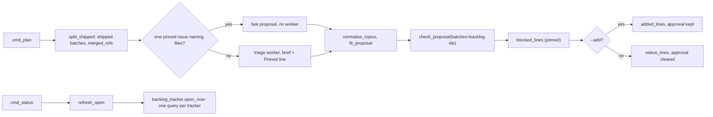
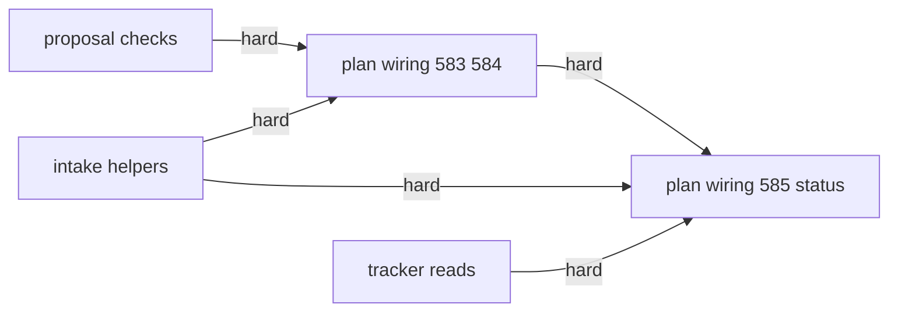

# Superlite: backlog plan intake (B125)

**Goal:** fix #583, #584, #585: `sl backlog plan` accepts the triage worker's own proposal (any batch id, depends on open batches, topic case), plans one pinned issue fast and prints only what `--add` added, keeps the ship approval across `--add` rounds, refreshes OPEN markers in one tracker query, and never plans an issue that already shipped.
**Architecture:** `backlog_checks.py` widens the proposal check and gains the topic slug; new `backlog_intake.py` holds the pure intake helpers (shipped detection from default-branch subjects, files named in an issue body, pinned brief rule, blocked-reason check); new `backlog_tracker.py` holds the batched tracker reads (OPEN refresh, Jira read by key); `backlog.py` wires them into `cmd_plan` and `refresh_open`.
**Tech stack:** Python 3.10+ stdlib, pytest (through `sl run_tests`).
**Spec:** this file, section Design; issues #583, #584, #585 (Expected lines).
**Detail:** contracts
**Target-min:** 11
**Wave0:** none
**Coverage:** off

Global constraints:
- Every Python code line keeps the file's trailing `# O(...)` complexity comment style where the file uses it (backlog.py, the new modules).
- Existing tests stay green. An existing test file changes only when the task Owns it, except T5 (see its Notes). Another existing test turning red: report it in DONE_WITH_CONCERNS with the test id and reason.
- Run `sl` as an executable (`<abs>/sl ...`). Verify with `<abs>/sl run_tests --fast <own test files> --task Tn --background`, then run the printed `wait:` line in the foreground and end the turn only after it reports.
- Tests fake every outside call (gh, git, acli, fleet); no test reaches the network.
- Untrusted text (issue bodies, worker topics and reasons) printed to the terminal loses control characters.
- No version edits (the ship step bumps). Never run `scripts/test_layers.py run`, `scripts/evals.sh` or `claude plugin eval`.

Ruling: new helpers go in two new modules, `backlog_intake.py` and `backlog_tracker.py` (because the brief's files are backlog.py and backlog_checks.py only, three tasks can then build in parallel, and no open batch lists the new files; notes.md names them; cost if wrong: two small modules more).
Ruling: a proposal id is any `B1` to `B999999` and plan renumbers as before; `depends` may name a batch of the backlog (any state); a proposal id wins over a backlog id of the same name (#583; cost if wrong: a worker that reuses an open batch's id for its own batch gets its local meaning).
Ruling: plan lowercases and slugs a topic that is not lowercase words joined by `-` and prints one `topic: "<id>" "<old>" -> <new>` line; the 40-character cut stays in fit_proposal (#583).
Ruling: one pinned issue whose body names at least one tracked repo file (exact path, or a basename or path suffix unique in `git ls-files`) is planned without a triage worker: topic from the title, those files, no decisions; otherwise the worker runs as before (#584 allows either; cost if wrong: a fast batch lists too few files and its lead names the rest in notes.md, as the lead rules already say).
Ruling: `plan --add` keeps the ship approval also on a drained backlog and prints only the new batches' rows, the pinned issues' left-out lines, overlap lines and the questions line; a plain plan or `--reset` still clears the approval (#584).
Ruling: `status` re-reads every OPEN marker in one query per tracker (GitHub GraphQL with one alias per number, one Jira `key in (...)` search); an issue the answer does not name stays OPEN (#584).
Ruling: an issue in a shipped batch, or named by a default-branch commit subject (the squash-merged PR title; `(#N)` at its end is the PR), is left out with an `already shipped:` line naming the batch or PR; plan does not offer `ship B done --pr N`, because `done` needs a running or parked batch with a worktree (backlog_ship.py, backlog_run.py `_shipped`, owned by B120 and others); a follow-up names it. A pinned issue is planned anyway with an `already shipped?:` line (#585; cost if wrong: main closes such issues by hand).
Ruling: when issues are pinned, the triage brief gets one `Pinned:` line (inserted before `Rules:` by backlog.py, like the carry-over line was), and plan prints a `check:` line for a pinned issue the worker left out as blocked without naming a commit, version, issue or batch, or naming a version at or below the repository's; plan never rejects the proposal for it (#585).
Ruling: a pinned Jira key the search misses is read by key (`acli jira workitem view`); a key still missing gets a `not found:` line and the others plan; only when no pinned key is found plan stays BLOCKED (#585). GitHub pins keep their BLOCKED (a missing GitHub number is closed, not unindexed).
Ruling: detail contracts, no probe adapter (CLI wiring over fakes; cases are named tests), unit layer only (only `skills/**/scripts/**` and tests change); already in the lead worktree.
LAYERS: unit

## Design

### 1. Proposal checks (T1, #583)
`ID_RE` takes `B1` to `B999999`; a bad id reads `batch <n>: id must be B<n>, B1 to B999999 (got '<id cut to 20>')`. `check_proposal(obj, known, batches=frozenset())`: a `depends` entry that is no proposal id but is in `batches` is accepted and kept. `topic_slug(text)`: lowercase, every run of characters outside `a-z0-9` becomes `-`, dashes stripped at both ends, then the existing 40-character cut (at the last `-` inside the first 40 characters when character 41 is not `-`). `normalise_topics(obj)` rewrites each batch topic that is a string not matching `[a-z0-9][a-z0-9-]*` with `topic_slug` (only when the result is non-empty) and returns the lines. `_fit_topic` reuses the same cut helper.

### 2. Intake helpers (T2, #584, #585)
Pure functions in `backlog_intake.py`, texts as in T2's Produces.

### 3. Tracker reads (T3, #584, #585)
`backlog_tracker.py`: `open_now` (GitHub: `gh api graphql -f query=...`, chunks of 100 aliases `i<N>: issueOrPullRequest(number: N) { ... on Issue { state } ... on PullRequest { state } }`, stdout parsed even when gh exits non-zero; Jira: one `backlog._acli` search `key in (...)` with `--fields key,status --paginate --json`, done when `fields.status.statusCategory` key or name is `done`); `jira_by_key` (one `acli jira workitem view KEY --fields summary,description --json` per missing key through `backlog._acli`). Any failed or unparsable read keeps the issue open or missing.

### 4. Plan wiring (T4 #583/#584, T5 #585 and status)
As in T4 and T5.

## File structure

- `skills/subagent-driven-development/scripts/backlog_checks.py`: id range, external depends, topic slug (T1)
- `tests/scripts/test_backlog_checks_583.py`, `tests/scripts/test_backlog_checks.py`: T1 tests
- `skills/subagent-driven-development/scripts/backlog_intake.py`, `tests/scripts/test_backlog_intake.py`: intake helpers (T2)
- `skills/subagent-driven-development/scripts/backlog_tracker.py`, `tests/scripts/test_backlog_tracker.py`: tracker reads (T3)
- `skills/subagent-driven-development/scripts/backlog.py`: plan and status wiring (T4, then T5)
- `tests/scripts/test_backlog_plan_add_583.py`: T4 tests; `tests/scripts/test_backlog_plan_shipped_585.py`: T5 tests

## Task graph

```mermaid
%% schedule
gantt
  title Predicted schedule (mm:ss)
  dateFormat X
  axisFormat %M:%S
  section lane 1
  T2 intake helpers find shipped issues an :t2, 0, 142s
  T4 plan accepts the proposal plans one p :t4, 142, 98s
  T5 plan skips shipped issues reads Jira :t5, 240, 98s
  section lane 2
  T3 tracker reads in one query :t3, 0, 97s
  section lane 3
  T1 proposal checks accept the worker's p :t1, 0, 97s
```

critical path: T2 → T4 → T5 (5.6 min) · peak width 3 · predicted build 5.6 min · predicted total ≈ 9.1 min (target ✓)

Ruling: sequential [T4 -> T5] - both wire cmd_plan in backlog.py, so they cannot run at once - one task's time on the critical path.

## Package: backlog plan intake

App type: CLI + library. Categories: protocol (flags, output lines), encoding (untrusted titles, bodies, reasons), state (backlog.json approval, round, outside), file (git output). **Probe entry:** none (CLI wiring over fakes; cases are named tests).

### T1 proposal checks accept the worker's proposal · Complexity 3 · Est. context 38k
**Owns:** skills/subagent-driven-development/scripts/backlog_checks.py, tests/scripts/test_backlog_checks_583.py, tests/scripts/test_backlog_checks.py
**Components:** 1
**LOC owned:** 110
**Tests:** fast
**Model:** sonnet
**Est. time:** 2.0 min (1 component, about 110 LOC, fast tests)
**Covers:** 1
**Consumes:** none
**Produces:** backlog_checks.topic_slug(text: str) -> str · backlog_checks.normalise_topics(obj: object) -> list[str] · backlog_checks.check_proposal(obj: dict, known: set, batches: frozenset = frozenset()) -> tuple[list[dict], list[str]]
e.g. topic_slug("Backlog Plan --add: Rejects") -> "backlog-plan-add-rejects"
e.g. topic_slug("backlog plan --add rejects the triage worker's own proposal: batch id") -> "backlog-plan-add-rejects-the-triage"; topic_slug("!!!") -> ""
e.g. normalise_topics({"batches": [{"id": "B1", "topic": "Backlog Plan"}, {"topic": "ok-topic"}, {"topic": "Two Words"}]}) -> ['topic: "B1" "Backlog Plan" -> backlog-plan', 'topic: "batch 3" "Two Words" -> two-words'] and the topics become "backlog-plan", "ok-topic", "two-words"
e.g. check_proposal({"batches": [{"id": "B174", "topic": "t", "issues": [1], "files": ["a.py"], "depends": ["B112"], "decisions": []}]}, {1}, frozenset({"B112"})) -> one batch with id "B174", depends ["B112"], no errors
**Review Focus:** protocol: `test_id_range_and_message` (`B999999` ok; `B1000000`, `B0`, `X1` rejected with `batch 1: id must be B<n>, B1 to B999999 (got 'X1')`); state: `test_local_id_wins_over_backlog_id` (proposal B1 and B2 depends ["B1"], batches={"B1"} -> depends stays ["B1"] and separate/_reach treat it as the local batch); `test_unknown_depends_still_rejected` (depends ["B7"], batches={"B1"} -> `B1: depends on unknown batch B7`); encoding: `test_normalise_note_drops_control_characters` (topic "Bad\x1b[2J Topic" -> line without \x1b, topic "bad-2j-topic"); `test_slug_cut_keeps_whole_words` (the 67-character example above).
**Steps:** 1 failing tests, 2 run: FAIL, 3 implement, 4 run: PASS
**Notes:** update the one expectation in tests/scripts/test_backlog_checks.py (`batch 1: id must be B<n>` becomes the new text). A `topic:` line shows the old topic with control characters replaced by blanks, blank runs collapsed and cut to 60 characters. The id is `b.get("id")` of a batch, else `batch <k>` (1-based).

### T2 intake helpers find shipped issues and named files · Complexity 4 · Est. context 36k
**Owns:** skills/subagent-driven-development/scripts/backlog_intake.py, tests/scripts/test_backlog_intake.py
**Components:** 2
**LOC owned:** 220
**Tests:** fast
**Model:** sonnet
**Est. time:** 3.5 min (2 components, about 220 LOC, fast tests)
**Covers:** 2
**Consumes:** none
**Produces:** backlog_intake.merged_refs(lines: list[str], jira: bool) -> dict · backlog_intake.split_shipped(trusted: list[dict], batches: list[dict], merged: dict, pin: list) -> tuple[list[dict], list[dict], list[str]] · backlog_intake.named_files(body: str, tracked: list[str]) -> list[str] · backlog_intake.blocked_lines(prop: dict, pin: list, version: str | None) -> list[str] · backlog_intake.pinned_rule(head: str | None, version: str | None) -> str · backlog_intake.insert_before_rules(brief: str, lines: list[str]) -> str
e.g. merged_refs(["48888dd\tFinal reviewer; 1.5.125 (#564) (#608)", "a1b2c3d\tFix (#564) (#600)"], False) -> {564: "PR #608"}; merged_refs(["b2c3d4e\tMerge pull request #12 from x/y"], False) -> {}
e.g. merged_refs(["a1b2c3d\tPIX-3: Fix y (#9)", "b2c3d4e\tPIX-4 and PIX-5 cleanup"], True) -> {"PIX-3": "PR #9", "PIX-4": "commit b2c3d4e", "PIX-5": "commit b2c3d4e"}
e.g. split_shipped([{"number": 5, "title": "A", "body": ""}, {"number": 6, "title": "B", "body": ""}], [{"id": "B7", "state": "shipped", "issues": [5], "pr": 608}], {6: "PR #20"}, []) -> ([], [{"number": 6, "title": "B", "reason": "not planned (shipped: PR #20)"}], ["already shipped: #5 in B7 (PR #608): not planned again", "already shipped: #6 named by merged PR #20: not planned; close it, or sl backlog skip 6 keeps it out"])
e.g. split_shipped([{"number": 6, "title": "B", "body": ""}], [], {6: "PR #20"}, [6]) -> ([{"number": 6, "title": "B", "body": ""}], [], ["already shipped?: #6 named by merged PR #20: planned anyway (pinned); sl backlog skip 6 drops it"])
e.g. named_files("Where: backlog_checks.py, backlog.py plan, backlog.md, 1.5.123.", ["s/scripts/backlog.py", "s/scripts/backlog_checks.py", "s/backlog.md", "commands/backlog.md"]) -> ["s/scripts/backlog.py", "s/scripts/backlog_checks.py"]
e.g. blocked_lines({"left_out": [{"issues": [12], "reason": "needs the fleet rework first"}, {"issues": [13], "reason": "needs 1.5.100 first"}, {"issues": [14], "reason": "umbrella issue"}]}, [12, 13, 14], "1.5.125") -> ['check: #12 left out as "needs the fleet rework first" without naming the missing commit or version; sl backlog plan --issues 12 --add plans it again', 'check: #13 left out as "needs 1.5.100 first" but the repository is at 1.5.125; sl backlog plan --issues 13 --add plans it again']
e.g. pinned_rule("48888dd", "1.5.125") -> 'Pinned: main chose these issues with --issues; plan each one. Leave a pinned issue out only as an umbrella or tracking issue, or as blocked with the missing commit, version or issue named in its left_out reason (e.g. "needs 1.6.0 first"); work already on the default branch (at 48888dd, version 1.5.125) is not missing.'; pinned_rule(None, None) ends "work already on the default branch is not missing."
e.g. insert_before_rules("# T\nx\nRules: a\nEnd\n", ["P"]) -> "# T\nx\nP\nRules: a\nEnd\n"; with no `Rules: ` line the lines go at the end, before the final newline
**Review Focus:** protocol: `test_trailing_pr_is_not_an_issue` ("Fix #3 (#9)" -> {3: "PR #9"}, 9 absent); `test_first_subject_wins`; state: `test_shipped_batch_beats_merged_subject`; `test_jira_keys_match_whole_keys` ("PIX-120" does not give "PIX-12"); file: `test_ambiguous_basename_is_skipped`, `test_dot_slash_and_trailing_punctuation` ("`./s/scripts/backlog.py`," resolves); encoding: `test_lines_drop_control_characters` (title or reason with \x1b); `test_reason_naming_commit_issue_or_batch_gives_no_line` ("needs a1b2c3d first", "after #12", "waits for B7", "needs PIX-9" -> []); `test_unpinned_left_out_gives_no_line`; numeric: `test_version_compare_pads` ("needs 1.6 first" with 1.5.125 -> []; "needs 1.5 first" -> line); `test_no_version_known` (version None: a named version gives no line).
**Steps:** 1 failing tests, 2 run: FAIL, 3 implement, 4 run: PASS
**Notes:** issue refs print as `#N` for an int and the key for a str; `sl backlog ... <plain>` uses `N` or the key. A subject line is `<sha>\t<subject>`; a line without a tab is skipped; `Merge pull request #N` subjects are skipped. GitHub refs are `#N` (whole number) outside a trailing `(#N)`; Jira refs match `[A-Z][A-Z0-9_]*-[1-9][0-9]*` as a whole word. `what` is `PR #N` from the trailing `(#N)`, else `commit <sha>`. A shipped batch with no `pr` prints no ` (PR ...)` part. split_shipped keeps trusted order. named_files: tokens match `[A-Za-z0-9_.][A-Za-z0-9_./-]*`, a leading `./` and trailing `.`, `,`, `/` stripped, only tokens holding `.` or `/`; exact tracked path, else the paths ending in `/<token>` when exactly one does (index tracked by basename); result sorted, unique. blocked_lines reads reasons through `backlog_checks.left_out_reasons(prop, set(pin))` (existing), pin order; "blocked" means the reason matches `\b(needs?|needed|blocked|blocks|waits?|waiting|after|depends?|dependency|requires?|required|first|until|prerequisite|missing)\b` (case-insensitive); named = a commit (7 to 40 hex characters holding a digit and a letter), `#N`, a Jira key, `B<n>` or a version `\d+\.\d+(\.\d+)?`; a line only when blocked and (nothing named, or a named version at or below `version` after padding with zeros).

### T3 tracker reads in one query · Complexity 4 · Est. context 32k
**Owns:** skills/subagent-driven-development/scripts/backlog_tracker.py, tests/scripts/test_backlog_tracker.py
**Components:** 1
**LOC owned:** 150
**Tests:** fast
**Model:** sonnet
**Est. time:** 2.5 min (1 component, about 150 LOC, fast tests)
**Covers:** 3
**Consumes:** none
**Produces:** backlog_tracker.open_now(repo: str, issues: list, root: Path) -> list · backlog_tracker.jira_by_key(keys: list) -> tuple[list[dict], list[str]]
e.g. open_now("o/r", [5, 6, "PIX-1", "PIX-2"], root) with GraphQL {"i5": {"state": "OPEN"}, "i6": {"state": "CLOSED"}} and a search where PIX-1 is done and PIX-2 absent -> [5, "PIX-2"]
e.g. open_now("o/r", [5, 6], root) when gh raises OSError or prints no JSON -> [5, 6]
e.g. jira_by_key(["PIX-2"]) with view {"key": "PIX-2", "fields": {"summary": "Two", "description": None}} -> ([{"number": "PIX-2", "title": "Two", "body": ""}], []); a view that raises RuntimeError -> ([], ["PIX-2"])
**Review Focus:** protocol: `test_one_graphql_call_for_many_numbers` (150 numbers -> 2 calls of 100 and 50 aliases, 3 numbers -> 1 call); `test_one_jira_search_for_many_keys`; `test_bad_repo_or_key_is_kept_unread` (repo "o/r; x" or key "pix 1" -> kept, no call with it); state: `test_null_alias_keeps_issue_open` (alias null, gh exit 1 with JSON on stdout); `test_bool_is_not_a_number`; encoding: `test_view_body_is_flattened_and_capped` (ADF description through `backlog.adf_text` and `backlog._body`).
**Steps:** 1 failing tests, 2 run: FAIL, 3 implement, 4 run: PASS
**Notes:** import `backlog` inside the functions (it imports this module lazily too) and use `backlog._acli`, `backlog.adf_text`, `backlog._body`, `backlog.KEY_RE` (all existing). GitHub calls: `subprocess.run(["gh", "api", "graphql", "-f", "query=" + q], capture_output=True, text=True, timeout=60, cwd=root)`; repo must match `^[A-Za-z0-9_.-]+/[A-Za-z0-9_.-]+$`. A state of `CLOSED` or `MERGED` is closed; `OPEN`, null or a missing alias keeps the issue. Jira keys must match KEY_RE before they go into the JQL. Result order is the input order. A view result is a dict or a list of dicts; the item is the one whose `key` equals the asked key (a dict without `key` but with `fields` counts as it).

### T4 plan accepts the proposal, plans one pin fast, prints only what --add added · Complexity 5 · Est. context 60k
**Owns:** skills/subagent-driven-development/scripts/backlog.py, tests/scripts/test_backlog_plan_add_583.py
**Components:** 1
**LOC owned:** 180
**Tests:** fast
**Model:** sonnet
**Est. time:** 3.5 min (1 component, about 180 LOC, fast tests)
**Covers:** 4
**Consumes:** backlog_checks.topic_slug(text: str) -> str (T1) · backlog_checks.normalise_topics(obj: object) -> list[str] (T1) · backlog_checks.check_proposal(obj: dict, known: set, batches: frozenset = frozenset()) -> tuple[list[dict], list[str]] (T1) · backlog_intake.named_files(body: str, tracked: list[str]) -> list[str] (T2)
**Produces:** backlog.added_lines(data: dict, ids: list, pin: list) -> list[str] · backlog._tracked(root: Path) -> list[str]
e.g. added_lines(data with B1 shipped #1, B2 planned #2 and outside [{"number": 3, "title": "T", "reason": "not planned (triage)"}], ["B2"], [2]) -> ["batch | issues | state | lead | PR | next", "B2 | #2 | planned | - | - | start"] (plus `questions: N open (sl backlog decide --print)` when questions are open)
**Review Focus:** state: `test_add_keeps_approval_on_drained_backlog` (B1 shipped, approved, `plan --issues 2 --add` -> approval unchanged, round ["B2"]); `test_plain_pinned_plan_still_clears_approval`; protocol: `test_add_prints_only_the_new_batch` (no `B1 |` row, no other issue's `not planned` line, no `backlog o/r:` head line); `test_worker_ids_and_open_depends_are_accepted` (proposal B174 topic "Urgent Fix" depends ["B1"] next to running B1 -> B2, depends ["B1"], topic "urgent-fix", line `topic: "B174" "Urgent Fix" -> urgent-fix`); `test_fast_path_plans_without_worker` (root a git repo tracking s/scripts/backlog.py, issue #2 body "Where: backlog.py" -> no spawn call, files ["s/scripts/backlog.py"], line `fast path: #2 names s/scripts/backlog.py; no triage worker`); `test_fast_path_falls_back_without_named_files`; `test_two_pins_use_the_worker`.
**Steps:** 1 failing tests, 2 run: FAIL, 3 implement, 4 run: PASS
**Notes:** in cmd_plan: keep `add_flag = bool(getattr(a, "add", False))` before `add` is narrowed; every new attribute read uses getattr (tests/regression/test_backlog_gh_intake.py passes a bare namespace). `_tracked(root)`: `git -C root ls-files` lines, [] on any failure. Fast path when `proposal is None`, `pin` holds one issue and `trusted` is exactly that issue: `files = named_files(body, _tracked(root))`; non-empty -> `prop = {"status": "DONE", "summary": "fast path", "batches": [{"id": "B1", "topic": topic_slug(title) or topic_slug(f"issue {n}"), "issues": [n], "files": files, "depends": [], "decisions": []}]}` and no `_triage`. Before `cuts`: `topics = bc.normalise_topics(prop)`. Both check_proposal calls pass `batches=frozenset(b["id"] for b in d["batches"])`. In apply: the plain branch clears `approved_ship` only when not add_flag; the lines are `added_lines(...) + overlap_lines(new, was)` in the add branch and `added_lines(...)` in the plain branch when add_flag, else `status_lines` as now. added_lines: the table header and the `status_lines(data, all_=True)` rows whose first ` | ` field is in ids, then `left_out_lines` of a copy whose outside holds only pinned issues, then the questions line. Print order: shown lines, `notes` (a list T5 extends; the fast-path line here), topics, cuts, drops; a rejected proposal prints topics after its errors. Extend the module docstring with #583 and #584.

### T5 plan skips shipped issues, reads Jira keys by key, status refreshes in one query · Complexity 5 · Est. context 62k
**Owns:** skills/subagent-driven-development/scripts/backlog.py, tests/scripts/test_backlog_plan_shipped_585.py, tests/scripts/test_backlog_status_reset_469_488.py, tests/scripts/test_backlog_jira_208.py
**Components:** 1
**LOC owned:** 190
**Tests:** fast
**Model:** sonnet
**Est. time:** 3.5 min (1 component, about 190 LOC, fast tests)
**Covers:** 4
**Consumes:** backlog_intake.merged_refs(lines: list[str], jira: bool) -> dict (T2) · backlog_intake.split_shipped(trusted: list[dict], batches: list[dict], merged: dict, pin: list) -> tuple[list[dict], list[dict], list[str]] (T2) · backlog_intake.blocked_lines(prop: dict, pin: list, version: str | None) -> list[str] (T2) · backlog_intake.pinned_rule(head: str | None, version: str | None) -> str (T2) · backlog_intake.insert_before_rules(brief: str, lines: list[str]) -> str (T2) · backlog_tracker.open_now(repo: str, issues: list, root: Path) -> list (T3) · backlog_tracker.jira_by_key(keys: list) -> tuple[list[dict], list[str]] (T3)
**Produces:** backlog._subjects(root: Path, ref: str) -> list[str]
e.g. _subjects(root, "main") -> ["48888dd\tFinal reviewer; 1.5.125 (#564) (#608)", ...] from `git -C root log --first-parent -n 2000 --format=%h%x09%s main`; [] on any failure
**Review Focus:** state: `test_issue_of_shipped_batch_is_not_triaged` (B7 shipped with #1 -> #1 not in the brief, line `already shipped: #1 in B7`); `test_merged_subject_leaves_issue_out` (subject "Fix two (#2) (#40)" -> outside reason `not planned (shipped: PR #40)`, status line `not planned (shipped: PR #40): #2`); `test_pinned_shipped_issue_is_planned_anyway`; `test_everything_shipped_plans_nothing` (rc 0, `nothing to plan: every issue is already shipped`, backlog.json unchanged); protocol: `test_pinned_brief_has_the_rule` (brief holds `Pinned: main chose these issues`); `test_blocked_pin_gets_check_line` (`--issues 1,2 --proposal` with left_out #2 "needs the fleet rework first"); `test_missing_jira_key_read_by_key` (search lacks PIX-2, view finds it -> both planned); `test_missing_jira_key_others_plan` (view fails -> `not found: PIX-2 (Jira search and read by key); sl backlog plan --issues PIX-2 --add retries it`, rc 0); `test_status_reads_markers_in_one_call` (B1 OPEN [5], B2 OPEN [6, "PIX-1"] -> one open_now call with [5, 6, "PIX-1"]).
**Steps:** 1 failing tests, 2 run: FAIL, 3 implement, 4 run: PASS
**Notes:** repo view asks `nameWithOwner,visibility,defaultBranchRef`; ref = `defaultBranchRef.name` when it is a dict with a string name, else `HEAD`. After trusted/outside are built and before the fast path: `subjects = _subjects(root, ref)`, `trusted, more, lines = split_shipped(trusted, d["batches"], bi.merged_refs(subjects, jira), pin or [])`, `outside += more`, `notes += lines`; no trusted issue left and no `--proposal`: print notes plus `nothing to plan: every issue is already shipped`, return 0, write nothing. head = the first subject's sha or None; version = `backlog_ship._current_version(root)` (None on any error). `_triage(..., extra=[pinned_rule(head, version)])` only when issues are pinned (keyword passed only then; the regression fake has no `extra`); `_triage` inserts it with insert_before_rules. After a passing check: `notes += blocked_lines(prop, pin or [], version)`. Jira: `jira_issues(jql, keys, missing=None)`: keys the search misses go to `backlog_tracker.jira_by_key`; still missing: raise as now when `missing` is None, else append; cmd_plan passes a list, prints `BLOCKED: Jira issue <first> not found` (exit 3) when no pinned key was found, else one `not found:` line per key and drops them from pin and keys. refresh_open: one `backlog_tracker.open_now(repo, <union of marked issues, first-seen order>, root)` call; each batch keeps the issues still open; the rest of refresh_open stays. Existing tests that pin a behavior this task replaces (an issue of a shipped batch planned again, the Jira not-found BLOCKED, the per-batch OPEN refresh through backlog_ship.open_issues) are updated in place: the two listed in Owns, and any other `tests/scripts/test_backlog_*.py` or `tests/regression/test_*backlog*.py` the full backlog set shows red for that reason; name each such file in the report. Extend the module docstring with #585.

## Self-review

Coverage: #583 id/depends/topic -> T1+T4; #584 fast path, noise, approval -> T2+T4, status -> T3+T5; #585 shipped, pinned, Jira keys -> T2+T3+T5. No placeholders. Consumes match Produces. T4 and T5 share backlog.py and run in sequence (hard edge).
