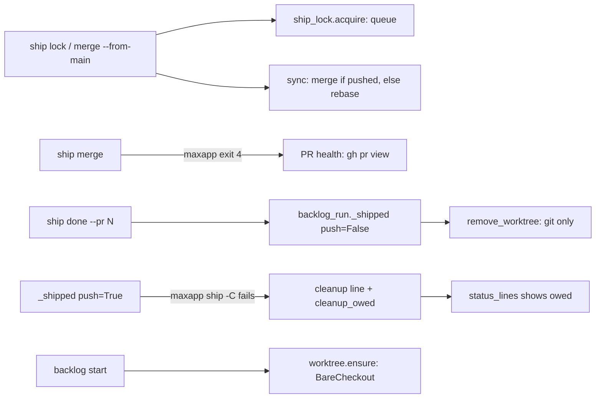
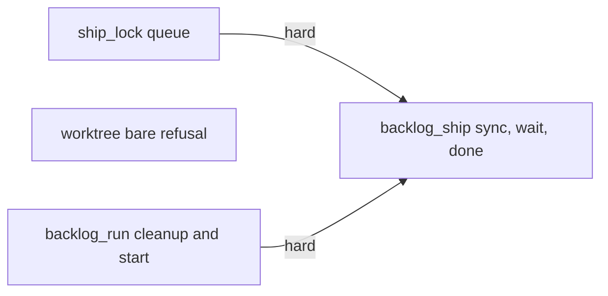

# Superlite: backlog ship robustness (B133: #587 #588 #589)

**Goal:** a ship never rewrites a branch already on origin (#587), `ship done --pr N` only cleans up (#587), lock waiters are served first come first served and main can block on the lock (#588), a healthy but slow PR is not parked as timed out (#588), and a main checkout with `core.bare=true` neither hosts a lead nor fails its cleanup silently (#589).
**Architecture:** `ship_lock` keeps a waiter queue file beside the lock. `backlog_ship` syncs a pushed branch by merge, reads the PR's health on a maxapp timeout, accepts a bare `--wait`, and hands `done` a cleanup-only path. `backlog_run` gets a git-only `remove_worktree`, a cleanup line with git's error and the bare cause, a `cleanup_owed` record and a start check; `backlog_state.status_lines` shows owed cleanups; `worktree.ensure` refuses a bare-flagged checkout.
**Tech stack:** Python 3.10+ stdlib, pytest (through `sl run_tests`).
**Spec:** this file, section Design; issues #587, #588, #589.
**Detail:** tests
**Target-min:** 11
**Wave0:** none
**Coverage:** off

Global constraints:
- Every Python code line keeps the file's trailing `# O(...)` complexity comment.
- Existing tests stay green. An existing test file changes only when the task Owns it. If another existing test turns red, report it in DONE_WITH_CONCERNS with the test id and the reason instead of editing it.
- Run `sl` as an executable (`<abs>/sl ...`). Verify with `<abs>/sl run_tests --fast <own test files> --task Tn --background`, then run the printed `wait:` line in the foreground and end the turn only after it reports.
- No version edits. Never run `scripts/evals.sh`, `claude plugin eval` or `scripts/test_layers.py run`. Tests never call real `git push`, `gh` or `maxapp`: stub `_run` as the existing tests do, or use a local tmp git repo.
- Never edit `skills/subagent-driven-development/backlog.md`, `docs/tools.md`, `docs/fleet.md`, `commands/backlog.md` or `tests/scripts/conftest.py` (other batches own them). Update the touched module's docstring.

Ruling: a branch that already exists on origin (`origin/<current branch>`) is synced by `git merge --no-edit origin/<branch>`, then `git merge --no-edit origin/<default>`, in `lock` and `merge --from-main`; an unpushed branch still rebases (because maxapp ship pushes without force and a rebase rewrites pushed commits, also when origin only lags; cost if wrong: merge commits in the branch, squashed away by the PR merge).
Ruling: FIFO is a queue file `<lock>.queue` under the same guard; an entry drops when its agent is known and not live, or when not seen for 10 min (`QUEUE_STALE_MS`) (cost if wrong: a crashed main waiter delays the next batch by up to 10 min).
Ruling: `--wait` without a value waits without a limit; `--wait N` is unchanged (default 500).
Ruling: a `maxapp ship` exit 4 while the PR is OPEN, not DIRTY and has no red check is a healthy wait: not counted toward the 5 timeouts, up to 30 healthy waits (`MAX_WAITS`, about 4 h at 8 min), then counted as before (cost if wrong: a stuck runner holds the lock up to 4 h).
Ruling: `done --pr N` cleans up with git only: `git worktree remove`, `git branch -d`, and `git branch -D` only when the branch tip equals PR N's head commit; it never runs `maxapp ship` (no push, no PR, no main fast-forward).
Ruling: `worktree ensure` raises `BareCheckout` (exit 2) for a checkout whose `.git/config` has `core.bare=true`; `backlog start` also checks that the path is a linked worktree under `<root>/.claude/worktrees`.
Ruling: a failed cleanup sets the batch's `cleanup_owed` to its line; `status` keeps that shipped batch in the table (never folded into earlier rounds) while its worktree folder exists.
LAYERS: unit

## Design

### 1. Pushed branch sync (#587)
`lock` and `merge --from-main` read the current branch; when `origin/<branch>` exists they merge it and then `origin/<default>` instead of rebasing, and print `B1 merged origin/<default> into <branch> (on origin: no rebase)`. A merge conflict in `lock` keeps the merge and the lock: `CONFLICT: a.py; lock held: resolve with fixers, git commit, then run lock again`; in `--from-main` it runs `git merge --abort` and gives up with `CONFLICT: a.py; merge aborted`.

### 2. done only cleans up (#587)
`done --pr N` reads PR N's head commit and calls `_shipped(..., push=False, head=oid)`: project cleanup, `remove_worktree`, never `maxapp ship`.

### 3. FIFO lock, bare --wait (#588)
`acquire` serves the oldest live waiter first; a WAIT line names the queue place. `--wait` alone waits until the lock is free.

### 4. Healthy waits (#588)
On `maxapp ship` exit 4, `merge` reads `gh pr view <branch> -R <repo> --json number,state,mergeStateStatus,statusCheckRollup`; a healthy PR gives `RERUN: ... (PR #12 BEHIND, 2 checks pending; healthy wait 1 of 30, not counted)`.

### 5. core.bare=true (#589)
`ensure` refuses; `start` prints `BLOCKED: B1 not started: ...` naming `core.bare=true`; a failed cleanup line carries git's `fatal:`/`error:` line and the bare cause, and `status` shows the owed cleanup.

## File structure

- `scripts/ship_lock.py`, `tests/scripts/test_ship_lock.py`, `tests/scripts/test_ship_lock_fifo_588.py`: T1
- `scripts/worktree.py`, `tests/scripts/test_worktree_bare_589.py`: T2
- `scripts/backlog_run.py`, `scripts/backlog_state.py`, `tests/scripts/test_backlog_cleanup_589.py`: T3
- `scripts/backlog_ship.py`, `tests/scripts/test_backlog_ship.py`, `tests/scripts/test_backlog_ship_done.py`, `tests/scripts/test_backlog_ship_from_main.py`, `tests/scripts/test_backlog_ship_587_588.py`: T4

(`scripts/` = `skills/subagent-driven-development/scripts/`.)

## Task graph

```mermaid
%% schedule
gantt
  title Predicted schedule (mm:ss)
  dateFormat X
  axisFormat %M:%S
  section lane 1
  T3 git-only cleanup owed cleanups start :t3, 0, 160s
  T4 ship sync by merge bare --wait health :t4, 160, 165s
  section lane 2
  T1 FIFO ship lock queue :t1, 0, 106s
  section lane 3
  T2 worktree refuses a bare-flagged check :t2, 0, 97s
```

critical path: T3 → T4 (5.4 min) · peak width 3 · predicted build 5.4 min · predicted total ≈ 18.6 min (target ✗ 11.0)

## Package: ship lock

App type: concurrency library. Categories: state (queue order, stale entries, partial writes), file (broken queue file). **Probe entry:** none (file fixtures; cases are named tests).

### T1 FIFO ship lock queue · Complexity 4 · Est. context 34k
**Owns:** skills/subagent-driven-development/scripts/ship_lock.py, tests/scripts/test_ship_lock.py, tests/scripts/test_ship_lock_fifo_588.py
**Components:** 1
**LOC owned:** 110
**Tests:** fast
**Model:** sonnet
**Est. time:** 2.5 min (1 component, about 110 LOC, fast tests)
**Covers:** 3
**Produces:** ship_lock.acquire(p, owner: dict, live, now_ms: int) -> dict
  e.g. acquire(p, B1, {"a2"}, 1000) on a free lock, empty queue -> {"acquired": True, "holder": None, "took_over": False, "place": 0, "queued": 0, "first": None}
  e.g. B1 holds; acquire(p, B2, {"a2", "a3"}, 6000) -> {"acquired": False, "holder": {**B1, "time": 1000}, "took_over": False, "place": 1, "queued": 1, "first": {"batch": "B2", "lead": "W3", "agent": "a3", "time": 6000, "seen": 6000}}
  e.g. lock free, queue [B2]; acquire(p, B3, live, 7000) -> {"acquired": False, "holder": None, "took_over": False, "place": 2, "queued": 2, "first": <B2 entry>}
**Review Focus:** `test_queue_served_in_request_order`: B1 holds; B2 asks at 2000, B3 at 3000; B1 releases; B3 asks first and is refused (place 2), B2 then acquires, then B3; `test_dead_waiter_is_skipped`: queue [B2 (agent a3), B3]; live lacks a3: B3 acquires; `test_unseen_waiter_expires`: B2 (agent None) last seen 600001 ms ago: B3 acquires; `test_broken_queue_file_reads_empty`: `<lock>.queue` holds `{x`: acquire works and rewrites it; `test_release_drops_the_waiter`: release(p, "B2") removes B2's queue entry and returns False when B2 does not hold the lock.
**Steps:** 1 failing tests, 2 run: FAIL, 3 implement, 4 run: PASS
**Notes:**
- Queue file `Path(str(p) + ".queue")`: a JSON list of `{batch, lead, agent, time, seen}`, written with `_write` (tmp + replace, 0600), read with `O_NOFOLLOW`; anything unreadable or not a list of dicts reads as `[]`. All reads and writes inside `_guard(p)`.
- `acquire`: under the guard, prune the queue (drop entries whose agent is not None/`?` and not in `live` when `live is not None`, entries with `now_ms - seen > QUEUE_STALE_MS` (600000), and the current holder's batch). Re-entry (holder is this batch): drop the owner from the queue, return acquired with place 0. A live holder, or a free/stale lock whose queue head is another batch: add the owner at the end (`time` = `seen` = now) or refresh its `seen`, save, return not acquired with its 1-based `place`, `queued` = queue length, `first` = the head entry, `holder` = the live holder or None. Otherwise take the lock as today, drop the owner from the queue, `place` 0, `queued` = remaining length, `first` None.
- `release(p, batch)`: also drops `batch` from the queue (saved only when changed); return value unchanged (True only when it held the lock).
- Update the three exact-dict asserts in `tests/scripts/test_ship_lock.py` to the new keys; `test_parallel_acquire_has_one_winner` stays as is.

## Package: worktree

App type: CLI over git. Categories: state (bare flag, linked vs main), file (`.git` dir vs file). **Probe entry:** none (git fixtures; cases are named tests).

### T2 worktree refuses a bare-flagged checkout · Complexity 2 · Est. context 30k
**Owns:** skills/subagent-driven-development/scripts/worktree.py, tests/scripts/test_worktree_bare_589.py
**Components:** 1
**LOC owned:** 60
**Tests:** fast
**Model:** sonnet
**Est. time:** 1.6 min (1 component, about 60 LOC, fast tests)
**Covers:** 5
**Produces:** worktree.bare_flag(start) -> str · worktree.BareCheckout(Exception)
  e.g. bare_flag("/r") where /r/.git/config has core.bare=true -> "core.bare=true in /r/.git/config"
  e.g. bare_flag("/r") for a normal checkout, a linked worktree of it, or a real bare repo /r.git -> ""
**Review Focus:** `test_linked_worktree_of_bare_flagged_main_still_works`: from a linked worktree `ensure` returns it with state `linked`; `test_real_bare_repo_unchanged`: `git init --bare x.git`: `ensure` still returns (start, "no-repo").
**Steps:** 1 failing tests, 2 run: FAIL, 3 implement, 4 run: PASS
**Notes:**
- `bare_flag`: `git rev-parse --is-bare-repository` is `true` and `git rev-parse --path-format=absolute --git-common-dir` names a directory called `.git` -> `f"core.bare=true in {common / 'config'}"`; else `""`.
- `ensure`: first thing after resolving `start`, `cause = bare_flag(start)`; when set, raise `BareCheckout(f"{cause}: git treats the checkout {common.parent} as bare; run git -C {common.parent} config core.bare false")`. `main` catches it like `Taken`: `worktree: <message>` on stderr, exit 2.
- Named tests (tmp repo with one commit, then `git config core.bare true`): `test_ensure_refuses_bare_flagged_checkout` (raises, message holds `core.bare=true` and `config core.bare false`), `test_main_exits_2_on_bare_flag`, `test_bare_flag_values` (the e.g. lines), plus the Review Focus tests.

## Package: backlog runner

App type: CLI. Categories: state (cleanup owed, branch deletion), protocol (BLOCKED and cleanup lines), file (worktree removal). **Probe entry:** none (git, herdr and maxapp stubs; cases are named tests).

### T3 git-only cleanup, owed cleanups, start check · Complexity 5 · Est. context 44k
**Owns:** skills/subagent-driven-development/scripts/backlog_run.py, skills/subagent-driven-development/scripts/backlog_state.py, tests/scripts/test_backlog_cleanup_589.py
**Components:** 2
**LOC owned:** 170
**Tests:** fast
**Model:** sonnet
**Est. time:** 4 min (2 components, about 170 LOC, fast tests)
**Covers:** 2, 5
**Consumes:** worktree.bare_flag(start) -> str (T2) · worktree.BareCheckout(Exception) (T2)
**Produces:** backlog_run.remove_worktree(root: Path, wt: Path, branch: str, bid: str, head: str | None = None) -> list · backlog_run._shipped(p, sd, root, b: dict, wt, push: bool = True, head: str | None = None) -> list
  e.g. remove_worktree(root, wt, "superlite/b1", "B1") after a clean removal and `git branch -d` ok -> ["B1 worktree <wt> removed, branch superlite/b1 deleted"]
  e.g. same, `-d` fails, `git rev-parse superlite/b1` == head -> ["B1 worktree <wt> removed, branch superlite/b1 deleted (PR head)"]
  e.g. `git worktree remove` fails with "fatal: x" -> ["B1 worktree <wt> kept: fatal: x"]
**Review Focus:** `test_done_path_never_runs_maxapp`: `_shipped(..., push=False)` makes no `maxapp` call; `test_unmerged_branch_kept_without_head`: `-d` fails, head None -> `branch superlite/b1 kept (not merged)` and no `-D`; `test_cleanup_line_carries_git_error`: maxapp cleanup fails with output `fatal: this operation must be run in a work tree\nmaxapp: worktree remove failed` -> line `B1 cleanup: maxapp: worktree remove failed: fatal: this operation must be run in a work tree`; `test_status_shows_owed_cleanup`: a shipped batch of an earlier round with `cleanup_owed` and an existing worktree folder stays a table row whose next column ends `cleanup owed`, and a `cleanup owed: B1 <wt>: <reason>; fix it, then maxapp ship -C <wt>` line follows the table; gone folder: folded as before.
**Steps:** 1 failing tests, 2 run: FAIL, 3 implement, 4 run: PASS
**Notes:**
- `remove_worktree`: the `git worktree remove` + branch part of `drop_worktree`, moved out; `drop_worktree` calls it, so its output is unchanged. On a failed remove the line keeps git's last `fatal:`/`error:` line (else the last line), cut to 200 characters; with `head`, `-D` only when `git rev-parse <branch>` equals it.
- `_shipped`: `push=False` -> after the project cleanup, `remove_worktree(root, Path(wt), branch, bid, head)` lines instead of `maxapp ship -C`. `push=True` failure line: `{bid} cleanup: <maxapp's last line>` plus `: <git's last fatal:/error: line>` when one exists, plus `; cause: <worktree.bare_flag(root)>` when set (lazy `import worktree`). Either path: a failed cleanup stores `cleanup_owed=<line>` on the batch, a clean one pops it.
- `backlog_state.status_lines`: `in_round` is true for a batch with `cleanup_owed` whose worktree is a directory; such a shipped row's next column gets ` cleanup owed`, and one `cleanup owed: ...` line per such batch goes after the table rows.
- `cmd_start`: `worktree.ensure` inside `try`; `BareCheckout`, `Taken`, `BadBranch`, `RuntimeError` -> `BLOCKED: {bid} not started: <message>` (code 2, next batch). Then refuse unless the state is `created` or `exists`, the path is not `root` and sits under `root / worktree.PARENT`: `BLOCKED: {bid} not started: worktree ensure gave <wt> (<state>), not a linked worktree under <root>/.claude/worktrees` plus `; cause: <bare_flag(root)>` when set. `mark` also sets `ship_waits: 0`.
- Named tests: the three e.g. lines (tmp git repo), the Review Focus tests, `test_start_blocks_on_bare_flag` and `test_start_blocks_on_root_path` (fake `worktree` module whose `ensure` raises `BareCheckout("core.bare=true in /r/.git/config: ...")` or returns `(root, "no-repo")`; stub fleet modules like `tests/scripts/test_backlog_start_551.py`).

## Package: backlog ship

App type: CLI. Categories: protocol (WAIT, RERUN, CONFLICT lines, exit codes), state (ship_waits, ship_runs, lock held or released). **Probe entry:** none (git, gh and maxapp stubs; cases are named tests).

### T4 ship sync by merge, bare --wait, healthy waits, cleanup-only done · Complexity 6 · Est. context 52k
**Owns:** skills/subagent-driven-development/scripts/backlog_ship.py, tests/scripts/test_backlog_ship.py, tests/scripts/test_backlog_ship_done.py, tests/scripts/test_backlog_ship_from_main.py, tests/scripts/test_backlog_ship_587_588.py
**Components:** 2
**LOC owned:** 200
**Tests:** fast
**Model:** sonnet
**Est. time:** 5 min (2 components, about 200 LOC, fast tests)
**Covers:** 1, 2, 3, 4
**Consumes:** ship_lock.acquire(p, owner: dict, live, now_ms: int) -> dict (T1) · backlog_run._shipped(p, sd, root, b: dict, wt, push: bool = True, head: str | None = None) -> list (T3)
**Review Focus:** `test_pushed_branch_merges_not_rebases`: replies `git rev-parse --abbrev-ref HEAD` -> `superlite/b1`, `git branch -r --list origin/superlite/b1` -> `  origin/superlite/b1`: calls hold `git merge --no-edit origin/superlite/b1` then `git merge --no-edit origin/main`, no `git rebase`; `test_unpushed_branch_still_rebases`; `test_merge_conflict_keeps_lock` (exit 5, `git commit` named); `test_from_main_merge_conflict_aborts` (`git merge --abort` called, batch parked, lock released); `test_bare_wait_blocks_until_free` (`--wait` alone: polls past 500 s, then acquires); `test_wait_line_names_queue_place`; `test_healthy_wait_not_counted` (maxapp exit 4, gh JSON `{"number": 12, "state": "OPEN", "mergeStateStatus": "BEHIND", "statusCheckRollup": [{"status": "IN_PROGRESS", "conclusion": ""}, {"status": "QUEUED", "conclusion": ""}]}`: exit 4, `ship_runs` unchanged, `ship_waits` 1); `test_red_check_counts` (a `FAILURE` conclusion: `ship_runs` +1); `test_dirty_or_unreadable_pr_counts`; `test_thirty_healthy_waits_then_counted`; `test_done_never_runs_maxapp` (no `maxapp` call; `_shipped` gets `push=False` and the PR head oid).
**Steps:** 1 failing tests, 2 run: FAIL, 3 implement, 4 run: PASS
**Notes:**
- `_sync(ctx, default, abort)`: branch = `git rev-parse --abbrev-ref HEAD` (empty or `HEAD`: unpushed); pushed = `git branch -r --list origin/<branch>` prints a line. Unpushed: today's rebase and messages. Pushed: the two merges; on a conflict collect `git diff --name-only --diff-filter=U`; `abort` (from main) runs `git merge --abort`. A clean merge appends `{bid} merged origin/{default} into {branch} (on origin: no rebase)` to `ctx["pre"]`. `_lock` and `_from_main` both use it.
- `--wait`: `nargs="?"`, `const=-1`, default 500; `_acquire` stops waiting only when `a.wait >= 0`. WAIT line: `WAIT: ship lock held by {h['batch']} ({h['lead']}), queue place {place} of {queued}; run sl backlog ship {bid} {again} again`; with no holder: `WAIT: ship lock free, {first['batch']} ({first['lead']}) is first in the queue, queue place {place} of {queued}; run ...`.
- `_merge` rc 4: `_pr_wait(ctx)` runs the gh read of Design 4 in `wt`; healthy = state OPEN, mergeStateStatus not DIRTY, no rollup item with conclusion in FAILURE, CANCELLED, TIMED_OUT, ACTION_REQUIRED, STARTUP_FAILURE, ERROR or state FAILURE, ERROR; text `PR #<n> <mergeStateStatus>, <k> checks pending` (pending: empty conclusion, or state PENDING/EXPECTED). Healthy and `ship_waits` < `MAX_WAITS` (30): store `ship_waits+1`, print `RERUN: sl backlog ship {bid} {again} ({text}; healthy wait {w} of 30, not counted)`, exit 4. Else today's counting.
- `_done`: after the MERGED check, `gh pr view N -R repo --json headRefOid -q .headRefOid` (empty on failure) and `backlog_run._shipped(..., wt, push=False, head=oid)`.
- Update the WAIT-line and `maxapp ship -C` asserts in the owned existing tests.
- Named tests: the Review Focus tests in `tests/scripts/test_backlog_ship_587_588.py`, built on the `sh` fixture of `tests/scripts/test_backlog_ship.py`.

## Review Focus

Per package above. Cross-cutting: no ship step ever force-pushes or rebases a branch already on origin; every refusal keeps today's exit code.

## Self-review

Coverage: Design 1 T4, 2 T3+T4, 3 T1+T4, 4 T4, 5 T2+T3. Edges: T4's tests run real `ship_lock` and `backlog_run._shipped`. No two parallel tasks share a file.
