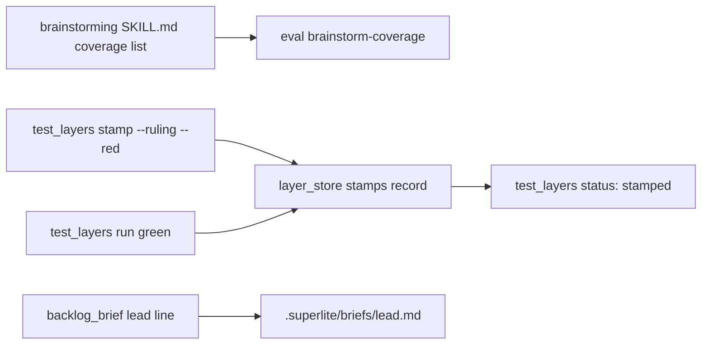
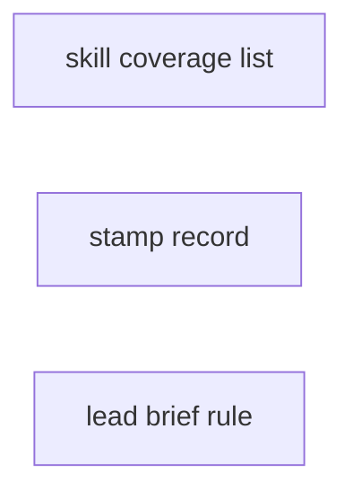

# B148: brainstorm-coverage green, stamps keep a record (#626)

**Goal:** the `brainstorm-coverage` eval case passes with the plugin; a layer stamp records its ruling, time and red cases and shows as `stamped`; the lead brief says a lead never stamps a red eval case its batch does not touch.
**Architecture:** three independent edits: the brainstorming skill text, the test-layer store and CLI (`scripts/layer_store.py`, `scripts/test_layers.py`), the lead brief builder (`backlog_brief.py`).
**Tech stack:** Python 3 stdlib, pytest.
**Spec:** .superlite/spec.md
**Detail:** tests
**Wave0:** none
**Coverage:** off (bounded: every change extends an existing flow)

## Global constraints

- Every code line in `scripts/*.py` and `skills/**/scripts/*.py` ends with a `# O(...)` complexity comment, like its neighbours.
- Stdlib only. Keep LF line endings.
- Run tests only through `sl run_tests --fast PATHS --task Tn --background`, then its `wait:` line.

## Design

Evidence (spec 1): the 1.5.140 run's plugin arm never read `coverage.md` and invented its own coverage rows; the judges were right, since the designs state no size limit. So the fix is the skill, not the graders: the brainstorming coverage paragraph names all 14 categories, so the table cannot drop limits, untrusted input or rollback even when `coverage.md` is not read. The spike with exactly the T1 text passed 2 of 2 plugin runs (every judge 3 of 3, coverage.md read 1x each).

Ruling: fix the skill and leave the graders unchanged (because the failing designs really named no limit, no rollback and no untrusted input, and the judges were unanimous; cost if wrong: one more eval round on a noisy judge).
Ruling: raise the brainstorming SKILL.md size cap from 9,500 to 10,000 characters (because the inline list is the fix, about 480 characters; #151 raised it the same way; cost if wrong: about 120 more tokens per brainstorming load).
Ruling: a stamp record lives in the layer entry as `stamps: {digest: {ruling, at, red}}`, kept only for digests still in the green list; a real green run of the same digest drops it (because `status` must then say green again; cost if wrong: none, the progress.md line stays).
Ruling: red cases come from `--red CASE...`; without it an evals stamp reads the cases below threshold from `evals/results/last.json`, other layers record none (because only evals writes a result file; cost if wrong: an empty red list on a stamp).
Ruling: the lead rule asks main through `.superlite/question.json` and `Status: NEEDS_DECISION` (because that is how a lead parks and asks; cost if wrong: none).



## File structure

- `skills/brainstorming/SKILL.md`: the coverage pass names its 14 categories.
- `scripts/layer_store.py`: green hashes plus the stamp record per digest.
- `scripts/test_layers.py`: `stamp` writes the record, `status` shows `stamped`.
- `docs/testing.md`: the stamp paragraph names the record.
- `skills/subagent-driven-development/scripts/backlog_brief.py`: the lead rule line.

## Task graph

```mermaid
%% schedule
gantt
  title Predicted schedule (mm:ss)
  dateFormat X
  axisFormat %M:%S
  section lane 1
  T2 stamp record and stamped status :t2, 0, 152s
  section lane 2
  T1 brainstorming lists the coverage cate :t1, 0, 90s
  section lane 3
  T3 lead rule for a red eval case :t3, 0, 90s
```





critical path: T2 (2.5 min) · peak width 3 · predicted build 2.5 min · predicted total ≈ 15.0 min

## Predicted schedule

## Skill

### T1 brainstorming lists the coverage categories · Complexity 1 (O-1) · Est. context 24k
**Owns:** skills/brainstorming/SKILL.md, tests/scripts/test_coverage_docs.py
**Components:** 1
**LOC owned:** 30
**Tests:** fast
**Kind:** mechanical
**Model:** haiku
**Est. time:** 1.5 min
**Covers:** 1
**Consumes:** none
**Produces:** none
**Review Focus:** `test_brainstorming_lists_every_coverage_category_626`: the inline list equals `coverage.md`'s `## Categories` names, in order, 14 of them.
**Test code (verbatim):** append to `tests/scripts/test_coverage_docs.py` (add `import re` to its imports) and change the size line in `test_brainstorming_points_at_the_pass` to `assert len(BRAINSTORM) <= 10000  # 9,500 before #626 listed the 14 coverage categories inline`:
```python
COVERAGE = (ROOT / "skills/brainstorming/coverage.md").read_text()


def coverage_categories():
    table = COVERAGE.split("## Categories", 1)[1]
    names = [ln.split("|")[1].strip() for ln in table.splitlines() if ln.startswith("| ")]
    return [n.lower() for n in names if n.lower() != "category"]


def test_brainstorming_lists_every_coverage_category_626():
    m = re.search(r"none merged or dropped: (.+?)\. A ruled row", BRAINSTORM)
    assert m, "the coverage pass names its categories inline"
    listed = [re.sub(r"\s*\(.*?\)", "", part).strip() for part in m.group(1).split("; ")]
    assert listed == coverage_categories()
    assert len(listed) == 14


def test_ruled_row_basis_is_the_decision_626():
    assert "A ruled row's basis is the decision itself (a number, a step), not \"none needed\"." in BRAINSTORM
```
**Steps:** 1 add the tests, 2 run: FAIL, 3 in `skills/brainstorming/SKILL.md` replace the whole `**Coverage pass**` paragraph (one line, section 2) with exactly the text below, 4 run: PASS.
````text
**Coverage pass** (architectural work, before any question): Read `coverage.md` in this skill's folder and follow it. It gives each decision category one `## Coverage` row: settled, ruled, n/a, spike or open. All 14 rows, none merged or dropped: scope and success criteria; domain and data model; persistence and migration; interfaces and contracts; UI states; concurrency and state ownership; error handling and recovery; security and privacy (untrusted input); performance and limits (sizes, timeouts); observability; testing strategy; compatibility; rollout (release order, rollback); research unknowns. A ruled row's basis is the decision itself (a number, a step), not "none needed". Research unknowns become spike tasks, never questions; the open rows are the questions. `**Coverage:** off` in the spec, or the user saying so, skips the pass.
````
**Notes:** the text is the one the eval spike proved; change no word of it.

**Probe entry:** none (skill text; the named tests and the evals layer cover it)

## Test layers

### T2 stamp record and stamped status · Complexity 4 (O-1) · Est. context 52k
**Owns:** scripts/layer_store.py, scripts/test_layers.py, tests/scripts/test_test_layers.py, tests/scripts/test_layer_stamp_untracked_396.py, tests/scripts/test_layer_stamp_record_626.py, docs/testing.md
**Components:** 2
**LOC owned:** 150
**Tests:** fast
**Model:** sonnet
**Est. time:** 4 min
**Covers:** 2
**Consumes:** none
**Produces:** layer_store.record_green(store: Path, layer: str, digest: str, files: dict[str, str], checkout: str | None = None, stamp: dict | None = None) -> None · layer_store.stamp_of(store: Path, layer: str, digest: str) -> dict | None · test_layers.red_cases(path: Path) -> list[str] · test_layers.write_stamp(root: Path, state: Path, layer: str, digests: dict | None = None, stamp: dict | None = None) -> None
e.g. stamp_of(s, "evals", "d1") -> {"ruling": "judge flake", "at": "2026-11-12T09:00:00Z", "red": ["brainstorm-coverage"]}
e.g. stamp_of(s, "evals", "d2") -> None
e.g. red_cases(Path("evals/results/last.json")) -> ["brainstorm-coverage"]
**Review Focus:** state: `test_store_keeps_a_stamp_until_its_digest_runs_green_626`, `test_stamp_dropped_with_its_green_hash_626`; file: `test_red_cases_reads_nothing_from_a_missing_or_bad_file_626`; encoding: `test_ruling_newlines_keep_status_one_line_626`.
**Test code (verbatim):** new file `tests/scripts/test_layer_stamp_record_626.py`:
```python
"""#626: a stamp records its ruling, time and red cases; status shows it as stamped; a green run clears it."""
from __future__ import annotations

import json
import re
import sys
from pathlib import Path

sys.path.insert(0, str(Path(__file__).resolve().parent))
from test_test_layers import cli, real_store, repo, store_file, tl  # noqa: E402,F401  (repo is a fixture)


def evals_line(root):
    return next(ln for ln in cli(root, "status").stdout.splitlines() if ln.startswith("evals "))


def record(root, layer="evals"):
    return real_store.stamp_of(store_file(root), layer, tl.layer_hash(layer, root))


def test_stamp_records_ruling_time_and_red_626(repo):
    r = cli(repo, "stamp", "evals", "--ruling", "judge flake", "--red", "brainstorm-coverage", "debug-flow")
    assert r.returncode == 0, r.stderr
    rec = record(repo)
    assert rec["ruling"] == "judge flake"
    assert rec["red"] == ["brainstorm-coverage", "debug-flow"]
    assert re.fullmatch(r"\d{4}-\d\d-\d\dT\d\d:\d\d:\d\dZ", rec["at"])
    assert r.stdout.strip() == "evals: stamped (red: brainstorm-coverage, debug-flow)"


def test_status_shows_stamped_not_green_626(repo):
    cli(repo, "stamp", "evals", "--ruling", "judge flake", "--red", "brainstorm-coverage")
    line = evals_line(repo)
    assert line.startswith("evals stamped " + tl.layer_hash("evals", repo)[:12] + " at ")
    assert line.endswith(", red: brainstorm-coverage, ruling: judge flake")
    assert "evals" not in cli(repo, "check").stdout


def test_green_run_clears_the_stamp_626(repo):
    cli(repo, "stamp", "evals", "--ruling", "r", "--red", "x")
    assert cli(repo, "run", "evals", "--command-override", "evals=true").returncode == 0
    assert evals_line(repo).startswith("evals green ")
    assert record(repo) is None


def test_evals_stamp_reads_red_cases_from_last_json_626(repo):
    out = repo / "evals" / "results"
    out.mkdir(parents=True)
    (out / "last.json").write_text(json.dumps({"suite": {"threshold": 1}, "cases": [
        {"name": "a", "aggregates": {"score": 0.5}}, {"name": "b", "aggregates": {"score": 1}},
        {"name": "c", "aggregates": {}}]}))
    assert cli(repo, "stamp", "evals", "--ruling", "r").returncode == 0
    assert record(repo)["red"] == ["a", "c"]


def test_red_cases_reads_nothing_from_a_missing_or_bad_file_626(tmp_path):
    assert tl.red_cases(tmp_path / "missing.json") == []
    bad = tmp_path / "bad.json"
    bad.write_text("{not json")
    assert tl.red_cases(bad) == []
    bad.write_text(json.dumps({"cases": [{"name": "n", "aggregates": {"score": 0.9}}]}))
    assert tl.red_cases(bad) == ["n"]


def test_non_evals_stamp_has_no_red_cases_626(repo):
    assert cli(repo, "stamp", "tui", "--ruling", "no tmux").stdout.strip() == "tui: stamped (red: none)"
    rec = record(repo, "tui")
    assert rec["red"] == [] and rec["ruling"] == "no tmux"


def test_ruling_newlines_keep_status_one_line_626(repo):
    cli(repo, "stamp", "evals", "--ruling", "line one\nline two")
    assert evals_line(repo).endswith("ruling: line one line two")


def test_store_keeps_a_stamp_until_its_digest_runs_green_626(tmp_path):
    s = tmp_path / "store.json"
    rec = {"ruling": "r", "at": "2026-11-12T09:00:00Z", "red": ["x"]}
    real_store.record_green(s, "evals", "d1", {"a": "1"}, stamp=rec)
    real_store.record_green(s, "evals", "d2", {"a": "2"})
    assert real_store.stamp_of(s, "evals", "d1") == rec
    assert real_store.stamp_of(s, "evals", "d2") is None
    real_store.record_green(s, "evals", "d1", {"a": "1"})
    assert real_store.stamp_of(s, "evals", "d1") is None
    assert real_store.is_green(s, "evals", "d1")


def test_stamp_dropped_with_its_green_hash_626(tmp_path, monkeypatch):
    s = tmp_path / "store.json"
    monkeypatch.setattr(real_store, "KEEP", 2)
    real_store.record_green(s, "evals", "d1", {}, stamp={"ruling": "r", "at": "t", "red": []})
    real_store.record_green(s, "evals", "d2", {})
    real_store.record_green(s, "evals", "d3", {})
    assert not real_store.is_green(s, "evals", "d1")
    assert "d1" not in real_store.layer_entry(s, "evals").get("stamps", {})
```
**Steps:** 1 add the tests, 2 run: FAIL, 3 implement, 4 run the new file plus `tests/scripts/test_test_layers.py tests/scripts/test_layer_stamp_untracked_396.py tests/scripts/test_layer_manifest_checkout_430.py tests/scripts/test_run_tests_unit_stamp.py`: PASS.
**Notes:**
- `record_green` keeps every key it rewrites today and adds `stamps` (only digests still in the kept green list); with `stamp` given it sets `stamps[digest] = stamp`, without it pops `stamps[digest]`. Callers that pass four positional arguments (run_tests.py's `write_stamp(root, state, "unit", digests)`) keep working.
- `cmd_stamp` gains `--red CASE...` (`nargs="*"`). Red = `--red` when given, else `red_cases(root / "evals/results/last.json")` for evals, else `[]`. `at` = UTC now, `%Y-%m-%dT%H:%M:%SZ`. The ruling is stored with each run of whitespace (newlines too) collapsed to one space. It still appends the `Ruling: skip <layer> - <ruling>` line to progress.md, then prints `<layer>: stamped (red: <a, b | none>)`.
- `red_cases`: case names whose `aggregates.score` is missing or below `suite.threshold` (default 1.0), in file order; `[]` for a missing or unreadable file or a non-dict.
- `layer_states`: a green digest with a record is `("stamped", "<hash12> at <at>, red: <a, b | none>, ruling: <ruling>")`; `cmd_status` prints it as `<layer> stamped <detail>`. `check` and the Stop hook treat stamped like green (not stale).
- Test fakes: `FakeStore` in `test_test_layers.py` gains `stamp` on `record_green` and a `stamp_of` (docstring: nine functions). `test_layer_stamp_untracked_396.py` expects `unit stamped ` where it expected `unit green ` after a stamp.
- `docs/testing.md` `## Stamps`: one sentence after the `stamp --ruling` line: the stamp also records the ruling, the UTC time and the red cases (`--red`, or for evals the cases below threshold in `evals/results/last.json`) next to the hash, `status` shows the layer as `stamped`, and the next green run of the same files clears the record.

**Probe entry:** none (the CLI writes the repository's shared layer store; the named tests cover it)

## Lead brief

### T3 lead rule for a red eval case · Complexity 1 (O-1) · Est. context 22k
**Owns:** skills/subagent-driven-development/scripts/backlog_brief.py, tests/scripts/test_backlog_brief_626.py
**Components:** 1
**LOC owned:** 25
**Tests:** fast
**Kind:** mechanical
**Model:** haiku
**Est. time:** 1.5 min
**Covers:** 3
**Consumes:** none
**Produces:** none
**Review Focus:** `test_lead_brief_never_stamps_a_red_eval_case_626`: the line follows the Escalate line.
**Test code (verbatim):** new file `tests/scripts/test_backlog_brief_626.py`:
```python
"""#626: the lead brief says a lead never stamps a red eval case its batch does not touch."""
import sys
from test_plan_tools import SCRIPTS
sys.path.insert(0, str(SCRIPTS))
import backlog_brief as bb  # noqa: E402

LCTX = {"sl": "/x/sl", "repo": "o/r", "backlog_md": "b.md"}
RULE = ("Evals layer red on a case your batch's files do not touch: never stamp it yourself (no `test_layers.py stamp`); "
        "write .superlite/question.json naming the case and its failing graders (options: main stamps it by ruling, "
        "or the batch waits for the case's fix), then end your turn with Status: NEEDS_DECISION.")


def test_lead_brief_never_stamps_a_red_eval_case_626():
    lines = bb.lead_brief({"id": "B1", "issues": [7]}, LCTX).splitlines()
    assert RULE in lines
    assert lines[lines.index(RULE) - 1].startswith("Escalate a new major decision:")
```
**Steps:** 1 add the test, 2 run: FAIL, 3 in `lead_brief` append `RULE`'s exact text as one `out.append(...)` right after the `Escalate a new major decision` append, 4 run it plus `tests/scripts/test_backlog_brief*.py`: PASS.

**Probe entry:** none (brief text; the named test covers it)

## Review Focus

- Skill (docs): the inline list matches `coverage.md`.
- Test layers (CLI, file I/O): state (record kept and dropped with its green hash, cleared by a green run), file (missing or corrupt `last.json`), encoding (multi-line ruling stays one status line).
- Lead brief (text): the rule line sits after the Escalate line.

## Self-review

Every spec section maps to a task (1: T1, 2: T2, 3: T3); no placeholders; no shared files; no edges, since no task's tests run another's code.
