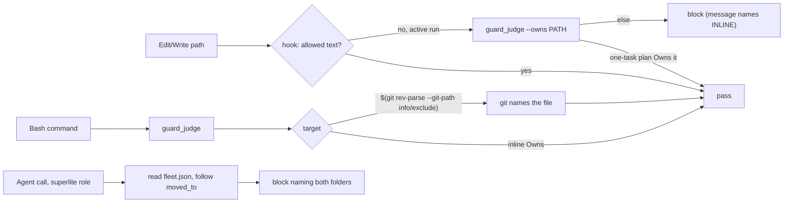
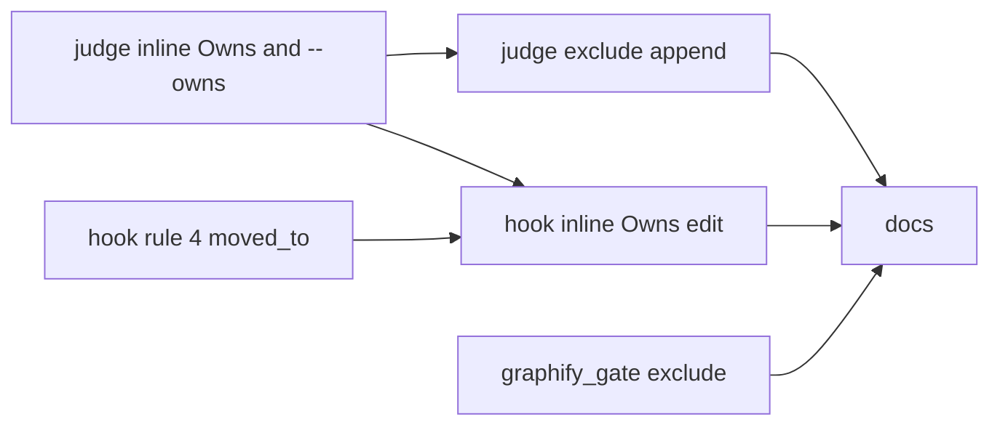

# Superlite: coordinator guard allows the inline task, the exclude append and names its fleet folder (B141)

**Goal:** fix #599 and main's #580 follow-up: (1) a coordinator that builds a one-task plan inline may write that task's Owns; (2) an append to `"$(git rev-parse --git-path info/exclude)"` passes from a linked worktree; (3) `graphify_gate` keeps `graphify-out/` out of git; (4) the rule-4 "fleet is on" block follows `moved_to` and names the fleet.json folders it read.
**Architecture:** `hooks/block-coordinator-edits` (bash) judges Edit/Write paths and the Agent rule; `guard_judge.py` (Python) judges Bash commands and gains an `--owns PATH` entry the hook calls only for an Edit/Write it would block in an active run. `graphify_gate.py` reuses `worktree.add_exclude`.
**Tech stack:** bash 3.2+ builtins in the hook; Python 3.10+ stdlib, pytest (through `sl run_tests`).
**Spec:** this file, section Design; issue #599; #580 third bullet (main's `backlog tell`).
**Detail:** contracts
**Target-min:** 11
**Wave0:** none
**Coverage:** off (bounded change to an existing guard; the rulings below settle every open point)

Global constraints:
- Existing tests stay green. An existing test file changes only when the task Owns it. If another existing test turns red, report it in DONE_WITH_CONCERNS with the test id and the reason instead of editing it.
- Run `sl` as an executable (`<abs>/sl ...`). Verify with `<abs>/sl run_tests --fast <own test files> --task Tn --background`, then run the printed `wait:` line in the foreground and end the turn only after it reports.
- No version edits. Never run `scripts/evals.sh`, `claude plugin eval` or `scripts/test_layers.py run`.
- Hook tests run the hook with `shutil.which("bash")` (never a quoted `/bin/bash`) and an env without `SUPERLITE_STATE_DIR`, `SUPERLITE_FLEET_*` and `SUPERLITE_SESSION_ID` (copy `run`/`bash` from `tests/scripts/test_block_coordinator_edits.py`, dropping those keys).
- Every existing block-message line stays byte-identical; new text is a new line or a sentence appended at the end.
- The new inline line, exactly (`INLINE` below): `- An inline build (the run's plan holds exactly one task): you may write that task's Owns yourself.`

Ruling: main's ruling (orchestrator, not Max): the guard allows the inline task's Owns.
Ruling: "inline" means the plan in `.superlite/stable.json` holds exactly one task and that task names no `**Repo:**` (because a one-task plan is the case #599 reports and needs no new marker or tool; cost if wrong: a two-task chain built inline still needs a worker, and using-superlite now says "one task").
Ruling: the Edit/Write path runs the judge (`--owns`) only after the bash rules would block in an active, non-human run (because a Python start on every allowed edit costs ~250 ms on Windows; cost if wrong: none, blocked edits are rare).
Ruling: the exclude append is recognised only as the exact words `$(git rev-parse --git-path info/exclude)` and `$(git rev-parse --git-common-dir)/info/exclude`, resolved by running that git command from the one known shell directory; a command naming `GIT_DIR`, `GIT_COMMON_DIR`, `GIT_WORK_TREE` or `GIT_CONFIG` keeps the word unknown (because git would then name another file; cost if wrong: such a command still blocks, as today).
Ruling: `graphify-out/` goes to info/exclude from `graphify_gate` when `use` is true, instead of commit_task ignoring it (commit_task.py belongs to B130 and B146; an excluded folder is skipped by `git status`, which commit_task reads; cost if wrong: a repo whose gate says `use` false but runs graphify anyway still shows the folder).
Ruling: rule 4 follows `moved_to` like `fleet_state.home` (at most 5 hops, only while the read fleet.json is off and `moved_to` is absolute); the stale-owner check, the incident and the PLAN hint use the folder reached.
Ruling: B141 edits files no open batch lists: graphify_gate.py, skills/subagent-driven-development/SKILL.md, docs/hooks.md and new tests; named in notes.md.
Ruling: already in the lead worktree, no `sl worktree ensure`; no probe adapter (hooks and CLI entries; the cases are named tests).
LAYERS: unit, headless, evals

## Design

### 1. Inline Owns (judge)
`guard_judge.inline_owns(sd)` returns `(root, owns)` for a one-task plan: `root` the real path of `plan_tools.stable_root(plan)`, `owns` that task's Owns list; else `None` (no or unreadable stable.json, 0 or 2+ tasks, a `**Repo:**` task, any exception). In `_judge_path`, in active mode, after the render-edit check and the linked-worktree protected check: a real path whose path relative to `root` (never starting with `..`) matches `next_tasks.owns_match` passes. Protected names, hard-linked files and symlinks out of the root still block (the checks before it stay first). `MESSAGES["code"]` gains `INLINE` right before the render_edit line.

### 2. Judge CLI `--owns PATH`
`guard_judge.py --mode active --project P --sd SD --owns PATH` reads no stdin. PATH (absolute, or relative to P) passes (stdout `guard: ok <SUPERLITE_GUARD_NONCE>`, exit 0) when it is not a protected name, not an existing file with more than one hard link, and section 1 says owned; else exit 1 with no output. Any mode other than active exits 1.

### 3. Exclude append (judge)
In `_check`, before a word with `$` counts as unknown: a word that is exactly one of the two forms in the ruling, with exactly one known shell directory and no GIT_* name in the command text, becomes the path git prints (`git -C DIR rev-parse --git-path info/exclude`, or `--git-common-dir` plus `/info/exclude`; env without `GIT_*`; timeout 1 s; a relative answer joined to DIR; it must end in `/info/exclude`) and is judged as a literal. Anything else stays unknown.

### 4. Hook: Edit/Write and the message
After `project_code` denies an Edit, Write or NotebookEdit path with `prot` not 1 or 2, `active=1` and `human` not 1, the hook runs the judge's `--owns` entry (the interpreter and nonce handling of `run_judge`; only exit 0 with the ok line passes) and exits 0 when it passes. The code block message gains `INLINE` right before the render_edit line. Header rule 3 names the exception.

### 5. Hook rule 4
After FSD is chosen (FSD0), up to 5 times: when `FSD/fleet.json` is not on and holds `"moved_to": "<absolute path>"` (JSON `\\` read as `/`), FSD becomes that path. Both block messages end with ` Fleet state read: <FSD0>/fleet.json.`, or after a move ` Fleet state read: <FSD0>/fleet.json, moved to <FSD>/fleet.json.`

### 6. graphify_gate
`graphify_gate.exclude_output(root)` adds `graphify-out/` to the repo's info/exclude (`worktree.add_exclude(<toplevel>, "graphify-out", "graphify-out/x")`, the common dir's file from a linked worktree) and returns whether `git check-ignore -q graphify-out/x` then succeeds; a non-repo or failed write returns False. The JSON gains `"excluded"`: that value when `use` is true, else `false` (nothing written).

### 7. Docs
using-superlite, SDD SKILL.md and docs/hooks.md say what sections 1-6 changed (T5 text).

## File structure

- `skills/subagent-driven-development/scripts/guard_judge.py`: sections 1-3 (T1, T2)
- `hooks/block-coordinator-edits`: sections 4-5 (T3, T4)
- `skills/subagent-driven-development/scripts/graphify_gate.py`: section 6 (T6)
- `skills/using-superlite/SKILL.md`, `skills/subagent-driven-development/SKILL.md`, `docs/hooks.md`: section 7 (T5)
- tests: one new file per task, named in each task

## Task graph

```mermaid
%% schedule
gantt
  title Predicted schedule (mm:ss)
  dateFormat X
  axisFormat %M:%S
  section lane 1
  T1 judge inline Owns and --owns :t1, 0, 518s
  T3 hook inline Owns for Edit and Write :t3, 518, 467s
  T5 docs name the inline Owns the exclude :t5, 986, 452s
  section lane 2
  T4 hook rule 4 follows moved_to :t4, 0, 466s
  T2 judge exclude append :t2, 518, 466s
  section lane 3
  T6 graphify_gate excludes graphify-out :t6, 0, 456s
```

critical path: T1 → T3 → T5 (24.0 min) · peak width 3 · predicted build 24.0 min · predicted total ≈ 38.5 min (target ✗ 11.0)

## Package: guard judge

App type: library (command judge). Categories: state, file, encoding. **Probe entry:** none (hook entry points; the cases are named tests).

### T1 judge inline Owns and --owns · Complexity 4 · Est. context 45k
**Owns:** skills/subagent-driven-development/scripts/guard_judge.py, tests/scripts/test_guard_inline_owns_599.py
**Components:** 2
**LOC owned:** 170
**Tests:** fast
**Model:** sonnet
**Est. time:** 3.5 min
**Covers:** 1, 2
**Consumes:** none
**Produces:** guard_judge.inline_owns(sd: str) -> tuple[str, list[str]] | None
  e.g. inline_owns("/p/.superlite") -> ("/p", ["src/app.py", "tests/test_app.py"]) (plan `### T1 a` with `**Owns:** src/app.py, tests/test_app.py`)
  e.g. inline_owns("/p/.superlite") -> None (plan with `### T1` and `### T2`)
  e.g. inline_owns("/p/.superlite") -> None (no stable.json)
**Produces:** CLI `guard_judge.py --mode active --project P --sd SD --owns PATH` -> exit 0 and stdout `guard: ok <nonce>`, or exit 1 and no stdout
**Review Focus:** state: two-task plan never opens Owns; file: hard link and protected names under an owned glob still block.
**Test code:** new file `tests/scripts/test_guard_inline_owns_599.py`; fixture: tmp project with `.superlite/stable.json` `{"plan": "<abs plan>"}`, plan text like `tests/scripts/test_judge_housekeeping.py` line 27, files `src/app.py`, `src/other.py`. Named tests:
- `test_inline_owns_one_task`: Owns `src/app.py, tests/test_app.py` -> `(realpath(root), ["src/app.py", "tests/test_app.py"])`
- `test_inline_owns_none_cases`: two tasks -> None; no stable.json -> None; `**Repo:** ../x` task -> None
- `test_bash_write_to_owned_file_passes`: `judge("sed -i '' s/a/b/ src/app.py", root, root, "active", (sd,))` is None; `echo x > src/other.py` gives kind `code`
- `test_owned_glob`: Owns `src/` -> `echo x > src/new.py` passes, `echo x > lib/a.py` blocks
- `test_two_task_plan_blocks_bash`: same write to src/app.py with a two-task plan gives kind `code`
- `test_owns_cli`: `--owns src/app.py` and `--owns <abs src/app.py>` -> exit 0, stdout `guard: ok N` with `SUPERLITE_GUARD_NONCE=N`; `--owns src/other.py` -> exit 1, empty stdout; `--mode human ... --owns src/app.py` -> exit 1
- `test_owns_cli_refuses_protected_and_hardlink`: Owns `.superlite/`, `--owns .superlite/orchestrator.json` -> 1; `src/app.py` hard-linked to `lib/x.py` -> `--owns src/app.py` 1 and the Bash write blocks (skip without hard links)
- `test_code_message_has_inline_line`: `INLINE` in `MESSAGES["code"]`, directly before the line starting `- A throwaway edit to check a render`
**Steps:** 1 tests, 2 run: FAIL, 3 implement, 4 run: PASS

### T2 judge exclude append · Complexity 3 · Est. context 40k
**Owns:** skills/subagent-driven-development/scripts/guard_judge.py, tests/scripts/test_guard_git_exclude_599.py
**Components:** 1
**LOC owned:** 110
**Tests:** fast
**Model:** sonnet
**Est. time:** 2.5 min
**Covers:** 3
**Consumes:** none
**Produces:** none
**Review Focus:** encoding: quoted and unquoted forms; state: GIT_* in the command keeps it unknown.
**Notes:** starts after T1 committed (same file). Find how the lexer hands `_check` the word (debug one command) before matching it.
**Test code:** new file; fixture: a main repo with one commit and a linked worktree `git worktree add .claude/worktrees/w1 -b w1`, `.superlite/pool.json` `{}` in the worktree; run the hook with `CLAUDE_PROJECT_DIR=<worktree>`, input `cwd` the worktree. Named tests (exit codes):
- `test_git_path_form_passes`: `printf 'graphify-out/\n' >> "$(git rev-parse --git-path info/exclude)"` -> 0
- `test_common_dir_form_passes`: `printf 'graphify-out/\n' >> "$(git rev-parse --git-common-dir)/info/exclude"` -> 0
- `test_main_checkout_form_passes`: same `--git-path` command in a plain repo with pool.json -> 0
- `test_compound_call_passes`: `printf 'x/\n' >> "$(git rev-parse --git-path info/exclude)" && echo done` -> 0
- `test_other_substitutions_block`: `echo x >> "$(git rev-parse --show-toplevel)/src.py"` -> 2; `echo x >> "$(git rev-parse --git-path hooks/pre-commit)"` -> 2
- `test_git_env_keeps_unknown`: `export GIT_DIR=src; echo x >> "$(git rev-parse --git-path info/exclude)"` -> 2
**Steps:** 1 tests, 2 run: FAIL, 3 implement, 4 run: PASS

## Package: coordinator hook

App type: CLI hook. Categories: protocol, state, file. **Probe entry:** none (bash hook; the cases are named tests).

### T4 hook rule 4 follows moved_to · Complexity 3 · Est. context 40k
**Owns:** hooks/block-coordinator-edits, tests/scripts/test_guard_fleet_moved_580.py
**Components:** 1
**LOC owned:** 110
**Tests:** fast
**Model:** sonnet
**Est. time:** 2.5 min
**Covers:** 5
**Consumes:** none
**Produces:** none
**Review Focus:** state: chain length and off target; encoding: `\\` in moved_to.
**Test code:** new file; reuse the fixtures of `tests/scripts/test_guard_fleet_research_hint.py` (Agent call with `subagent_type`). Named tests:
- `test_block_names_fleet_folder`: `<sd>/fleet.json` `{"on": true}`, `superlite:implementer` -> 2, stderr holds ` Fleet state read: <sd>/fleet.json.`
- `test_moved_fleet_blocks_and_names_both`: `<sd>/fleet.json` `{"on": false, "moved_to": "<other>"}`, `<other>/fleet.json` `{"on": true}` -> 2; stderr holds ` Fleet state read: <sd>/fleet.json, moved to <other>/fleet.json.` and `PLAN is the plan file, or <other> for a build without a plan.`; the incident line lands in `<other>/incidents.jsonl`
- `test_moved_research_hint_uses_target`: same move, `superlite:researcher` -> `write the prompt to <other>/briefs/<name>.md;`
- `test_moved_to_off_target_passes`: target `{"on": false}` -> 0
- `test_chain_limit`: d0..d5 each moved to the next, d5 on -> 2; d0..d6, d6 on -> 0
- `test_relative_moved_to_ignored`: `"moved_to": "rel/x"` -> 0
**Steps:** 1 tests, 2 run: FAIL, 3 implement, 4 run: PASS

### T3 hook inline Owns for Edit and Write · Complexity 3 · Est. context 42k
**Owns:** hooks/block-coordinator-edits, tests/scripts/test_hook_inline_owns_599.py
**Components:** 1
**LOC owned:** 120
**Tests:** fast
**Model:** sonnet
**Est. time:** 2.5 min
**Covers:** 4
**Consumes:** CLI `guard_judge.py --mode active --project P --sd SD --owns PATH` (T1)
**Produces:** none
**Review Focus:** state: human mode and protected files still block; protocol: the last stderr line stays `Blocked target: <rel>`.
**Notes:** starts after T4 committed (same file); update header rule 3.
**Test code:** new file; project with `.superlite/stable.json` naming a one-task plan, Owns `src/app.py`. Named tests (exit codes):
- `test_edit_of_inline_owns_passes`: Edit and Write of `<abs>/src/app.py` and `src/app.py` -> 0; `src/other.py` -> 2
- `test_two_task_plan_blocks_edit`: -> 2
- `test_human_mode_blocks_owned_edit`: orchestrator.json `{"mode": "human", "approved": false}` -> 2
- `test_protected_still_blocks`: Owns `.superlite/`, Write `.superlite/orchestrator.json` -> 2
- `test_block_message_names_inline_build`: blocked Edit stderr holds `INLINE`; last line `Blocked target: src/other.py`
**Steps:** 1 tests, 2 run: FAIL, 3 implement, 4 run: PASS

## Package: graphify gate

App type: CLI. Categories: file, state. **Probe entry:** none (CLI over git; the cases are named tests).

### T6 graphify_gate excludes graphify-out · Complexity 2 · Est. context 30k
**Owns:** skills/subagent-driven-development/scripts/graphify_gate.py, tests/scripts/test_graphify_gate_exclude_599.py
**Kind:** mechanical
**Components:** 1
**LOC owned:** 90
**Tests:** fast
**Model:** haiku
**Est. time:** 2 min
**Covers:** 6
**Consumes:** none
**Produces:** graphify_gate.exclude_output(root: str) -> bool
**Review Focus:** file: the common dir's exclude from a linked worktree, no duplicate line.
**Test code:** new file; reuse `make_repo` and `fake_bin` from `tests/scripts/test_graphify_gate.py` (60 files, fake graphify on PATH -> `use` true). Named tests:
- `test_use_adds_graphify_out_to_exclude`: JSON `"excluded": true`; `.git/info/exclude` lines hold `graphify-out/` once after two runs
- `test_small_repo_writes_nothing`: 3 files -> `"excluded": false`, no `graphify-out/` line
- `test_worktree_writes_common_exclude`: `git worktree add ../wt -b wt`, gate with `--root ../wt` -> line in the main `.git/info/exclude`; a file `graphify-out/g.json` in the worktree is absent from `git -C wt status --porcelain`
- `test_gitignore_already_covers`: `.gitignore` committed with `graphify-out/` -> `"excluded": true`, no exclude line
- `test_exclude_output_non_repo`: `exclude_output(<tmp dir, no git>)` -> False
**Steps:** 1 tests, 2 run: FAIL, 3 implement, 4 run: PASS

## Package: docs

App type: prompt text. **Probe entry:** none (text).

### T5 docs name the inline Owns, the exclude and graphify-out · Complexity 1 · Est. context 30k
**Owns:** skills/using-superlite/SKILL.md, skills/subagent-driven-development/SKILL.md, docs/hooks.md, tests/scripts/test_docs_inline_owns_599.py
**Kind:** mechanical
**Components:** 1
**LOC owned:** 40
**Tests:** fast
**Model:** haiku
**Est. time:** 1.5 min
**Covers:** 7
**Consumes:** none
**Produces:** none
**Review Focus:** none beyond the named test.
**Notes:** exact edits, nothing else changed:
1. using-superlite: replace `inline only if small (few files, one chain; say so)` with `inline only if small: one task, few files (the guard then lets you write its Owns; say so)`.
2. SDD SKILL.md, after the Setup bullet starting `- Wave 0 is not yours`, insert `- Inline build (a plan of exactly one task, few files): after \`lint --stable\` write its Owns yourself (the guard allows them; no implementer), commit with \`commit_task T1\`, then Final review.`
3. SDD SKILL.md Graphify bullet: append ` When \`use\` is true it also adds \`graphify-out/\` to the repo's info/exclude, so \`git status\` and \`commit_task\` skip it.`
4. docs/hooks.md, the `block-coordinator-edits` line: append ` An inline build (the run's plan in \`stable.json\` holds exactly one task, no \`**Repo:**\`) may also write that task's Owns: Bash targets through the judge, an Edit or Write through \`guard_judge.py --owns PATH\`, run only for a path the hook would block; protected names, hard links and paths outside the plan root still block. A target written \`$(git rev-parse --git-path info/exclude)\` or \`$(git rev-parse --git-common-dir)/info/exclude\` is judged as the file git names from the one known shell directory (unknown when the command names GIT_DIR, GIT_COMMON_DIR, GIT_WORK_TREE or GIT_CONFIG). The fleet block (rule 4) follows \`moved_to\` up to 5 hops and ends with \`Fleet state read: <folder>/fleet.json\` (plus \`, moved to <folder>/fleet.json\`).`
**Test code:** new file `tests/scripts/test_docs_inline_owns_599.py`; named tests: `test_using_superlite_one_task` (the new text in, `one chain` out), `test_sdd_inline_and_graphify_lines` (items 2 and 3 verbatim), `test_hooks_doc_names_owns_exclude_moved` (`guard_judge.py --owns PATH`, `--git-path info/exclude`, `moved_to` in the line).
**Steps:** 1 tests, 2 run: FAIL, 3 edit, 4 run: PASS

## Self-review

Coverage: Design 1-2 T1, 3 T2, 4 T3, 5 T4, 6 T6, 7 T5. No placeholders. T3 consumes T1's CLI (hard edge, its tests run it). Same-file pairs are serial: T1->T2 (guard_judge.py), T4->T3 (hook). Docs wait for the code. Every task has Components, LOC, Tests, Model.
