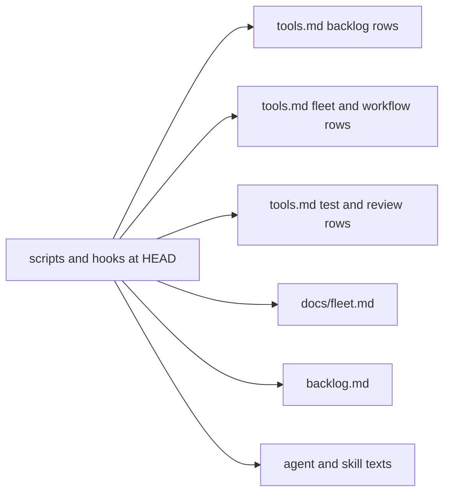
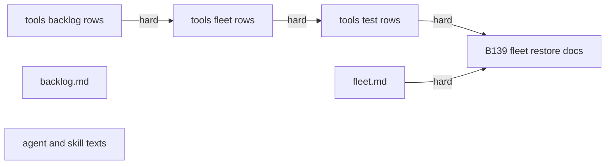

# Docs and agent texts catch up (B135: #607 plus main's docs follow-ups)

**Goal:** docs/tools.md, docs/fleet.md, backlog.md and the agent and skill texts name what shipped from 1.5.114 to 1.5.158: the six #607 items and the follow-up lines main collected from shipped batches.
**Architecture:** documentation only; every statement is read off the code at HEAD under skills/subagent-driven-development/scripts and hooks/; pin tests under tests/scripts read the docs.
**Tech stack:** Markdown docs, Python 3.10+ pytest pin tests (tests/scripts/test_docs_*.py style).
**Spec:** this file (Design).
**Detail:** tests
**Wave0:** none
**Worktree:** none
**Target-min:** 11
**Max chars:** 27000

Global constraints:
- Docs only: change no file under skills/**/scripts/, hooks/, commands/ and no file another task owns.
- Every sentence you add is checked against the code at HEAD (grep the module, read the printing line); where a follow-up's wording and the code differ, write what the code does and name the difference in your report. An item the doc already states correctly is skipped, not repeated.
- House style: terse, one fact per clause, the repo's existing voice; table rows stay one line; no new headings unless the file has a matching section; no host, project or path names outside superlite.
- Keep every phrase other tests pin: before DONE run every test file that reads your doc (`grep -l '<doc path or file name>' tests/scripts/*.py`) together with your own pin test through `run_tests --fast PATHS --task Tn`.

## Design

What the issue asks (data): #607 lists six gaps from 1.5.114 to 1.5.122 (tools.md and fleet.md backlog items, `owner_session`/`owner_pid` and the `foreign_worktree` scope, the implementers' `**Tests:** cmd=`, the import-linter contract types, `release` after a shipped merge, `LAYERS: unit`). Expected: the docs name each item; `release` after a shipped merge exits 0 or the text says when it is needed; `fleet run --layer unit` runs the full suite or the docs say the unit layer is `run_tests --full`. Main's tell adds 21 follow-up lines from batches shipped since (copied into the task blocks below, each with its source).

Facts read at HEAD: `merge` releases the ship lock itself once it ships (backlog_ship.py `_merge`); `release` after that prints `B lock not held` and exits 0. `fleet_layer.py` knows headless, tui and evals; `--layer unit` exits 2. B134 (1.5.158) already wrote `Decisions:`/`Attribution:` and B133's ship changes into backlog.md.

Approach: one task per doc, docs/tools.md split in three row groups run one after another (one file); each task adds a pin test for its items. Rejected: changing `release` or `fleet_layer.py` code (main: keep the batch to docs; fleet_layer.py belongs to B139).

Ruling: #607 items 5 and 6 are fixed in words: backlog.md says `release` is needed only when `merge` did not ship (lock still held after a BLOCKED, or to park), and that the unit layer is `run_tests --full` while `fleet run --layer` runs headless, tui and evals (because main asked to keep the batch to docs and fleet_layer.py is B139's; cost if wrong: a later code change to accept `unit`).
Ruling: commands/backlog.md follow-ups go to B140 and the backlog.py `notes` route to B144 (both own those files); SDD SKILL.md's render_edit line (B118) is left out (SDD SKILL.md sits 21 characters under its 13300 cap); the writing-plans `**Also-touches:**` row is left to B146, whose T4 adds it (lint OVERLAP).
Ruling: agents/implementer.md, agents/implementer-haiku.md, skills/writing-plans/SKILL.md, skills/subagent-driven-development/fleet.md, docs/language.md and the pin tests are edited although outside the batch list (no open batch lists them; named in notes.md).

## Coverage

| Category | State | Basis |
|---|---|---|
| Scope and success criteria | settled | #607 Expected section; main's tell lists the follow-ups |
| Domain and data model | n/a | docs only |
| Persistence and migration | n/a | docs only |
| Interfaces and contracts | ruled | no CLI change; docs describe HEAD behaviour |
| UI states | n/a | no UI |
| Concurrency and state ownership | ruled | one task per file; the three tools.md tasks run in sequence |
| Error handling and recovery | n/a | docs only |
| Security and privacy | ruled | no host, project or path names from other repos |
| Performance and limits | ruled | SDD SKILL.md cap 13300 untouched; table rows stay one line |
| Observability | n/a | docs only |
| Testing strategy | ruled | one pin test file per task; existing pin tests stay green |
| Compatibility | ruled | pinned phrases change only in test_docs_b32_tools.py and test_docs_b26.py (fresh-pane retry) |
| Rollout | ruled | ships in one version bump; rollback is a revert |
| Research unknowns | n/a | none |



## File structure

- docs/tools.md: tool table; rows split among T1 (backlog, backlog_run, backlog_ship, worktree), T5 (fleet, fleet_io, state, dispatch, task, plan_tools, commit_task, findings, graphify_gate), T6 (run_tests, testcmd, trees, pt_review, finish, predict, build_prime, a new gui_session row).
- docs/fleet.md: fleet mode guide (T2).
- skills/subagent-driven-development/backlog.md: backlog rules (T3).
- agents/implementer.md, agents/implementer-haiku.md, skills/writing-plans/SKILL.md, skills/subagent-driven-development/fleet.md, docs/language.md (T4).

```mermaid
%% schedule
gantt
  title Predicted schedule (mm:ss)
  dateFormat X
  axisFormat %M:%S
  section lane 1
  T2 docs/fleet.md catch-up :t2, 0, 455s
  T6 tools.md test review and forecast row :t6, 907, 454s
  section lane 2
  T1 tools.md backlog and worktree rows :t1, 0, 453s
  T5 tools.md fleet and workflow rows :t5, 453, 454s
  section lane 3
  T3 backlog.md lead and main steps :t3, 0, 451s
  section lane 4
  T4 agent and skill texts :t4, 0, 451s
```





critical path: T1 → T5 → T6 (22.7 min) · peak width 4 · predicted build 22.7 min · predicted total ≈ 37.2 min (target ✗ 11.0)

Ruling: T1 -> T5 -> T6 are hard edges (because all three edit docs/tools.md and two tasks that run at once never share a file; cost if wrong: about 10 minutes of wall time).

## Docs

### T1 tools.md backlog and worktree rows · Complexity 2 (O-1) · Est. context 45k
**Owns:** docs/tools.md, tests/scripts/test_docs_607_tools_backlog.py
**Components:** 1
**LOC owned:** 40
**Tests:** fast
**Model:** sonnet
**Est. time:** 3 min
**Notes:** Edit only the `backlog`, `backlog_run`, `backlog_ship` and `worktree` rows. Sources: backlog.py (module docstring lists every subcommand), backlog_intake.py, backlog_run.py, backlog_ship.py, backlog_brief.py, worktree.py, and skills/subagent-driven-development/backlog.md for wording. Items: (#607) `.superlite/cleanup-cmd.json` project cleanup before `maxapp ship` removes a worktree, the tracker close at ship (Jira comment and Done; GitHub `Closes`), `status` re-reading OPEN markers, `plan --reset` removing dropped batches' worktrees; (main 2, #583-#585) the fast path, the `already shipped:`, `check:`, `topic:` and `not found:` lines, the lean `plan --add` output and the kept ship approval; (main 3, #557) the summary's `Decisions:` line and the lead brief's `Attribution:` line; (main 8, #552/#563) triage and leads read the latest comments, reopened issues are planned again (`reopened:` line), a background `backlog wait` stopped for low memory is restarted in the foreground; (main 9, #586) `unskip`, `reset B [--discard]`, the full `--help`, the parked-only `next:` line, the answer rule (a label, or a label plus a note), `"by"` in answers files as decide reads it, `ship B done` on a planned batch, plan's `offer:` line; (B133) FIFO queue and `queue place` WAIT line, bare `--wait` (also `merge --from-main`), merge instead of rebase for a pushed branch, healthy waits, cleanup-only `ship done`, `cleanup owed`, and in the worktree row `worktree ensure`'s `core.bare` refusal; (B134) `Status: DONE no-change`, `Unverified:`, `Kind: design`, `Refs #N`, `ship B notes`.
**Test code (verbatim):**
```python
# tests/scripts/test_docs_607_tools_backlog.py
from pathlib import Path

DOC = (Path(__file__).resolve().parents[2] / "docs" / "tools.md").read_text(encoding="utf-8")


def rows(*names):
    return "\n".join(l for l in DOC.splitlines() if any(l.startswith(f"| `{n}` |") for n in names))


def test_backlog_rows_name_607_ship_and_status_items():
    r = rows("backlog", "backlog_run", "backlog_ship")
    for s in ("cleanup-cmd.json", "--reset", "OPEN", "Closes", "Decisions:", "Attribution:", "queue place", "cleanup owed", "healthy"):
        assert s in r, s


def test_backlog_rows_name_plan_and_undo_lines():
    r = rows("backlog", "backlog_run", "backlog_ship")
    for s in ("fast path", "already shipped:", "check:", "not found:", "offer:", "unskip", "--discard", "--help", "reopened", "latest"):
        assert s in r, s


def test_backlog_rows_name_lead_end_states():
    r = rows("backlog", "backlog_run", "backlog_ship")
    for s in ("no-change", "Unverified:", "Kind: design", "Refs #N", "ship B notes"):
        assert s in r, s


def test_worktree_row_names_core_bare():
    assert "core.bare" in rows("worktree")
```
**Steps:** 1 failing test, 2 run: FAIL, 3 implement, 4 run: PASS
**Probe entry:** none (docs)

### T2 docs/fleet.md catch-up · Complexity 3 (O-1) · Est. context 45k
**Owns:** docs/fleet.md, tests/scripts/test_docs_607_fleet.py, tests/scripts/test_docs_b26.py
**Components:** 1
**LOC owned:** 50
**Tests:** fast
**Model:** sonnet
**Est. time:** 3 min
**Notes:** Sources: fleet.py, fleet_io.py, fleet_state.py, fleet_lead.py, trees.py, dispatch.py, run_tests.py, backlog_*.py, hooks/block-coordinator-edits, and skills/subagent-driven-development/fleet.md for wording. Items: (#607, Batch leads section) `.superlite/cleanup-cmd.json`, the tracker close at ship, `status` re-reading OPEN markers, `plan --reset` removing worktrees; (main 1, #574/#614, Run root and task trees section) the disk gate (refuse under 20 GB, warn under 50 GB, `SUPERLITE_DISK_FLOOR_GB`/`SUPERLITE_DISK_WARN_GB` as the code names them), the reap of committed and stopped trees, the orphaned DerivedData sweep, `trees clean --module-cache-hours H`, the per-tree `-derivedDataPath` and `SUPERLITE_DERIVED_DATA_PATH`, `fleet stop` dropping `worker-<Wn>` trees, fleet spawn's disk gate; (main 3) the summary's `Decisions:` and the lead brief's `Attribution:` lines; (main 5, #578/#579) the worker spawn line and the lead line share the fresh-pane retry (BLOCKED tail `; retried once; retried in a fresh pane after Wn`), `spawn --brief --wait`, wait's `--timeout` units, exactly-once collection (`already collected`), `status` reported/dead, the report of an uncollected turn, `send` to a stopped or dead worker (exit 2); update `F_SPAWN` in tests/scripts/test_docs_b26.py to the new sentence; (main 8) the low-memory stop of a background wait and its foreground restart, leads reading the latest comments, reopened issues planned again; (B138) the session fleet pointer and its follow, worker `state_dir`, `fleet: off (moved to X)`, dispatch counting fleet workers' running tasks; (B141) the guard's rule-4 `Fleet state read:` line and the moved_to follow (up to 5 hops); (B142) `checker` in the role list; (B134) `Status: DONE no-change`, `Unverified:`, `Kind: design`, `Refs #N`, `ship B notes`.
**Test code (verbatim):**
```python
# tests/scripts/test_docs_607_fleet.py
from pathlib import Path

DOC = (Path(__file__).resolve().parents[2] / "docs" / "fleet.md").read_text(encoding="utf-8")


def test_batch_leads_name_ship_and_end_items():
    for s in ("cleanup-cmd.json", "plan --reset", "OPEN", "Decisions:", "Attribution:", "no-change", "Unverified:", "Kind: design", "Refs #N", "ship B notes", "reopened"):
        assert s in DOC, s


def test_trees_and_disk_gate():
    for s in ("20 GB", "50 GB", "SUPERLITE_DISK_FLOOR_GB", "--module-cache-hours", "-derivedDataPath", "SUPERLITE_DERIVED_DATA_PATH", "orphan"):
        assert s in DOC, s


def test_fleet_commands_roles_and_state():
    for s in ("fresh pane", "--wait", "already collected", "(reported:", "dead", "checker", "Fleet state read:", "state_dir", "fleet: off (moved to", "low memory"):
        assert s in DOC, s
    assert "retried once on the same pane after 3 s" not in DOC
```
**Steps:** 1 failing test, 2 run: FAIL, 3 implement, 4 run: PASS
**Probe entry:** none (docs)

### T3 backlog.md lead and main steps · Complexity 2 (O-1) · Est. context 35k
**Owns:** skills/subagent-driven-development/backlog.md, tests/scripts/test_docs_607_backlog.py
**Components:** 1
**LOC owned:** 30
**Tests:** fast
**Model:** sonnet
**Est. time:** 2 min
**Notes:** Sources: backlog.py, backlog_intake.py, backlog_answer.py, backlog_undo.py, backlog_run.py, backlog_ship.py, fleet_layer.py. Items: (#607-5) ship step 4: `merge` frees the lock itself once it ships, so `release` runs only when `merge` did not ship (a BLOCKED that kept the lock, giving up, or `release --park R`); after a shipped merge it prints `B lock not held` and exits 0; (#607-6) Lead `Test layers`: `fleet run --layer` runs headless, tui and evals; the unit layer is `run_tests --full` (`fleet run --layer unit` exits 2); (main 2) the fast path (one pinned issue that names tracked files, no triage worker), the `already shipped:`, `check:`, `topic:` and `not found:` lines, the lean `plan --add` output, the kept ship approval; (main 8) Main steps 2 and 5: triage and leads read the latest comments, reopened issues are planned again, a background `backlog wait` stopped for low memory is restarted in the foreground (`backlog wait --timeout 540`); (main 9) `unskip`, `reset B [--discard]`, the full `--help`, the parked-only `next:` line, the answer rule with notes, `"by"` in answers files exactly as decide reads it (step 3 now says `default user`: correct it if the code requires it), `ship B done` on a planned batch, plan's `offer:` line. `Decisions:`, `Attribution:` and B133's ship changes are already there (B134): keep them.
**Test code (verbatim):**
```python
# tests/scripts/test_docs_607_backlog.py
from pathlib import Path

DOC = (Path(__file__).resolve().parents[2] / "skills" / "subagent-driven-development" / "backlog.md").read_text(encoding="utf-8")


def test_release_and_unit_layer_are_explained():
    assert "lock not held" in DOC
    assert "run_tests --full" in DOC and "--layer unit" in DOC


def test_plan_and_undo_lines_are_documented():
    for s in ("fast path", "already shipped:", "check:", "not found:", "offer:", "unskip", "reset B [--discard]", "--help", "reopened", "latest comments", "low memory"):
        assert s in DOC, s
```
**Steps:** 1 failing test, 2 run: FAIL, 3 implement, 4 run: PASS
**Probe entry:** none (docs)

### T4 agent and skill texts · Complexity 2 (O-1) · Est. context 40k
**Owns:** agents/implementer.md, agents/implementer-haiku.md, skills/writing-plans/SKILL.md, skills/subagent-driven-development/fleet.md, docs/language.md, tests/scripts/test_docs_607_agents.py
**Components:** 1
**LOC owned:** 25
**Tests:** fast
**Model:** sonnet
**Est. time:** 2 min
**Notes:** Sources: run_tests.py (`--task`, the task's `**Tests:** cmd=`, `--background` gates), plan_tools.py (IL_KNOWN_TYPES, tsconfig_allows), predict.py (prose kind), hooks/block-coordinator-edits (rule 4 blocks superlite:checker), build_prime.py and testcmd.py (`launch`). Items: (#607-3) both implementer agents: the fast check runs the task's `**Tests:** cmd=` when the task names one (`run_tests --fast PATHS --task Tn`), and say which command the `--background` gate runs as the code does; (#607-4) writing-plans Consumes/Produces row: `acyclic_siblings` and the tsconfig references and paths the IMPORT warning reads; (main 10, #605) writing-plans Kind row: `prose` as predict reads it; (B142) SDD fleet.md line 3: add `checker` to the roles the hook blocks; (B143) docs/language.md: the test-cmd.json `launch` key beside `lock` and `destinations`. Keep each agent file's existing rules; no SKILL.md other than writing-plans.
**Test code (verbatim):**
```python
# tests/scripts/test_docs_607_agents.py
from pathlib import Path

ROOT = Path(__file__).resolve().parents[2]


def read(p):
    return (ROOT / p).read_text(encoding="utf-8")


def test_implementers_name_the_task_test_command():
    for n in ("agents/implementer.md", "agents/implementer-haiku.md"):
        assert "cmd=" in read(n), n


def test_writing_plans_names_contracts_and_prose():
    t = read("skills/writing-plans/SKILL.md")
    for s in ("acyclic_siblings", "tsconfig", "prose"):
        assert s in t, s


def test_sdd_fleet_blocks_checker_and_language_names_launch():
    line = next(l for l in read("skills/subagent-driven-development/fleet.md").splitlines() if "never call `Agent` for a superlite role" in l)
    assert "checker" in line
    assert "`launch`" in read("docs/language.md")
```
**Steps:** 1 failing test, 2 run: FAIL, 3 implement, 4 run: PASS
**Probe entry:** none (docs)

### T5 tools.md fleet and workflow rows · Complexity 3 (O-1) · Est. context 50k
**Owns:** docs/tools.md, tests/scripts/test_docs_607_tools_fleet.py, tests/scripts/test_docs_b32_tools.py
**Components:** 1
**LOC owned:** 45
**Tests:** fast
**Model:** sonnet
**Est. time:** 3 min
**Notes:** Edit only the `fleet`, `fleet_io`, `state`, `dispatch`, `task`, `plan_tools`, `commit_task`, `findings` and `graphify_gate` rows. Sources: fleet.py, fleet_io.py, fleet_state.py, state.py, orchestrator.py, hooks/block-coordinator-edits and the other hooks, dispatch.py, task.py, plan_tools.py, commit_task.py, findings.py, graphify_gate.py. Items: (#607-2) the `owner_session` and `owner_pid` keys `fleet on` writes; which hooks and guard rules honour `foreign_worktree` and which follow a session binding out of a linked worktree, as the code does today; (main 4, #578/#579) fleet row: replace `retried once on the same pane after 3 s` with the fresh-pane retry (BLOCKED tail `; retried once; retried in a fresh pane after Wn`), name spawn `--brief`/`--label`/`--wait`/`--timeout`, wait's `--timeout` units, `already collected`, the BUSY/TIMEOUT `(reported: ...)` suffix, `DEAD`, `status` reported/dead and `send`'s exit 2; update the pinned phrase in tests/scripts/test_docs_b32_tools.py; (main 6, #591/#592) fleet row ` partial`; (main 1) dispatch row: the disk gate and tree reap; (B138) the session fleet pointer and follow, worker `state_dir`, `fleet: off (moved to X)`, dispatch counting fleet workers' running tasks, the plan task `Tn wave0` line, the `only task` review reason, commit_task's render-edit refusal; (B142) `checker` in fleet spawn's `--role` list; (B141) graphify_gate's JSON key `excluded` (adds `graphify-out/` to info/exclude when use is true); (B130) commit_task's `--claim` `next:` line, `findings route --also`.
**Test code (verbatim):**
```python
# tests/scripts/test_docs_607_tools_fleet.py
from pathlib import Path

DOC = (Path(__file__).resolve().parents[2] / "docs" / "tools.md").read_text(encoding="utf-8")


def rows(*names):
    return "\n".join(l for l in DOC.splitlines() if any(l.startswith(f"| `{n}` |") for n in names))


def test_fleet_rows_name_retry_wait_and_owner():
    r = rows("fleet", "fleet_io")
    for s in ("retried in a fresh pane after", "already collected", "(reported:", "DEAD", "dead", "owner_session", "owner_pid", "state_dir", "fleet: off (moved to", "checker", "only task", "partial"):
        assert s in r, s
    assert "retried once on the same pane after 3 s" not in r


def test_state_and_workflow_rows():
    assert "foreign_worktree" in rows("state", "fleet", "orchestrator")
    assert "render" in rows("commit_task") and "--claim" in rows("commit_task")
    assert "--also" in rows("findings")
    assert "excluded" in rows("graphify_gate") and "graphify-out" in rows("graphify_gate")
```
**Steps:** 1 failing test, 2 run: FAIL, 3 implement, 4 run: PASS
**Probe entry:** none (docs)

### T6 tools.md test, review and forecast rows · Complexity 3 (O-1) · Est. context 50k
**Owns:** docs/tools.md, tests/scripts/test_docs_607_tools_tests.py
**Components:** 1
**LOC owned:** 45
**Tests:** fast
**Model:** sonnet
**Est. time:** 3 min
**Notes:** Edit only the `run_tests`, `testcmd`, `trees`, `pt_review`, `finish`, `predict` and `build_prime` rows, and add one `gui_session` row next to `run_tests` (it is a library: say so, as other library rows do). Sources: run_tests.py, testcmd.py, trees.py, pt_review.py, finish.py, predict.py, predict_live.py, build_prime.py, gui_session.py. Items: (main 1, #574) disk gate (20 GB refuse, 50 GB warn, env overrides), reap of committed and stopped trees, orphaned DerivedData sweep, `trees clean --module-cache-hours H`, per-tree `-derivedDataPath` (several are already there: check, do not repeat); (main 6) pt_review row: the packet's head, `Cut` and `End` lines, ledger-ruled and gone-file incidents left out, killed runs; (main 7, #593) run_tests row: `--record --scope`, mode `recorded`, `test-summary-full.json`, the honoured file marker; finish row: the non-recorded full result, the committed-after line, the gone-file and ruled filters; packet (pt_review row): section 4's full run, newer and committed rows; (main 10, #605) predict row: `predict_live.py`, the `live` block, `SUPERLITE_FORECAST_LIVE`; (B151) run_tests and testcmd rows: the `-m` fallback, the configured full-run unit stamp, the behind-main warning, pytest last-summary counting, `.superlite/test-cmd.seeded`; (B143) build_prime row: the `## Running the app` section from test-cmd.json `launch`; (B119) `gui_session.py`, `testcmd` reasons, a red remote run's `file::name: message` lines.
**Test code (verbatim):**
```python
# tests/scripts/test_docs_607_tools_tests.py
from pathlib import Path

DOC = (Path(__file__).resolve().parents[2] / "docs" / "tools.md").read_text(encoding="utf-8")


def rows(*names):
    return "\n".join(l for l in DOC.splitlines() if any(l.startswith(f"| `{n}` |") for n in names))


def test_run_tests_and_testcmd_rows():
    r = rows("run_tests", "testcmd")
    for s in ("--record", "--scope", "test-summary-full.json", "test-cmd.seeded", "behind", "file::name"):
        assert s in r, s


def test_review_finish_predict_and_prime_rows():
    assert "End" in rows("pt_review") and "Cut" in rows("pt_review")
    assert "committed" in rows("finish")
    for s in ("predict_live", "SUPERLITE_FORECAST_LIVE"):
        assert s in rows("predict"), s
    assert "## Running the app" in rows("build_prime")
    assert rows("gui_session")
```
**Steps:** 1 failing test, 2 run: FAIL, 3 implement, 4 run: PASS
**Probe entry:** none (docs)

### T7 B139 fleet restore, writer and read-first docs · Complexity 2 (O-1) · Est. context 40k
**Owns:** docs/tools.md, docs/fleet.md, tests/scripts/test_docs_607_b139.py
**Components:** 1
**LOC owned:** 30
**Tests:** fast
**Model:** sonnet
**Est. time:** 2 min
**Notes:** Main's line 22 (B139, 1.5.159, PR #652 on origin/main 0f133bd8). The code may not be merged into this branch yet: read it with `git show origin/main:<path>` (fleet_restore.py, fleet_rearm.py, fleet.py, fleet_lead.py, fleet_layer.py, fleet_roles.py, build_prime.py, herdr_client.py, agents/writer.md, skills/subagent-driven-development/fleet.md, docs/plans/2026-11-12-fleet-restore-and-briefs.md). Items: `sl fleet restore` (`--resume`) and the lines it prints (`re-arm:`, `test run ended:`, and the others the code prints), run before any `fleet wait` after a Herdr restart; the fleet.json launch/session record each worker and lead keeps for it; `fleet spawn --for-review ... --note FILE` (the brief's `## Coordinator notes`); the writer role (`--role writer`, the brief's first `Output: <path>` line names the one file it may write, every other write refused); the plan header `**Read first:**` and test-cmd.json `read_first` (a `## Read first` prime section); the layer pid file `<Wn>-<layer>.pid`. docs/tools.md: the `fleet` row (restore, writer role, --note, launch record), the `build_prime` row (`## Read first`), a `fleet_restore` row and a `fleet_rearm` row if the modules are separate tools or libraries (say which), and the layer pid in the `fleet` row; docs/fleet.md: the Commands, Roles and Troubleshooting sections as fits.
**Test code (verbatim):**
```python
# tests/scripts/test_docs_607_b139.py
from pathlib import Path

ROOT = Path(__file__).resolve().parents[2]
TOOLS = (ROOT / "docs" / "tools.md").read_text(encoding="utf-8")
FLEET = (ROOT / "docs" / "fleet.md").read_text(encoding="utf-8")


def test_tools_names_restore_writer_note_and_read_first():
    for s in ("fleet restore", "writer", "Output:", "--note", "Read first", "read_first", ".pid"):
        assert s in TOOLS, s


def test_fleet_md_names_restore_writer_note_and_read_first():
    for s in ("fleet restore", "writer", "Output:", "--note", "Read first", "read_first", ".pid"):
        assert s in FLEET, s
```
**Steps:** 1 failing test, 2 run: FAIL, 3 implement, 4 run: PASS
**Probe entry:** none (docs)

## Review Focus

Package docs: app type docs (file); categories: accuracy against the code (each new clause names behaviour the code at HEAD has), pinned phrases (no existing doc test turns red). Specific risks: a follow-up's wording that the code no longer matches (write the code's behaviour); a table row split over two lines; a doc claiming `release` fails after a shipped merge.

## Self-review

Coverage: #607-1 T1 and T2; #607-2 T5; #607-3 and #607-4 T4; #607-5 and #607-6 T3. Main's lines: 1 T2, T5, T6; 2 T1, T3; 3 T1, T2; 4 T5; 5 T2; 6 T5, T6; 7 T6; 8 T1, T2, T3; 9 T1, T3; 10 T4, T6; B118 left out (SDD SKILL.md cap); B133 T1; B138 T2, T5; B142 T2, T4, T5; B151 T6; B143 T4, T6; B141 T2, T5; B130 T5 (the writing-plans `**Also-touches:**` row is B146's T4); B134 T1, T2; B119 T6; 22 (B139) T7. commands/backlog.md items go to B140 as follow-ups.
