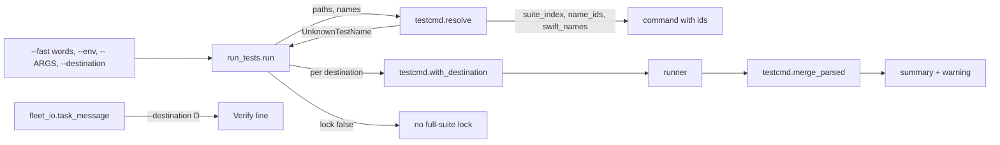
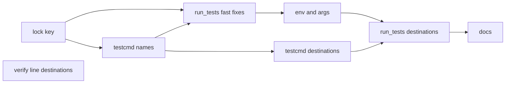

# Superlite: run_tests --fast maps names and paths; destinations, env and args; remote full runs skip the lock (B131)

**Goal:** fix #597 (fast runs widened to the whole package, 0-test runs, shell-broken `{names}`, workflow files run as tests, failing tests unnamed), #598 (one destination only, no env, no extra args) and main's #630 addition (a test-cmd.json `"lock": false` full run takes no local full-suite lock).
**Architecture:** `testcmd.py` resolves names and paths to test ids (`{only_testing}`, `{names}`), carries the new config keys `lock` and `destinations`, and owns the pure helpers (destination rewrite, platforms, result merge). `run_tests.py` refuses what cannot run, skips non-test paths, runs once per destination, passes `--env` and `-- ARGS`, skips the lock on `lock: false`. `fleet_io.py` puts named destinations on a task's Verify line. Docs name all of it.
**Tech stack:** Python 3.10+ stdlib, pytest (through `sl run_tests`); Markdown docs.
**Spec:** this file, section Design; issues #597, #598.
**Detail:** contracts
**Target-min:** 11
**Wave0:** none
**Edges:** hard
**Coverage:** off

Global constraints:
- Every Python code line keeps the file's trailing `# O(...)` complexity comment.
- Existing tests stay green. An existing test file changes only when the task Owns it. If another existing test turns red, report it in DONE_WITH_CONCERNS with the test id and the reason instead of editing it.
- Run `sl` as an executable (`<abs>/sl ...`). Verify with `<abs>/sl run_tests --fast <own test files> --task Tn --background`, then run the printed `wait:` line in the foreground and end the turn only after it reports.
- No version edits. Never run `scripts/evals.sh`, `claude plugin eval` or `scripts/test_layers.py run`. Never edit `tests/scripts/conftest.py`, `tests/scripts/test_run_tests_marker_468.py` or `tests/scripts/test_run_tests_wrapped_614.py` (batch B150 owns them). Tests set `SUPERLITE_HOME` and `SUPERLITE_USER_TEST_CMD` per test as the conftest does; no test touches the real `~/.superlite`.
- Fake runners are shell scripts or `echo` commands in a tmp git repo with `.superlite/test-cmd.json`, as `tests/scripts/test_run_tests_swift_only_testing.py` (fake xcodebuild recording its argv) and `tests/scripts/test_run_tests_task_cmd_475.py` do.

Ruling: by main, not the user (#630): the key is `"lock": false` in test-cmd.json (project file and user-level entry); a full run with it takes no full-suite lock; `sl testcmd` shows `lock`; no sniffing of the command text (cost if wrong: a project that sets it while running locally overlaps another full suite).
Ruling: a bare `--fast` word that is no existing path and reads like `Suite`, `Suite/test`, `Target/Suite[/test]` is a test name; on a Swift run (`{only_testing}`, or `{names}` with language swift) it maps to the suites the test targets declare and an unknown one is refused (exit 2), never widened; a path outside every test target keeps B71's unfiltered fallback (because #597 names names, and B71 ruled paths; cost if wrong: a source-only `--fast` still runs the whole suite).
Ruling: `{names}` for a `.swift` test file is the suites it declares (a suite-less test file: its target), and the joined filter is shell-quoted unless the template quotes it (because `A|B` unquoted is a shell pipe: #597's exit 127).
Ruling: `--fast` paths with a non-test suffix (`.yml`, `.md`, `.json`, ...) are skipped with a note; none left is exit 2; a red exit whose runner printed its "no tests" line is the `no tests ran` stop, and exit 126/127 with no count is `test command could not run` (exit 2) (because a 0-test run is no failing test).
Ruling: pass-through args (`run_tests ... -- ARGS`) make a narrowed fast run, as `-m` does (B101): no full-suite lock, no unit stamp, no full-run closing; `--env K=V` keeps the mode (cost if wrong: `--full -- -x` is not a full result).
Ruling: destinations come from test-cmd.json `"destinations"` (and `--destination D|all`); a full run runs every one, a fast run the first; the full-run warning names Package.swift platforms no run built for, instead of deriving a build command (because a scheme cannot be derived reliably; cost if wrong: a project without the key only gets the warning).
Ruling: one `run_tests` call carries every `--destination` of a task's Verify line (one run per destination inside), not one command per destination.
Ruling: main's #630 tell asks for docs/language.md and docs/tools.md, owned by B150 and B119/B135; T8 edits them with mid-paragraph insertions and notes.md names it.
LAYERS: unit

## Design

1. **Lock key (#630).** `testcmd.lock_enabled(cfg)` reads `"lock"`; `resolve` returns `"lock"`; `full_suite_lock(..., enabled=False)` prints one line and takes nothing.
2. **Names (#597 items 1-3).** `suite_index` scans the test targets' Swift files; `name_ids` maps names to `Target/Suite[/test]`; `{only_testing}` and `{names}` use them; unknown names raise `UnknownTestName`, which run_tests turns into exit 2.
3. **Paths and results (#597 items 4-5, expected list).** Non-test paths skipped, the 1.5.103 doubled prefix pinned by a regression test (fixed by #548's `root_relative`), no-match and 127 exits as stops, `; failing:` names in the summary line.
4. **Env and args (#598 item 3).** `--env K=V` on top of test-cmd.json `env`; `-- ARGS` into the test command (`with_args`) or the pytest argv.
5. **Destinations (#598 items 1-2).** test-cmd.json `destinations`, one run per destination, merged counts, a red destination named, the Package.swift platform warning; Verify lines carry the task's named destinations.

## File structure

- `skills/subagent-driven-development/scripts/testcmd.py`: lock key, name and path mapping, destination helpers, merge (T1, T2, T5).
- `skills/subagent-driven-development/scripts/run_tests.py`: lock skip, refusals, skips, stops, summary names, env, args, destinations (T1, T3, T4, T6).
- `skills/subagent-driven-development/scripts/fleet_io.py`, `agents/implementer.md`: Verify line destinations, worker wording (T7).
- `docs/tools.md`, `docs/language.md`: docs (T8).

## Task graph

```mermaid
%% schedule
gantt
  title Predicted schedule (mm:ss)
  dateFormat X
  axisFormat %M:%S
  section lane 1
  T1 test-cmd.json lock key :t1, 0, 155s
  T2 testcmd test names and paths :t2, 155, 123s
  T3 run_tests fast-run fixes :t3, 277, 119s
  T4 run_tests --env and pass-through args :t4, 396, 116s
  T6 run_tests destinations :t6, 512, 121s
  T8 docs for lock names env args destinat :t8, 633, 97s
  section lane 2
  T7 Verify line destinations and worker w :t7, 0, 146s
  T5 testcmd destinations :t5, 277, 117s
```

critical path: T1 → T2 → T3 → T4 → T6 → T8 (12.2 min) · peak width 2 · predicted build 12.2 min · predicted total ≈ 27.4 min (target ✗ 11.0)

## Package: testcmd and run_tests

App type: CLI over a library. Categories: protocol (flags, exit codes, stderr lines), encoding (shell quoting of ids and args), deep (Swift suite scan), state (lock). **Probe entry:** none (git repos with fake runners; cases are named tests).

### T1 test-cmd.json lock key · Complexity 3 · Est. context 44k
**Owns:** skills/subagent-driven-development/scripts/testcmd.py, skills/subagent-driven-development/scripts/run_tests.py, tests/scripts/test_run_tests_lock_key_630.py
**Components:** 2
**LOC owned:** 140
**Tests:** fast
**Model:** sonnet
**Est. time:** 2.5 min (2 components, about 140 LOC, fast tests)
**Covers:** 1
**Produces:** testcmd.lock_enabled(cfg: dict | None) -> bool
e.g. lock_enabled({"test": "x", "lock": False}) -> False
e.g. lock_enabled({"test": "x"}) -> True; lock_enabled(None) -> True
e.g. lock_enabled({"test": "x", "lock": "no"}) -> True, stderr `test-cmd.json "lock" must be true or false; ignored`
**Review Focus:** `test_full_run_with_lock_false_skips_held_lock`: another process holds the run's toolchain lock (`run_tests.full_lock_path(run_tests.lock_toolchain(spec))` under the test's SUPERLITE_HOME); `run_tests --full --lock-wait 2` with `"lock": false` exits 0, stderr has `no full-suite lock` and no `waiting for`; `test_background_full_run_writes_no_lockwait`: the same with `--background` then `--wait`: green, no `*.lockwait` file under `.superlite/`.
**Steps:** 1 failing tests, 2 run: FAIL, 3 implement, 4 run: PASS
**Notes:**
- `resolve` returns `"lock": lock_enabled(cfg)` in both result shapes (the python one too); detection gives True.
- `full_suite_lock(a, label, toolchain="python", enabled=True)`: when `label == "full"` and not enabled, print `run_tests: no full-suite lock: test-cmd.json sets "lock": false (its test command runs on another machine)` on stderr and yield; no note, no wait. Both call sites pass `enabled=spec.get("lock", True)`.
- Named tests: the e.g. lines, the Review Focus tests, `test_full_run_without_key_still_waits` (exit 2, `full-suite lock: still held`), `test_fast_run_ignores_key` (no `no full-suite lock` line), `test_user_entry_lock_false` (user file entry with `"lock": false` -> `resolve(...)["lock"] is False`), `test_sl_testcmd_shows_lock` (`testcmd.py --root R` JSON has `"lock": false`).

### T2 testcmd test names and paths · Complexity 5 · Est. context 52k
**Owns:** skills/subagent-driven-development/scripts/testcmd.py, tests/scripts/test_testcmd_names_597.py, tests/scripts/test_testcmd.py
**Components:** 1
**LOC owned:** 210
**Tests:** fast
**Model:** sonnet
**Est. time:** 3.5 min (1 component, about 210 LOC, fast tests)
**Covers:** 2, 3
**Produces:** testcmd.is_non_test(path: str) -> bool
e.g. is_non_test(".github/workflows/ci.yml") -> True; is_non_test("docs/x.md") -> True
e.g. is_non_test("tests/test_a.py") -> False; is_non_test("FooTests") -> False
**Produces:** testcmd.UnknownTestName(ValueError)
e.g. str(UnknownTestName(["Nope", "Gone"])) -> "test name not found: Nope, Gone (no Swift test target declares that suite)"; its `.names` -> ["Nope", "Gone"]
**Produces:** testcmd.name_ids(root: Path, names: list[str]) -> list[str]
e.g. name_ids(root, ["ParserTests"]) -> ["AppTests/ParserTests"] (AppTests/ParserTests.swift declares `struct ParserTests`, AppTests a test target)
e.g. name_ids(root, ["ParserTests/testA", "AppTests/ParserTests"]) -> ["AppTests/ParserTests/testA", "AppTests/ParserTests"]
e.g. name_ids(root, ["Nope"]) raises UnknownTestName(["Nope"])
**Produces:** testcmd.swift_names(root: Path, paths: list[str]) -> list[str] | None
e.g. swift_names(root, ["AppTests/ParserTests.swift"]) -> ["ParserTests"]; swift_names(root, ["AppTests/Helpers.swift"]) (no suite) -> ["AppTests"]
e.g. swift_names(root, ["Sources/App/Model.swift"]) -> None; swift_names(root, ["ParserTests", "AppTests/ParserTests"]) -> ["ParserTests", "AppTests.ParserTests"]
**Review Focus:** `test_names_filter_is_shell_quoted`: template `swift test --filter {names}` with two suite files -> `swift test --filter 'ParserTests|LexerTests'`; template `go test -run '{names}'` keeps its quotes; `test_unknown_name_is_not_widened`: `{only_testing}` template, `resolve(root, ["Nope"])` raises UnknownTestName; `test_suite_in_comment_is_no_suite`: a suite named only inside a comment is not in the index.
**Steps:** 1 failing tests, 2 run: FAIL, 3 implement, 4 run: PASS
**Notes:**
- `NON_TEST_EXT`: `.md .markdown .mdx .rst .txt .adoc .yml .yaml .json .toml .ini .cfg .conf .plist .xcconfig .entitlements .lock .csv .png .jpg .jpeg .gif .svg .pdf .strings .xcstrings .storyboard .xib .resolved .pbxproj .xcscheme .html .css`; `is_non_test` compares the lowercased suffix. `verify_paths` drops non-test paths from its `code` list.
- `is_test_name(arg, root)`: not an existing path under root and fullmatches `[A-Za-z_]\w*(?:/[A-Za-z_]\w*(?:\(\))?){0,2}`.
- `suite_index(root) -> dict[str, list[str]]`: suite name -> sorted test targets, from `swift_suites` (free `name()` functions are no suites) of every `.swift` file `owning_test_target` maps to a test target (`swift_target_map`); the walk skips hidden folders, `SKIP_DIRS`, `NO_SCAN`, `.build`, `DerivedData`.
- `name_ids`: a name whose first part is a test target keeps its form when its second part is a suite of that target; a name whose first part is a suite becomes `Target/<name>` per declaring target; all unknown names raise one UnknownTestName.
- `swift_names`: a test name -> `Suite[/test]`, `Target/Suite` -> `Target.Suite` (swift test's filter form), validated by `name_ids`; a readable `.swift` file -> its suites (`name()` -> `name`), else its owning test target, else the whole call returns None; an unreadable or non-Swift path -> its stem.
- `resolve`: `{names}` uses `swift_names` when the config language is swift or a path ends in `.swift` (None -> the unfiltered `test` command plus the note `<path> is not in a test target; running the unfiltered test command`, as `only_testing` does), else `names_filter`; the `|`-joined text is `shlex.quote`d unless the template's character before `{names}` is `'` or `"`. `xcode_only_testing` maps test-name args through `name_ids`. `UnknownTestName` propagates out of `resolve`; `main` prints it and exits 2.
- `parse_output`: `empty` also matches `No matching test cases were run` (add `\bno matching tests?(?: cases?)?\b`, case-insensitive).
- Named tests: the e.g. lines, the Review Focus tests, `test_verify_paths_drops_workflow_yml` (`[".github/workflows/ci.yml", "src/a.sh"]` -> `["src/a.sh"]`), `test_only_testing_name_maps_to_target_suite`, `test_testcmd_cli_unknown_name_exit_2`, `test_swift_test_no_match_line_is_empty`. Update `tests/scripts/test_testcmd.py` only where quoting changes a pinned command.

### T3 run_tests fast-run fixes · Complexity 5 · Est. context 54k
**Owns:** skills/subagent-driven-development/scripts/run_tests.py, tests/scripts/test_run_tests_fast_mapping_597.py
**Components:** 1
**LOC owned:** 190
**Tests:** fast
**Model:** sonnet
**Est. time:** 3.5 min (1 component, about 190 LOC, fast tests)
**Covers:** 3
**Consumes:** testcmd.is_non_test(path: str) -> bool (T2) · testcmd.UnknownTestName(ValueError) (T2)
**Produces:** run_tests.summary_line(data: dict) -> str
e.g. summary_line({"mode": "fast", "passed": 3, "failed": 2, "failures": ["tests/a.py::test_x: assert 1 == 2", "-::ParserTests/parses(): failed"]}) -> "tests (fast): 3 passed, 2 failed; failing: tests/a.py::test_x, ParserTests/parses()"
e.g. five failures a..e -> "tests (fast): 0 passed, 5 failed; failing: a, b, c (+2 more)"
e.g. summary_line({"passed": 3, "failed": 1, "skipped": 2, "mode": "fast"}) -> "tests (fast): 3 passed, 1 failed, 2 skipped" (unchanged without failures)
**Review Focus:** `test_unknown_suite_name_refused`: Xcode fixture, `--fast Nope` exits 2 with `test name not found: Nope`, the fake xcodebuild never ran, no incident; `test_known_suite_name_runs_target_suite`: `--fast ParserTests` gives the fake `-only-testing:AppTests/ParserTests`; `test_exit_127_is_could_not_run`: a command `nosuchtool-xyz` exits 2 with `test command could not run (exit 127`.
**Steps:** 1 failing tests, 2 run: FAIL, 3 implement, 4 run: PASS
**Notes:**
- `run`: with `--fast` paths (not a task `cmd=`), drop `is_non_test` paths and print `run_tests: --fast skips non-test paths: a.yml, b.md`; none left -> `usage_error(a, label, "no test paths left: --fast named only non-test files (a.yml, b.md)")`. The `--background` parent refuses the same way (exit 2, nothing spawned) and prints `run_tests: <reason>` for UnknownTestName.
- `UnknownTestName` from `fast_spec` -> `usage_error(a, label, str(e))`.
- `run_other`: a red exit with nothing counted, no names and the runner's `empty` line takes the existing `no tests ran` stop (exit 1, `; runner:` part); a red exit 126 or 127 with nothing counted -> `record_no_result` with `test command could not run (exit 127: command not found): <last output line>` (126: `not executable`), exit 2.
- `summary_line`: failing names only when `failed > 0`, `failures` is non-empty and there is no `error`; a name is a failure string up to its first `": "`, a leading `-::` dropped, each cut at 60 characters, at most 3, then ` (+K more)`.
- Named tests: the e.g. lines, the Review Focus tests, `test_yml_path_skipped_with_note`, `test_only_non_test_paths_refused`, `test_background_parent_refuses_non_test_only`, `test_red_no_match_is_no_tests_ran` (fake prints `No matching test cases were run`, exits 1: exit 1, summary error starts `no tests ran`), `test_fast_from_package_dir_resolves_once` (cwd `<root>/packages/app`, `--fast packages/app/test/a.test.ts` and `--fast test/a.test.ts` both run `packages/app/test/a.test.ts`; the 1.5.103 report).

### T4 run_tests --env and pass-through args · Complexity 4 · Est. context 50k
**Owns:** skills/subagent-driven-development/scripts/run_tests.py, tests/scripts/test_run_tests_env_args_598.py
**Components:** 1
**LOC owned:** 170
**Tests:** fast
**Model:** sonnet
**Est. time:** 3.0 min (1 component, about 170 LOC, fast tests)
**Covers:** 4
**Produces:** run_tests.with_args(command: str, args: list[str]) -> str
e.g. with_args("xcodebuild test -scheme A | xcpretty", ["-test-iterations", "3"]) -> "xcodebuild test -scheme A -test-iterations 3 | xcpretty"
e.g. with_args("cd P && swift test", ["--parallel"]) -> "cd P && swift test --parallel"
e.g. with_args("npm test", ["--", "-t", "a b"]) -> "npm test -- -t 'a b'"; with_args("x", []) -> "x"
**Review Focus:** `test_passthrough_background_keeps_args`: `--fast F --background -- --flag` then `--wait`: the fake runner saw `--flag`, and the child's own `--summary`/`--run-id` flags are not in the pass-through; `test_env_bad_value_exit_2`: `--env NOVALUE` exits 2 with `--env needs K=V, got NOVALUE`.
**Steps:** 1 failing tests, 2 run: FAIL, 3 implement, 4 run: PASS
**Notes:**
- `main`: split argv at the first bare `--`; argparse reads the head, `a.passthrough` is the tail. `--env` is `action="append"`, `metavar="K=V"`; K must match `[A-Za-z_][A-Za-z0-9_]*`. Pass-through with `--record` or `--wait` exits 2: `run_tests: pass-through args (after --) need a test run`. `to_root` rewrites only the head; `start_background` builds the child as head (no `--background`) + its own flags + `["--", *tail]`.
- `with_args`: args `shlex.join`ed; with an `XCODEBUILD` word they go at the end of each xcodebuild segment (`SEGMENT_END`), else before the first single `|` (not `||`), else at the end.
- Env: the pytest run gets `child_env(cli_env)`; other runners and setup get the spec env with `cli_env` on top (CLI wins). Args: the pytest argv ends with them; other runners and a task `cmd=` run `with_args(command, args)`.
- Pass-through args make the run narrowed: label `fast` (also in main's crash, limit and background-pointer paths, which read `a.fast or a.marker` today).
- Named tests: the e.g. lines, the Review Focus tests, `test_env_reaches_test_command`, `test_env_overrides_config_env`, `test_passthrough_appended_to_command`, `test_passthrough_makes_run_fast` (`--full -- -x`: summary mode `fast`), `test_passthrough_with_wait_refused`, `test_passthrough_to_pytest` (`--fast tests/test_a.py -- -k one` runs 1 of 2 tests).

### T5 testcmd destinations · Complexity 4 · Est. context 46k
**Owns:** skills/subagent-driven-development/scripts/testcmd.py, tests/scripts/test_testcmd_destinations_598.py
**Components:** 1
**LOC owned:** 180
**Tests:** fast
**Model:** sonnet
**Est. time:** 3.0 min (1 component, about 180 LOC, fast tests)
**Covers:** 5
**Produces:** testcmd.with_destination(command: str, dest: str) -> str | None
e.g. with_destination("xcodebuild test -scheme A -destination 'platform=iOS Simulator,name=iPhone 16'", "platform=macOS") -> "xcodebuild test -scheme A -destination platform=macOS"
e.g. with_destination("xcodebuild test -scheme A | xcpretty", "platform=iOS Simulator,name=X") -> "xcodebuild test -scheme A -destination 'platform=iOS Simulator,name=X' | xcpretty"
e.g. with_destination("swift test", "platform=macOS") -> None
**Produces:** testcmd.destination_platform(dest: str) -> str | None
e.g. "platform=iOS Simulator,name=iPhone 16" -> "iOS"; "generic/platform=macOS" -> "macOS"; "platform=macOS,variant=Mac Catalyst" -> "macCatalyst"; "id=00008030-ABC" -> None
**Produces:** testcmd.command_platforms(command: str) -> list[str]
e.g. command_platforms("swift test") -> ["macOS"]; command_platforms("xcodebuild test -scheme A -destination 'platform=iOS Simulator,name=X'") -> ["iOS"]; command_platforms("npm test") -> []
**Produces:** testcmd.declared_platforms(root: Path) -> list[str]
e.g. a root Package.swift with `platforms: [.iOS(.v17), .macOS(.v14)]` -> ["iOS", "macOS"]; none declared -> []
**Produces:** testcmd.merge_parsed(parts: list[tuple[str, dict]]) -> dict
e.g. merge_parsed([("platform=macOS", {"passed": 3, "failed": 0, "skipped": 0, "names": [], "tail": ["ok"], "empty": "", "counted": True, "error": "", "marker": "** TEST SUCCEEDED **"}), ("platform=iOS Simulator,name=X", {"passed": 2, "failed": 1, "skipped": 1, "names": ["ParserTests/parses()"], "tail": ["bad"], "empty": "", "counted": True, "error": "", "marker": "** TEST FAILED **"})]) -> {"passed": 5, "failed": 1, "skipped": 1, "names": ["ParserTests/parses()"], "tail": ["bad"], "empty": "", "counted": True, "error": "", "marker": "** TEST FAILED **"}
e.g. a part with error "a.swift:3:1: error: x" under "platform=macOS" -> merged error "[platform=macOS] a.swift:3:1: error: x"
**Review Focus:** `test_destination_value_quoted_both_ways`: `-destination "platform=iOS Simulator,name=X"` and `-destination platform=macOS` are both replaced, never left twice; `test_platforms_in_comment_ignored`: `// platforms: [.tvOS(.v17)]` declares nothing.
**Steps:** 1 failing tests, 2 run: FAIL, 3 implement, 4 run: PASS
**Notes:**
- `destinations(cfg) -> list[str]`: the config's `"destinations"` (non-empty strings); absent -> []; any other value -> stderr `test-cmd.json "destinations" must be a list of xcodebuild destination strings; ignored` and []. `resolve` returns `"destinations"` in both shapes.
- `with_destination`: in each xcodebuild segment drop every `-destination <one shell word>` and append ` -destination <shlex.quote(dest)>` at the segment's end; no xcodebuild word -> None.
- `declared_platforms`: every Package.swift at the root and one or two folder levels below (hidden, `SKIP_DIRS`, `.build` skipped), scanned after `strip_swift`; names among iOS, macOS, tvOS, watchOS, visionOS, macCatalyst; sorted, unique.
- `merge_parsed`: counts summed; names concatenated, deduped, at most 50; `counted` all; `empty` the first non-empty when nothing counted, else ""; `error` the first non-empty as `[<dest>] <error>`; `marker` the last non-empty; `tail` the last 40 lines of the parts with `failed > 0` (all parts when none).
- Named tests: the e.g. lines and the Review Focus tests, `test_resolve_carries_destinations`, `test_invalid_destinations_ignored`.

### T6 run_tests destinations · Complexity 5 · Est. context 54k
**Owns:** skills/subagent-driven-development/scripts/run_tests.py, tests/scripts/test_run_tests_destinations_598.py
**Components:** 1
**LOC owned:** 200
**Tests:** fast
**Model:** sonnet
**Est. time:** 3.5 min (1 component, about 200 LOC, fast tests)
**Covers:** 5
**Consumes:** testcmd.with_destination(command: str, dest: str) -> str | None (T5) · testcmd.destination_platform(dest: str) -> str | None (T5) · testcmd.command_platforms(command: str) -> list[str] (T5) · testcmd.declared_platforms(root: Path) -> list[str] (T5) · testcmd.merge_parsed(parts: list[tuple[str, dict]]) -> dict (T5)
**Review Focus:** `test_red_destination_named`: config destinations [macOS, iOS Simulator], the fake xcodebuild exits 65 for macOS only: `--full` exits 1, a failure reads `destination platform=macOS: exit 65`, and the iOS run still ran; `test_platform_warning_full_run`: Package.swift declares iOS and macOS, the command builds iOS only: stderr and the summary's `warning` name macOS; `--wait` prints `warning: ...` before its summary line.
**Steps:** 1 failing tests, 2 run: FAIL, 3 implement, 4 run: PASS
**Notes:**
- `--destination D` (`action="append"`; `all` = every configured one). Chosen: the flags, else `spec["destinations"]`: all on a full run, the first on a fast run; none -> the command as is.
- `run_other`: with chosen destinations and an xcodebuild word, one `run_captured` per destination on `with_destination(command, d)` (after the tree rewrite), in order; each output is preceded by `run_tests: destination <d>`; the joined text is saved as the output; the return code is the first non-zero one; with 2+ destinations JUnit is not read, each output is `parse_output`-ed and `merge_parsed`, and each red destination adds the failure `("-", 0, "destination <d>: exit <n>")`. Chosen destinations without an xcodebuild word: stderr `run_tests: WARNING: destinations need an xcodebuild command; ran `<cmd>` once`, one run.
- Platform warning, full runs only: `declared_platforms(Path.cwd())` minus the platforms of the destinations run (`destination_platform`), or of `command_platforms(command)` when none; non-empty -> stderr `run_tests: WARNING: Package.swift declares iOS, macOS; this full run built for iOS only; add "destinations" to .superlite/test-cmd.json, e.g. ["platform=macOS", "platform=iOS Simulator,name=iPhone 16"]` (`built for no declared platform` when none), and the summary key `warning` (that text without `run_tests: WARNING: `), kept through write_summary like `OUTPUT`; `wait_background` prints `warning: <text>` on stderr before the summary line.
- Named tests: the Review Focus tests, `test_full_runs_every_destination`, `test_fast_runs_first_destination`, `test_destination_flag_overrides`, `test_destination_all`, `test_counts_summed`, `test_non_xcodebuild_warns_runs_once`, `test_no_warning_when_covered`.

## Package: fleet_io

App type: text generator (task messages). Categories: protocol (Verify line flags), encoding (shell quoting). **Probe entry:** none (plan fixtures; cases are named tests).

### T7 Verify line destinations and worker wording · Complexity 3 · Est. context 40k
**Owns:** skills/subagent-driven-development/scripts/fleet_io.py, agents/implementer.md, tests/scripts/test_fleet_io_destinations_598.py
**Components:** 2
**LOC owned:** 90
**Tests:** fast
**Model:** sonnet
**Est. time:** 2.0 min (2 components, about 90 LOC, fast tests)
**Covers:** 5
**Produces:** fleet_io.named_destinations(text: str) -> list[str]
e.g. named_destinations("Run on -destination 'platform=macOS' and -destination \"platform=iOS Simulator,name=iPhone 16\".") -> ["platform=macOS", "platform=iOS Simulator,name=iPhone 16"]
e.g. named_destinations("run_tests --destination platform=macOS") -> ["platform=macOS"]; named_destinations("no platform") -> []
**Review Focus:** `test_verify_line_carries_named_destinations`: a plan task whose Steps name two destinations gets `--destination platform=macOS --destination 'platform=iOS Simulator,name=iPhone 16'` before `--background` on its Verify line; a `cmd=` task's line is unchanged.
**Steps:** 1 failing tests, 2 run: FAIL, 3 implement, 4 run: PASS
**Notes:**
- `task_message`: the `--fast` and the `Tests: build` Verify forms get one ` --destination <shlex.quote(d)>` per destination `named_destinations` finds in the task's `steps` and `notes` field text, deduped in order.
- `agents/implementer.md`, after the fast-check bullet: "A Verify line with `--destination` flags runs once per destination; a red destination is a red run, never skip one. For env vars or extra test-tool args use `run_tests ... --env K=V` and `-- ARGS`, never a raw test tool plus `--record`." If a test pins the agent file's size, report it in DONE_WITH_CONCERNS.

## Package: docs

App type: docs. Categories: none beyond wording. **Probe entry:** none (Markdown).

### T8 docs for lock, names, env, args, destinations · Complexity 2 · Est. context 36k
**Owns:** docs/tools.md, docs/language.md, tests/scripts/test_docs_b131.py
**Components:** 1
**LOC owned:** 60
**Tests:** fast
**Model:** sonnet
**Est. time:** 2.0 min (1 component, about 60 LOC, fast tests)
**Covers:** 1, 2, 3, 4, 5
**Review Focus:** `test_docs_b131_lock_key`: docs/language.md and docs/tools.md both name `"lock": false`.
**Steps:** 1 failing tests, 2 run: FAIL, 3 implement, 4 run: PASS
**Notes:**
- docs/language.md: Xcode paragraph: bare suite names (`--fast ParserTests` -> `-only-testing:<Target>/ParserTests`), unknown names exit 2; Swift paragraph: `{names}` is the suites a test file declares (suite-less: its target), shell-quoted; a test-cmd.json keys sentence: `"lock": false` (a test command that runs on another machine: its full run takes no local full-suite lock; project file and user entry; `sl testcmd` shows `lock`) and `"destinations"` (one xcodebuild run per destination: full all, fast the first, `--destination D|all`; the full-run Package.swift platform warning).
- docs/tools.md `run_tests` row: `--env K=V`, `-- ARGS` (a narrowed fast run), `--destination D|all`, skipped non-test paths, refused unknown names, the no-match and exit-127 stops, the `; failing:` part, `lock: false`; `testcmd` row: `lock` and `destinations` in its JSON, the names mapping. Insert mid-row: `tests/scripts/test_docs_b67_tools.py` pins row ends and `test_docs_b72_*.py` pin quoted texts.
- Named tests: the Review Focus test, `test_docs_b131_run_tests_flags` (the run_tests row names `--env`, `--destination`, `-- ARGS`), `test_docs_b131_names` (language.md names `test name not found`).

## Self-review

Coverage: #630 T1; #597 items 1-3 T2/T3, 4-5 and the expected list T3; #598 items 1-2 T5/T6/T7, item 3 T4; docs T8. Shared files run in order (T1, T3, T4, T6 on run_tests.py; T1, T2, T5 on testcmd.py). Types match their Produces lines.
