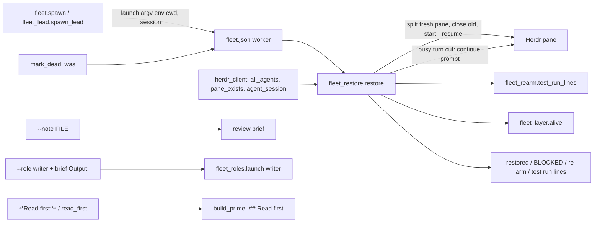
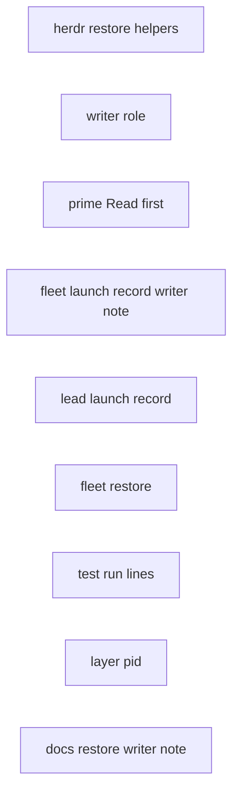

# Superlite: fleet restore after a Herdr restart; brief notes, writer role, Read first (B139)

**Goal:** fix #577: one command, `sl fleet restore`, re-launches every worker and lead of the run after a Herdr server restart, each in a fresh pane with its recorded env, account, model, agent and name, resuming its own Claude session, and prints the waits to re-arm and the test runs that ended meanwhile. Fix #604: `fleet spawn --for-review ... --note FILE` adds coordinator notes to the generated review brief; a `writer` role may write only the one `Output:` file its brief names; a plan header `**Read first:**` line or test-cmd.json `read_first` list puts those files into every prime.
**Architecture:** spawn (fleet.py, fleet_lead.py) records the exact launch (argv, pane env, cwd) and the Claude session id in each fleet.json worker. The new `fleet_restore.py` reads them back: per worker it finds the pane that holds its session (herdr agent list) or its recorded pane, splits a fresh pane off it with the recorded env, closes the old one, starts the agent with `--resume <session>`, and prompts a worker whose turn the restart cut. `fleet_rearm.py` names the test runs; `fleet_layer.py` records the layer shell's pid so a restore can tell a dead layer run. The writer role is permissions: `--permission-mode default --allowedTools Edit(//<abs output>)`, so every other write is a dialog the fleet hook answers no.
**Tech stack:** Python 3.10+ stdlib, pytest (through `sl run_tests`); Markdown docs; bash (hooks/session-start, printf only).
**Spec:** this file, section Design; issues #577 and #604; Max's decisions in the lead brief (restore re-launches all panes; all three #604 features).
**Detail:** contracts
**Target-min:** 11
**Wave0:** none
**Coverage:** off (backlog batch: scope fixed by the issues and Max's two decisions; the rulings below settle the rest)

Global constraints:
- Every Python code line keeps the file's trailing `# O(...)` complexity comment; hooks keep theirs.
- Existing tests stay green. An existing test file changes only when the task Owns it. If another existing test turns red, report it in DONE_WITH_CONCERNS with the test id and the reason instead of editing it.
- Run `sl` as an executable (`<abs>/sl ...`). Verify with `<abs>/sl run_tests --fast <own test files> --task Tn --background`, then run the printed `wait:` line in the foreground and end the turn only after it reports.
- No version edits. Never run `scripts/evals.sh`, `claude plugin eval`, `scripts/test_layers.py run` or `run_tests --full`. No test calls the real `herdr`, `claude` or `ps`.
- Never edit run_tests.py, fleet_io.py, fleet_state.py, backlog*.py, docs/tools.md or docs/fleet.md (other batches own some; import functions from them freely).
- Code that calls a herdr_client function T1 adds (`agent_session`, `all_agents`, `pane_exists`) from fleet.py or fleet_lead.py goes through a helper that never raises (`getattr(hc, name, None)`, any Exception -> None), because the existing FakeHerdr test doubles lack them. Tests fake those functions with `monkeypatch.setattr(..., raising=False)` or a fake client object.

Ruling: restore opens a fresh pane per worker (split off the pane that holds the worker's session, or off its recorded pane, then closes that one) instead of typing `export` lines into the old pane (because `herdr agent start` takes no env and the pane env is set only at pane creation, as spawn does; cost if wrong: the layout shifts once per restore).
Ruling: the session id comes from herdr's live agent list first (`agent_session.value` of the agent in the worker's pane or with its name), then the recorded `session`, then the newest stop record's transcript file stem (because herdr knows what it resumed; cost if wrong: a resume of an older session, visible in the restored line).
Ruling: restore skips a worker whose agent herdr shows `working` (restore is for idle or gone agents; cost if wrong: a working env-less agent must be stopped by hand first) and a worker without a `launch` record (spawned before this version; the line names its fresh-spawn command).
Ruling: a dead worker (`fleet status`/`wait` marked it after the restart) is restored when `mark_dead` recorded its `was` state ready or busy and no live worker of the run holds its last task; restore needs no account choice and no machine gate (it resumes agents that ran before).
Ruling: a busy worker whose turn ended before the restart (a stop record since its send) is restored without a prompt (`fleet wait` collects it); any other busy worker gets one continuation prompt and a new `sent`.
Ruling: the writer is one-turn, default model sonnet (`--tier sonnet|opus|haiku`), tools Read, Grep, Glob, Write, Edit, no Bash; its output must lie inside the run root or the state folder (spike: `--permission-mode default --allowedTools "Edit(//<abs>)"` wrote out.md and refused other.md under claude -p).
Ruling: `--note FILE` exists only on `--for-review`/`--package`; Read first goes into all three prime kinds, plan header first, then test-cmd.json (project file only), deduplicated; a missing file is listed with a stderr warning.
Ruling: `**Detail:** contracts` (named tests with exact values; the fakes follow the existing FakeHerdr pattern in tests/scripts/test_fleet.py).
LAYERS: unit, headless, tui, evals

## Design

### 1. Launch records (#577)
Each spawned worker's fleet.json record gains `"launch": {"argv": [...], "env": {...}, "cwd": "<abs>"}` (the exact argv passed to `herdr agent start`, lean flags and `--add-dir` included; the pane env; the pane cwd) and, after a successful start, `"session": "<id>"` from `herdr agent get` when herdr reports one. Leads get the same. `mark_dead` keeps `"was": <state before>`.

### 2. `sl fleet restore [--plan P]` (#577)
Fleet off: `BLOCKED: fleet is off in <sd>; nothing to restore`, exit 3. First each lead's own fleet (its `lead_sd`), lines prefixed `<lead id> `, then this run's workers in id order. Per worker: find the session and the old pane, split a fresh pane (`down`) off the old pane with the recorded env and cwd (no old pane: a tab in the run's workspace, else a new workspace), close the old pane, start the recorded name with the recorded argv plus `--resume <session>` (an earlier `--resume` pair dropped; one retry after 3 s on `not an available shell`; a trust dialog is accepted), store the new pane and session, restore `was` and the last task of a dead worker (implementers back into pool.json). A busy worker whose turn did not end gets the continue prompt and a new `sent` through `fleet_io._busy`. Lines: `Wn restored pane=P session=<8 chars> <state>[, continued|, reported]`, `Wn skipped (<why>)`, `BLOCKED: Wn not restored (<why>)`; then `re-arm: <sl> fleet wait --any --timeout 540000 --plan <sd>` (any busy worker), `re-arm: <sl> backlog wait` (any lead), the test run lines, or `fleet restore: nothing to restore in <sd>`. Exit 3 when any BLOCKED line, else 0. A layer worker whose run died (no exit file, its shell pid gone) is stopped with `Wn layer-L died with the restart; rerun: <sl> fleet run --layer L --plan <sd>`.

### 3. Test runs (#577)
`fleet_rearm.test_run_lines(sd)`: each `test-summary*.latest` pointer in sd names a background run; started within 12 h: summary written -> `test run ended: 
 <run_tests.summary_line>`; pid alive -> `test run running: 
; re-arm: <sl> run_tests --wait 
`; else `test run died: 
 (no summary, pid gone)`.

### 4. #604
`--note FILE` appends `## Coordinator notes` to the review brief before the send. `--role writer` needs `--brief`; the brief's first `Output: <path>` line names the one file. `**Read first:** a, b` in the plan header and `"read_first": [...]` in test-cmd.json become a `## Read first` prime section.

## File structure
- `skills/subagent-driven-development/scripts/herdr_client.py`, `tests/scripts/test_herdr_client_restore_577.py`: T1
- `skills/subagent-driven-development/scripts/fleet_roles.py`, `agents/writer.md`, `hooks/session-start`, `docs/skills-and-agents.md`, `tests/scripts/test_fleet_roles_writer_604.py`, `tests/scripts/test_session_start_roles.py`: T2
- `skills/subagent-driven-development/scripts/build_prime.py`, `tests/scripts/test_build_prime_read_first_604.py`: T3
- `skills/subagent-driven-development/scripts/fleet.py`, `tests/scripts/test_fleet_launch_record_577.py`, `tests/scripts/test_fleet_writer_note_604.py`: T4
- `skills/subagent-driven-development/scripts/fleet_lead.py`, `tests/scripts/test_fleet_lead_record_577.py`: T5
- `skills/subagent-driven-development/scripts/fleet_restore.py`, `tests/scripts/test_fleet_restore_577.py`: T6
- `skills/subagent-driven-development/scripts/fleet_rearm.py`, `tests/scripts/test_fleet_rearm_577.py`: T7
- `skills/subagent-driven-development/scripts/fleet_layer.py`, `tests/scripts/test_fleet_layer_pid_577.py`: T8
- `skills/subagent-driven-development/fleet.md`, `tests/scripts/test_docs_fleet_restore_577.py`: T9

## Task graph

```mermaid
%% schedule
gantt
  title Predicted schedule (mm:ss)
  dateFormat X
  axisFormat %M:%S
  section lane 1
  T6 fleet restore :t6, 0, 615s
  section lane 2
  T4 fleet launch record writer note :t4, 0, 605s
  section lane 3
  T2 writer role :t2, 0, 597s
  section lane 4
  T3 prime Read first :t3, 0, 551s
  section lane 5
  T7 test run lines :t7, 0, 548s
  section lane 6
  T5 lead launch record :t5, 0, 545s
  section lane 7
  T9 docs restore writer note :t9, 0, 543s
  section lane 8
  T1 herdr restore helpers :t1, 0, 543s
  section lane 9
  T8 layer pid :t8, 0, 540s
```

critical path: T6 (10.2 min) · peak width 9 · predicted build 10.2 min · predicted total ≈ 26.7 min (target ✗ 11.0)

## Package: herdr and fleet records

App type: library over a CLI (herdr). Categories: protocol (herdr JSON shapes, error codes), state (fleet.json records). **Probe entry:** none (every call needs herdr; cases are named tests).

### T1 herdr restore helpers · Complexity 2 · Est. context 26k
**Owns:** skills/subagent-driven-development/scripts/herdr_client.py, tests/scripts/test_herdr_client_restore_577.py
**Components:** 1
**LOC owned:** 70
**Tests:** fast
**Kind:** mechanical
**Model:** haiku
**Est. time:** 1.5 min (1 component, about 70 LOC, fast tests)
**Produces:** herdr_client.session_of(agent: dict) -> str | None
e.g. session_of({"agent_session": {"kind": "id", "value": "84f86f13-02e3"}}) -> "84f86f13-02e3"
e.g. session_of({"name": "x"}) -> None; session_of({"agent_session": {"value": ""}}) -> None
**Produces:** herdr_client.agent_session(name: str) -> str | None
e.g. `agent get NAME` result {"agent": {"agent_session": {"value": "abc"}}} -> "abc"; result {"agent": {}} -> None
**Produces:** herdr_client.all_agents() -> list
e.g. `agent list` result {"agents": [{"pane_id": "w5:p9"}, {"name": "sl-a-w1", "pane_id": "w6:p1"}, "junk"]} -> both dicts (unnamed kept, non-dicts dropped)
**Produces:** herdr_client.pane_exists(pane_id: str) -> bool
e.g. `pane get w6:p1` succeeds -> True; HerdrError code "pane_not_found" (any code but "missing" or "timeout") -> False; codes "missing" and "timeout" re-raise
**Review Focus:** `test_session_of_shapes` (the three examples), `test_agent_session_reads_agent_get`, `test_all_agents_keeps_unnamed`, `test_pane_exists_false_on_not_found`, `test_pane_exists_reraises_missing_and_timeout`; all patch `herdr_client.call` with a lambda returning the result dict or raising `HerdrError(code, msg)`, and assert the args (`["agent", "get", NAME]`, `["agent", "list"]`, `["pane", "get", PANE]`).
**Steps:** 1 failing tests, 2 run: FAIL, 3 implement with `call` and `_pick`, 4 run: PASS
**Notes:** `agents()` keeps its named-only filter; `all_agents` is a separate function. Each new function gets the file's `# O(...)` comments.

### T2 writer role · Complexity 3 · Est. context 34k
**Owns:** skills/subagent-driven-development/scripts/fleet_roles.py, agents/writer.md, hooks/session-start, docs/skills-and-agents.md, tests/scripts/test_fleet_roles_writer_604.py, tests/scripts/test_session_start_roles.py
**Components:** 2
**LOC owned:** 110
**Tests:** fast
**Model:** sonnet
**Est. time:** 2.5 min (2 components, about 110 LOC, fast tests)
**Produces:** fleet_roles.launch(role: str, tier: str | None, cfg: dict, agents_dir: Path = AGENTS, output: str | None = None) -> dict
e.g. launch("writer", None, cfg, output="/r/docs/plans/x.md") -> {"role": "writer", "agent": "superlite:writer", "model": "sonnet", "effort": "medium", "argv": ["--agent", "superlite:writer", "--model", "sonnet", "--effort", "medium", "--permission-mode", "default", "--allowedTools", "Edit(//r/docs/plans/x.md)", "--disallowedTools", "AskUserQuestion", "Bash", "NotebookEdit"], "prime": False, "pool": False, "one_turn": True}
e.g. launch("writer", "opus", cfg, output="/r/a.md")["argv"][:4] -> ["--agent", "superlite:writer", "--model", "opus"]
e.g. launch("writer", None, cfg) -> ValueError("writer needs an output file (the brief's Output: line)"); launch("writer", "2", cfg, output="/r/a.md") -> ValueError("writer tier must be sonnet, opus or haiku")
**Review Focus:** `test_writer_argv_limits_writes_to_output` (first example, exact dict), `test_writer_tier_pins_model`, `test_writer_without_output_or_bad_tier_is_value_error`, `test_other_roles_ignore_output` (launch("fixer", "1", cfg, output="/r/a.md") equals launch("fixer", "1", cfg)), `test_roles_tuple_ends_with_writer` (ROLES == (..., "checker", "writer")), `test_writer_agent_file` (frontmatter `name: writer`, `model: sonnet`, `effort: medium`, `tools: Read, Grep, Glob, Write, Edit`; body names `Output:`, "absolute `sl` path", "no shell", "every other write is refused"; no `$SL`), `test_skills_and_agents_lists_writer` (a line starting "- `writer` (sonnet, medium)"); in test_session_start_roles.py add ("writer", "superlite:writer") to the brief-role parameters.
**Steps:** 1 failing tests, 2 run: FAIL, 3 implement, 4 run: PASS
**Notes:** the rule path is `"Edit(/" + Path(output).as_posix() + ")"` for an absolute output (two slashes then). The docstring's role list adds writer. hooks/session-start: add `writer` to the `fixer|package-reviewer|final-reviewer|research|checker)` case. agents/writer.md body (about 10 lines): read the brief the first message names; write only the file its `Output:` line names (Write, then Edit to revise); every other write is refused by permission; no shell, so no git or `sl` runs; when the brief gives the absolute `sl` path, type it literally; end as the first message says.

### T3 prime Read first · Complexity 3 · Est. context 32k
**Owns:** skills/subagent-driven-development/scripts/build_prime.py, tests/scripts/test_build_prime_read_first_604.py
**Components:** 1
**LOC owned:** 90
**Tests:** fast
**Model:** sonnet
**Est. time:** 2 min (1 component, about 90 LOC, fast tests)
**Produces:** build_prime.read_first_section(plan: str, root: Path) -> str
e.g. plan header line `**Read first:** docs/ui-guide.md, ` + "`~/notes/x.md`" + ` and root /r with .superlite/test-cmd.json {"test": "pytest", "read_first": ["docs/style.md", "docs/ui-guide.md"]} -> "## Read first\n\nRead each of these files in full before your first task; they are not in this prime.\n\n- /r/docs/ui-guide.md\n- <home>/notes/x.md\n- /r/docs/style.md"
e.g. neither key -> ""
e.g. read_first = "docs/a.md" (not a list) -> "" plus stderr `test-cmd.json "read_first" must be a list of paths; ignored`
**Review Focus:** `test_read_first_header_and_test_cmd` (first example: backticks stripped, `~` expanded, relative paths joined to root, duplicates dropped, header first), `test_read_first_none_is_empty`, `test_read_first_bad_type_warns`, `test_read_first_missing_file_listed_with_warning` (stderr `build_prime: read first: /r/docs/gone.md not found`), `test_read_first_only_in_header_block` (a `**Read first:**` line after the first `## ` heading is ignored), `test_slim_full_and_mini_carry_section` (each prime kind built from a temp plan with the header line holds the section right after the preamble's rules), `test_prime_without_read_first_unchanged` (each prime kind built from a plan with neither key holds no `## Read first`; the existing build_prime tests stay green).
**Steps:** 1 failing tests, 2 run: FAIL, 3 implement, 4 run: PASS
**Notes:** the header block is the plan's lines before the first `## ` heading. test-cmd.json is read like `launch_section` (`testcmd.config_source`, project file only). The section goes after the preamble in `build`, `build_slim` and `build_mini`, before `## Running the app`. Module docstring names the key.

### T4 fleet launch record writer note · Complexity 5 · Est. context 52k
**Owns:** skills/subagent-driven-development/scripts/fleet.py, tests/scripts/test_fleet_launch_record_577.py, tests/scripts/test_fleet_writer_note_604.py
**Components:** 2
**LOC owned:** 160
**Tests:** fast
**Model:** sonnet
**Est. time:** 3.5 min (2 components, about 160 LOC, fast tests)
**Consumes:** fleet_roles.launch(role: str, tier: str | None, cfg: dict, agents_dir: Path = AGENTS, output: str | None = None) -> dict (T2)
**Produces:** fleet.writer_output(brief: str, root: Path, sd: Path) -> Path
e.g. brief text "Write the plan.\nOutput: `docs/plans/x.md`\n" with root /r -> Path("/r/docs/plans/x.md")
e.g. no `Output:` line -> ValueError("writer brief <abs brief> names no Output: <file> line"); "Output: /etc/x" -> ValueError("writer output /etc/x is outside /r and <sd>")
**Produces:** fleet.mark_dead(sd, wid) -> None
e.g. a busy W2 on T3 -> fleet.json W2 {"state": "stopped", "dead": True, "was": "busy", "last_task": "T3", "task": None}
**Review Focus:** in test_fleet_launch_record_577.py: `test_spawn_records_launch` (world fixture as in test_fleet.py: W1's record "launch" == {"argv": the argv passed to start_agent, "env": the pane env passed to create_workspace, "cwd": str(proj)}), `test_spawn_records_session` (fake `agent_session` returns "sid-1" -> record "session" == "sid-1"; a fake without it -> no "session" key, spawn still succeeds), `test_mark_dead_keeps_was`, `test_restore_is_delegated` (main(["restore", "--plan", sd]) calls fleet_restore.main(["--plan", sd]) and returns its code), `test_status_names_restore_after_dead` (a newly dead worker adds the line `restore: after a Herdr restart, sl fleet restore --plan <sd> resumes the workers in their own sessions`), `test_docstring_lists_checker_and_writer`; in test_fleet_writer_note_604.py: `test_writer_output_examples` (the three examples), `test_writer_spawn_needs_brief` (main spawn --role writer without --brief: exit 2, stderr `error: --role writer needs --brief naming its Output: file`, no pane), `test_writer_spawn_passes_output` (spawn is called with output="/abs/out.md"), `test_note_appends_coordinator_notes` (for_review with note text "check X" writes the brief ending "\n\n## Coordinator notes\n\nThese notes add to the review above; review every task and file it lists all the same.\n\ncheck X\n"), `test_note_needs_review_form` (spawn --note with a plain spawn: exit 2 `error: --note is for --for-review or --package`), `test_note_missing_file_is_exit_2` (`error: note not found: <abs>`, no pane).
**Steps:** 1 failing tests, 2 run: FAIL, 3 implement, 4 run: PASS
**Notes:** it also calls herdr_client.agent_session(name) -> str | None (T1; the agent's Claude session id or None), only through the never-raising helper. `spawn` and `_spawn` take `output=None` and pass it to `fleet_roles.launch`; the argv (lean flags, `--add-dir`) is built before `open_pane` so the record saved there carries "launch". The session is stored after a successful start (ready or one-turn) through a helper that never raises. `for_review(..., note=None)`; an empty note adds nothing. The restore route sits beside the `run` route (after `_follow`), plus a `restore` help entry. Docstring: roles line names checker and writer; one line each for restore, `--note` and the writer brief.

### T5 lead launch record · Complexity 2 · Est. context 30k
**Owns:** skills/subagent-driven-development/scripts/fleet_lead.py, tests/scripts/test_fleet_lead_record_577.py
**Components:** 1
**LOC owned:** 50
**Tests:** fast
**Model:** sonnet
**Est. time:** 1.5 min (1 component, about 50 LOC, fast tests)
**Review Focus:** `test_lead_records_launch` (the lead's record "launch" == {"argv": the lead_argv passed to start_agent, "env": the lead_env passed to the pane, "cwd": str(worktree.resolve())}), `test_lead_records_session` (fake agent_session "sid-9" -> "session" == "sid-9"), `test_lead_without_agent_session_still_starts`; fakes as in tests/scripts/test_fleet_lead.py.
**Steps:** 1 failing tests, 2 run: FAIL, 3 implement, 4 run: PASS
**Notes:** it calls herdr_client.agent_session(name) -> str | None (T1; the agent's Claude session id or None) only through a never-raising helper. Compute the argv before `open_pane`; the docstring names the record.

## Package: restore

App type: CLI over Herdr. Categories: protocol (herdr calls and errors), state (fleet.json, pool.json, sent and collected), file (pointer and pid files). **Probe entry:** none (needs Herdr; cases are named tests).

### T6 fleet restore · Complexity 6 · Est. context 58k
**Owns:** skills/subagent-driven-development/scripts/fleet_restore.py, tests/scripts/test_fleet_restore_577.py
**Components:** 2
**LOC owned:** 220
**Tests:** fast
**Model:** sonnet
**Est. time:** 4 min (2 components, about 220 LOC, fast tests)
**Consumes:** herdr_client.pane_exists(pane_id: str) -> bool (T1) · herdr_client.session_of(agent: dict) -> str | None (T1)
**Produces:** fleet_restore.restore(sd: Path, client=None, prefix: str = "") -> tuple[list[str], bool]
e.g. W1 busy on T3 (launch, session "s1", pane w6:p1), herdr lists an idle agent in w6:p1 with session "s1" -> (["W1 restored pane=w6:p2 session=s1 busy, continued", "re-arm: <sl> fleet wait --any --timeout 540000 --plan <sd>"], False); calls: split_pane("w6:p1", "down", cwd, env), close_pane("w6:p1"), start_agent(name, "w6:p2", argv + ["--resume", "s1"]), prompt(name, CONTINUE + "\n\n" + fleet_report.WORK, ["working"], 15000)
e.g. W2 without "launch" -> (["BLOCKED: W2 not restored (no launch record; spawned before restore existed); start a fresh one: <respawn_hint>"], True)
**Produces:** fleet_restore.main(argv: list) -> int
e.g. main(["--plan", sd]) with fleet off prints `BLOCKED: fleet is off in <sd>; nothing to restore` -> 3
**Review Focus:** `test_busy_worker_resumed_and_continued` (first example; afterwards fleet.json W1 pane_id "w6:p2", state busy, sent newer, brief kept), `test_ready_worker_not_prompted` (`W1 restored pane=... ready`, no prompt, no re-arm line), `test_reported_turn_not_prompted` (a stop record after `sent` -> `..., reported`, sent unchanged), `test_session_falls_back_to_record_then_stop_record` (no live agent: recorded "session"; none: the transcript stem of the newest stop record; none: BLOCKED `no session id`), `test_existing_resume_pair_replaced` (launch argv holding `--resume old` -> exactly one `--resume s1`), `test_no_old_pane_opens_tab_then_workspace` (pane_exists False and no agent: create_tab(workspace); create_tab raising -> create_workspace and fleet.json workspace_id updated), `test_working_agent_skipped` (`W1 skipped (its agent is working in pane w6:p1)`, no herdr write), `test_own_pane_never_closed` (HERDR_PANE_ID equals the old pane -> BLOCKED `its pane is this session's pane`), `test_shell_retry_and_start_failure` (`not an available shell` once: retried after the pause; another HerdrError: BLOCKED `startup: <message>`, the new pane closed, state blocked), `test_trust_dialog_accepted` (screen with "Yes, I trust this folder" and no READY -> send_keys Down Enter), `test_dead_worker_restored_with_was_and_task` (stopped, dead, was busy, last_task T3, no other worker on T3 -> busy on T3 again, back in pool.json for an implementer; another live worker on T3 -> `W1 skipped (its task T3 went to W4)`), `test_lead_fleet_first_and_lead_prompt` (main fleet W1 lead with lead_sd holding busy W2: lines `W1 W2 restored ...` before `W1 restored ...`; the lead's prompt starts with LEAD_CONTINUE and names the lead's re-arm line; top level ends `re-arm: <sl> backlog wait`), `test_dead_layer_stopped` (busy layer worker, alive False -> `W3 layer-headless died with the restart; rerun: <sl> fleet run --layer headless --plan <sd>`, state stopped), `test_main_fleet_off_and_nothing`, `test_main_exit_3_on_blocked`.
**Steps:** 1 failing tests, 2 run: FAIL, 3 implement, 4 run: PASS
**Notes:** it also calls, through `client` or the lazy helpers below (tests fake them): herdr_client.all_agents() -> list of agent dicts with `pane_id`, `agent_status`, optional `name` and `agent_session` (T1); herdr_client.agent_session(name) -> str | None (T1); fleet_rearm.test_run_lines(sd, now_s=None) -> list[str] (T7, e.g. ["test run ended: 
 tests (full): 7 passed, 0 failed"]); fleet_layer.alive(sd, wid, w) -> bool | None (T8; True live shell pid, False gone, None unknown). `client` defaults to herdr_client; tests pass a fake client with the FakeHerdr methods of tests/scripts/test_fleet.py plus `all_agents`, `pane_exists`, `agent_session`. Targets: role not "layer" with state ready or busy, or stopped with dead and was ready/busy; layer workers busy without a result go to `fleet_layer.alive`. `<sl>` is the absolute path of the sl launcher next to fleet.py. CONTINUE = "Herdr restarted and ended your last turn; sl fleet restore resumed this session with its fleet env. Continue the work of your last message where it stopped (check what is already done first; a wait or test run you started died with the restart: run it again in the foreground), then end with the report it asks for." (final-reviewer: fleet_report.REVIEW instead of WORK). LEAD_CONTINUE = "Herdr restarted and ended your last turn; sl fleet restore resumed this session and your fleet with their fleet env. Your waits died with the restart: re-arm them in the foreground first:" then one line per re-arm and test run line of the lead's run, then "Then continue your brief where you stopped." A failed prompt is no BLOCKED: `..., continue not sent (<message>); send it: <sl> fleet send Wn --text "continue" --plan <sd>`. Test run lines come through a module helper `_test_lines(sd)` (lazy import of fleet_rearm) and layer liveness through `_layer_alive(sd, wid, w)` (lazy import of fleet_layer), so tests patch both. Records change under `fs.locked(sd)`; busy state through `fleet_io._busy(sd, wid, label, sent, brief)`, implementers back into the pool through `fleet._register_pool`. Pause between shell retries: `fleet.SHELL_PAUSE_S` through a module `_pause` tests swap.

### T7 test run lines · Complexity 3 · Est. context 30k
**Owns:** skills/subagent-driven-development/scripts/fleet_rearm.py, tests/scripts/test_fleet_rearm_577.py
**Components:** 1
**LOC owned:** 70
**Tests:** fast
**Model:** sonnet
**Est. time:** 1.5 min (1 component, about 70 LOC, fast tests)
**Produces:** fleet_rearm.test_run_lines(sd: Path, now_s: float | None = None) -> list[str]
e.g. sd/test-summary.latest {"id": "r1", "summary": "<sd>/test-summary-r1.json"}, that summary {"mode": "full", "passed": 7, "failed": 0} written 1 h ago -> ["test run ended: <sd>/test-summary-r1.json tests (full): 7 passed, 0 failed"]
e.g. a pointer whose summary is missing and whose .pid names this test process (alive) -> ["test run running: 
; re-arm: <sl> run_tests --wait 
"]; pid 999999 (gone) -> ["test run died: 
 (no summary, pid gone)"]
e.g. no pointer, or a run started more than 12 h before now_s (pid or summary mtime) -> []
**Review Focus:** `test_ended_run_line`, `test_running_run_line`, `test_died_run_line`, `test_old_runs_left_out`, `test_task_pointers_and_dedupe` (test-summary.latest and test-summary-T3.latest naming the same run give one line; lines sorted by summary path), `test_bad_pointer_ignored` (invalid JSON or no "summary" key: no line, no error).
**Steps:** 1 failing tests, 2 run: FAIL, 3 implement, 4 run: PASS
**Notes:** use run_tests.summary_line and run_tests.pid_alive (import only; never edit run_tests.py). `<sl>` is the absolute path of the sl launcher next to this file. RECENT_S = 12 * 3600.

### T8 layer pid · Complexity 2 · Est. context 26k
**Owns:** skills/subagent-driven-development/scripts/fleet_layer.py, tests/scripts/test_fleet_layer_pid_577.py
**Components:** 1
**LOC owned:** 40
**Tests:** fast
**Kind:** mechanical
**Model:** haiku
**Est. time:** 1.5 min (1 component, about 40 LOC, fast tests)
**Produces:** fleet_layer.alive(sd: Path, wid: str, w: dict) -> bool | None
e.g. `<sd>/fleet/layers/W3-headless.pid` holding str(os.getpid()) and w {"layer": "headless"} -> True; holding "999999" -> False; no pid file -> None; "garbage" -> None
**Review Focus:** `test_command_records_shell_pid` (the command `run` passes to run_in_pane starts with `echo $$ > <quoted pid path>; ` and the pid file is unlinked before the run), `test_alive_examples` (the four examples).
**Steps:** 1 failing tests, 2 run: FAIL, 3 implement, 4 run: PASS
**Notes:** pid path `_dir(sd) / f"{wid}-{layer}.pid"`; alive uses `os.kill(pid, 0)` (PermissionError -> True, ProcessLookupError -> False). The docstring names the pid file. Existing test_fleet_layer.py command assertions must stay green: if one pins the exact command, report it in DONE_WITH_CONCERNS.

## Package: docs

App type: docs. Categories: none. **Probe entry:** none (docs).

### T9 docs restore writer note · Complexity 2 · Est. context 30k
**Owns:** skills/subagent-driven-development/fleet.md, tests/scripts/test_docs_fleet_restore_577.py
**Components:** 1
**LOC owned:** 40
**Tests:** fast
**Model:** sonnet
**Est. time:** 1.5 min (1 component, about 40 LOC, fast tests)
**Review Focus:** `test_fleet_md_names_restore` (a paragraph `Herdr restart:` naming `"$SL" fleet restore --plan $PLAN`, `--resume`, `re-arm:`, `test run ended:` and that it runs before any `fleet wait`), `test_fleet_md_names_writer` (a `- Writer:` bullet naming `--role writer`, `--brief`, `Output:` and that every other write is refused), `test_fleet_md_names_note` (the package reviewer bullet names `--note FILE` and `## Coordinator notes`), `test_fleet_md_names_read_first` (the Implementers section names `**Read first:**` and test-cmd.json `read_first`).
**Steps:** 1 failing tests, 2 run: FAIL, 3 edit, 4 run: PASS
**Notes:** follow the facts of section Design; keep fleet.md's style (one paragraph or bullet per topic). docs/tools.md and docs/fleet.md belong to other batches: do not touch them.

## Review Focus

- herdr and fleet records: protocol (herdr JSON with missing keys, error codes), state (record keys, fakes without the new functions).
- restore: protocol (closing only the pane that holds the session, never the caller's), state (sent, collected, pool after a restore; dead workers whose task moved on), file (pointer and pid files, garbage content).
- writer: security (writes limited by the permission rule; output outside root and state folder refused).

## Self-review

Coverage: #577 items (restore, env, account, model, name, re-arm and test-run line) map to T1, T4-T8; #604 items to T2, T3, T4; docs to T9. No placeholders. Consumes match Produces. No edges: every consumer tests against fakes or lazy helpers. Every task has Components, LOC owned, Tests, Model.
