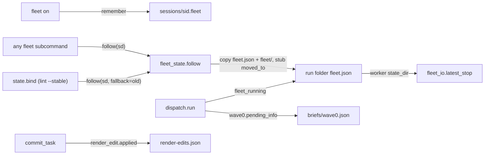
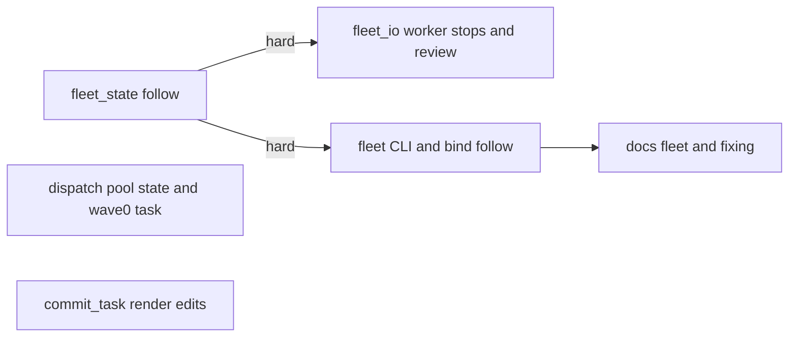

# Superlite: one fleet follows the session; dispatch reads one pool state (B138)

**Goal:** fix #580 (the fleet state folder differs before a plan, after the run and in a second worktree) and #595 (dispatch offers a running task again, prints no review line for a one-task plan, never sends a plan task's Wave 0 brief), plus main's tell: `commit_task` refuses while render-check edits are applied.
**Architecture:** `fleet_state` remembers, per session, the folder that holds the session's fleet (`~/.superlite/sessions/<sid>.fleet`) and moves that fleet into the folder a later fleet command or session binding names (`follow`); each worker keeps the state folder its stop hook writes to (`state_dir`), and `fleet_io` reads its stop records there. `dispatch` counts the tasks of busy fleet workers as running and gives a plan task that is the Wave 0 the same `wave0` line as T0. `fleet_io.review_reasons` names the only task of a one-task plan. `commit_task` refuses while `render_edit.applied` lists files.
**Tech stack:** Python 3.10+ stdlib, pytest (through `sl run_tests`); Markdown docs.
**Spec:** this file, section Design; issues #580, #595.
**Detail:** tests
**Target-min:** 11
**Wave0:** none
**Coverage:** off

Global constraints:
- Every Python code line keeps the file's trailing `# O(...)` complexity comment.
- Existing tests stay green. An existing test file changes only when the task Owns it. If another existing test turns red, report it in DONE_WITH_CONCERNS with the test id and the reason instead of editing it.
- Run `sl` as an executable (`<abs>/sl ...`). Verify with `<abs>/sl run_tests --fast <own test files> --task Tn --background`, then run the printed `wait:` line in the foreground and end the turn only after it reports.
- No version edits. Never run `scripts/evals.sh`, `claude plugin eval` or `scripts/test_layers.py run`. Tests never touch the real `~/.superlite`: `tests/scripts/conftest.py` points `SUPERLITE_HOME` at a tmp folder per test; set `SUPERLITE_SESSION_ID` with `monkeypatch.setenv` where a test needs a session.
- Never edit `docs/fleet.md`, `docs/tools.md`, `hooks/block-coordinator-edits`, `plan_tools.py`, `pt_review.py`, `backlog*.py` or `build_prime.py` (other batches own them).

Ruling: Max's decision for #580 ("one fleet follows the session into the run"): a session has one fleet. `fleet on` records its folder in `<SUPERLITE_HOME>/sessions/<sid>.fleet`. Every `sl fleet` subcommand except `name`, and `state.bind`, first move that fleet into the folder they resolve when that folder has no fleet on; one stderr line says so.
Ruling: a move copies `fleet.json` (each worker gains `state_dir`, the folder its stop hook writes to) and the `fleet/` tree (reports, screens; files already in the target are kept), and leaves `{"on": false, "moved_to": <target>}` in the source, so report paths printed before the move still open (because live workers keep their env; cost if wrong: a stale copy of old reports in the source folder).
Ruling: no move of another session's fleet (owner_session must equal the session id), of a fleet with a worker of role `lead` that is not stopped (backlog main keeps its leads), or into a folder whose fleet.json is on (cost if wrong: a second fleet stays where it is, as before).
Ruling: in fleet mode the running tasks are the pool's `current` tasks plus the tasks of fleet.json workers of role implementer in state busy or blocked (only when `--running` is not given); pool.json writes are unchanged (because fleet.json is written under its lock by every send; cost if wrong: none beyond today's).
Ruling: a plan task that is the Wave 0 (`briefs/wave0.json` with `synthetic: false`) gets dispatch's first line `Tn wave0 tier=<lane> agent=<lane agent>` like T0, whatever its graph edges (lint's START FIRST names it too), and never a normal line; `Ruling: skip Tn` silences it.
Ruling: a one-task plan's task gets the review reason `only task` when no other reason applies (the "last package: per task" rule for a plan with one task; final-suite fix F-T2-1 kept an existing test that pins `["Complexity 6"]`); multi-task plans keep their reasons.
Ruling: main's tell (B118 follow-up): `commit_task` refuses while `render_edit.applied(sd)` lists files: stdout `BLOCKED: render edits still applied: F, G; run sl render_edit restore first`, exit 2, before any commit or ledger line; `--claim` alone (commits nothing) still runs.
Ruling: accept predicted total over the 11 min target - T2 and T3 run T1's code with Wave0 none, so their edges are hard - one extra wave of wall time.
LAYERS: unit, headless

## Design

### 1. One fleet per session (#580)
`fleet on` writes the session pointer. A later `sl fleet ...` (or `state.bind` when lint binds the run) whose folder has no fleet on moves the session's fleet there and prints `fleet: this session's fleet moved from <from> to <to> (<n> workers)` on stderr. Workers started before the move keep writing stop records to their own folder; `fleet_io` reads each worker's stop records from its `state_dir`. A folder holding a moved stub says so: `fleet status` prints `fleet: off (moved to <to>)`, a refused spawn names `--plan <to>`.

### 2. Post-run fixers (#580)
After `sl finish`, a fix in a fresh worktree runs `fleet spawn --role fixer --tier T --brief <abs> --wait --plan <that worktree>/.superlite`; the session's fleet follows there. The fixer commits with a plain git commit (no run). `fixing.md` and SDD `fleet.md` say so; before a plan, `$PLAN` is the worktree's `.superlite` folder.

### 3. One pool state (#595)
`dispatch.run` (also through `commit_task --dispatch`) adds the tasks of busy or blocked fleet implementers to the running set, so a task `fleet spawn --for-dispatch` just sent is never offered again.

### 4. Review line for a one-task plan (#595)
`review_reasons` adds `only task` when the plan has one task; `commit_task --dispatch` and `--for-dispatch` then print `review: T1 (only task); run ...`.

### 5. Plan task as Wave 0 (#595)
`wave0.pending_info` reads `briefs/wave0.json` of either kind; `dispatch.run` puts that task first as a `wave0` line and keeps it off the normal lines; `fleet spawn --for-dispatch` already sends `briefs/wave0.md` for a `wave0` line under the line's task id.

### 6. Render edits block commits (main's tell)
`commit_task` checks `render_edit.applied(sd)` right after it resolves the run folder.

## File structure

- `skills/subagent-driven-development/scripts/fleet_state.py`, `tests/scripts/test_fleet_follow_580.py`: T1
- `skills/subagent-driven-development/scripts/fleet_io.py`, `tests/scripts/test_fleet_io_state_dir_580.py`, `tests/scripts/test_review_one_task_595.py`: T2
- `skills/subagent-driven-development/scripts/fleet.py`, `skills/subagent-driven-development/scripts/state.py`, `tests/scripts/test_fleet_follow_cli_580.py`: T3
- `skills/subagent-driven-development/fleet.md`, `skills/subagent-driven-development/fixing.md`, `tests/scripts/test_docs_580_fleet.py`: T4
- `skills/subagent-driven-development/scripts/dispatch.py`, `skills/subagent-driven-development/scripts/wave0.py`, `tests/scripts/test_dispatch_pool_state_595.py`: T5
- `skills/subagent-driven-development/scripts/commit_task.py`, `tests/scripts/test_commit_task_render_edits.py`: T6

## Task graph

```mermaid
%% schedule
gantt
  title Predicted schedule (mm:ss)
  dateFormat X
  axisFormat %M:%S
  section lane 1
  T5 dispatch pool state and plan-task Wav :t5, 0, 163s
  section lane 2
  T3 fleet CLI and bind follow :t3, 0, 160s
  T4 docs fleet and fixing :t4, 160, 97s
  section lane 3
  T1 fleet_state follow :t1, 0, 121s
  section lane 4
  T2 fleet_io worker stops and one-task re :t2, 0, 111s
  section lane 5
  T6 commit_task refuses applied render ed :t6, 0, 101s
```

critical path: T3 → T4 (4.3 min) · peak width 5 · predicted build 4.3 min · predicted total ≈ 20.5 min (target ✗ 11.0)

## Package: fleet state

App type: file I/O library with concurrency. Categories: state (two processes moving one fleet, lock order), file (copy without overwrite, missing folders, a stub left behind). **Probe entry:** none (filesystem fixtures; cases are named tests).

### T1 fleet_state follow · Complexity 5 · Est. context 45k
**Owns:** skills/subagent-driven-development/scripts/fleet_state.py, tests/scripts/test_fleet_follow_580.py
**Components:** 1
**LOC owned:** 200
**Tests:** fast
**Model:** sonnet
**Est. time:** 3 min (1 component, about 200 LOC, fast tests)
**Covers:** 1
**Produces:** fleet_state.remember(sd: str | Path, sid: str | None = None) -> Path | None
e.g. remember(W, "s1") with SUPERLITE_HOME=H -> H/sessions/s1.fleet holding str(W.resolve()) + "\n"
e.g. remember(W) with no session id -> None (nothing written)
**Produces:** fleet_state.session_fleet(sid: str | None = None) -> Path | None
e.g. session_fleet("s1") with the pointer naming S and S/fleet.json {"on": true, "owner_session": "s1"} -> S
e.g. session_fleet("s1") with S/fleet.json {"on": true, "owner_session": "s2"} -> None
**Produces:** fleet_state.home(sd: str | Path) -> Path
e.g. home(S) with S/fleet.json {"on": false, "moved_to": str(W)} and W/fleet.json {"on": true} -> W
e.g. home(W) with W/fleet.json {"on": true} -> Path(W)
**Produces:** fleet_state.follow(sd: str | Path, sid: str | None = None, fallback: str | Path | None = None) -> dict | None
e.g. follow(W, "s1") with the pointer naming S, S/fleet.json {"on": true, "owner_session": "s1", "workers": {"W1": {"state": "busy", "task": "R1"}}} and no W/fleet.json -> {"from": str(S.resolve()), "to": str(W.resolve()), "workers": 1}
e.g. follow(W, "s1") when W/fleet.json is on -> None
e.g. follow(W, "s1", fallback=S) with no pointer and S's fleet on, owned by s1 -> the same dict as the first example
**Review Focus:** `test_follow_never_overwrites_a_target_report`: W/fleet/reports/R1.md exists with "new" and S has R1.md with "old": W keeps "new"; `test_follow_skips_a_running_lead`: a worker {"role": "lead", "state": "busy"} in S -> None, S unchanged; `test_follow_twice_is_a_no_op`: a second follow(W, "s1") -> None (the pointer now names W, W is on).
**Steps:** 1 failing tests, 2 run: FAIL, 3 implement, 4 run: PASS
**Notes:**
- `pointer_path(sid)`: `state.home() / "sessions" / f"{sid}.fleet"` (import `state` lazily, as `owner()` does). `remember`: sid defaults to `state.session_id()`; None without one; mkdir the parent; an OSError returns None. `set_on` calls `remember(sd)` after its save and drops a `moved_to` key before it saves.
- `session_fleet`: read the pointer's first line; return that folder only when its fleet.json is on and `owner_session` equals sid; any read error -> None.
- `home`: follow `moved_to` while the folder's fleet.json is not on and names one, at most 5 hops; return the last folder (a Path).
- `follow`: sid defaults to `state.session_id()`; None without sid. Source = `session_fleet(sid)`, else `fallback` when its fleet.json is on with `owner_session == sid`. None when there is no source, the source resolves to `Path(sd).resolve()`, `is_on(sd)`, or a worker with `role == "lead"` is not `stopped`. Otherwise lock both folders in sorted order of their resolved path strings (`locked` on each), re-check inside the locks, then: data = load(source); each worker without `state_dir` gets `str(source.resolve())`; `save(sd, data)`; copy every file under `source/fleet/` to the same relative path under `sd/fleet/` unless it exists there (`shutil.copy2`, no symlink followed out of the tree); `save(source, {**default(), "moved_to": str(Path(sd).resolve())})`; `remember(sd, sid)`. `workers` counts workers whose state is not `stopped`.
- `add_worker` adds `"state_dir": str(Path(sd).resolve())` to the record it writes.
- Docstring: one paragraph naming remember, session_fleet, home, follow and the `state_dir` key.
- Named tests: the seven e.g. lines, the three Review Focus tests, `test_add_worker_records_state_dir`, `test_set_on_remembers_and_drops_moved_to`, `test_follow_needs_a_session_id` (no SUPERLITE_SESSION_ID, no CLAUDE_CODE_SESSION_ID -> None).

### T2 fleet_io worker stops and one-task review · Complexity 3 · Est. context 40k
**Owns:** skills/subagent-driven-development/scripts/fleet_io.py, tests/scripts/test_fleet_io_state_dir_580.py, tests/scripts/test_review_one_task_595.py
**Components:** 1
**LOC owned:** 140
**Tests:** fast
**Model:** sonnet
**Est. time:** 2.5 min (1 component, about 140 LOC, fast tests)
**Covers:** 1, 4
**Consumes:** fleet_state.home(sd: str | Path) -> Path (T1)
**Review Focus:** `test_latest_stop_reads_the_worker_state_dir`: W/fleet.json worker W1 with state_dir S, a stop record for W1 only in S/metrics.jsonl -> latest_stop(W, "W1", 0) returns it, also when a pre-read W stops list is passed; `test_review_one_task_plan`: a plan with one task T1 (Complexity 2, no seams) -> review_reasons(plan, "T1") == ["only task"].
**Steps:** 1 failing tests, 2 run: FAIL, 3 implement, 4 run: PASS
**Notes:**
- `latest_stop(sd, wid, after_ms, stops=None)`: when the worker record has a `state_dir` whose resolved path differs from `Path(sd).resolve()`, read `_stops(state_dir)` and ignore the passed `stops`; otherwise as today.
- `stopped(sd, wid, t_ms)`: `sd = fs.home(sd)` first, so the stop hook of a worker started before a move labels its pane in the fleet's new folder.
- `review_reasons(plan, tid)`: append `"only task"` when `len(pl.tasks) == 1`.
- Named tests: the two Review Focus tests; `test_latest_stop_same_folder_unchanged` (no state_dir: reads sd as before); `test_stopped_follows_moved_to` (S/fleet.json {"on": false, "moved_to": W}, W/fleet.json worker W1 sent 5: `stopped(S, "W1", 10)` calls `pane_label` with W; monkeypatch `fleet_io.pane_label`); `test_review_two_task_plan_has_no_only_task`; `test_commit_task_dispatch_prints_review_for_one_task_plan` (fleet.json on in the run folder, one-task plan, T1's owned file changed, `commit_task T1 --plan P --dispatch` prints a line starting `review: T1 (only task); run `; follow the setup of `tests/scripts/test_commit_task_review_hints*.py` or `test_fleet_review*.py` if one exists, else build the repo with `git init` as other commit_task tests do).

### T3 fleet CLI and bind follow · Complexity 4 · Est. context 45k
**Owns:** skills/subagent-driven-development/scripts/fleet.py, skills/subagent-driven-development/scripts/state.py, tests/scripts/test_fleet_follow_cli_580.py
**Components:** 2
**LOC owned:** 170
**Tests:** fast
**Model:** sonnet
**Est. time:** 3 min (2 components, about 170 LOC, fast tests)
**Covers:** 1
**Consumes:** fleet_state.follow(sd: str | Path, sid: str | None = None, fallback: str | Path | None = None) -> dict | None (T1) · fleet_state.home(sd: str | Path) -> Path (T1)
**Review Focus:** `test_status_after_lint_bind_shows_busy_workers`: fleet on in S with W1 busy, `state.bind(W)` -> `fleet status --plan W` lists W1 busy (not `fleet: off`); `test_wait_delegation_follows_first`: `fleet wait --plan W` with the fleet in S moves it before fleet_io.main runs (monkeypatch `fleet_io.main` to record `fleet_state.is_on(W)`).
**Steps:** 1 failing tests, 2 run: FAIL, 3 implement, 4 run: PASS
**Notes:**
- `fleet.main`: after the `--plan` check and before any delegation or subcommand except `name`, resolve the folder as the subcommand will (`state.resolve(plan)` when `--plan` is given, else `state.resolve()`; a `state.Foreign` or OSError skips the follow), call `fs.follow(<that folder>)` and, when it returns a dict, print `fleet: this session's fleet moved from <from> to <to> (<workers> workers)` on stderr. Any exception from follow is caught and printed as `fleet: warning: fleet not moved (<error>)` on stderr.
- `status` when the folder is off and its fleet.json holds `moved_to`: print `fleet: off (moved to <to>)` instead of `fleet: off`. `spawn` refused for fleet off: when `moved_to` is set, the BLOCKED line ends `; this fleet moved to <to>: pass --plan <to>` instead of the worktree remark.
- `state.bind`: after the binding file is written and only when the session moved (an `old` bound folder that differs from sd), call `fleet_state.follow(sd, sid, fallback=old)` (lazy import, any exception swallowed) and print the same stderr line when it moved.
- Docstrings: one line each in fleet.py (`Every subcommand but name first moves this session's fleet into its folder (#580)`) and state.py (bind).
- Named tests: the two Review Focus tests; `test_fleet_on_elsewhere_follows_then_turns_on` (`fleet on --plan W` keeps W1 from S); `test_status_names_moved_stub` (no session id, S stub moved_to W -> `fleet: off (moved to W)`); `test_spawn_blocked_names_moved_to`; `test_name_does_not_follow`; `test_bind_without_fleet_prints_nothing`. Fake Herdr as `tests/scripts/test_fleet_status_579.py` does (monkeypatch `fleet.agent_gone` to return False where status runs).

### T4 docs fleet and fixing · Complexity 2 · Est. context 30k
**Owns:** skills/subagent-driven-development/fleet.md, skills/subagent-driven-development/fixing.md, tests/scripts/test_docs_580_fleet.py
**Components:** 1
**LOC owned:** 60
**Tests:** fast
**Model:** sonnet
**Est. time:** 1.8 min (1 component, about 60 LOC, fast tests)
**Covers:** 2
**Review Focus:** `test_fleet_md_names_follow`: SDD fleet.md holds `follows the session` and `before a plan, $PLAN is the worktree's .superlite`; `test_fixing_md_names_post_run_fixer`: fixing.md holds `fleet spawn --role fixer --tier T --brief` and `plain git commit`.
**Steps:** 1 failing tests, 2 run: FAIL, 3 implement, 4 run: PASS
**Notes:**
- SDD `fleet.md`, first paragraph: one sentence: `One fleet per session: it follows the session into the run (lint's binding, or the first fleet command naming another folder moves it there; stderr says so), and before a plan, $PLAN is the worktree's .superlite folder.` Keep every existing sentence (other tests pin them).
- `fixing.md`: a short paragraph `After the run`: after `sl finish`, a fix in a fresh worktree runs `"$SL" fleet spawn --role fixer --tier T --brief <abs brief> --wait --plan <worktree>/.superlite` (fleet on: the session's fleet follows there; fleet off: the fixer Agent as usual); the fixer commits with a plain git commit, no commit_task.
- The test reads both files and checks the quoted phrases; it also checks that `fleet: this session's fleet moved from` is in `scripts/fleet.py`.

## Package: dispatch

App type: CLI over a shared state file. Categories: state (a task offered twice, a worker busy in one file and idle in the other), protocol (dispatch line format). **Probe entry:** none (fixtures; cases are named tests).

### T5 dispatch pool state and plan-task Wave 0 · Complexity 5 · Est. context 45k
**Owns:** skills/subagent-driven-development/scripts/dispatch.py, skills/subagent-driven-development/scripts/wave0.py, tests/scripts/test_dispatch_pool_state_595.py
**Components:** 2
**LOC owned:** 190
**Tests:** fast
**Model:** sonnet
**Est. time:** 3 min (2 components, about 190 LOC, fast tests)
**Covers:** 3, 5
**Produces:** wave0.pending_info(plan_path: str) -> dict | None
e.g. pending_info(plan) with briefs/wave0.json {"id": "T3", "synthetic": false, "owns": ["pyproject.toml"], "wait": ["T4"]} -> that dict
e.g. pending_info(plan) with no briefs/wave0.json -> None
**Produces:** dispatch.fleet_running(sl_dir: str | Path, committed: list[str] = ()) -> list[str]
e.g. fleet.json on, W1 {"state": "busy", "task": "T2,T3", "role": "implementer"}, W2 {"state": "busy", "task": "FR1", "role": "final-reviewer"}, committed ["T3"] -> ["T2"]
e.g. fleet.json off or absent -> []
**Review Focus:** `test_commit_dispatch_never_reoffers_a_fleet_busy_task`: pool.json W2 idle (no current), fleet.json on with W1 busy on T2 (W1 not in the pool): `dispatch.run` offers no line holding T2; `test_plan_task_wave0_line_first`: wave0.json id T1 (synthetic false), T1 depends on T2 in the taskgraph -> the first line is ("T1", "wave0 tier=haiku agent=...") and no other line holds T1.
**Steps:** 1 failing tests, 2 run: FAIL, 3 implement, 4 run: PASS
**Notes:**
- `fleet_running`: `fleet_state.load(sl_dir)` (module may be None: []); not on -> []; workers whose `role` is missing or `implementer` and whose state is `busy` or `blocked`; split `task` on commas; drop committed ids; keep order, no duplicates.
- `run(...)`: when `running is None`, `busy = running_from_pool(pool, done)` plus each `fleet_running(Path(pool_path).parent, done)` id not already in it.
- `run(...)`: `info = wave0.pending_info(plan)`; `wid = info["id"]` when a string, else no Wave 0; pending when wid is not in done, busy or held and not `skip_t0(ledger, plan, wid)`. When pending and `info.get("synthetic")` is false, `plan_dispatch` and `stable_blocked` get `busy + [wid]`; the first line is `(wid, f"wave0 tier={lt} agent=...")` for both kinds. `skip_t0(ledger, plan=None, tid="T0")` matches `Ruling: skip <tid>`.
- `wave0.pending_info`: like `synth_info` without the `synthetic` filter; a non-dict or a missing string `id` -> None. `synth_info` stays.
- Docstrings: dispatch.py names the fleet running tasks (#595) and `Tn wave0` for a plan task; wave0.py names pending_info.
- Named tests: the four e.g. lines, the two Review Focus tests, `test_explicit_running_ignores_fleet` (`run(..., running="")` offers T2), `test_skip_ruling_for_plan_task_wave0` (`- Ruling: skip T1` -> no wave0 line, T1 offered normally when ready), `test_for_dispatch_sends_wave0_brief_under_task_id` (reuse the `dwld` and `brief_calls` fixtures of `tests/scripts/test_fleet_for_dispatch.py` by import, dispatch lines `[("T3", "wave0 tier=haiku agent=superlite:implementer-haiku")]` -> brief_calls `[(sd, "W1", str(sd / "briefs" / "wave0.md"), "T3")]`).

## Package: commit_task

App type: CLI. Categories: state (render-edits record read), protocol (exit code, stdout line). **Probe entry:** none (git fixtures; cases are named tests).

### T6 commit_task refuses applied render edits · Complexity 2 · Est. context 35k
**Owns:** skills/subagent-driven-development/scripts/commit_task.py, tests/scripts/test_commit_task_render_edits.py
**Components:** 1
**LOC owned:** 80
**Tests:** fast
**Model:** sonnet
**Est. time:** 1.8 min (1 component, about 80 LOC, fast tests)
**Covers:** 6
**Review Focus:** `test_commit_task_refuses_applied_render_edit`: run folder `.superlite/render-edits.json` {"files": {"app/View.swift": {"t": 1}}} -> `commit_task T1 --plan P` prints `BLOCKED: render edits still applied: app/View.swift; run sl render_edit restore first`, exits 2, the ledger gains no `commit` line and no checkpoint ref is written.
**Steps:** 1 failing tests, 2 run: FAIL, 3 implement, 4 run: PASS
**Notes:**
- In `main`, right after `a.sd = sd` is set and the run-folder `--plan` is resolved, and only when `--claim` is not given: `import render_edit` (lazy) and refuse when `render_edit.applied(sd)` is not empty (files joined by `, `, sorted as `applied` returns them).
- Docstring: one line `(7) Refuses while .superlite/render-edits.json lists applied render edits (B118 follow-up).`
- Named tests: the Review Focus test, `test_commit_task_runs_without_render_edits` (empty `{"files": {}}` record: T1 commits), `test_claim_still_runs_with_render_edits` (`--claim F --ruling R` writes its ruling line and exits 0).

## Review Focus

- fleet state: state (lock order, re-check under the locks, a lead fleet never moved), file (copy without overwrite). Cases in T1, T2, T3.
- dispatch: state (fleet busy tasks are running; the plan-task Wave 0 is offered once). Cases in T5.
- commit_task: protocol (refusal line and exit 2 before any write). Cases in T6.

## Self-review

- Coverage: Design 1 -> T1, T2, T3; 2 -> T4; 3, 5 -> T5; 4 -> T2; 6 -> T6.
- No two tasks that can run at once share a file; T2 and T3 wait for T1 (their tests run `follow` and `home`), T4 for T3.
- Follow-ups (other batches' files): the hook rule-4 message names the folder it read (B141, hooks/block-coordinator-edits); docs/fleet.md and docs/tools.md rows for follow, `state_dir`, fleet running tasks, plan-task Wave 0, `only task` and the commit_task refusal (B135, B119).
