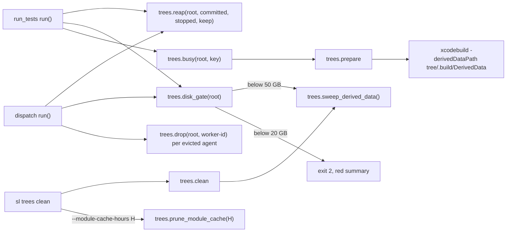
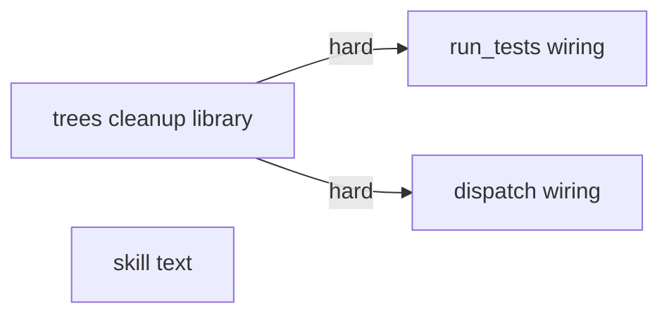

# Superlite: fleet trees and their build output are cleaned during a run (B117)

**Goal:** fix #574: a test tree and its Xcode build output go away as soon as nothing needs them, the build output of a tree lives inside the tree (module cache included), orphaned DerivedData of removed trees is swept, and `run_tests` and `dispatch` refuse to start on a nearly full disk.
**Architecture:** `trees.py` gains the cleanup library (busy markers, `drop`, `reap`, `stopped_workers`, `sweep_derived_data`, `prune_module_cache`, `free_gb`, `disk_gate`) and `trees clean` sweeps orphaned DerivedData. `run_tests.py` passes `-derivedDataPath <tree>/.build/DerivedData` to `xcodebuild` in a tree, marks the tree busy while it runs, reaps unneeded trees and checks the disk before each run, and turns `ENOSPC` into one clear line. `dispatch.py` checks the disk and reaps trees each round, and drops an evicted worker's tree. The SDD skill text names the cleanup duties.
**Tech stack:** Python 3.10+ stdlib, pytest (through `sl run_tests`), Markdown.
**Spec:** this file, section Design; issue #574 Expected and its comments.
**Detail:** tests
**Target-min:** 11
**Wave0:** none
**Coverage:** off

Global constraints:
- Every Python code line keeps the file's trailing `# O(...)` complexity comment.
- Existing tests stay green. An existing test file changes only when the task Owns it. If another existing test turns red, report it in DONE_WITH_CONCERNS with the test id and the reason instead of editing it.
- Run `sl` as an executable (`<abs>/sl ...`). Verify with `<abs>/sl run_tests --fast <own test files> --task Tn --background`, then run the printed `wait:` line in the foreground and end the turn only after it reports.
- Environment values are read at call time, never cached at import: `SUPERLITE_DISK_FLOOR_GB` (default 20), `SUPERLITE_DISK_WARN_GB` (default 50), `SUPERLITE_DERIVED_DATA_HOME` (default `~/Library/Developer/Xcode/DerivedData`). GB means 1024**3 bytes; amounts print with one decimal (`12.3 GB`), thresholds with `:g`.
- Nothing is ever deleted outside `<root>/.superlite/trees/` and the DerivedData home; a key that is not `[A-Za-z0-9_-]+` is never removed. No version edits. Never run `scripts/evals.sh`, `claude plugin eval` or `scripts/test_layers.py run`.

Ruling (main, not the user): each tree builds in `<tree>/.build/DerivedData` via `-derivedDataPath`, and the free-space gate refuses below 20 GB and warns below 50 GB. Measured 2026-11-12 on this machine: an `xcodebuild build -scheme Tiny-Package -derivedDataPath <tree>/.build/DerivedData` put every `-module-cache-path` (ModuleCache.noindex, SwiftExplicitPrecompiledModules, SDKExplicitPrecompiledModules) inside the tree and named the shared `~/Library/Developer/Xcode/DerivedData` zero times.
Ruling: `-derivedDataPath` goes right after each `xcodebuild` word whose command segment (up to the next `|`, `;`, `&` or newline) names `-scheme`, `-xctestrun` or `-testProductsPath` and no `-derivedDataPath` (because xcodebuild refuses `-derivedDataPath` without one of them, measured: `xcodebuild -list -derivedDataPath X` exits 65), only in a tree run; a root run is unchanged.
Ruling: commit_task.py (B130), fleet.py (B118, B120, B132) and plan_tools.py stay untouched: a tree is removed by `trees.reap` at the start of every `run_tests` run and every dispatch round (task trees of tasks with a `- commit Tn <sha>` ledger line, `worker-Wn` trees of workers fleet.json marks `stopped`), plus `dispatch` drops `worker-<id>` of each evicted agent; a run's own tree and a tree with a live busy marker stay (cost if wrong: a committed task re-run rebuilds its tree once).
Ruling: the shared module cache is pruned only on request (`trees clean --module-cache-hours H`), never by default (it serves every Xcode project of the user); the orphan sweep runs in `trees clean`, and in `run_tests` and `dispatch` when a tree was reaped or the gate is below 50 GB.
Ruling: tests/scripts/conftest.py sets `SUPERLITE_DISK_FLOOR_GB=0`, `SUPERLITE_DISK_WARN_GB=0` and points `SUPERLITE_DERIVED_DATA_HOME` at a missing folder under tmp_path for every script test (the suite must not depend on this machine's free space or touch the real DerivedData); no open batch lists conftest.py.
Ruling: output-log rotation needs no change (`keep_output` keeps the newest 20 already); the live-tree cap, the lint disk forecast and the fleet-spawn gate are left to follow-ups. No probe adapter (filesystem and subprocess helpers; Review Focus cases are named tests); layers unit and headless.
LAYERS: unit, headless



## Design

### 1. trees.py (T1)
Busy marker: `<root>/.superlite/trees/<key>.busy.<pid>`; `is_busy` counts a marker whose pid lives (`os.kill(pid, 0)`; `PermissionError` counts as alive) and deletes a dead one; a `<key>.lock` younger than 600 s also counts as busy. `drop` removes the tree (`git worktree remove --force`, else `shutil.rmtree`) and its `<key>.overlay.json` and `<key>.digests.json`. `sweep_derived_data` reads each DerivedData folder's `info.plist` (`plistlib`) and removes the folder when `WorkspacePath` contains `/.superlite/trees/` and that path does not exist; folders without a readable plist and symlinks stay. Sizes count regular files by `lstat`. CLI `clean` prints `removed N`, then `derived data: removed N orphaned folder(s), X.X GB` only when N > 0; `clean --module-cache-hours H` adds `module cache: removed N entries older than H h, X.X GB` (H printed with `:g`); a bad H prints `trees: --module-cache-hours needs a number of hours` (exit 2). The usage line stays `usage: trees.py clean | path Tn [--plan P]`.

### 2. run_tests.py (T2)
Top of `run()`: `trees.reap(".", ct.committed_tasks(a.ledger), trees.stopped_workers(Path(".superlite")), keep={own key})` (own key: `a.task`, else `worker_tree_name()`), stderr `run_tests: removed N tree(s) nothing needs: K1, K2` when any; then `trees.disk_gate(".")`; when a tree was removed or the level is not ok, `trees.sweep_derived_data()` (stderr `run_tests: removed N orphaned DerivedData folder(s), X.X GB` when N > 0) and the gate again; `warn` prints `run_tests: <line>`; `refuse` is `usage_error(a, label, line)` (exit 2, red summary). A tree run holds `trees.busy(".", key)` from before `trees.prepare` until `run_other` returns. `run_other` with a tree passes the setup and the command through `with_derived_data(text, cwd)` and prints `run_tests: xcodebuild builds in <tree>/.build/DerivedData (removed with the tree)` once when it changed the command. `main()`: an `OSError` with `errno.ENOSPC` prints `run_tests: disk full (ENOSPC): <strerror>[: <filename>]; run sl trees clean and free space, then rerun`, tries the red summary (an `OSError` there is ignored), prints `0 0 0 0.0`, returns 2, no traceback.

### 3. dispatch.py (T3)
Root = the pool folder's parent when that folder is named `.superlite`, else no tree work. `disk_check(sd) -> str` gates the root (else the pool folder), prints `dispatch: BLOCKED: <line>` (refuse) or `dispatch: <line>` (warn) on stderr, returns the level. `main` runs it and returns 3 on refuse before `run`; `run(..., gate=True)` runs it when `gate` and returns `([], {})` on refuse (commit_task --dispatch and fleet spawn --for-dispatch call `run`). After `drop_evicted`, `run` reaps (committed = `done`, stopped = `trees.stopped_workers(sd)`) and drops `worker-<id>` of every evicted id; any error there is swallowed; stderr `dispatch: removed N tree(s) nothing needs: K1, K2` when any.

### 4. SDD SKILL.md (T4)
New duties, with the SKILL.md at most 12990 characters (cap 13000).

## File structure

- `skills/subagent-driven-development/scripts/trees.py`: tree lifecycle, cleanup and the disk gate.
- `skills/subagent-driven-development/scripts/run_tests.py`: tree build path, busy marker, reap, gate, ENOSPC.
- `skills/subagent-driven-development/scripts/dispatch.py`: gate and reap per dispatch round, evicted worker trees.
- `skills/subagent-driven-development/SKILL.md`: coordinator and worker cleanup duties, the TESTS warning step.
- `tests/scripts/conftest.py`: machine-independent disk and DerivedData env for every script test.

## Task graph

```mermaid
%% schedule
gantt
  title Predicted schedule (mm:ss)
  dateFormat X
  axisFormat %M:%S
  section lane 1
  T1 trees cleanup library :t1, 0, 142s
  T2 run_tests builds in the tree and chec :t2, 142, 142s
  section lane 2
  T4 SDD skill names the cleanup duties :t4, 0, 96s
  T3 dispatch checks the disk and drops un :t3, 142, 97s
```





critical path: T1 → T2 (4.7 min) · peak width 2 · predicted build 4.7 min · predicted total ≈ 8.2 min (target ✓)

## Package: trees

App type: file I/O. Categories: file, state. Risks: deleting outside the trees folder; removing a tree a run still uses.
**Probe entry:** none (filesystem helpers; the Review Focus cases are named tests)

### T1 trees cleanup library · Complexity 5 · Est. context 40k
**Owns:** skills/subagent-driven-development/scripts/trees.py, tests/scripts/conftest.py, tests/scripts/test_trees_cleanup_574.py
**Components:** 2
**LOC owned:** 230
**Tests:** fast
**Model:** sonnet
**Est. time:** 4 min
**Produces:** trees.derived_data_path(tree: str | Path) -> Path · trees.busy(root: str | Path, key: str) -> ContextManager[None] · trees.is_busy(root: str | Path, key: str) -> bool · trees.drop(root: str | Path, key: str) -> bool · trees.reap(root: str | Path, committed: set[str], stopped: set[str], keep: set[str] = frozenset()) -> list[str] · trees.stopped_workers(sd: str | Path) -> set[str] · trees.sweep_derived_data(home: str | Path | None = None) -> tuple[int, int] · trees.prune_module_cache(hours: float, home: str | Path | None = None) -> tuple[int, int] · trees.free_gb(path: str | Path) -> float · trees.disk_gate(path: str | Path) -> tuple[str, str]
e.g. trees.derived_data_path("/r/.superlite/trees/T1") -> Path("/r/.superlite/trees/T1/.build/DerivedData")
e.g. trees.reap(root, {"T1"}, {"W2"}) with trees T1, T2, worker-W1, worker-W2 -> ["T1", "worker-W2"]
e.g. trees.disk_gate("/r") at 12.3 GB free -> ("refuse", "disk: 12.3 GB free on /r, below the 20 GB floor; run sl trees clean (trees, orphaned Xcode DerivedData) and free space, then rerun")
e.g. trees.disk_gate("/r") at 41.0 GB free -> ("warn", "disk: WARNING: 41.0 GB free on /r, below 50 GB; run sl trees clean soon")
e.g. trees.disk_gate("/r") at 80 GB free -> ("ok", "")
**Review Focus:** file: `test_drop_refuses_a_bad_key` (`../x` and `a/b` return False, nothing removed); `test_sweep_removes_only_orphaned_tree_derived_data` (a folder of a live tree, a non-tree workspace and ModuleCache.noindex stay); state: `test_reap_keeps_a_busy_tree_and_the_keep_set`, `test_a_dead_pid_busy_marker_is_stale`.
**Notes:** `disk_gate` shows `Path(path).resolve()`; an `OSError` from `shutil.disk_usage` is `("ok", "")`; a floor of 0 never refuses, a warn level of 0 never warns. `reap` returns the dropped keys sorted and never raises. `stopped_workers` reads `<sd>/fleet.json` with `json` (missing or bad file: empty set). `prune_module_cache` removes each top-level entry of `<home>/ModuleCache.noindex` whose newest mtime (the entry and everything below it) is older than `hours`; it returns (entries removed, bytes). Update the module docstring. conftest.py: add to the autouse fixture `monkeypatch.setenv("SUPERLITE_DISK_FLOOR_GB", "0")`, `monkeypatch.setenv("SUPERLITE_DISK_WARN_GB", "0")`, `monkeypatch.setenv("SUPERLITE_DERIVED_DATA_HOME", str(tmp_path / "_derived_data"))`.
**Test code (verbatim):**
```python
"""trees cleanup: busy markers, reap, orphaned DerivedData, module cache, disk gate (GitHub #574)."""
import json
import os
import plistlib
import subprocess
import sys
import time
from collections import namedtuple
from pathlib import Path

import pytest

SCRIPTS = Path(__file__).resolve().parents[2] / "skills" / "subagent-driven-development" / "scripts"
sys.path.insert(0, str(SCRIPTS))
import trees  # noqa: E402

GiB = 1024 ** 3
U = namedtuple("U", "total used free")


def git(root, *a):
    subprocess.run(["git", "-C", str(root), "-c", "user.email=t@t", "-c", "user.name=t", *a], check=True, capture_output=True)


@pytest.fixture
def repo(tmp_path):
    r = tmp_path / "r"
    r.mkdir()
    (r / ".gitignore").write_text(".superlite/\n", encoding="utf-8")
    (r / "a.txt").write_text("a\n", encoding="utf-8")
    git(r, "init", "-q")
    git(r, "add", ".")
    git(r, "commit", "-qm", "init")
    return r


def make_dd(home, name, workspace, size=3):
    d = home / name
    (d / "Build").mkdir(parents=True)
    (d / "info.plist").write_bytes(plistlib.dumps({"WorkspacePath": str(workspace)}))
    (d / "Build" / "x.o").write_bytes(b"x" * size)
    return d


def test_derived_data_path_is_inside_the_tree():
    assert trees.derived_data_path("/r/.superlite/trees/T1") == Path("/r/.superlite/trees/T1/.build/DerivedData")


def test_reap_drops_committed_task_and_stopped_worker_trees(repo):
    for k in ("T1", "T2", "worker-W1", "worker-W2"):
        trees.prepare(repo, k, [])
    (trees.tree_path(repo, "T1") / ".build" / "DerivedData").mkdir(parents=True)
    assert trees.reap(repo, {"T1"}, {"W2"}) == ["T1", "worker-W2"]
    assert not trees.tree_path(repo, "T1").exists() and not trees.tree_path(repo, "worker-W2").exists()
    assert trees.tree_path(repo, "T2").is_dir() and trees.tree_path(repo, "worker-W1").is_dir()
    assert not (repo / ".superlite" / "trees" / "T1.overlay.json").exists()


def test_reap_keeps_a_busy_tree_and_the_keep_set(repo):
    trees.prepare(repo, "T1", [])
    trees.prepare(repo, "T2", [])
    with trees.busy(repo, "T1"):
        assert trees.is_busy(repo, "T1")
        assert trees.reap(repo, {"T1", "T2"}, set(), keep={"T2"}) == []
    assert not trees.is_busy(repo, "T1")
    assert trees.reap(repo, {"T1"}, set()) == ["T1"]


def test_a_dead_pid_busy_marker_is_stale(repo):
    trees.prepare(repo, "T1", [])
    marker = repo / ".superlite" / "trees" / "T1.busy.999999"
    marker.write_text("", encoding="utf-8")
    assert not trees.is_busy(repo, "T1") and not marker.exists()


def test_drop_refuses_a_bad_key(repo):
    (repo / "x").mkdir()
    assert trees.drop(repo, "../x") is False and trees.drop(repo, "a/b") is False
    assert (repo / "x").is_dir()
    assert trees.drop(repo, "T9") is False


def test_stopped_workers_reads_fleet_json(tmp_path):
    sd = tmp_path / ".superlite"
    sd.mkdir()
    (sd / "fleet.json").write_text(json.dumps({"workers": {"W1": {"state": "stopped"}, "W2": {"state": "busy"}}}), encoding="utf-8")
    assert trees.stopped_workers(sd) == {"W1"}
    assert trees.stopped_workers(tmp_path / "none") == set()


def test_sweep_removes_only_orphaned_tree_derived_data(tmp_path, monkeypatch):
    home = tmp_path / "dd"
    monkeypatch.setenv("SUPERLITE_DERIVED_DATA_HOME", str(home))
    live = tmp_path / "p" / ".superlite" / "trees" / "T2"
    live.mkdir(parents=True)
    orphan = make_dd(home, "App-aaa", tmp_path / "p" / ".superlite" / "trees" / "T1", size=1000)
    alive = make_dd(home, "App-bbb", live)
    user = make_dd(home, "App-ccc", tmp_path / "gone" / "App.xcodeproj")
    (home / "ModuleCache.noindex" / "X").mkdir(parents=True)
    n, freed = trees.sweep_derived_data()
    assert (n, orphan.exists(), alive.exists(), user.exists()) == (1, False, True, True)
    assert freed >= 1000 and (home / "ModuleCache.noindex" / "X").is_dir()
    assert trees.sweep_derived_data(tmp_path / "none") == (0, 0)


def test_prune_module_cache_removes_entries_older_than_hours(tmp_path, monkeypatch):
    home = tmp_path / "dd"
    monkeypatch.setenv("SUPERLITE_DERIVED_DATA_HOME", str(home))
    mc = home / "ModuleCache.noindex"
    old, new = mc / "OLD1", mc / "NEW1"
    old.mkdir(parents=True)
    new.mkdir()
    (old / "a.pcm").write_bytes(b"o" * 10)
    (new / "b.pcm").write_bytes(b"n" * 10)
    t = time.time() - 30 * 3600
    os.utime(old / "a.pcm", (t, t))
    os.utime(old, (t, t))
    assert trees.prune_module_cache(24) == (1, 10)
    assert not old.exists() and new.exists()
    assert trees.prune_module_cache(24, home=tmp_path / "none") == (0, 0)


@pytest.mark.parametrize("free,level", [(12.3, "refuse"), (41.0, "warn"), (80.0, "ok")])
def test_disk_gate_levels(tmp_path, monkeypatch, free, level):
    monkeypatch.delenv("SUPERLITE_DISK_FLOOR_GB", raising=False)
    monkeypatch.delenv("SUPERLITE_DISK_WARN_GB", raising=False)
    monkeypatch.setattr(trees.shutil, "disk_usage", lambda p: U(1000 * GiB, 0, int(free * GiB)))
    got, line = trees.disk_gate(tmp_path)
    shown = tmp_path.resolve()
    assert got == level
    assert line == {"refuse": f"disk: 12.3 GB free on {shown}, below the 20 GB floor; run sl trees clean (trees, orphaned Xcode DerivedData) and free space, then rerun",
                    "warn": f"disk: WARNING: 41.0 GB free on {shown}, below 50 GB; run sl trees clean soon", "ok": ""}[level]


def test_disk_gate_env_zero_never_refuses_and_free_gb(tmp_path, monkeypatch):
    monkeypatch.setenv("SUPERLITE_DISK_FLOOR_GB", "0")
    monkeypatch.setenv("SUPERLITE_DISK_WARN_GB", "0")
    monkeypatch.setattr(trees.shutil, "disk_usage", lambda p: U(3 * GiB, 0, 3 * GiB))
    assert trees.disk_gate(tmp_path) == ("ok", "")
    assert trees.free_gb(tmp_path) == 3.0


def test_cli_clean_sweeps_orphans_and_prunes_on_request(repo, monkeypatch, capsys):
    home = repo.parent / "dd"
    monkeypatch.setenv("SUPERLITE_DERIVED_DATA_HOME", str(home))
    trees.prepare(repo, "T1", [])
    make_dd(home, "App-aaa", repo / ".superlite" / "trees" / "T1")
    make_dd(home, "App-bbb", repo / ".superlite" / "trees" / "T9")
    monkeypatch.chdir(repo)
    assert trees.main(["clean"]) == 0
    assert capsys.readouterr().out == "removed 1\nderived data: removed 2 orphaned folder(s), 0.0 GB\n"
    assert trees.main(["clean", "--module-cache-hours", "24"]) == 0
    assert capsys.readouterr().out == "removed 0\nmodule cache: removed 0 entries older than 24 h, 0.0 GB\n"
    assert trees.main(["clean", "--module-cache-hours", "x"]) == 2
    assert "trees: --module-cache-hours needs a number of hours" in capsys.readouterr().err
```
**Steps:** 1 failing tests, 2 run: FAIL, 3 implement, 4 run: PASS (also tests/scripts/test_trees.py and test_trees_plan.py)

## Package: wiring

App type: CLI. Categories: protocol, file, state. Risks: a changed command line for a non-tree run; a refused run with no summary.
**Probe entry:** none (subprocess wiring; the Review Focus cases are named tests)

### T2 run_tests builds in the tree and checks the disk · Complexity 5 · Est. context 60k
**Owns:** skills/subagent-driven-development/scripts/run_tests.py, tests/scripts/test_run_tests_disk_574.py
**Components:** 2
**LOC owned:** 190
**Tests:** fast
**Model:** sonnet
**Est. time:** 4 min
**Consumes:** trees.derived_data_path(tree: str | Path) -> Path (T1) · trees.busy(root: str | Path, key: str) -> ContextManager[None] (T1) · trees.reap(root: str | Path, committed: set[str], stopped: set[str], keep: set[str] = frozenset()) -> list[str] (T1) · trees.stopped_workers(sd: str | Path) -> set[str] (T1) · trees.sweep_derived_data(home: str | Path | None = None) -> tuple[int, int] (T1) · trees.disk_gate(path: str | Path) -> tuple[str, str] (T1)
**Produces:** run_tests.with_derived_data(command: str, tree: str | Path) -> str
e.g. run_tests.with_derived_data("xcodebuild test -scheme App", "/r/.superlite/trees/T1") -> "xcodebuild -derivedDataPath /r/.superlite/trees/T1/.build/DerivedData test -scheme App"
e.g. run_tests.with_derived_data("xcodebuild -list", "/r/.superlite/trees/T1") -> "xcodebuild -list"
**Review Focus:** protocol: `test_with_derived_data` cases (pipe, `;` chain, `/usr/bin/xcodebuild`, existing `-derivedDataPath`, `xcodebuildx`); file: `test_root_run_leaves_xcodebuild_unchanged`; state: `test_run_reaps_unneeded_trees_but_keeps_its_own`.
**Notes:** the `xcodebuild` word matches `(?<![\w.-])xcodebuild(?=\s|$)` (a `/` before it is fine); the path is `shlex.quote`d. Work from the last match back so earlier offsets stay valid. The gate runs in the run process only (not in the `--background` parent). `trees.busy` wraps `trees.prepare` through `run_other`. Update the module docstring (tree build path, gate, reap).
**Test code (verbatim):**
```python
"""run_tests: tree build path, busy reap, disk gate, ENOSPC (GitHub #574)."""
import errno
import json
import os
import subprocess
import sys
from pathlib import Path

import pytest

from test_plan_tools import SCRIPTS
from test_run_tests_plan_fallback import OUT, setup

sys.path.insert(0, str(SCRIPTS))
import run_tests as rt  # noqa: E402
import trees  # noqa: E402

RUN_TESTS = SCRIPTS / "run_tests.py"
T = "/r/.superlite/trees/T1"
DD = "/r/.superlite/trees/T1/.build/DerivedData"


@pytest.mark.parametrize("cmd,want", [
    ("xcodebuild test -scheme App", f"xcodebuild -derivedDataPath {DD} test -scheme App"),
    ("set -o pipefail && xcodebuild test -scheme App | xcpretty", f"set -o pipefail && xcodebuild -derivedDataPath {DD} test -scheme App | xcpretty"),
    ("/usr/bin/xcodebuild test -xctestrun x.xctestrun", f"/usr/bin/xcodebuild -derivedDataPath {DD} test -xctestrun x.xctestrun"),
    ("xcodebuild -list; xcodebuild test -scheme A", f"xcodebuild -list; xcodebuild -derivedDataPath {DD} test -scheme A"),
    ("xcodebuild -list", "xcodebuild -list"),
    ("xcodebuild test -scheme App -derivedDataPath dd", "xcodebuild test -scheme App -derivedDataPath dd"),
    ("swift test", "swift test"),
    ("xcodebuildx test -scheme A", "xcodebuildx test -scheme A"),
])
def test_with_derived_data(cmd, want):
    assert rt.with_derived_data(cmd, T) == want


def test_with_derived_data_quotes_a_tree_with_spaces():
    assert rt.with_derived_data("xcodebuild test -scheme A", "/r s/T1") == "xcodebuild -derivedDataPath '/r s/T1/.build/DerivedData' test -scheme A"


def fake_xcodebuild(tmp_path):
    b = tmp_path / "bin"
    b.mkdir()
    x = b / "xcodebuild"
    x.write_text(f'#!/bin/sh\necho "$@" > "{tmp_path}/args.txt"\necho "{OUT}"\n', encoding="utf-8")
    x.chmod(0o755)
    return {"PATH": f"{b}{os.pathsep}{os.environ['PATH']}"}


def set_cmd(tmp_path, cmd):
    (tmp_path / ".superlite" / "test-cmd.json").write_text(json.dumps({"language": "swift", "test": cmd, "test_file": cmd}), encoding="utf-8")


def run_env(tmp_path, *args, env=None):
    e = dict(os.environ, PYTHONIOENCODING="utf-8", **(env or {}))
    return subprocess.run([sys.executable, str(RUN_TESTS), *map(str, args)], capture_output=True, text=True, cwd=tmp_path, env=e, timeout=120)


def test_tree_run_builds_in_the_trees_derived_data(tmp_path):
    plan = setup(tmp_path)
    set_cmd(tmp_path, "xcodebuild test -scheme App")
    cp = run_env(tmp_path, "--full", "--task", "T1", "--plan", plan, env=fake_xcodebuild(tmp_path))
    assert cp.returncode == 0, cp.stdout + cp.stderr
    args = (tmp_path / "args.txt").read_text(encoding="utf-8").split()
    tree = (tmp_path / ".superlite" / "trees" / "T1").resolve()
    assert args[0] == "-derivedDataPath" and Path(args[1]).resolve() == tree / ".build" / "DerivedData"
    assert args[2:] == ["test", "-scheme", "App"]
    assert "(removed with the tree)" in cp.stderr


def test_root_run_leaves_xcodebuild_unchanged(tmp_path):
    setup(tmp_path)
    set_cmd(tmp_path, "xcodebuild test -scheme App")
    cp = run_env(tmp_path, "--full", env=fake_xcodebuild(tmp_path))
    assert cp.returncode == 0, cp.stdout + cp.stderr
    assert (tmp_path / "args.txt").read_text(encoding="utf-8") == "test -scheme App\n"


def test_gate_refuses_below_the_floor(tmp_path):
    plan = setup(tmp_path)
    cp = run_env(tmp_path, "--full", "--task", "T1", "--plan", plan, env={"SUPERLITE_DISK_FLOOR_GB": "999999", "SUPERLITE_DISK_WARN_GB": "1999999"})
    assert cp.returncode == 2
    assert "run_tests: disk: " in cp.stderr and "below the 999999 GB floor" in cp.stderr
    data = json.loads((tmp_path / ".superlite" / "test-summary.json").read_text(encoding="utf-8"))
    assert data["error"].startswith("disk: ")
    assert not (tmp_path / ".superlite" / "trees" / "T1").exists()


def test_gate_warns_below_the_warn_level(tmp_path):
    plan = setup(tmp_path)
    cp = run_env(tmp_path, "--full", "--task", "T1", "--plan", plan, env={"SUPERLITE_DISK_FLOOR_GB": "0", "SUPERLITE_DISK_WARN_GB": "999999"})
    assert cp.returncode == 0, cp.stdout + cp.stderr
    assert "run_tests: disk: WARNING: " in cp.stderr


def test_run_reaps_unneeded_trees_but_keeps_its_own(tmp_path):
    plan = setup(tmp_path)
    for k in ("T1", "T7", "worker-W3", "worker-W4"):
        trees.prepare(tmp_path, k, [])
    (tmp_path / ".superlite" / "progress.md").write_text("- commit T1 abcdef1234 t1\n- commit T7 abcdef1234 t7\n", encoding="utf-8")
    (tmp_path / ".superlite" / "fleet.json").write_text(json.dumps({"workers": {"W3": {"state": "stopped"}, "W4": {"state": "ready"}}}), encoding="utf-8")
    cp = run_env(tmp_path, "--full", "--task", "T1", "--plan", plan)
    assert cp.returncode == 0, cp.stdout + cp.stderr
    assert "run_tests: removed 2 tree(s) nothing needs: T7, worker-W3" in cp.stderr
    base = tmp_path / ".superlite" / "trees"
    assert (base / "T1").is_dir() and (base / "worker-W4").is_dir()
    assert not (base / "T7").exists() and not (base / "worker-W3").exists()


def test_enospc_is_a_clear_exit_without_traceback(tmp_path, monkeypatch, capsys):
    (tmp_path / ".superlite").mkdir()
    monkeypatch.chdir(tmp_path)

    def boom(a):
        raise OSError(errno.ENOSPC, "No space left on device", "/x/test-summary.json")

    def full(*_a, **_k):
        raise OSError(errno.ENOSPC, "No space left on device")

    monkeypatch.setattr(rt, "run", boom)
    monkeypatch.setattr(rt, "write_summary", full)
    assert rt.main(["--full"]) == 2
    err = capsys.readouterr().err
    assert "run_tests: disk full (ENOSPC): No space left on device: /x/test-summary.json; run sl trees clean and free space, then rerun" in err
    assert "Traceback" not in err
```
**Steps:** 1 failing tests, 2 run: FAIL, 3 implement, 4 run: PASS (also tests/scripts/test_run_tests_tree_state_511.py, test_run_tests_fast_tree.py, test_run_tests_placeholder_gate.py)

### T3 dispatch checks the disk and drops unneeded trees · Complexity 3 · Est. context 40k
**Owns:** skills/subagent-driven-development/scripts/dispatch.py, tests/scripts/test_dispatch_disk_574.py
**Components:** 1
**LOC owned:** 110
**Tests:** fast
**Model:** sonnet
**Est. time:** 3 min
**Consumes:** trees.drop(root: str | Path, key: str) -> bool (T1) · trees.reap(root: str | Path, committed: set[str], stopped: set[str], keep: set[str] = frozenset()) -> list[str] (T1) · trees.stopped_workers(sd: str | Path) -> set[str] (T1) · trees.sweep_derived_data(home: str | Path | None = None) -> tuple[int, int] (T1) · trees.disk_gate(path: str | Path) -> tuple[str, str] (T1)
**Produces:** dispatch.disk_check(sd: str | Path) -> str
e.g. dispatch.disk_check(sd) at 80 GB free -> "ok"
e.g. dispatch.disk_check(sd) with SUPERLITE_DISK_FLOOR_GB=999999 -> "refuse" (stderr `dispatch: BLOCKED: disk: ...`)
**Review Focus:** protocol: `test_dispatch_refuses_below_the_floor` (exit 3, empty stdout, stderr `dispatch: BLOCKED: disk: ` and `below the 999999 GB floor`); `test_dispatch_warns_and_still_dispatches` (FLOOR 0, WARN 999999: stderr `dispatch: disk: WARNING: `, a `T1 ` line on stdout); state: `test_dispatch_reaps_committed_and_stopped_trees` (pool and ledger in `tmp_path/.superlite/`, git repo, trees `T1` and `worker-W5` made with `trees.prepare`, ledger `- commit T1 abcdef1234 t1`, fleet.json W5 `stopped`: both trees gone, stderr `dispatch: removed 2 tree(s) nothing needs: T1, worker-W5`); `test_dispatch_drops_an_evicted_workers_tree` (an evicted idle agent `W9` as in tests/scripts/test_dispatch_evict.py, tree `worker-W9`: gone after the round); `test_run_with_gate_false_skips_the_check` (`dispatch.run(..., gate=False)` with FLOOR 999999 still returns lines); `test_pool_outside_superlite_does_no_tree_work` (pool at `tmp_path/pool.json`, a committed `T1` tree under `tmp_path/.superlite/trees`: kept).
**Notes:** model the fixtures on tests/scripts/test_dispatch_committed_hold.py and test_dispatch_evict.py, with the pool and the ledger moved under `tmp_path/.superlite/`. `run` keeps its positional parameters; `gate` is a keyword with default True. Update the module docstring.
**Steps:** 1 failing tests, 2 run: FAIL, 3 implement, 4 run: PASS (also tests/scripts/test_dispatch_*.py)

## Package: skill text

App type: docs. Categories: none beyond the pinned phrases.
**Probe entry:** none (Markdown)

### T4 SDD skill names the cleanup duties · Complexity 2 · Est. context 35k
**Owns:** skills/subagent-driven-development/SKILL.md, tests/scripts/test_orchestrator.py
**Components:** 1
**LOC owned:** 30
**Tests:** fast
**Model:** sonnet
**Est. time:** 2 min
**Review Focus:** `test_sdd_skill_cap_and_every_pinned_phrase` holds every new phrase below and the SKILL.md at most 12990 characters.
**Notes:** Add these texts (wording may tighten, the quoted phrases stay exact): (a) Planning check, after the `THEN LOG` paragraph: "Lint `WARNING: TESTS: no test command resolves`: before the first dispatch run `"$SL" testcmd --propose`, then `--write` (or give the task `**Tests:** fast cmd=`)." (b) Scheduling step 3, after "...and end the turn only after it reports),": `"before DONE remove what you created (simulators, build folders, temp files)",`. (c) Freeze: `"$SL" trees clean` becomes "`"$SL" trees clean` (also orphaned Xcode DerivedData; `--module-cache-hours 24` prunes the shared module cache), delete what you created yourself (simulators, build folders, `-derivedDataPath` folders in your session scratchpad), then". (d) Coordinator batching, a bullet after the `run_tests ... --background` one: "- `run_tests` and `dispatch` refuse below 20 GB free (warn below 50) and remove the trees of committed tasks and stopped workers; refused: `"$SL" trees clean`." To stay at or under 12990 characters, shorten other sentences; before changing a sentence, grep tests/ for it and keep every phrase a test pins. Add to SDD_PINNED: "`WARNING: TESTS: no test command resolves`", "`\"$SL\" testcmd --propose`", "`**Tests:** fast cmd=`", "before DONE remove what you created (simulators, build folders, temp files)", "`-derivedDataPath` folders in your session scratchpad", "`--module-cache-hours 24`", "refuse below 20 GB free (warn below 50)".
**Steps:** 1 add the pins, 2 run: FAIL, 3 edit SKILL.md, 4 run: PASS (also every test that reads the SDD SKILL.md: `grep -rl "subagent-driven-development" tests/scripts | xargs grep -l "SKILL.md"`)

## Review Focus

- trees (file I/O): file, state; deletion confined to the trees folder and orphaned DerivedData; busy trees kept.
- wiring (CLI): protocol, file, state; non-tree runs unchanged; refusals write a red summary.
- skill text: pinned phrases and the cap.

## Self-review

Coverage: tree build path (T2), removal after commit / stop / eviction (T1 reap, T2, T3), orphan sweep (T1), gate in run_tests and dispatch (T1, T2, T3), ENOSPC (T2), skill duties incl. scratchpad build folders and main's TESTS follow-up (T4). Out: live-tree cap, lint disk forecast, fleet-spawn gate in fleet.py, direct calls in commit_task.py and finish.py (follow-ups). Edges: T2 and T3 run T1's code (hard). No shared files.
