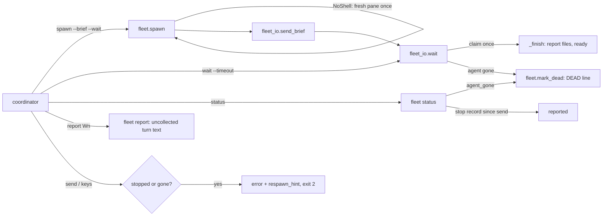
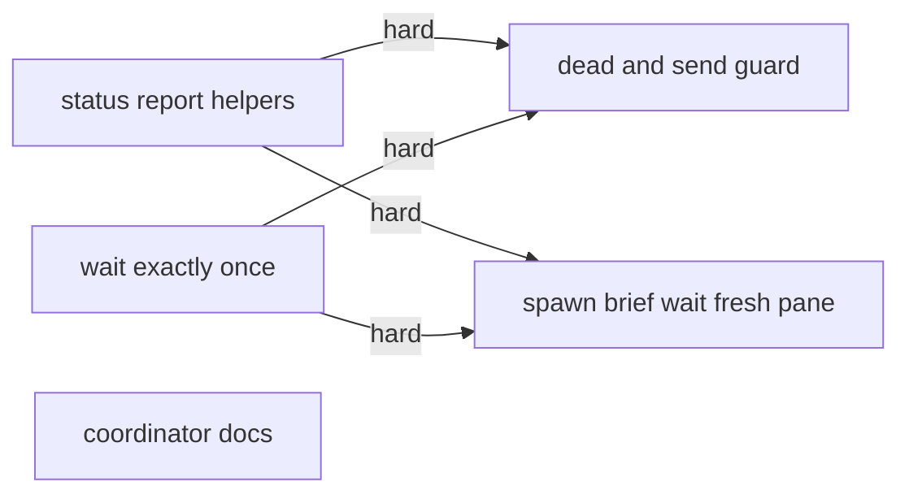

# Superlite: fleet wait, status and send tell the truth (B132)

**Goal:** fix #578 and #579 plus main's #551 follow-up: `fleet wait` honours its timeout and returns each report exactly once naming the finisher; `fleet status` shows `reported` and `dead` workers; `fleet report` reads a turn that ended but was not collected; `fleet send` to a finished or dead worker says so and names a fresh spawn; `fleet spawn --brief F --wait` spawns, sends and waits in one call; worker spawns get the lead's fresh-pane retry.
**Architecture:** `fleet.py` gains three helpers (`agent_gone`, `mark_dead`, `respawn_hint`), a probing `status`, a `report` that reads an uncollected turn, `spawn --brief/--label/--wait/--timeout` and `NoShell` (moved from `fleet_lead.py`, which aliases it). `fleet_io.py` gains `parse_timeout` and `claim` (exactly-once collection), a finisher suffix on `BUSY`/`TIMEOUT`, `DEAD` detection in `wait` and a send/keys guard for stopped or gone workers.
**Tech stack:** Python 3.10+ stdlib, pytest (through `sl run_tests`), Markdown docs.
**Spec:** this file, section Design; issues #578 and #579 (Expected lines).
**Detail:** contracts
**Target-min:** 11
**Wave0:** none
**Coverage:** off

Global constraints:
- Every Python code line keeps the file's trailing `# O(...)` complexity comment; module docstrings name each new behaviour in one line.
- Existing tests stay green. An existing test file changes only when the task Owns it. If another existing test turns red, report it in DONE_WITH_CONCERNS with the test id and the reason instead of editing it.
- Run `sl` as an executable (`<abs>/sl ...`). Verify with `<abs>/sl run_tests --fast <own test files> --task Tn --background`, then run the printed `wait:` line in the foreground and end the turn only after it reports.
- Tests never reach a real Herdr: use the in-process fakes (`test_fleet.FakeHerdr` for fleet.py, `test_fleet_io.FakeHerdr` for fleet_io.py); a test needing scripted Herdr replies skips under `SUPERLITE_REAL=1`.
- No version edits. Never run `scripts/evals.sh`, `claude plugin eval` or `scripts/test_layers.py run`. Never edit docs/tools.md or docs/fleet.md (other batches own them).

Ruling: `--timeout` stays milliseconds; a bare number from 1 to 999 is read as seconds with a stderr note, and `ms`/`s`/`m` suffixes are accepted (because #578's `--timeout 580` meant 580 s and ended after one poll; cost if wrong: a deliberate sub-second wait now lasts seconds).
Ruling: exactly-once is a lock-held `collected` marker per send in fleet.json (`claim`), checked before any report file is written (because concurrent `fleet wait` calls each finished the same worker; cost if wrong: one extra fleet.json write per report).
Ruling: `status` probes each ready or busy worker (not layer, not starting) with `agent get`; `agent_not_found` marks it stopped with `dead: true` and drops it from pool.json, without closing its pane (a test must never close a real pane; `off` closes the workspace) (cost if wrong: a dead pane stays until `fleet off`).
Ruling: `report` stays read-only: for a busy worker whose turn ended it prints the turn's report text and names `fleet wait Wn` as the collector; no state change (because B54 made report read-only).
Ruling: one-call path is `fleet spawn --role R [--tier T] --brief F [--label L] [--wait [--timeout T]]`, not `fleet run` (taken by layers).
Ruling: worker spawns get the lead's fresh-pane retry through one `fleet.NoShell`; `fleet_lead.NoShell` is an alias (main's #551 follow-up; the backlog triage worker goes through `fleet.spawn` too). docs/tools.md and docs/fleet.md rows go to notes.md as follow-ups.
Ruling: detail contracts; no probe adapter (Herdr-bound CLI; cases are named tests); layers unit and headless (T5 edits skills/subagent-driven-development/fleet.md).
LAYERS: unit, headless

## Design

### 1. Helpers (T1)
`agent_gone(name, client=None)`: `client or hc`; `client.agent_state(name)`; a `HerdrError` whose `code` is `agent_not_found` gives True, any other `HerdrError` or a returned state gives False. `mark_dead(sd, wid)`: one `fs.locked` write: `state` `stopped`, `dead` true, `task` None, `last_task` the old `task` or `last_task`; `_pool_drop(sd, wid)` in the same lock; unknown wid: no-op; no Herdr call. `respawn_hint(sd, wid, plan=None)`: `sl fleet spawn` + ` --role R` (role not implementer) + ` --tier T` (role implementer, fixer or research, tier set) + ` --brief B` (record `brief` set) + ` --plan P` (PLAN, else `str(sd)`); KeyError for an unknown wid.

### 2. Status and report (T1)
`status` per printed worker in state ready or busy, role not layer: `agent_gone(name)` True → `mark_dead`, the line's state word reads `dead`; else a busy worker with `fio.latest_stop(sd, wid, int(sent))` not None reads `reported`. With `--all` a stopped worker with `dead` reads `dead`. After the worker lines: `reported: W2 W5; collect: sl fleet wait W2 W5 --plan P` when any, one `dead: Wn (its agent is gone); start a fresh one: <respawn_hint>` line per worker marked dead by this call. P is `--plan` as given, else the state dir. `report Wn` on a busy worker with such a stop record: stderr `Wn <task>: turn ended, not collected yet; sl fleet wait Wn --plan P collects it`, stdout the text `fio.report_text(transcript)` (no transcript: the record's `last`), success; without a stop record the old busy error.

### 3. Wait exactly once (T2)
`parse_timeout`: see T2. `claim(sd, wid, sent)`: lock-held; True when the record's state is busy or blocked, `int(sent)` equals SENT and `collected` differs, then `collected = SENT` is saved; else False. `wait`: an explicit id in state ready or stopped prints `Wn <last_task or -> already collected: <json path or "no report">` and is not pending; an unknown id prints `Wn unknown worker`. Each poll, a pending worker whose state now reads ready or stopped prints the same line and leaves pending. `_finish` and `_finish_layer` call `claim` first; False prints that line and returns None (not added to results). `BLOCKED-UI` does not claim. `BUSY ...` and `TIMEOUT ...` gain ` (reported: W1 <report>, W4 <report>)` when this call has results (report path, or the id alone when empty).

### 4. Dead workers and sends (T3)
In `wait`, a pending non-layer worker with no stop record since its send, absent from a successful `agent_states()` listing, is probed with `fleet.agent_gone(name, hc)` at most once per SETTLE_MS; True → `claim`, `fleet.mark_dead`, line `Wn <label> DEAD (its agent is gone; no report); start a fresh one: <hint>`, result status `DEAD`, source `herdr`, report "". `send_brief` saves `brief` (absolute path) on the record in the `_busy` write. `main` for `send` (all forms) and `keys`, before any Herdr call: a stopped record exits 2 with `error: Wn is stopped (<role>, last task <L>); start a fresh one: <hint>` (`dead`: `error: Wn is dead (its agent is gone; last task <L>); start a fresh one: <hint>`). A `HerdrError` code `agent_not_found` from the send or keys: `mark_dead`, then the dead message, exit 2.

### 5. Spawn (T4)
`--brief F` (plain spawn only): a missing file exits 2 `error: brief not found: <abs>` before any pane; after the worker line, `fio.send_brief(sd, wid, F, label)`; a `HerdrError`, OSError or KeyError there stops the worker, prints `BLOCKED: Wn <label> not sent (<why>)`, exit 3. `--wait` (needs `--brief`, else exit 2 `error: --wait needs --brief`) then runs `fio.wait(sd, [wid], fio.parse_timeout(timeout or "540000"))`, exit 0. `--timeout` needs `--wait` (exit 2). `--brief` with `--for-dispatch`, `--for-review` or `--package` exits 2 `error: --brief is for a plain spawn`. Fresh pane: `_spawn`'s `fail` takes `shell`; a start error with SHELL_MSG while `after` is None keeps the screen and raises `NoShell(wid, account, why)`; `spawn` catches `_Slow` and `NoShell`; the second `_spawn` with a NoShell uses `choose_account` normally, prints `<wid> <why>; retrying in a fresh pane` on stderr, and its BLOCKED tail is `; retried in a fresh pane after <wid>`.

## File structure

- `skills/subagent-driven-development/scripts/fleet.py`: helpers, status, report (T1); spawn brief/wait, NoShell (T4)
- `skills/subagent-driven-development/scripts/fleet_io.py`: timeout, claim, finisher suffix (T2); DEAD, send guard (T3)
- `skills/subagent-driven-development/scripts/fleet_lead.py`: `NoShell = fleet.NoShell` (T4)
- `skills/subagent-driven-development/fleet.md`: coordinator lines (T5)
- tests: `test_fleet_status_579.py`, `test_fleet.py` (T1); `test_fleet_wait_once_578.py`, `test_fleet_io_notify.py` (T2); `test_fleet_dead_send_579.py`, `test_fleet_io.py` (T3); `test_fleet_spawn_brief_578.py`, `test_fleet_spawn_shell_retry.py` (T4); `test_fleet_docs_578_579.py` (T5)

## Task graph

```mermaid
%% schedule
gantt
  title Predicted schedule (mm:ss)
  dateFormat X
  axisFormat %M:%S
  section lane 1
  T1 fleet status and report tell reported :t1, 0, 150s
  T4 spawn takes a brief and waits workers :t4, 150, 149s
  section lane 2
  T2 fleet wait honours its timeout and re :t2, 0, 149s
  T3 wait ends dead workers send refuses f :t3, 150, 148s
  section lane 3
  T5 coordinator docs name the new fleet l :t5, 0, 94s
```

critical path: T1 → T4 (5.0 min) · peak width 3 · predicted build 5.0 min · predicted total ≈ 8.5 min (target ✓)

## Package: fleet CLI

App type: CLI over Herdr. Categories: protocol (commands, lines, exit codes), state (fleet.json races, dead workers), file (reports). **Probe entry:** none (every path needs Herdr; cases are named tests).

### T1 fleet status and report tell reported and dead · Complexity 5 · Est. context 45k
**Owns:** skills/subagent-driven-development/scripts/fleet.py, tests/scripts/test_fleet.py, tests/scripts/test_fleet_status_579.py
**Components:** 2
**LOC owned:** 170
**Tests:** fast
**Model:** sonnet
**Est. time:** 3.5 min (2 components, about 170 LOC, fast tests)
**Covers:** 1, 2
**Consumes:** none
**Produces:** fleet.agent_gone(name: str, client=None) -> bool · fleet.mark_dead(sd: Path, wid: str) -> None · fleet.respawn_hint(sd: Path, wid: str, plan: str | None = None) -> str
e.g. respawn_hint(Path("/r/.superlite"), "W5") with W5 {"role": "fixer", "tier": "2", "brief": "/r/.superlite/briefs/fix-1.md"} -> "sl fleet spawn --role fixer --tier 2 --brief /r/.superlite/briefs/fix-1.md --plan /r/.superlite"
e.g. respawn_hint(Path("/r/.superlite"), "W1") with W1 {"role": "implementer", "tier": "sonnet"} -> "sl fleet spawn --tier sonnet --plan /r/.superlite"
e.g. respawn_hint(Path("/r/.superlite"), "W7", ".superlite") with W7 {"role": "final-reviewer", "tier": "opus", "brief": "/r/.superlite/review-packet.md"} -> "sl fleet spawn --role final-reviewer --brief /r/.superlite/review-packet.md --plan .superlite"
**Review Focus:** state: `test_mark_dead_stops_and_drops_from_pool`, `test_status_herdr_error_keeps_stored_state`; protocol: `test_status_shows_dead_and_persists`, `test_report_reads_an_uncollected_turn`.
**Test code:** in tests/scripts/test_fleet.py, `FakeHerdr` gains `self.gone = set()` and `agent_state(name)` (not logged): raises `HerdrError("agent_not_found", "agent target not found")` for a name in `gone`, raises `HerdrError(self.state_error, "x")` when `self.state_error` is set, else returns "idle". New tests/scripts/test_fleet_status_579.py (world fixture from test_fleet, fleet.json workers written directly):
- `test_agent_gone_true_on_agent_not_found`: gone={"sl-a"} -> agent_gone("sl-a") is True, agent_gone("sl-b") is False; state_error="timeout" -> agent_gone("sl-b") is False; a passed client object is used instead of fleet.hc.
- `test_mark_dead_stops_and_drops_from_pool`: W1 busy task "T3", in pool.json -> after mark_dead: state "stopped", dead True, task None, last_task "T3"; pool.json has no W1; no close_pane call.
- `test_respawn_hint_shapes`: the three e.g. lines; unknown "W9" raises KeyError.
- `test_status_shows_dead_and_persists`: W1 ready, its name in gone -> stdout has a line starting "W1 dead account=" and the line "dead: W1 (its agent is gone); start a fresh one: sl fleet spawn --tier sonnet --plan <sd>"; fleet.json W1 state "stopped", dead True. A second `status` prints no W1 line; `status --all` prints "W1 dead".
- `test_status_shows_reported_for_ended_turn`: W1 busy sent=5000, metrics.jsonl line {"ev": "stop", "t": 5010, "agent_id": "W1", "last": "Status: DONE"} -> line starts "W1 reported account=" and "reported: W1; collect: sl fleet wait W1 --plan <sd>"; fleet.json W1 still busy.
- `test_status_busy_without_stop_stays_busy`: W1 busy, no stop -> "W1 busy account=", no "reported:" line.
- `test_status_herdr_error_keeps_stored_state`: state_error="timeout" -> "W1 ready account=", fleet.json unchanged.
- `test_status_does_not_probe_layer_or_starting`: W2 role layer busy, W3 state starting, both names in gone -> neither marked dead.
- `test_report_reads_an_uncollected_turn`: W1 busy task "T3" sent=5000, stop t=5010 with a transcript whose last assistant text is "Status: DONE\nFiles: a.py" -> main(["report", "W1"]) == 0, stdout "Status: DONE\nFiles: a.py\n", stderr contains "W1 T3: turn ended, not collected yet"; no file under fleet/reports; W1 still busy.
- `test_report_busy_still_working_refuses`: W1 busy, no stop -> exit 1, stderr contains "is busy on T3".
- `test_report_dead_worker_prints_last_report`: mark_dead on W1 (task "T3"), fleet/reports/T3.md "Status: DONE\n" -> report prints it, exit 0.
**Steps:** 1 failing tests, 2 run: FAIL, 3 implement, 4 run: PASS

### T2 fleet wait honours its timeout and reports once · Complexity 5 · Est. context 45k
**Owns:** skills/subagent-driven-development/scripts/fleet_io.py, tests/scripts/test_fleet_io_notify.py, tests/scripts/test_fleet_wait_once_578.py
**Components:** 2
**LOC owned:** 150
**Tests:** fast
**Model:** sonnet
**Est. time:** 3.2 min (2 components, about 150 LOC, fast tests)
**Covers:** 3
**Consumes:** none
**Produces:** fleet_io.parse_timeout(v: str) -> int · fleet_io.claim(sd: Path, wid: str, sent: int) -> bool
e.g. parse_timeout("540000") -> 540000; parse_timeout("580") -> 580000; parse_timeout("9m") -> 540000
e.g. claim(sd, "W1", 2000000) -> True for W1 busy with sent 2000000; the same call again -> False
**Review Focus:** state: `test_concurrent_finish_reports_once`, `test_claim_once`; protocol: `test_cli_small_timeout_reads_seconds`, `test_wait_any_busy_line_names_finisher`.
**Test code:** new tests/scripts/test_fleet_wait_once_578.py (world fixture, `transcript` and the stop-record pattern from test_fleet_io / test_fleet_io_notify):
- `test_parse_timeout_units`: "540000"->540000, "580"->580000, "580s"->580000, "9m"->540000, "1500ms"->1500, "0"->0, "1000"->1000; "abc", "-5", "5h", "" raise ValueError.
- `test_cli_small_timeout_reads_seconds`: wait monkeypatched; io.main(["wait", "--timeout", "580"]) == 0, wait got 580000; stderr contains "--timeout 580 read as 580 s"; "540000" gives 540000 and no note.
- `test_cli_bad_timeout_exits_2`: io.main(["wait", "--timeout", "abc"]) == 2, stderr starts "error: --timeout abc".
- `test_claim_once`: W1 busy sent S -> claim True, then False; fleet.json collected == S; claim(sd, "W1", S + 1) False; a ready worker False; unknown "W9" False.
- `test_concurrent_finish_reports_once`: W1 sent T3 with a DONE stop record; claim(sd, "W1", S) first (another wait) -> wait(sd, ["W1"], 5000) == [], stdout has "W1 T3 already collected", no "W1 T3 DONE" line, no fleet/reports/T3.json written by this call.
- `test_second_wait_returns_nothing_new`: wait collects W1 (DONE line); wait(sd, ["W1"], 5000) == [] and prints "W1 T3 already collected: <sd>/fleet/reports/T3.json".
- `test_worker_collected_mid_wait_leaves_pending`: W1 and W2 busy, W2 working; after the first poll W1 is set ready by another process (a fake sleep calls io._ready) -> W1 printed "already collected", wait ends on W2 only.
- `test_wait_any_busy_line_names_finisher`: as test_wait_any_returns_first -> last line == f"BUSY W2 (reported: W1 {sd}/fleet/reports/T3.json)".
- `test_timeout_line_names_finishers`: W1 done, W2 working, no --any, timeout 5000 -> last line == f"TIMEOUT W2 (reported: W1 {sd}/fleet/reports/T3.json)"; a TIMEOUT with no results stays "TIMEOUT W2".
In test_fleet_io_notify.py, test_wait_any_returns_first expects the new BUSY line.
**Steps:** 1 failing tests, 2 run: FAIL, 3 implement, 4 run: PASS

### T3 wait ends dead workers, send refuses finished ones · Complexity 5 · Est. context 45k
**Owns:** skills/subagent-driven-development/scripts/fleet_io.py, tests/scripts/test_fleet_io.py, tests/scripts/test_fleet_dead_send_579.py
**Components:** 2
**LOC owned:** 140
**Tests:** fast
**Model:** sonnet
**Est. time:** 3.1 min (2 components, about 140 LOC, fast tests)
**Covers:** 4
**Consumes:** fleet.agent_gone(name: str, client=None) -> bool (T1) · fleet.mark_dead(sd: Path, wid: str) -> None (T1) · fleet.respawn_hint(sd: Path, wid: str, plan: str | None = None) -> str (T1) · fleet_io.claim(sd: Path, wid: str, sent: int) -> bool (T2)
**Produces:** none
**Review Focus:** state: `test_wait_ends_a_dead_worker`, `test_live_unlisted_worker_keeps_waiting`; protocol: `test_send_to_stopped_fixer_names_fresh_spawn`, `test_send_agent_not_found_marks_dead`.
**Test code:** in tests/scripts/test_fleet_io.py, `FakeHerdr.HerdrError` takes `(code="", message="")` and sets both; `FakeHerdr` gains `self.gone = set()` and `agent_state(name)` (logged as ("agent_state", name)): raises HerdrError("agent_not_found", "agent target not found") for a name in gone, else returns "idle". New tests/scripts/test_fleet_dead_send_579.py:
- `test_wait_ends_a_dead_worker`: W1 sent T3, states [{"sl-proj-w2": "working"}], gone={"sl-proj-w1"}, no stop record -> wait(sd, ["W1"], 60000) returns one result status "DEAD"; stdout line starts "W1 T3 DEAD (its agent is gone; no report); start a fresh one: sl fleet spawn --tier sonnet --plan "; fleet.json W1 stopped, dead True; pool.json lacks W1.
- `test_live_unlisted_worker_keeps_waiting`: name missing from states but not in gone, timeout 5000 -> TIMEOUT W1; agent_state probed at most once per 10000 ms of fake clock.
- `test_listing_failure_is_no_death`: agent_states raises HerdrError -> no agent_state call, TIMEOUT.
- `test_send_records_the_brief`: send_brief(sd, "W1", <abs brief>) -> fleet.json W1 brief == that absolute path.
- `test_send_to_stopped_fixer_names_fresh_spawn`: W1 {"role": "fixer", "tier": "2", "state": "stopped", "last_task": "FX1", "brief": "/b/fix.md"} -> io.main(["send", "W1", "--text", "hi"]) == 2, stderr "error: W1 is stopped (fixer, last task FX1); start a fresh one: sl fleet spawn --role fixer --tier 2 --brief /b/fix.md --plan <sd>", no prompt call; the same for `--brief`, task ids and `keys W1 Enter`.
- `test_send_to_dead_names_dead`: the record also has dead True -> stderr starts "error: W1 is dead (its agent is gone; last task FX1)".
- `test_send_agent_not_found_marks_dead`: W1 ready; prompt raises HerdrError("agent_not_found", "gone") -> exit 2, stderr starts "error: W1 is dead (its agent is gone", fleet.json W1 stopped and dead.
**Steps:** 1 failing tests, 2 run: FAIL, 3 implement, 4 run: PASS

### T4 spawn takes a brief and waits; workers get a fresh pane · Complexity 5 · Est. context 45k
**Owns:** skills/subagent-driven-development/scripts/fleet.py, skills/subagent-driven-development/scripts/fleet_lead.py, tests/scripts/test_fleet_spawn_shell_retry.py, tests/scripts/test_fleet_spawn_brief_578.py
**Components:** 2
**LOC owned:** 150
**Tests:** fast
**Model:** sonnet
**Est. time:** 3.2 min (2 components, about 150 LOC, fast tests)
**Covers:** 5
**Consumes:** fleet_io.parse_timeout(v: str) -> int (T2)
**Produces:** fleet.NoShell(Exception)
**Review Focus:** protocol: `test_spawn_brief_wait_one_call`, `test_spawn_brief_missing_file_exits_2`; state: `test_worker_fresh_pane_after_two_shell_failures`.
**Test code:** new tests/scripts/test_fleet_spawn_brief_578.py (world fixture from test_fleet; `fleet_io.hc` patched to world.fh; fio.send_brief and fio.wait monkeypatched to record calls unless the test says otherwise):
- `test_spawn_brief_sends_after_spawn`: main(["spawn", "--role", "fixer", "--tier", "2", "--brief", <abs b.md>, "--label", "FX1"]) == 0; send_brief got ("W1", <abs b.md>, "FX1"); no wait call.
- `test_spawn_brief_wait_one_call`: adds "--wait", "--timeout", "580" -> wait got ([ "W1" ], 580000); without --timeout 540000.
- `test_spawn_brief_missing_file_exits_2`: missing brief -> 2, stderr starts "error: brief not found: ", no create_workspace call.
- `test_spawn_wait_needs_brief`: ["spawn", "--wait"] -> 2 "error: --wait needs --brief"; ["spawn", "--brief", b, "--timeout", "5"] -> 2 "error: --timeout needs --wait".
- `test_spawn_brief_refused_with_dispatch`: ["spawn", "--for-dispatch", "--brief", b] -> 2 "error: --brief is for a plain spawn".
- `test_spawn_brief_send_failure_stops_worker`: send_brief raises world.fh.HerdrError("agent_prompt_stalled", "x") -> exit 3, stdout "BLOCKED: W1 FX1 not sent (x)", W1 state stopped.
- `test_worker_fresh_pane_after_two_shell_failures`: script {1: SHELL, 2: SHELL} (helpers from test_fleet_spawn_shell_retry) -> spawn returns W2; W1 blocked, W2 ready; close_pane of W1's pane; 3 starts, 1 pause; stderr contains f"W1 startup: {MSG}; retried once; retrying in a fresh pane".
- `test_worker_blocks_after_fresh_pane_fails`: {1..4: SHELL} -> exit 3, BLOCKED line starts "BLOCKED: W2 account " and ends f"startup: {MSG}; retried once; retried in a fresh pane after W1"; 4 starts, 2 pauses.
- `test_lead_noshell_is_fleet_noshell`: fleet_lead.NoShell is fleet.NoShell.
In test_fleet_spawn_shell_retry.py: `test_second_shell_failure_blocks` scripts four shell failures and expects the fresh-pane BLOCKED tail; `test_for_dispatch_names_the_rerun` scripts four and its first line ends "retried once; retried in a fresh pane after W1; rerun sl fleet spawn --for-dispatch)", the second "W3 T3 sent".
**Steps:** 1 failing tests, 2 run: FAIL, 3 implement, 4 run: PASS

### T5 coordinator docs name the new fleet lines · Complexity 2 · Est. context 25k
**Owns:** skills/subagent-driven-development/fleet.md, tests/scripts/test_fleet_docs_578_579.py
**Components:** 1
**LOC owned:** 30
**Tests:** fast
**Kind:** mechanical
**Model:** haiku
**Est. time:** 1.5 min (1 component, about 30 LOC, fast tests)
**Covers:** 3, 4, 5
**Consumes:** none
**Produces:** none
**Test code:** new tests/scripts/test_fleet_docs_578_579.py reads skills/subagent-driven-development/fleet.md and asserts each of the three sentences below is in it verbatim, once.
**Steps:** 1 failing test, 2 run: FAIL, 3 edit fleet.md, 4 run: PASS, 5 run the existing docs tests: `<abs sl> run_tests --fast tests/scripts/test_fleet_b1_docs.py tests/scripts/test_fleet_docs_b54.py tests/scripts/test_docs_b26.py tests/scripts/test_docs_b95_fleet.py tests/scripts/test_docs_b67_fleet.py tests/scripts/test_docs_b104_fleet.py --task T5 --background`.
**Notes:** edits, exact text:
1. In `## Other roles`, after the sentence ending "A one-turn worker answers once and `fleet wait` stops it.", append in the same paragraph: " One call does all three: `fleet spawn --role R [--tier T] --brief <abs file> [--label L] --wait [--timeout 540000] --plan $PLAN` (a missing brief exits 2 before any pane; a failed send stops the worker, `BLOCKED: Wn L not sent (...)`, exit 3)."
2. In `## Waiting and acting`, replace "`BUSY Wn Wm` lists the workers still running." with "`BUSY Wn Wm (reported: Wk <json>)` lists the workers still running and names this call's finishers; `--timeout` is in ms (a bare number under 1000 is read as seconds; `540s` and `9m` work too). Each report is returned once: `Wn <label> already collected: <json>` means another wait got it."
3. Replace the line starting "`\"$SL\" fleet status` lists workers;" with "`\"$SL\" fleet status` lists workers; `reported` means the turn ended and `fleet wait Wn` collects it (`fleet report Wn` reads it first), `dead` (also `Wn <label> DEAD` from wait) means its agent is gone: the line names the fresh `fleet spawn`. `fleet send` to a stopped or dead worker exits 2 with that spawn line. `fleet stop Wn` or `--all` closes them. At freeze, `\"$SL\" fleet stop --all` runs before `trees clean` (no-op without fleet mode)."

## Review Focus

Package fleet CLI (CLI over Herdr): protocol (exact lines, exit codes, `--timeout` units), state (two waits racing on one worker, a worker sent new work mid-wait, a dead agent with or without a stop record), file (no report file rewritten by a second collector). App-specific: a busy worker with a stale stop record from before its send must not read `reported` (`latest_stop` takes `sent`); BLOCKED-UI must not claim (its send still reports later).

## Self-review

Coverage: sections 1-5 map to T1-T4, docs to T5. Consumes match Produces (T1, T2). Shared files: fleet.py (T1 then T4), fleet_io.py (T2 then T3) are ordered by hard edges. No placeholders.
