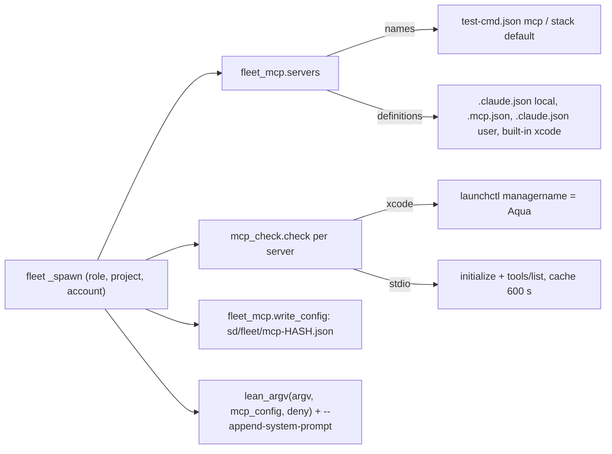
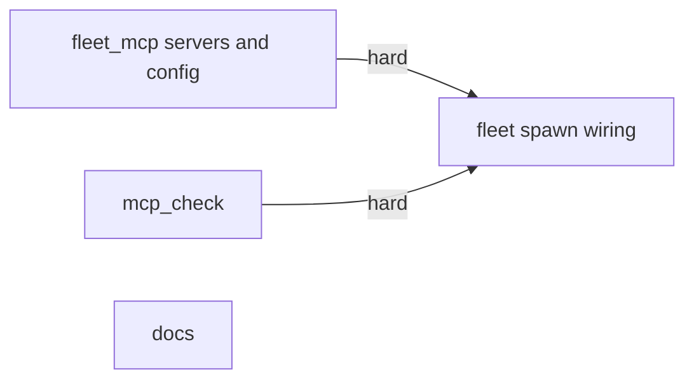

# Superlite: fleet workers keep the MCP servers their project needs (B156)

**Goal:** fix #576: a fleet worker still starts lean (`--strict-mcp-config`), but implementers, fixers and package reviewers get the MCP servers their project names (or the stack default: an Xcode project gets `xcode`) through `--mcp-config <generated file>`; `fleet spawn` checks each server first and prints one line for a server it leaves out.
**Architecture:** new `fleet_mcp.py` resolves which servers a role gets and their definitions (project `.mcp.json`, the worker account's `.claude.json`, a built-in `xcode` entry) and writes the generated config; new `mcp_check.py` checks one server (macOS GUI session for `xcode`, an MCP `initialize` + `tools/list` handshake over stdio, cached per run for 10 min); `fleet.py` `_spawn` wires both into the worker argv (`lean_argv(argv, mcp_config, deny)`, `--append-system-prompt` with the usage note).
**Tech stack:** Python 3.10+ stdlib, pytest (through `sl run_tests`); Markdown docs.
**Spec:** this file, section Design; issue #576.
**Detail:** tests
**Target-min:** 11
**Wave0:** none
**Coverage:** off (bounded change to one existing flow, fleet spawn)

Global constraints:
- Standing rules from main (copy them into every brief): this repository is public: no host names, user names, home paths, other project or repository names, ticket keys or account names in code, tests, docs or commit messages; write "a Swift project", "the machine". Never change the machine's gate config or `~/.superlite/machine.json`; tests use private temp homes and state dirs. No real app builds and no real Xcode or `xcrun mcpbridge` call as proof: this repository's own test suite is the check. Friction with superlite itself goes to `sl feedback add`.
- Every Python code line keeps the file's trailing `# O(...)` complexity comment; new modules start with the `#!/usr/bin/env python3` line, a module docstring and a `# Complexity notation:` block like `gui_session.py`.
- Existing tests stay green. An existing test file changes only when the task Owns it. If another existing test turns red, report it in DONE_WITH_CONCERNS with the test id and the reason instead of editing it.
- Run `sl` as an executable (`<abs>/sl ...`). Verify with `<abs>/sl run_tests --fast <own test files> --task Tn --background`, then run the printed `wait:` line in the foreground and end the turn only after it reports.
- No version edits. Never run `scripts/evals.sh`, `claude plugin eval` or `scripts/test_layers.py run`. Never edit `agents/**`, `skills/**/SKILL.md`, `skills/subagent-driven-development/fleet.md`, `backlog_brief.py`, `backlog_run.py`, `backlog_ship.py`, `run_tests.py` or `testcmd.py` (other batches own them or they cost the evals layer).
- Stdlib only. A check or lookup error never stops a spawn: the server is left out with one line.

Ruling: by main, not the user: the server list is set in the project config plus a stack default (main's ruling on "Where is the list of MCP servers for workers set?").
Ruling: the project config is the existing `.superlite/test-cmd.json`, key `"mcp"`: a list of server names, read through `testcmd.config_source` like `read_first` (because it is the one project file superlite already reads and seeds into worktrees; cost if wrong: one key moves). `"mcp": []` turns the stack default off; a value that is not a list of strings prints `test-cmd.json "mcp" must be a list of server names; ignored` on stderr and falls back to the stack default.
Ruling: stack default on macOS only: `["xcode"]` when the config's `language` is `swift` or the project root holds an `.xcodeproj` or `.xcworkspace`; otherwise none (because `xcrun mcpbridge` exists only on a Mac; cost if wrong: one more line per spawn elsewhere).
Ruling: roles with servers: implementer, fixer, package-reviewer; research, final-reviewer, checker and writer stay without (the issue's split; checker builds and runs through its own simulator rules).
Ruling: definitions are looked up, first hit wins: the account `.claude.json` local scope (`projects[<project>]`, then `projects[<main checkout>]` for a linked worktree), the project `.mcp.json` `mcpServers`, the account `.claude.json` top-level `mcpServers`, then the built-in `xcode` = `{"type": "stdio", "command": "xcrun", "args": ["mcpbridge"]}`; the account file is `<config dir>/.claude.json`, or `~/.claude.json` for the default `~/.claude`.
Ruling: the usage rules go into the worker through `--append-system-prompt`, only when `xcode` is kept, and `mcp__xcode__XcodeOpenWorkspace` and `mcp__xcode__XcodeCloseWorkspace` are denied; agents/*.md stay unchanged (because the rules are Xcode-only and a lean worker without the server should not carry them; agent edits also cost the headless and evals layers; cost if wrong: the text moves into the role files later).
Ruling: a server that fails its check is left out of the generated file (one stderr line `Wn mcp: <name> left out: <why>`); results are cached in `<sd>/fleet/mcp-check.json` for 600 s per name and definition; `SUPERLITE_MCP_CHECK=0` skips the check; only stdio servers are probed (http and sse pass unprobed).
Ruling: no new allow rules: MCP tools follow the worker's permission mode like every other tool.
LAYERS: unit

## Design

### 1. Which servers (#576 Expected 2)
`fleet_mcp.servers(role, project, claude_json)` returns `({name: definition}, notes)`. Roles outside `MCP_ROLES` get `({}, [])` without reading anything. Names come from test-cmd.json `"mcp"` (any config source `testcmd.config_source` returns), else the stack default. Each name is looked up in the order of the ruling above; a name found nowhere adds the note `mcp: <name> left out: no definition in <project>/.mcp.json, <claude_json> or the built-in list`. An unreadable or malformed JSON file counts as empty.

### 2. The generated file (#576 Expected 1)
`fleet_mcp.write_config(sd, servers)` writes `{"mcpServers": servers}` (sorted keys, indent 2) to `<sd>/fleet/mcp-<first 10 hex of sha1 of that text>.json`, content-addressed so `fleet restore` replays the recorded argv safely; it returns the path, `None` for an empty dict.

### 3. The check (#576 Expected 3)
`mcp_check.check(name, definition, sd=None, cwd=None)` returns `None` (usable) or a short reason. `xcode` (by name, or a definition whose args hold `mcpbridge`) on macOS needs `gui_session.session_kind()` to be `None` or `Aqua`. A stdio server must answer `initialize` and then `tools/list` within `CHECK_TIMEOUT_S = 15`. Results are cached in `<sd>/fleet/mcp-check.json`.

### 4. Spawn wiring and usage rules (#576 Expected 1, 4)
`_spawn` resolves the servers after the account is chosen, checks each, prints each note as `Wn mcp: ...` on stderr, writes the file, and builds `lean_argv(launch["argv"], path, fleet_mcp.deny(kept))` plus `--append-system-prompt <fleet_mcp.usage_note(kept)>` when the note is not empty. The spawn line ends ` mcp=<names>` and the fleet.json record keeps `"mcp": [names]` when servers are kept; a lean worker's argv and line stay byte-identical to today.

### 5. Docs
`docs/fleet.md` and `docs/tools.md` name the setting, the stack default, the roles, the check, its line, the cache and `SUPERLITE_MCP_CHECK=0`.

## File structure

- `skills/subagent-driven-development/scripts/fleet_mcp.py`, `tests/scripts/test_fleet_mcp_576.py`: T1
- `skills/subagent-driven-development/scripts/mcp_check.py`, `tests/scripts/conftest.py`, `tests/scripts/test_mcp_check_576.py`: T2
- `skills/subagent-driven-development/scripts/fleet.py`, `tests/scripts/test_fleet_spawn_mcp_576.py`: T3
- `docs/fleet.md`, `docs/tools.md`, `tests/scripts/test_docs_576_mcp.py`: T4

## Task graph

```mermaid
%% schedule
gantt
  title Predicted schedule (mm:ss)
  dateFormat X
  axisFormat %M:%S
  section lane 1
  T2 mcp_check GUI session and tools/list :t2, 0, 204s
  T3 fleet spawn passes the kept servers :t3, 204, 195s
  section lane 2
  T1 fleet_mcp servers and generated confi :t1, 0, 201s
  section lane 3
  T4 docs name worker MCP servers :t4, 0, 181s
```

critical path: T2 → T3 (6.6 min) · peak width 3 · predicted build 6.6 min · predicted total ≈ 13.1 min (target ✗ 11.0)

## Package: fleet_mcp

App type: library. Categories: file (missing and malformed JSON, content-addressed writes), state (precedence of sources). **Probe entry:** none (filesystem fixtures; cases are named tests).

### T1 fleet_mcp servers and generated config · Complexity 4 · Est. context 40k
**Owns:** skills/subagent-driven-development/scripts/fleet_mcp.py, tests/scripts/test_fleet_mcp_576.py
**Components:** 1
**LOC owned:** 170
**Tests:** fast
**Model:** sonnet
**Est. time:** 2.8 min (1 component, about 170 LOC, fast tests)
**Covers:** 1, 2
**Produces:** fleet_mcp.servers(role: str, project: str | Path, claude_json: str | Path | None) -> tuple[dict, list[str]]
e.g. servers("research", P, J) -> ({}, [])
e.g. servers("implementer", P, J) with P/.superlite/test-cmd.json {"test": "pytest", "mcp": ["docs"]} and P/.mcp.json {"mcpServers": {"docs": {"command": "npx", "args": ["-y", "docs-mcp"]}, "other": {"command": "x"}}} -> ({"docs": {"command": "npx", "args": ["-y", "docs-mcp"]}}, [])
e.g. servers("fixer", P, J) on macOS with P/App.xcodeproj/, no test-cmd.json and J missing -> ({"xcode": {"type": "stdio", "command": "xcrun", "args": ["mcpbridge"]}}, [])
**Produces:** fleet_mcp.write_config(sd: str | Path, servers: dict) -> Path | None
e.g. write_config(SD, {"docs": {"command": "npx", "args": ["-y", "docs-mcp"]}}) -> SD/fleet/mcp-<10 hex>.json holding {"mcpServers": {"docs": {"command": "npx", "args": ["-y", "docs-mcp"]}}}
e.g. write_config(SD, {}) -> None
**Produces:** fleet_mcp.deny(names: list[str]) -> list[str]
e.g. deny(["docs", "xcode"]) -> ["mcp__xcode__XcodeOpenWorkspace", "mcp__xcode__XcodeCloseWorkspace"]
e.g. deny(["docs"]) -> []
**Produces:** fleet_mcp.usage_note(names: list[str]) -> str
e.g. usage_note(["xcode"]) -> fleet_mcp.XCODE_NOTE
e.g. usage_note(["docs"]) -> ""
**Review Focus:** `test_local_scope_beats_project_file`: J {"projects": {str(P.resolve()): {"mcpServers": {"docs": {"command": "local"}}}}} and P/.mcp.json docs `{"command": "proj"}` -> the local definition; `test_malformed_files_count_as_empty`: P/.mcp.json `{not json` and J `[]` -> the name is left out with its note, no exception; `test_bad_mcp_value_falls_back`: `"mcp": "xcode"` prints the ignored line on stderr and uses the stack default; `test_empty_list_turns_default_off`: `"mcp": []` with an `.xcodeproj` -> ({}, [])
**Steps:** 1 failing tests, 2 run: FAIL, 3 implement, 4 run: PASS
**Notes:**
- Constants: `MCP_ROLES = ("implementer", "fixer", "package-reviewer")`, `XCODE = {"type": "stdio", "command": "xcrun", "args": ["mcpbridge"]}`, `BUILTIN = {"xcode": XCODE}`, `XCODE_DENY = ("mcp__xcode__XcodeOpenWorkspace", "mcp__xcode__XcodeCloseWorkspace")`, `BAD_MCP = 'test-cmd.json "mcp" must be a list of server names; ignored'`.
- `XCODE_NOTE` (one line, no backticks, quotes, `$`, `!` or `#`): "Xcode MCP tools (mcp__xcode__...) are connected. After each edit of a Swift file run XcodeRefreshCodeIssuesInFile on it and fix what it reports. Render every Preview you add or change with RenderPreview before you report DONE. Look up Apple APIs with DocumentationSearch. Only the coordinator opens or closes an Xcode workspace; if none is open for this project, say so in your report instead of opening one."
- Names: `cfg, _, _ = testcmd.config_source(Path(project))`; when `cfg` is a dict holding `"mcp"`: a list of strings gives the names (stripped, empty ones dropped, first occurrence kept), anything else prints `BAD_MCP` on stderr and falls through. Stack default: `sys.platform == "darwin"` and (`cfg.get("language") == "swift"` or an entry ending `.xcodeproj` or `.xcworkspace` in the project root) -> `["xcode"]`.
- Lookup per name: J's `projects[str(Path(project).resolve())]["mcpServers"]`, then the main checkout's key when the project is a linked worktree (`git -C <project> rev-parse --path-format=absolute --git-common-dir`; its parent when it ends in `.git`; any git error: skip), then `<project>/.mcp.json` `mcpServers`, then J's top-level `mcpServers`, then `BUILTIN`. A definition must be a dict. J may be `None` (skip it).
- Named tests: the Produces e.g. lines (P, J and SD under `tmp_path`; the xcode one skipped off macOS, and another `test_no_default_off_macos` monkeypatches `sys.platform` to `linux` -> ({}, [])), the Review Focus tests, `test_user_scope_used_last` (only J top-level `mcpServers.docs` -> found), `test_unknown_name_note` (`"mcp": ["nope"]` -> ({}, ["mcp: nope left out: no definition in 
/.mcp.json, <J> or the built-in list"])), `test_write_config_is_content_addressed` (two calls with equal dicts -> the same path; a different dict -> another path; the file names only the given servers).

## Package: mcp_check

App type: protocol client. Categories: protocol (JSON-RPC over stdio, non-JSON stdout lines), state (cache freshness), file (cache file). **Probe entry:** none (needs a stub server process; cases are named tests).

### T2 mcp_check: GUI session and tools/list handshake · Complexity 5 · Est. context 44k
**Owns:** skills/subagent-driven-development/scripts/mcp_check.py, tests/scripts/conftest.py, tests/scripts/test_mcp_check_576.py
**Components:** 1
**LOC owned:** 190
**Tests:** fast
**Model:** sonnet
**Est. time:** 3.0 min (1 component, about 190 LOC, fast tests)
**Covers:** 3
**Produces:** mcp_check.check(name: str, definition: dict, sd: str | Path | None = None, cwd: str | Path | None = None) -> str | None
e.g. check("docs", {"command": sys.executable, "args": [STUB]}, SD) -> None (STUB answers initialize and tools/list)
e.g. check("docs", {"command": "no-such-cmd-576"}) -> "command no-such-cmd-576 not found"
e.g. check("xcode", {"type": "stdio", "command": "xcrun", "args": ["mcpbridge"]}) on macOS with session_kind() == "Background" -> "no macOS GUI session (launchctl managername: Background, not Aqua)"
**Produces:** mcp_check.probe(definition: dict, cwd: str | Path | None = None, timeout: float = 15.0) -> str | None
e.g. probe({"command": sys.executable, "args": [STUB]}) -> None
e.g. probe({"command": sys.executable, "args": ["-c", "import sys; sys.exit(3)"]}) -> "exited before answering tools/list (exit 3)"
**Review Focus:** `test_stdout_noise_is_skipped`: a stub that prints a non-JSON line before each reply -> None; `test_silent_server_times_out`: a stub that reads stdin and never answers, `timeout=1` -> "did not answer tools/list in 1 s" within 5 s and the process is gone; `test_tools_list_error`: a stub answering tools/list with {"error": {"message": "nope"}} -> "tools/list error: nope"; `test_cache_skips_second_start`: a stub that appends to a counter file per start: two `check` calls with the same SD within 600 s start it once, a changed definition starts it again, an entry older than 600 s starts it again; `test_check_off`: `SUPERLITE_MCP_CHECK=0` -> None and the counter stays 0
**Steps:** 1 failing tests, 2 run: FAIL, 3 implement, 4 run: PASS
**Notes:**
- Constants: `CHECK_TIMEOUT_S = 15.0`, `CHECK_TTL_S = 600`, `CACHE = "mcp-check.json"` (under `<sd>/fleet/`), `PROTOCOL = "2025-06-18"`.
- `check`: `SUPERLITE_MCP_CHECK == "0"` -> None. GUI: `name == "xcode"` or `"mcpbridge"` in the args, `sys.platform == "darwin"`, `gui_session.session_kind()` not in `(None, "Aqua")` -> the GUI reason (tests monkeypatch `mcp_check.gui_session.session_kind` and `mcp_check.sys.platform`). A definition with `url`, or `type` in `("http", "sse")` -> None, not probed. Cache key: `name + ":" + sha1(json.dumps(definition, sort_keys=True))[:12]`, entry `{"why": str | None, "at": time.time()}`; a fresh entry returns its `why`; otherwise `probe(definition, cwd)`, then write the cache atomically (temp file + `os.replace`; an OSError is ignored). A cache file that is not a JSON object counts as empty.
- `probe`: resolve `definition["command"]` with `shutil.which` against the merged env's PATH (`{**os.environ, **definition.get("env", {})}`, values as str); not found -> `command <cmd> not found`. `subprocess.Popen([cmd, *args], stdin=PIPE, stdout=PIPE, stderr=DEVNULL, cwd=cwd, env=env, text=True)`; a reader thread queues stdout lines; send `{"jsonrpc": "2.0", "id": 1, "method": "initialize", "params": {"protocolVersion": PROTOCOL, "capabilities": {}, "clientInfo": {"name": "superlite-fleet", "version": "1"}}}`, wait for the id-1 reply, send `{"jsonrpc": "2.0", "method": "notifications/initialized"}` and `{"jsonrpc": "2.0", "id": 2, "method": "tools/list"}`, wait for the id-2 reply; lines that are not JSON objects are skipped; one deadline for the whole handshake; a reply with `error` -> `<initialize|tools/list> error: <message>`; EOF before id 2 -> `exited before answering tools/list (exit <code>)`; deadline -> `did not answer tools/list in <timeout:g> s`. Always terminate the process in a `finally` (terminate, wait 2 s, kill). Never `DETACHED_PROCESS`.
- conftest `_isolated_superlite_home` also sets `SUPERLITE_MCP_CHECK=0` (no test reaches a real server); this file's tests `monkeypatch.delenv("SUPERLITE_MCP_CHECK")` where they probe.
- STUB: a Python file the tests write under `tmp_path` that reads JSON lines and answers id 1 with `{"result": {"protocolVersion": "2025-06-18", "capabilities": {}, "serverInfo": {"name": "stub", "version": "1"}}}` and id 2 with `{"result": {"tools": [{"name": "ping", "inputSchema": {"type": "object"}}]}}`, flushing each line; variants by argv flag.
- Named tests: the Produces e.g. lines, the Review Focus tests, `test_http_not_probed` ({"type": "http", "url": "http://127.0.0.1:9"} -> None), `test_gui_aqua_passes_to_probe` (session_kind "Aqua" and a stub definition named xcode -> None).

## Package: fleet spawn

App type: CLI. Categories: protocol (argv shape, stdout and stderr lines), state (fleet.json record, restore replay). **Probe entry:** none (herdr fake; cases are named tests).

### T3 fleet spawn passes the kept servers · Complexity 4 · Est. context 46k
**Owns:** skills/subagent-driven-development/scripts/fleet.py, tests/scripts/test_fleet_spawn_mcp_576.py
**Components:** 1
**LOC owned:** 130
**Tests:** fast
**Model:** sonnet
**Est. time:** 2.4 min (1 component, about 130 LOC, fast tests)
**Covers:** 4
**Consumes:** fleet_mcp.servers(role: str, project: str | Path, claude_json: str | Path | None) -> tuple[dict, list[str]] (T1) · fleet_mcp.write_config(sd: str | Path, servers: dict) -> Path | None (T1) · fleet_mcp.deny(names: list[str]) -> list[str] (T1) · fleet_mcp.usage_note(names: list[str]) -> str (T1) · mcp_check.check(name: str, definition: dict, sd: str | Path | None = None, cwd: str | Path | None = None) -> str | None (T2)
**Produces:** fleet.lean_argv(argv: list, mcp_config: str | Path | None = None, deny: list | tuple = ()) -> list
e.g. lean_argv(["--agent", "x", "--disallowedTools", "AskUserQuestion"], "/s/fleet/mcp-a.json", ["mcp__xcode__XcodeOpenWorkspace"]) -> ["--agent", "x", "--strict-mcp-config", "--mcp-config", "/s/fleet/mcp-a.json", "--no-chrome", "--disable-slash-commands", "--disallowedTools", "AskUserQuestion", "Artifact", "ArtifactComments", "ArtifactData", "ListAgents", "ReadNotifications", "ReportFindings", "mcp__xcode__XcodeOpenWorkspace"]
e.g. lean_argv(["--agent", "x"]) -> ["--agent", "x", "--strict-mcp-config", "--no-chrome", "--disable-slash-commands", "--disallowedTools", "Artifact", "ArtifactComments", "ArtifactData", "ListAgents", "ReadNotifications", "ReportFindings"] (as today)
**Produces:** fleet.claude_json(config_dir: str, env: dict | None = None) -> Path
e.g. claude_json("/u/.claude-account3", {"HOME": "/u"}) -> Path("/u/.claude-account3/.claude.json")
e.g. claude_json("/u/.claude", {"HOME": "/u"}) -> Path("/u/.claude.json")
**Review Focus:** `test_lean_argv_mcp_idempotent`: `lean_argv(lean_argv(a, p, d), p, d) == lean_argv(a, p, d)` (one `--mcp-config`, each deny name once); `test_research_spawn_stays_lean`: a project whose test-cmd.json says `"mcp": ["docs"]`: `--role research` argv has no `--mcp-config` and equals today's; `test_failed_check_left_out`: `mcp_check.check` monkeypatched to return "did not answer tools/list in 15 s": stderr has `W1 mcp: docs left out: did not answer tools/list in 15 s`, argv has no `--mcp-config`, the spawn still succeeds; `test_restore_replays_the_file`: the fleet.json `launch.argv` holds the same `--mcp-config` path and that file exists
**Steps:** 1 failing tests, 2 run: FAIL, 3 implement, 4 run: PASS
**Notes:**
- `lean_argv`: with `mcp_config`, the flags are `--strict-mcp-config --mcp-config <str(path)> --no-chrome --disable-slash-commands` (the pair only when `--mcp-config` is not in argv yet); `deny` names join `LEAN_DENY` at the end of the deny list, each once, in the given order. Without both, output is byte-identical to today (the existing tests in `tests/scripts/test_fleet_lean_377.py` stay green).
- `claude_json`: `Path(HOME of env or ~) / ".claude.json"` when `ac.is_default_dir(config_dir, env)`, else `Path(config_dir) / ".claude.json"`.
- `_spawn`, after `wid`: `servers, notes = fleet_mcp.servers(role, project, claude_json(cdir, base))`; per server `why = mcp_check.check(name, d, sd, project)`, a reason appends `mcp: <name> left out: <why>` and drops it; each note prints `f"{wid} {note}"` on stderr; any exception in this block prints `{wid} mcp: none: <error>` on stderr and keeps the worker lean. With kept servers: `path = fleet_mcp.write_config(sd, kept)`, `argv = lean_argv(launch["argv"], path, fleet_mcp.deny(names))`, then `["--append-system-prompt", note]` when `usage_note(names)` is not empty (before the `--add-dir` pair); the record gets `"mcp": names` (sorted) and the spawn line ends ` mcp=<names joined by ,>`. Imports lazy inside `_spawn` like `fleet_roles`.
- Module docstring: one line (#576); the `spawn` docstring names the kept servers.
- Named tests (use `world` from `tests/scripts/test_fleet.py`, `fleet.main(["on"])`, project `world.proj` with `.superlite/test-cmd.json` `{"test": "pytest", "mcp": ["docs"]}` and `.mcp.json` defining `docs`; `SUPERLITE_MCP_CHECK=0` from conftest): the Produces e.g. lines, the Review Focus tests, `test_implementer_gets_the_file` (argv has `--mcp-config <sd>/fleet/mcp-*.json` once, the file's `mcpServers` keys are `["docs"]`, stdout line ends ` mcp=docs`), `test_xcode_kept_adds_deny_and_note` (`fleet_mcp.servers` monkeypatched to return `({"xcode": fleet_mcp.XCODE}, [])`: both xcode deny names in the deny list, `--append-system-prompt` followed by `fleet_mcp.XCODE_NOTE`), `test_lean_project_argv_unchanged` (no test-cmd.json: argv equals `lean_argv(launch_argv)` plus the `--add-dir` pair, no ` mcp=`).

## Package: docs

App type: docs. Categories: none. **Probe entry:** none (docs).

### T4 docs name worker MCP servers · Complexity 1 · Est. context 30k
**Owns:** docs/fleet.md, docs/tools.md, tests/scripts/test_docs_576_mcp.py
**Components:** 1
**LOC owned:** 40
**Tests:** fast
**Model:** sonnet
**Est. time:** 1.6 min (1 component, about 40 LOC, fast tests)
**Covers:** 5
**Review Focus:** `test_fleet_md_names_mcp`: docs/fleet.md holds `"mcp"`, `--mcp-config`, `xcode`, `SUPERLITE_MCP_CHECK=0` and `left out`
**Steps:** 1 failing tests, 2 run: FAIL, 3 implement, 4 run: PASS
**Notes:**
- docs/fleet.md: the sentence `A one-turn worker and a lead start lean: ...` gains: implementers, fixers and package reviewers keep the MCP servers test-cmd.json `"mcp"` names (a list; `[]` none), else on macOS `xcode` for a Swift or Xcode project, through `--strict-mcp-config --mcp-config <sd>/fleet/mcp-<hash>.json`; definitions from the account's `.claude.json` (local, then user scope), the project `.mcp.json` or the built-in `xcode` (`xcrun mcpbridge`); `fleet spawn` checks each (macOS GUI session for `xcode`, `initialize` + `tools/list` within 15 s, cached 10 min in `<sd>/fleet/mcp-check.json`, `SUPERLITE_MCP_CHECK=0` skips it) and prints `Wn mcp: <name> left out: <why>` for one it drops; a worker with `xcode` gets the usage rules through `--append-system-prompt` and cannot call XcodeOpenWorkspace or XcodeCloseWorkspace. Research, final reviewer, checker and writer stay without servers. The researcher sentence (no documentation tools) stays true.
- docs/tools.md: in the `fleet` row, `launches workers with lean flags (--strict-mcp-config and denied tools)` gains `, plus --mcp-config with the role's kept MCP servers (#576)`; new rows after the `fleet` row: `fleet_mcp` (library of fleet spawn: `servers`, `write_config`, `deny`, `usage_note`; the `"mcp"` setting, stack default, lookup order) and `mcp_check` (library of fleet spawn: `check`, `probe`; GUI session, handshake, cache, `SUPERLITE_MCP_CHECK=0`).
- Named tests: the Review Focus test, `test_tools_md_rows` (docs/tools.md has rows starting `| \`fleet_mcp\` |` and `| \`mcp_check\` |`, and the fleet row holds `--mcp-config`).

## Review Focus

- fleet_mcp (library): file, state. Risks: a huge or malformed `.claude.json`; a local-scope key for a worktree path; a name defined nowhere.
- mcp_check (protocol client): protocol, state, file. Risks: a server that writes logs to stdout; a server that never answers (timeout, no orphan process); a stale cache hiding a fixed server for at most 600 s.
- fleet spawn (CLI): protocol, state. Risks: argv shape (`--mcp-config` is variadic: it must sit before another option); a lean worker's argv must not change; `fleet restore` replays the recorded file.

## Self-review

Coverage: Design 1 to 5 map to T1 to T4. No placeholders. T3's Consumes match T1 and T2 Produces. Edges T1->T3 and T2->T3: T3's tests run both modules. No two parallel tasks share a file (conftest only in T2).
