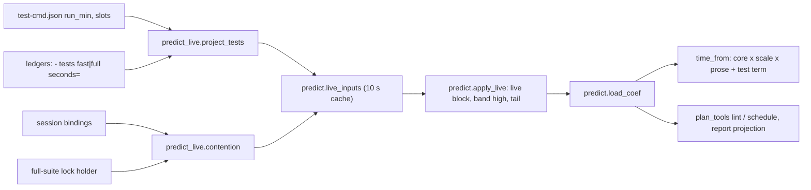
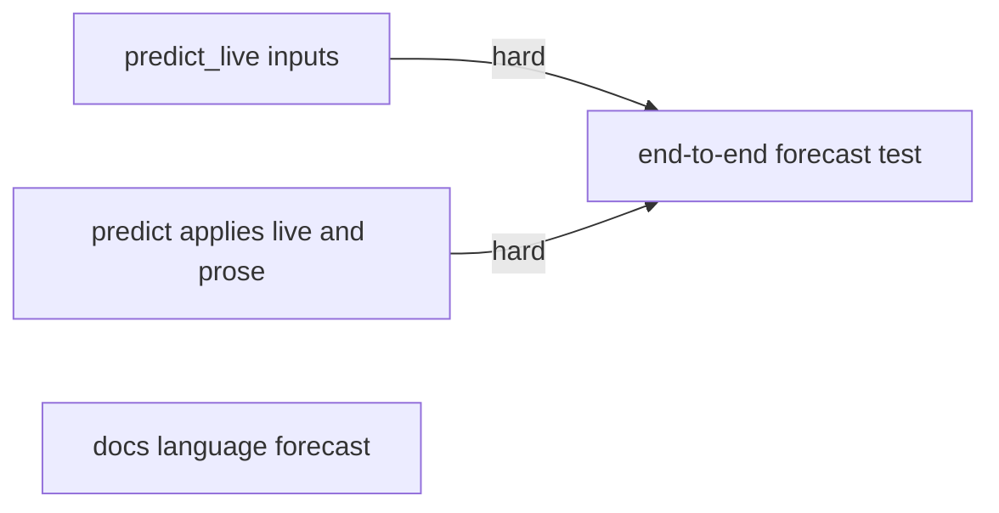

# Superlite: forecast with test-run cost, contention and prose (B145)

**Goal:** fix #605: the plan forecast (lint, schedule, predict, the saved projection finish reports) adds a per-project test-run cost times the runs a task needs, a contention factor when other runs share the machine's build slots or the full-suite lock, and a factor for evidence-checked prose.
**Architecture:** a new library `predict_live.py` reads the live inputs: test-run minutes per mode (test-cmd.json `run_min`, else the run ledgers' measured `- tests` lines) and contention (other live superlite runs from the session bindings, the full-suite lock holder). `predict.py` applies them in `load_coef` (no explicit `--coef`, `SUPERLITE_FORECAST_LIVE` not `0`): a per-task test term in `time_from`, the size band's high end and the schedule tail raised in the coefficients plan_tools already reads, a `live` block in the predict JSON; it also marks prose tasks and scales their time and calls. plan_tools, finish and report are unchanged: they read `predict_task`, `predict_plan` and `load_coef`.
**Tech stack:** Python 3.10+ stdlib, pytest (through `sl run_tests`), JSON config, Markdown docs.
**Spec:** .superlite/spec-605.md (issue #605 Expected, main's ruling).
**Detail:** tests
**Target-min:** 11
**Wave0:** none
**Max chars:** 60000

Global constraints:
- Every Python code line in `skills/**/scripts/*.py` keeps the trailing `# O(...)` complexity comment the files use.
- Existing tests stay green. An existing test file changes only when the task Owns it. If another existing test turns red, report it in DONE_WITH_CONCERNS with the test id and the reason instead of editing it.
- Run `sl` as an executable (`<abs>/sl ...`). Verify with `<abs>/sl run_tests --fast <own test files> --task Tn --background`, then run the printed `wait:` line in the foreground and end the turn only after it reports. Never run `run_tests --full` yourself: the lead runs the full suite.
- No version edits (the ship step bumps the version). Never run `scripts/evals.sh`, `claude plugin eval` or `scripts/test_layers.py run`.
- The live inputs never break a prediction: any exception while reading them leaves the coefficients as they were.

Ruling: test-run cost source is test-cmd.json `run_min` with the measured ledger history as fallback (main's ruling, from the brief).
Ruling: measured history = `- tests fast|full ... seconds=S` ledger lines (finish.TESTS) with passed+failed > 0, from `.superlite/progress.md` and `.superlite/runs/*/progress.md` of every checkout of the repository (git worktree list), newest 20 files by mtime, newest 50 lines per mode, median, at least 3 lines (because the lint that fixes the forecast runs before this run's own tests; sibling leads and archived runs measured the same suite; cost if wrong: a skewed median until test-cmd.json names `run_min`).
Ruling: contention reads what superlite can see: session bindings `$SUPERLITE_HOME/sessions/<id>` (line 1 folder, line 2 pid) with a live pid, a run marker (`state.has_run`), a run file changed within 120 min, outside this project, distinct folders; and the full-suite lock holder (live pid, root outside this project). No placement-CLI slot query; slots default 2, test-cmd.json `slots` overrides (cost if wrong: a factor off by the unseen load).
Ruling: this run's own parallel lanes are not counted in the factor: predict sees one task at a time and the schedule's cap lives in plan_tools (other batches' file); a follow-up.
Ruling: the test term = runs x fast minutes x factor less runs x 0.5 min (plus slow_tests_min for a slow task), never negative; it sits outside the language scale and the prose factor (because the coefficients already hold some test time and a measured per-project cost is no language prior; cost if wrong: the 0.5 prior moves).
Ruling: lint's SIZE band high end rises by a fast task's test minutes, low_min stays (because splitting cannot shrink a fixed per-task test cost; cost if wrong: one more lint NOTE).
Ruling: live inputs apply only with no explicit `--coef` and `SUPERLITE_FORECAST_LIVE` not `0`; tests/scripts/conftest.py sets `0` (it is in no open batch's list; notes.md names it), so the suite stays independent of the run's ledgers and the machine.
Ruling: prose priors time x2, calls x3 (1.5.121: wall +108 %, cost +282 %); a refit does not learn them (history rows carry no prose flag).
Ruling: docs/language.md (in no open batch's list) gets the test-cmd.json fields; docs/tools.md's predict row is a follow-up (other batches own it).
Ruling: headless layer stamped by ruling, not run: predictor.json is data that only predict.py reads, and the unit layer covers it.
Ruling: no probe adapter (inputs are files and processes; Review Focus cases are named tests); already in the lead worktree, no `sl worktree ensure`.
LAYERS: unit



## Design

### 1. Live inputs (T1) - `predict_live.py`
Module docstring states the rules below. Imports: `finish` (TESTS regex), `run_tests` (lock_holder, full_lock_path), `state` (home, has_run), `testcmd` (config_source), `worktree` (git).
- `config_minutes(config: dict | None) -> tuple[dict, int | None]`: `run_min` a positive int/float (not bool) sets both modes; a dict sets `fast`/`full` from its positive numbers; anything else gives None. `slots`: an int >= 1 (not bool), else None.
- `checkouts(root: Path) -> list[Path]`: root first, then every `worktree <path>` of `git -C root worktree list --porcelain`; resolved, deduplicated; a git failure gives `[root]`.
- `ledger_paths(root: Path, limit: int = 20) -> list[Path]`: per checkout `.superlite/progress.md` and `.superlite/runs/*/progress.md` that exist, deduplicated, newest mtime first, at most `limit`.
- `ledger_minutes(paths: list[Path], keep: int = 50) -> dict`: `{"fast": [...], "full": [...]}` minutes, newest first (files in the given order, each file's lines from the last); `finish.TESTS` match, mode `fast` or `full`, passed+failed > 0; at most `keep` per mode; unreadable files skipped.
- `project_tests(root: Path, cfg: dict) -> dict`: `testcmd.config_source(root)`; source `test-cmd.json` labels `test-cmd.json`, `user` labels `user test-cmd.json`, detection gives no config. Per mode: the config value (runs 0), else the ledger median rounded to 3 places when at least `cfg["history_min_runs"]` (3) lines (runs = lines used), else None (runs 0). Keys `fast_min`, `full_min`, `fast_source`, `full_source`, `fast_runs`, `full_runs`, `slots`. The ledgers are read only when a mode lacks a config value. cfg defaults: history_min_runs 3, history_keep 50, history_files 20.
- `is_alive(pid) -> bool`: an int > 0 (not bool); `os.kill(pid, 0)`: ProcessLookupError False, PermissionError True, other OSError/OverflowError False.
- `other_runs(root: Path, window_min: float, now: float | None = None) -> int`: files in `state.home() / "sessions"` (skip directories); line 1 an absolute existing folder, line 2 an int pid; count when the pid lives, `state.has_run(folder)`, the folder lies outside root (resolved; root itself and below are this run, task trees included), and the newest mtime of its `progress.md`, `stable.json`, `pool.json`, `prime.md`, `fleet.json` is within `window_min` minutes; distinct resolved folders; an unreadable binding is skipped; a missing sessions folder gives 0.
- `full_lock_held(root: Path) -> bool`: `run_tests.lock_holder(run_tests.full_lock_path())` with a live pid whose `root` does not lie inside root.
- `contention(root: Path, cfg: dict, slots: int | None = None) -> dict`: slots = the argument when an int >= 1, else `cfg["slots"]` (2), at least 1; others = `other_runs(root, cfg["active_window_min"] (120))`; `factor = round(max(1, (1 + others) / slots), 3)`; `full_factor = round(1 + cfg["full_wait_share"] (0.5) * max(others, 1 if lock else 0), 3)`.

### 2. Forecast (T2) - `predict.py`, `predictor.json`, conftest
- predictor.json, after `schedule`: `"tests": {"_comment": "#605 test-run cost: runs per task by its Tests field (red, green, review); included_*_min = test minutes per run the time coefficients and schedule.tail_min already hold; history_* = the ledger fallback when test-cmd.json names no run_min.", "runs": {"fast": 3, "slow": 3, "build": 1}, "included_run_min": 0.5, "included_full_min": 1.0, "history_min_runs": 3, "history_keep": 50, "history_files": 20}`, `"contention": {"_comment": "#605: test runs scale by max(1, (1 + other live runs) / slots); the closing full run waits 1 + full_wait_share x max(others, full-suite lock held) runs; test-cmd.json slots overrides slots.", "slots": 2, "active_window_min": 120, "full_wait_share": 0.5}`, `"prose": {"_comment": "#605: a task owning only these files, or Kind: prose (never Kind: mechanical), is evidence-checked prose; priors from the 1.5.121 run.", "extensions": [".md", ".mdx", ".markdown", ".rst", ".txt", ".adoc"], "time_factor": 2.0, "calls_factor": 3.0}`.
- predict.py constants: `LIVE_ENV = "SUPERLITE_FORECAST_LIVE"`, `LIVE_TTL = 10.0`, `_LIVE_CACHE: dict = {}`, `TEST_COST_DEFAULTS` and `PROSE_DEFAULTS` holding the predictor.json values (a custom `--coef` file may lack the blocks).
- `load_coef(path=None)`: explicit path: the file as is. Else the current history refit and language scale (unchanged rules, also when no history file exists), then, unless `os.environ.get(LIVE_ENV) == "0"`, `live = live_inputs(out)` and `out = apply_live(out, live)` when live is truthy; any exception there keeps `out`.
- `live_inputs(coef: dict) -> dict | None`: root = `run_tests.project_root(Path.cwd()) or Path.cwd()`; cache key `(str(root.resolve()), str(state.home()), os.environ.get("SUPERLITE_USER_TEST_CMD", ""))`, entry `(time.monotonic(), live)` reused within LIVE_TTL; else `_read_live(root, coef)` (looked up as a module global, so a test can patch it). `_read_live(root, coef)`: `tests = predict_live.project_tests(root, coef.get("tests") or {})`; `{"tests": tests, "contention": predict_live.contention(root, coef.get("contention") or {}, tests.get("slots"))}`.
- `test_extra_min(feats: dict, coef: dict) -> float`: 0.0 unless `coef["live"]["tests"]["fast_min"]` is a number; runs by `feats["tests"]` (unknown: fast); `max(0.0, runs * fast_min * factor - runs * included_run_min - (time.slow_tests_min if slow else 0))`, factor from `coef["live"]["contention"]["factor"]` (1.0).
- `apply_live(coef: dict, live: dict) -> dict`: a deep copy (the input stays unchanged) with `live = {"tests", "contention", "task_test_min", "tail_add_min", "base": {"tail_min", "high_min"}}`; task_test_min = `test_extra_min({"tests": "fast"}, copy)`; tail_add_min = `max(0, full_min * full_factor - included_full_min)` when full_min is a number, else 0; both rounded to 3 places; when > 0, `size_band.high_min = base high + task_test_min` and `schedule.tail_min = base tail + tail_add_min` (rounded to 3). Base tail 3.5 and high 6.0 when the blocks lack them.
- `strip_live(coef: dict) -> dict`: a copy without `live`, `schedule.tail_min` and `size_band.high_min` back to `live.base` where apply_live changed them.
- `time_from`: `core * language_scale * (prose time_factor if feats.get("prose") else 1) + test_extra_min(feats, coef)`, core as today.
- `cost_from`: calls times prose calls_factor when `feats.get("prose")`.
- `is_prose(task, coef: dict) -> bool`: Kind field text names `mechanical`: False; names `prose`: True; else Owns non-empty and every entry ends (case-insensitive) with a prose extension.
- `task_features(task, coef)`: adds `"prose": True` for a prose task, else None (so it drops out of the JSON features).
- `predict_task`: adds `"test_min": round(test_extra_min(feats, coef), 3)` when `coef` has `live`. `predict_plan`: `out["live"]` = the live block's tests, contention, task_test_min, tail_add_min when present.
- `refit(obs, models, coef, ...)`: works on `strip_live(coef)`, so no live value is ever written.
- Module docstring: one paragraph naming the live inputs, the gate and the prose factor.
- tests/scripts/conftest.py `_isolated_superlite_home`: `monkeypatch.setenv("SUPERLITE_FORECAST_LIVE", "0")` with the comment `# the forecast's live inputs (ledgers, sessions, locks) stay out; #605 tests turn them on`.

### 3. Docs (T4) - `docs/language.md`
Append after the **User-level default.** paragraph, verbatim:

**Forecast.** The plan forecast (`sl plan_tools lint`, `schedule`, `predict`) adds the project's test-run cost: `"run_min": N` (minutes per run, both modes) or `"run_min": {"fast": N, "full": N}` in the test-cmd.json in effect (a user-level entry too), else the median `seconds=` of the newest `- tests fast|full` ledger lines in the repository's checkouts (`.superlite/progress.md`, `.superlite/runs/*/progress.md`; 3 lines at least). Each task adds its runs (fast and slow 3, build 1) times the fast minutes, less the 0.5 min a run the coefficients already hold, and lint's size band rises by the same amount; the schedule tail adds the full run. Contention scales both: the other superlite runs live on the machine (session bindings with a live pid and a run changed in the last 2 hours) share `"slots": N` build slots (default 2), and the closing full run waits for them at the full-suite lock. A task that owns only prose files (`.md`, `.rst`, `.txt`, ...) or has `**Kind:** prose` counts double time and triple calls, unless it is `Kind: mechanical`. `predict --plan` names these inputs under `live`; `SUPERLITE_FORECAST_LIVE=0` turns them off.

## File structure

| File | Responsibility |
|---|---|
| skills/subagent-driven-development/scripts/predict_live.py | new: reads test-run minutes and machine contention |
| skills/subagent-driven-development/scripts/predict.py | applies live inputs and the prose factor to the forecast |
| skills/subagent-driven-development/config/predictor.json | priors: tests, contention, prose blocks |
| tests/scripts/conftest.py | live inputs off for the script tests |
| docs/language.md | test-cmd.json `run_min`, `slots`, the forecast rules |
| tests/scripts/test_predict_live_605.py, test_predict_forecast_605.py, test_forecast_e2e_605.py, test_docs_605_forecast.py | tests |

## Task graph

```mermaid
%% schedule
gantt
  title Predicted schedule (mm:ss)
  dateFormat X
  axisFormat %M:%S
  section lane 1
  T2 predict applies the live inputs and t :t2, 0, 184s
  T3 end-to-end forecast test :t3, 184, 93s
  section lane 2
  T1 predict_live reads test minutes and c :t1, 0, 183s
  section lane 3
  T4 docs name the forecast inputs :t4, 0, 90s
```





critical path: T2 → T3 (4.6 min) · peak width 3 · predicted build 4.6 min · predicted total ≈ 8.1 min (target ✓)

## Package: live inputs

App type: library over files and processes. Categories: state (stale bindings, pid reuse), file (missing, unreadable, malformed). **Probe entry:** none (inputs are files and processes; the cases are named tests).

### T1 predict_live reads test minutes and contention · Complexity 5 · Est. context 48k
**Owns:** skills/subagent-driven-development/scripts/predict_live.py, tests/scripts/test_predict_live_605.py
**Components:** 2
**LOC owned:** 330
**Tests:** fast
**Model:** sonnet
**Covers:** 1, 2
**Consumes:** none
**Produces:** predict_live.project_tests(root: Path, cfg: dict) -> dict · predict_live.contention(root: Path, cfg: dict, slots: int | None = None) -> dict · predict_live.is_alive(pid: int) -> bool
e.g. project_tests(<root whose .superlite/test-cmd.json is {"test": "make test", "run_min": {"fast": 6, "full": 12}, "slots": 2}>, {}) -> {"fast_min": 6.0, "full_min": 12.0, "fast_source": "test-cmd.json", "full_source": "test-cmd.json", "fast_runs": 0, "full_runs": 0, "slots": 2}
e.g. project_tests(<root, no test-cmd.json, ledger with three `- tests fast passed=3 failed=0 skipped=0 seconds=30.0` lines>, {"history_min_runs": 3}) -> {"fast_min": 0.5, "full_min": None, "fast_source": "history", "full_source": None, "fast_runs": 3, "full_runs": 0, "slots": None}
e.g. contention(<root>, {"slots": 2, "active_window_min": 120, "full_wait_share": 0.5}) with 3 other live runs, lock free -> {"others": 3, "full_lock": False, "slots": 2, "factor": 2.0, "full_factor": 2.5}
**Review Focus:** state: `test_dead_idle_markerless_and_own_runs_do_not_count`, `test_two_sessions_of_one_run_count_once`, `test_a_dead_or_own_lock_holder_does_not_count`; file: `test_a_bad_run_min_is_ignored`, `test_runs_that_ran_nothing_do_not_count`.
**Test code (verbatim):** new file tests/scripts/test_predict_live_605.py:
```python
"""#605: predict_live reads a project's test-run minutes and the machine's contention."""
from __future__ import annotations

import json
import os
import subprocess
import sys
import time

from test_plan_tools import SCRIPTS

sys.path.insert(0, str(SCRIPTS))
import predict_live  # noqa: E402
import run_tests  # noqa: E402
import state  # noqa: E402

DEAD = 99_999_999
CFG = {"slots": 2, "active_window_min": 120, "full_wait_share": 0.5}


def project(tmp_path, name="proj", config=None, ledger=()):
    root = tmp_path / name
    (root / ".superlite").mkdir(parents=True)
    if config is not None:
        (root / ".superlite" / "test-cmd.json").write_text(json.dumps(config), encoding="utf-8")
    if ledger:
        (root / ".superlite" / "progress.md").write_text("# Progress ledger\n\n" + "\n".join(ledger) + "\n", encoding="utf-8")
    return root


def fast(seconds, passed=3, failed=0):
    return f"- tests fast passed={passed} failed={failed} skipped=0 seconds={seconds}"


def full(seconds, recorded=False):
    return f"- tests full passed=900 failed=0 skipped=2 seconds={seconds}" + (" recorded" if recorded else "")


def bind(sid, sd, pid):
    p = state.home() / "sessions" / sid
    p.parent.mkdir(parents=True, exist_ok=True)
    p.write_text(f"{sd}\n{pid}\n{sd.parent}\n", encoding="utf-8")


def run_dir(tmp_path, name, marker="stable.json", age_s=0):
    sd = tmp_path / name / ".superlite"
    sd.mkdir(parents=True)
    f = sd / marker
    f.write_text("{}", encoding="utf-8")
    if age_s:
        old = time.time() - age_s
        os.utime(f, (old, old))
    return sd


def test_run_min_dict_in_test_cmd_json_wins(tmp_path):
    root = project(tmp_path, config={"test": "make test", "run_min": {"fast": 6, "full": 12}, "slots": 2},
                   ledger=[fast(1.0)] * 5)
    assert predict_live.project_tests(root, {}) == {"fast_min": 6.0, "full_min": 12.0, "fast_source": "test-cmd.json",
                                                    "full_source": "test-cmd.json", "fast_runs": 0, "full_runs": 0, "slots": 2}


def test_a_run_min_number_sets_both_modes(tmp_path):
    out = predict_live.project_tests(project(tmp_path, config={"test": "make test", "run_min": 4.5}), {})
    assert (out["fast_min"], out["full_min"], out["slots"]) == (4.5, 4.5, None)


def test_a_user_level_entry_supplies_the_minutes(tmp_path, monkeypatch):
    root = project(tmp_path)
    (root / "go.mod").write_text("module x\n", encoding="utf-8")
    user = tmp_path / "user-test-cmd.json"
    user.write_text(json.dumps({"go": {"test": "go test ./...", "run_min": {"fast": 3, "full": 9}}}), encoding="utf-8")
    monkeypatch.setenv("SUPERLITE_USER_TEST_CMD", str(user))
    out = predict_live.project_tests(root, {})
    assert (out["fast_min"], out["full_min"], out["fast_source"]) == (3.0, 9.0, "user test-cmd.json")


def test_measured_ledger_lines_fill_a_mode_the_config_leaves_out(tmp_path):
    root = project(tmp_path, config={"test": "make test", "run_min": {"fast": 6}},
                   ledger=[full(600.0), full(540.0), full(720.0, recorded=True)])
    out = predict_live.project_tests(root, {"history_min_runs": 3})
    assert (out["full_min"], out["full_source"], out["full_runs"]) == (10.0, "history", 3)
    assert (out["fast_min"], out["fast_source"]) == (6.0, "test-cmd.json")


def test_history_is_the_ledger_median(tmp_path):
    root = project(tmp_path, ledger=[fast(30.0), fast(30.0), fast(30.0)])
    assert predict_live.project_tests(root, {"history_min_runs": 3}) == {
        "fast_min": 0.5, "full_min": None, "fast_source": "history", "full_source": None,
        "fast_runs": 3, "full_runs": 0, "slots": None}


def test_too_few_lines_give_no_minutes(tmp_path):
    out = predict_live.project_tests(project(tmp_path, ledger=[fast(30.0), fast(30.0)]), {"history_min_runs": 3})
    assert (out["fast_min"], out["fast_source"], out["fast_runs"]) == (None, None, 0)


def test_runs_that_ran_nothing_do_not_count(tmp_path):
    root = project(tmp_path, ledger=[fast(30.0), fast(30.0), fast(30.0), fast(1.0, passed=0)])
    assert predict_live.project_tests(root, {"history_min_runs": 3})["fast_min"] == 0.5


def test_only_the_newest_lines_count(tmp_path):
    root = project(tmp_path, ledger=[fast(600.0)] * 3 + [fast(6.0)] * 3)
    assert predict_live.project_tests(root, {"history_min_runs": 3, "history_keep": 3})["fast_min"] == 0.1


def test_archived_run_ledgers_count(tmp_path):
    root = project(tmp_path)
    old = root / ".superlite" / "runs" / "20261101-120000"
    old.mkdir(parents=True)
    (old / "progress.md").write_text("\n".join([full(300.0)] * 3) + "\n", encoding="utf-8")
    assert predict_live.project_tests(root, {"history_min_runs": 3})["full_min"] == 5.0


def test_other_worktrees_ledgers_count(tmp_path):
    main = tmp_path / "main"
    main.mkdir()

    def git(*a):
        subprocess.run(["git", "-C", str(main), *a], check=True, capture_output=True)

    git("init", "-q")
    git("-c", "user.email=t@example.com", "-c", "user.name=t", "commit", "-q", "--allow-empty", "-m", "init")
    git("worktree", "add", "-q", str(tmp_path / "wt"), "-b", "side")
    (main / ".superlite").mkdir()
    (main / ".superlite" / "progress.md").write_text("\n".join([fast(12.0)] * 3) + "\n", encoding="utf-8")
    (tmp_path / "wt" / ".superlite").mkdir()
    assert predict_live.project_tests(tmp_path / "wt", {"history_min_runs": 3})["fast_min"] == 0.2


def test_a_bad_run_min_is_ignored(tmp_path):
    for i, bad in enumerate(("6", -1, 0, True, {"fast": "x"}, [6])):
        root = project(tmp_path, name=f"p{i}", config={"test": "make test", "run_min": bad, "slots": 0})
        out = predict_live.project_tests(root, {})
        assert (out["fast_min"], out["full_min"], out["slots"]) == (None, None, None), bad


def test_no_other_runs_no_contention(tmp_path):
    assert predict_live.contention(project(tmp_path), CFG) == {
        "others": 0, "full_lock": False, "slots": 2, "factor": 1.0, "full_factor": 1.0}


def test_three_live_runs_double_the_test_runs(tmp_path):
    root = project(tmp_path)
    for i in range(3):
        bind(f"s{i}", run_dir(tmp_path, f"other{i}"), os.getpid())
    assert predict_live.contention(root, CFG) == {
        "others": 3, "full_lock": False, "slots": 2, "factor": 2.0, "full_factor": 2.5}


def test_dead_idle_markerless_and_own_runs_do_not_count(tmp_path):
    root = project(tmp_path)
    bind("dead", run_dir(tmp_path, "a"), DEAD)
    bind("idle", run_dir(tmp_path, "b", age_s=3 * 3600), os.getpid())
    nomark = tmp_path / "c" / ".superlite"
    nomark.mkdir(parents=True)
    bind("nomark", nomark, os.getpid())
    (root / ".superlite" / "stable.json").write_text("{}", encoding="utf-8")
    bind("mine", root / ".superlite", os.getpid())
    tree = root / ".superlite" / "trees" / "T1" / ".superlite"
    tree.mkdir(parents=True)
    (tree / "pool.json").write_text("{}", encoding="utf-8")
    bind("tree", tree, os.getpid())
    bind("gone", tmp_path / "gone" / ".superlite", os.getpid())
    (state.home() / "sessions" / "nopid").write_text(f"{run_dir(tmp_path, 'd')}\n", encoding="utf-8")
    (state.home() / "sessions" / "x.d").mkdir()
    assert predict_live.contention(root, CFG)["others"] == 0


def test_two_sessions_of_one_run_count_once(tmp_path):
    root, sd = project(tmp_path), run_dir(tmp_path, "lead")
    bind("lead", sd, os.getpid())
    bind("worker", sd, os.getpid())
    assert predict_live.contention(root, CFG)["others"] == 1


def test_a_fresh_ledger_keeps_an_old_marker_active(tmp_path):
    root, sd = project(tmp_path), run_dir(tmp_path, "lead", age_s=5 * 3600)
    (sd / "progress.md").write_text("- dispatch T1\n", encoding="utf-8")
    bind("lead", sd, os.getpid())
    assert predict_live.contention(root, CFG)["others"] == 1


def test_a_live_full_suite_lock_holder_elsewhere_counts(tmp_path):
    root = project(tmp_path)
    lock = run_tests.full_lock_path()
    lock.parent.mkdir(parents=True, exist_ok=True)
    lock.write_text(json.dumps({"pid": os.getpid(), "root": str(tmp_path / "elsewhere"), "task": None, "started": time.time()}))
    assert predict_live.contention(root, CFG) == {
        "others": 0, "full_lock": True, "slots": 2, "factor": 1.0, "full_factor": 1.5}


def test_a_dead_or_own_lock_holder_does_not_count(tmp_path):
    root = project(tmp_path)
    lock = run_tests.full_lock_path()
    lock.parent.mkdir(parents=True, exist_ok=True)
    lock.write_text(json.dumps({"pid": DEAD, "root": "/elsewhere", "task": None, "started": 1.0}))
    assert predict_live.contention(root, CFG)["full_lock"] is False
    lock.write_text(json.dumps({"pid": os.getpid(), "root": str(root), "task": "T1", "started": 1.0}))
    assert predict_live.contention(root, CFG)["full_lock"] is False


def test_slots_from_test_cmd_json_override_the_default(tmp_path):
    root = project(tmp_path)
    for i in range(3):
        bind(f"s{i}", run_dir(tmp_path, f"other{i}"), os.getpid())
    assert predict_live.contention(root, CFG, slots=4)["factor"] == 1.0
    assert predict_live.contention(root, CFG, slots=1)["factor"] == 4.0
    assert predict_live.contention(root, {}, slots=None)["slots"] == 2


def test_is_alive():
    assert predict_live.is_alive(os.getpid())
    assert not predict_live.is_alive(DEAD)
    assert not predict_live.is_alive(0)
    assert not predict_live.is_alive(True)
```
**Steps:** 1 write the test file, 2 run: FAIL (no module), 3 implement per Design section 1, 4 run: PASS.

## Package: forecast

App type: library (numeric). Categories: numeric (band and tail math, never negative), state (cache, the input coefficients unchanged, nothing live in a refit). **Probe entry:** none (the cases are named tests).

### T2 predict applies the live inputs and the prose factor · Complexity 5 · Est. context 52k
**Owns:** skills/subagent-driven-development/scripts/predict.py, skills/subagent-driven-development/config/predictor.json, tests/scripts/conftest.py, tests/scripts/test_predict_forecast_605.py
**Components:** 2
**LOC owned:** 340
**Tests:** fast
**Model:** sonnet
**Covers:** 3, 4
**Consumes:** predict_live.project_tests(root: Path, cfg: dict) -> dict (T1) · predict_live.contention(root: Path, cfg: dict, slots: int | None = None) -> dict (T1)
**Produces:** predict.apply_live(coef: dict, live: dict) -> dict · predict.strip_live(coef: dict) -> dict · predict.live_inputs(coef: dict) -> dict | None · predict.test_extra_min(feats: dict, coef: dict) -> float · predict.is_prose(task, coef: dict) -> bool
**Review Focus:** numeric: `test_a_cheap_suite_adds_nothing`, `test_the_tail_adds_the_full_run_and_its_wait_for_the_lock`; state: `test_apply_live_does_not_touch_its_input`, `test_a_refit_never_stores_live_values`, `test_live_inputs_are_read_once_per_window`, `test_a_failing_live_read_never_breaks_a_prediction`.
**Test code (verbatim):** new file tests/scripts/test_predict_forecast_605.py:
```python
"""#605: the forecast adds a project's test-run cost, slot contention and an evidence-checked prose factor."""
from __future__ import annotations

import os
import sys

import pytest

from test_plan_tools import SCRIPTS

sys.path.insert(0, str(SCRIPTS))
import plan_tools  # noqa: E402
import predict  # noqa: E402

SHIPPED = predict.CONFIG_DIR / "predictor.json"


def live(fast=6.0, full=12.0, others=0, full_lock=False, factor=1.0, full_factor=1.0):
    return {"tests": {"fast_min": fast, "full_min": full,
                      "fast_source": "test-cmd.json" if fast is not None else None,
                      "full_source": "test-cmd.json" if full is not None else None,
                      "fast_runs": 0, "full_runs": 0, "slots": None},
            "contention": {"others": others, "full_lock": full_lock, "slots": 2, "factor": factor, "full_factor": full_factor}}


def shipped():
    return predict.load_coef(SHIPPED)


def task(tid="T1", owns="src/a.py, tests/test_a.py", tests="fast", kind=None):
    lines = [f"### {tid} task {tid.lower()} · Complexity 2 · Est. context 30k", f"**Owns:** {owns}", "**Components:** 1",
             "**LOC owned:** 100", f"**Tests:** {tests}", "**Model:** sonnet"]
    if kind:
        lines.append(f"**Kind:** {kind}")
    return "\n".join(lines) + "\n"


def plan_of(*blocks):
    return plan_tools.Plan("# P\n\n**Goal:** test.\n\n" + "\n".join(blocks))


def one(**kw):
    return plan_of(task(**kw)).tasks[0]


def test_a_fast_task_adds_three_runs_less_the_included_minutes():
    models, t = predict.load_models(), one()
    base = predict.predict_task(t, models, shipped())
    got = predict.predict_task(t, models, predict.apply_live(shipped(), live()))
    assert got["est_time_min"] == pytest.approx(base["est_time_min"] + 3 * 6.0 - 3 * 0.5, abs=0.002)
    assert got["test_min"] == pytest.approx(16.5)
    assert "test_min" not in base


def test_a_slow_task_counts_its_slow_tests_minutes_as_included():
    coef = shipped()
    got = predict.predict_task(one(tests="slow"), predict.load_models(), predict.apply_live(coef, live()))
    assert got["test_min"] == pytest.approx(18.0 - 1.5 - coef["time"]["slow_tests_min"], abs=0.001)


def test_a_build_task_counts_one_run():
    got = predict.predict_task(one(tests="build"), predict.load_models(), predict.apply_live(shipped(), live()))
    assert got["test_min"] == pytest.approx(6.0 - 0.5)


def test_contention_scales_the_test_runs():
    got = predict.predict_task(one(), predict.load_models(), predict.apply_live(shipped(), live(others=3, factor=2.0)))
    assert got["test_min"] == pytest.approx(3 * 6.0 * 2.0 - 1.5)


def test_a_cheap_suite_adds_nothing():
    models, t = predict.load_models(), one()
    coef = predict.apply_live(shipped(), live(fast=0.1, full=0.4))
    got, base = predict.predict_task(t, models, coef), predict.predict_task(t, models, shipped())
    assert got["test_min"] == 0.0 and got["est_time_min"] == base["est_time_min"]
    assert coef["schedule"]["tail_min"] == shipped()["schedule"]["tail_min"]
    assert coef["size_band"]["high_min"] == shipped()["size_band"]["high_min"]


def test_the_size_band_rises_by_a_fast_tasks_test_minutes():
    base, coef = shipped(), predict.apply_live(shipped(), live())
    assert coef["size_band"]["high_min"] == pytest.approx(base["size_band"]["high_min"] + 16.5)
    assert coef["size_band"]["low_min"] == base["size_band"]["low_min"]
    assert coef["live"]["task_test_min"] == pytest.approx(16.5)


def test_the_tail_adds_the_full_run_and_its_wait_for_the_lock():
    base = shipped()["schedule"]["tail_min"]
    coef = predict.apply_live(shipped(), live(others=3, full_factor=2.5))
    assert coef["schedule"]["tail_min"] == pytest.approx(base + 12.0 * 2.5 - 1.0)
    assert coef["live"]["tail_add_min"] == pytest.approx(29.0)


def test_unknown_test_minutes_change_nothing_but_are_named():
    models, t = predict.load_models(), one()
    coef = predict.apply_live(shipped(), live(fast=None, full=None, others=2, factor=1.5, full_factor=2.0))
    assert predict.predict_task(t, models, coef)["est_time_min"] == predict.predict_task(t, models, shipped())["est_time_min"]
    assert coef["schedule"]["tail_min"] == shipped()["schedule"]["tail_min"]
    assert coef["size_band"]["high_min"] == shipped()["size_band"]["high_min"]
    assert coef["live"]["contention"]["others"] == 2


def test_the_language_scale_leaves_the_test_minutes_alone():
    models, t = predict.load_models(), one()
    coef = shipped()
    coef["time"]["language_scale"] = 0.5
    base = predict.predict_task(t, models, coef)["est_time_min"]
    got = predict.predict_task(t, models, predict.apply_live(coef, live()))["est_time_min"]
    assert got == pytest.approx(base + 16.5, abs=0.002)


def test_apply_live_does_not_touch_its_input():
    coef = shipped()
    predict.apply_live(coef, live(others=3, full_factor=2.5))
    assert coef == shipped()


def test_strip_live_restores_the_shipped_values():
    assert predict.strip_live(predict.apply_live(shipped(), live(others=3, full_factor=2.5))) == shipped()


def test_a_refit_never_stores_live_values():
    obs = [{"components": 1.0, "loc": float(50 + 10 * i), "slow": False, "model": "sonnet",
            "actual": 1.5 + 0.02 * i, "overhead": None} for i in range(8)]
    new, _ = predict.refit(obs, predict.load_models(), predict.apply_live(shipped(), live(others=3, full_factor=2.5)))
    assert "live" not in new
    assert new["schedule"]["tail_min"] == shipped()["schedule"]["tail_min"]


def test_the_plan_forecast_names_its_live_inputs():
    plan, models = plan_of(task()), predict.load_models()
    out = predict.predict_plan(plan, models, predict.apply_live(shipped(), live()))
    assert out["live"]["tests"]["fast_min"] == 6.0 and out["live"]["task_test_min"] == pytest.approx(16.5)
    assert "base" not in out["live"]
    assert "live" not in predict.predict_plan(plan, models, shipped())


def test_a_task_owning_only_prose_files_is_prose():
    models, coef = predict.load_models(), shipped()
    p = predict.predict_task(one(owns="docs/tools.md, skills/x/SKILL.md"), models, coef)
    c = predict.predict_task(one(), models, coef)
    assert p["features"]["prose"] is True and "prose" not in c["features"]
    assert p["est_time_min"] == pytest.approx(c["est_time_min"] * 2.0, abs=0.002)
    assert p["tokens"]["cache_read"] == pytest.approx(c["tokens"]["cache_read"] * 3.0, rel=0.02)


def test_kind_prose_marks_any_task_and_mechanical_never_is_prose():
    coef = shipped()
    assert predict.is_prose(one(kind="prose"), coef)
    assert not predict.is_prose(one(owns="docs/a.md", kind="mechanical"), coef)


def test_mixed_owns_are_not_prose():
    assert not predict.is_prose(one(owns="docs/a.md, scripts/a.py"), shipped())


def test_prose_extensions_ignore_case():
    assert predict.is_prose(one(owns="README.MD, docs/x.rst, notes.txt"), shipped())


def test_prose_leaves_the_test_minutes_alone():
    models, coef = predict.load_models(), predict.apply_live(shipped(), live())
    p = predict.predict_task(one(owns="docs/a.md"), models, coef)
    c = predict.predict_task(one(), models, coef)
    assert p["test_min"] == c["test_min"] == pytest.approx(16.5)
    assert p["est_time_min"] - 16.5 == pytest.approx((c["est_time_min"] - 16.5) * 2.0, abs=0.003)


@pytest.fixture
def live_on(monkeypatch, tmp_path):
    monkeypatch.setenv(predict.LIVE_ENV, "1")
    monkeypatch.chdir(tmp_path)
    monkeypatch.setattr(predict, "_LIVE_CACHE", {})
    return monkeypatch


def test_load_coef_applies_the_live_inputs(live_on):
    live_on.setattr(predict, "live_inputs", lambda coef: live())
    assert predict.load_coef()["live"]["tests"]["fast_min"] == 6.0


def test_the_env_switch_turns_the_live_inputs_off(live_on):
    live_on.setattr(predict, "live_inputs", lambda coef: live())
    live_on.setenv(predict.LIVE_ENV, "0")
    assert "live" not in predict.load_coef()


def test_an_explicit_coef_file_has_no_live_inputs(live_on):
    live_on.setattr(predict, "live_inputs", lambda coef: live())
    assert "live" not in predict.load_coef(SHIPPED)


def test_a_failing_live_read_never_breaks_a_prediction(live_on):
    def boom(coef):
        raise RuntimeError("probe failed")

    live_on.setattr(predict, "live_inputs", boom)
    assert "live" not in predict.load_coef()


def test_live_inputs_are_read_once_per_window(live_on):
    calls = []
    live_on.setattr(predict, "_read_live", lambda root, coef: calls.append(root) or live())
    predict.load_coef()
    predict.load_coef()
    assert len(calls) == 1


def test_the_script_tests_run_with_the_live_inputs_off():
    assert os.environ.get(predict.LIVE_ENV) == "0"
```
**Steps:** 1 write the test file, 2 run: FAIL, 3 implement per Design section 2 (predictor.json blocks, predict.py, the conftest line), 4 run: PASS, 5 run `<abs>/sl run_tests --fast tests/scripts/test_plan_tools.py tests/scripts/test_predict_language.py --task T2 --background` and its wait line: PASS (existing forecast tests unchanged).

## Package: integration

App type: CLI (the forecast commands). Categories: protocol (the JSON and lint lines). **Probe entry:** none (CLI checks are named tests).

### T3 end-to-end forecast test · Complexity 2 · Est. context 30k
**Owns:** tests/scripts/test_forecast_e2e_605.py
**Components:** 1
**LOC owned:** 70
**Tests:** fast
**Kind:** mechanical
**Model:** haiku
**Covers:** 3
**Consumes:** none
**Produces:** none
**Test code (verbatim):** new file tests/scripts/test_forecast_e2e_605.py:
```python
"""#605 end to end: schedule, lint and predict read a project's test-run minutes and the machine's other runs."""
from __future__ import annotations

import json
import os
import sys

import pytest

from test_plan_tools import PREDICT, SCRIPTS, make_plan, pt, run

sys.path.insert(0, str(SCRIPTS))
import state  # noqa: E402


def live_project(tmp_path, monkeypatch, run_min):
    monkeypatch.setenv("SUPERLITE_FORECAST_LIVE", "1")
    root = tmp_path / "proj"
    (root / ".superlite").mkdir(parents=True)
    (root / ".superlite" / "test-cmd.json").write_text(json.dumps({"test": "true", "run_min": run_min}), encoding="utf-8")
    plan = make_plan(root, [{"id": "T1", "features": "components=1 · loc=100 · tests=fast · model=sonnet"}])
    return root, plan


def schedule(plan, cwd):
    cp = pt("schedule", "--plan", plan, "--json", cwd=cwd)
    assert cp.returncode == 0, cp.both
    return json.loads(cp.out)


def test_schedule_adds_the_test_runs_and_the_full_run(tmp_path, monkeypatch):
    root, plan = live_project(tmp_path, monkeypatch, {"fast": 6, "full": 12})
    got = schedule(plan, root)
    monkeypatch.setenv("SUPERLITE_FORECAST_LIVE", "0")
    base = schedule(plan, root)
    assert got["tasks"]["T1"]["min"] == pytest.approx(base["tasks"]["T1"]["min"] + 16.5, abs=0.01)
    assert got["tail_min"] == pytest.approx(base["tail_min"] + 11.0)


def test_lint_keeps_the_size_band_above_the_test_runs(tmp_path, monkeypatch):
    root, plan = live_project(tmp_path, monkeypatch, {"fast": 6, "full": 12})
    cp = pt("lint", "--plan", plan, cwd=root)
    assert "SIZE:" not in cp.both, cp.both


def test_another_live_run_makes_the_full_run_wait(tmp_path, monkeypatch):
    root, plan = live_project(tmp_path, monkeypatch, {"fast": 6, "full": 12})
    other = tmp_path / "other" / ".superlite"
    other.mkdir(parents=True)
    (other / "stable.json").write_text("{}", encoding="utf-8")
    binding = state.home() / "sessions" / "other-session"
    binding.parent.mkdir(parents=True, exist_ok=True)
    binding.write_text(f"{other}\n{os.getpid()}\n{other.parent}\n", encoding="utf-8")
    monkeypatch.setenv("SUPERLITE_FORECAST_LIVE", "0")
    base = schedule(plan, root)["tail_min"]
    monkeypatch.setenv("SUPERLITE_FORECAST_LIVE", "1")
    assert schedule(plan, root)["tail_min"] == pytest.approx(base + 12.0 * 1.5 - 1.0)


def test_predict_json_names_the_live_inputs(tmp_path, monkeypatch):
    root, plan = live_project(tmp_path, monkeypatch, 6)
    cp = run(PREDICT, "--plan", plan, cwd=root)
    assert cp.returncode == 0, cp.both
    out = json.loads(cp.out)
    assert out["live"]["tests"]["fast_source"] == "test-cmd.json"
    assert out["tasks"]["T1"]["test_min"] == pytest.approx(16.5)
```
**Steps:** 1 write the file verbatim, 2 run it: PASS (T1 and T2 are committed).

## Package: docs

App type: docs. **Probe entry:** none (docs).

### T4 docs name the forecast inputs · Complexity 1 · Est. context 24k
**Owns:** docs/language.md, tests/scripts/test_docs_605_forecast.py
**Components:** 1
**LOC owned:** 30
**Tests:** fast
**Kind:** mechanical
**Model:** haiku
**Covers:** 1, 2, 3, 4
**Consumes:** none
**Produces:** none
**Test code (verbatim):** new file tests/scripts/test_docs_605_forecast.py:
```python
"""#605: docs/language.md names the forecast's test-cmd.json fields and rules."""
from pathlib import Path

DOC = Path(__file__).resolve().parents[2] / "docs" / "language.md"


def test_language_doc_names_the_forecast_inputs():
    text = DOC.read_text(encoding="utf-8")
    para = next(p for p in text.split("\n\n") if p.startswith("**Forecast.**"))
    for phrase in ('"run_min": {"fast": N, "full": N}', '"slots": N', "- tests fast|full", "full-suite lock",
                   "**Kind:** prose", "SUPERLITE_FORECAST_LIVE=0", "under `live`"):
        assert phrase in para, phrase
    assert text.index("**User-level default.**") < text.index("**Forecast.**")
```
**Steps:** 1 write the test, 2 run: FAIL, 3 append the paragraph of Design section 3 verbatim after the **User-level default.** paragraph (a blank line before and after), 4 run: PASS.

## Review Focus

- predict_live (library over files and processes): state (dead, idle, marker-less, own and tree bindings; two sessions of one run; a lock holder that is dead or ours), file (bad `run_min` and `slots` values, empty runs, archived and sibling ledgers). Cases are T1's named tests.
- predict (numeric): never negative test term, band and tail only raised by positive amounts, the input coefficients unchanged, a refit with no live value, the 10 s cache, a failing read. Cases are T2's named tests.
- Seam: T2 calls `predict_live.project_tests(root, coef["tests"])` and `contention(root, coef["contention"], tests["slots"])`; T3 runs both for real.

## Self-review

- Coverage: spec 1, 2 (T1), 3 (T2, T3), 4 (T2), docs (T4).
- Edges: T3's tests run T1's and T2's code (hard edges); T2 tests apply_live with dicts and patch live_inputs, so it needs no edge to T1; T4's text is fixed here.
- Owns: no file shared; plan_tools.py, finish.py, report.py and run_tests.py are read, never edited.
