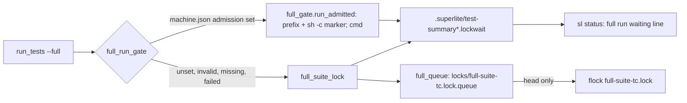
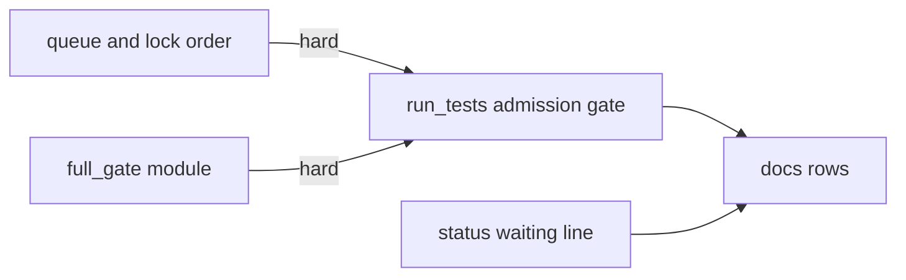

# Superlite: local full runs queue in arrival order and can take admission from a machine gate (B153)

**Goal:** fix #655: the local full-suite lock serves waiters first come first served, a machine can name an admission command that replaces the lock, and `sl run_tests` and `sl status` show what a full run waits for.
**Architecture:** a new `full_queue` module keeps a FIFO of waiters next to each toolchain lock (guard flock, liveness check); `run_tests.full_suite_lock` takes the flock only at the queue head. A new `full_gate` module reads `machine.json` `"admission"` and runs a command through it with a start marker, so run_tests knows when the gate admitted it. `run_tests.full_run_gate` picks admission or the lock per full run, with one-warning fallback. `sl status` reads the waiting notes.
**Tech stack:** Python 3.10+ stdlib, pytest through `sl run_tests`.
**Spec:** this file, section Design; issue #655 and main's tell (B153).
**Detail:** contracts
**Target-min:** 14
**Wave0:** none
**Coverage:** off (one filed issue plus main's tell are the spec; every open choice is a Ruling line below)
**Max chars:** 24000

Global constraints:
- Existing tests stay green. An existing test file changes only when the task Owns it; another one turning red goes into DONE_WITH_CONCERNS with its id and reason.
- Every new or changed code line in `skills/subagent-driven-development/scripts/*.py` carries the `# O(...)` complexity comment its neighbours carry; stdlib only.
- Run `sl` as an executable (`<abs>/sl ...`). Verify with `<abs>/sl run_tests --fast <own test files> --task Tn --background`, then the printed `wait:` line in the foreground; end the turn only after it reports. Never run `sl run_tests --full`.
- No version edits. Never run `scripts/evals.sh`, `claude plugin eval` or `scripts/test_layers.py run`.
- Tests never read or write the real `~/.superlite` (its `machine.json` included): `tests/scripts/conftest.py` sets `SUPERLITE_HOME` per test; a subprocess gets an env carrying that `SUPERLITE_HOME`. Every process a test starts is killed in a `finally`.
- Public repository: code, tests, comments and docs name no specific gate tool, host or project. The admission command in tests is a stub shell script in `tmp_path`; docs write it as `<gate>`.

Ruling: main's tell (orchestrator, not Max): the code lives in run_tests.py and new helper modules plus sl status; no open batch owns them, so B153 also edits `run_tests.py`, `status.py`, new `full_queue.py`, `full_gate.py` and new tests (named in notes.md).
Ruling: the queue entry is `{id, pid, root, task, time, seen}` with a random id per wait; an entry drops when its pid is gone (`os.kill(pid, 0)`) or its `seen` is over 600 s old (because a reused pid must not hold the head forever; cost if wrong: a run suspended 10+ min re-queues at the end).
Ruling: the flock stays the mutual exclusion and the queue only orders waiters of this version (an older superlite can still take a free lock first, during the transition only).
Ruling: admission wraps each command run_tests would run under the lock (setup, each destination, the pytest command) as `<prefix> /bin/sh -c ': > MARKER<newline>CMD'`; the marker file says the gate started it (because a gate has no protocol beyond exec; cost if wrong: a gate that runs the command elsewhere never writes the marker and the run falls back to the lock).
Ruling: `--lock-wait` bounds the admission wait too; `--limit` counts from admission; summary seconds leave the admission wait out.
Ruling: a run whose `SUPERLITE_FULL_SUITE_LOCK` names an ancestor process takes neither the lock nor admission (nested run under an admitted one).
Ruling: `sl status` shows the waiting full runs of its own run folder only (notes with a live pid).
Ruling: accept predicted 17.3 min - T1 and T3 share run_tests.py and the docs describe both, so T1, T3, T5 run in order - one lane idles a few minutes.
LAYERS: unit

## Design

### 1. Arrival order

`full_queue` keeps `<lock>.queue` (JSON list) under an flock on `<lock>.guard`, as `ship_lock` does for the ship lock (#588). A waiter joins once, refreshes `seen` while it waits (written at most every 30 s unless the queue changed), and tries the flock only while it is first; it leaves the queue when it holds the lock, gives up or fails. Dead entries (pid gone, or unseen 600 s) are dropped on every join. The wait line keeps today's text and ends `, in arrival order: queue place N of M`; with the lock free and another waiter first, the parenthesis reads `(next in line: pid Q in ROOT (task T))`. Every waiting run (foreground too) writes `
.lockwait` = `{"lock", "holder", "pid", "since", "place", "queued"}`, rewritten when place or queued changes, removed when the wait ends.

### 2. Admission command

`~/.superlite/machine.json` `{"admission": ["<gate>", "run", "--"]}`: a non-empty list of strings, an argv prefix. When set, a full run (label `full`, lock enabled, not nested) prints `run_tests: full run through the admission command <name> (machine.json "admission"); no full-suite lock`, takes no lock, exports `SUPERLITE_FULL_SUITE_LOCK=<pid>` to its test processes, and runs each command through `full_gate.run_admitted`. Until the marker shows (after 1 s) it prints once `run_tests: waiting for the admission command <name> to start the full run (machine.json "admission"); the machine's gate decides when it runs` and writes the note `{"admission": name, "pid", "since"}`; once it shows, `run_tests: admission command <name> started the full run after N s`. Fallback, one warning per run, then the lock for the rest of the run: key not a list of strings; command not found; the gate exits or cannot start before the marker shows. `--lock-wait S` passing before admission kills the gate: exit 2, red summary `admission: <name> did not start the full run after S s (run_tests --lock-wait S; 0 = no limit)`, no incident.

### 3. Visibility

`sl run_tests` prints each wait line once (above). `--wait` on a background run still waiting prints `run_tests: 
 is waiting for the admission command <name> (since HH:MM:SS)` for an admission note, the lock text otherwise. `sl status` adds one line per waiting full run of the run folder after `last test run:`: `full run waiting: N min for the python full-suite lock, queue place P of Q (held by pid H in ROOT)` or `full run waiting: N min for the admission command <name>`.

### 4. Docs

`docs/tools.md` names the queue, the `admission` key, the fallback, the wait lines and the status line.

## File structure

- `skills/subagent-driven-development/scripts/full_queue.py`: new, waiter queue per lock (T1)
- `skills/subagent-driven-development/scripts/full_gate.py`: new, machine.json admission and admitted runs (T2)
- `skills/subagent-driven-development/scripts/run_tests.py`: queue in the lock (T1), `full_run_gate` and call sites (T3)
- `skills/subagent-driven-development/scripts/status.py`: waiting line (T4)
- `docs/tools.md`: run_tests and status rows (T5)

## Task graph

```mermaid
%% schedule
gantt
  title Predicted schedule (mm:ss)
  dateFormat X
  axisFormat %M:%S
  section lane 1
  T1 queue and lock order :t1, 0, 259s
  T3 run_tests admission gate :t3, 259, 211s
  T5 docs rows :t5, 470, 179s
  section lane 2
  T2 full_gate module :t2, 0, 214s
  section lane 3
  T4 status waiting line :t4, 0, 185s
```

critical path: T1 → T3 → T5 (10.8 min) · peak width 3 · predicted build 10.8 min · predicted total ≈ 17.3 min (target ✗ 14.0)

## Package: run_tests

App type: concurrency / CLI. Categories: state (races, dead waiters), protocol (argv, exit codes), file (queue, notes). **Probe entry:** none (the cases are named tests).

### T1 queue and lock order · Complexity 5 · Est. context 55k
**Owns:** skills/subagent-driven-development/scripts/full_queue.py, skills/subagent-driven-development/scripts/run_tests.py, tests/scripts/test_full_queue_655.py, tests/scripts/test_full_lock_queue_655.py
**Components:** 2
**LOC owned:** 260
**Tests:** fast
**Model:** sonnet
**Est. time:** 4 min
**Covers:** 1
**Consumes:** none
**Produces:** full_queue.join(lock: Path, entry: dict, alive=pid_alive, now: float | None = None) -> dict · full_queue.leave(lock: Path, entry_id: str) -> None · full_queue.pid_alive(pid: int) -> bool
e.g. join(L, {"id": "a", "pid": 11, "root": "/r", "task": None, "time": 1.0, "seen": 1.0}, alive=lambda p: True, now=1.0) -> {"place": 1, "queued": 1, "first": {"id": "a", ...}}
e.g. then join(L, {"id": "b", "pid": 12, ...}, alive=lambda p: True, now=2.0) -> {"place": 2, "queued": 2, "first": {"id": "a", ...}}
e.g. then join(L, {"id": "b", "pid": 12, ...}, alive=lambda p: p != 11, now=3.0) -> {"place": 1, "queued": 1, "first": {"id": "b", ...}}
**Review Focus:** `test_join_orders_by_arrival`: a, b, c joined at now 1, 2, 3 get places 1, 2, 3; after `leave(L, "a")` b's join returns place 1 of 2; `test_dead_waiter_dropped`: a queue file whose first entry has a pid `alive` rejects gives a new join place 1 and the file no longer lists it; `test_unseen_waiter_dropped`: an entry with `seen` = now - 601 drops; `test_broken_queue_reads_empty`: queue file text `not json` gives place 1; `test_leave_unknown_id_noop`; `test_three_waiters_served_in_arrival_order`: a child process holds the python lock flock (holder record = its pid); waiter processes w1, w2, w3 (each `full_suite_lock(a, "full")`, then append its name to `order.txt`, sleep 0.3 s) start one at a time, each only after `<lock>.queue` lists the one before; killing the holder gives `order.txt` = `w1\nw2\nw3\n` within 30 s; `test_dead_waiter_does_not_hold_a_place`: a free lock and a queue whose first entry is a finished child's pid: `full_suite_lock` enters within 2 s with no `waiting for` line; `test_wait_line_names_queue_place`: held lock and one live entry already queued: stderr holds `python full runs on one machine run one at a time, in arrival order: queue place 2 of 2` once, `--lock-wait 1` raises `LockBusy`, and afterwards the queue lists only the other entry; `test_foreground_wait_writes_note`: a run with `a.run_id = None` writes `
.lockwait` with keys lock, holder, pid (the waiting process), since, place, queued while waiting and removes it after.
**Notes:** `join` and `leave` hold an flock on `<lock>.guard`; writes go through a temp file and `os.replace`. `pid_alive`: `os.kill(pid, 0)`, PermissionError counts alive. In `full_suite_lock`: the nested-holder check and the lock-file open stay first; then join with `{"id": uuid4 hex, "pid": os.getpid(), "root": cwd, "task": a.task, "time": now, "seen": now}`, try `flock(LOCK_NB)` only at place 1, leave in a `finally`. Wait line: print once, with the text in Design 1. Update the lock paragraph of the module docstring. The `.lockwait` reader of `--wait` keeps working on the new note (same `lock` and `holder` keys).
**Steps:** 1 failing tests, 2 run: FAIL, 3 implement, 4 run: PASS

### T2 full_gate module · Complexity 5 · Est. context 40k
**Owns:** skills/subagent-driven-development/scripts/full_gate.py, tests/scripts/test_full_gate_655.py
**Components:** 1
**LOC owned:** 240
**Tests:** fast
**Model:** sonnet
**Est. time:** 4 min
**Covers:** 2
**Consumes:** none
**Produces:** full_gate.admission_command(home: Path | None = None) -> tuple · full_gate.run_admitted(prefix: list, cmd: str | list, limit: float | None = None, wait_limit: float | None = None, env: dict | None = None, cwd: str | None = None, note: Path | None = None) -> subprocess.CompletedProcess · full_gate.NotAdmitted(Exception) · full_gate.AdmissionBusy(Exception)
e.g. admission_command(H) with H/machine.json `{"admission": ["/bin/sh", "-c", "exec \"$@\"", "gate"]}` -> (["/bin/sh", "-c", "exec \"$@\"", "gate"], None)
e.g. admission_command(H) with no machine.json -> (None, None)
e.g. admission_command(H) with `{"admission": "gate"}` -> (None, 'machine.json "admission" must be a non-empty list of strings; running under the full-suite lock')
e.g. run_admitted([STUB, "run", "--"], "echo a && exit 7") -> CompletedProcess(returncode=7, stdout="a\n", waited=0.0)
**Review Focus:** stub gate `tmp_path/gate` (`printf '%s\n' "$@" > "$GATE_ARGS"; sleep "${GATE_SLEEP:-0}"; [ -n "$GATE_FAIL" ] && { echo "gate: refused" >&2; exit "$GATE_FAIL"; }; while [ "$1" != "--" ]; do shift; done; shift; exec "$@"`), env passed through `env=`. `test_admission_unset`; `test_admission_valid`; `test_admission_not_a_list` and `test_admission_empty_list`: the warning above; `test_admission_missing`: `["/no/such/gate", "run"]` -> (None, 'admission command /no/such/gate not found (machine.json "admission"); running under the full-suite lock'); `test_admission_bare_name_on_path`: `["sh"]` -> (["sh"], None); `test_run_records_args_and_runs_command`: prefix `[gate, "run", "--class", "other", "--"]`, cmd `["/bin/echo", "hi"]`: rc 0, stdout `hi\n`, the args file starts `run`, `--class`, `other`, `--`, `/bin/sh`, `-c`; `test_shell_string_exit_code`: the e.g. above; `test_env_and_cwd_reach_command`: cmd `pwd; echo $FOO`, env FOO=bar, cwd tmp_path -> both in stdout; `test_wait_line_and_note`: GATE_SLEEP=2, note `tmp_path/x.lockwait`: during the wait the note holds `{"admission": "gate", "pid": <this pid>, "since": float}`; after return it is gone, stderr holds `waiting for the admission command gate to start the full run` exactly once and `admission command gate started the full run after`, and `r.waited` >= 1.5; `test_no_wait_line_when_quick`: GATE_SLEEP=0 gives no `waiting for` and `r.waited` < 1; `test_not_admitted`: GATE_FAIL=3 raises NotAdmitted with `.returncode` 3 and `.reason` `exited 3 before the tests started: gate: refused`; `test_cannot_start`: a prefix naming a non-executable file raises NotAdmitted whose `.reason` starts `could not start:`; `test_wait_limit_kills_gate`: GATE_SLEEP=30, wait_limit=1 raises AdmissionBusy (`.seconds` 1, `.name` `gate`) within 5 s and the gate process is gone; `test_limit_counts_from_admission`: GATE_SLEEP=2, cmd `sleep 10`, limit=1 raises `subprocess.TimeoutExpired` after 2.5 to 8 s.
**Notes:** `admission_command` reads `(home or history.home()) / "machine.json"` (as `machine_load` does); a list entry is accepted when `shutil.which(argv[0])` finds it. `run_admitted`: marker in a `tempfile.mkdtemp()` folder (removed in `finally`); argv `[*prefix, "/bin/sh", "-c", ": > " + shlex.quote(marker) + "\n" + (cmd if str else shlex.join(cmd))]`; Popen with stdout and stderr in temp files and `start_new_session=True`; poll every 0.5 s; kill with `_pyrun.kill_tree`. Name = `os.path.basename(prefix[0])`. Wait and started lines and the note follow Design 2. The returned CompletedProcess has `stdout`, `stderr` (text) and an extra attribute `waited` (seconds before the marker showed). `NotAdmitted(returncode, reason, text)`, `AdmissionBusy(seconds, name)`.
**Steps:** 1 failing tests, 2 run: FAIL, 3 implement, 4 run: PASS

### T3 run_tests admission gate · Complexity 5 · Est. context 60k
**Owns:** skills/subagent-driven-development/scripts/run_tests.py, tests/scripts/test_run_tests_admission_655.py
**Components:** 1
**LOC owned:** 220
**Tests:** fast
**Model:** sonnet
**Est. time:** 4 min
**Covers:** 2, 3
**Consumes:** full_gate.admission_command(home: Path | None = None) -> tuple (T2) · full_gate.run_admitted(prefix: list, cmd: str | list, limit: float | None = None, wait_limit: float | None = None, env: dict | None = None, cwd: str | None = None, note: Path | None = None) -> subprocess.CompletedProcess (T2) · full_gate.NotAdmitted(Exception) (T2) · full_gate.AdmissionBusy(Exception) (T2)
**Produces:** run_tests.full_run_gate(a, label: str, toolchain: str = "python", enabled: bool = True) -> Gate
**Review Focus:** stub gate as in T2, written to `SUPERLITE_HOME/machine.json` `{"admission": [gate, "run", "--class", "other", "--"]}`. `test_gate_runs_through_admission`: `with full_run_gate(a, "full", "python", True) as g: r = g.run(["/bin/echo", "x"])` gives stdout `x\n`, the args file is written, stderr holds `full run through the admission command gate`, and no `full-suite-python.lock` holder record names this pid; `test_shell_full_run_through_admission`: a `--full` run of a test-cmd.json shell project (as in test_toolchain_lock_550) while a child holds the shell lock exits 0 with no `waiting for the shell full-suite lock`; `test_missing_admission_falls_back_to_lock`: `["/no/such/gate"]` plus a held python lock and `a.lock_wait = 1`: one `admission command /no/such/gate not found` line, then `LockBusy`; `test_failing_admission_falls_back_once`: GATE_FAIL=3: two `g.run` calls both return rc 0, stderr holds `admission command gate exited 3 before the tests started` exactly once and `running under the python full-suite lock`, and the args file was written once; `test_nested_run_skips_admission`: `SUPERLITE_FULL_SUITE_LOCK` = `str(os.getppid())`: the gate is not called and no lock is taken; `test_lock_false_skips_admission`: `enabled=False` prints the existing `no full-suite lock` line and never calls the gate; `test_admission_busy_is_red_exit_2`: `main(["--full", "--lock-wait", "1"])` in a shell project with GATE_SLEEP=30 exits 2 with summary error `admission: gate did not start the full run after 1 s (run_tests --lock-wait S; 0 = no limit)` and no incident; `test_wait_reports_admission_note`: a background summary with a `.lockwait` note `{"admission": "gate", "pid": <live pid>, "since": t}` makes `--wait --timeout 1` print `is waiting for the admission command gate (since `; `test_waited_left_out_of_seconds`: GATE_SLEEP=2 gives `g.waited` >= 1.5.
**Notes:** `Gate.run(cmd, limit=None, shell=False, env=None, cwd=None) -> CompletedProcess` raises `LimitHit` (from `subprocess.TimeoutExpired`); `Gate.waited` sums the admission waits. Replace `with full_suite_lock(...)` at both call sites by `with full_run_gate(...) as gate` and route the setup, destination and pytest `run_captured` calls through `gate.run` (`run_other` gets a `gate=None` parameter; None runs `run_captured`). Lines and red summary follow Design 2 and 3; the warning from `admission_command` prints as `run_tests: <warning>` and the lock follows. Catch `full_gate.AdmissionBusy` beside `LockBusy` in `main`. Update the module docstring.
**Steps:** 1 failing tests, 2 run: FAIL, 3 implement, 4 run: PASS

## Package: status and docs

App type: CLI. Categories: file, encoding. **Probe entry:** none (the cases are named tests).

### T4 status waiting line · Complexity 2 · Est. context 30k
**Owns:** skills/subagent-driven-development/scripts/status.py, tests/scripts/test_status_full_wait_655.py
**Components:** 1
**LOC owned:** 110
**Tests:** fast
**Kind:** mechanical
**Model:** haiku
**Est. time:** 2 min
**Covers:** 3
**Consumes:** none
**Produces:** status.waiting_lines(sd: Path, now: float | None = None, alive=None) -> list
e.g. waiting_lines(sd) with sd/test-summary.lockwait `{"lock": "/h/locks/full-suite-python.lock", "holder": {"pid": 77, "root": "/r"}, "pid": 4242, "since": 1000.0, "place": 2, "queued": 3}`, now=1720.0, alive=lambda p: True -> ["full run waiting: 12 min for the python full-suite lock, queue place 2 of 3 (held by pid 77 in /r)"]
e.g. waiting_lines(sd) with sd/test-summary-r1.lockwait `{"admission": "gate", "pid": 4242, "since": 1000.0}`, now=1190.0, alive=lambda p: True -> ["full run waiting: 3 min for the admission command gate"]
e.g. the same notes with alive=lambda p: False -> []
**Review Focus:** `test_lock_note_line` and `test_admission_note_line`: the two e.g. above; `test_dead_pid_skipped`: the third; `test_note_without_place_or_holder`: `{"lock": "/h/locks/full-suite-xcode.lock", "holder": {}, "pid": 1, "since": 0.0}`, now=60.0 -> `full run waiting: 1 min for the xcode full-suite lock`; `test_unreadable_note_skipped`: text `{` -> []; `test_note_without_pid_skipped`: `{"lock": "/x/full-suite-python.lock", "holder": {"pid": 2}}` -> []; `test_overview_adds_line`: `overview(sd, None)` lists the line right after the `last test run:` line.
**Notes:** read `sd.glob("test-summary*.lockwait")` sorted by name; minutes = `int((now - since) // 60)`, at least 0; toolchain = the lock path's stem after `full-suite-`, else `python`; `alive` default `os.kill(pid, 0)` (PermissionError counts alive, OSError not). Add the line to the module docstring list.
**Steps:** 1 failing tests, 2 run: FAIL, 3 implement, 4 run: PASS

### T5 docs rows · Complexity 1 · Est. context 35k
**Owns:** docs/tools.md, tests/scripts/test_docs_655_full_run_queue.py
**Components:** 1
**LOC owned:** 40
**Tests:** fast
**Model:** sonnet
**Est. time:** 2 min
**Covers:** 4
**Consumes:** none
**Produces:** none
**Review Focus:** `test_run_tests_row_names_queue_and_admission`: the `| \`run_tests\` |` row holds `in arrival order: queue place N of M`, `{"admission": ["<gate>", "run", "--"]}`, `run_tests: full run through the admission command <name> (machine.json "admission"); no full-suite lock`, `run_tests: waiting for the admission command <name> to start the full run`, `admission: <name> did not start the full run after S s` and `running under the full-suite lock`; `test_status_row_names_waiting_line`: the `| \`status\` |` row holds `full run waiting: N min for the <toolchain> full-suite lock, queue place P of Q` and `full run waiting: N min for the admission command <name>`.
**Notes:** insert in the run_tests row right after `before its last line;` (the `--wait` lock sentence) this text: ` waiting full runs take the lock in arrival order (\`<lock>.queue\`; a waiter whose process is gone or unseen for 10 min drops out) and the wait line ends \`, in arrival order: queue place N of M\`; a machine can name an admission command in \`~/.superlite/machine.json\` as \`{"admission": ["<gate>", "run", "--"]}\` (any argv prefix; superlite names no tool): a full run then runs each command through it (\`<prefix> /bin/sh -c ...\`), takes no full-suite lock and prints \`run_tests: full run through the admission command <name> (machine.json "admission"); no full-suite lock\`, and while the gate holds it back \`run_tests: waiting for the admission command <name> to start the full run ...\`; \`--lock-wait S\` bounds that wait too (exit 2, red summary \`admission: <name> did not start the full run after S s ...\`) and \`--limit\` counts from admission; a key that is not a list of strings, a command not found, or a gate that exits before the tests start falls back to the lock with one warning ending \`running under the full-suite lock\`; a run nested under an admitted one skips both;`. In the status row, after `last test run` insert `, one \`full run waiting: N min for the <toolchain> full-suite lock, queue place P of Q (held by pid H in ROOT)\` or \`full run waiting: N min for the admission command <name>\` line per waiting full run of the run folder`. Keep every span tests/scripts/test_docs_*.py pins.
**Steps:** 1 failing tests, 2 run: FAIL, 3 implement, 4 run: PASS

## Review Focus

run_tests package: concurrency (queue races between join and flock, a waiter killed mid-wait, two notes at once), protocol (argv prefix and `--`, exit codes 0, 2, rc pass-through), file (broken queue, symlinked queue is read as empty, note cleanup). Status: file (broken notes). Cases are named in each task.

## Self-review

Coverage: Design 1 T1, 2 T2 T3, 3 T3 T4, 4 T5. Edges: T1 and T3 share run_tests.py (hard), T3's tests run T2's code (hard), docs wait for code. No placeholders; every Consumes matches a Produces.
